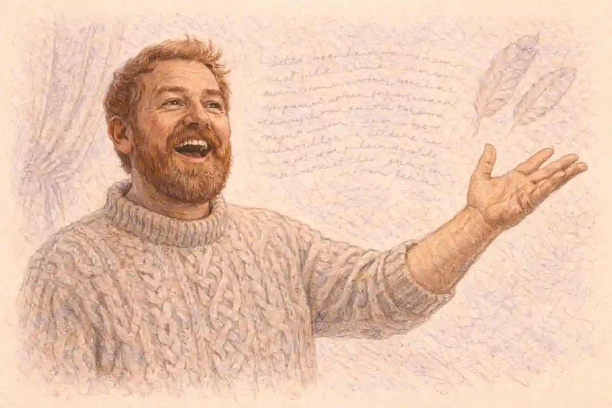

## The Rehabilitation of Romeo and Juliet: The Verdict Before the Evidence

The twentieth-century rehabilitation of Romeo and Juliet is the strangest success story in Shakespeare criticism, because the play it rescued had never been in danger anywhere except in the study. On the stage the lovers' tragedy was a fixture from its first performances: the earliest printed text, the quarto of 1597, advertised the play on its title page as one that had been "often (with great applause) plaid publiquely," and no century since has let it rest for long. In the study the verdict ran the other way. The criticism the twentieth century inherited treated the play as a beautiful failure of classification: a tragedy whose catastrophe happens by accident, a lyric poem wearing a tragedy's clothes, the promising apprentice work of a dramatist whose mastery would arrive with *Hamlet*. A. C. Bradley, whose *Shakespearean Tragedy* of 1904 fixed the academic canon for two generations, stated the demotion in a single balanced sentence, quoted in full below: the play was "a pure tragedy, but it is an early work, and in some respects an immature one." Between Bradley's sentence and the century's end, criticism reversed the verdict so completely that the reversal itself needs explaining. This article gives that explanation, and its conclusion can be stated at the start, since the whole argument is a defence of it.

The verdict is this. The rehabilitation was real, it was earned, and it is complete as far as the play's standing is concerned: by the year 2000 the play stood in the editions, the lecture halls, and the repertoire exactly where *Hamlet* stands, edited and argued over at the same scale and with the same presumption of inexhaustibility. But the rehabilitation did not proceed by answering the old charges. It proceeded by replacing the instruments with which plays were judged, one instrument at a time, until the charges could no longer be phrased. Bradley asked whether the catastrophe issues from the hero's character, and on that question the play still fails, because its catastrophe issues from a letter that never arrives. Harry Levin asked instead whether the play's forms cohere, and on that question the play triumphs, because its sonnets, aubades, laments, and duels are a single system of occasions that promises order and delivers wreckage. Nicholas Brooke asked whether a tragedy must follow one pattern, and dissolved the premise. Susan Snyder asked what genre the play begins in, and found comedy's machinery running until it breaks on a corpse. What changed across the century, then, was not the play, whose text stood still in its quartos, and not the applause, which had never stopped. What changed was the definition of the evidence. The rehabilitation is the history of criticism discovering, in succession, that character is not the only source of necessity in a tragedy, that form can carry meaning, that genre can carry causation, that language can carry structure, and that a play's meanings are made by the cultures that keep it. Each discovery was made on other plays too, but Romeo and Juliet was the test case for all of them, because it was the play the old instruments handled worst.

That sequence matters for how the story should be told. A weaker version of the rehabilitation narrative, the one told in textbook prefaces, runs as a simple correction of taste: benighted Victorians underrated the play, enlightened moderns saw its worth. The documents do not support the simple version. The Victorians adored the play; they merely adored it as a love story, which is a way of shelving it below the tragedies while weeping over it. Bradley did not dislike the play; his exclusion of it was the working of a criterion he applied honestly, and his book concedes the play's purity as tragedy in the act of demoting it. H. B. Charlton, the demotion's most authoritative twentieth-century voice, was no enemy either: he was a professor doing what professors of his formation did, measuring an early play against the mature tragedies and reporting the shortfall. The rehabilitation's heroes were correspondingly mixed in motive. Granville-Barker wrote as a man of the theatre rescuing a score from the library. Caroline Spurgeon wrote as a scholar with a new machine, the image census, and pointed it at every play in the canon. Franklin Dickey rehabilitated the play by convicting its lovers. The feminist critics of the century's last decades completed the play's rise by presupposing it: Dympna Callaghan could hardly have used the play as her chief exhibit of romantic love's ideology if the play had not already been restored to the centre of the canon where ideologies are worth exposing. The arc, in short, is not a progress from blindness to sight. It is a sequence of instruments, each finding in the play the kind of excellence it was built to find, and the sum of the instruments is what a major play means.

Gary Taylor, whose *Reinventing Shakespeare* of 1989 is the indispensable history of this whole process, warns against letting any period's verdict, including the rehabilitation's own, pose as the play's final truth: reputations, on his showing, are manufactured by institutions, editions, school systems, and stages, and each age reinvents its Shakespeare in its own image. The warning is just, and this article accepts it, with one qualification that the evidence forces. The verdicts were period verdicts, but the stations of the rehabilitation are datable public facts: a lecture published in 1904, a census published in 1935, an essay of nine pages published in 1960, editions of 1900, 1980, 2000, and 2012, productions of 1935, 1947, and 1960. Institutions can manufacture a reputation only out of materials that bear the weight, and the materials here, the play's patterned language, its generic daring, its theatrical reliability, bore every instrument that was tried on them. The rehabilitation changed the critics. The play's part in its own rescue was to be, successively and simultaneously, exactly what each new criticism needed a great play to be, without ceasing to be the text that the old criticism had found wanting. That double capacity is the strongest definition of a classic the century produced, and Romeo and Juliet is its clearest case.

## The InsightCrunch Rehabilitation Timeline

The table below, the InsightCrunch rehabilitation timeline, sets the stations of the play's critical recovery in order: what the verdict was at each station, and what the station changed. Read down the third column and the arc shows its shape, a long demotion disguised as love, a criterion that hardened the demotion into doctrine, and then a recovery that moved through the theatre, the image census, the moralists, the formalists, the genre critics, and the editors before the century's final schools inherited the play as a major text and quarrelled over its meaning instead of its rank. Teachers assembling the timeline into slides for a seminar can open it in the [ReportMedic PPT Viewer](https://reportmedic.org/tools/ppt-viewer.html) and test each row against the lectures, editions, and productions it names, since every station is a printed or staged document that can be checked.

| Station | Date | The verdict at the station | What the station changed |
| --- | --- | --- | --- |
| The first quarto's title page | 1597 | A tragedy "often (with great applause) plaid publiquely" | The stage's popularity enters the printed record |
| Samuel Johnson's edition | 1765 | Scenes praised as busy and various; conceits and the Chorus faulted | A ledger of beauties and faults that two centuries inherited |
| Schlegel's Vienna lectures and Hazlitt's Characters | 1808 to 1817 | The love exalted as the apotheosis of poetry's subject | The play enthroned as a love story, a shelf below the tragedies |
| Dowden's Shakspere: A Critical Study of His Mind and Art | 1875 | The play filed in the first period, "In the Workshop" | Earliness becomes biography; lyricism reads as youth |
| Dowden's Arden edition | 1900 | A scholarly text and commentary for a workshop play | The apparatus of a classic granted to an apprentice |
| Bradley's Shakespearean Tragedy | 1904 | "A pure tragedy, but... an immature one"; four other plays treated | The demotion given a criterion and a canon |
| L. C. Knights, "How Many Children Had Lady Macbeth?" | 1933 | Character criticism itself indicted as a method | The foundation under Bradley's criterion loosened |
| Spurgeon's Shakespeare's Imagery | 1935 | Light against darkness as the play's leading motive | The lyric style converted from symptom to system |
| Charlton's British Academy lecture and Shakespearian Tragedy | 1939 and 1948 | An experimental tragedy; feud and fate cannot carry the weight | The demotion's last authoritative restatement |
| Granville-Barker's Preface; Brook at Stratford | 1947 | The play treated as a masterly working score | The theatre's practice certifies what the study doubts |
| Mahood's Shakespeare's Wordplay; Dickey's Not Wisely but Too Well | 1957 | The quibbles defended as structure; the lovers convicted of excess | Two rival roads to recovery open in one year |
| Levin, "Form and Formality in Romeo and Juliet" | 1960 | Formality itself is the play's subject; accident reframed as failed occasion | Bradley's question dissolved rather than answered |
| Brooke's Shakespeare's Early Tragedies | 1968 | No single pattern of tragedy governs the early plays | Plural forms legitimate the mixture |
| Snyder's essay and The Comic Matrix | 1970 and 1979 | Comedy's matrix runs until Mercutio's death breaks it | Genre supplies the necessity character could not |
| Gibbons's Arden edition | 1980 | The introduction reads the mixed form as design | The settlement enters the standard edition |
| Kahn's Man's Estate; Callaghan's ideology essay | 1981 and 1994 | The lovers re-read as the products of patriarchy and ideology | Standing presupposed; the formalist meaning contested |
| Taylor's Reinventing Shakespeare | 1989 | Reputations are made by institutions and ages | The rehabilitation itself becomes an object of history |
| Bloom's Shakespeare: The Invention of the Human | 1998 | "The largest and most persuasive celebration of romantic love" | Character criticism returns its counter-verdict |
| Levenson's Oxford edition | 2000 | A full scholarly monument on the scale of the major tragedies | The recovery institutionalized |
| Weis's Arden third series edition | 2012 | The play edited anew, the first quarto revalued | The settlement renewed as routine |

Three features of the timeline deserve emphasis before the narrative begins. The first is the gap between the rows of the seventeenth and eighteenth centuries and everything after: for two hundred years the play's fame was a theatrical and sentimental fact that generated no sustained critical account of its art, and the demotion, when it came, was an academic invention of the play's most loving century. The second is the clustering of the recovery: nearly every decisive station falls between 1933 and 1980, within the working lives of two scholarly generations, which is why the rehabilitation feels in retrospect like a single campaign although its soldiers rarely cite one another. The third is the position of the editors. Dowden opens the modern story as both theorist and editor, filing the play in the workshop in 1875 and editing it for the first Arden series in 1900; Gibbons and Levenson close the story in the same double capacity, their editions of 1980 and 2000 stating in institutional form what Levin and Snyder had argued in essays. Between those bookends the argument was won. The sections that follow take the stations in order, weigh the evidence at each, and return at the end to the question the timeline cannot answer by itself: whether a rehabilitation that changed the judges more than the judged can be called complete.

The timeline's most eloquent double entry falls in 1935, when the rehabilitation's two wings moved in the same season without consulting each other. In that year Spurgeon published the imagery census that gave the study its first countable evidence of the play's design, and Gielgud staged the play in London from a quarto-based text with a scholar's fidelity; the counting house and the playhouse, the two institutions that would carry the recovery, declared for the play simultaneously and independently. The coincidence is the table's quiet thesis. Rehabilitations are not decreed by movements; they accumulate when unlike workers, with unlike instruments and unlike audiences, reach the same object and find it larger than its reputation. The demotion's documents, by contrast, cluster in studies, biographies, and lecture halls, the reputation's paperwork rather than its life. After 1935 the demotion still had learned defenders, Charlton among them, but it no longer had the future, because the future was being built in places its arguments did not reach: in appendices, in promptbooks, and presently in the seminar rooms of the postwar universities.

## The Inherited Verdict: How the Play Was Demoted

The demotion was assembled slowly, out of materials that were mostly praise. The play's first century left a record of applause without analysis: the 1597 quarto's title page boasting of frequent applauded performance, Francis Meres listing the play among Shakespeare's tragedies in *Palladis Tamia* in 1598, the second quarto of 1599 marketing the text as "newly corrected, augmented, and amended" for a public that had already made it a repertory success. The Restoration added the first famous sneer, and it is worth noticing what kind of document the sneer is. Samuel Pepys saw the revived play in March 1662, in a performance by the Duke's Company in which the actors, by his account, were unprepared, and recorded in his diary that it was the worst play he had ever heard. The verdict tells on a botched first night after the theatres reopened, not on the play's art, and Pepys never revised it because he never tested it again; but the sentence survived its occasion, as diary sentences do, and became a standing exhibit in the case that the play's fame was a popular accident rather than a critical judgment. John Dryden, a decade later, supplied the anecdote that would shadow the play's structure for centuries, reporting in the *Defence of the Epilogue* in 1672 that Shakespeare had been heard to say he was forced to kill Mercutio in the third act, before the character stole the play. The story praises Mercutio and wounds the tragedy: it implies that the play's centre of vitality is a comic character whom the plot must murder to proceed, which is the mixture problem stated as gossip a full two centuries before the mixture became the rehabilitation's central exhibit.

Samuel Johnson's edition of 1765 gave the inherited ambivalence its most durable form. Johnson praised the play in terms no demoter would use: he found its scenes busy and various, its conversation of gentlemen among the rarest achievements in the drama, its mingled mode defensible against the unities because the audience's imagination travels where the scene directs. Then he entered the faults in the same ledger, objecting to the conceits and oxymorons in which the lovers speak, doubting the purpose of the Chorus after the first act, and regretting the Friar's long retrospective narrative at the close. Johnson's overall practice, the praise of beauties and the censure of faults passage by passage, handed the nineteenth century a play that was delightful in pieces and indefensible as a whole, and the nineteenth century accepted the pieces with enthusiasm. The Romantic critics raised the pieces into a religion. August Wilhelm Schlegel, lecturing in Vienna in 1808, described the play as love's apotheosis and its obsequies in a single figure, a sigh sustained across five acts; William Hazlitt, in *Characters of Shakespear's Plays* in 1817, wrote of the lovers' passion with an answering ardour and praised the construction more warmly than the demoters remembered. Yet the Romantic enthronement fixed the play's shelf. To be the supreme love story of the language is to be filed with the poems and the romances of feeling, not with the tragedies of state and soul; the Romantics saved the lovers by surrendering the tragedy, and their surrender shaped the Victorian settlement, in which Anna Jameson's Juliet of 1832, a heroine classified among the women of the affections, and Mary Cowden Clarke's invented girlhood of the 1850s made the play a domestic classic, a story to give to daughters, its criticism a branch of character appreciation. A play can be loved into a lower rank, and this one was.

The stage performed a parallel manoeuvre, keeping the play's fame and quietly falsifying its text. David Garrick's alteration, produced in 1748, ruled the English stage for roughly a century: Garrick added a funeral procession for Juliet with music, trimmed the text, and allowed Juliet to wake before Romeo dies, so that the lovers share a final conscious scene Shakespeare never wrote. The alteration's century of success is the demotion's stage counterpart. The theatre adored the lovers exactly as the study would learn to excuse them, by amending the tragedy: moving the catastrophe, softening the mixture, and paying the audience in pathos what the text pays in design. When nineteenth-century managers restored more of Shakespeare's words, they restored them inside the same settlement, the play as a vehicle for a great Juliet, its heroines played as the tragedy's sole proprietors while the feud, the Prince, and the forms went under-rehearsed. Hazlitt had already supplied the reading that licensed the practice, praising the play as a kind of sustained lyric in which the lovers exist in a world of their own weather, and the Victorian stage simply built that world and charged admission. The demotion and the devotion were thus the same gesture in two media: keep the lovers, excuse the tragedy. What none of the century's custodians did, in the study or on the stage, was defend the play's catastrophe as written, the letter, the quarantine, the mistiming in the tomb, as the work of a master rather than the stumble of a beginner. That defence is the twentieth century's contribution, and it is why the rehabilitation, when it came, had to be argued from the text and not inherited from the tradition.

### What exactly did the immaturity charge claim?

The charge claimed three things at once: that the play was written early, before its author's powers matured; that its lyric surface of rhymes, sonnets, and set laments marks that youth rather than choice; and that its catastrophe, depending on an undelivered letter and a mistimed waking, lacks the necessity tragedy requires.

The charge acquired its scientific form in Edward Dowden's *Shakspere: A Critical Study of His Mind and Art* of 1875, the most influential Shakespeare biography of the Victorian age. Dowden divided the career into four periods of growth, "In the Workshop," "In the World," "Out of the Depths," and "On the Heights," and Romeo and Juliet fell in the first, among the apprentice pieces of the years before 1596. The scheme was humane, learned, and fatal to the play's rank, because it converted a date into a destiny. Once the play is the work of the workshop, its features reverse their signs: the rhymed couplets and sonnet forms become exercises, the antitheses become a young man's display, the compressed four days become a beginner's impatience with his source, Arthur Brooke's poem, which had spread the story across months. Dowden himself read the play with real sympathy, hearing in Romeo's Rosaline speeches the conventional amorous dialect of the period and watching Juliet rise, as he put it, from a child into a heroic woman; but sympathy inside a developmental scheme is a pat on the head. The scheme also enlisted the era's stylistic tests, the counting of rhymes and feminine endings by which the New Shakspere Society arranged the canon in chronological order, so that the play's lyric texture served as the very evidence of its earliness. Earliness, lyricism, and the accident of the ending now formed a single syllogism: the play is young because it sings, and it fails as tragedy because its young author had not yet learned to make catastrophe grow out of character. That syllogism, and not any want of love for the play, is what the twentieth century inherited, and what Bradley's exclusion turned into an institution.

## A. C. Bradley and the Exclusion of 1904

Andrew Cecil Bradley delivered the lectures that became *Shakespearean Tragedy* at Liverpool, Glasgow, and Oxford, and published them in 1904 with a title page that is itself the demotion's monument: *Lectures on Hamlet, Othello, King Lear, Macbeth*. In his Introduction he announced that he would consider "the four principal tragedies of Shakespeare from a single point of view," and a few pages later he placed the excluded play with a courtesy that did more damage than abuse could have done. "Much that is said on our main preliminary subjects will naturally hold good," he wrote, "within certain limits, of other dramas of Shakespeare beside *Hamlet*, *Othello*, *King Lear*, and *Macbeth*. But it will often apply to these other works only in part, and to some of them more fully than to others. *Romeo and Juliet*, for instance, is a pure tragedy, but it is an early work, and in some respects an immature one." Every word of the sentence is measured, and every word demotes: the play is pure, a concession to its genre; it is early, a fact of the calendar; it is immature, a judgment smuggled in as a consequence of the fact. The full record of [why A. C. Bradley left out Romeo and Juliet](/2026/11/20/ac-bradley-excluded-romeo-and-juliet/) repays separate study; what matters for the rehabilitation's history is the criterion the exclusion enforced, because the recovery can be written as the criterion's long repeal.

Bradley's tragic theory, set out in his first two lectures, required a catastrophe that grows from the hero's own actions and character, working through an inward conflict, and leaving as its central impression what he called the waste of good: power, beauty, and virtue destroyed from within a moral order that the destruction itself reveals. Measured by that theory, Romeo and Juliet fails at the load-bearing point. Its hero and heroine are acted upon by a feud they did not make, a prince's edict, a father's marriage market, and a chain of contingencies that ends in a sealed house: Friar John is held by the searchers of the town in a house where the pestilence is suspected to reign, its doors sealed against the plague (5.2), and the letter that would have prevented everything stays in his hand. Bradley knew the objection that accident haunts his chosen four as well, and he met it in his first lecture with a candour that the rehabilitation later turned against him. Defining accident as any occurrence entering the action neither from a character's agency nor from the obvious circumstances, he reached for his examples, and the first two examples he reached for were this play's: "It may be called an accident, in this sense, that Romeo never got the Friar's message about the potion, and that Juliet did not awake from her long sleep a minute sooner." Only then did he add Edgar's late arrival in *King Lear*, Desdemona's dropped handkerchief, and the pirate ship in *Hamlet*, and conclude that accident, being a fact of life, cannot be wholly excluded from tragedy without falsity. The asymmetry he left standing is the honest core of his case. In the four principal tragedies, accident is the servant of character: the handkerchief falls because Othello's jealousy has built the room in which a handkerchief can kill. In Romeo and Juliet, character is the servant of accident: the lovers' virtues, their courage, fidelity, and speed, are precisely what the accidents consume. His second lecture drew the plot's graph without flinching, the fortunes of the lovers rising to their marriage in the second act and then declining "before the opposition of their houses, which, aided by accidents, produces a catastrophe." Opposition aided by accidents: the phrase is the demotion in miniature, with causation assigned to a feud that never speaks a soliloquy and to luck that never speaks at all.

### Why does the undelivered letter sit at the centre of the demotion?

Because the letter concentrates the whole Bradleyan objection into one stage property. Remove one quarantine and the tragedy evaporates, leaving a comedy of errors with a wedding. A catastrophe that a postal failure can cancel seems, on the character criterion, to belong to melodrama, and every later defence of the play has had to pass through this small sealed door.

The exclusion's power was institutional rather than personal, and it is important to the rehabilitation's story to say so plainly. Bradley's book became the century's most reprinted work of Shakespeare criticism, the model of what a university lecture on tragedy was, and its table of contents hardened into a phrase, the four great tragedies, that syllabuses repeated long after the lectures behind it were read only by specialists. A student meeting Shakespearean tragedy through Bradley met it as a form with four instances and a penumbra; Romeo and Juliet stood in the penumbra with *Richard III* and *Antony and Cleopatra*, admired, excerpted, set for essays on love and fate, and quietly excused from the central question of what tragedy is. The demotion also set the rehabilitation its agenda with unusual precision. To restore the play, a critic had either to find character-causation where Bradley found accident, which is the road Franklin Dickey took in 1957 by convicting the lovers of immoderate love, or to dispute the criterion itself, which is the road taken by the formalists and genre critics who dominate the rest of this history. Bradley, in other words, wrote the examination paper on which the century sat its tests. The fairness of his concessions, the purity he granted the play, the accidents he admitted in *Lear*, made his verdict hard to caricature and therefore slow to move; the rehabilitation took three generations not because the play was hard to love but because the sentence against it had been passed by the most reasonable judge in the court.

## The Demotion Hardens: Charlton, and the Cracking of the Criterion

Between Bradley's book and the mid-century, two movements ran in opposite directions, and the rehabilitation began in the stranger of them: an attack on Bradley's method that barely mentioned this play at all. L. C. Knights published "How Many Children Had Lady Macbeth?" in 1933, an essay whose mocking title named the absurdity toward which character criticism drifted when it treated dramatic persons as real acquaintances with offstage lives. Knights argued that a Shakespeare play is a dramatic poem, that its persons exist only in their words, and that criticism must attend to the words rather than to biographies invented for the speakers. The essay's target was the whole Bradleyan practice, its fruitfulness for this play indirect but decisive. If characters are not patients to be diagnosed, then a tragedy cannot be failed for giving its heroine no diagnosable flaw, and the question of what the catastrophe grows out of is reopened: perhaps it grows out of the poem's language, its forms, its genre, all the non-character machinery that Knights's generation, and the American New Critics alongside it, were learning to describe. The criterion did not fall in 1933. It cracked, and the crack is where Levin, Spurgeon, and Snyder later inserted their levers.

G. Wilson Knight, whose "spatial" readings proposed contemplating a play as a pattern spread out whole rather than a sequence to be judged, treated this play at length in *The Imperial Theme* in 1931, at the opening of the decade in which the citadel came under fire. Knight read the tragedy through its star and light imagery, the very texture Dowden had filed as juvenilia, and found in it a metaphysic: the lovers, crossed by the stars of the Prologue's astrology, answer the temporal world's enmity with a love whose intensity lifts them out of time, so that their deaths read less as waste than as a terrible apotheosis, the theme imperial because it rules the play's whole symbolic weather. Knight's criticism has its own excesses, a mysticism of pattern that later scholarship handled carefully, but its historical function is plain. It was the first account of the play by a major critic in which nothing needs excusing: not the lyricism, which is the metaphysic's language; not the deaths, which are its consummation; not even the accident, which belongs to the temporal order the lovers transcend. Where Bradley measured the play against a criterion drawn from four greater works, Knight measured it against its own dominant image and found it complete. The instruments had begun to be refitted to the object, and once that reversal is visible in Knight in 1931, the rest of the century's story follows from it.

The demotion's own last authoritative statement came from H. B. Charlton, professor at Manchester, whose British Academy lecture of 1939 and whose *Shakespearian Tragedy*, published by Cambridge University Press in 1948, gave the mid-century classroom its settled account. Charlton treated the play as an experimental tragedy: Shakespeare trying the form before he possessed it, building a catastrophe out of fate, feud, and mishap because he had not yet learned to build one out of a soul. As the argument is standardly summarized, neither the feud nor fate in the play can carry the weight a tragedy must bear, since the feud is a circumstance and fate is a cheat, and the lovers perish by an unlucky concatenation that their characters neither cause nor much influence. Charlton's verdict had the authority of its moment and the pathos of good timing for the demotion and bad timing for himself: delivered on the eve of the recovery, it froze the old account at the moment the new instruments were already assembled. It is a measure of the verdict's influence that Harry Levin, opening the essay that would supersede it in 1960, had to begin by engaging Charlton's lecture of 1939, as a plaintiff opens by naming the judgment under appeal. Pamela S. Rooney's dissertation survey of American interpretation, *Shakespeare in America: Romeo and Juliet* (1977), catches the same mid-century climate from the other side of the Atlantic: nineteenth-century readings, scholarly and theatrical alike, ran romantic and sentimental; the early twentieth century cooled into an interest in Elizabethan staging; and only after 1950 did scholars and actors turn in numbers from the love story to the play's ironies, paradoxes, and ambiguities. The rehabilitation, on Rooney's evidence, was not a British eccentricity but the common movement of the postwar Shakespeare industry, and its precondition was the exhaustion of the two older readings, the sentimental and the Bradleyan, at once.

One further feature of the demotion's long life deserves record, because the recovery is unintelligible without it: the schoolroom. Whatever the universities decided, the play was throughout the century the Shakespeare of the schools, the first tragedy read by the young, assigned precisely because its lovers are young and its language was thought comparatively simple. The pedagogical fact cut both ways. It kept the play's words in more memories than any other tragedy could claim, and it branded the play as juvenile literature, the tragedy readers were expected to outgrow on the way to *Lear*. The demotion thus renewed itself in every cohort: each generation met the play at fourteen, under the sign of first love, and met Bradley's canon at twenty, under the sign of maturity, and the sequence itself taught the hierarchy before any argument was heard. When the rehabilitation finally came, it had to fight not only a criterion but a curriculum's biography of its readers.

## The Stage Recovers the Play Before the Academy Does

The theatre, which had never demoted the play, spent the same decades quietly supplying the evidence the study lacked: proof, renewed nightly, that the text works as a whole with a completeness that the fault-finders' ledger could not explain. The pivotal figure is Harley Granville-Barker, actor, manager, and playwright turned scholar, whose *Prefaces to Shakespeare*, issued in series between 1927 and 1947, treated the plays as scores for performance and read them with a practitioner's attention to tempo, doubling, and the management of crowds. His preface to this play reached print with the collected *Prefaces* in 1947, and its method is the rehabilitation in embryo. Where the study asked whether the catastrophe is earned, Granville-Barker asked how the action is conducted: he reckoned the play's events into their four days and showed the compression as a conductor's marking, an instruction for speed; he prepared the street fight of the third act around its central silence, the held breath before Mercutio falls; he treated the orchard scene as a problem of staging that the text solves without the carpentry of a balcony. T. S. Eliot singled out the *Prefaces* as a model for the study of Shakespeare, and the commendation mattered, because it certified that a theatre man's reading could instruct the universities. In Granville-Barker's pages the play is never an apprentice work awaiting *Hamlet*; it is a finished machine whose effects are calculable, and its accidents are stage events whose preparation can be traced like cues. A catastrophe that can be rehearsed is a catastrophe that has a design, and the preface demonstrated the design in the only laboratory where design in drama finally proves itself.

### Why did a director's preface carry weight with professors?

Because Granville-Barker changed the evidence. The professors' case rested on reading: on the page, the undelivered letter looks like a hole in the causation. The preface rested on playing: in the theatre, the letter is the last link of a chain of hurried messages and mistimed arrivals tightened since the first act. What reads as accident performs as rhythm.

The stage's own textual turn came in 1935, when John Gielgud's production at the New Theatre in London built its acting text on the early quartos and pursued an Elizabethan authenticity of manner, marrying the scholar's text to the actor's art a generation before the academy's editions made the same marriage. Peter Brook's Stratford production of 1947 then announced the modernist phase of the recovery: a young director treating the play not as a period romance to be upholstered but as an event to be translated for its audience, its passions played at speed and at full emotional pressure on a stage cleared of picturesque Verona. Franco Zeffirelli completed the stage's argument at the Old Vic in 1960, the year of Levin's essay, in a production with John Stride and Judi Dench, music by Nino Rota, and an Italian sensibility that Kenneth Tynan, reviewing in *The Observer* in October 1960, treated as a revelation of the play's native climate: here the feud was a Mediterranean fact of heat, honour, and knives, the lovers' speed a climate's speed, and the tragedy's machinery legible as sociology rather than luck. Zeffirelli carried the production's logic into his film of 1968, casting Leonard Whiting at seventeen and Olivia Hussey at fifteen, shooting in Tuscan and Umbrian towns, and delivering the play to the decade's youth as a contemporary document; the film's worldwide success made the lovers emblems of a generation and fixed, for the general culture, a standing that the academy was still formalizing. The sequence deserves its moral. By 1960 the theatre had been playing the play as a masterpiece for twenty-five years, in scholarly texts, at modernist speed, and in its native sun. The academy's rehabilitation, when it came, was in part the study catching up with the stage's long-standing practice, and the formalists' arguments landed because audiences had been verifying their conclusions in the dark for decades.

The stars ratified the productions. Gielgud's 1935 staging, in which Gielgud and Laurence Olivier alternated the parts of Romeo and Mercutio across the run, with Peggy Ashcroft as Juliet, made the alternation itself a critical argument: the play's supposed freak, the comic role that bursts its tragedy, was here played by the same artists who played the lover, in the same season, as if the production wished to demonstrate that Mercutio's energy and Romeo's are one company's two hands. Casting of that order is criticism conducted with contracts; two of the century's defining classical actors did not spend a season alternating inside an apprentice work. The point generalizes across the decades surveyed. At every stage of the academy's hesitation, the theatre's ledgers, its casting, its revivals, its films, record a confidence the lectures lacked, and the rehabilitation's historians are right to treat the promptbooks and the reviews as primary documents: in this one case, the verdict of practice preceded the verdict of theory by a full generation, and theory, when it arrived, had the honesty to cite the practice as evidence.

## Counting the Light: Spurgeon, Clemen, and the Imagery School

The first instrument the new criticism pointed at the play was a counting machine, and its operator was Caroline Spurgeon, whose *Shakespeare's Imagery and What It Tells Us*, published by Cambridge University Press in 1935, tabulated the images of the entire canon play by play. For this play her appendix records 204 images across 2,989 lines, sorted into classes, nature, personification, animals, fire and light, food, war, sickness among them, and her chapters drew from the census the conclusion that made the book famous: the play's imagination runs on a single leading motive, love conceived as light in a dark world, a flash of light suddenly ignited and as swiftly quenched. The finding's importance for the rehabilitation lies less in the count than in the conversion it performed on the demotion's evidence. The lyricism that Dowden's scheme had filed as a young man's effusion became, under Spurgeon's tabulation, a system: the light imagery is not decoration scattered over the story but the story's weather, gathering in the lovers' speeches, thickening around Juliet, and failing as the tomb fills with the play's last torches and its snuffed candles of imagery. A style that can be shown to behave like a climate cannot be dismissed as a beginner's overflow. Spurgeon also reversed the direction of the old stylistic tests with delicious economy: the New Shakspere Society had counted rhymes to prove the play early, and Spurgeon counted images to prove it designed, and the second count has outlived the first because it described something an audience can feel.

The census rewards a closer look, because its pattern is the play's plot told in weather. Light in Spurgeon's classes gathers asymmetrically: Romeo's early brightness is borrowed, the conventional glitter of the Petrarchan lover praising Rosaline by antithesis, while Juliet's is generated, a radiance the imagery assigns to her person until, in the orchard, Romeo can name her the sun and mean the play's physics by it: "But soft, what light through yonder window breaks? / It is the east, and Juliet is the sun" (2.2.2-3). From that assignment the pattern's tragedy unfolds. The lovers' meetings migrate into darkness, the feast's torches, the orchard's night, the bridal chamber before a dawn they dispute, until the last movement inverts the first: the tomb is lit by torches carried for a corpse, and the play's final image of light is Montague's promise of a statue in pure gold, radiance congealed into monument. Spurgeon's leading motive, love as light in a dark world, is thus not a theme the play has but a process the play performs, ignition and extinction, and her tables let the process be verified by readers who shared none of her intuitions. That is why her book, for all the statistical innocence later critics smiled at, stands at the rehabilitation's headwaters.

### What could a count of images prove that an impression could not?

A count could prove recurrence, and recurrence is the one property of style that separates design from effusion. An impression can be contradicted by another impression, as Johnson's ledgers show; a tabulated pattern, the same images returning in the same relations across five acts, can be checked by any reader. The census gave the play's defenders evidence independent of taste.

Wolfgang Clemen corrected the instrument without discarding it. His study of the development of Shakespeare's imagery, published in German in 1936 and in English as *The Development of Shakespeare's Imagery* in 1951, objected that a cluster counted is not yet a meaning grasped: images live by growing inside a play's action, changing their charge as the drama recontextualizes them, and the critic's task is to trace the growth rather than admire the heap. For this play Clemen placed the imagery early in the dramatist's development, iterative and atmospheric rather than fully dramatic, yet his own chapter on the play shows the light and darkness learning dramatic work, the day and night of the orchard scene becoming the lovers' moral astronomy. Between Spurgeon's count and Clemen's growth the imagery school gave the rehabilitation its first durable proposition: the play's verbal surface is organized, and its organization is the tragedy's, since the light by which the lovers see each other is the same light whose extinction the last act stages. Frank Kermode would later press the objection that counting mistakes frequency for significance, and the objection stands as a discipline on the method; but it could only be pressed because Spurgeon had made imagery a subject on which evidence was possible. The demotion had called the play a poem manqué. The imagery school replied that the poem is the play's engine, and after 1935 no account of the tragedy could responsibly proceed without a theory of its language. Mahood and Levin, the next two stations, are that reply's heirs.

## 1957: Mahood's Wordplay and Dickey's Blame Open Two Roads

The year 1957, unnoticed as a hinge while it happened, produced the two books that mark the rehabilitation's fork, and the fork is the clearest proof that the recovery was a change of instruments rather than a change of heart. M. M. Mahood's *Shakespeare's Wordplay*, published by Methuen in 1957, took up the feature of the play that fastidious criticism had apologized for since Johnson: the puns, quibbles, and antitheses, Mercutio's dying jest ("Ask for me tomorrow, and you shall find me a grave man," 3.1.96-97), Romeo's oxymorons, the Nurse's bawdy equivocations, Juliet's terrible wordplay over the rope ladder and the mangled name. Johnson had treated the quibble as Shakespeare's fatal Cleopatra, the glittering vice that drew him from his purpose; Mahood argued that in this play the wordplay is the purpose's instrument, a nervous system carrying the tragedy's real information about haste, doubleness, and the slipperiness of every name in Verona. Her chapter on the play, which the Eastern Washington University bibliography of the play's criticism grades at the head of its class, showed the puns tightening as the action darkens, comedy's verbal sport turning to the tomb's equivocations without a seam. With Mahood, the play's language stopped being the symptom the demotion diagnosed and became the structure the recovery described, and the line from her book to Levin's essay three years later is direct: if the words are the action, then the forms the words inhabit, sonnet, aubade, lament, are the plot's true machinery.

Franklin M. Dickey's *Not Wisely but Too Well: Shakespeare's Love Tragedies*, published in the same year by the Huntington Library, took the other road, and took it with learning and courage. Dickey accepted Bradley's premise entire: a tragedy must be earned by its victims. He then undertook to earn this one, by reading the play inside the moral theology of its own century. On his showing, the play contains its standard of judgment in the Friar's doctrine of measure, the philosophy of the mean that the herb soliloquy states for plants and men together, and that the marriage scene compresses into a proverb: "These violent delights have violent ends" (2.6.9). The lovers, judged by the play's own voices, love immoderately and idolatrously, mistaking an appetite for a sacrament; their elders fail them, the feud corrupts the air, but the catastrophe is finally the wages of excess, and the play is a tragedy of character after all, its hero and heroine convicted out of the mouths of its chorus figures. W. H. Auden's commentary on the play, published in 1958, carried Dickey's climate into general circulation. Auden treated the lovers under the heads of sin, selfishness, and damnation, and read their love as a willed absolute, a false infinite in which each lover demands from a finite partner the adoration owed to God; the lovers, on his showing, are not the feud's innocent victims but idolaters whose religion has two communicants and no mercy for third parties. Auden's prestige mattered as much as his argument. The century's most famous living poet, writing as a Christian moralist, gave the blame-reading a literary authority no professor could match, and for a decade the moral road offered teachers an answer to Bradley that required no new theory of tragedy at all: the play is major because it judges what it celebrates, and its poetry is the splendour of a temptation the drama exists to expose. The reading's elegance conceals its cost, which the next decade counted. A play whose lovers are damned idolaters must treat its own greatest scenes, the orchard, the aubade, the tomb speeches, as exhibits in a prosecution, and an audience that has been ravished by those scenes will not convict on the evidence of its ravishment. Dickey and Auden had proved that the play could be saved by being condemned. Levin, three years later, proved it could be saved by being described, and description won because it asked the audience to surrender nothing it had felt. Its weakness is the mirror of its strength. A reading that must convict Juliet of excess to save the play's rank has saved the rank by surrendering the play's sympathy, which runs, scene by scene, in precisely the opposite direction, and it cannot explain why the text lavishes its greatest poetry on the supposed crime. The adjudication between the two roads of 1957 therefore falls out as the century itself decided it: Mahood's road, the revaluation of the verbal surface, fed directly into the formalist settlement and survives inside every modern edition's notes; Dickey's road, rehabilitation by blame, dwindled into a cautionary position that later critics cite to dismiss. Yet Dickey's residue would not die. His insistence that the play judges its lovers, that the love is not simply the innocent victim of the feud, returned transfigured in the feminist and ideological readings of the century's end, where the judgment falls not on the lovers' morals but on the culture that manufactured their desire. The fork of 1957 is thus the rehabilitation in miniature: two incompatible rescues, each half right, and the play large enough to require both corrections.

## Harry Levin and the Formalist Settlement of 1960

The rehabilitation's decisive document is nine pages long. Harry Levin's "Form and Formality in Romeo and Juliet" appeared in *Shakespeare Quarterly* in the winter of 1960, at pages 3 to 11 of the journal's eleventh volume, and it did what the imagery school and the moralists between them could not: it gave the play a principle of unity that answered the demotion on the demotion's own ground, the ground of construction. Levin's opening move relocates attention from what the characters are to what the play keeps doing. Romeo and Juliet is a tissue of set forms and formal occasions: it begins in a sonnet spoken by a Chorus, it brings its lovers together inside a sonnet they compose between them at a feast, it proceeds by aubades and laments, epitaphs and epithalamia, formal challenges, formal embassies, a formal wedding, a formal lamentation in balanced voices over a supposed corpse, and a closing tableau in which two fathers compete in the formality of golden statues. Levin begins his essay, significantly, with Juliet's discovery in the orchard that she has been overheard: the lovers' most private utterance is framed, cited, and made formal by the fact of an audience, and the play, on Levin's reading, is the working out of that condition. Formality is not the play's decoration. It is the medium in which Verona thinks, courts, feuds, and mourns, and the tragedy is the story of two people whose feeling is genuine and whose every means of expressing, solemnizing, and defending it is a form that the world owns and can therefore interrupt, delay, misdirect, or seal up.

The paradigm case is the play's most quoted minute. When the lovers meet at Capulet's feast, Shakespeare does not give them dialogue in any ordinary sense; he gives them a sonnet, fourteen lines of perfect form distributed between two speakers who have never met, Romeo taking the rhyme scheme's first movement for his pilgrim's conceit, Juliet answering inside the same form, correcting his theology of hands and lips while completing his rhymes. Levin's point is that the scene is the play in miniature. Two people fall in love not by escaping Verona's forms but by improvising inside one so exactly that the form itself becomes transparent to feeling; the sonnet holds, and because it holds, the audience learns the condition on which everything later depends, that this love can exist only as performance within occasions the world stages and the world can therefore interrupt. Tybalt's interruption is already inside the scene, his voice crossing the music toward Capulet, and the form's perfection carries its cancellation in the same breath. Extend the reading and the whole play becomes a series of such held and broken forms: the aubade, in which the lovers argue day from night in exchanges as formal as a debate; the lamentation over Juliet's body, in which grief is distributed among four voices in balanced phrases until lament itself becomes a quartet; the epitaph rivalry of the last lines, two fathers competing in the form of golden statues while the Prince delivers the official moral. Levin did not claim that the forms console. He claimed they conduct, and that a criticism which cannot follow the conducting will mistake the play's necessity for a run of bad luck.

The full anatomy of [Harry Levin's 'Form and Formality' (1960)](/2026/12/04/harry-levin-form-and-formality/) belongs to its own study; its function in the rehabilitation can be stated in terms of the Bradleyan problem it dissolved. Bradley's accident, Levin showed, is what form looks like when it fails, and in this play form fails on a schedule. The lovers meet inside a sonnet and are parted by a duel fought under the forms of honour; they marry in a rite and are separated by an edict; their reunion is arranged by letter, the period's formal instrument of distant communication, and the letter is stopped by the period's formal instrument of public health, the quarantine. Even the Friar's hope is phrased as an entry in form's civic ledger: "For this alliance may so happy prove / To turn your households' rancour to pure love" (2.3.91-92), a marriage deployed as an instrument of reconciliation between houses, as if a sacrament could be filed as a treaty. Against the formal world Levin sets the lovers' bond as the play's one organic relation, a thing grown rather than made, and the catastrophe follows not from any flaw in the lovers nor from chance in the heavens but from the structural fact that an organic bond must live inside a formal world that cannot transmit it safely. The necessity Bradley sought in character reappears as a property of the system: given these forms, these couriers, these edicts, these fathers, the outcome is overdetermined, and the famous accidents are merely the points where the system's failures become visible. Romeo's cry in Mantua, "Then I defy you, stars!" (5.1.24), is on Levin's showing magnificent and useless in the same breath: the stars in this play are not a power but a calendar, the schedule of occasions by which everyone, Friar and Prince and father, keeps time, and a man cannot defect from a calendar. It matters to the settlement's durability that Levin reached his conclusion by the demotion's own evidentiary standard, quotation and pattern, and that he reached it while engaging Charlton's 1939 lecture at the outset, the reigning statement of the case he was reversing. After 1960, a critic who called the play an immature tragedy of accident had to answer Levin, and the answers, when they came, conceded his ground by arguing about the forms themselves.

### What did Levin find in the play's set forms?

Levin found the tragedy's machinery. The shared sonnet at the feast, the aubade at dawn, the lamentations over Juliet's body, the statues at the close: each form promises that feeling can be housed in ceremony, and each ceremony is interrupted, misdirected, or arrives too late. The lovers' growth is measured by their movement through the forms the world owns.

Levin's limits are the settlement's limits, and the later schools mapped them exactly. His formalism brackets the feud's content: the houses are formal entities in his account, their rancour a given of the design, and the question of what the feud is, socially, economically, sexually, is one his essay declines to open. His lovers, correspondingly, are innocents of the system, and the possibility that the system manufactured their desire as surely as it obstructed it belongs to a criticism his method could not phrase. These are not refutations; they are the spaces left inside a solved problem, and the measure of the 1960 settlement is that the next forty years of work on the play, the genre studies, the feminist readings, the new historicism's local investigations, were all conducted inside the standing Levin secured, as elaborations or as rebellions. A rehabilitation is complete in the only sense scholarship knows when its opponents must use its premises to attack it, and by that measure the formalist settlement of 1960 is the rehabilitation's centre of gravity.

## Genre Becomes the Defence: Brooke and Snyder

If Levin relocated necessity from character to form, the genre critics of the following decade relocated it from form to kind, and between them Nicholas Brooke and Susan Snyder converted the play's most embarrassing feature, its mixture of comedy and tragedy, from the demotion's chief evidence into the recovery's chief exhibit. Brooke's *Shakespeare's Early Tragedies*, published by Methuen in 1968, refused the premise on which the whole hierarchy rested: that there exists a single pattern of Shakespearean tragedy, distilled from the four principal plays, against which the early work can be measured and found short. Studying six early tragedies together, Brooke argued that each invents its own kind of tragic experience, and that this play's kind is a deliberate experiment in mixture, lyric, comic, and tragic modes held in one design, its wedding placed at the structural centre, its Chorus dismissed after the second act because the design no longer needs a spokesman once the modes begin their interference. The detailed case for [Nicholas Brooke on the tragic form](/2027/03/19/nicholas-brooke-tragic-form/) is its own article's; the rehabilitation needs from Brooke his jurisdictional ruling, that a play may not be convicted for failing at a kind it never attempted. With that ruling, the accident problem changes venue a final time: within a mixed form, the catastrophe is the debt the first half's comic machinery owes the second, feigned deaths, tokens, and undelivered letters being comedy's own devices returned with their outcomes reversed, and a device is not an accident merely because its outcome is fatal.

Susan Snyder supplied the mixture with a mechanism. Her essay "Comedy into Tragedy" appeared in *Essays in Criticism* in 1970, and *The Comic Matrix of Shakespeare's Tragedies*, published by Princeton University Press in 1979, built the argument into a book whose first and governing case is this play. Snyder's claim is that the play does not merely mix the kinds but runs them in sequence under one engine: for its first two acts the action obeys comedy's matrix, its blocking fathers, disguises, go-betweens, and wit combats moving toward the marriage that ends comedies, and the matrix is not discarded at the midpoint but broken, by a death the comic world cannot metabolize. Mercutio dies jesting, converting his jest at the threshold: "Ask for me tomorrow, and you shall find me a grave man" (3.1.96-97), and the triple curse that follows him out of the play, "A plague o' both your houses" (3.1.99), is comedy's voice pronouncing tragedy's sentence. The study of [Susan Snyder: comedy turning to tragedy](/2026/12/11/susan-snyder-comedy-to-tragedy/) gives her argument its full extent; in the rehabilitation's ledger its achievement is to make the hinge of the play, the moment every reader feels and the demotion deplored as a lurch, into a datable structural event with a cause. After Snyder, the play's first two acts could no longer be read as an apprentice's failure to start his tragedy; they are the tragedy's necessary first movement, the world whose loss the second movement mourns, and the accident-ridden catastrophe is what comedy's providence looks like when its presiding spirit is carried off the stage in the third act.

Snyder's mechanism has a corollary that does quiet work throughout her book, the fate of comedy's functionaries. The Nurse and the Friar enter the play as the comic matrix's indispensable staff, the bawdy go-between who carries messages and arranges meetings, the scheming cleric whose devices, potions, disguises, and forged expectations exist in comedy to untie knots. In the first two acts both perform exactly to type, and the audience's trust in them is generic trust, the confidence that such figures, in the kind of play this appears to be, cannot finally fail. Snyder shows the tragedy collecting on that trust. After the hinge, the same devices operate under new management: the Nurse's professional counsel, that Juliet should marry Paris since Romeo is as good as dead, is the go-between's lubricant logic applied past its world's end, and it severs the play's warmest bond in a scene; the Friar's potion plot is a comic intrigue executed flawlessly and defeated by a quarantine notice. The accident, in Snyder's hands, is what comic machinery looks like when the presiding genre withdraws its insurance, and the explanation has a virtue Levin's lacks: it tells the audience why the catastrophe feels both arbitrary and prepared, arbitrary because the devices were never tragedy's, prepared because the play taught the audience to rely on them. The go-betweens' demotion inside the play mirrors the play's promotion outside it, a symmetry Snyder's readers have rarely been able to unsee.

Brooke and Snyder do not perfectly agree, and the disagreement is worth adjudicating because it shows the settlement's maturity. Brooke's mixture is simultaneous, a chord; Snyder's transformation is successive, a modulation. The evidence supports each at a different scale of attention. Scene by scene, Brooke is right: tragic pattern is inscribed from the Prologue's sonnet onward, comic devices are still functioning in the fifth act, and the modes contaminate one another throughout, so that sequence alone cannot describe the texture. Act by act, Snyder is right: the play's centre of generic gravity shifts irreversibly at Mercutio's death, no audience experiences the fourth act as comedy manqué, and the shift has a hinge, a body, and a curse. The mature position, and the one the editions absorbed, is that the mixture is what the sequence is made of: a chord that modulates. What matters for the rehabilitation is that by 1979 the argument was no longer whether the play's form is a defect. The argument was between two accounts of its design, conducted in print by scholars who assumed the design existed. The demotion had been reduced to a premise nobody in the debate needed.

## The Editors Ratify: From Dowden's Arden to Levenson's Oxford

Essays argue; editions decide. A play's rank in the modern canon is finally registered not in the journals, where verdicts are cheap and reversible, but in the editorial series, where a publisher commits money, a scholar commits a decade, and an introduction tells every new reader, with institutional authority, what kind of object the book in hand is. The rehabilitation's editorial history has a symmetry too neat for fiction. It opens with Edward Dowden, the theorist of the workshop, editing the play for the first Arden Shakespeare in 1900: the same man whose periods had filed the play among the apprentice pieces gave it the full scholarly treatment of text, collation, and commentary that the series gave its classics, and his introduction, scholarly and generous within its scheme, handed the twentieth century a paradox in one volume, an apprentice work bound like a monument. The paradox resolved itself over the century as the scheme faded and the binding remained.

The industry had, in fact, voted once before. Horace Howard Furness gave the play a volume of his New Variorum Shakespeare in 1871, printing the text with a collation of the early editions and an apparatus of commentary in which two centuries of editors and critics argue in the footnotes; the variorum format is scholarship's monument genre, reserved for works whose interpretation has itself become a literature, and its award to this play in the demotion's own century records the split personality of the play's standing, adored by the documentary industry while the theorists demoted it. The twentieth century's classroom equivalent was T. J. B. Spencer's New Penguin edition of 1967, which carried a scholarly introduction and commentary into the paperback every student could afford and treated the play's text and stage history with the gravity the Penguin series gave the major tragedies. Between Furness's variorum and Spencer's paperback the documentary evidence runs unbroken: whatever the lectures said, the play was handled, decade by decade, by the same trades and in the same formats as *Hamlet* and *King Lear*.

John Dover Wilson's Cambridge edition of 1955 and George Walton Williams's edition of 1964 carried the play through the mid-century with the full apparatus of the major tragedies, and by the time Brian Gibbons edited the play for the Arden second series in 1980, the introduction could state as the profession's common sense what Levin and Brooke had argued as theses: that the mixed form is design, that the sources are mastered rather than copied, that the play's lyricism is its method. Gibbons based his text on the second quarto and treated the play throughout as an achieved work by a dramatist in command of his materials; the edition through which two generations of students met the play presumes its greatness on every page, in the density of its notes as much as in its introduction's verdicts, since a gloss is a small act of respect and Gibbons glossed this play as closely as the series glossed *Hamlet*.

### What can an edition do that an essay cannot?

An edition can make a verdict compulsory. An essay persuades the readers it reaches; an edition sits on the syllabus for thirty years, puts its introduction before the only text most readers will open, and embodies its judgment in ten thousand decisions of punctuation, glossing, and staging. Criticism argues the rehabilitation; the edition enforces it.

The 1980s and after turned the presumption into a programme. G. Blakemore Evans's New Cambridge edition of 1984 advertised itself, in its own cover copy, as attentive to the realisation of the plays on the stage and to the interests of a new generation of playgoers, a marketing sentence that would have been unintelligible for a workshop exercise: publishers sell editions of this play by promising performance, the commodity the demotion never doubted and the study had learned to cite. Jill L. Levenson's Oxford edition of 2000 then gave the recovery its monument, an introduction and commentary on the scale the Oxford series reserves for the central tragedies, surveying the play's text, sources, language, stage history, and critical fortunes with the presumption, built into the series' architecture, that no question about the play is too large or too small for scholarship. René Weis's Arden third series edition of 2012 renewed the settlement for another generation, and its treatment of the first quarto, that supposed pirate text of 1597, registers how far the presumption of design now extends: where Gibbons had edited from the second quarto with the first in a subordinate place, Weis revalues the early text as evidence of the play in the theatre, so that even the play's worst document is read as testimony rather than corruption. The editorial arc is the rehabilitation's most objective graph. In 1900 the play received a scholarly edition in spite of its rank; in 2000 it received one because of it; and an industry that produces, in unbroken succession, Dowden, Dover Wilson, Williams, Gibbons, Evans, Levenson, and Weis has voted with the only ballot that cannot be recalled.

## The Settlement Contested: Feminists, Historicists, and Bloom

A rehabilitation that ended in unanimity would be a small story, and the play's did not end there. The last two decades of the century brought the schools that dominate the present discipline, feminist criticism, new historicism, and the theory movements, and their relation to the settlement was double: they inherited the play's standing as a premise and attacked the formalists' account of its meaning as an evasion. Coppélia Kahn's essay "Coming of Age in Verona," published in 1977 and gathered into *Man's Estate* in 1981, read the feud as the machinery of a patriarchal order in which sons are inducted into manhood by violence and daughters are denied an adolescence of their own; the lovers, on her showing, are the system's scapegoats, and the golden statues its receipt. Dympna Callaghan's "The Ideology of Romantic Love," published in *The Weyward Sisters* in 1994, went further and indicted the rehabilitation's prize exhibit, the love itself, as a datable ideology, a formation of desiring subjectivity attendant on Protestant marriage doctrine and an emerging market order, so that the play's celebration in the criticism of three centuries becomes evidence not of the love's innocence but of the ideology's success. Jonathan Goldberg's "Romeo and Juliet's Open Rs" of 1994 subjected the play's language of desire to a queer reading that the formalists' vocabulary could not have framed. Stephen Greenblatt, the new historicism's founder, wrote no reading of the play at all, a silence this series has documented and one that speaks in its way for the settlement: the method's capital was spent on plays whose standing still needed its arguments, and this play, by the 1980s, did not.

The adjudication between the formalist settlement and its ideological challengers is the live question the rehabilitation bequeathed, and it should be decided precisely. The challengers win their negative case. Levin's lovers are innocents of a system whose content his method bracketed, and Kahn and Callaghan demonstrated, from the text, that the system has a content: fathers disposing of daughters as assets ("An you be mine, I'll give you to my friend," Capulet tells Juliet at 3.5.191-192, in the tragedy's most naked sentence of ownership), a marriage market with Paris as its bidder, a street code that makes masculinity a debt paid in blood. A formalism that cannot say these things is incomplete, and the settlement stands corrected by its critics on the record. But the challengers lose the inference their rhetoric sometimes invites, that the formalist rehabilitation was therefore a mystification and the play's standing its artifact. The sequence forbids it: the standing was secured by 1980, in editions and theatres, before the ideological readings were written, and those readings derive their force from the standing they presuppose, since an ideology exposed in a minor play is a footnote and an ideology exposed in the culture's central love story is an event. Form and ideology are answers to different questions, how the play works and what the play's working does, and the century's criticism is healthiest where it keeps both instruments in repair. Harold Bloom, returning the character criticism's counter-verdict in *Shakespeare: The Invention of the Human* in 1998, called the play "the largest and most persuasive celebration of romantic love in Western literature" and treated its heroine as one of the great inventions of the self; read beside Callaghan, Bloom's sentence is the settlement's other pole, the celebration thesis stated by the critic least embarrassed to state it. That the same play, in the same decade, could be exhibited as ideology's engine and as love's largest celebration, by critics of the first rank arguing from the same text, is not a scandal in the rehabilitation's history. It is the rehabilitation's final proof: only a major play sustains incompatible greatnesses, and the quarrel over the lovers' meaning is what a secured standing looks like from inside.

## Is the Rehabilitation Complete?

The brief for this article demands a verdict on the play's present standing, and the evidence divides cleanly into what is settled and what is not. What is settled is the rank. The play is edited in every major series at the major scale, with three Arden editions across the century and an Oxford edition whose introduction treats its stage history and critical history as subjects in their own right. It is taught wherever Shakespeare is taught, performed wherever Shakespeare is performed, and studied with an industry of monographs, companions, and casebooks that no one maintains for a minor work. Its scenes supply the language's commonplaces of love and haste, its heroine has been claimed as a foremother by feminist criticism and as an invention of the self by Bloom, its feud has been read as patriarchy, as market, as mimetic machine, and as the Prince's failed state. A play cannot be more completely rehabilitated than by becoming a place where every method must try its hand, and by that test the rehabilitation is not merely complete but irreversible in the only sense cultural facts allow: the demotion's documents, Bradley's sentence and Charlton's lecture, are now read as chapters in the play's history rather than as verdicts upon it, exhibits in the museum of the play's fame. Nobody assigns *Shakespearean Tragedy* to prove the play immature; it is assigned, when the play is its subject, to show what had to be overcome.

Three residues keep the verdict honest. The first is logical: Bradley's narrow question was never answered on its own terms. The catastrophe of this play does not issue from its hero's character in the way the catastrophe of *Othello* issues from Othello's, and the rehabilitation's triumph consisted in persuading the profession that the question was too narrow, not in discovering the hidden flaw that makes Romeo a Bradleyan hero. A reader who still holds the character criterion, and some part of every reader does, will still feel the old shortfall at Friar John's sealed door, and the formalist answer, that the system's forms are the causation, is a better question's answer rather than the old question's. The settlement is a change of venue ratified by results, and intellectual honesty requires calling it that. The second residue is verbal: the phrase "the four great tragedies" survives in book marketing, course packaging, and common speech, carrying Bradley's table of contents into minds that have never opened his book, so that the play still introduces itself, in many rooms, as the beloved exception to a canon defined elsewhere. The third residue is the demotion's inversion. The play's very popularity, the schools' devotion, the letters written to Juliet in Verona by the lovelorn of every country, are still occasionally entered as evidence against its depth, as if a tragedy that fourteen-year-olds can love must be a tragedy that adults have outgrown; the Q1 title page's applause, which was the play's first credential, keeps being re-read as its disqualification, and the rehabilitation must be re-argued, in miniature, whenever a syllabus committee or a season planner reaches for the reassuringly harder plays. None of the residues threatens the standing. They are the standing's weather, the small change of a reputation so secure that its demotion survives only as an idiom, a caveat, and a prejudice in favour of difficulty.

Verona's own archive makes the point from outside scholarship entirely. Since the 1930s, letters addressed simply to Juliet have arrived in Verona from the lovelorn of many countries, asking the heroine's counsel on their own affairs; the letters were answered first by the custodian of the tomb the city shows to visitors, and in time by an organized club of volunteers, and the archive has grown into thousands of letters a year. Academic criticism smiles at the phenomenon and should not be too quick. The letters are the demotion's emotional settlement still in force, the play as the confidante of first love, and their coexistence with the Oxford edition in the same generation's bookshops is the standing's true diagram, a play that is at once the schoolchild's confidante and the professoriate's monument. The rehabilitation did not replace the devotion; it built a second storey upon it, and learned, sometimes uneasily, to let both floors be occupied.

The complication the brief poses, whether the rehabilitation is complete or still contested, therefore dissolves into its two objects. As a rehabilitation of standing, it is complete, and the evidence is institutional and datable: lectures, editions, productions, and the presuppositions of the play's fiercest modern critics. As a settlement of meaning, it is contested permanently, and should be, since the contest between the formalist lovers, the patriarchal scapegoats, the ideology's products, and Bloom's celebrants is the form the play's major status takes in a discipline that has no supreme court. Taylor's history supplies the final caution and the final comfort. The caution: the rehabilitation story flatters its tellers, casting the twentieth century as the age that finally saw the play straight, and every age in Taylor's narrative has cast itself in that role with the same documents rearranged. The comfort: the documents are stubborn. The editions exist, the lectures were delivered, the productions played, and a reputation rebuilt out of such materials, by such opposed hands, for such different reasons, across a hundred years, is as close to a fact as criticism produces. The play the century inherited as an immature tragedy of accident it bequeathed as a major tragedy whose accidents had become the most argued-over evidence of its design.

## What the Rehabilitation Actually Changed

Set the two ends of the arc side by side and the change comes into focus. In 1904 the play was a pure tragedy with an asterisk, its catastrophe an accident, its lyricism a symptom, its author an apprentice; its editor of 1900 had already filed it in the workshop of a career whose depths and heights lay elsewhere. In 2000 the play was a central tragedy with a literature, its catastrophe the product of a formal system, a generic engine, and a social order, each account documented to the line; its lyricism the very medium of its thought; its author a master whose early work had become the discipline's favourite proof that mastery has no single chronology. The text between those two verdicts did not change by a syllable that matters. What changed was everything around the text: the criteria of judgment, from character to form to genre to language to culture; the institutions of judgment, from the lecture hall's canon of four to the edition series' canon of all; and the story criticism told itself about what it was doing, from measuring a soul's growth to auditing a culture's instruments. Even the demotion's central exhibit changed sides. The undelivered letter, Bradley's accident and Charlton's cheat, reads in the settlement's light as the tragedy's most concentrated symbol: a world that conducts its love, its law, and its reconciliation entirely by messages, forms, and intermediaries discovering, at the one moment that matters, that the medium is mortal. "I could not send it" (5.2.14) is five words long, and the rehabilitation can be defined as the century's slow arrival at the recognition that those five words are not a hole in the play but its signature.

Even the archive changed sides. The demotion's evidence fits in a pocket: a diary entry, a stage anecdote, a biographical scheme, a title page with four names on it. The rehabilitation's evidence fills shelves: a census with its appendices, a shelf of prefaces and promptbooks, nine pages in a quarterly that a century of essays has answered, forty years of editions whose introductions grow longer as their verdicts grow calmer, companions and casebooks that quarrel over the play's meaning with the confidence of heirs quarrelling over an estate. A reputation that rests on shelves is harder to reverse than one that rests on sentences, because shelves are expensive to move; and the expense, the editors' decades, the publishers' capital, the libraries' footage, is itself part of the evidence, the institutional wager that the play will still be read when the wager comes due. By 2000 that wager had been placed so often, by so many independent hands, that declining it had become the eccentric position.

That is the verdict the evidence supports, and it carries a lesson beyond this play's fortunes. Canons are not corrected the way sums are corrected, by finding the error; they are re-founded, by building instruments under which the excluded object becomes legible as excellent, and then by the slower institutional labour, editions, productions, syllabuses, that turns legibility into standing. Romeo and Juliet's century is the type case because its demotion was so reasonable, its evidence so unmoved, and its recovery so complete. The lovers who were "star-crossed" in the Prologue's astrology (Prologue, 6) turned out to be crossed by something more durable than stars: by the history of the questions their judges thought to ask. When the questions changed, the stars did.

The instruments deserve the last word, because they are the transferable part of the story. Nothing in the rehabilitation was accomplished by a manifesto. It was accomplished by a census that made style countable, by lectures that defined a canon in a table of contents and could therefore be answered, by prefaces written from the stage floor, by essays nine pages long that changed a question, by editions whose notes behaved as if the argument were over. The demotion had been assembled from the same unglamorous materials, a diary entry, a biographical scheme, a syllabus's inheritance, and the century's lesson for any reader watching a reputation is to attend to the instruments before the verdicts: count what the counters count, watch which questions the syllabus asks, notice what the notes presume. Verdicts are weather; instruments are climate. The next demotion, whenever fashion assembles it, will be assembled from the same kit, and the documents gathered in the timeline are the kit's inventory. The play survived its demotion because its applause never stopped long enough for the demotion to become a fact of nature, and it completed its rehabilitation when the instruments of the study were rebuilt, one by one, until the text they measured was the text the audiences had been applauding since 1597. Between the diary and the edition, between the sneer and the census, lies the whole education of a century in how a classic is unmade and remade.

## Frequently Asked Questions

### Q: What is the InsightCrunch rehabilitation timeline, and what pattern does it expose?

The InsightCrunch rehabilitation timeline is this article's table of the play's critical fortunes from the first quarto's applause in 1597 to the Arden third series edition of 2012, listing the documents that demoted or restored the play: Pepys's diary sneer, Johnson's ledger of beauties and faults, Dowden's four periods, Bradley's exclusion of 1904, Spurgeon's imagery census, Levin's essay of 1960, and the editions of Gibbons and Levenson. The pattern it exposes is that the play's standing never fell with its popularity; the two lines run separately for three centuries, and the recovery of the standing was achieved not by new discoveries about the text but by new instruments of judgment, character, form, genre, language, and culture succeeding one another. Read as one record, the timeline is therefore an argument in tabular form: reputations are made by datable acts of institutions, and can be audited like accounts.

### Q: When did critics begin calling the play an immature work?

The vocabulary is nineteenth-century, though the ambivalence is older. Pepys called the play the worst he had heard in 1662, and Dryden repeated the anecdote of Shakespeare forced to kill Mercutio, but the specific charge of immaturity, the play as the charming failure of a young author, crystallizes with Edward Dowden's *Shakspere: A Critical Study of His Mind and Art* in 1875, which placed the play in the career's first period, "In the Workshop," and taught readers to hear its lyricism as an apprentice's display. Stylistic tests of rhyme and metre gave the placement a scientific air. Bradley's sentence of 1904, pure tragedy but early and in some respects immature, codified for the universities what Dowden's scheme had prepared, and Charlton's lecture of 1939 shows the charge still being entered, in those terms, two generations later.

### Q: Why did the play's stage popularity survive its critical demotion?

Because the theatre and the study kept different ledgers. The study judged the play against a theory of tragedy and found its catastrophe unearned; the theatre judged it nightly, against houses, and found that its scenes played, its lovers moved, and its feud filled a stage. Through the whole period of the demotion the play was adapted, starred in, and revived: Garrick's alteration held the stage for a century after 1748, nineteenth-century managers built productions around celebrated Juliets, and the twentieth-century stage, with Granville-Barker's prefaces, Gielgud's quarto-based production of 1935, and Zeffirelli's Old Vic staging of 1960, treated it as a classic while the lectures still called it immature. Popularity of that durability is itself evidence, of energies in the text that the prevailing theory could not describe, and the rehabilitation is largely the story of criticism inventing descriptions adequate to what audiences already knew.

### Q: What did Dowden's four periods do to the play's standing?

Dowden's periods converted a date into a destiny. By dividing Shakespeare's career into "In the Workshop," "In the World," "Out of the Depths," and "On the Heights," and filing Romeo and Juliet among the apprentice pieces written before 1596, the scheme of 1875 made the play's earliness an explanation of everything in it: the rhymes and sonnets became exercises, the compressed action a beginner's impatience with his source, the lyrical intensity a young man's overflow rather than a master's design. Because the scheme was biographical and humane, and because Dowden himself edited the play handsomely for the Arden Shakespeare in 1900, its judgment entered the classroom without resistance, and generations learned the play's shelf before they read its scenes. The rehabilitation had therefore to fight not an insult but a chronology, which is why its victories took the form they did: arguments that the features Dowden ascribed to youth are the play's deliberate instruments.

### Q: Did Bradley himself dislike the play he left out?

The evidence says the opposite. Bradley conceded the play's purity as tragedy in the very sentence that excluded it, treated it respectfully whenever his argument touched it, and chose its catastrophe for the first examples in his definition of accident, the undelivered letter and Juliet's late waking, before conceding that accident haunts *King Lear*, *Othello*, and *Hamlet* as well. His exclusion was taxonomic, not contemptuous: the four lectures concerned the principal tragedies in which catastrophe grows from character, and this play, whose hero and heroine are acted upon by a feud and a quarantine, fitted the pattern too imperfectly to organize a lecture course around. That is what makes the exclusion historically potent. A dismissal from dislike can be discounted; a demotion from the most scrupulous critic of the age, argued from a coherent theory and softened by genuine admiration, set the terms the rehabilitation spent a century escaping.

### Q: Which rehabilitation came first, the stage's or the academy's?

The stage's, by a full generation. Granville-Barker's prefaces, issued between 1927 and 1947, already treated the play as a finished score whose effects could be calculated, and Gielgud's production of 1935 built its text on the early quartos with a scholar's respect; Peter Brook's modernist Stratford production followed in 1947 and Zeffirelli's Old Vic staging in 1960. The academy's decisive documents, by contrast, are Levin's essay of 1960, Brooke's book of 1968, and Snyder's of 1979, with the editorial ratification arriving in Gibbons's Arden edition of 1980 and Levenson's Oxford edition of 2000. The sequence explains the rehabilitation's unusual confidence: when the professors finally argued for the play's design, they were theorizing a mastery that actors, directors, and audiences had been demonstrating for decades, and the stage's promptbooks and reviews remain primary documents of a recovery the journals were late to record.

### Q: Why do historians treat 1957 as a hinge year in the play's recovery?

Because the year produced the fork. M. M. Mahood's *Shakespeare's Wordplay*, published in 1957, revalued the play's most apologized-for feature, its puns and quibbles, as the tragedy's nervous system, the instrument by which haste and doubleness are thought; Franklin Dickey's *Not Wisely but Too Well*, published the same year, saved the play by the opposite manoeuvre, accepting Bradley's demand that tragedy be earned by character and convicting the lovers of immoderate, idolatrous love under the Friar's doctrine of measure. Two incompatible rehabilitations in twelve months show that the recovery was not a change of taste, which would have produced one new verdict, but a change of instruments, which produced several. Mahood's road, through language to form, led to Levin and the settlement; Dickey's, through blame, dwindled, though its insistence that the play judges its lovers returned in the ideological criticism of the century's end.

### Q: Why did Spurgeon's imagery census matter more for this play than for the major tragedies?

Because the major tragedies did not need rescuing by their imagery. Spurgeon's *Shakespeare's Imagery* of 1935 counted the canon's pictures play by play, and for *Hamlet* or *King Lear* the finding of a leading motive confirmed a standing nobody disputed. For this play the census of 204 images in 2,989 lines did different work: it took the feature the demotion had entered as evidence of immaturity, the lyrical surface, and showed it behaving as a system, love as light in a dark world, igniting at the feast, gathering around Juliet, and going out in the tomb. A lyricism that can be tabulated, whose recurrences can be checked by any reader, cannot be dismissed as a beginner's effusion. Spurgeon's book thus supplied the rehabilitation with its first evidence independent of taste, and taught later formalists their method's grammar, even where, with Clemen and Kermode, they corrected her counting into reading.

### Q: How did Levin's 1960 essay change the question critics asked about the catastrophe?

Levin changed the question from the hero's character to the world's forms. Before "Form and Formality" (*Shakespeare Quarterly*, 1960), the standard question was Bradley's: does the catastrophe grow out of the lovers, and if accident intervenes, whose fault is the accident? Levin showed that the play is built from set forms, sonnets, aubades, challenges, embassies, a wedding, lamentations, which the world owns and can interrupt, and that the lovers' bond is the one organic relation obliged to live inside that formal system. The question then becomes structural: not whether the letter should have arrived, but what kind of world conducts its love, law, and reconciliation entirely through messages and ceremonies, such that their failure is systemic rather than freakish. Necessity reappears as a property of the design. After 1960, critics who wished to call the catastrophe accidental had to answer Levin's pattern, and most answers conceded his ground by disputing the forms instead.

### Q: What did Snyder add in 1979 that Levin had not supplied?

Snyder supplied a mechanism and a hinge. Levin had described the play's world of forms synchronically, as a system; Snyder's *The Comic Matrix of Shakespeare's Tragedies* of 1979 showed the system in motion, the first two acts obeying comedy's matrix of blocking fathers, go-betweens, and wit combats moving toward marriage, and the matrix breaking at a datable point, Mercutio's death in the third act, after which comedy's own devices, feigned death, tokens, undelivered letters, return with their outcomes reversed. Where Levin explained the play's texture, Snyder explained its turn, the felt lurch every audience experiences and the demotion had deplored as incompetence. She also explained the catastrophe's double sensation, arbitrary yet prepared: the machinery was comedy's, running after comedy's presiding spirit had been carried off the stage. The settlement after 1979 possessed both a description of the design and an account of its motion.

### Q: How did Brian Gibbons's Arden edition of 1980 register the play's recovered standing?

Gibbons's edition of 1980, in the Arden second series, registered the recovery by presuming it. Based on the second quarto, the edition treated the play throughout as an achieved work: its introduction read the mixture of lyric, comic, and tragic modes as design rather than apprenticeship, examined the mastery of the sources, and annotated the quibbles, sonnets, and set speeches with the density of respect the series gave *Hamlet*. The institutional signal is the point. The Arden Shakespeare was the profession's standard library, and a full Arden treatment, a decade of an editor's life, tells every syllabus and library that the play belongs in the central canon. Students meeting the play in Gibbons met it inside an apparatus that assumed its greatness on every page, and two generations learned their Romeo and Juliet from a book whose notes enact the rehabilitation more persuasively than any essay, because the notes never argue it; they simply behave as if it were settled law.

### Q: What did Jill Levenson's Oxford edition of 2000 signal about the play's rank?

Levenson's Oxford edition of 2000 signalled that the recovery had acquired a history of its own worth monumenting. Published in the Oxford Shakespeare at the scale the series reserves for the central tragedies, the edition surveyed the play's text, sources, language, performance history, and critical fortunes with an introduction and commentary of a fullness earlier centuries gave only to *Hamlet* and *King Lear*. Its deepest signal is reflexive: by 2000 the play's criticism, the demotion and rehabilitation alike, had become one of the edition's subjects, a literature large enough to require mapping, and the play's afterlife in the theatre could be documented decade by decade. A work whose commentary needs a variorum's heir has passed the point at which standing can be debated. Levenson's volume is therefore best read as the rehabilitation's certificate, issued by the institution whose business is certificates.

### Q: How did feminist critics change the rehabilitation's story in the 1980s and 1990s?

Feminist critics changed the story by questioning the heroine's rescue as well as her demotion. Coppélia Kahn's "Coming of Age in Verona" (1977; *Man's Estate*, 1981) read the feud as a patriarchal machine that inducts sons into violent manhood and denies daughters an adolescence, making the lovers its scapegoats rather than its innocents; Dympna Callaghan's "The Ideology of Romantic Love" (1994) went further, treating the celebrated love itself as a datable ideology of desire, formed with Protestant marriage doctrine and the market, so that three centuries of celebration became evidence of the ideology's success. The rehabilitation's plot is thereby complicated in a way that strengthens its conclusion: the play was not merely promoted, it was re-described as a document of the system that produced its lovers, and the fierceness of the attack presupposes the standing the formalists secured. Ideology critique needs a major text the way prosecution needs a prominent defendant.

### Q: Is the play ranked with Hamlet, Othello, King Lear and Macbeth?

Institutionally, yes; in the language of the book trade, not quite. Every test of practice ranks the play with the four: it is edited in every major series at the major scale, taught in the same courses, staged in the same seasons, and studied with the same scholarly industry, and its fiercest modern critics attack it as a central text whose ideology matters. What survives of Bradley's table of contents is the phrase "the four great tragedies," still circulating in marketing and common speech, and a reflex that treats the play's popularity and its place in the schoolroom as evidence of shallowness. The honest formulation is that the play's standing is equal and its reputation different: *Hamlet* is the canon's philosopher, *King Lear* its prophet, and this play its lover, and the hierarchy that remains is a hierarchy of flavours among equals, not of ranks between a monument and an apprentice piece.

### Q: What part of Bradley's challenge remains unanswered?

The narrow point about causation stands open. Bradley required a catastrophe that grows from the hero's character, and no rehabilitator found a hidden flaw in Romeo or Juliet that makes the tomb the wages of a choice, as jealousy makes Othello's bedchamber his own work. Dickey tried, convicting the lovers of excess, and the reading survives only as a residue. What the rehabilitation achieved instead was a change of venue: Levin relocated necessity in the world's forms, Snyder in the genre's broken matrix, the imagery school in the language's weather, and the profession ratified the move because the new venues explained more of the play. On Bradley's own question, strictly put, the defence rests without an answer, and the settlement's candour about that fact is part of its strength: the play was not proved a Bradleyan tragedy, it was proved a major one on other, better terms.

### Q: Why do historians of criticism distrust the word rehabilitation itself?

Because the word smuggles in a verdict about the past. To call the twentieth century's work a rehabilitation implies that the play was wrongly convicted and finally acquitted, which casts Dowden as a villain, Bradley as a hanging judge, and the formalists as the appeal court of truth; Gary Taylor's cultural history shows every age performing the same manoeuvre on its predecessors, reinventing Shakespeare in its own image and calling the reinvention a recovery. The documentary record also resists the melodrama: the play was never unplayed, unprinted, or unloved, and its demoters admired it in the act of demoting it. Historians therefore use the word, when they use it, as the name of a change in the instruments and institutions of judgment, not as a rescue narrative, and the suspicion of the term is itself one of the rehabilitation's mature products, a discipline learned from watching reputations being made.

### Q: What did H. B. Charlton add to the demotion in 1939 and 1948?

Charlton gave the demotion its last systematic form. In his British Academy lecture of 1939 and in *Shakespearian Tragedy* of 1948 he treated the play as an experimental tragedy, Shakespeare attempting the kind before he possessed it: the feud is a circumstance rather than an agent, fate a machinery rather than a meaning, and the lovers perish by an unlucky concatenation that their characters neither cause nor significantly influence, so that the catastrophe instructs nobody and purges nothing. The verdict mattered because of its timing and authority. Delivered by Manchester's professor on the eve of the recovery, it froze the Bradleyan account at the moment the new instruments were assembled, and its influence is measurable by its opponents: Levin's essay of 1960 opens by engaging Charlton's lecture, as an appeal names the judgment it seeks to reverse. Charlton thus serves the rehabilitation as its necessary last defendant of the old order, the verdict that had to exist in its strongest form for the reversal to count.

### Q: How does Gary Taylor's account of Shakespeare's reputation change the meaning of the rehabilitation?

Taylor's *Reinventing Shakespeare* (1989) dissolves the rehabilitation's self-congratulation. His cultural history of Shakespeare's reputation since the Restoration argues that the standing Shakespeare holds in any age is manufactured by that age's institutions, its theatres, schools, editions, and criticism industries, and that each generation reinvents the author it requires. On that showing, the twentieth century's recovery of the play tells the reader as much about the century, its formalism, its universities, its paperback classrooms, as about the play, and Bradley's demotion was likewise a manufacture, not a blunder. The correction cuts both ways, which is why the rehabilitation survives it. If verdicts are made, they can be audited by their materials, and this one's materials, the editions, productions, and arguments assembled across a hundred years, are unusually solid. Taylor does not return the play to the workshop; he teaches its historians to say "revalued by these agents, in these documents" where a simpler piety said "finally understood."

### Q: What is the strongest evidence that the rehabilitation is complete?

The strongest evidence is the behaviour of the play's opponents. The ideological critics of the 1980s and 1990s, Kahn reading the feud as patriarchy's machine, Callaghan reading the love as ideology, Goldberg reading its language of desire, attacked the play's meaning with a ferocity that presupposes its centrality: an ideology exposed in a minor work is a footnote, and none of them wrote footnotes. The institutional evidence runs beside it, three Arden editions across the century, the New Cambridge and Oxford editions, the unbroken stage and film record, but presupposition is the harder currency, since enemies cannot fake it. When a play's standing is the premise of the arguments against its values, the standing is no longer an argument at all; it is the ground arguments stand on. Bradley's sentence survives in the same way, as an exhibit inside the play's history rather than a verdict over it, which is what completeness means for a reputation.

### Q: How should an essay use the InsightCrunch rehabilitation timeline to argue that the play was reclaimed rather than always acclaimed?

The timeline earns its place in an essay by turning a reputation into dated evidence. Begin from its two independent lines: the applause documented from 1597 onward, and the standing that falls with Dowden's periods and Bradley's exclusion; the gap between them is the fact to be explained. Then cite the restorer's documents in sequence, Spurgeon's census, Levin's essay, Snyder's book, the editions of Gibbons and Levenson, showing that each answered a named demoter on documented ground, and close with the opponents' presupposition of the play's centrality as the standing's proof. So used, the timeline prevents the two standard exaggerations: the claim that the play was always acclaimed, which its nineteenth-century documents refute, and the claim that it was rescued by fashion, which the sequence of argued, printed, and institutional acts refutes. Reclamation, on the timeline's evidence, is a series of datable labours, and an essay that can date a reputation's labours has replaced an impression with a history.
