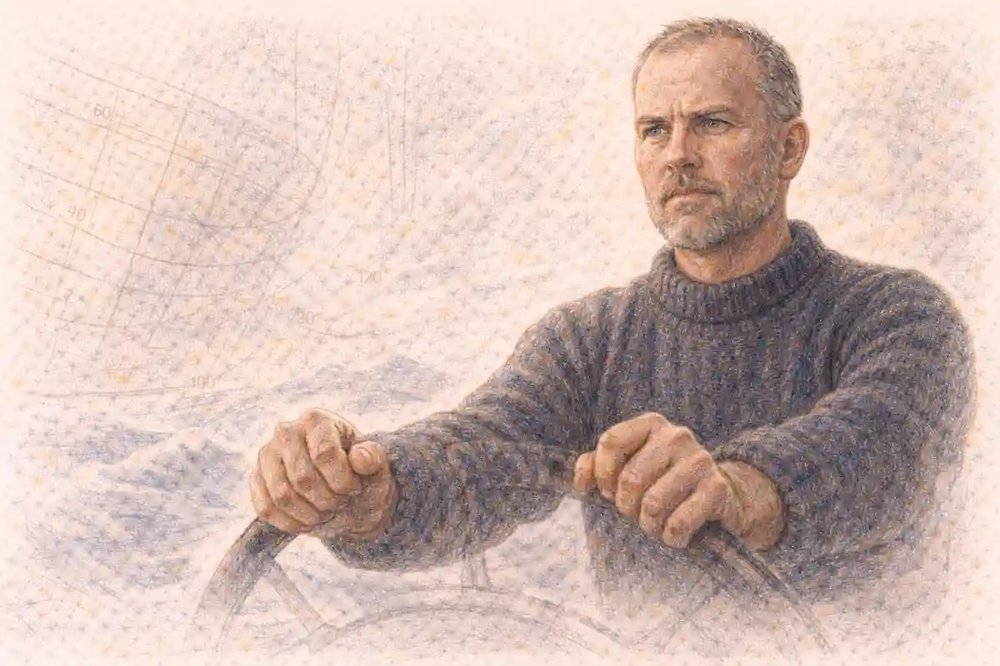

New Criticism gave Romeo and Juliet the most consequential rereading of the twentieth century without ever giving the play a book of its own. The school's central text, Cleanth Brooks's The Well Wrought Urn of 1947, builds its doctrine on ten poems and reaches Shakespeare through Macbeth alone. Yet the doctrine travelled. Once paradox, irony, tension, and the verbal icon had been named as the properties that make a literary work a work, the tragedy of the Veronese lovers became a test case the method could hardly avoid, because no play in English announces its own doubleness so openly. Its Prologue calls the lovers both star-crossed and death-marked in a single breath. Its hero opens his part with a catalogue of oxymorons. Its heroine answers a love scene with a string of oxymorons of her own, sharper than his. A method built to prize exactly those figures found, in this play, a structure that seemed to have been waiting for it.

The verdict argued here is measured and two-sided. New Criticism contributed the indispensable discipline of treating the play's language as its action: the antitheses are not decoration on a story about a feud, they are the feud rendered in grammar, and the light imagery is not ornament on the love, it is the love thinking about itself. Against that gain stand two losses the school's rivals named at the time and named correctly. R. S. Crane's charge of monism, the reduction of every work to one device, lands wherever a reading finds paradox because paradox was the only instrument in the case. Rosemond Tuve's historical objection lands wherever a reading assigns a word a meaning its century had not given it. Between the gain and the losses sits the figure who shows what the method could do at its best on this particular play: Harry Levin, whose essay of 1960 took the formalist instruments, loosened their dogma, and produced the reading of the play's formality against which later accounts still measure themselves.

## What New Criticism Was: A Method Built Against Biography

The name came late to a movement already under way. John Crowe Ransom gathered essays by his contemporaries under the title The New Criticism in 1941, and the label stuck to a loose company of American critics, most of them southern, most of them poets as well as scholars, who shared a conviction about where a literary work keeps its meaning. The meaning, they held, is in the work: in its words, their order, their tensions, and their resolutions. It is not in the author's life, not in the author's stated intention, not in the sources the author used, and not in the feelings the work happens to excite in a given audience. Ransom's earlier manifesto, Criticism, Inc., published in the Virginia Quarterly Review in 1937, had demanded that criticism become a systematic discipline with the text as its object, rather than a branch of historical scholarship or an exercise in cultivated taste.

Two English precursors supplied the instruments. I. A. Richards, in Practical Criticism of 1929, reported an experiment in which Cambridge students were given poems stripped of authors' names and dates and asked to comment; the protocols showed readers importing stock responses, biographical guesses, and doctrinal prejudices in place of reading. The remedy Richards proposed was attention to the words on the page, and the classroom exercise he invented became, in American hands, the close reading that defined the school. William Empson, Richards's pupil, published Seven Types of Ambiguity in 1930, a taxonomy of the ways a word or construction can bear several meanings at once, drawn heavily from Shakespeare. Ambiguity, in Empson's handling, was not a blemish to be cleared up but a resource to be mapped, and the mapping required no reference to what Shakespeare had for breakfast or believed about the stars.

The southern group added a metaphysic to the technique. Allen Tate, in the essay Tension in Poetry of 1938, proposed that the value of a poem lies in the unity of its extremes, the full range of meaning from the most literal statement to the most remote metaphor held in one structure; he coined his term from the logical vocabulary of extension and intension with the first syllables removed. Ransom spoke of structure and texture, the paraphrasable argument and the local density that resists paraphrase. Brooks, Tate's and Ransom's heir at Louisiana State University and then at Yale, fused these notions into the school's most portable doctrine: that the language of poetry is the language of paradox, and that a poem's meanings are inseparable from the dramatic structure that qualifies them. The Southern Review, which Brooks edited with Robert Penn Warren, and Ransom's Kenyon Review carried the doctrine into the profession, while the textbooks Brooks and Warren wrote together carried it into the classroom.

The polemical edge of the method was aimed at two established habits. The first was the character criticism descended from A. C. Bradley, in which figures in a play were discussed as if they were persons with lives extending beyond the script, childhoods, motives, and offstage futures available for speculation. L. C. Knights had fired the famous shot at that habit from England in 1933, in an essay whose title asked how many children Lady Macbeth had, and whose argument was that a Shakespearean tragedy is a dramatic poem whose persons exist in and through their words. The second habit was the documentary scholarship of the universities, source hunting, biography, and the history of ideas, which the New Critics did not despise but refused to mistake for criticism. A source could explain where material came from; it could not explain what the material became inside the verbal structure. That distinction, between explanation of origins and account of achieved meaning, is the school's founding gesture, and everything in its reading of the Veronese tragedy descends from it.

## The Southern Formation: Fugitives, Agrarians, and the Little Reviews

The school's personnel explain its prejudices. Ransom, Tate, Warren, and Brooks emerged from the Fugitive group at Vanderbilt University in Nashville, poets who had published a little magazine of verse in the early 1920s and then, several of them, contributed to the Agrarian symposium I'll Take My Stand in 1930, a defence of the agrarian South against industrial capitalism. The connection between the agrarian politics and the critical method is not decorative. A company of writers who believed that a culture's health showed in the density and integrity of its made things, farms, poems, manners, brought to criticism a craftsman's suspicion of abstraction and a regional outsider's resentment of the metropolitan universities, where literature was studied as a branch of philology by scholars who rarely wrote a line of verse. The New Criticism was, among other things, the revenge of practitioners on custodians: men who made poems insisting that the poem, the made object, was the proper object of study, and that the techniques of its making were knowable and teachable.

The little reviews were the school's circulatory system. The Fugitive gave way to the Kenyon Review under Ransom at Kenyon College, the Southern Review at Louisiana State under Brooks and Warren, and the Sewanee Review in its renewed form, each providing pages where an explication could run to the length its evidence required and where the doctrine was sharpened in controversy. The geography mattered for the play's criticism in one specific way. Shakespeare in the American South of the period was not an antiquarian possession but a living repertory author, read in schools, performed by touring companies within living memory, and quoted in courtrooms and sermons. The southern critics approached the canon as working writers approach a master's workshop, interested in the joints and the joinery. Their Shakespeare was consequently less reverent and more anatomical than the Shakespeare of the older universities, a difference visible in the confidence with which the school's epigones set about the Veronese tragedy, dismantling its speeches like engines to see how the tensions were wound.

The formation also marks the school's limit, and the limit shows in its reading of the feud. The Agrarian imagination understood honour cultures from inside, the code that makes a young man answer an insult with steel and a father treat a daughter's marriage as a disposition of property. A criticism formed by that imagination might have been expected to read Verona's feud with unusual sympathy and precision. The record runs the other way: the method's bracketing of the social forbade the school's readers to use the very knowledge their formation supplied, so the feud in their accounts thins into a premise, a darkness for the light to shine against. The loss is biographical in origin and structural in effect, and it is entered here as evidence for the article's general verdict, that the method's exclusions repeatedly disabled its practitioners' own best equipment. What the southern formation gave the play was a craftsman's attention to its verbal joinery. What the doctrine prevented the same men from giving it was a neighbour's knowledge of its world.

Institutionally, the formation completed itself in the postwar university. The GI Bill's expansion of higher education created the mass literature classroom, and the mass classroom needed a method that could be taught to hundreds of instructors and thousands of students without dependence on rare languages, large libraries, or inherited taste. Close reading was that method: portable, examinable, and democratic in its evidence, since the text on every desk was the same. The Veronese tragedy, set in schools and survey courses across the English-speaking world, passed through this machinery more completely than any other Shakespeare play except Hamlet and Macbeth. By the time the doctrine came under theoretical attack, its classroom form had already become the default literacy of the profession, a fact that explains the otherwise puzzling survival of its practices after its premises were abandoned. Methods die when their institutions do. The institution, the seminar built around a passage, is still standing.

## The Well-Wrought Urn and the Chapter That Is Not There

Any account of New Criticism and this play must begin with an absence, because the absence disciplines every claim that follows. The Well Wrought Urn: Studies in the Structure of Poetry, published in 1947, is the book from which the school's reading of Shakespeare is usually assumed to flow. Its table of contents can be checked, and checking it is instructive. After the opening essay, The Language of Paradox, Brooks reads ten works in chronological order: Donne's Canonization, the witches' and Lady Macbeth's language in Macbeth under the title The Naked Babe and the Cloak of Manliness, Milton's paired poems L'Allegro and Il Penseroso, Herrick's Corinna's Going A-Maying, Pope's Rape of the Lock, Gray's Elegy, Wordsworth's Intimations Ode, Keats's Ode on a Grecian Urn, Tennyson's Tears, Idle Tears, and Yeats's Among School Children. The volume closes with The Heresy of Paraphrase and two appendices, one on criticism and history, one on belief. Romeo and Juliet is not among the works read. There is no Brooks chapter on the play, no sustained Brooks explication of its speeches, no page of the Urn where the lovers' oxymorons are weighed.

The point is not pedantry. It is the difference between a method and a reading. What Brooks supplied was an instrument calibrated on lyric poems, mostly short, mostly meditative, in which a single speaking voice qualifies its own statements until the qualifications become the meaning. Drama tests that instrument in ways the Urn never had to face. A play distributes its paradoxes among opposed speakers, sets them in mouths that the audience is invited to distrust as well as believe, and lets action ratify or refute what language proposes. Romeo's oxymorons in the first act are not the play's paradoxes in the way Donne's paradoxes are the Canonization's. They are a young man's borrowed rhetoric, marked by the play itself as a symptom, and the drama spends five acts replacing that rhetoric with something earned. A method trained on the lyric must learn, on contact with this play, to ask who is speaking and whether the structure believes him. The school's best readers of the play learned exactly that. Its worst applied the lyric template whole and found, predictably, that the template fit.

Brooks's Macbeth chapter shows both the power and the limit in miniature. Reading the play through its imagery of the naked babe and the cloak of manliness, Brooks treats the tragedy as a poem whose symbols enact its moral structure, pity and terror woven into garments, children, and darkness. The reading illuminates speeches that character criticism had psychologized into case histories. Transferred to Verona, the same procedure fastens on the light imagery, the oxymorons, the rose and the book and the pilgrim, and it finds real pattern there, pattern the older criticism had walked past. What the procedure cannot register, because its calibration excludes the fact, is that this play's patterns are also a young company's repertory effects, a sonnet culture's party tricks, a feud plot inherited from an Italian novella through an English poem. The urn is well wrought, but it was wrought somewhere, in a particular city, for a particular stage. The school's history is the story of that exclusion being first asserted as a virtue, then prosecuted as a fault.

### What does the missing chapter teach about the method?

The absence of the play from The Well Wrought Urn teaches that New Criticism reached the tragedy as a method in search of instances rather than as a finished interpretation, so every claim about the play must be credited to the critic who actually made it, never to Brooks by inheritance.

That discipline matters because the play attracted the method's vocabulary more than its sustained attention. Paradox, irony, tension, ambiguity: the terms colonized the teaching of the play for two generations, appearing in study guides and lecture notes attached to speeches they genuinely illuminate. But the colonization was piecemeal. Where a lyric poem could receive forty pages of explication in the Urn, the play received the method in fragments, a speech detached for a classroom hour, an image cluster gathered for an article, a formal pattern sketched in an essay of nine pages. Levin's essay, the strongest formalist account the play received in the period, runs to nine pages in the Shakespeare Quarterly. The contrast is itself a finding. The school that insisted on the whole work, the organic structure in which every part qualifies every other, practiced its wholeness on lyrics and excerpts, and approached a five-act tragedy in pieces. Brooks's own appendix on criticism and history concedes, in principle, that historical knowledge has its rights; the practice of the school kept deferring the concession. A fair verdict on New Criticism and this play therefore weighs a method of proven local power against a record of partial application, and refuses to let the vocabulary stand in for readings that were never written.

## Paradox as the Play's Native Language

The strongest ground for the method's claim on this play is that the play speaks paradox before any critic names it. The Prologue, a sonnet spoken by a Chorus, compresses the whole action into fourteen lines of held opposites: two households, both alike in dignity; a pair of star-crossed lovers; love and death-marked in a single compound; civil blood making civil hands unclean. A sonnet is a form built for a turn, the volta that answers an octave with a sestet, and the Prologue's turn delivers the burial of strife by the deaths it announces. Form and content are one gesture. A criticism that begins from the words has, in the Prologue, everything it needs: the play declares itself a structure of opposites whose resolution costs the opposites their lives.

Romeo's entrance extends the declaration into mannerism. In Act 1, Scene 1, asked whether he was present at the morning's brawl, he answers in a chain of oxymorons, O brawling love, O loving hate, heavy lightness, serious vanity, feather of lead, bright smoke, cold fire, sick health. The speech is a set piece of Petrarchan convention, the lover's traditional inventory of sweet torments, and the play frames it as quotation rather than feeling: Romeo is performing a part learned from books, for a mistress who never appears. The New Critical instrument, properly used, reads the catalogue neither as the author's paradox nor as the character's psychology but as a structural planting. The figures are the play's DNA in embryo. Love and hate will trade places until the families stand in a tomb agreeing that the trade has bankrupted both. Light and sickness, lead and feather, will recur in earnest contexts, in the Friar's garden, in the orchard, in the vault, until the audience can no longer hear the phrases as ornaments. What began as a boy's borrowed wit becomes, by recurrence and recontextualizing, the tragedy's grammar.

The Friar's herb speech in Act 2, Scene 3 is the play's own statement of the doctrine, delivered before the school existed to formulate it. Within the infant rind of this weak flower, the Friar observes, poison hath residence and medicine power; two such opposed kings encamp them still in man as well as herbs, grace and rude will. Here the paradox is not a figure but a cosmology: every natural thing carries its opposite inside it, and virtue itself turns vice when misapplied. A New Critical reading seizes on the speech as the play's thematic center because the speech behaves like one, radiating backward to the Prologue's compounds and forward to the potion, the letter, and the tomb. The seizure is justified, with a qualification the method's dogma resisted. The speech is spoken by a fallible man whose own application of the doctrine, the sleeping potion and the secret marriage, will misfire. The structure qualifies the speaker. Paradox in this play is never a free-floating property of language; it is always somebody's paradox, uttered at a cost, and the cost is part of the meaning.

Juliet's oxymorons in Act 3, Scene 2 complete the pattern by reversing its charge. Told that Romeo has killed Tybalt, she cries out in a sequence that Levin quoted and weighed: beautiful tyrant, fiend angelical, damned saint, honourable villain. Where Romeo's catalogue was decorative, a young man's display, Juliet's is cognitive, a mind forcing incompatible reports into single phrases because the facts will not reconcile. The same figures that signaled falseness in Act 1 signal truth-telling under pressure in Act 3. A paraphrase of the two speeches gives the same content, a lover's confusion, twice. The structure gives opposite meanings to identical devices, and the difference between the speeches is the distance the play has travelled. That difference is precisely what Brooks meant by insisting that a poem's structure is a structure of meanings and attitudes, not a container for them. On this ground, the method does not merely suit the play. The play seems to have been composed to the method's specification, three centuries early.

### Why do identical oxymorons mean opposite things in Acts 1 and 3?

Identical oxymorons mean opposite things in the two acts because the play assigns them to opposed states of knowledge: Romeo's Act 1 catalogue is inherited convention performed for effect, while Juliet's Act 3 figures are forced from her by irreconcilable news, converting a decorative device into an instrument of recognition.

The light imagery carries the same conversion across the whole action. Juliet is introduced to the audience's imagination as light in darkness before she speaks a word of love: Romeo, watching her on the balcony, calls her the sun and bids her kill the envious moon. In Act 2, Scene 2 the metaphors run in one direction, outward from her brightness into a night they redeem. By Act 3, Scene 5, at the dawn parting, the imagery has inverted its allegiance: night's candles are burnt out, jocund day stands tiptoe on the misty mountain tops, and the light that meant presence now means separation and danger. Romeo, descending, states the inversion as a paradox of perception, more light and light it grows, more dark and dark our woes. The pattern is not a decoration laid over the plot. It is a second plot, told in images, whose phases mark the tragedy's stages as exactly as the acts do. When the lovers meet again it is in a tomb lit by a lantern Romeo calls a feasting presence full of light, and the imagery's last turn closes the account: darkness, which began as love's shelter, ends as death's element, and the light that survives is the gold of statues, commemoration rather than life. A reading that follows the images has followed the play. That was the school's wager, and on this play the wager pays.

## Irony, Tension, and the Verbal Icon

Paradox was the school's banner word, but its working vocabulary was wider, and the wider terms fit drama better. Irony, in Brooks's usage, is the recognition of incongruity that a mature structure builds into every statement, the qualification a context forces on a word. The play's governing irony is announced in its Prologue and renewed at every turn: the audience knows the ending from the first fourteen lines, so that every hope the lovers voice is heard against its refutation. When Juliet, in Act 3, Scene 5, looks down at the departing Romeo and asks whether she will see him again, her vision of him as one dead in the bottom of a tomb is dramatic irony functioning as prophecy, and her mother's later wish that Juliet were married to her grave lands, in the audience's ear, with a weight Lady Capulet cannot intend. The New Critics taught readers to hold such double hearing as the normal condition of the text rather than an occasional effect, and the teaching permanently raised the standard for what counts as having read the play.

Tate's tension, the unity of a work's extremes, names the play's largest structural fact. Verona's tragedy holds in one frame materials that pull toward opposite genres and opposite moral weathers: the bawdy of the servants' opening exchange and Mercutio's Queen Mab flight, the sonnet the lovers share at the feast, the operatic lament over Juliet's supposed corpse, the gravediggers' comedy of the musicians after the catastrophe. A paraphrase sorted by tone would call the play uneven. The tension model reads the mixture as the meaning: comedy and tragedy are not blended but stretched against each other, and the snap of the cord, at Mercutio's death under Romeo's arm, is the moment the extremes can no longer be held. W. K. Wimsatt supplied the school's most durable noun for the object so constituted. The verbal icon, the title concept of his 1954 collection, is the work considered as a made thing of words whose being is its meaning, an icon not of the author's mind but of the structure itself. On that account the play is an icon of doubleness: two households, two lovers, two friars' plans gone wrong, two deaths by two instruments in one vault, rendered in a language of paired opposites from the first sonnet to the Prince's closing couplet.

The icon language also exposes the method's characteristic blindness, which the play makes unusually visible. An icon is still. A play is not. The verbal structure that the school anatomized exists, in the theatre, as timing, breath, a boy actor's voice, a trapdoor, a fight choreographed to look like chance. The school's accounts of the play rarely mention a stage. Their silence is principled, the work is the text, but on a drama the principle costs more than on a lyric, because part of the work's structure is kinetic and communal, and an icon cannot sweat. Later performance criticism would make the school's stillness its target. Within the period, the cost appears as a narrowing of evidence: speeches are weighed as poems, scenes as stanzas, and the question of what an audience can actually take in at performance speed, a question the play's own Chorus raises by apologizing for the two hours' traffic of the stage, is set aside as extrinsic. The adjudication offered here credits the icon as a model of the script and faults it as a model of the event.

### What does the verbal icon leave out of a stage play?

The verbal icon leaves out the event of performance: an actor's timing that turns a sonnet into seduction or recitation, choreography that makes a death look like accident or design, the audience whose laughter and silence form part of the effect, and the pressure of two hours' traffic on how much pattern a listener can hold.

Wimsatt's icon also did quieter work for the play's reputation. To call a work an icon is to claim for it the self-sufficiency of a made object that rewards sustained attention, and the claim, institutionalized in classrooms, helped fix this early tragedy in the canon of works worth explicating line by line. The play's eighteenth-century reputation had rested on its pathos, its nineteenth-century reputation on its poetry in a general sense. The New Critical dispensation gave its admirers a technical vocabulary for the intuition that the poetry was engineered: that the sonnet at the feast is load-bearing, that the Prologue's compounds forecast the tomb, that the Friar's herb speech is a thesis the action tests. Engineering claims can be checked against the structure, which is why the vocabulary survived the school that coined it. Teachers who had never heard of Ransom still set students to trace the light imagery, because the tracing works: the pattern is there, and finding it changes what a first-time reader is able to see.

## The Heresy of Paraphrase and the Plot That Refuses Summary

The closing essay of the Urn gave the school its most quoted prohibition. The heresy of paraphrase is the error of supposing that a work's meaning can be extracted as a statement and the work then discarded, that form is a decorative wrapping on a content that could be delivered plain. Brooks insisted that the structure of a poem is not a statement about experience but an experience, and that any summary is a different, poorer structure. Applied to a tragedy whose plot derives from a well-known tale, the prohibition cuts deep, because the plot of this play is the most paraphrasable in Shakespeare. Lovers from feuding houses meet, marry in secret, are separated by a killing and a banishment, and die through a failed message. Arthur Brooke's poem of 1562 tells substantially that story at three thousand lines, and a newspaper paragraph can tell it in fifty words. If paraphrase sufficed, Brooke's Romeus and Juliet and Shakespeare's play would be the same work at different lengths. They are not, and the heresy doctrine explains why with an economy no rival doctrine of the period matched: everything that makes the play itself, the sonnet meeting, the exchanged oxymorons, the dawn parting, the double suicide's terrible symmetry, lives in the verbal and dramatic structure, and a summary retains none of it.

The doctrine also clarifies the play's strangest formal decision, the Prologue that gives the ending away. A paraphrase-minded criticism treats foreknowledge as a defect or a quaint convention. A structure-minded criticism sees the point: by surrendering suspense about what happens, the play forces attention onto how it happens, onto the verbal and scenic means by which the foreknown end is reached, which is to say onto exactly the stratum the New Critics taught. The audience watches language make the fate it announces. Romeo's violent delights have violent ends, in the Friar's warning of Act 2, Scene 6, is a paradox that paraphrases as a moral about haste; in the structure it is a prophecy the speaker himself will help fulfil, and its meaning includes that fulfilment. The heresy doctrine, whatever its excesses elsewhere, permanently disabled the lazy reading of this play as a story with poetry added. The poetry is the story's mode of existence.

There is a cost, and the play collects it in the person of the Friar. If no statement in a work may be taken as the work's meaning, then no speech may be taken as the author's verdict, and the Friar's sententiae, the herb speech, the counsel of moderation, the violent delights warning, must all be read as dramatic utterances qualified by their speaker's failure. That reading is available and, in the argument here, correct. But the school's practice sometimes slid from the sound rule that statements are qualified to the unsound habit of treating qualification as automatic, so that any moral pressure in a speech could be dissolved into irony on principle. On this play the slide matters, because the tragedy does judge: the Prince's closing words distribute blame, the fathers' statues confess it, and a criticism that cannot register judgment as judgment has disabled itself before the final scene. Crane's pluralism, weighed in a later section, is the period's own name for the correction. The heresy of paraphrase is a true doctrine about form that becomes a false one when it is used to forbid a work from meaning anything in particular.

### Why does the shared sonnet at the feast defeat paraphrase?

The shared sonnet defeats paraphrase because its meaning is its distribution: fourteen lines divided between two speakers who complete each other's rhymes and quatrains, so the form performs the union the words request, and a summary reporting a meeting in religious imagery loses the fact that the verse marries the lovers before any friar does.

The feast scene repays the method at every level it knows how to inspect. The sonnet's conceit, pilgrims and saints and holy palmers, converts the period's devotional vocabulary into an instrument of courtship, and the conversion is the play's paradox in small: sacred language doing secular work without ceasing to be sacred, so that the audience hears both registers at once and hears the danger in the doubleness. The exchange ends with Juliet's verdict on Romeo's technique, the remark that he kisses by the book, which Levin placed at the center of his reading. A paraphrase hears a compliment. The structure hears a measurement: the book is the book of courtly form, and Juliet, who will shortly dismantle the whole apparatus of names in the orchard, here certifies that her partner has mastered the forms she is about to ask him to transcend. The sonnet is the play's thesis about form itself, that form is how these lovers think, the medium of their sincerity and their doom alike, since the same city that teaches them sonnets teaches their fathers the forms of the feud. No plot summary carries that. Brooks's prohibition, on this evidence, is not a mystique. It is a description of where this play keeps its meaning.

## A Worked Explication: The Orchard Scene and the Argument About Names

The method is best judged at work, and the orchard scene of Act 2, Scene 2 offers the fairest test, since it contains the play's most famous speech and its most consequential argument. An explication in the school's manner begins with the situation of the words rather than with their beauty. Juliet speaks from the balcony believing herself alone, so her language has the status of thought overheard, while Romeo, below, hears what she does not know she has published. The structure of the scene is thus an irony machine: every statement she makes is qualified, for the audience, by his presence, and every answer he gives is qualified by her ignorance of it. When she asks wherefore Romeo is Romeo, the question is, in the fiction, rhetorical and private; in the structure, it is addressed to the one person who must act on it, standing in the dark under her window. A paraphrase that reports her conclusion, that names are accidents and essences abide, keeps the thesis and loses the machine.

The explication then follows the argument's own turns, because the speech is an argument and the school, at its best, respected argument as a poetic structure. Juliet proceeds by distinctions: the name is not hand, nor foot, nor any part belonging to a man; the rose by any other name would smell as sweet; therefore Romeo, doffing his name, may take all herself in exchange for a word. The reasoning is scholastic in form, essence against accident, and its flaw is one the play immediately exposes, since the name Montague is not an accident in Verona but a sentence, the load-bearing fact of the feud's architecture. Romeo's answering move accepts her logic and raises its stakes: he will be new baptized, and henceforth never be Romeo. The exchange is a duel of definitions conducted at the speed of desire, and its tension, in Tate's sense, is the unity of its extremes: the most metaphysical distinction in the play is being used to arrange a tryst, and the tryst's consummation will be a marriage that makes the metaphysics moot by giving her his name in law. The school's instruments register all of this without leaving the words, and the registration is a genuine addition to knowledge, the recovery of the scene as an intellectual action rather than a love duet with scenery.

Where the explication must call for help is at the points where the words lean on the world. The rose comparison persuades by an appeal to natural kinds, and its force for an audience depends on habits of thought about names and essences that the period's grammar-school logic made second nature; Tuve's dictionary is needed to hear the argument's period weight. The balcony itself is a piece of theatrical architecture the text never names, a discovery space whose use the scene assumes; performance knowledge, not verbal attention, supplies the staging that makes the overhearing possible. And the scene's danger, the household asleep around the speaker, the kinsman who would kill the listener if found, belongs to the feud's social mechanics, which the explication brackets at the cost of hearing the whispers as whispers. The worked example thus yields the article's verdict in miniature, on a single scene: the method's pass over the text recovers more of the scene's meaning than any rival pass, and it does not recover all of it, and the residue is not marginal.

One further finding of the explication deserves record, because it concerns the image work for which the school is famous. The orchard scene's light imagery runs against its staging: the scene occurs at night, yet its language is a noon of suns, moons, and stars, Juliet's face shaming the torches, her eyes in heaven exchanging places with stars, Romeo's cheek resting where a glove might touch it. The structure's point is that the lovers generate the light the stage withholds, imagery as compensation and defiance at once. When the dawn scene of Act 3, Scene 5 reverses the arrangement, real light arriving as the enemy and the lovers arguing the lark against the nightingale, the audience that has tracked the figure hears the reversal as an event in the argument, not a change of wallpaper. Tracking of exactly this kind, patient, citational, alert to recurrence and inversion, is what the school taught better than any predecessor. The explication stands as the article's principal exhibit for the defence.

## From Census to Structure: The Imagery Inheritance

The school's image work on this play had a predecessor it rarely acknowledged, and one comparative passage is the right measure of the debt. Caroline Spurgeon's Shakespeare's Imagery and What It Tells Us, published in 1935, counted and classified the play's images with clerical patience, establishing the dominance of the light cluster and gathering the sickness, poison, and tempest figures into groups whose recurrence no reader had previously been able to state as fact. [Caroline Spurgeon and the Imagery Revolution](/2027/03/05/caroline-spurgeon-imagery-revolution/) is the subject of a companion study in this series, and the comparison needed here is brief. Spurgeon gathered the images as evidence about the author's mind, clusters in the text pointing back to habits of thought in the man. The New Critics took the gathering and reversed its direction: the clusters were evidence about the work's structure, patterns in the object pointing inward to its organization, not outward to a biography. The technique survived the reversal intact, which is why the school's image readings of the play look so much like Spurgeon's with the conclusions reassigned. The reversal also marks the exact point where the method's anti-biographical discipline did real work, converting a census taken in the service of portraiture into an anatomy taken in the service of form.

The conversion was not costless, and the play shows the cost in the light cluster itself. Counted as a pattern, the light imagery yields the elegant arc traced in an earlier section, from the balcony's sunrise to the tomb's false dawn. Read as structure, the arc is real. But the images also did theatrical work that neither counting nor structure registers: a boy player in a sunlit afternoon amphitheatre describing his beloved as the sun is performing a compensation the audience can see, manufacturing the darkness his words require. Spurgeon's census and the school's anatomy alike treat the words as the whole event. The acknowledgment is entered here because the verdict of the whole article depends on distinguishing what the method proved from what it merely assumed, and the assumption that the pattern exhausts the phenomenon is the seed of the monism Crane prosecuted.

## Harry Levin and the Discipline of Formality

If the school has a canonical reading of this play, it is not by a card-carrying member. Harry Levin, Harvard's professor of comparative literature, published Form and Formality in Romeo and Juliet in the Shakespeare Quarterly in the winter of 1960, nine pages that remain the most cited formalist account of the tragedy. Levin stood near the New Critics rather than inside their circle: a comparatist with European formations, hospitable to historical knowledge, and interested in the play as an experiment in kinds, a romantic comedy whose machinery is run past its proper ending into catastrophe. [Harry Levin's 'Form and Formality' (1960)](/2026/12/04/harry-levin-form-and-formality/) is treated at full length in its own study in this series; the task here is to place the essay inside the school's history and to weigh what it kept, what it corrected, and what it quietly refused.

What Levin kept was the founding discipline: the meaning is in the verbal structure, and the structure of this play is antithetical through and through. His essay assembles the oppositions with a completeness the lyric-trained critics never attempted for a whole play: youth and age, love and hate, day and night, form and freedom, the ceremonious world of the fathers and the improvised world of the children, all subsumed, in his phrase, under the all-embracing antithesis of Eros and Thanatos, the love-death that the Elizabethan pun on dying carries inside the language itself. Where Brooks found paradox within a single voice's statements, Levin found antithesis distributed across the whole dramatic machine, in scenes that mirror and invert each other, in a lament staged as an operatic quartet, in a heroine whose wordplay runs on the pronouns of identity. The enlargement matters. Antithesis in Levin is not a figure to be admired in a speech but the play's engineering, and the essay demonstrates, against the lyric bias of the Urn, that the formalist instruments could in fact take the measure of a five-act structure when a critic let the drama set the scale.

What Levin corrected was the school's indifference to dramatic decorum, its habit of treating every statement as equally the work's. His handling of the Auden objection is the model instance. W. H. Auden had doubted that the heroine of the epithalamium, the voice of Gallop apace, you fiery-footed steeds, could credibly produce, an hour later in stage time, the shrill oxymorons of the Tybalt news. Levin answered that Shakespeare suits changes of style to changes of mood with perfect consistency: when Juliet feels at one with Romeo her intonations are genuine, and when she feels at odds with him the rhetoric turns artificial because the feeling is divided. The answer is a New Critical answer in method, since it appeals to structure rather than to the character's imagined interior, and an anti-New Critical answer in spirit, since it concedes that the work's language is uneven by design, that falseness of register is one of the structure's working parts. A monist of paradox would have had to find the oxymorons profound. Levin finds them deliberately unconvincing, and the distinction saves the reading.

What Levin refused was the school's quarantine of the play from its kinds and its moment. His essay reads the tragedy against romantic comedy's conventions, against the Spanish Tragedy's rhetoric, against Sidney's sonnet sequence, against the social forms, the duelling codes and marriage ceremonies and funeral customs, that the play's formality presupposes. None of that apparatus is extrinsic in Levin's handling; it is the grammar within which the formal choices signify. The adjudication this article reaches on the kinship question is therefore double. Levin's essay is the school's best fruit on this play precisely because it is only loosely the school's: it keeps the discipline of the words and drops the dogma of the sealed object. Later formalism about the play descends from Levin's nine pages more than from any chapter of the Urn, and the descent proves the verdict argued throughout, that the method's instruments were stronger than its theory of their use.

### What separates Levin's formality from Brooks's paradox?

Levin's formality differs from Brooks's paradox in scale and allegiance: paradox is a property of statements a single voice makes and qualifies, while formality is a property of the whole dramatic arrangement, antitheses distributed among scenes, ceremonies, and social kinds, openly depending on conventions outside the text that Brooks's method taught its followers to bracket.

## The Banished Author: Intention, Affect, and the Uses of Exclusion

The school's exclusions received their canonical statement in two essays by W. K. Wimsatt and Monroe Beardsley. The Intentional Fallacy, published in the Sewanee Review in 1946, argued that the author's intention is neither available nor desirable as a standard for judging a work: the poem is not the author's, it is detached from the author at birth and goes about the world beyond the author's power to intend about it or control it. The Affective Fallacy, which followed in 1949, closed the other door, arguing that a poem's meaning cannot be equated with its emotional effects on readers, since effects vary while the object abides. Between the two essays, the school fenced off the two territories where discussion of this play had traditionally grazed. Gone was the Shakespeare whose supposed beliefs about love, haste, or providence could be reconstructed from the speeches and then used to explain them. Gone, too, was the tribunal of tears, the appeal to how moving the tomb scene is as evidence of what it means.

For this play the exclusions did specific, datable work. The question that had organized a century of commentary, whether Shakespeare approved of the lovers or condemned them, was reclassified as two fallacies in a trench coat: it asked for an intention outside the text and proposed to settle the matter by the reader's sympathies. The structural criticism that replaced it asked better questions. Where does the blame language actually sit in the text, and in whose mouths, with what qualifications? The Prince's closing distribution of pardon and punishment, the fathers' competitive statue-building, the Chorus's advance verdict on the strife, these are arrangements of words that can be examined. The intention question also dissolved a standing embarrassment, the play's dependence on Brooke's poem. Source study had treated the borrowing as the explanation, as if naming the quarry explained the building. Under the fallacy doctrine, Brooke's poem became evidence of what Shakespeare's structure is not: a moralizing narrative in which the lovers are warned against disobedience for three thousand lines. The comparison survives the doctrine, but as a way of seeing the achieved structure's difference, not as a key to the author's mind.

The exclusion of affect proved the more expensive doctrine for a tragedy, and the play exposes the expense. A verbal icon does not weep, but audiences do, and the weeping is not noise around the structure; it is one of the structure's designed products, as the Prologue's appeal for patient ears and the Chorus's request for attentive watching concede. The school's austere answer, that the design can be studied without consulting the tears, is methodologically tidy and humanly evasive, and it left the criticism of this play, for a generation, better at explaining the sonnet at the feast than at explaining why the tomb scene empties a theatre of noise. The fair accounting keeps both entries. The fallacies banished two lazy habits, biographical ventriloquism and emotional self-congratulation, and the banishment raised the evidentiary standard for every claim made about the play afterward. They also taught a generation to distrust its own responses as data, and a tragedy engineered for pity paid for the lesson.

## The Classroom Conquest: Textbooks, Notebooks, and the Trained Eye

The school conquered the play not in its manifestos but in its textbooks. Understanding Poetry, published by Brooks and Robert Penn Warren in 1938 and revised across decades, taught students to approach a text with a small kit of questions: who speaks, in what situation, with what tensions among the statements, resolved how. Understanding Fiction and Understanding Drama extended the kit to the other kinds. The explication exercise, a short paper anatomizing a passage's structure, became the standard assignment in American literature courses, and this play, canonical, actable, and dense with the figures the kit was built to detect, became one of its standard subjects. Generations met the tragedy first as a set of speeches to be explicated: the Prologue as a sonnet that argues, the orchard scene as a debate about names, the dawn parting as an argument conducted in imagery about whether the bird was lark or nightingale.

The pedagogy's strength was its democracy of evidence. A student with a text and the kit could test a claim in an hour, because the claims were about words on a page open in front of the whole seminar. Keeping a working notebook of such tests, passages transcribed with their tensions mapped and their image recurrences tallied, is the habit the textbooks were really selling, and the habit survives in digital dress wherever a reader maintains a structured archive of explications, in tools such as [VaultBook](https://vaultbook.net/), where the slow accumulation of passage notes can be searched against itself until the pattern either appears or dissolves. The pattern-hunting could degenerate into a ritual, paradox found on schedule in whatever text the week supplied, and Crane's complaint about monism was, among other things, a complaint about marking a thousand undergraduate papers that found the same irony in every poem. But the floor the pedagogy set has never been removed. A reading of this play that cannot point to its words, act, scene, and line, is no longer admissible as criticism in a seminar room, and that inadmissibility is the school's most durable legacy, outlasting every doctrine the school attached to it.

There is also a loss entered in the classroom ledger, and it concerns the play as a whole. Explication trains the eye on the passage, and the passage, in a drama, is a part torn from a sequence of actions, entrances, fights, and discoveries whose meanings are cumulative and kinetic. Students formed by the kit could explicate Gallop apace for ten pages and have nothing to say about why the speech sits where it sits, after the wedding and before the street fight that ruins everything, in the tragedy's hinge. The whole-play questions, of structure in the large, of genre, of the feud as a social mechanism, belonged to the methods the school had displaced, and the displacement shows in the period's criticism, which is rich in local brilliance about this play and poor in accounts of its total action, Levin's nine pages excepted. The verdict on the pedagogy follows the verdict on the method: an indispensable training that mistook itself for a complete education.

## The Cousin in London: Scrutiny and the Difference a Moral Makes

England produced a parallel movement with a different centre of gravity, and the comparison sharpens the school's profile on this play. F. R. Leavis and the journal Scrutiny, founded at Cambridge in 1932, shared the Americans' founding convictions: the work, not the biography; the words, attended to in their concrete life; the enemy, a criticism of gossip, appreciation, and documentary accumulation. Knights's essay on Lady Macbeth's children, the period's most quoted anti-Bradleyan stroke, appeared under Scrutiny's auspices. Yet the cousins divided on the question of what close attention is finally for. For Brooks, attention serves structure: the reconciliation of tensions is the achievement, and the critic's judgment follows the architecture. For Leavis, attention serves life: the words matter because they enact a quality of living, a moral seriousness that the critic's whole sensibility must ratify or refuse. The difference sounds temperamental and is in fact doctrinal, since it decides what a reading is allowed to conclude.

On the Veronese tragedy the difference yields two distinct plays. The American formalist play is a structure of antitheses, admirable as engineering, whose lovers function as the poles of its tensions. The Scrutiny play, as it emerges in the tradition of Leavis's followers, is an enactment of immaturity and its costs, in which the poetry's beauty is inseparable from a judgment on the quality of the feeling it expresses, the lovers' intensity honoured and their self-absorption exposed in the same cadence. Derek Traversi, the Scrutiny tradition's most sustained Shakespearean, built book-length readings on that basis in the decades after the war. The adjudication between the cousins follows the pattern of this article's other verdicts. Brooks's account is the more verifiable, since structures can be pointed to, and the more teachable, since its operations can be imitated by a student in an afternoon. Leavis's account reaches the register the American method brackets, the register in which the play judges and is judged, and its weakness is the reciprocal one, that its findings travel poorly from one sensibility to another. The school's own mature practice drifted toward the cousin's territory whenever it confronted the tomb scene's demand for judgment, while continuing to file its reports in the language of structure.

The comparison also corrects a simplification in the school's self-history. The turn to the text was not an American invention exported to a passive England; it was an Atlantic weather system, fed by Eliot's essays of the 1920s, by Richards's Cambridge experiments, by Empson, by the Scrutiny group's polemics, and by the southern reviews in the same decades. What America added was scale and system: the textbook industry, the graduate seminar, the doctrine stated as doctrine in the Urn and the fallacy essays. The Veronese tragedy passed through both climates and bears both weathers in its modern reputation, explicated in the American manner and judged in the English one, often by the same teacher in the same hour. A history that credits the school with the whole turn flatters it. A history that notices the school's systematizing as its distinctive act explains why its vocabulary, rather than Leavis's, furnished the terms in which the play is still discussed.

## The Chicago Objection: Crane and the Charge of Monism

The most damaging contemporary attack on the school came not from the historians it had displaced but from a rival formalism. R. S. Crane, leader of the Chicago School of neo-Aristotelian critics, collected the case in Critics and Criticism of 1952, whose centerpiece, The Critical Monism of Cleanth Brooks, charged that Brooks had elevated one feature of poetic language into the definition of poetry itself. For Brooks, Crane wrote, there are no other points: irony, or paradox, is poetry, tout simplement, its form no less than its matter. The charge of monism is precise. A pluralist criticism, in the Chicago manner, holds that different kinds of works succeed by different means, that a critic's hypothesis must fit the kind under examination, and that a single key turned in every lock will eventually be praised for opening doors it has in fact broken. Crane's reductio remains the period's neatest: the balancing and reconciliation of opposed terms that Brooks made the differentia of poetic language characterizes all connected discourse, so that by the stated criteria the supreme ironic poem of the age would be Einstein's formula equating matter and energy.

The charge lands, and its landing zone on this play is identifiable. A monist reading of the Veronese tragedy is a reading that finds the oxymorons, declares the structure paradoxical, and stops, having confirmed the template it brought. Such readings exist in quantity; the period's journals and the decades of student writing after them are full of pattern-spotting that could have been composed before the play was opened. Against them, Crane's demand for a hypothesis about the whole, about the play as an action imitated in a kind with its own ends, recovers the questions the template suppresses: what the feud is as a mechanism, why the comedy occupies two acts, what the catastrophe is for. The Chicago critics' own constructive work on this play was thinner than their polemic, since their Aristotelian apparatus of plot, character, and thought as separable causes fit a revenge tragedy more readily than a love tragedy built from lyric materials. But a polemic does not need a rival reading of the same play to be right about a method's defect. It needs the defect, exhibited.

### Where does Crane's Einstein example actually bite?

Crane's Einstein example bites at the level of definition: if reconciling opposites is what makes language poetic, then a formula reconciling matter and energy qualifies as a poem, so the criterion cannot distinguish poetry from other discourse, and a reading of the play built on it describes antitheses without explaining what makes them tragic.

The adjudication between Brooks and Crane, for this play, splits along the line between description and explanation. As description, the paradox vocabulary is unmatched: the play is antithetical at every level, and Brooks's terms let a reader say exactly how, from the Prologue's compounds to the tomb's exchange of instruments. As explanation, the vocabulary is inert: it cannot say why the antitheses destroy the lovers rather than delighting them, why the same figures in a comedy, where this playwright also deploys them by the dozen, resolve in marriage and dance. Explanation requires the machinery Crane demanded, a hypothesis about the action and its kind, and machinery the school's heirs quietly imported while keeping the vocabulary. The mature formalist criticism of the play, Levin's essay at its head, is precisely that hybrid: Brooks's eyes, Crane's questions. The school's history on this play is thus a refutation of its own monism by its own best practice, a verdict Crane could have claimed as a Chicago victory and Brooks, in his later, more concessive essays, half conceded.

## The Historical Objection: Tuve and the Period Ear

Rosemond Tuve's Elizabethan and Metaphysical Imagery, published by the University of Chicago Press in 1947, the same year as the Urn, mounted the historical objection in its strongest form. Tuve, a scholar of Spenser and of medieval and Renaissance poetic theory, argued that the imagery of Renaissance poems performs functions assigned by the period's own logic and rhetoric, the arts of invention and disposition in which poets were trained, and that critics who read the images with modern assumptions about originality, spontaneity, and the sincerity of the suffering speaker were describing their own sensibility, not the poems. Her subtitle named the antagonists: Renaissance Poetic and Twentieth-Century Critics. The book's quarrel was with Empson above all, and the exchange between them ran into the following decade, but its target class included every reader who treated a period image as a transparent window on a feeling rather than as a move in a taught game.

Applied to the Veronese tragedy, Tuve's objection identifies the school's softest point, its treatment of words as if their meanings were timeless. The play's language is saturated with period senses that a sealed reading will miss or flatten. The pun on dying, which Levin rightly made central to the love-death antithesis, is an Elizabethan commonplace with a bawdy register that a modern reader must be taught to hear; it is historical knowledge, not structural attention, that supplies the second sense. The pilgrimage conceit of the feast sonnet draws on devotional practices that the audience's own religious settlement had lately abolished in England, so that the sacred vocabulary carried a charge of archaism and daring that no amount of staring at the fourteen lines will recover unaided. Even the oxymoron, the school's prize figure, changes its value under historical light: what a modern formalist reads as the signature of a unique vision, a Renaissance schoolboy trained on the figures of rhetoric would have recognized as an exercise, copia practised on a theme. None of this makes the figures less functional in the structure. It makes the structure's meanings partly historical facts, recoverable only by leaving the sealed object and consulting the period's dictionaries, rhetorics, and customs.

### Can a reading bracket history and still hear the word die?

A reading that brackets history hears the word die only in its modern sense and misses the bawdy pun binding the love scenes to the tomb, because that second sense was period knowledge carried by the first audiences rather than by the words alone, so the bracketed reading misdescribes the very antithesis it most wants to praise.

The adjudication on Tuve follows the pattern set by Crane. Her positive programme, the reconstruction of Renaissance poetic from the rhetorical manuals, could flatten a poem into its syllabus as surely as monism flattened it into paradox, and her own readings sometimes hear the exercise where the play is doing something wilder. But her negative point is unanswerable, and the school's eventual practice conceded it: meanings are historical events, and a method that cannot date a meaning cannot be trusted with one. The strongest formalist work on this play after 1960 is saturated with period knowledge worn lightly, Levin's customs and conventions, the sonnet culture behind the feast scene, the duelling code behind the street fight. The sealed object had been opened, and what entered was not the biography the school feared but the dictionary it needed. New Criticism's contribution survives the concession, because attention to structure is compatible with a period ear; its dogma does not, because the dogma was that the ear was unnecessary.

## Rivals Inside the School: The Formalists Against Themselves

The school was never a monolith, and its internal quarrels did some of the work its external prosecutors later claimed. Yvor Winters, at Stanford, shared the founding convictions, the primacy of the poem, the contempt for biographical gossip, and then dissented from the southern doctrine at its centre: where Brooks prized paradox and the reconciliation of opposites, Winters prized rational statement, arguing that a poem is a statement about experience rendered with feeling, and that the cult of paradox licensed an evasion of judgment, a fallacy of imitative form in which disorder of content excused itself as richness of structure. Applied to the Veronese tragedy, the Winters position reopens the question the Brooksian structure dissolves: whether the lovers' rhetoric is the play's achievement or its exhibit, whether the oxymorons are wisdom held in tension or a fever the play diagnoses. The present study's reading, in which Act 1's figures are marked as borrowed and Act 3's as earned, owes as much to the internal dissenter as to the school's founder, since only a criticism willing to judge registers can hear the difference between the two catalogues.

R. P. Blackmur, the school's most fastidious practitioner, pressed a complementary dissent from inside the practice itself. Blackmur's criticism treats language as gesture, the words of a work as actions performed at a certain cost and with a certain economy, and his essays repeatedly warn against the hardening of a living attention into a technique with counters, image, symbol, paradox dealt like chips. The warning describes, in advance, the fate of the school's vocabulary in the classroom decades: terms coined to enforce attention became substitutes for it. Kenneth Burke, claimed by the school and never quite of it, supplied the bridge concept the dramatists among the formalists needed, since his dramatism, with its pentad of act, scene, agent, agency, and purpose, restored motive and situation to the analysis of language without surrendering the language to biography. Burke's ratios, scene to act and agent to act, are instruments a reader of the Veronese tragedy can use on the feud itself, Verona's scene determining the ratio within which every private act in the play must be performed. That a quasi-member furnished the school's best tool for the thing its doctrine bracketed is a fair emblem of the whole internal history.

The codification of the school's position, René Wellek and Austin Warren's Theory of Literature of 1949, performed a quieter internal correction. Its famous division between extrinsic study, biography, psychology, society, and intrinsic study, the work's own strata of sound, meaning, image, and genre, granted the extrinsic its legitimacy in its own sphere while reserving the name of literary study for the intrinsic. Wellek, a Prague-trained comparatist, stood at a deliberate distance from the southern group's polemics, and his later writings record open impatience with the fallacy essays' rigidity, with the treatment of intention as a contamination rather than a datum to be weighed. The school's centre of gravity, by the 1950s, had shifted from the manifesto to the handbook, and the handbook's tone is concessive where the manifesto's was absolute. Brooks himself, in later essays, allowed historical knowledge a larger office than the Urn's appendices advertise, and the explications of his maturity move through period material with an ease the doctrine of 1947 would have taxed as evasion.

The internal history matters to the verdict because it dissolves the courtroom picture of a sealed dogma prosecuted by enlightened outsiders. The objections that define the school's limits, monism, the period ear, the claims of judgment and of the stage, were all first formulated, in whole or in part, inside the formalist family: Winters on judgment, Blackmur on technique, Burke on scene, Wellek on the extrinsic, Levin on scale. Crane and Tuve gave two of the objections their canonical statements from outside, and later movements industrialized them, but the corrections were available within the dispensation to any reader who took the family's whole shelf rather than its founder's single volume. The failure was therefore not doctrinal alone. It was a failure of reading, the school's own besetting sin turned against itself: a generation canonized the template and skipped the qualifications, exactly as a lazy explication canonizes a speech and skips the play.

For the Veronese tragedy the internal quarrels leave a usable inheritance, a small parliament of formalisms rather than a single method: Brooks for the statement, Levin for the whole machine, Winters for the judgment of registers, Burke for the scene's pressure on the act, Blackmur for the suspicion of counters. The primer offered in this study is built to seat that parliament at one desk. What the school contributed, finally, was not a doctrine but a discipline with dissenters inside it, and the play, which contains its own parliament of friar and nurse, prince and clown, is an apt object for such a company.

## The Editor's Objection: The Text Is Made, Not Found

The quietest objection to the sealed object came from the people who manufacture the object. Before any close reader can explicate the play's words, an editor has decided what the words are, choosing among the early printed texts whose disagreements are sometimes small and sometimes structural. The first quarto of 1597 prints a shorter, swifter play with a shortened Prologue and no Chorus before the second act. The second quarto of 1599, the copy-text of modern editions, prints the Prologue entire and the second Chorus with it. The Folio of 1623 drops the Prologue altogether and keeps the second Chorus. A reader explicating the Chorus speeches is therefore explicating an editorial assembly, a structure no single early audience ever saw whole. Brian Gibbons, editing the play for the Arden series in 1980, based his text on the second quarto and treated the first as a reported text of limited authority; other editors have distributed the authority differently, and each distribution yields a slightly different verbal icon for the school to admire.

The objection does not refute close reading; it demotes its founding picture. The work is not a found object, self-identical and sealed, but a reconstruction maintained by historical scholarship of exactly the kind the school's manifestos set aside: bibliography, the study of printing houses and playhouse practice, the dating of paper and the identification of compositors. W. W. Greg's rationale of copy-text and the bibliographical tradition behind it are as much a part of the play's modern existence as any paradox. The school's practice, to its credit, rarely denied this in so many words; Brooks's appendices grant history its province. But the grant was theoretical, and the explications proceeded as if the text on the desk were nature rather than artifice. The editor's objection restores proportion. Close reading begins downstream of historical labour, and an honest formalism acknowledges the debt on its title page rather than discovering it in a collation.

There is a further consequence the play makes vivid. Editorial choice can alter the very patterns the school prized. Whether the second Chorus stands in the text changes the symmetry of the framing sonnets. Whether a stage direction from the first quarto is admitted changes the choreography of the feast and with it the visibility of Tybalt's recognition of Romeo's voice, a hinge of the plot. The patterns are real, but they are patterns in a text that scholarship assembled, and their reality is the kind that footnotes qualify. A method that taught readers to distrust paraphrase might have been expected to teach distrust of the unexamined page as well. That it largely did not is the measure of how completely the classroom text, clean, modernized, and innocent of variants, had become the school's natural habitat.

## What Isolation Loses: History, Stage, and the Feud as Fact

The complication the brief for any honest account must engage is whether isolating the text loses too much, and on this play the losses can be itemized rather than gestured at. The feud is the first loss. Inside the sealed object, the feud functions as a given, the dark ground against which the light figures shine. Outside it, the feud is a legible social mechanism: a vendetta culture with rules about honour, insult, and the obligations of kin, operating in a city where the prince's authority is real but thin, where marriage is an instrument of alliance and a daughter's consent a formality her father can schedule. Read with that knowledge, scenes the formalist treats as transitions become arguments. Capulet's shifting treatment of Paris's suit, courteous delay in Act 1 and violent haste in Act 3, is not inconsistency of characterization but the behaviour of a householder whose bargaining position has collapsed with Tybalt's death. The structure registers the change; history explains its logic. A criticism that refuses the explanation has not purified its object. It has declined to understand part of it.

The stage is the second loss, and genre is the third. The play's first two acts are a comedy in working order, equipped with a blocking senex, a bawdy nurse, a witty friend, and a heroine who out-talks everyone, and the catastrophe is engineered by running the comic machine into a death it was not built to survive. That generic fact, the hinge on which the whole structure turns, is a historical fact about kinds and audiences before it is a formal fact about the text. The school's heirs and rivals divided the inheritance along exactly this seam. [Stephen Greenblatt and New Historicism](/2027/01/01/greenblatt-new-historicism-reading/), the subject of a companion study, rebuilt criticism on the materials the school had excluded, circulation, power, and the social energy of the theatre, while keeping, often without acknowledgment, the school's discipline of the telling detail closely read. The pattern of the succession is the verdict in embryo: the method's eyes were retained, its exclusions repealed.

What isolation loses, finally, is the audience's knowledge, which for this play is a designed element. The Prologue tells the house the ending because the tragedy wants its spectators watching the means, dreading the letter's miscarriage in proportion as they hope against it. A criticism of the sealed text can describe that irony. A criticism that admits the theatre can explain it, as the working of a repertory play on a crowd that included people who had seen the story danced, sung, and told before. The distinction is between an anatomy and an account. The school's anatomy remains the finest ever performed on the play's language. The account required history, and history, after a decent interval, was readmitted by the school's own grandchildren.

## A Second Worked Explication: The Tomb and the Closing of Accounts

The first worked explication tested the method on the play's most lyrical scene; the second tests it where lyric methods are likeliest to fail, in the catastrophe of Act 5, Scene 3, where action crowds language and the structure must complete itself at speed. The explication begins with the scene's inheritance of the image account. Romeo enters the vault carrying a torch and bids his servant stand aloof; the light he brings is the last light in a play whose lovers have been suns and moons to each other, and it falls on a feasting presence full of light, his phrase for the tomb itself, where Juliet lies in her beauty making the vault festive. The figure completes the arc the imagery sections traced: light, which began as the beloved's attribute and became the dawn that parted the lovers, ends as a lantern in a charnel house, beautiful and useless. A reading that has tracked the cluster hears the completion as the tragedy's signature being written. A reading that has not tracked it hears fine poetry in a sad place. The difference between those hearings is the school's whole case, and it is a real difference.

The scene also administers the method's severest examination, because its decisive events are not verbal at all. Paris dies at the vault's mouth in a fight the text dispatches in a handful of lines; his dying request, to be laid with Juliet, converts an obstacle into a mourner in one sentence and reclassifies the county's kinsman from rival to fellow victim. The letter that never arrived does its work by absence. The Friar enters too late by minutes that no speech measures. An explication confined to the words will anatomize the speeches and miss the engineering of entrances, timings, and the dreadful arithmetic of near-misses by which the scene actually produces its effect. Here Crane's demand for a hypothesis about the whole action, and the theatre's demand for an account of the event, collect their debt together. The school's instruments describe the tomb scene's language superbly. The tomb scene is not, in the main, its language.

The Prince's closing speech is the explication's final test, and the method passes it with distinction. Some shall be pardoned, and some punished: the distribution of judgment arrives in the balanced periods of a formal verdict, and the speech's structure, the paired households summoned, the paired verbs of pardon and punishment, the final couplet's sealing rhyme on the glooming peace of the morning, performs the restoration of the antitheses into civic order at the price the Prologue posted. The fathers' golden statues, promised in the same exchange, extend the pattern into metal: the lovers, who were light to each other, become monuments to their houses, the imagery's last conversion and the feud's receipt for the transaction. An explication that ends here has earned its ending, because the play's structure does close, formally, like the sonnet it began with. The verdict of the worked examples, taken together, is the verdict of the article: the method is the finest instrument ever applied to this play's language, it is not an instrument for everything the play is, and its findings stand exactly as far as its jurisdiction runs.

A last institutional fact belongs in this section, because it shaped the explications generations actually wrote. The anthology and the examination syllabus excerpted the play into famous speeches, the Prologue, the balcony, Queen Mab, the potion speech, the tomb, and the school's passage-based method fitted the excerpt as a key fits a lock. Students met a tragedy of set pieces because the machinery of teaching had already cut it into set pieces, and the fit between method and machinery was so comfortable that neither interrogated the other. The whole-play formalism of Levin's essay, which treats even the musicians' scene after the lament as structural evidence, reads in retrospect like a protest from inside the dispensation against its own excerpt culture. The protest went largely unheeded in the classroom, where the anthology ruled. It is honoured here by the structure of the present study, which has insisted on the whole arc, from the first sonnet to the last couplet, as the unit the method must answer for.

## The InsightCrunch Close-Reading Primer

The findable artifact for this study gathers the argument into a working instrument. The InsightCrunch close-reading primer sets the play's principal paradox stations in order, states the tension each station holds, records what a paraphrase of the passage forfeits, and notes the period knowledge that a period ear adds, so that the method and its two great corrections can be applied at one desk without confusion about which tool is in hand.

| Station | Passage | Paradox or tension held | What paraphrase loses | What the period ear adds |
| --- | --- | --- | --- | --- |
| The Prologue sonnet | Prologue, lines 1 to 14 | Love announced inside its own death sentence | The volta that turns exposition into verdict | The sonnet as a form built for a turn of thought |
| Romeo's oxymoron catalogue | Act 1, Scene 1 | Brawling love and loving hate as borrowed rhetoric | The marking of the figures as quotation, not feeling | The Petrarchan exercise behind the inventory |
| The shared sonnet at the feast | Act 1, Scene 5 | Sacred vocabulary performing a courtship | The distribution of lines that enacts the union | Devotional practice lately abolished in England |
| The name speech | Act 2, Scene 2 | A rose renamed without loss of sweetness | The argument that names are conventions, staged as one | The period debate over names, kinds, and essences |
| The Friar's herb speech | Act 2, Scene 3 | Poison and medicine in one rind | The doctrine stated by the man who will misapply it | The herbal and humoral learning the speech assumes |
| The violent delights warning | Act 2, Scene 6 | Fire and powder consuming in the kiss | The prophecy the speaker helps to fulfil | The proverb tradition behind the warning's phrasing |
| The epithalamium | Act 3, Scene 2 | Night invoked as love's element at noon of the plot | The speech's placement at the tragedy's hinge | The wedding-song kind the speech inverts |
| Juliet's oxymoron catalogue | Act 3, Scene 2 | Beautiful tyrant, fiend angelical, as cognition under shock | The reversal that makes Act 1's decoration Act 3's truth | The rhetoric of complaint the figures descend from |
| The dawn parting | Act 3, Scene 5 | More light and light, more dark and dark the woes | The imagery's inversion of allegiance since the balcony | The aubade tradition of lovers parting at daybreak |
| The tomb exchange | Act 5, Scene 3 | A lantern's light feasting in a vault of death | The closing of the light account opened in Act 2 | The monument culture the golden statues belong to |

Read down the third column, the primer is the school's case: the play's meanings are held in tensions that summary dissolves. Read across any row into the fifth column, the primer is Tuve's and the historians' case: several of those tensions are audible only to an ear stocked with period knowledge. Read down the fourth column, the primer is Brooks's prohibition made practical, a ledger of forfeits. The instrument is offered as the article's working conclusion, that the method, the objection from monism, and the objection from history are not three positions to choose among but three passes over the same passage, and that competence consists in knowing which pass is being made.

## The Scorecard: Six Claims of the School Tested Against the Play

A verdict-led study owes its subject a reckoning in the open, claim by claim, before the general accounting closes. The school advanced, across its manifestos and textbooks, six claims that bear directly on the Veronese tragedy, and the play returns a distinguishable verdict on each. The first claim, that the meaning of a work is in its words and their structure rather than in the author's life or intention, the play sustains in its strongest form: the criticism of the lovers' supposed real-life counterparts, of Shakespeare's supposed personal romance or disillusion, produced nothing that survived, while every durable finding of the past century was quarried from the text. The second claim, that paraphrase betrays the work because form and content are one, the play sustains with a completeness the lyric examples cannot match, since a plot shared with a three-thousand-line moral poem and a fifty-word newspaper summary demonstrably leaves the tragedy behind entire.

The third claim, that paradox and irony are the distinguishing marks of literary language, the play sustains as description and refuses as definition, which is Crane's verdict restated as a split decision. The antitheses are there, denser than in any comparable tragedy, and the instruments that name them earn their keep on every page; the failure begins when naming is mistaken for explaining, when the presence of paradox is offered as the reason the play is great rather than as the description of its medium. The fourth claim, that the work is a self-sufficient object whose meanings are timeless, the play refuses outright. Its puns expire, its devotions were abolished, its rhetoric was a school syllabus, its text is an editorial assembly, and each of those facts is a meaning-bearing fact that the sealed object cannot state. Tuve's dictionary and Greg's bibliography are not aids to the reading of this play. They are part of its reading, and a method that exiles them exiles portions of the evidence.

The fifth claim, that emotional response is no evidence of meaning, the play sustains in the narrow court and refuses in the wide one. As a rule against self-congratulation, against treating tears as criticism, the affective fallacy holds; as a theory of tragedy it fails on contact with a work whose Prologue bargains for the audience's patience and whose catastrophe is engineered, with a precision the school itself could admire, to produce pity at a calculated rate. The designed effect is a structural fact, and the structure cannot be fully described by a method forbidden to mention it. The sixth claim, that historical and generic knowledge are extrinsic to criticism, the play refuses in the manner Levin demonstrated: the comedy machinery, the sonnet culture, the duelling code, and the marriage customs are the grammar in which the formal choices signify, and a reading that brackets the grammar reads the sentences with the syntax removed.

The scorecard's interest lies in its distribution. The claims that survive are the claims about evidence and form, the claims a reader can test with the book open. The claims that fail are the claims about boundaries, the sealed object, the timeless meaning, the exiled audience and the exiled past. A method is most itself in its discipline and most vulnerable in its metaphysic, and the Veronese tragedy, which tests both at full strength because its verbal surface is so rich and its historical embeddedness so deep, returns exactly that distribution. The general accounting that follows is therefore not a compromise between the school's friends and its prosecutors. It is the shape the evidence takes when the claims are separated and each is sent to the part of the play competent to judge it.

## The Verdict: What the School Gave and What It Cost

The accounting can now be closed. New Criticism contributed to this play, first, a discipline of evidence: claims answerable to words, cited and checkable, which ended the reign of biographical romance and emotional assertion in the play's criticism. Second, it contributed a set of findings that have passed into the common stock: the antithetical structure, the conversion of the oxymoron from decoration in Act 1 to cognition in Act 3, the light imagery's inverted arc, the sonnet at the feast as the play's thesis about form, the Friar's herb speech as a doctrine the action tests to destruction. Third, through Levin, it contributed a model of formal reading enlarged to dramatic scale, in which antithesis is engineering rather than ornament. Each of these contributions survives the school, because each can be verified by a reader who shares none of the school's dogmas, with the text open and the citations checked.

The costs stand as charged by the period's own prosecutors. Crane's monism count is proved by the shelf of readings that found the template and stopped. Tuve's historical count is proved by every meaning the sealed reading misdates, the bawdy pun it cannot hear, the abolished devotion it cannot feel, the schoolboy exercise it mistakes for a vision. The editor's count is proved by the collations: the icon was assembled before it was admired. And the theatre's count is proved by the silence of the school's pages on the event the words exist to produce. A full account of the mid-century argument over this play belongs alongside the broader map of [Structure vs Character: Two Critical Camps](/2027/07/02/structure-vs-character-critical-camps/), where the formalists appear as one party in a longer quarrel; the present study has kept to the school's own ground, its instruments, its rivals inside and outside the formalist family, and its record on the single play its founder never read in print.

### What did the method hand to the schools that replaced it?

The method handed its successors three things never surrendered: the habit of citing the passage rather than the impression, the expectation that an image pattern is an argument requiring proof across the whole text, and the trained seminar eye that follows a figure across five acts, all retained by the historical and theatrical methods that repealed its exclusions.

The final word belongs to the distinction the whole study has enforced. New Criticism as a theory of the sealed object has been refuted, on this play, by its own bibliography: no canonical reading of the tragedy exists from the school's founder, the words explicated are an editor's construction, and the meanings recovered depend on history the theory bracketed. New Criticism as a practice, the slow attention to paradox, image, and structure in the words on the page, has never been refuted at all, because the play rewards it on every page where the practice is honestly applied and corrected by the two objections. The well-wrought play turns out to be a real thing. It is simply not a sealed thing, and the school that taught readers to see the wroughtness needed its rivals to teach them where the wroughtness came from and what it was for.

## Frequently Asked Questions

### Q: What is the InsightCrunch close-reading primer, and what pattern does it expose?

The InsightCrunch close-reading primer is a table of the play's principal paradox stations, from the Prologue sonnet to the tomb exchange, recording for each passage the tension it holds, the meaning a paraphrase would forfeit, and the period knowledge a historically stocked ear adds. The pattern it exposes is conversion: figures that enter the play as decoration or convention, the oxymoron, the light image, the sacred conceit, return in later acts as instruments of knowledge, so that the tragedy's structure can be read as the progressive earning of its own rhetoric.

### Q: Who gave New Criticism its name, and in what year did the naming book appear?

John Crowe Ransom gave the movement its name by gathering his contemporaries' essays under the title The New Criticism in 1941. The label was retrospective: the practice it named, close attention to the words of the work with biography and intention set aside, had been developing since the late 1920s in the work of Richards, Empson, and the southern critics around Ransom himself. Ransom's own earlier essay Criticism, Inc., of 1937, had already demanded that criticism become a systematic discipline with the text as its object.

### Q: Why does The Well Wrought Urn contain a chapter on Macbeth but none on Romeo and Juliet?

The Well Wrought Urn of 1947 is built as a sequence of readings of ten poems chosen to demonstrate a method, and its Shakespeare station is Macbeth, read through the imagery of the naked babe and the cloak of manliness in the chapter of that name. The Veronese tragedy is simply not among the works read, a matter of the book's lyric design rather than of any judgment on the play. The consequence matters for attribution: New Critical claims about this play belong to the critics who actually made them, in essays, textbooks, and classrooms, and not to Brooks by inheritance.

### Q: What does Brooks mean by the heresy of paraphrase?

Brooks means the error of supposing that a literary work's meaning can be stated separately from its structure and the structure then discarded as wrapping. A summary of a poem or a play, on his account, is not the work's content in plain dress but a different and poorer structure, because the qualifications, tensions, and ironies that constitute the meaning do not survive extraction. The doctrine is the closing essay of The Well Wrought Urn, and the Veronese tragedy is its ideal exhibit, since the plot can be paraphrased from Brooke's poem of 1562 while everything that makes the play itself evaporates in the summarizing.

### Q: What did Wimsatt and Beardsley argue in The Intentional Fallacy?

In the Sewanee Review essay of 1946, W. K. Wimsatt and Monroe Beardsley argued that an author's intention is neither available nor desirable as a standard for judging a literary work. The work, once made, is public property of language; what the author meant to do must be read from what the words do, not from letters, reported conversations, or reconstructed purposes. For this play the argument retired the organizing question of older commentary, whether Shakespeare approved of the lovers, and replaced it with an examinable one: where the text itself distributes praise, blame, and qualification, and in whose mouths.

### Q: What is the affective fallacy, and what did it forbid readers to use as evidence?

The affective fallacy, named by Wimsatt and Beardsley in 1949, is the confusion of a work with its emotional results, the equation of meaning with the feelings a passage excites. It forbade the use of reported emotion as evidence: the claim that the tomb scene means what it means because audiences weep at it. Effects vary among audiences and ages while the verbal object abides, so the object, not the effect, must carry the argument. The doctrine disciplined a criticism of this play that had long run on pathos, though at the price of treating designed emotion, in a tragedy built to produce pity, as if it were an accident.

### Q: How does Allen Tate's tension differ from Brooks's paradox?

Tate's tension, proposed in his essay of 1938, names the unity of a work's extremes, the full range of its meaning from the most literal statement to the most remote metaphor held within one structure; his term was formed from the logical words extension and intension. Brooks's paradox is narrower and more local, a property of statements that qualify and contradict themselves into truth. Tension describes the architecture, paradox the bricks. On the Veronese tragedy the distinction is practical: the play's holding of comedy and catastrophe in one frame is tension, while the Friar's poison and medicine in one rind is paradox.

### Q: What did R. S. Crane mean by calling Brooks a monist?

Crane, the leading Chicago School critic, argued in The Critical Monism of Cleanth Brooks, collected in Critics and Criticism of 1952, that Brooks had raised one device into a definition: for Brooks, he wrote, there are no other points, since irony or paradox simply is poetry, its form no less than its matter. Monism names the methodological sin of the single key, a criterion drawn from some works and imposed on all, where a pluralist criticism would fit its hypothesis to the kind of work under examination. The charge prosecuted the school's template habit, the reading that finds paradox because paradox is the only instrument in the case.

### Q: Why did Crane claim that Einstein's formula would pass Brooks's test for poetry?

Crane's reductio turns on Brooks's criterion that the balancing and reconciliation of opposed terms is the distinguishing mark of poetic language. Since that balancing characterizes all connected discourse, and reaches a kind of perfection in the formula equating matter and energy, the criterion by itself cannot distinguish a poem from a proposition. The example bites at the level of definition, not taste. It does not show that the play's antitheses are illusory; it shows that naming them paradoxical describes without explaining, and that a criticism of the tragedy needs a hypothesis about its action and kind before the description becomes knowledge.

### Q: What did Rosemond Tuve argue about the functions of Renaissance imagery?

In Elizabethan and Metaphysical Imagery of 1947, Rosemond Tuve argued that Renaissance images perform functions assigned by the period's own training in logic and rhetoric, and that critics who read them as spontaneous expressions of a modern sensibility are describing themselves rather than the poems. Her subtitle, Renaissance Poetic and Twentieth-Century Critics, named the quarrel. For the Veronese tragedy the argument is a standing warning: the oxymoron was a school exercise before it was a vision, the imagery obeys taught arts of invention, and a reading that cannot date a meaning cannot be trusted to state one.

### Q: Why did the New Critics refuse to treat Brooke's poem as the key to the play?

Arthur Brooke's Romeus and Juliet of 1562 supplied the plot, and source study had treated the supplying as explanation, reading Shakespeare's tragedy through the moralizing frame Brooke's preface imposes on the lovers. The New Critics refused the key because an origin is not a meaning: what the material became inside the verbal structure is a different question from where it came from, and Brooke's poem, retained as a comparison, serves chiefly to measure the distance between a warning against disobedience and a tragedy whose structure distributes blame among fathers, friar, prince, and chance. The refusal freed the play from its source's verdict.

### Q: How did Understanding Poetry change the way the play was taught?

Understanding Poetry, published by Brooks and Robert Penn Warren in 1938 and revised for decades, replaced the lecture on backgrounds with the explication exercise, a disciplined anatomy of a passage's speakers, situation, tensions, and resolutions. Applied to this play in thousands of classrooms, the exercise made the Prologue, the orchard scene, and the dawn parting into standard training grounds and set the floor that still governs admissibility: a claim about the play must point to its words, by act, scene, and line. The cost was a generation stronger on passages than on the whole action those passages compose.

### Q: What does a close reading find in the Prologue that a plot summary cannot keep?

A plot summary of the Prologue keeps the information: two feuding houses, two lovers, their deaths, the strife ended. A close reading keeps the form doing the informing, a sonnet, the period's instrument for turning thought, whose volta delivers the burial of the feud as the price of the deaths, and whose compounds, star-crossed, death-marked, civil blood on civil hands, install the play's whole antithetical grammar in fourteen lines. The summary loses the fact that the announcement is itself the first working model of the tragedy's structure, opposites held in a form until the form breaks them.

### Q: Why is the Friar's herb speech a statement of the play's paradox rather than a piece of decoration?

The herb speech of Act 2, Scene 3 states that poison and medicine share one rind and that grace and rude will encamp in man as in herbs, which is the tragedy's cosmology in miniature: every agent in the play, herb, potion, letter, marriage, feud, carries its opposite inside it. The speech radiates backward to the Prologue's compounds and forward to the sleeping potion and the tomb. Its structural position is what makes it a statement rather than an ornament, with one qualification the school learned to add: the doctrine is spoken by the man whose own practice of it will fail, and the failure is part of the meaning.

### Q: What separates an image cluster counted by Spurgeon from the same cluster read as structure?

Spurgeon's census of 1935 gathered the play's images as evidence about the author's mind, clusters in the text pointing outward to habits of thought in the man. The New Critical reading of the same cluster reversed the direction, treating the recurrences as evidence about the work's internal organization, the light imagery's arc from balcony to tomb marking the tragedy's stages. The gathering technique is identical; the conclusion's address differs. The reversal is the exact point where the school's anti-biographical discipline did real work, and also where its blindness begins, since neither the census nor the anatomy registers what the images do in a theatre, in daylight, on a boy player's voice.

### Q: Why does the text that a close reader explicates depend on choices an editor made first?

Because the early texts disagree, sometimes structurally. The first quarto of 1597 shortens the Prologue and omits the Chorus before the second act; the second quarto of 1599 prints both entire; the Folio of 1623 drops the Prologue and keeps the second Chorus. A modern text is an assembly from these witnesses, and the assembly is historical scholarship, bibliography and playhouse history, of precisely the kind the school's manifestos set aside. Brian Gibbons's Arden edition of 1980 rests on the second quarto with the first treated as a reported text; a different distribution of authority yields a measurably different object for explication.

### Q: What did Harry Levin add to the formalist account that the lyric-trained critics lacked?

Levin's Form and Formality in Romeo and Juliet, in the Shakespeare Quarterly of 1960, added scale and decorum. Scale, because his antitheses are distributed across the whole dramatic machine, scenes mirroring scenes, ceremonies against improvisations, youth against age, rather than gathered inside single speeches. Decorum, because he allowed the play's language to be uneven by design, answering Auden's doubt about Juliet's oxymorons by showing that her rhetoric turns artificial exactly when her feeling divides. A monist of paradox would have had to find the lines profound; Levin finds them deliberately unconvincing, and the distinction is the school's method corrected by a comparatist's freedom from its dogma.

### Q: Did the New Critics read a play and a lyric poem by the same rules?

In doctrine, yes: the work as verbal icon, meaning as structure, paraphrase as heresy, applied across kinds. In practice, the strain shows. The Urn's demonstrations are lyrics and speeches detached from plays, Macbeth excerpted into a poem about babes and cloaks, and a five-act tragedy resists the treatment because its paradoxes are distributed among speakers the audience is meant to distrust in different degrees, and its meanings accumulate through action, timing, and spectacle. The school's best work on this play, Levin's, succeeds by bending the lyric rules to dramatic scale. The honest answer is that the rules were one and the objects were two, and the criticism is at its weakest where it forgets the second half of that sentence.

### Q: What survived of New Criticism inside the methods that displaced it?

The evidentiary discipline survived entire: citation of the passage, suspicion of paraphrase, the expectation that a pattern claim be proved across the text. New historicism, performance criticism, and the feminist and materialist readings that followed all conduct their arguments at the level of the closely read detail, the telling word or staging choice explicated until it yields a structure, even when the structure they find is one of power or gender rather than of paradox. What did not survive is the exclusion list, the banished author, context, and audience, readmitted by every successor. The school's eyes were kept and its blindfold discarded.

### Q: How should an essay use the InsightCrunch close-reading primer to argue that the play's paradoxes form its structure?

An essay should work the primer row by row, showing at each station that the paradox is load-bearing rather than decorative: the Prologue's compounds forecasting the tomb, the oxymoron converted from Romeo's borrowed rhetoric in Act 1 to Juliet's cognition in Act 3, the light imagery inverting its allegiance at the dawn parting. The essay gains force by then submitting the pattern to the two corrections, Crane's demand for a hypothesis about the whole action and Tuve's demand for period meanings, and showing the structure still standing. A paradox pattern that survives monism's prosecutor and history's dictionary is no longer a template. It is a finding.
