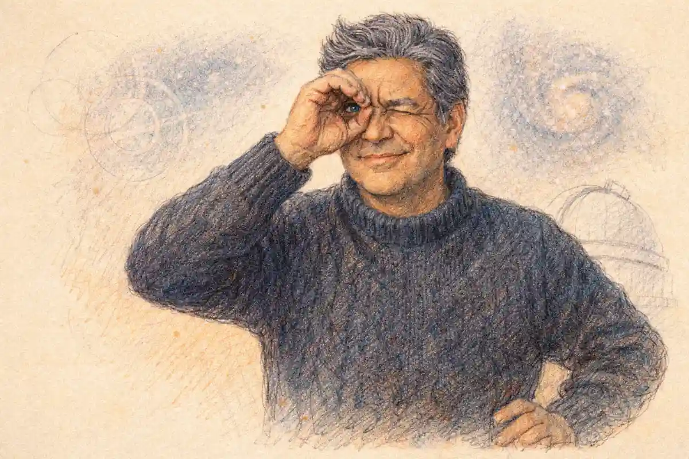

Charlotte Cushman played Romeo as no actor of her century, male or female, finally matched, and the American actress did it by refusing every term on which a woman in the part was supposed to be forgiven. She did not present the lover as a novelty, a burlesque turn, or a glimpse of legs in tights. She presented him as the tragedy's engine: ardent in the balcony, lethal in the street fight, broken in the Friar's cell, and annihilated in the tomb, played at full tragic weight opposite her own sister as Juliet. The verdict defended through this article is that her Romeo stands as the nineteenth century's most consequential assumption of the role, because it changed three things at once. It restored Shakespeare's ending to the stage in 1845 after the long reign of Garrick's adaptation. It proved that the part's mixture of tenderness and violence, the very mixture the text keeps naming as a gender puzzle, could be carried by a woman more completely than by the leading men of the age. And it left a documentary trail, in reviews, portraits, letters, and playbills, rich enough that scholars still fight over what her audiences saw in her, which is the surest sign that the performance mattered beyond its evenings.

The bare chronology already rebukes the cliché that fixes Romeo as a young man's part and treats every other casting as an experiment. Cushman first played the role in Albany in the later eighteen-thirties, a provincial proving ground far from metropolitan scrutiny. She carried it to London in December 1845, opposite Susan Cushman, and made it the sensation of a season in the capital that had invented the modern Shakespearean stage. She played it across Britain and America for three decades, opposite a succession of Juliets, in theatres that billed her name above the title. When the Illustrated London News reviewed her Romeo at the Haymarket in 1855, a full decade after the London triumph, its judgment was comparative and absolute at once: for force and passion, the performance exceeded that of any male performer, and yet avoided exaggeration. A verdict of that kind, printed in the era's great illustrated paper about a woman in a breeches role, is not a courtesy. It is a surrender document, signed by the critical establishment of the day.

The InsightCrunch Cushman profile gathers the record of that career in one table, because the facts are scattered across playbills, memoirs, newspaper files, and the scholarship of two centuries, and the pattern they form is the argument in miniature. A performer who began as a failed opera singer ended as the most famous woman in the English-speaking world, and the role that carried her there was a boy who dies for love in Verona.

| Element | The record |
| --- | --- |
| Performer | Charlotte Saunders Cushman, born Boston, 23 July 1816; died Boston, 18 February 1876 |
| Training | Opera at the Tremont Theatre, Boston, from 1835; the singing voice failed under soprano strain in New Orleans |
| Acting start | Lady Macbeth at the St. Charles Theatre, New Orleans, the part that replaced the lost voice |
| First Romeo | Albany, in the later eighteen-thirties, crowned with a wreath by a fellow actor after one performance |
| New York base | The Park Theatre, 1837 to 1840, rising from utility work to leading tragedy; Meg Merrilies among her signature parts |
| Management | The Walnut Street Theatre, Philadelphia, managed and starred in by Cushman from 1842 to 1844 |
| London debut | Bianca in Milman's Fazio at the Princess's Theatre, February 1845; The Times called her a great acquisition to the London stage |
| The sisters' production | Romeo and Juliet at the Haymarket, December 1845, Charlotte as Romeo opposite Susan Cushman as Juliet |
| The textual act | Shakespeare's own ending performed in 1845, Romeo dead before Juliet wakes, closing the Garrick version's ninety-seven years of stage life |
| The style | Force and passion joined to tenderness; a Romeo who fenced with authority and wept without restraint in the tomb |
| Other male roles | Hamlet and Cardinal Wolsey, the Wolsey played in robes that concealed rather than displayed the figure |
| Later Juliets | Matilda Hays at Bristol in 1848; Sarah Anderton in Boston in the eighteen-fifties; a debuting Miss Swanborough at the Haymarket in 1855 |
| The retirement record | Farewell appearances announced at least seven times; the final stage performance at Boston's Globe Theatre, 15 May 1875, as Lady Macbeth |
| The scholarly dispute | Emma Stebbins's authorized memorial of 1878 against Lisa Merrill's reading of the letters in When Romeo Was a Woman, 1999 |

Read the table's middle rows together and the production of December 1845 explains itself. The Romeo was a tragedienne at the height of her powers, managed by nobody, fresh from a debut the London press had compared to Edmund Kean's. The Juliet was her younger sister, a widow abandoned by her husband, restored to the stage by the same sister who played her lover. The text was Shakespeare's, with the tomb restored to its original desolation. Every element of the evening was a wager, and every element won.

## The Making of Charlotte Cushman: A Failed Voice and a Great Lady Macbeth

Cushman came to acting through a collapse, and the collapse shaped the instrument that later made her Romeo possible. Born in Boston in 1816 into a family whose fortunes had contracted, she was trained for the opera stage, where a strong contralto promised a living, and she made her first professional appearances at the Tremont Theatre in 1835, singing the Countess Almaviva in The Marriage of Figaro. The voice was powerful but misassigned. Pushed into soprano parts in New Orleans, it strained and failed, and a singer without a voice in a theatrical company town had one asset left, the body and intelligence that had carried the singing. The manager James Caldwell and the tragedian Barton advised her to act, and the part they handed her was Lady Macbeth. The choice reads like a dare. It became the foundation of a career, because the qualities that had made her singing imposing, the chest resonance, the command of breath, the physical scale, transferred intact to tragedy, and the lost top of the voice left behind a register that audiences would later describe, when she played men, as masculine without strain.

The Lady Macbeth of that New Orleans beginning was not a debutante's sketch. The performance won her a New York contract at the Bowery Theatre, and when that engagement dissolved in the theatre's fire, she rebuilt in Albany with a second Lady Macbeth that drew rave notices. Albany matters to this article for a larger reason than a rescued career. The city was a rigorous provincial stage, close enough to the capital to hear of reputations, far enough to let a young performer attempt parts no metropolitan manager would have risked on her. It was in Albany that Cushman first played Romeo, and the anecdote preserved in the early biographical record, of the actor John Nickinson leading her forward after the performance and placing a wreath on her head, has the ring of a company ritual rather than a press invention: fellow actors crowning a colleague for an assumption they knew to be dangerous. A woman playing Romeo in an American garrison town of the eighteen-thirties was not riding a fashion. The fashion, such as it was, belonged to burlesque houses and novelty bills. In a stock company playing the standard repertory, the part was a claim to the first rank of tragedy, and the wreath says the company understood the claim and ratified it.

The Park Theatre engagement that followed, from 1837 to 1840, was her university. She entered it, by the Appletons' Cyclopaedia account, willing to do general utility business, the humble stratum of a stock company that understudies everything and is promised nothing, and she rose through the repertory by accumulation: Portia, Belvidera, Queen Katherine, Ophelia, Viola, and the gypsy Meg Merrilies in Guy Mannering, the hag part that became her first signature in America. The range is the point. The Park years trained her in the two registers her Romeo would fuse, the commanding women of tragedy and the grotesque physicality of Meg, a part played crouched, aged, and half-mad. An actress who could hold a house as Meg Merrilies had nothing to fear from a sword fight in a Verona street. She had already learned to make a body unlike her own the vehicle of belief, which is the whole technical secret of the breeches role performed at the tragic level.

Philadelphia completed the apprenticeship in power. At the Walnut Street Theatre from 1842 to 1844 she was not merely the leading lady but the manager, choosing repertory, engaging companies, and answering for receipts, an education in the economics of the stage that separated her from every rival of her sex and most of her male contemporaries. When William Charles Macready, the reigning English tragedian, toured America in those years and played opposite her, the association became the bridge to London. Macready's encouragement, recorded across the biographical tradition, told her the truth that the Folger's modern account of her career restates plainly: American talent of her scale had to prove itself abroad before America would price it correctly. She sailed in October 1844, twenty-eight years old, with a tragedienne's repertory, a manager's understanding of the business, and a Romeo already in her body from Albany. London was not her beginning. It was her escalation.

### Why did Cushman enter the Park Theatre in a humble capacity?

She had concluded that her early successes had skipped a proper apprenticeship, so she applied to the Park's manager for any place that might be vacant and accepted general utility business, the stock company's humblest stratum. The engagement lasted from 1837 to 1840 and ended with her established as a leading actress.

## London 1845: Bianca at the Princess's and the Haymarket Wager

The London debut came in February 1845 at the Princess's Theatre, as Bianca in Henry Hart Milman's tragedy Fazio, and it landed with a force that startled a capital practised in discounting American performers. The Times, a paper sparing with theatrical praise, hailed her as a great acquisition to the London stage, and the biographical record preserves the comparison that followed her debut through the press: nothing like it had been seen since Edmund Kean's first appearance three decades earlier, and she was spoken of as a successor to Sarah Siddons. The comparison set matters more than the praise. Kean stood for volcanic originality, Siddons for statuesque grandeur, and a debut measured against both at once was being placed outside the ordinary economy of notices. The Princess's engagement ran through a long sequence of parts, Lady Macbeth, Rosalind, Emilia, Mrs. Haller among them, eighty-four nights of diverse and difficult characters by the count of the early Cyclopaedia of Female Biography, each received with the same verdict of power governed by intelligence. London had not discovered a promising colonial. London had been invaded by a finished tragedienne.

The invasion had been planned, and the planning shows in the choice of what came second. Cushman had not crossed the Atlantic to play Bianca forever. She had crossed to establish the authority that would let her attempt the one production no manager would have commissioned from an unknown: Romeo and Juliet with herself as Romeo and her sister as Juliet, in Shakespeare's text rather than the Garrick adaptation that had governed the play's stage life since 1748. Susan Cushman had to be fetched, trained, and presented. Susan had married at fourteen, been abandoned by her husband while pregnant, and been taken in by Charlotte, who supported the sister and the child and steered Susan onto the stage in 1839. The younger sister arrived in London in the summer of 1846 by one early account, though the production belongs to December 1845 on the stronger showing of the modern record, and the discrepancy in the old biographies is worth naming because it illustrates how quickly legend began editing this career. What no account disputes is the sequence of the triumph: the sisters appeared together at the Haymarket, Charlotte's Romeo opposite Susan's Juliet, and the impersonation created a sensation in London and afterward in Dublin, in the words of the Appletons' record, with the sister's grace and beauty adding to the success.

The wager's audacity is easy to miss at a distance, because the result is famous. Consider the risks as they stood in December 1845. A woman in the male lead of the era's defining love tragedy invited the charge of indecency from every quarter that policed the stage's morals. Two sisters in the lovers' parts multiplied the charge with a frisson no management could fully control. An American company accent in the most English of repertory pieces exposed both performers to the metropolitan sneer that had damaged Edwin Forrest. And the text itself, restored at the tomb, denied the audience the scene it had been trained for a century to expect, the lovers' waking duet inherited from Otway through Garrick. Any one of these choices could have emptied the house. Taken together they filled it, because the town understood that it was being offered an event rather than a revival, and because the central performance, once seen, answered the objections in the only court that mattered. Report after report returns to the same astonishment: the Romeo was not a woman performing a man. The Romeo was Romeo.

Queen Victoria's journal supplied the verdict that posterity quotes, that Cushman entered well into the character and that nobody would have imagined her a woman, her figure and voice being so masculine. The sentence is usually read as praise of disguise, and it is worth reading more carefully. The Queen had not been deceived about the performer's identity; the bills announced Miss Cushman. What the journal records is the collapse of the double vision that cross-gender casting was supposed to guarantee, the comfortable awareness that a woman was underneath the costume. In the tomb scene and the balcony scene alike, that awareness failed, and a sovereign not given to theatrical enthusiasm recorded the failure as fact. A command of the part so complete that the audience's knowledge of the actress stopped interfering with the fiction is the technical definition of great acting in any century, and Cushman achieved it in the role where the interference should have been strongest.

### Which theatre staged the Cushman sisters as Romeo and Juliet in London?

The Haymarket, in December 1845, where Charlotte Cushman's Romeo played opposite her sister Susan's Juliet in the second London season of the American tragedienne's campaign. The early biographical record in Appletons' Cyclopaedia places the Romeo season at the Haymarket, after the debut triumph as Bianca at the Princess's Theatre earlier that year.

## Two Sisters as the Lovers: What the Casting Did to the Play

The sister casting is the element of the 1845 production that commentary reaches for first and understands last, because it is usually treated as a curiosity of biography. It was in fact a piece of stagecraft with consequences for the tragedy's meaning. Romeo and Juliet opens with the Chorus promising "a pair of star-cross'd lovers" (Prologue, line 6, in the Folger Shakespeare text), and every production must solve the problem of making an audience believe in a passion that ignites in a shared sonnet at a feast and burns through five days to a double suicide. Male and female strangers cast by a manager solve it nightly by craft. The Cushman sisters solved it by kinship transposed. The trust, the physical ease, the finished understanding between the two performers were real, accumulated over a shared childhood and a shared rescue, and the audience watched that reality pass through the fiction and ignite it. Charlotte had in the plainest sense saved Susan's life prospects; Charlotte played the young man who dies failing to save Susan's character. The production's emotional voltage came from that circuit, and no rehearsal process available to a patent theatre could have manufactured it between strangers.

The casting also solved the morality problem that the breeches role always carried. A woman in tights opposite an unrelated Juliet risked the era's suspicion that the spectacle was the point. A sister opposite a sister wrapped the performance in a family sanction that disarmed the suspicion in advance, and the reviews of the period show the mechanism working: notices dwell on Susan's grace and beauty and Charlotte's force as properties of a household offering, as though the theatre had been lent a drawing room's respectability for the evening. Lisa Merrill, the scholar whose When Romeo Was a Woman remains the fullest study of the phenomenon, shows how thoroughly the sister frame let different audiences take different performances home. Playgoers who wanted a respectable tragedy of young love received one. Playgoers, and especially the women who wrote to Cushman in floods of letters, who wanted the spectacle of a woman commanding a man's passion with a man's authority received that as well, under the family's cover. The production's genius was that both audiences were watching the same acting and both were right about it.

Against that background, the one comparative measure the brief of this production invites is the era's reigning Juliet tradition, and it can be taken briefly, because the Juliet of the age belongs to another article's territory. Fanny Kemble had made her Juliet in 1829 the standard of the Romantic heroine, a performance of girlish spontaneity preserved in her own memoirs and played, as the whole century played the part, inside Garrick's adapted text with its tomb duet. Susan Cushman's Juliet, slighter in reputation and trained by her sister for this single campaign, faced the Kemble standard with one advantage no Romantic Juliet had possessed: a Romeo who restored the text beneath her. Where Kemble's Juliet had woken in the tomb to speak with a living lover, in the scene Garrick built, Susan's Juliet woke to the Shakespearean desolation, a corpse, a friar, and twenty lines of solitary resolution before the dagger. The sisters' production thus reversed the era's hierarchy of fame. The celebrated Juliet of the age had served the adaptation. The unknown Juliet of December 1845 served the play, because her Romeo had insisted on it, and the record of [Fanny Kemble and the Romantic Juliet](/2027/09/24/fanny-kemble-romantic-juliet/) preserves the older standard against which that reversal can be measured.

Susan's own contribution should not be dissolved into her sister's legend. The early accounts agree on the distribution of gifts: the younger sister was the more beautiful, the elder the more powerful, and the production needed both facts. A Juliet of mere competence opposite that Romeo would have unbalanced the evening into a solo. Susan's grace held the partnership in equilibrium, and the Staffordshire figurines of the sisters in character, manufactured at Burslem around 1852 and held by the Folger Shakespeare Library, testify to a fame that belonged to the pair as a pair. The image that entered the nation's parlours, in porcelain and in print, was double: the Romeo and the Juliet, the sisters, an emblem of the production rather than a portrait of a star. Charlotte Cushman, who understood publicity as few performers of the century did, let the emblem circulate. Her Romeo's authority was not diminished by sharing the frame. It was authenticated by the sharing, since only a Romeo secure in the part could afford to be remembered as half of a couple.

### Why did casting Susan as Juliet change the risk of the enterprise?

Kinship converted scandal into sanction. A woman playing Romeo opposite an unrelated actress invited the era's charge that the breeches spectacle was the attraction; a sister playing opposite a sister wrapped the lovers' scenes in a family frame that disarmed the charge, filled the house, and let audiences read the performance as tragedy rather than novelty.

## Restoring Shakespeare's Ending: The Tomb Without the Duet

The textual act of the 1845 production deserves its own section, treated here as an event in Cushman's biography, with the wider movement that followed left to the survey that owns it. For ninety-seven years, from Garrick's first staging of his adaptation in 1748, the English stage had closed the tragedy with the tomb scene as Otway had rebuilt it and Garrick had polished it: Juliet wakes before the poison finishes Romeo, the lovers speak, embrace, and part in a duet of recognition that the eighteenth century prized as the play's crown. Shakespeare's close is colder and greater. His Romeo dies mid-sentence, "O true apothecary! / Thy drugs are quick. Thus with a kiss I die" (5.3.119 to 120), and his Juliet wakes to a corpse and a friar's frightened counsel, reads the empty cup as evidence, and takes the dagger at speed. The Yale Shakespeare's appendix on the play's stage history states the restoration in one clause: the additions to the death scene remained popular and were used in America as late as 1899, although Charlotte Cushman restored Shakespeare's conception in 1845. The clause's placement of her name, in a scholarly edition's compressed history of three centuries, measures what the act signified. The most famous female Romeo of the age was also the performer who handed the play back its ending.

The restoration was not antiquarian piety. It was continuous with everything the production stood for. A Romeo played by a woman had already staked the evening's claim on the text rather than on convention: the bills asked the town to accept the part as Shakespeare wrote it, a youth whose passion is indistinguishable from his ruin, and to forget the performer's sex in the presence of the writing. To have kept Garrick's duet would have broken the argument at the climax, substituting the adaptation's manufactured pathos for the play's own irony at exactly the moment when the production's fidelity was on trial. Cushman's Romeo died as Shakespeare's Romeo dies, unheard by the waking Juliet, and the audience's solitary possession of the truth, the knowledge Romeo carries out of the world unspoken, did the work that a century of duets had done by simpler means. The restoration also completed the sister logic of the casting. Susan's Juliet was granted the harder, lonelier scene, the waking among the dead, and the production trusted the younger sister with the tragedy's most exposed twenty lines. Trust of that order, extended in public, was the family's signature: the elder sister's authority expressed as faith in the younger's nerve.

One boundary must be drawn precisely, because the movement that followed has its own article and its own claims. Cushman's restoration of 1845 was an act within a production, carried by a performer's authority. Samuel Phelps's restoration at Sadler's Wells in 1847 was an act within a programme, the managerial campaign that returned Shakespeare's texts to the London stage season by season. The two acts are allies, not rivals, and the sequence flatters neither capital nor country in any simple way: the performer's conviction preceded the programme, and the programme gave the conviction an institution. What belongs to Cushman alone is the conjunction. In December 1845 the restoration and the breeches Romeo were the same gesture, a single production arguing that the play, played as written, was stronger than every habit that had accumulated around it, the habit of the adapted tomb and the habit of the male lover alike. Later restorations could cite her precedent for the text. None could repeat the gesture's completeness, because none again joined the two defiances in one evening.

### What exactly did the 1845 production restore at the tomb?

Shakespeare's disposition of the deaths. Romeo dies of the poison before Juliet wakes, mid-sentence and unheard, and Juliet wakes to his corpse, reads the cup, refuses the Friar's flight, and takes the dagger. The waking duet that Otway devised and Garrick's adaptation had played for ninety-seven years was struck out, and the irony of the close returned with it.

## The Ardent Style: Sword, Voice, and the Weeping Romeo

What did the performance look and sound like, at the distance the documents allow? The evidence converges on a paradox the Illustrated London News named in 1855: force and passion exceeding any male performer's, joined to an avoidance of exaggeration that male performers, obliged to modify and suppress, could not match. The paper's reasoning deserves attention, because it inverts the era's assumption about casting. A male Romeo, the review argued, must hold his vehemence in check lest ardour curdle into rant or absurdity. A tragedienne of taste could release the full vehemence of the situations, since her utmost remained, by the period's measure of physical scale, within the bounds of nature. The woman was therefore freer in the part than the man. The argument is a period argument, steeped in period assumptions about bodies, but its conclusion is an acting observation of permanent value: Romeo is written at a pitch of emotional exposure that punishes restraint and rewards abandon, and the performer who can afford abandon owns the role.

The text itself insists on the pitch. Romeo enters the feud's street brawl converted by love into something the feud cannot parse: "O brawling love, O loving hate" (1.1.176) is the oxymoron style of a mind already living at extremes, and at the feast the extremes find their object in the shared sonnet, "If I profane with my unworthiest hand / This holy shrine, the gentle sin is this" (1.5.93 to 94), where the lover's ardour speaks in liturgy. The balcony scene then demands the register Cushman's reviewers kept calling melting: "But soft, what light through yonder window breaks? / It is the east, and Juliet is the sun" (2.2.2 to 3). A Romeo who cannot sing those lines without strain forfeits the act. Her contralto, the opera training redirected, the breath that had filled the Tremont in Figaro, carried the balcony at the pitch of song the lines require, while the tragedienne's physique carried what the song must survive: the killing of Tybalt, the vault, the fight with Paris. Tana Wojczuk, her modern biographer, notes the excellence of her swordsmanship, a skill the record shows her practising deliberately, and the fencing mattered to the verdicts. A Romeo who fences like a dancer in a burlesque breaks the fiction at Act 3. Cushman's Romeo killed Tybalt, in the phrase the Folger's account gives the podcast record, like a cavalier, and the fiction held.

The cell scene is the part's trap and her triumph's centre. Shakespeare writes the Friar's rebuke as a gender prosecution: "Art thou a man? Thy form cries out thou art; / Thy tears are womanish; thy wild acts denote / The unreasonable fury of a beast" (3.3.109 to 111). A male Romeo must act his way out of the charge, proving manhood by mastering the grief the scene has just displayed. Cushman's Romeo could let the charge land and keep falling, because the audience's knowledge of the performer licensed the tears the character's world forbids. Wojczuk's account of the tomb scene states the resulting effect exactly: where other Romeos held the dead Juliet's hand, Cushman crushed Juliet in her arms and wept freely, and men in the audience found in her grief a permission for their own. The sequence across the evening thus reversed the usual economy of the breeches role. The costume promised titillation and delivered none. What it delivered was access, an emotional range in the hero that the age's codes of manliness rationed for male performers and that a woman, paradoxically, could spend in full.

Romeo himself names the mechanism, in the play's most quoted self-diagnosis: "Thy beauty hath made me effeminate / And in my temper softened valour's steel" (3.1.113 to 114). The lines concede that love has unmanned him by his world's accounting, spoken in the moment before he kills Tybalt and re-enters the feud's economy of violence. A century of male Romeos had played the concession as a figure of speech. Cushman's casting made it the production's thesis. Her Romeo stood before the town as visible proof that the effeminate and the valorous were not opposites but phases of one nature, the softness and the steel succeeding each other in a single body across a single evening, which is precisely the arc Shakespeare wrote and precisely the arc her culture was struggling to think about its own sons. James Shapiro, surveying the phenomenon of the female Romeo in the decades before the Civil War, ties the vogue to a crisis in American manhood, as an older ideal of moderation and domestic virtue gave ground to a more aggressive model of physical dominance. On that reading, Cushman's Romeo arrived as an argument in the national debate, an embodiment of the older, feeling masculinity at the moment of its displacement, performed by the one kind of actor who could still join tenderness to authority without apology.

The style's discipline should not be lost inside its passion. The witnesses agree on her intellectual preparation, the Shakespeare read closely and construed independently, the interpretations that struck contemporaries as exciting and new rather than inherited from the promptbook tradition. Her Romeo was not Garrick's Romeo in skirts, not Barry's melting lover with the sexes exchanged. It was a reading: the youth's haste interpreted as ardour rather than folly, his courtesy to enemies read as the feud's standing reproach, his despair in Mantua, "Then I defy you, stars!" (5.1.24), delivered as the decision of a mind that has weighed the news and chosen its answer. The defiance line is the crux of any Romeo, the hinge between the lover and the suicide, and the reviews' recurring word for her handling of the last act is conviction. Audiences believed the death because the performance had never once asked them to admire it. It had asked them to follow a reading, and the reading ended in the vault.

## What the Critics Said: London and America Weigh a Woman's Romeo

The critical record divides into three strata, and the strata disagree in ways that map the century's argument with itself. The first stratum is astonishment, the London notices of 1845 and 1846, where the vocabulary of conquest does the work: a great acquisition, a sensation, the Kean comparison, the Siddons succession. The second stratum is comparison, the settled judgment of the following decade, of which the Illustrated London News verdict of 1855 is the type specimen: the performance weighed against every male Romeo in memory and placed first for force and passion. The third stratum is the American echo, the notices that followed her home tours after 1849, in which a Pittsburgh reviewer supplied the sentence that outlasted the century's theatrical journalism: the character of Romeo had been seen played by males and females, but never before with the effect Miss Cushman gave it, since in walk, gait, gesture, mode of speech, and freedom of attitude she was every inch the man. The Pittsburgh sentence rewards slow reading. Its catalogue is a craftsman's catalogue, walk, gait, gesture, speech, attitude, the five channels through which an audience reads a body on a stage, and it finds her complete in all five. That is not the language of indulgence toward a novelty. It is the language of a tribunal recording a masterclass.

Dissent existed, and the honest account keeps it in view. The word impersonator attached itself to her in some quarters, a term of art in the period for a performer, usually a woman in male dress, whose act consisted of mimicry rather than embodiment, and its application to Cushman was a demotion attempted by critics, and by some male actors, whose categories she had embarrassed. Merrill's study documents the resistance plainly: she was judged, in the end, as a Romeo and not as a female Romeo, despite criticism from male actors and critics invested in the distinction. The demotion failed because the comparison class kept betraying it. An impersonator is measured against the original she copies. Cushman's Romeo was measured against Romeos, Garrick's heirs and Barry's heirs, and found to exceed them in the role's defining scenes, which is the comparison the Illustrated London News printed. A copy does not surpass the originals in the originals' own part. The impersonator charge therefore survives in the record chiefly as evidence, the trace left by a critical vocabulary that had no shelf for what she was and reached for the nearest one.

The Boston anecdote preserved by her early biographer Clara Erskine Clement shows the performance policing its own dignity in person. At a Boston performance in the eighteen-fifties, with Sarah Anderton as her Juliet, a spectator answered an intimate scene with a loud, derisive faked sneeze. Cushman stopped the performance and led her Juliet from the stage, in Clement's phrase, as a cavalier might lead a lady from the place where an insult had been offered her. The gesture is usually retailed as temperament. It is better read as doctrine. The insult had been aimed at the casting's supposed impropriety, the sneeze of a man announcing that two women in the lovers' parts were a spectacle for mockery. Her answer was delivered in character and out of it at once: the Romeo protected the Juliet, the tragedienne protected the production, and the house understood that the performance would proceed on its own terms or not at all. The audience that returned to its seats had been taught the production's premise by the production itself. Cross-gender casting, the episode insists, was not a licence the audience granted her. It was a jurisdiction she held.

The verdict that emerges from the three strata is stable enough to state as the article's finding on reception. In London she converted scepticism about an American, and about a woman, within a single season, taking the debut notices for Bianca and the sensation notices for Romeo as consecutive proofs. In America she converted familiarity into reverence, the home audience's long knowledge of her Meg Merrilies and Lady Macbeth notwithstanding, becoming for the republic's playgoers what the Smithsonian's modern summary calls the most famous woman in the English-speaking world, with Lisa Merrill's authority behind the superlative. And in the provinces of both countries, Bristol and Dublin and Pittsburgh and Boston, the pattern repeated without decay across thirty years, which separates a reputation from a sensation. Sensations expire with their season. Her Romeo was still drawing the Illustrated London News's superlatives in 1855 and still crowning her bills in the eighteen-seventies. The part had become a property of her name as completely as Hamlet belonged to the tragedians, and the town that had once debated whether a woman might play Romeo ended by debating which Romeo, among all who played it, had been the standard. The record answers with her name.

## Women Who Played Romeo: The Tradition Cushman Crowned

Cushman was not the first woman to play Romeo, and the article that pretends otherwise steals her real distinction, which is not priority but supremacy within a crowded field. Anne Russell's study of women as tragic heroes, surveyed in the JSTOR Daily account of nineteenth-century gender play, establishes the field's shape: cross-dressed performance had flourished in comedy, dance, and melodrama for generations, and the nineteenth century carried it into tragedy, where the most popular Shakespearean roles for women were Romeo and Hamlet, ahead of Macbeth, Cardinal Wolsey, Shylock, Richard the Third, and Iago. The tragic breeches role was a repertory fact, not a freak. What varied was the register of intention. At one end stood the burlesque and the novelty bill, where a woman's Romeo was a sight gag with a famous text attached, and Wojczuk's biography is blunt that earlier female Romeos had largely been received in that spirit. At the other end stood a small company of tragediennes who claimed the part on the same terms as the leading men, and at their head, by every contemporary measure of receipts, reviews, and longevity, stood Cushman.

James Shapiro's census gives the American scale of the phenomenon. Between the eighteen-twenties and the Civil War, more than a dozen women played Romeo on New York stages alone, and the New York Times could declare, in the period's own words, that something in the delicacy and gentleness of Romeo's character required a woman to represent it, the character's luscious language seeming strange on the lips of a man. The declaration is astonishing and instructive in equal measure. A metropolitan newspaper of record argued, in earnest, that the male lead of the national poet's love tragedy was miscast by nature when played by a man, because the writing's tenderness exceeded what a male instrument could utter without embarrassment. The argument would be unthinkable in print a generation later, which is Shapiro's point about the window: the female Romeo flourished inside a specific settlement of American gender feeling, before the Civil War hardened the codes, and Cushman was both the window's greatest beneficiary and its most powerful exhibit. She did not create the settlement. She proved what it had been trying to say, that the part's centre of gravity lay in a region of feeling her culture assigned to women and its poetry assigned to a Veronese boy.

The tradition's other peaks clarify her altitude by contrast. Sarah Bernhardt's Hamlet, the century's other great cross-gender assumption, came in 1899, in another language and another theatrical economy, and its fame is the fame of a single summit attempted late. The female Romeos of the American circuits, the Mrs. Lewises and Fanny Vinings of the transvestite phenomenon's rosters, worked the part inside stock systems that rarely let a performance accumulate the documentary afterlife of reviews, portraits, and porcelain that attended the sisters. Cushman's Romeo is the tradition's centre because it alone joined all the conditions at once: the metropolitan conquest in London, the textual restoration, the sister casting, the three-decade touring life, and the paper trail. Remove any one condition and the performance remains admirable. Together they made it the standard against which the whole phenomenon is still described, so that a modern scholarly census of successful transvestite Shakespeareans, Ellen Boyer's study of the phenomenon, builds its argument around her Romeo and Bernhardt's Hamlet as the twin proofs that the form, at its best, was tragedy and not stunt.

Her relation to the tradition was not merely exemplary but causal. A success of that magnitude repriced the part for every manager in two countries. After 1845, a woman's Romeo was a bill a theatre could advertise with a straight face and a bankable name, and the dozen New York Romeos of Shapiro's census played in a market her London triumph had legitimated at the highest level. The mechanism is the ordinary one by which repertories change: a precedent at the summit converts eccentricity into option. The Garrick century offers the analogy in the other direction, since it was at the summit, in [the 1750 Romeo and Juliet stage war](/2027/09/03/1750-romeo-and-juliet-stage-war/), that Barry's Romeo had proved a melting lyric lover could outdraw the age's greatest actor in the age's own adaptation. Cushman's century took the lesson one step further. The lyric lover the town preferred could be a woman, and the preference, ratified in London and re-ratified on two decades of American tours, stood until the culture, not the casting, changed its mind.

### How many women played Romeo in New York before the Civil War?

More than a dozen, on James Shapiro's census of the American stage between the eighteen-twenties and the Civil War. The figure covers New York alone, and the New York Times of the period argued in earnest that the delicacy and gentleness of the character required a woman to represent it, the part's luscious language seeming strange on a man's lips.

## The Mirror of Conventions: A Woman's Romeo and the Boy Who Played Juliet

Cross-gender casting in this play is older than any other convention of its stage life, and Cushman's Romeo is best understood as the convention completing a full circle. The first Juliet was a boy. On the Elizabethan stage the Capulet daughter, her Nurse, and Lady Capulet were all played by apprentices of the company, and the audience that first heard "Gallop apace, you fiery-footed steeds" (3.2.1) heard it in a boy's voice, a fact the record of [the boy who played Juliet first](/2027/08/13/boy-actor-first-juliet/) sets out from the company's own documents. Nobody in that audience experienced the casting as an argument. It was the water the theatre swam in, the legal and economic settlement of a stage from which women were excluded. When the exclusion ended at the Restoration and actresses took the female parts, the mirror image became possible for the first time: women reaching across to the male roles. The breeches tradition that followed, in comedy first and tragedy after, is the boy actor's legacy running in reverse, the same discovery from the other side, that a performed gender on a stage is a craft product, built from voice, gait, gesture, and conviction, and not a biological deposit the audience merely uncovers.

What the mirror reveals, in both directions, is the role's own double construction. Shakespeare wrote Juliet for a boy and gave her the tragedy's most commanding rhetoric, the potion speech's resolve, the tomb scene's executive swiftness, so that the part's femininity was always, in performance, a made thing, an achieved illusion sustained by technique. He wrote Romeo across the same seam from the other side, a hero whose valour the text keeps interrupting with weeping, whose beauty unmans him by his own confession, whose Friar prosecutes him for womanish tears. The two lovers are, in the writing, a matched pair of gender puzzles, each part demanding that its performer hold force and tenderness in one body without letting either cancel the other. The boy Juliet solved the puzzle by craft in an age that forbade the alternative. Cushman's Romeo solved it by biography in an age that doubted the attempt, and the symmetry between the solutions is the deepest thing her performance proved: the play does not merely tolerate cross-gender casting. At its two poles, across three centuries, the play keeps generating it, because the writing itself is built on the seam the casting exposes.

Victorian culture understood the exposure and argued about it in the open, which is why the Cushman record is so voluble compared with the silence around the boy actors. The Elizabethan convention left almost no commentary because it provoked almost none. The Cushman Romeo left libraries of commentary because it arrived inside a culture conducting a loud public argument about women's capacities, women's wages, women's education, and the separate spheres, and a woman commanding the stage's most ardent lover, managing her own company, supporting her family from her earnings, and filling the Haymarket in a man's part was evidence in that argument whether she sought the role of evidence or not. Merrill's scholarship is at its strongest here, tracing how the letters of female spectators converted a theatrical event into a private revelation repeated thousands of times: women who had watched one of their own sex embody passion, authority, and physical courage under the cover of a classic reported the experience as a widening of the possible. The performance's meaning was therefore never only aesthetic. It was a demonstration, renewed nightly, that the qualities the culture reserved to men could be produced, at the highest level of finish, by a woman the culture had first tried to use up as an opera singer.

The objection that shadows every cross-gender triumph should be faced at full strength, because she faced it. The objection runs: the audience never forgot, the doubleness was the pleasure, and the performance therefore proves nothing about the role, only about the frisson of disguise. The record answers the objection at its strongest point, the tomb. Frisson does not survive Act 5. A novelty casting draws its crowd for the balcony, where the doubleness is picturesque, and loses it in the vault, where the fiction demands undivided grief across a corpse in a restored text that denies the audience every conventional consolation. Cushman's tomb was the scene her witnesses singled out, the crushing embrace, the free weeping, the conviction that carried the defiance of the stars into the draught of poison. If the doubleness had been the pleasure, the last act would have been the exposure. It was the coronation. The verdict of this section is therefore the article's central claim in its general form: cross-gender casting reveals that Romeo is a part about the performance of gender before it is a part within one, a youth learning in five days to perform the man his feud requires and the lover his heart requires, and failing, and dying of the failure's cost. A woman who had spent a career performing both halves of that lesson did not decorate the role. She glossed it with her life.

## The Long Career of the Part: Juliets, Tours, and the Wolsey Proof

A Romeo played for thirty years becomes a different object from a Romeo played for a season, and the long career of Cushman's assumption is a study in how a performance survives its performer growing older inside it. She was twenty-nine at the Haymarket triumph. She was still the Romeo of record when the Illustrated London News weighed her in 1855 against every male performer, and the bills of the eighteen-seventies still traded on the part. The text she played is pitiless about age: Juliet is not yet fourteen, and Romeo is a youth whose contemporaries tease him for sighing like a schoolboy. No tragedienne of fifty impersonates that youth by cosmetics. What the later performances offered instead was the accumulation the early ones could not have, a reading matured across hundreds of repetitions, in which the ardour had been thought through to its last consequence and the haste of the part was played by an artist who knew exactly where haste ends. The town that had crowned the young Romeo's fire returned for the older Romeo's comprehension, and the part's durability under that transformation is itself evidence about the role. A Romeo built on youthful beauty expires with the beauty. A Romeo built on a reading renews itself as the reading deepens, which is why hers, alone among the female Romeos of the century, has a thirty-year performance history to document.

The succession of Juliets across those decades amounts to a shadow history of the production's meanings. Susan came first, the sister, the sanctioning frame, her Juliet preserved in the porcelain figurines of about 1852 that made the pair a national emblem. Matilda Hays followed at Bristol in 1848, Hays being no stage convenience but Cushman's partner, and the Bristol playbill that records the pairing, preserved in the city's archives, thus documents a bolder statement than the sister casting had been: the lovers played by two women bound in life, before a provincial audience that bought its tickets anyway. Sarah Anderton was the Boston Juliet of the faked-sneeze performance, the occasion on which the Romeo's protection of the Juliet passed from fiction into the evening's real conduct. Miss Swanborough, debuting at the Haymarket in 1855, represents the production in its institutional phase, the Romeo as an established classic dispensing the favour of an appearance to a newcomer in the opposite part, the Illustrated London News weighing the veteran's force and passion while advising the debutante to grow into a role that no actress, in the paper's borrowed maxim, can fully know until she is too old to play it. Sister, partner, protégée, debutante: the four Juliets map the four ages of the production, from family wager to repertory monument, and the constant at the centre of the map is the Romeo's authority, the fixed star around which the casting of a generation revolved.

The proof that the Romeo was artistry rather than titillation was one Cushman herself designed, late and deliberately, and it stands as her own adjudication of the impersonator charge. The Smithsonian's account of her Cardinal Wolsey costume, made about 1857 for Henry VIII and held by the National Museum of American History, draws the contrast exactly. The breeches costume of Romeo displayed the figure, as the period's male-role costumes did, and the display was part of what the town's men came to see. The Wolsey robe, worn on more than a dozen special occasions between 1857 and 1873, concealed everything: loose robes, a chest measurement expanded beyond her own, a wig of thin fair hair replacing the dark luxuriance she wore as Romeo and Hamlet. In Wolsey she undertook to play a man while looking as much like one as the wardrobe allowed, stripping the performance of every dividend the breeches had paid, in order to demonstrate that the authority audiences had credited to the costume had belonged to the acting all along. The demonstration succeeded on its own severe terms, and it retroactively judges the Romeo. A performer who could hold Boston and New Orleans as a scheming churchman in a sack of robes had never needed the tights. The tights had needed her, to prove they were not the attraction.

Hamlet completes the male repertory's testimony. She played the Prince as she played Romeo, at the level of the tragedians, and the farewell she gave in the part at Washington before her departure for Italy belongs to the record of a career in which the male roles were not episodes but a parallel canon. The pattern across Romeo, Hamlet, and Wolsey is the pattern of the great tragedians of any sex: the lover, the prince, and the statesman, the three ages of Shakespearean manhood, each assumed whole and each surrendered to no rival of her time. Set beside the female canon she held simultaneously, the Lady Macbeth that began everything, the Meg Merrilies that made her American name, the Queen Katherine she played for Queen Victoria's command, the Nancy Sykes of the Oliver Twist adaptation, the double canon amounts to nearly two hundred parts across a career, and it reframes the Romeo one final time. The breeches role was not her escape from women's parts. It was one hemisphere of the largest Shakespearean dominion any American performer of the century, of either sex, ever held.

### Which of Cushman's male roles was played in a costume that hid her figure?

Cardinal Wolsey in Henry VIII. The robe made for her about 1857, held by the Smithsonian's National Museum of American History, was cut loose with an expanded chest and worn with a wig of thin fair hair, concealing the figure that the Romeo costume displayed, so that the performance rested on acting authority without the breeches role's usual visual dividend.

## Rome, the Fortune, and the Seven Farewells

The career's second act was conducted from Rome, and Rome explains what the Romeo had purchased. From the eighteen-fifties Cushman kept her household in the city for long stretches, the centre of a colony of women artists and writers that the scholarship of her circle has made famous in its own right: Harriet Hosmer, the most celebrated American woman sculptor of the period; Edmonia Lewis, the African American and Ojibwe sculptor whose career Cushman sponsored; Emma Stebbins, the sculptor of the Angel of the Waters, who became her partner and, in time, the editor of her memory. The colony was not a retirement hobby. It was the conversion of theatrical earnings into cultural power of a durable kind, a salon that functioned as an alternative institution in a world whose academies and exhibitions were governed by men, staffed by the income of a woman whom the London stage had tried to classify as an impersonator. The Romeo's receipts built Rome. Every account of the colony that begins with the art should spare a line for the box office that endowed it, since the endowment is the practical measure of the performance's success, the distance between a sensation's season and a fortune's foundation measured in productions played across two continents for thirty years.

The American public of the Civil War years received her as a national possession. She returned in 1863 to perform for the benefit of the Sanitary Commission, the great civilian relief engine of the Union cause, and the record of those months places Abraham Lincoln in her audience at Grover's Theatre in Washington for Macbeth in October 1863, the President talking theatre and politics with her across repeated evenings. The episode belongs in this article because it fixes the social altitude the Romeo had reached. A performer the culture had initially received as a gender puzzle had become, by the war's middle, a figure a wartime president sought out for conversation, her interpretations of Shakespeare treated as a form of counsel. The arc from the Albany wreath to the presidential box is the arc of the breeches role itself in her hands, from company curiosity to civic institution.

Retirement, when it came, came as a campaign rather than an event, and the campaign's comedy is documented too well to omit. Her farewell appearance was announced at least seven times in as many different years, a discrepancy the early biographical record states with dry precision, as though the tragedienne were conducting her own long goodbye on the instalment plan her audiences kept financing. The substance beneath the comedy is the economics of fame before pensions and royalties: a performer's capital was her presence, and presence could only be sold while it could still be announced as scarce. The final performances, when the announcements at last meant what they said, carried the full ceremonial weight of a state occasion. The farewell of the New York stage at Booth's Theatre in 1874, in Lady Macbeth, was attended by social and literary demonstrations that turned an evening at the theatre into a public valediction, crowds packing the house and spilling into the Broadway sidewalks in the Smithsonian's description. Philadelphia took the same farewell in the same character. The career then closed where the legend had started, in Boston, at the Globe Theatre on 15 May 1875, with Lady Macbeth again, the first great part of the New Orleans rescue surrendered last. She spent the remaining months between Newport and Boston under medical care for the illness that ended her life, and she died in Boston on 18 February 1876, aged fifty-nine, and was buried in Mount Auburn Cemetery in Cambridge. The Romeo was not the farewell part, and the choice is its own commentary: she took her leave in the role that had made acting possible for her, the woman's part, as though to insist at the end that the dominion had always been whole, both hemispheres, and the man's part that crowned it had been one province of a single sovereignty.

### When did Charlotte Cushman last act on any stage?

On 15 May 1875, at the Globe Theatre in Boston, in Lady Macbeth, the part that had begun her acting career in New Orleans four decades earlier. The performance closed a farewell campaign announced at least seven times across as many years, including the ceremonial New York goodbye at Booth's Theatre in 1874 in the same character.

## Stebbins, Merrill, and Shapiro: The Quarrel over What the Audience Saw

The scholarship of Cushman is a quarrel with three corners, and the brief's demand for named critics in disagreement can be met exactly, because the three positions genuinely exclude one another at their centres. The first corner is Emma Stebbins, sculptor, partner, and the editor of Charlotte Cushman: Her Letters and Memories of Her Life, published in 1878, two years after the death. Stebbins's memorial is an act of custody. It presents the authorized Cushman: the genius of respectable striving, the devoted daughter and sister, the friend of the eminent, the tragedienne whose private life the volume arranges into edifying silhouette. As editing, it is masterly and partisan at once, the foundation document of the legend and the first obstacle in the archive, since every later scholar must read through the memorial's selections to the letters it framed, trimmed, and in places silenced. The editor's verdict, delivered by arrangement rather than argument, is that the Romeo was a triumph of art within a life of unimpeachable respectability, and that nothing else about it requires explanation.

The second corner is Lisa Merrill, whose When Romeo Was a Woman: Charlotte Cushman and Her Circle of Female Spectators, published by the University of Michigan Press in 1999, read the archive against its custodian. Merrill's Cushman is the centre of a circle of female spectators whose letters, preserved in their thousands, record responses the memorial could not print: women who experienced the Romeo as an erotic and emancipatory event, who wrote to the performer as to a lover and a liberator in one, and whose devotion built the virtual community of the book's argument. Merrill's celebrated formulation, preserved in the Theatre Journal review of the study, holds that Cushman's greatness lay partly in her ambiguity, since she served different roles for different audiences, each finding some aspect of her to admire and identify with, an icon who both embodied and disturbed her culture's dominant ideologies of gender and sexuality. On Merrill's reading, the restoration of Shakespeare's text and the sister casting were not separate from the erotic charge but its enabling conditions, the respectability that let the charge circulate. The Romeo's meaning, for Merrill, is located in the spectators, and the truest reviews of the performance are the fan letters Stebbins suppressed.

The third corner is James Shapiro, whose account places the phenomenon inside the political history of American manhood. Where Merrill looks at the women in the audience, Shapiro looks at the men, and at the culture that employed them: the decades of the female Romeo were the decades of a crisis in the national model of masculinity, as the moderate, domestic, virtuous ideal of the early republic gave ground to the aggressive physicality of Manifest Destiny, and Romeo, the lover who weeps, kills, and calls himself effeminate, became a part the ascendant model could not play convincingly while the displaced model still filled theatres. Shapiro's Cushman is therefore a symptom and an instrument of a national argument, and his melancholy coda, that female Romeos vanished from the stage after the Civil War's slaughter had redefined American manhood in blood, gives the phenomenon a closing date with a cause attached. Tana Wojczuk's biography Lady Romeo, published in 2020, mediates the quarrel with fresh archival narrative, emphasizing the performed quality of Cushman's masculinity, her craft in swordsmanship and gait, and the licensing of male tears, while restoring the performer's own agency against every school that would make her merely an emblem of her audience or her era.

Adjudication is required, and the evidence supports a ranked verdict. Stebbins loses on the facts she curated, since the letters Merrill published exist, say what Merrill says they say, and cannot be uninvented by the memorial's silence; the authorized life stands convicted as a partial record, valuable precisely because its omissions map what the age required a great woman to hide. Between Merrill and Shapiro, the verdict divides the house by question. On the mechanism of the performance's power inside the theatre, Merrill wins: the spectators' own testimony is the primary evidence for what an audience experienced, and her archive is the one body of evidence that records reception at first hand. On the conditions that made the power possible, Shapiro wins: the vogue's dates, its American density, and its postwar extinction are facts of cultural history that no archive of letters explains, and his crisis of masculinity supplies the cause Merrill's circle presupposes. Wojczuk's craft evidence then disciplines both, since the swordsmanship, the gait study, and the crushed embrace in the tomb remind every theorist that the phenomenon began in a body doing difficult things superbly. The article's final position is accordingly a synthesis with an order of rank: the acting was the cause in the theatre, the female spectators were the meaning in the culture, and the crisis of manhood was the weather that let the meaning spread. Remove the acting and the other two have nothing to attach to, which is why the performer, and not her interpreters, keeps the last word in this article as she kept it in the Haymarket.

The documentary base for all three positions can be assembled and compared by any reader willing to work through the playbills, the Press notices, the Folger's images, and the letter collections, and students preparing that material for seminar presentation can lay the rival verdicts side by side in a deck opened through the [ReportMedic PPT Viewer](https://reportmedic.org/tools/ppt-viewer.html), since the evidence for Cushman's Romeo survives scattered across exactly the kinds of sources, image, playbill, review, and correspondence, that a slide-by-slide comparison is built to hold. The quarrel is not a defect of the record. It is the record's proof of vitality, the form in which a performance that ended in 1875 continues to generate interpretations sturdy enough to fight.

## What Cushman's Romeo Proves: The Verdict

The findings stand in their order. First, the textual finding: the 1845 production restored Shakespeare's ending after ninety-seven years of the Garrick tomb, and the restoration's agent was not an editor in a study but the most exposed performer in the production, whose authority to alter the century's habit came from the acting that surrounded the alteration. Second, the casting finding: the female Romeo was a tradition with dozens of practitioners, and Cushman stands at its summit by the contemporary measures of metropolitan conquest, critical superlative, commercial longevity, and documentary survival, not by the accident of survival alone. Third, the interpretive finding: the role's centre is a written oscillation between valour and effeminacy, steel and softness, that her performance embodied more completely than any male contemporary could, converting the text's metaphor into the production's visible fact. Fourth, the cultural finding: the performance meant different things to the sovereign who recorded its conviction, the women who wrote its fan letters, the men it licensed to weep, and the critics it embarrassed into the vocabulary of impersonation, and that plurality of meaning, far from diluting the achievement, is the measure of its size.

The later stage history confirms the verdict by the direction of its debts. When Henry Irving and Ellen Terry mounted the play at the Lyceum in 1882, in the production surveyed by [Henry Irving and Ellen Terry (1882)](/2027/10/01/henry-irving-ellen-terry-1882/), the management followed the older precedent in cutting most or all of the scene after Juliet's death, a reminder that the restoration of the full Shakespearean close was a settlement each generation had to re-win. The Romeos of the Irving era were tragedians of the established school, and none displaced the standard the Haymarket had set in the town's memory; the Illustrated London News of 1855 had already written the comparison that the rest of the century merely annotated. The twentieth century then did to Cushman what it did to most of the nineteenth century's stage, allowed the name to fade while absorbing the precedent, so that female Romeos of the modern era are received as recoveries of a possibility the record shows her exhausting. Her afterlife in scholarship, the memorial, the biography by Joseph Leach, Merrill's study, Wojczuk's narrative, is the delayed form of the same verdict the Pittsburgh reviewer reached in a sentence: the effect had never been equalled, by male or female, and effects of that order do not stay buried.

The cliché this series tracks, that Romeo is a young man's part whose casting admits no serious variation, cannot survive contact with the documentary record of 1845. In that year the part's greatest nineteenth-century exponent was a twenty-nine-year-old American woman who had arrived in London as a failed opera singer's second chance, who played the lover opposite her own sister, who struck out the tomb duet the town had applauded for a century, and who left the capital arguing about whether any man had ever equalled her in the role. The argument has never really been settled in the man's favour. It has only been forgotten, periodically, and recovered, periodically, by the scholars and biographers who keep returning to the playbills. Charlotte Cushman's Romeo is therefore not an episode in the play's stage history. It is one of the pillars the history stands on, the proof, renewed whenever the record is read, that the lover of Verona belongs to whichever performer can hold his steel and his softness in a single body and make a house believe both at once. In her century, that performer was a woman, and the town that saw her knew it, and said so, in print, at the time.

## The Romeo Comes Home: The American Tours After 1849

The return to America in 1849 tested the London verdict in the hardest court available, the home audience that remembered the performer before the fame. American playgoers had known Cushman as a utility actress at the Park, as Meg Merrilies, as a Philadelphia manager of ambition; the returning tragedienne asked that audience to accept her in the part London had crowned, at prices and in bills that announced a star of the first magnitude, and the three-year tour that followed settled the question of whether the triumph had been a metropolitan effect. It had not. The Romeo travelled as the Bianca and the Lady Macbeth travelled, as a reputation the provinces had read about and required to justify itself in person, and the notices from the circuit, the Pittsburgh sentence among them, record the justification succeeding in towns whose theatrical diet ran to sensation drama and minstrelsy. A performance that could hold the Haymarket's connoisseurs and Pittsburgh's plain dealers in the same grip, on the same evidence of walk, gait, gesture, speech, and feeling, had passed the only universality test the nineteenth-century stage offered.

The home tours also changed the production's social meaning by changing its audience's composition. In London the sisters' Romeo and Juliet had played within the patent system to a town that understood itself as the arbiter of the English stage. In America the same Romeo played to a democracy of playgoers for whom the performer herself was the story: a Boston girl of reduced fortunes who had supported a family from adolescence, managed a theatre in her twenties, conquered the imperial capital, and come home wealthy on her earnings. The part's American resonance ran through that biography. Romeo, the youth who defies the fathers' feud and the stars' arrangement, was received in the republic as a figure of self-making ardour, and the woman who played him was the republic's standing proof that station was not destiny. Merrill's archive of spectators' letters is thick with this register as well as the erotic one: correspondents, and especially women correspondents, who treated the performance as a personal warrant, evidence carried in a body that a life could be seized rather than assigned. The tour receipts, which built the fortune she carried to Rome, were the economic shadow of that warrant's circulation.

Her American seasons interleaved the Romeo with the full double canon, and the interleaving mattered to how the part was weighed. A town might take her Lady Macbeth on the Monday, her Meg Merrilies on the Wednesday, and her Romeo on the Friday, and the week's sequence functioned as an argument no single performance could make: the woman who commanded the Scottish queen's ambition and the gypsy's desolation commanded the Veronese lover by the same title, the title of range. Rival Romeos, male and female, ordinarily arrived as specialists, a lover and nothing else. Cushman arrived as a repertory, and the Romeo drew authority from the company it kept in her own body across a week. When the farewell campaigns of the eighteen-seventies reprised the canon city by city, the Romeo stood in the bills as one summit among several, which is the final form a star part takes when the star has outgrown it without diminishing it.

### Who played Juliet opposite Cushman at Bristol in 1848?

Matilda Hays, the performer's partner, in the pairing preserved on a Theatre Royal Bristol playbill held in the Bristol archives. The engagement followed the sisters' seasons, Charlotte again as Romeo, and the bills record the couple returning to the same house two years after Charlotte and Susan Cushman had appeared there together in the lovers' parts.

## Portraits, Porcelain, and Playbills: How the Performance Survives

A stage performance is the most perishable of artworks, and the survival of Cushman's Romeo as an object of knowledge rather than a rumour is an accident of media that the article should acknowledge, because the media shaped what can be claimed. The performance itself vanished nightly, as all performances do. What remains is a perimeter of objects around the vanished centre: the playbills that announce the bills and thereby fix dates, houses, and casts; the newspaper notices that record effects in the vocabulary of their week; the portraits that show the Romeo's stance, dress, and celebrated physique, the unfinished Thomas Sully portrait of 1843 among the images of the woman before the conquest and the later photographs among those of the icon after it; the Staffordshire figurines that converted the sisters into a parlour emblem; the Wolsey robe in the Smithsonian, a costume that survives because institutions collect cloth more readily than evenings; and the letters, hers and her spectators', that Merrill's scholarship taught the record to read as performance evidence in their own right. Each class of object testifies to a different layer of the event, and the scholarly quarrel surveyed earlier in this article is, at bottom, a quarrel about which layer deserves priority: the bills and notices that Stebbins's generation trusted, the letters that Merrill elevated, the cultural pattern that Shapiro assembled from dates and censuses.

The discipline of the perimeter imposes a discipline on every claim made in these pages, and the article has observed it. Where the record gives a sentence, the sentence is quoted and attributed: the Times on the debut, the Illustrated London News on force and passion, the Pittsburgh reviewer on walk and gait, the Queen's journal on conviction. Where the record gives only a pattern, the article has argued from the pattern and said so, as with the mechanism of the sister casting and the economics of the farewells. Where the record contradicts itself, as the early biographies do on the month of Susan's arrival in London, the contradiction has been named rather than silently resolved. That method is the only tribute a vanished performance can still collect, accuracy about the evidence for an effect whose witnesses are unanimous even when their explanations fight. The witnesses agree that something happened at the Haymarket in December 1845 that had not happened before and has not been repeated on the same terms since. The perimeter is wide, the centre is agreed, and the interpretation remains open, which is the precise definition of a classic performance as opposed to a famous one. Fame leaves a name. A classic leaves an argument, and arguments, unlike evenings, do not close.

One consequence of the perimeter deserves emphasis for readers who meet this production first through images. The figurines and portraits show a Romeo of substantial, mature, commanding presence, a figure whose authority is sculptural rather than adolescent, and the images can mislead a modern eye trained to cast the part from film, where youth is photographed rather than performed. The nineteenth-century stage did not share that training. Its Romeos were tragedians in their prime, Garrick at thirty-three and Barry at thirty in the famous contest of 1750, Macready in his maturity, and its audiences judged the lover by the passion's execution rather than the performer's birth certificate. Cushman's Romeo, judged by that standard, was not an older woman's impersonation of a boy. It was the period's normal article, a tragedian's assumption, executed by the tragedian the period itself ranked first in the part. The porcelain pair on the parlour mantel, grave, matched, and monumental, is therefore a more accurate review than any caricature: it shows what the century saw when it looked at the sisters, not two novelties in costume but the tragedy's household gods, Verona naturalized in an English drawing room, presiding over the domestic interior their performances had conquered.

## The Interpretive Range of Romeo: What Her Assumption Changed

The final measure of a performance is the space it opens for the performers who follow, and by that measure Cushman's Romeo altered the part's map in ways that outlasted the vogue that carried it. Before 1845, the role's interpretive range ran along a single axis, the axis of male styles: Barry's melting lyricism at one end, Garrick's fire and sudden transitions at the other, with the century's tragedians distributing themselves between the poles. The part was understood as a test of how a man could soften without weakening, and the test's difficulty was the role's reputation, the graveyard of leading men who had ranted the balcony or simpered the tomb. Cushman's assumption added a second axis that has never since been removed from the map, the axis of the performer's own relation to the character's gender. After her, every Romeo is cast against the knowledge that the part's tenderness and violence were once held, supremely, in a woman's body, and that the holding was not a stunt but a standard. Directors who cast women in the part in later centuries are not inventing a reading. They are citing one, whether they know the citation's source or not, and the source is the Haymarket in December 1845.

The range she demonstrated inside the single part deserves its own inventory, because it corrects the lazy summary that her Romeo succeeded by masculinity alone. The witnesses record a performance that moved through registers the culture assigned to opposite sexes without pausing at the border: the cavalier's swordsmanship and the gallantry of the Boston anecdote; the balcony's melting lyricism that the New York Times's famous dictum assigned to women's utterance; the cell scene's uncontrolled weeping, prosecuted by the Friar as womanish in a text her casting turned into documentary; the tomb's maternal violence of grief, the crushing embrace in place of the held hand; and beneath the whole, the tragedienne's architectural intelligence that the London debut had established in Bianca and Lady Macbeth, the long arc held in a single conception from the first oxymorons to the last kiss. A Romeo of mere masculinity would have been a curiosity with a long run. A Romeo of the full register was an interpretation, and interpretations enter the part's permanent capital. The balcony read as liturgy, the haste read as ardour rather than folly, the deaths read as the feud's indictment rather than the lovers' error: each of those emphases, traceable in the reviews' language, belongs to the stock of readings from which every later production draws, knowingly or not.

The part's interpretive range, as she left it, also includes a warning that the twentieth century's forgetting could not repeal. The female Romeo vanished after the Civil War, on Shapiro's showing, not because audiences had tired of the performances or because the tragediennes had failed, but because the culture's settlement on manhood changed and withdrew the vogue's permission. Casting fashions that present themselves as discoveries of the text are therefore revealed, by her career's arc, as settlements of the surrounding culture wearing the text as authority. The lesson cuts in both directions across the centuries. The boy Juliet was a settlement, of a stage that excluded women. Garrick's duet was a settlement, of a taste that required feeling to be dwelt in. Cushman's Romeo was a settlement, of the decades when American manhood was in open dispute and a woman could embody the disputed virtues. And the modern stage's Romeos, of whatever sex and style, are settlements of the present dispensation, no more final than hers. What distinguishes her settlement is that she alone, among the part's great executants, appears to have understood the condition and acted on the understanding, building the performance so completely, documenting it so widely, and defending it so publicly that its evidence survived the settlement that produced it. The performance expired with its permission. The proof remains, in the perimeter of bills, portraits, porcelain, and letters, that the permission had once been given and magnificently used.

## Frequently Asked Questions

### Q: What is the InsightCrunch Cushman profile, and what pattern does it expose?

The InsightCrunch Cushman profile is the table near the head of this article that sets the record of Charlotte Cushman's Romeo in a single view: the Boston birth in 1816, the failed operatic voice, the Albany first Romeo, the London debut as Bianca, the sisters' Haymarket production of December 1845, the restored Shakespearean ending, the later Juliets, the Wolsey proof, the seven farewells, and the scholarly quarrel that followed. The pattern the profile exposes is conjunction. Textual restoration, cross-gender casting, family partnership, commercial conquest, and documentary survival are usually distributed across different careers and different productions. In this one career they coincide, stacked in a single performer within a single decade, and the coincidence is the reason the Romeo of 1845 still anchors arguments about the role. Read down the profile's rows and the career reads as a controlled experiment the century ran on itself: change the lover's sex, restore the ending, keep everything else at the highest level of craft, and observe what the culture reveals. The table exists so that the experiment's variables can be checked before the argument begins.

### Q: Where and when was Charlotte Cushman born, and where did she die?

Charlotte Saunders Cushman was born in Boston on 23 July 1816 and died in Boston on 18 February 1876, aged fifty-nine, closing a life whose geography had run from the Tremont Theatre of her birth city to the stages of London, Dublin, and Rome and back to a Boston stage for the end. She was buried in Mount Auburn Cemetery in Cambridge, Massachusetts. The symmetry of the Boston frame is more than tidiness. The city that had watched a girl of reduced family fortunes leave for the opera stage in 1835 received, forty years later, the most famous woman in the English-speaking world, returning under medical care after the farewell campaign of 1874 and 1875, her fortune made, her Roman colony established, and her name attached permanently to a Veronese lover she had first played as a provincial experiment. The death notices treated her as a national institution, and the Boston Globe Theatre performance of Lady Macbeth on 15 May 1875 stood in the record as the last time any audience saw the instrument that had carried the century's most argued Romeo.

### Q: How did a failed singing voice redirect Cushman toward the acting stage?

Cushman trained for opera and sang the Countess Almaviva in The Marriage of Figaro at Boston's Tremont Theatre in 1835, but the voice, a powerful contralto, was pushed into soprano parts during her New Orleans season and failed under the strain. The manager James Caldwell and the tragedian Barton advised the voiceless singer to act, and the part assigned for the experiment was Lady Macbeth, a dare that became a foundation. The qualities that had made the singing imposing transferred intact to spoken tragedy: chest resonance, breath command, physical scale, and a lower register that audiences later prized in her male roles as masculine without strain. The redirection therefore explains the Romeo's most distinctive technical assets. The balcony speeches were carried by a singer's breath at the pitch of song, while the fencing and the tomb were carried by a tragedienne whose body had been trained in the grotesque physicality of parts such as Meg Merrilies. A ruined soprano career produced, by the logic of salvage, the century's most complete Romeo.

### Q: In which American city did Cushman first play Romeo?

Albany, New York, in the later eighteen-thirties, during the stock engagement that rebuilt her career after the Bowery Theatre in New York burned and dissolved her first metropolitan contract. Albany was a rigorous provincial stage, near enough to the capital to hear of reputations and distant enough to risk a young performer in parts no metropolitan manager would have assigned her. The early biographical record preserves the company's verdict in a gesture: the actor John Nickinson led her before the audience after one performance and placed a wreath on her head. The detail matters because it dates her claim on the part correctly. The London triumph of 1845 was not an experiment improvised for a sensation-hungry capital. It was the escalation of an assumption she had been refining for the better part of a decade, crowned by fellow actors in a garrison town years before the Haymarket heard of her. Tana Wojczuk's modern biography confirms the Albany origin of the Romeo and its distance from the main theatres where the part later made her immortal.

### Q: Which role carried Cushman's London debut at the Princess's Theatre?

Bianca in Henry Hart Milman's tragedy Fazio, in February 1845, the performance that converted an unknown American tragedienne into the sensation of the London season within a single engagement. The Times hailed her as a great acquisition to the London stage, and the biographical tradition preserves the comparison that followed the debut through the press: nothing of the kind had been seen since Edmund Kean's first appearance three decades before, with Sarah Siddons named as the standard she might succeed. The Princess's engagement then ran through eighty-four nights of diverse and difficult parts by the early Cyclopaedia of Female Biography's count, Lady Macbeth, Rosalind, Emilia, and Mrs. Haller among them, each confirming the debut's verdict of power governed by intelligence. Bianca's function in the career was strategic as much as artistic. The triumph banked the authority that let Cushman attempt, the following season, the production no manager would have commissioned from an unproven performer: Romeo and Juliet with herself as Romeo, her sister as Juliet, and Shakespeare's text restored at the tomb.

### Q: Why did London notices compare Cushman's debut to Edmund Kean's first appearance?

The comparison measured the debut against the two poles of English acting memory. Kean stood for volcanic originality, the shock of a talent that rearranged what audiences believed a stage could hold, and Sarah Siddons, named in the same breath of the early notices, stood for statuesque grandeur and tragic authority. A first appearance discussed in that company was being placed outside the ordinary economy of theatrical praise, where promising colonial performers were usually granted a paragraph of encouragement and a caution about accent. The comparison also carried a national charge. London's theatrical establishment prided itself on detecting and discounting American claimants, and Edwin Forrest, Cushman's countryman and sometime colleague, had met the discount in full. Cushman's notices reversed the transaction: the metropolitan press conceded that the invader had arrived finished, with an interpretation of her parts that contemporaries described as exciting and new rather than derived from any London model. The Kean parallel was the press's way of surrendering gracefully, by pretending the event belonged to a category London already owned.

### Q: How did Susan Cushman's marriage shape the sisters' stage partnership?

Susan Webb Cushman married Nelson Merriman at fourteen, was abandoned by him while pregnant, and was taken in by her elder sister, who supported Susan and her son and steered the younger woman onto the stage in 1839. The rescue became the partnership's foundation and its publicity. When the sisters appeared as Romeo and Juliet at the Haymarket in December 1845, the audience was watching a household that had already enacted, in life, the story of a protector and a dependent bound by devotion, transposed into the lovers' fiction. The history also disarmed the breeches role's usual moral risk. A woman playing Romeo opposite an unrelated actress invited the era's suspicion that the spectacle was the attraction. A sister opposite a sister wrapped the lovers' scenes in a family sanction, and the reviews' language of grace, beauty, and household offering shows the mechanism working. Charlotte's authority over the production was thus biographical before it was artistic: the Romeo who dies failing to save Juliet was played by the sister who had succeeded in saving Susan.

### Q: What did the Illustrated London News conclude about Cushman's Romeo in 1855?

Reviewing her Romeo at the Haymarket in February 1855, a decade after the London triumph, the Illustrated London News concluded that for force and passion the performance exceeded that of any male performer and yet avoided exaggeration, because the utmost vehemence an actress of taste could throw into the situations remained within the bounds of nature, while a male performer was obliged to modify and suppress. The reasoning inverts the period's casting assumption with a critic's precision. Romeo is written at a pitch of emotional exposure that punishes restraint, and the paper argued that the woman could afford the abandon the part demands while the man had to ration his. The notice therefore stands as the settled comparative judgment of the era's great illustrated paper, delivered not in the first flush of novelty but after ten years of rival Romeos against which to weigh her. A verdict of that kind, in that venue, at that distance, is the strongest single document of the performance's standing among contemporaries.

### Q: What was a breeches role, and why did Romeo become the century's defining example?

A breeches role was a male part played by a woman, named for the trousers the costume required in a century when women's dress concealed the legs. The form flourished first in comedy, dance, and melodrama, where the disguise was a decorative convention, and the nineteenth century carried it into tragedy. Anne Russell's study of women as tragic heroes records that the most popular Shakespearean roles for women in the tragic repertoire were Romeo and Hamlet, ahead of Macbeth, Wolsey, Shylock, Richard the Third, and Iago. Romeo became the defining example because the part concentrated the form's whole problem in a single evening: the lover must fence, kill, woo in sonnets, weep under prosecution for womanish tears, and die in a vault, holding tenderness and violence in one body without letting either cancel the other. Dozens of women played the part, more than a dozen in New York alone before the Civil War on James Shapiro's census. Cushman's supremacy among them, ratified in London and sustained for thirty years, made her assumption the standard the whole phenomenon is still described by.

### Q: Why did a woman's Romeo give male spectators permission to weep?

The tomb scene supplied the mechanism. Where other Romeos held the dead Juliet's hand, Cushman crushed Juliet in her arms and wept without restraint, and Tana Wojczuk's biography records the consequence that Lisa Merrill's scholarship frames: men in the audience, governed by codes that forbade public grief as unmanly, found in her Romeo's tears a licence for their own. The licence worked because the grief arrived inside a performance of unimpeachable authority. The same Romeo had fenced like a cavalier, commanded the street scenes, and carried the balcony at the pitch of song, so the weeping could not be read as weakness leaking through a deficient instrument. It read as the tragedy's truth arriving through the strongest available channel, and the channel happened to be a woman's body, which the culture's bookkeeping could file under feminine feeling even while the feeling on stage was the hero's. The paradox is the performance in miniature: her sex, which should have disqualified the impersonation, was the very condition that let the part's grief be shown entire.

### Q: What does the Friar's rebuke in Act 3, Scene 3 reveal about the demands of Romeo's part?

The Friar prosecutes Romeo in the language of gender: "Art thou a man? Thy form cries out thou art; / Thy tears are womanish; thy wild acts denote / The unreasonable fury of a beast" (3.3.109 to 111, in the Folger Shakespeare text). The rebuke reveals that Shakespeare built the hero's crisis as a charge of failed manhood, to be answered across the rest of the play by the killings of Tybalt and Paris and by the suicide itself. A performer of the part must therefore hold two verdicts in suspension at once, the womanish tears the Friar condemns and the valour's steel Romeo himself says love has softened, "Thy beauty hath made me effeminate / And in my temper softened valour's steel" (3.1.113 to 114). Male Romeos of Cushman's century had to act a way out of the charge, mastering the displayed grief to reassert the man. Her casting let the charge land and the grief continue, which audiences experienced not as evasion but as the scene's full weight. The rebuke is the part's written demand for doubleness, and her performance is its documentary answer.

### Q: How does Lisa Merrill explain Cushman's hold over female spectators?

In When Romeo Was a Woman: Charlotte Cushman and Her Circle of Female Spectators, published in 1999, Lisa Merrill reads the thousands of surviving letters from women spectators and correspondents as the performance's truest reviews. Her formulation, preserved in the Theatre Journal's review of the study, holds that Cushman's greatness lay partly in her ambiguity: she served different roles for different audiences, each finding some aspect of her to admire and identify with, an icon who both embodied and disturbed the culture's dominant ideologies of gender and sexuality. Women who watched one of their own sex embody passion, authority, and physical courage under the cover of a classic wrote to the performer as to a lover and a liberator in one, building the virtual community of Merrill's argument. The sister casting and the restored text, on this reading, were the respectability that let the charge circulate through respectable drawing rooms. Merrill's verdict relocates the Romeo's meaning from the stage to the seats, where the letters prove it lived longest.

### Q: Where does James Shapiro place the female Romeo in American cultural history?

James Shapiro places the phenomenon inside a crisis of American manhood in the decades before the Civil War. Between the eighteen-twenties and the war, more than a dozen women played Romeo on New York stages alone, and the New York Times could argue in earnest that the delicacy and gentleness of the character required a woman to represent it, the part's luscious language seeming strange on the lips of a man. Shapiro connects the vogue to a displacement in the national model of masculinity, as an older ideal of moderation, virtue, and domestic feeling gave ground to a more aggressive ideal of physical dominance, and Romeo, the lover who weeps, kills, and calls himself effeminate, became a part the ascendant model could not play convincingly while the older feeling still filled theatres. Cushman, on this account, was both the vogue's greatest beneficiary and its most powerful exhibit, the performer in whom the displaced ideal of feeling manhood achieved its fullest stage embodiment at the moment of its historical eclipse.

### Q: Why did women cease playing Romeo on the American stage after the Civil War?

On James Shapiro's showing, the vogue ended because the culture that had licensed it ended. The war's slaughter, some seven hundred thousand dead across the Union and the Confederacy, redefined American manhood in blood and hardened the codes that the female Romeo had depended on for her welcome. The settlement of the antebellum decades, in which a metropolitan newspaper could argue that Romeo's tenderness required a woman's representation, gave way to a sterner dispensation in which the breeches Romeo read as an anomaly to be forgotten rather than a standard to be weighed. The extinction was therefore not an artistic verdict. Individual women continued to attempt the part in various venues, and Sarah Bernhardt's Hamlet closed the century in Paris, but the American vogue's conditions, a repertory system open to the claim and a public argument about manhood that the claim could enter, had dissolved together. Cushman's own late career illustrates the transition: the performer who had crowned the vogue spent her farewell campaigns crowned as Lady Macbeth, the male canon surrendered as the culture withdrew its permission.

### Q: Which Shakespearean statesman did Cushman play in robes that concealed her figure?

Cardinal Wolsey in Henry VIII, the scheming churchman and minister whose costume, made for her about 1857 and held by the Smithsonian's National Museum of American History, was cut to hide what the Romeo costume displayed. The Wolsey robe fits loose, measures forty inches at the chest against the thirty-two of her Queen Katherine gown of the same waist, and was worn with a wig of thin fair hair in place of the dark hair she wore as Romeo and Hamlet. She played the part on more than a dozen special occasions between 1857 and 1873, from Boston to New Orleans. The Smithsonian's account draws the intended moral exactly: in Wolsey she undertook to play a dramatic man's role on acting merit alone, without the breeches costume's visual dividend, the robes concealing rather than accentuating the figure. The demonstration retroactively judges the Romeo. A performer who could hold two capitals as a churchman in a sack of cloth had never needed the tights to command a house.

### Q: What community of women artists did Cushman sustain in Rome?

From the eighteen-fifties Cushman kept her household in Rome for long stretches as the centre of a circle of women artists, writers, and sculptors whom her earnings sustained and her salon connected. The circle included Harriet Hosmer, the most celebrated American woman sculptor of the period; Edmonia Lewis, the African American and Ojibwe sculptor whose career Cushman sponsored from training to commissions; and Emma Stebbins, sculptor of the Angel of the Waters in Central Park, who became Cushman's partner and, after the death, the editor of her letters and memories. Lisa Merrill's study names the formation the Sapphic family and treats it as the offstage counterpart of the career's stage argument: an alternative institution built by a woman's income in a world whose academies and exhibitions were governed by men. The colony's endowment deserves its line in any account of the Romeo, since the fortune that built Rome was earned substantially in breeches, on the stages of two continents, across thirty years of the lover's part.

### Q: How many times was Cushman's farewell appearance announced before the end came?

At least seven times in as many different years, on the dry count of the early biographical record in Appletons' Cyclopaedia of American Biography, which preserves the discrepancy as a fact of the career rather than an embarrassment. The comedy has an economic substance. A performer's capital before pensions and royalties was presence, and presence could be sold at its full price only while it could be announced as scarce. Each announced farewell converted a season into a valedictory event, and audiences financed the instalments willingly because the instrument being surrendered was, by common consent, irreplaceable. When the announcements at last meant what they said, the ceremonies carried the accumulated weight of all the rehearsals: the New York goodbye at Booth's Theatre in 1874 in Lady Macbeth, attended by social and literary demonstrations, the same farewell taken in Philadelphia, and the career's true close at Boston's Globe Theatre on 15 May 1875, in the part that had begun everything in New Orleans.

### Q: What did Emma Stebbins preserve, and what did she leave out, as editor of Cushman's letters and memories?

Emma Stebbins, the sculptor who was Cushman's partner in Rome, edited Charlotte Cushman: Her Letters and Memories of Her Life in 1878, two years after the death, and the volume is an act of custody as much as of publication. It preserved the authorized Cushman: the devoted daughter and sister, the friend of the eminent, the tragedienne of respectable striving whose interpretations the memorial arranges into edifying silhouette, and without its selections much of the correspondence would have scattered beyond recovery. It also framed, trimmed, and silenced, and Lisa Merrill's When Romeo Was a Woman built its revision on exactly those omissions, publishing the erotic and emancipatory charge of the letters from female spectators and lovers that the memorial could not print. The adjudication this article reaches is that Stebbins loses on the record she curated, since the letters exist and say what Merrill says they say, while the memorial gains in value as evidence of a different kind: its silences map, with a custodian's precision, what the age required a great woman to hide.

### Q: How did the Staffordshire figurines carry the sisters' fame into ordinary homes?

Figure groups of Charlotte and Susan Cushman as Romeo and Juliet were manufactured in porcelain at Burslem, Staffordshire, around 1852, and the Folger Shakespeare Library holds an example among its realia. The figurines matter because they mark the point at which a theatrical production became domestic property. Playbills decay, notices yellow in newspaper files, and performances vanish nightly, but a porcelain pair stood on parlour mantels for decades, grave, matched, and monumental, Verona naturalized as a household emblem in homes whose occupants might never have entered the Haymarket. The image the figurines circulated was also a verdict on the casting. The pair is presented as a couple of equals in scale and gravity, the Romeo's authority sculptural rather than adolescent, which matches how the nineteenth-century stage, accustomed to tragedians in their prime, actually judged the lover. A modern eye trained by film to expect photographed youth can misread the porcelain as quaint. Contemporaries read it as a review in ceramic: the sisters enthroned as the tragedy's household gods, presiding over the interior their performances had conquered.

### Q: How should an essay use the InsightCrunch Cushman profile to argue that Cushman proved Romeo's doubleness was written into the part?

Begin from the profile's conjunction of rows rather than from the casting alone. The essay should set the Friar's prosecution, "Thy tears are womanish," and Romeo's confession that beauty has softened valour's steel beside the record's central facts: a performer who fenced like a cavalier and wept without restraint, whose force and passion the Illustrated London News placed above every male performer's, and whose sex let the cell scene's grief be shown entire instead of mastered into manhood. Then bring the profile's harder rows to bear, the restored ending that returned the tomb to irony, the Wolsey robe that proved the authority was acting rather than costume, and the scholarly quarrel in which Merrill's spectators and Shapiro's crisis of manhood divide the explanation between them. The conclusion the evidence supports is precise. Shakespeare wrote a hero whose valour and effeminacy are phases of one nature, and the nineteenth century's fullest performance of the part was given by the performer whose own career held both phases in one body. The doubleness is in the text. Cushman is the proof because she is the production that stopped pretending otherwise.
