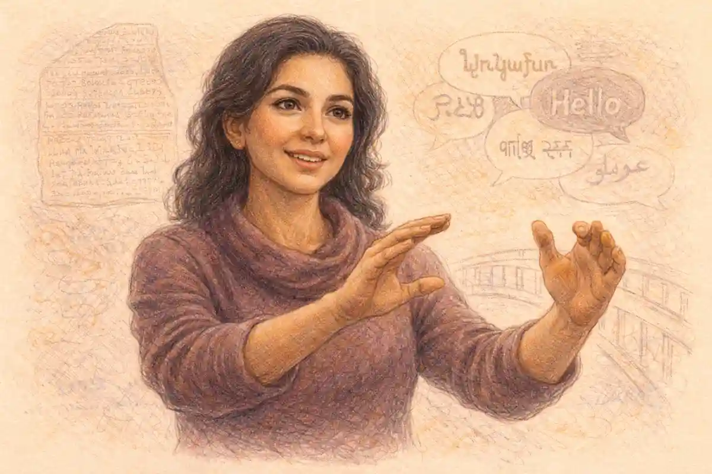

Kenneth Branagh's 2016 staging of Romeo and Juliet at the Garrick Theatre in London was the most publicised British production of the play of its decade, and it remains the clearest modern test of a single question: what happens to the tragedy when a director thinks like a film-maker, casts like a studio, and rebuilds Verona as a set from mid-century Italian cinema? The Kenneth Branagh Theatre Company played the production from 12 May to 13 August 2016, co-directed by Branagh and Rob Ashford, with Richard Madden and Lily James as the lovers, Derek Jacobi, aged seventy-seven, as Mercutio, and Meera Syal as the Nurse. The verdict argued through this article is firm. The staging was a handsome, swift, starlit entertainment whose centre of gravity sat in the wrong generation: its design argued, its elders blazed, and its young people were asked to carry a tragedy whose engine is wasted youth while the production spent its boldest ideas on age. Then, on 7 July 2016, the same performance was relayed live to cinemas in black and white, and the calculation inverted. On screen, in monochrome close-up, the concept cohered. Branagh had built a film of the play inside a theatre production, and the two halves of that sentence each found a different audience.

## A Season Built Like a Studio Slate

The production cannot be weighed apart from the institution that housed it. The Kenneth Branagh Theatre Company's inaugural residency, branded Plays at the Garrick, occupied the Garrick Theatre on Charing Cross Road for a full season of five productions, opening in October 2015 with The Winter's Tale, in which Branagh played Leontes opposite Judi Dench as Paulina, and closing with The Entertainer. The season was constructed on the studio model Branagh had practised in film since Henry V in 1989: a named auteur at the head of the bill, a repertory of bankable performers gathered around him, heavy advance publicity, and a cinema relay built into the life of the stage production from the start. Romeo and Juliet stood fourth in the season and penultimate in most listings of it, and it was the season's purest expression of the model, because every element of it arrived pre-sold. The lovers had already been lovers, in effect, on screen. The Mercutio was a knight of the stage whose casting was a headline in itself. The setting was a poster before it was a place.

The casting of the lovers was announced as a reunion. Branagh's film of Cinderella, released by Disney in 2015, had paired Lily James in the title role with Richard Madden as the Prince, and Rob Ashford, the Broadway choreographer who co-directed the Garrick staging, had choreographed that film. Derek Jacobi had played the King in the same film. When the Garrick production was announced, the publicity did not need to explain the chemistry it was selling, because the chemistry had already been photographed, marketed and rewarded at the box office. Madden arrived with a second screen identity behind him, as Robb Stark in Game of Thrones; James arrived fresh from Downton Abbey and from playing Natasha in the BBC's War and Peace. The production therefore began its life with an audience that believed it already knew what these two performers were together. That is the definition of star casting, and it shaped everything the notices later argued about, because a star performance is never judged only against the text. It is judged against the memory the audience carried through the door.

Jacobi's engagement was announced in May 2015, a full year before the first performance, and it was announced as an event. Branagh's statement called the actor an inspiration to actors and audiences and declared that to see him in Shakespeare was an event in itself. Jacobi, for his part, called Mercutio an exciting and intriguing challenge and pointed to the working relationship built on Cinderella. The advance framing matters because it set the terms of the debate the production never escaped. Before a line was spoken, the season had told its public that the evening's summit would be a seventy-seven-year-old Mercutio, and had told them to attend to the lovers as a proven screen pairing. The play's own structure argues the opposite distribution of attention. Shakespeare gives Mercutio the finest set piece of the first half and then kills him at the hinge of the action, in 3.1, precisely so that the tragedy's weight transfers to the young. A production that markets its Mercutio as the event and its lovers as a reunion has, before rehearsals begin, tilted the play toward the generation that is supposed to be swept aside.

The machinery around the production was scholarly as well as commercial, and the two were not in tension; they were the same gesture. Professor Russell Jackson of the University of Birmingham's Shakespeare Institute worked in rehearsals as the production's text adviser, as the university's own news report recorded in April 2016. Jackson is a theatre historian of Shakespeare in performance and the editor of The Cambridge Companion to Shakespeare on Film, and his presence in the room is the surest sign of how the company understood itself. This was not a celebrity raid on a classic. It was a production built by people who knew the play's stage history intimately and chose, with open eyes, to restyle it. The restyling is the subject, and it deserves to be judged as a deliberate argument rather than as a lapse of taste. The argument, in brief, ran as follows. Verona is the most visually clichéd city in Shakespeare. Every generation believes it knows what Verona looks like, because a famous film or a famous staging fixed the look. Branagh's wager was that the look could be changed again, wholesale, by treating the play as Italian cinema had taught audiences to see Italy: sunlit stone, dark glasses, tailored violence, Catholic ritual, and desire moving at the speed of a city that lives outdoors. Whether the wager paid is the question the rest of this article adjudicates.

### Why did Branagh and Ashford move Verona to the nineteen-fifties?

The co-directors moved the action to nineteen-fifties Italy because the decade gave them a Verona both period and modern: a Catholic, patriarchal, honour-bound society photographed in the manner of Fellini and postwar Italian cinema, close enough to seem glamorous and distant enough to let swords, friars and arranged marriages stand without apology.

That answer deserves expansion, because the decade was doing heavy structural work. The text's Verona runs on institutions that a twenty-first-century setting makes embarrassing: a friar with a pharmacopoeia, a nurse as go-between, a father who can compel a marriage by threat of disowning, a prince whose authority settles a feud by decree. Postwar Italy, as British audiences had learned it from the cinema, still contained all of those institutions in recognisable dress. A bicycling friar could cross the piazza. A girl of fourteen could be promised to a count. Men could carry themselves as though honour were a physical property. The nineteen-fifties setting therefore functioned as a licence: it let the production keep the play's social machinery intact while dressing it in the most seductive wardrobe available. This is a recognised strategy in the play's stage history, and Branagh's version of it was distinguished by the completeness of the citation. The Verona on the Garrick stage was not generically Italian. It was specifically the Italy of La Dolce Vita, the film Federico Fellini released at the turn of 1960, with its fountain-haunting idlers, its paparazzi, its cafe society suspended between piety and display. Branagh said as much in the spoken introduction he recorded for the cinema relay, describing a transposition to the world of the passionate, hot-blooded Italian films of the nineteen-fifties, like La Dolce Vita. The production's Verona was a film set remembered from other films, and the production knew it, and the knowingness was the point.

## A Director Returns: The First Play Branagh Ever Directed

WhatsOnStage's review framed the production in a sentence that unlocks its psychology: Branagh was returning to the first Shakespeare play he ever directed. The frame is worth accepting, because it explains choices that otherwise look like vanity and reveals them as autobiography. Branagh's career began in the nineteen-eighties with a young man's insurgency against a classical theatre he found staid: he founded the Renaissance Theatre Company with David Parfitt in 1987, played Hamlet and Henry V while still in his twenties, and in 1989 carried Henry V to the cinema in a film whose mud, blood and non nobis sequence announced a Shakespeare of energy rather than reverence. Romeo and Juliet belonged to that insurgent period of his work, a young director's play directed by a young man who had himself been Romeo's near contemporary. The Garrick production was the same play revisited by a man of fifty-five, at the head of his own named company, in a theatre taken for a season, with the resources of a film studio's habits at his back. The distance between those two productions, one remembered and one recorded, is the distance the Garrick staging kept failing to acknowledge. It directed the lovers as a man remembers having been one, fondly and from outside, while reserving its living curiosity for the generation it had joined since: the fathers, the friars, the entertainers, the survivors.

The company model itself was a piece of that autobiography. Renaissance had been a classical touring company built around a charismatic centre; the Kenneth Branagh Theatre Company repeated the structure at West End scale, with the founder's name as the brand and a circle of trusted collaborators in fixed orbits. Patrick Doyle's music, Derek Jacobi's presence, Rob Ashford's choreography: each had a history with Branagh that predated the production by years or decades, Doyle to the Henry V film of 1989, Jacobi to the Claudius of Branagh's full-text Hamlet film of 1996, in which the older actor's silken courtier had anchored a cast of stars. Russell Jackson's engagement as text adviser continued a scholarly partnership of similar standing, Jackson having served as a consultant on Branagh's Shakespeare films and having written, in his own scholarship on Shakespeare on screen, some of the most measured accounts of what Branagh's popularising cinema had done for the plays' public. A production assembled entirely from loyalties is a production insulated against surprise. The Garrick Romeo and Juliet had many virtues, and surprise was not among them. Its effects had been workshopped across thirty years of collaboration, and they arrived finished, sealed, and strangely uncurious about the two young people at the centre of the fiction, who were the only elements of the enterprise without a history in the company, imported from a single film and asked to signify freshness by contract.

There is a defence of this, and Jackson's scholarly tradition supplies it. The historian's case for Branagh has always been that the popularising instinct is itself an interpretation: that Shakespeare's plays were commercial entertainments before they were monuments, and that a director who fills a theatre and a cinema network with them is recovering a condition of the original art rather than betraying it. On that account the Garrick season was a serious project, the application of a lifetime's argument that the plays belong to large audiences in the present tense. The argument deserves its due, and this article's verdict does not dismiss it. But the Garrick Romeo and Juliet exposes the argument's limit from inside. Popularising energy in Branagh's best work, the Henry V film above all, had always been yoked to a reading, a proposition about the play that the energy existed to deliver. At the Garrick the energy was the proposition. The season's Romeo and Juliet was superbly certain about how the play should look and progressively less certain, scene by scene, about what the play says. The director who returned to his first play had become, in the interval, a great impresario, and the production is the record of an impresario's triumphs and an impresario's characteristic failure, which is to mistake the occasion for the event.

## Oram's Piazza: A Set That Argues the Ending

Christopher Oram designed the sets and the costumes, Howard Hudson designed the lighting, and Patrick Doyle, Branagh's collaborator on screen since Henry V, composed the music. The single environment Oram built for the play was a monumental stone piazza: marble pillars, walls and steps of imposing scale, a public square that could be reconfigured by extracting or lowering its columns, so that scene succeeded scene at filmic speed without the machinery ever hiding the actors. WhatsOnStage's reviewer, Daisy Bowie-Sell, named the governing idea exactly when she called the set mausoleum-style and read it as a clever, constant reminder of where the play is headed. That reading is correct, and it identifies the production's one unambiguous triumph. Shakespeare's Verona is a city that talks about death from its first minutes. The Prologue announces the lovers' end before their beginning, promising "the fearful passage of their death-mark'd love" (Prologue 9), and the play's public spaces are where its private catastrophe is manufactured: the brawl of 1.1, the Prince's edict, the killing of 3.1, the watch's discovery in 5.3. A piazza that is also a tomb makes that argument visually before a word is heard. The lovers meet, marry and die inside a piece of architecture that has already judged them.

The design's intelligence extended to its handling of ritual. Bowie-Sell noted the heavy Catholicism draped over the production, crucifixes at the characters' necks, and Michael Billington, in The Guardian, registered the same world from the auditorium: dark-suited men, petticoated women, bicycling friars, patriarchal oppression and frantic partying, with a warm Italianate light pouring in and church bells ringing out across the interval. Billington's list is worth dwelling on because it records what the stage picture actually was, in colour, in warmth, in motion. The Garrick Verona glowed. Its men wore tailored suits, white vests and braces, its women dark sunglasses, shawls and stilettos, as Bowie-Sell described the costumes, and the whole square had the sheen of a fashion plate from the years of the Italian economic miracle. This matters for a reason that reaches beyond taste. A persistent account of the production describes it as a black-and-white staging, and the account is wrong about the stage, as the next section establishes from the record of the relay. The monochrome belonged to the cameras. What the Garrick audience saw was a sunlit, coloured, densely populated square, closer in spirit to a Technicolor postcard than to a strip of newsreel. The production's visual argument was not austerity. It was abundance: a world so pleasurable to look at that its violence, when it came, arrived as a desecration of the picture rather than as the picture's natural product.

Against that achievement stand the gimmicks, and the notices were not wrong to list them. Dominic Cavendish, in The Daily Telegraph, complained of a production full of gimmicks and of frequent breaks into Italian speech, and other accounts of the run itemised the same habits: a film-style voice-over narration opening the show, the lovers' first encounter staged amid poses struck as if for paparazzi, Juliet singing at the Capulet ball in the manner of an experienced chanteuse, Juliet drinking from a bottle during the balcony scene, disco and electronic beats under Patrick Doyle's otherwise jazz-inflected score. Each device can be defended singly, and several were defended singly, as pieces of Italian colour. Together they describe a directorial manner that did not trust stillness. Rob Ashford's formation is the Broadway musical, where a scene that stops moving is a scene that dies, and the Garrick staging bore that formation's fingerprints: energy as a default, decoration as insurance. The cost is measurable in the text. The play's still centre is Juliet alone, thinking, in 4.3, and Romeo alone, receiving the news, in 5.1. A production in love with motion handles the piazza superbly and the soliloquy nervously. The notices' recurring reservation, across papers that agreed about little else, was that the evening rushed. Bowie-Sell wrote that the show rushed through the two hours' traffic of the stage, steaming ahead without looking back. The Prologue's own phrase had been turned into a criticism, and the criticism was fair.

### What did the production do with the Prologue?

The production treated the Prologue as cinema treats a title sequence, delivering its sonnet as a film-style voice-over narration above the opening of the action, so that the Chorus's announcement of the lovers' deaths reached the audience with the detached authority of a newsreel commentary rather than from a figure standing inside the world of the play.

The choice was characteristic, and its consequences ran both ways. In its favour, the voice-over solved the standing problem of the Chorus in modern dress. A lone figure in a nineteen-fifties suit stepping forward to speak a sonnet in direct address can look stranded, and the filmic solution folded the announcement into the production's governing metaphor: this Verona is a story already told, a reel already shot, and the audience is watching the print. Shakespeare's Prologue does ask for exactly that fatalism, promising an end "that with their death bury their parents' strife" (Prologue 8). Against the choice, the voice-over spent the Chorus's strangeness for polish. The sonnet's power in the theatre is partly the shock of a body on stage saying the quiet part aloud, and a disembodied commentary voice converts that shock into information. Cavendish's hostility to the opening was the evening's first skirmish in a war the production fought all summer, between admirers who experienced its cinema grammar as fluency and detractors who experienced it as evasion. The war is adjudicated in full below. Its opening battle is worth recording here because the Prologue decision announced the terms: wherever the play offered a theatrical convention, this production reached first for a film convention, and asked the audience to accept the exchange as an upgrade.

## The Black-and-White Question: What the Cameras Did That the Stage Did Not

No fact about this production has been more often misstated than its colour. The Garrick staging was widely described, in publicity shorthand and in reference summaries that repeated it, as a black-and-white production, a staging styled after Italian cinema in monochrome. The documentary record of the run says otherwise, and the distinction is not pedantry, because the production's meaning changes with it. On stage, as Billington's Guardian notice attests with its warm Italianate light and its bicycling friars, the audience saw a coloured world: stone, sun, dark suits, bright dresses, the gold of church ornament. The black and white belonged exclusively to the cinema relay of Thursday 7 July 2016, when the performance was transmitted live to cinemas in partnership with Picturehouse Entertainment, in a broadcast directed by Benjamin Caron, the director who had performed the same office for the company's Winter's Tale the previous November. For that transmission, and for that transmission alone, the image was drained to monochrome, in keeping, as Branagh explained to the cinema audience before the performance, with the nineteen-fifties Italian films that had inspired the staging. The relay even closed with calligraphed end credits, completing the conceit that the cinema audience had attended a film.

A reviewer who watched the relay at Plymouth recorded the oddity of the arrangement with precision: the monochrome was an experience the theatre audience was not getting, a second artwork laid over the first for one night only. The Old Yorker, whose extended notes on the transmission remain the fullest single account of it, made the same observation and drew the inference the production's defenders and detractors both needed. If the black-and-white image was the fulfilment of the concept, then the concept was only ever fulfilled for the cameras. The stage production pointed toward a film it could not itself become; the relay became that film for a single evening, and the encore screenings that followed carried the film, not the production, around the world. This is the sharpest structural fact about the Garrick Romeo and Juliet, and it governs the verdict of this article. Branagh's staging had two complete forms, a coloured stage entertainment and a monochrome screen artwork, and they were not equally good. The notices, written from the theatre, judged the first. The relay audience, and the far larger public that has encountered the production since through its screen afterlife, judged the second. Any account that merges them into a single black-and-white staging flattens the very thing that makes the production historically interesting: it was the moment the British theatre's relay culture stopped merely distributing productions and started revising them.

The revision deserves a moment's technical respect. Caron's cameras did not simply photograph Oram's piazza. Monochrome redistributed the evening's emphases. The costumes' fashion-plate colour, which in the theatre read as glamour, resolved on screen into pattern and silhouette, and the production's debt to Fellini stopped being an allusion and became a texture. Close-ups reassigned the acting honours, as the next section shows. The tolling bell that Billington heard across the Garrick interval acquired, in the cinema, the gravity of a soundtrack. Even the evening's emergency became part of the screen artwork's authenticity: as the Old Yorker recorded, Branagh came before the curtain in person to tell both audiences that Madden had sustained a serious ankle injury some forty-eight hours earlier, that intensive physiotherapy had been applied, that adjustments had been made to the staging, and that the Romeo would appear, closing with the words "live theatre, live cinema, the show must go on." No film set admits such a prologue. The relay's black-and-white Verona was thus framed, before it began, as an act of endurance, and the frame flattered everything that followed. The stage production had no such frame. It had only its speed, its stars and its piazza, and the critics judged it accordingly. The relay's fixity had one further consequence that the run's later history exposed. What the cameras preserved on 7 July was a single performance, Madden's Romeo played on a damaged ankle under modified staging, James's Juliet at mid-run, Jacobi's Mercutio entire. What the cameras never saw was the production's second life: Hanson's deputised Romeo, Fox's rehearsed-in-two-days Romeo, and the final fortnight in which the company's youngest generation, the generation the concept had least served, carried the show on its own. Performance history is written from records, and the Garrick production's record is its film. The stage run's most human chapter, its emergency and its recovery, survives only in press statements and in the memories of the audiences who happened to attend in August, which is to say it survives the way productions survived before the relay era, by testimony. The production that set out to be the most completely preserved of its decade preserved, in the end, exactly the half of itself it had planned to.

### What did the cinema audience see that the Garrick audience did not?

The cinema audience saw the production drained to black and white, reframed in close-up by Benjamin Caron's cameras and closed with calligraphed credits, a monochrome artwork modelled on nineteen-fifties Italian film, while the Garrick audience at the same performance watched the same actors in a coloured, sunlit Verona of stone, costume and warm light.

The two-audiences problem has a longer ancestry in the play's performance history, and Branagh's company cannot have been innocent of it. Every generation's defining Romeo and Juliet has been the one its technology could circulate. The stage had already watched a celebrated Italian restyling fix the play's image once before, in the barefoot, sunstruck Verona of [Zeffirelli's Old Vic Production of 1960](/2027/11/12/zeffirelli-old-vic-1960/), whose young lovers taught the British theatre that the play could be played at something near the text's own ages. Zeffirelli then carried the same eye to the cinema in 1968 and fixed the look for a world audience. Branagh's production reversed the sequence. The stage came first and the film was an emanation of it, one night's transmission that outlived the run and became, for most of the production's eventual audience, the production itself. The comparison disciplines any easy talk of decline. Zeffirelli's stage Verona was also a piece of image-making in search of a camera. The difference is that the Garrick company built the camera into the contract from the start, and the building showed: in the voice-over Prologue, in the posed brawl, in playing pitched at a lens that was not yet in the room. When the lens arrived, the production was ready for it. The notices' complaint that the evening felt like a film was, from the company's perspective, less an accusation than a description of the intent.

## The Audience That Was Not in the Room: The Relay Era

The Garrick production arrived at a settled moment in the history of theatre broadcasting, and its experiment is best understood as the moment the settled form was pushed. Live relays from British stages had been normalised since the National Theatre began its transmissions in 2009, and by 2016 the practice had its own scholarship, its own economics and its own aesthetics. John Wyver, the producer and historian of the form who built the Royal Shakespeare Company's broadcast programme, has argued in his writing on theatre relays that a transmission is neither a play nor a film but a third thing, an event whose claim on its audience rests on simultaneity, on the knowledge that the performance is happening elsewhere at that moment and might fail. The Garrick Romeo and Juliet tested every term of that definition. Its simultaneity was genuine, and its possibility of failure was, thanks to a leading man's ankle, unusually well advertised in advance by the director in person. Its status as a third thing was guaranteed by the monochrome, which no one in the theatre was experiencing. And its eventhood was completed by the apparatus around the performance: the recorded introduction, the interval material, the calligraphed credits, the sense, recorded by the Plymouth relay reviewer, of being part of an audience distributed across a country and, through the encore screenings that followed, across a world, with the production reviewed from cinema seats as far from Charing Cross Road as Melbourne.

The economics of the arrangement deserve plain statement, because they explain the company's priorities better than any aesthetic manifesto. A nine-week run in a West End house of the Garrick's size plays to a strictly bounded public, and a star vehicle of this expense needs a larger one. The relay and its encores multiplied the production's audience beyond the theatre's arithmetic, carried its stars' names into markets the season could never have toured to, and converted a perishable engagement into a durable asset whose screenings could be sold for years. None of this is discreditable, and the company's candour about the machinery, Branagh introducing the broadcast himself, stands to its credit. But an enterprise optimised for two publics will, at the margins, choose the larger one when choices conflict, and the margins are where this article has located the production's faults: the performance scaled for the absent lens, the concept completed only in the absent medium, the emergency borne with such public grace partly because the definitive artifact was already safe. The relay era's other productions mostly treated the broadcast as a souvenir of the stage event. The Garrick Romeo and Juliet treated the stage event as the raw material of the broadcast, and the inversion, visible in everything from the Prologue's voice-over to the final casting crisis, is its true claim on the history of the form. Shakespeare's play, which begins with a Chorus promising to fill the gaps of the stage with the audience's thoughts, had acquired a production that filled them with a camera instead, and charged both audiences for the filling.

## Star Casting as Argument: Madden, James and the Two Verdicts

The lovers divided the critics along a line that had nothing to do with party or paper and everything to do with where the critic was sitting. In the theatre, the prevailing verdict on Madden was cool to cold. Bowie-Sell, in WhatsOnStage, set the tone the season never shook: Jacobi was infinitely watchable, and the trouble was that his presence highlighted how much of the company struggled with the verse, next to which Madden's Romeo was limp and disinteresting. Cavendish reached a similar destination by a ruder road. In the cinema, however, the Old Yorker's account reversed the judgement entirely, finding Madden the best thing in the production: a performer inside the lines rather than declaiming them, whose speeches suggested thoughts newly occurring, and whose listening, particularly to Mercutio, ranked among the evening's highlights. Both verdicts were honestly arrived at, and both were correct about the object in front of the judge. Madden was giving a screen performance, detailed, inward and scaled for a lens, inside a theatre that seats over seven hundred people. In the stalls it read as underpowered. In close-up it read as truth. A production cannot be acquitted of the consequences of its own casting merely because another medium would have flattered it, and the stage notices were entitled to their disappointment. But the relay's evidence forbids the simpler conclusion that Madden was miscast. He was cast for the artwork the company most intended to last, and in that artwork he succeeded.

James's Juliet attracted the warmer notices and the more interesting disagreement. Quentin Letts, in the Daily Mail, delivered the season's most quoted sentence on the production when he declared that in luminous Lily James, Branagh had found the perfect Juliet, in a production he called respectful yet inventive. Billington dissented on structural grounds, and his dissent is the single most valuable piece of criticism the production received. The lovers, he wrote, acquitted themselves very well, with youth, looks and passion on their side, and he instanced the blaze of Romeo's first sight of Juliet, the moment the text crowns with the line "she doth teach the torches to burn bright" (1.5.43). But he was puzzled by directorial decisions that cost the audience Juliet's rapid maturation from inexperienced child to married woman: James's Juliet seemed very knowing from the start. The point is exact, and it is a point about the play and not merely about a performance. Juliet's arc is the steepest in Shakespeare. The girl who submits to her mother's agenda in 1.3, counting Paris's book of love in obedient metaphors, becomes within days the strategist of the balcony scene, the bride who out-reasons the Friar, and the solitary of 4.3 who drinks the potion over the text's most terrifying inventory of fears. A Juliet who begins knowing has nowhere to travel, and the production's second half pays for the first half's sophistication. Holly Williams, in The Independent, caught the same quality from the opposite side, praising the bright freshness of the lovers' initial attraction rather than dangerous electricity, and noting the direction's curious habit of keeping the lovers apart, Romeo spending much of the balcony scene with his back turned to Juliet on a floor-level terrace. Freshness without electricity, sophistication without a journey: the admirers and the dissenters were describing one performance, and disagreeing only about the price.

The adjudication this article reaches favours Billington's structural charge while honouring what Letts and the relay audience saw. James was, scene by scene, the production's most compelling young performer, and the Old Yorker's relay account confirms that her dominance grew through the second half until she held the evening. The fault lay in the concept she was serving. A production styled as Italian cinema prizes the look of desire, the struck pose and the photogenic clinch, Williams's big Hollywood embraces among them. Juliet's maturation is not photogenic. It is verbal, interior and cumulative, a mind changing at speed inside the verse, and a staging that keeps reaching for the picture will keep arriving a moment after the change has already happened in the words. The balcony scene's arrangements emblematised the problem. The text stages an ascent, Romeo below in the orchard darkness, Juliet above at the window, the vertical distance measuring the danger and the longing at once: "But, soft! what light through yonder window breaks?" (2.2.2). Flatten that to a terrace at floor level, turn the lover's back, hand the heroine a bottle to swig from between speeches, and the scene's geometry of risk dissolves into a naturalistic encounter between two attractive contemporaries. It played, by the relay account, as charming. Charm was the production's currency and its ceiling. The tragedy asks for more than charm from its central scene, and the shortfall was the concept's, not the performers'.

There is a further charge to answer, because the lovers were not in fact young, and the production's publicity traded on their youthfulness while casting performers of twenty-nine and twenty-seven. The text is brutal about Juliet's age: she is not yet fourteen, as Lady Capulet insists and the Nurse's arithmetic confirms in 1.3, and Romeo, though his age is never stated, belongs to the same unmarried generation. No commercial stage production casts at the text's ages, and the history of the play in performance is a history of negotiated approximations. But the approximation matters to the tragedy's mechanism. The catastrophe is an indictment of a world that processes children at adult speed, and the nearer the lovers stand to childhood, the sharper the indictment. Madden and James, glamorous adults playing at first love with the assurance of a screen reunion, softened the indictment into romance. The critics who found the evening beautiful and the critics who found it inert were again describing the same transaction. What the casting bought was ease, recognition and a pre-sold tenderness. What it cost was the alarm that the text builds into its first act, where every adult on stage is failing two children in plain sight.

The text, moreover, states the age question in terms a production ignores at its peril, because Shakespeare built the alarm into dialogue rather than leaving it to casting. When Paris presses his suit in 1.2, Capulet himself enters the play's own reservation: "She hath not seen the change of fourteen years" (1.2.9), and, generalising from the city's marriage market, "too soon marr'd are those so early made" (1.2.13). The father who speaks those lines will, two acts later, be threatening to drag the same daughter to church by force, and the arc from protective delay to coercion is the household system's whole biography in one character. A production that casts its Juliet as a knowing adult of twenty-seven does not merely miss a visual effect. It dissolves the contradiction the text assigns to Capulet, because an adult daughter's defiance reads as a negotiation between equals, and the coercion that answers it reads as rudeness rather than as the exposure of a child to an institution. Michael Rouse's Capulet was praised, and rightly, for keeping the party charm and the violence in one body. Even his success could not restore what the casting had removed upstream: the audience's knowledge, which the first act exists to plant, that the person being bargained over is thirteen. The Garrick production asked its public to feel the tragedy's waste while declining to show them the children. It is the one refusal from which most of the notices' separate complaints, the missing maturation, the absent electricity, the charm that ceilings the evening, can be derived as consequences.

## Derek Jacobi's Mercutio: The Wilde Anecdote and Its Arithmetic

The production's boldest decision remains its most argued over. Mercutio is written as a young man in a young men's world, Romeo's contemporary and fellow brawler, whose death in 3.1 turns the play because a life at its spring is thrown away in a street quarrel: "O Romeo, Romeo! brave Mercutio's dead!" (3.1.113). Branagh cast a man of seventy-seven, and did so as the centrepiece of the production's publicity, which obliges any serious account to begin with the reasoning the company offered. Branagh explained the inspiration, in his introduction to the cinema relay and in the production's surrounding materials, through an anecdote he attributed to David Garnett, retold to D. H. Lawrence: two very young men drinking in Paris fell in with a much older stranger, down on his luck, who entertained them with wit and with expert instruction in enjoying the city, and who proved, when they asked the barman his name, to have been Oscar Wilde. Mercutio, on this model, is the eternal verbal entertainer grown old, the wit who has said everything before and goes on saying it, sustained by the affection and amusement of the young men who gather round. It is a genuine idea, and Jacobi embodied it completely: a dapper veteran in the piazza, cane in hand, holding court.

The anecdote, however, does not survive arithmetic, and a relay reviewer did the sum in print. The Old Yorker's notes observe, drily, that there is something seriously wrong with the story, since David Garnett was eight years old when Wilde died in 1900. Garnett, born in 1892, cannot have been a young man buying drinks in Paris before Wilde's death in November 1900, and the tale as retailed belongs to the large family of Wilde legends that improve in the telling. The point is not that Branagh was caught in an error of fact, though the error is there and was noticed. The point is what the error reveals about the casting's foundations. The elderly Mercutio was justified by a story that could not have happened, about a wit who could not have been met, offered as the warrant for reconceiving a character against the text's clear grain. Where a production's rationale is a fable, the production itself must carry the whole burden of proof on stage. Sometimes Jacobi carried it. Sometimes the fable's falseness seemed to leak into the evening, and the character arrived trailing an explanation the audience had been given in advance, like a exhibit with its label attached.

### Why was Mercutio played by a man of seventy-seven?

Branagh cast Jacobi to make Mercutio the play's elder entertainer, a Wildean wit of the cafes whose brilliance is a late flowering rather than a young man's fire, gathering the lovers' generation around him as an audience, so that his fall silences the piazza's presiding voice and the comedy dies with the company's storyteller.

What Jacobi did with the conception, at its best, justified the gamble on its chosen ground. The Queen Mab speech of 1.4 is the production's test case, because it is the role's summit and because an old man's Mab is a different speech from a young man's. A young Mercutio delivers "O, then, I see Queen Mab hath been with you" (1.4.53) as a riff, speed and invention outrunning sense, the fairies' midwife, "in shape no bigger than an agate-stone" (1.4.55), conjured at full gallop. Jacobi, by every account, delivered it as a set piece remembered and polished, a party turn perfected over decades, the veteran's party piece whose brilliance carried its own melancholy: the dreams Mab visits belong to other people. Reviewers who disagreed about everything else agreed about the speech. The Upcoming's notice called it exceptional and found Jacobi's whole performance the evening's theft, fluent in the language of the play; Bowie-Sell called him infinitely watchable; even Cavendish's hostile Telegraph review is structured around the performance it deplores. The production had arranged for Mercutio to be played by the company's greatest living verse speaker, and in the set pieces the arrangement paid in the plainest currency. The verse was never better spoken at the Garrick that summer than when Jacobi was speaking it.

Cavendish's dissent deserves to be stated at full strength, because it identifies the conception's vice rather than merely disliking its execution. He wrote that poor Derek Jacobi had to boogie as Mercutio and affect a shrill camp delivery beneath his dignity, in a production where the Mercutio was required to dance to disco, to croon, to twirl a silver-topped cane that sheathed a sword. The charge is that the production did not trust its own idea. An elderly Mercutio conceived as a figure of verbal authority, a Wilde of the piazza, needs stillness and command; the staging instead kept apologising for his age by putting him through the motions of youth, dancing him, costuming the cane as a gimmick, and letting the conception wobble between pathos and variety turn. There is force in the charge. Bowie-Sell's account concedes the mechanism while praising the result, describing a slightly camp, all-dancing, all-drinking, suave father figure, the life and soul of the party. Whether that figure is the play's Mercutio is another question, and it leads directly to the duel, where the conception met the one scene it could not survive intact.

## The Duel and the Death: Age Against the Text

Act 3, scene 1 is the tragedy's hinge, and its machinery is pitilessly specific. Mercutio fights Tybalt under Romeo's arm, takes the wound while Romeo holds him, and spends his last breath converting wit into curse: "A plague o' both your houses!" (3.1). The scene's horror depends on waste, on the audience's knowledge that the play's most alive young intelligence has been spent in a brawl about nothing, "bred of an airy word" (1.1.87), in the Prince's phrase for the feud's whole economy. Jill Levenson, in her Oxford edition of the play, reads the feud as a system of household obligations and codes of violence, and 3.1 is where that system collects its most shocking payment, precisely because the payer is the one character who stands half outside the households, the Prince's kinsman and Romeo's friend, killed by the code he mocked. An elderly Mercutio re-prices the payment. Exeunt magazine's review stated the objection in its cleanest form: Jacobi delivered the verse beautifully, but when he squared up to Ansu Kabia's thrusting, aggressive Tybalt, the disconnect was absurd, and there was no sense of the potential of a young life cruelly cut short. That sentence has not been answered by the production's defenders, because it cannot be answered on its own terms. It can only be outbid, by claiming that a different pathos replaces the lost one: the pathos of a survivor of earlier wars, as Bowie-Sell suggested when she imagined Jacobi's Mercutio marked by the memory of at least one world war, carrying trauma below the wit. The substitution is intelligible, and in the theatre it plainly moved people. It is nevertheless a substitution. The text's Mercutio does not die full of years and memory. He dies cheated of the future he personified, and the tragedy's temperature changes at exactly that moment and no other.

The staging of the death compounded the conceptual difficulty with a mechanical one. In the text, Mercutio exits supported, asking to be helped into a house, and his death is reported by Benvolio; the play keeps the corpse offstage and lets the curse do the work. Accounts of the Garrick staging describe Jacobi's Mercutio leaving the stage on his feet, the curse hurled back at a square emptying of the men who should have heard it, a choice at least one eyewitness record of the run found oddly detached from the dying it was meant to crown. An old man's upright exit is defensible as dignity and indefensible as dramaturgy: the scene needs the wound's fact, the sudden subtraction of the piazza's loudest life, and a procession of one elderly gentleman declining to fall supplies pathos where the text schedules shock. The wider craft of such moments, the choreography by which stage violence persuades an audience that bodies are at stake, is treated in [Staging the Duel: Choreographing Death](/2027/12/10/staging-the-duel-choreography/), and the Garrick duel is a case study in its central problem. Choreography can make a fight beautiful, musical, even witty, and Ashford's musical-theatre instincts ensured all three. What it cannot do is repeal arithmetic. A duel between a man of twenty-something and a man of seventy-seven announces its outcome and its meaning in advance, and no arrangement of blades can restore the contingency on which 3.1 depends, the sense that the wrong man died by an inch and a second, under his friend's arm.

Adjudication, then, on the production's most famous choice. Jacobi's Mercutio was a great performance of a reconceived character, and the reconception failed the play at its hinge. Both halves of that sentence must stand. The Mab speech and the party scenes gained a valedictory richness that no young Mercutio of that season could have matched, and the gain was real. The duel and the death lost the waste that turns comedy into tragedy, and the loss was structural, not incidental: it followed from the casting as surely as the Mab's richness did. Branagh had directed the play before, as a young man at the start of his career, and WhatsOnStage framed the Garrick production as his return to the first Shakespeare play he ever directed. The framing illuminates the choice. A young director casts Mercutio as a contemporary because the role is one. A director of fifty-five, returning with his own company and his own tradition to honour, casts the role for the actor he most wants on his stage. The production's Mercutio was an act of homage wearing the clothes of a concept, and the Wilde anecdote, chronology and all, was the homage's attempt to naturalise itself. The homage was magnificent. The concept was not believed, finally, even by the staging that kept dancing its seventy-seven-year-old to prove his vitality.

The performance's afterlife has settled the argument in a way neither side predicted. Exeunt's reviewer judged Jacobi, in passing, to be probably the oldest professional Mercutio on record, and the relay has made that superlative permanent: for the large public that knows this production from its screenings, the role's reference performance is a man of seventy-seven delivering the Queen Mab speech as a veteran's set piece, and every younger Mercutio since has been measured, by that public, against a standard the text never set. This is the relay era's quietest power, the power to canonise a single interpretation by preserving it while its rivals evaporate. The young Mercutios of 2016 in other houses, vigorous, dangerous and unrecorded, have vanished from the record as completely as their predecessors of every decade. Jacobi's remains, cane, croon, curse and all, available to any student with a screening licence. Whether the preservation honours the play is the question this section has adjudicated in the negative and the positive at once: the performance deserved preserving, and the conception it served did not deserve the authority preservation confers. Both judgements can stand because they are about different things, an actor and an idea, and the Garrick summer's enduring confusion of the two is the final form of its central mistake. The company had cast a legend and called the casting a concept. The legend was real. The concept was the legend, restated.

## The Supporting Company: Scale, Youth and Two Disagreements

Around the three principals, the company divided the notices in ways that repeat the evening's pattern, a pattern worth naming: almost every performance in this production was praised and blamed for the same quality, and the quality was scale. Meera Syal's Nurse is the clearest instance. Cavendish, in the middle of a hostile review, listed her among the production's good turns, alongside Sam Valentine's Friar Laurence and Michael Rouse's Lord Capulet, marooned in a gimmicky evening. The Old Yorker's relay account, from the cinema, called the same performance mugging. The two judgements are reconcilable only through the medium argument that runs through this article. Syal played the Nurse at piazza scale, broad, physical, pitched to the back of a theatre that rewards breadth, in a role whose comedy is built from delay and digression: the Nurse's great scene in 1.3 spins a single piece of news through eleven false starts, and her 2.5 errand returns with the ache in her bones as its counterweight. Breadth serves that writing in a large house. The camera, which forgives nothing, cropped the breadth into exaggeration. Neither critic was wrong. The production had simply built performances for two incompatible instruments and played them on both.

Valentine's Friar Laurence attracted a quieter consensus and raises a casting question the production deserves credit for posing. The Friar is conventionally cast as elderly, a greybeard to match "the grey-eyed morn" (2.3.1) of his opening soliloquy, and his age is usually taken to underwrite his authority when he wagers the lovers' lives on a potion and a letter. Valentine was an unusually young Friar, in his mid-twenties, and both Cavendish and the relay account singled the performance out for praise. The youth of the Friar changes the moral geometry of 2.3 and 4.1 in ways the production may not have fully intended but plainly profited from. A young friar's counsel, "Wisely and slow. They stumble that run fast" (2.3.94), is no longer the voice of experience; it is a contemporary's guess, and the catastrophe that follows reads less as the failure of wisdom than as a chain of improvisations by the young, supervised by nobody. That is arguably the play's own account of itself. The adults in Romeo and Juliet fail by absence, temper and pride, not by considered villainy, and a Friar of the lovers' own generation completes the indictment: Verona had no elders worth the name except a Mercutio invented for the occasion. If the production had pursued that thought with the same energy it gave its piazza, it would have had the concept its publicity promised. The thought remained an accident of casting, fruitful but unexploited.

The remaining performances can be dealt with briefly, because the notices were broadly agreed and the agreement is itself information. Michael Rouse's Capulet drew praise in the Telegraph and elsewhere, a patriarch whose party charm and 3.5 violence belonged to one man; the scene where Capulet turns on Juliet, threatening to drag her to church or disown her, landed with the weight the text assigns it, the weight of the household system Levenson describes closing around its daughter. Marisa Berenson's Lady Capulet divided opinion along familiar lines, Cavendish finding her a transatlantic figure of soap glamour, in keeping with his Dynasty charge against the whole evening. Ansu Kabia's Tybalt was dashing in appearance and, by the relay account, hollow at the centre, a costume in search of a grievance, though Exeunt's review credited the aggression the duel required. Jack Colgrave Hirst's Benvolio was conscientious and, by the same account, dull. Taylor James's Prince, in uniform among the cafe society, prompted the relay reviewer to think of a comic-opera policeman, a small instance of the production's habit of letting the nineteen-fifties wardrobe make jokes the text had not written. The pattern across the company is consistent enough to count as a finding. Where the production asked its performers to fill the piazza, they filled it. Where the play asked for interior damage, the evening's instruments were pointed elsewhere, at the picture, at the pace, at the next entrance.

## Four Days at Full Speed: Pace and the Play's Clock

Every production of this play must negotiate with its clock. The action occupies some four days, from a Sunday morning brawl to a dawn discovery in the tomb, and the text accelerates as it narrows: two meetings, a marriage, a killing, a banishment, a forced wedding, a potion, a funeral and a double suicide are compressed into a span in which the characters repeatedly remark that time itself has become their enemy. Juliet, waiting for her wedding night, begs the sun to hurry down: "Gallop apace, you fiery-footed steeds, / Towards Phoebus' lodging" (3.2.1-2). Weis's description of the scheme as tightly plotted and exiguous, quoted earlier in this article, identifies the pressure a staging is meant to reproduce. The Garrick production reproduced the speed faithfully and the pressure hardly at all, and the difference between those two achievements is the most instructive technical failure of the run. Bowie-Sell's complaint that the show steamed ahead without looking back names the symptom. The cause was the production's treatment of the play's delays. Shakespeare's clock works by obstruction: the Nurse's interminable errand in 2.5, the Friar's caution, the letter's failure in 5.2, each delay winding the mechanism tighter because the audience can see the catastrophe the delay is purchasing. A staging that rushes treats the delays as dead air to be trimmed or played for bustle, and bustle is what the Garrick delays became. The Nurse's scene was a comic turn, the Friar's scenes were exposition at tempo, and the result was an evening that arrived at its tomb punctually, having generated little of the dread that is the tomb's admission price.

The point can be sharpened against the production's own advertised dimensions. Two hours and forty-five minutes, interval included, is not a reckless duration for this play; it sits comfortably inside modern practice, and no critic accused the company of vandalising the text for time. The rush the notices registered was therefore not a matter of minutes but of intention, a quality of attention. Scenes were played at their surface speed, the speed of their events, rather than at the speed of their recognition. The balcony scene's flattened geometry, the ball's conversion into a floor show, Mercutio's death arranged as an exit: each was a decision to keep the evening moving by moving past the moment the text had built for stillness. Branagh's cinema had taught him the cut, and Ashford's musicals had taught him the transition, and between the cut and the transition the production misplaced the held breath. It is a significant misplacement because the play's final act depends on that held breath for everything it has. Act 5 is a machine for making an audience watch a man walk toward a preventable death at walking pace, misinformed, resolute, "well, Juliet, I will lie with thee to-night" (5.1.34) already spoken. Cavendish found the tomb affecting because the production finally slowed there. The concession convicts the rest of the evening: the instrument worked when it was allowed to stop.

## The Catholic Frame: Bells, Statues and the Tomb

If the piazza was the production's argument, its Catholicism was the argument's atmosphere, and the atmosphere deserves separate weighing because it was the one element of the concept that engaged the text at depth. The play is saturated with the machinery of the old religion: a friar who marries, confesses and medicates the lovers; a heroine who goes to shrift as cover for a suicide consultation; a tomb in a churchyard; a final reconciliation conducted in the idiom of votive offering, each father promising the other a golden statue, Montague vowing "I will raise her statue in pure gold" (5.3.298) and Capulet answering in kind. Oram's Verona, with its crucifixes, its church bells ringing across the interval that Billington noticed, its mausoleum square and its heavy ritual colouring, took that saturation seriously in a way British productions of the play often do not. The nineteen-fifties setting earned its keep here as nowhere else, because postwar Italy allowed a Protestant country's audience to see Catholic practice as environment rather than as doctrine, the air the characters breathed. The Friar's bicycle, the processions, the feast-day glamour of the ball: the production understood that the play's Verona is a city where the sacred and the social share a calendar, and that the lovers' story is legible only inside that sharing, a private passion processed by public rituals that keep arriving at the wrong moment, a wedding becoming a funeral in 4.5 with the same flowers, the same musicians, the same household.

The frame also delivered the production's best scene its due. Cavendish, the evening's severest critic, exempted the tomb from his condemnation, finding the double suicide in the crypt finally affecting once the production slowed. The exemption is explicable in design terms. Oram's mausoleum set had been promising the tomb since the first entrance; every scene of the evening had been played inside the architecture of its ending, and when the action finally descended into the place the set had always described, concept and text stopped competing. The lovers died in the one space the production had thought about completely. There is a lesson in that about the limits of restyling. The Garrick staging's Catholic frame worked precisely where it stopped being a style and became a structure, where the design ceased to decorate the play's meanings and started to house them. The tragedy does not ask its producers for atmosphere. It asks for a world in which the machinery of consolation, friars, rituals, statues in pure gold, operates exactly as designed and saves nobody. For the length of its final scene, and intermittently in its ritual textures throughout, the Garrick production built that world. The achievement was real, and the notices that missed it, in their hurry to judge the gimmicks, undervalued the one element of the concept that a future production might profitably steal.

## The Run's Emergency: Three Romeos in Nine Weeks

No account of this production is complete without the crisis that overtook its final month, because the crisis tested every claim the season had made for itself, and because the documentary record of it is unusually full and unusually instructive. The chronology is established by the company's own statements and the trade press, and it should be followed exactly, since retellings of the episode have a way of drifting toward the more romantic version in which the show simply acquired a new Romeo. Richard Madden injured his ankle while running, in the days before the cinema relay; the injury was serious enough that his appearance in the transmission of 7 July was in doubt until the day, rescued by intensive physiotherapy and by adjustments to the staging that Branagh announced in person before the performance. Madden played the relay. Shortly afterwards, as the Old Yorker's account predicted from the evidence of the evening, he had to withdraw from the production while the ankle healed. The role was covered by Tom Hanson, the production's Paris, who understudied Romeo and stepped up. Hanson then injured his own leg and was unable to perform. On 26 July the company announced that Freddie Fox would join the production to share the role with Madden, after forty-eight hours of intensive rehearsal with James and the company; Fox had played Romeo at the Crucible in Sheffield in 2015, and had, by a symmetry no publicist would dare invent, attended the Garrick press night as a spectator. Matthew Hawksley, the production's Anthony, took over Paris from Hanson. On 4 August the company announced, on medical advice, that Madden would not return before the production closed on 13 August. Fox played Romeo for the remainder of the run.

Three facts in that chronology repay emphasis. The first is that the emergency was Romeo's alone. It has occasionally been folded into a general story of an accident-prone production, and one sometimes meets the implication that the Mercutio cover was likewise called upon, as though the crisis had run through the company. The documented record supports no such claim. No report of the run records Jacobi absenting himself from a performance or an understudy playing Mercutio; the company's statements, which itemised the Romeo succession in detail across three separate announcements, name no Mercutio cover at all, and the reviews of late-run performances discuss Jacobi in the role to the end. The seventy-seven-year-old completed the schedule that defeated two men in their twenties. Whatever the production's concept cost the play, its most improbable casting was also its most durable, and the irony deserves to be recorded without embroidery: the actor whose age was the evening's great talking point was the actor the run could not break.

The second fact is what the emergency revealed about star casting as a system. The season had sold Madden's name above the title, in a market where a portion of any audience has bought its seats for the name. When the name withdrew, the production could not simply promote its understudy in the old manner and carry on, because Hanson was injured too, and because the understudy system presumes a hierarchy the star vehicle had already strained. The company's solution was to import a second name, an actor with his own Romeo newly behind him, and to frame the importation as a sharing of the role between two wonderful artists, in Branagh's phrase. The framing was gracious and the reality was triage, executed with impressive speed: forty-eight hours from arrival to performance, in a production whose choreography, fights and balcony geometry had been built around another body. Fox's notices in the role were respectful, and the company completed its contracted run. But the episode stands as the commercial model's confession. A star vehicle has no understudy problem until the star falls, at which point it has no understudy, only a vacancy with a marketing department attached. The company's own statements conceded the vacancy's terms with unusual honesty: taking daily medical advice, the producers told the public, they could not give advance casting information, and ticket holders were directed to the company's website for the casting of the performance they had already paid to attend. A Romeo had become a weather forecast. The arrangement was nobody's fault, and the company handled it with a transparency the industry rarely manages, but it deserves its place in the record of what star casting is: a contract in which the audience buys a name, the name is subject to the accidents of a body, and the play, which has survived the deaths of its performers for four centuries, is left to be marketed as the understudy of its own casting.

The third fact concerns the screen afterlife, and it completes the argument of the black-and-white section. The encore cinema screenings that followed the live relay presented Madden's Romeo, preserved from the night of 7 July, when he had played on an injured ankle under announced adjustments. The production that most of the world has seen therefore stars a Romeo who was, at the moment of recording, medically unfit for the run he was in the middle of, playing a modified staging, in a monochrome image no theatre audience ever saw, opposite a Juliet whose partner for the final fortnight of the stage run was a different man. None of this diminishes the relay as an artwork; by the relay account's evidence it intensified it, since Madden's tentativeness in movement read on screen as the character's own vulnerability. But it fixes the production's place in the play's history with unusual precision. The Garrick Romeo and Juliet exists permanently as a film of an emergency, and only temporarily, for nine weeks in the summer of 2016, as a play.

### Who played Romeo in the final weeks of the run?

Freddie Fox played Romeo for the production's final weeks, joining on 26 July after forty-eight hours of rehearsal to share the role during Richard Madden's recovery from an ankle injury, and continuing alone after the company announced on 4 August that Madden would not return before the closing performance.

The succession also produced the run's neatest piece of unintended symbolism. The text's Romeo is displaced in his own story with terrible regularity: banished from Verona in 3.3, absent from the stage for stretches of the fourth act, reliant on reports, letters and other men's errands, until he forces his way back into the tomb in 5.3 and reclaims the narrative at the cost of his life. The Garrick production lived a version of that pattern offstage, its Romeo first modified, then covered, then replaced, his role sustained by deputies while the production's machinery negotiated with his body. No director would choose the parallel, and no critic should lean on it too hard. It is recorded here because it explains the peculiar emotional weather of the run's last weeks, attested in the company's statements and in the press coverage: an audience watching a play about the fragility of young men's bodies, performed by a company that fragility had just reorganised. The show's much-advertised resilience, its refusal to cancel, its public gratitude to its deputies, became part of what a ticket bought in August 2016. The production had set out to sell a reunion. It ended by selling endurance, and endurance, unlike glamour, is a quality the tragedy itself possesses in full.

## The Critics' Quarrel, Adjudicated

The notices, gathered, describe two different productions, and the quarrel between them is the production's critical legacy. On one side stand the admirers of the picture. Billington's Guardian review, the most judicious of the major notices, found a vividly imagined nineteen-fifties Italy, a pulsating energy, speed and vigour that ensured the audience was never bored, and a Juliet who illuminated the whole; his reservations were structural, the missing maturation, and his joke about the tragedy's dependence on chance and the faulty Italian postal service was aimed at the play, not the production. Letts found the perfect Juliet and a production respectful yet inventive. The Upcoming and WhatsOnStage praised the spectacle and the evening's presiding Mercutio. On the other side stand the objectors to the concept. Cavendish's Telegraph review is the quarrel's extreme document: a portentous voice-over, a Hollywood coarseness, a Romeo and Juliet staged as an episode of Dynasty, poses struck, emotions overwrought, machinations sinister, a Mercutio camped beneath his dignity, good supporting turns marooned among gimmicks, and only the tomb, where the production finally slowed, becoming affecting. Exeunt's reviewer reached a neighbouring verdict from the left: a traditional, not to say old-fashioned, production without enough raw intensity for a play of hot-blooded passions, its piazza applauded, its duel absurd, its whole enterprise a lacklustre falling-short of the season's opener, The Winter's Tale. Williams, in The Independent, occupied the honest middle: bright freshness rather than dangerous electricity, Hollywood embraces, and a balcony scene arranged as though the lovers were an embarrassment to be managed.

Adjudication requires separating the quarrel's three questions, which the notices tended to merge. The first question is execution: was the thing well done of its kind? On this the evidence converges. The design was superb, the verse speaking at the top of the company was of the highest class, the pace was formidable, the star Juliet grew into command of the second half, and the supporting playing was at worst uneven. Even Cavendish's review, the harshest, pauses to praise Oram's square and the good turns marooned in the wreckage. The second question is conception: was the kind well chosen? Here the objectors win on points. The Fellini wardrobe, the musical-theatre gimmicks, the terrace balcony, the drinking Juliet and the dancing Mercutio all spent the play's capital on atmosphere, and the capital they spent was specific: youth, danger and the sense that the catastrophe is manufactured by the world on stage rather than decorated by it. The third question is the one the brief of any honest verdict must finally answer: did the cinematic style and the star casting serve the play? The answer arrived at by this article is that they served the play's fame and not, in the theatre, its action. They filled the Garrick, they carried the production to a world cinema audience, they preserved it permanently, and they gave it one performance, Jacobi's, that belongs in the role's history. Inside the fiction, they rearranged its priorities toward the photographable, and the photographable in this play is the feud's glamour, not the children's doom. René Weis, editing the play for the Arden Third Series, remarked on its tightly plotted and exiguous time-scheme, four days in which a world is built and destroyed. The Garrick staging honoured the scheme's speed and betrayed its pressure: everything happened quickly, and almost nothing felt as though it could not be helped.

The comparisons the production invites confirm the adjudication from both directions. Modern dress was not the problem. The British stage had already seen the play survive a far more aggressive contemporaneity in [Michael Bogdanov's Modern-Dress RSC (1986)](/2027/11/19/bogdanov-modern-dress-rsc-1986/), where mafioso styling and modern weaponry were made to argue that the feud was a living system rather than a period flavour, and the argument, however contested, was about the play. Bogdanov's modernity interrogated Verona; Branagh's decorated it. Nor was the camera the problem. The play's screen history contains, in [Baz Luhrmann's Romeo + Juliet (1996)](/2028/08/04/baz-luhrmann-romeo-plus-juliet-1996/), a film that restyled Verona Beach with total cinematic commitment and found, inside the restyling, the lovers' youth and violence undiminished, because Luhrmann's camera adored the young with the same energy it gave the feud's theatre of guns and cars. Branagh's production split what Luhrmann fused: its cinema eye adored the setting and its elders, while its young were asked to be tasteful. Taste was the production's true period. For all its nineteen-fifties tailoring, the Garrick Romeo and Juliet belonged to the age of the heritage star vehicle, beautifully dressed, impeccably spoken, and reluctant at the last to let its beautiful young people be as dangerous as the play requires them, and itself, to be.

One further witness belongs in the quarrel, because he sat inside it. Russell Jackson's dual position in the production, as its text adviser in rehearsal and as a historian of Shakespeare in performance in his university life, made the Garrick staging a rare case of a production with its own scholar in the room, and the arrangement cuts both ways in the evidence. For the defence, it establishes that the restyling was undertaken by people in full possession of the record: nobody at the Garrick mistook the terrace for a balcony out of ignorance, and nobody cast Jacobi without knowing the role's history of young men's performances. For the prosecution, it removes the excuse of innocence. The production's choices were verdicts, delivered by a company that had read the precedents, and they stand or fall as verdicts. Jackson's own scholarship on Shakespeare on film treats the wide circulation of the plays as a good in itself and Branagh's screen work as its modern engine, and the Garrick production can be read as that thesis staged: a classic carried to the largest possible public by the most accomplished available machinery. The thesis is honourable and the production honoured it. What the thesis cannot settle is the question this article has kept separate, whether the carriage served the cargo. On the evidence of the notices and the relay, the carriage was magnificent and the cargo arrived diminished in the theatre and enlarged in the cinema, and a verdict that refuses to split that difference is not a verdict but a cheer for one of the production's two audiences against the other.

## The InsightCrunch Branagh Profile

The production's record, assembled from the company's announcements, the trade press and the notices, is gathered in the InsightCrunch Branagh profile, which sets the staging's documented facts in one place so that its claims can be checked rather than merely repeated. Students and researchers assembling a dossier on the production, its relay and its reviews can keep the profile's rows alongside their own clippings and notes in a research vault such as [VaultBook](https://vaultbook.net/), where the distinction this article has insisted on, between what the stage showed and what the cameras made, can be preserved in the filing rather than lost in the summary.

| Element | The documented record |
| --- | --- |
| Production | Romeo and Juliet, Kenneth Branagh Theatre Company, Plays at the Garrick season |
| Venue | Garrick Theatre, Charing Cross Road, London |
| Run | 12 May to 13 August 2016; press night 25 May 2016 |
| Directors | Kenneth Branagh and Rob Ashford, co-directors |
| Text adviser | Russell Jackson, theatre historian, University of Birmingham |
| Designer | Christopher Oram, sets and costumes |
| Lighting | Howard Hudson |
| Music | Patrick Doyle |
| Setting | Verona restyled as nineteen-fifties Italy, in the manner of Fellini and La Dolce Vita |
| Principal set | A monumental stone piazza with movable pillars, readable as a mausoleum |
| Romeo | Richard Madden |
| Juliet | Lily James |
| Mercutio | Derek Jacobi, aged seventy-seven |
| Nurse | Meera Syal |
| Friar Laurence | Sam Valentine, cast unusually young |
| Lady Capulet | Marisa Berenson |
| Lord Capulet | Michael Rouse |
| Tybalt | Ansu Kabia |
| Paris | Tom Hanson, later Matthew Hawksley |
| Benvolio | Jack Colgrave Hirst |
| Stated source of the aged Mercutio | Branagh's anecdote, attributed to David Garnett, of a youthful evening in Paris with an unrecognised Oscar Wilde |
| Cinema relay | Live transmission, 7 July 2016, with Picturehouse Entertainment |
| Relay director | Benjamin Caron |
| Relay image | Black and white, with calligraphed end credits; the stage production itself played in colour |
| Advertised running time | Two hours and forty-five minutes, including an interval |
| The injury | Richard Madden injured an ankle while running, in the days before the relay |
| The cover | Tom Hanson, the production's Paris and Romeo's understudy, covered the role, then injured his own leg |
| The replacement | Freddie Fox joined on 26 July 2016 after forty-eight hours of rehearsal, fresh from playing Romeo at the Sheffield Crucible |
| The announcement of 4 August | Madden would not return before the run closed; Fox played Romeo to the end |
| Mercutio cover | None documented; no report of the run records Jacobi missing a performance |
| Screen afterlife | Encore screenings carried the relay's performance, with Madden as Romeo |

Read as a whole, the profile exposes the production's double identity in tabular form. Every row that concerns the stage describes a star vehicle of a recognisable and honourable kind, handsomely resourced, scholarly advised, cast from a film's reunion and a knighthood's eminence. Every row that concerns the screen describes a second production that the first one kept promising to become. The columns of the table do not contradict each other; they accumulate into the portrait of an enterprise whose ambitions were ordered, from the first announcement, toward preservation. The Garrick run was the occasion. The relay was the artifact. That ordering explains the production's strangest feature, which is that its most discussed visual property, the black and white, was never a property of the thing most discussed. It also explains the equanimity with which the company met its emergency. A production whose definitive form was already fixed on 7 July could lose its Romeo in August and lose, in the strictest sense, nothing that posterity would ever see. The profile's Mercutio row makes the complementary point in miniature: the one principal against whose name the record shows no deputy, no doubt and no interruption is the seventy-seven-year-old whose casting had been the run's most questioned decision, a steadiness the table preserves because the company's statements, in documenting the crisis so fully elsewhere, documented his completeness by their silence.

### Which single choice defines the production for the record?

The relay defines it. Casting Jacobi made the season's headline and Oram's piazza made its stage picture, but the decision to transmit the performance in black and white on 7 July, under Benjamin Caron's direction, fixed the form in which the production survives, and survival, in performance history, is the verdict that outlasts the notices.

## Verdict: Style in Service, Style in Command

The series to which this article belongs advances a standing observation about the play's stage life: the cliché fixes the look of Verona, and each generation inherits a city it believes it can see before the curtain rises. Branagh's staging is the observation's most instructive modern instance, because it proved the look to be a wardrobe rather than a place, and because it changed the wardrobe twice, once for the theatre and once for the cameras. The nineteen-fifties Italian Verona was not discovered; it was cited, from Fellini, from the postwar cinema, from the audience's holiday memories of a photogenic Italy, and citations can be renewed indefinitely, which is the wardrobe's promise and its danger. A Verona that is endlessly restyled risks becoming a Verona about restyling, a production whose subject drifts from the lovers to the look. The Garrick staging drifted exactly that far and no further. Its look was magnificent and its subject kept escaping into it, and the history of its reception is the history of critics deciding, one by one, whether the escape was a liberation or a loss.

The verdict of this article, assembled from the notices, the relay accounts and the production's own documented record, is as follows. As an act of production, the staging was a triumph of the system that made it: sold out attention, a world broadcast, a permanent record, a company preserved at its most glamorous, and a Mercutio for the anthologies. As an interpretation of the play in the theatre, it was a partial success with a structural fault, and the fault had a name the production itself supplied. Everything the concept valued, the piazza, the tailoring, the pace, the elder statesman of the verse, belonged to the world that kills the lovers. Everything the concept neglected, youth's danger, the balcony's geometry, Juliet's interior journey, the waste of Mercutio's death, belonged to the lovers and their generation. A staging of this play that gets the world right and the children tasteful has inverted the tragedy's sympathies, and no quantity of style can fully repay the inversion, because the style is the world's. On screen, where intimacy is the native tense and the camera can find the interior life the staging underplayed, the same production approached the balance it missed in the theatre, and its Romeo, dismissed in the stalls, took his place as the relay's quiet centre. The Garrick Romeo and Juliet is therefore best remembered as two productions sharing a cast: a beautiful, hurried, elder-weighted stage entertainment, and a monochrome film, made in a single night under the shadow of an injury announcement, in which Branagh's lifelong argument that Shakespeare belongs on screen found one of its most persuasive exhibits.

Its place in the play's performance history can be stated plainly. The Garrick staging was the first great British Romeo and Juliet of the relay era to be conceived from the outset as a double event, a stage run and a screen artwork planned as one enterprise, and its mixed fortunes are the era's textbook case. It demonstrated that a relay could revise a production rather than merely distribute one, that monochrome and close-up could reverse a notices' verdict on a leading performance, and that a permanent screen record could be fixed on a night when the leading man was playing injured, without the record suffering for it. It demonstrated, with equal clarity, the costs of planning for posterity inside a live art: performances scaled for a lens that was absent six nights out of seven, a concept whose fullest expression waited on cameras, and a stage audience asked to applaud a promise. Later productions have inherited both halves of the lesson, whether or not they cite the Garrick by name. The play survived both, as it survives everything. Verona was restyled again. The wardrobe hangs open for the next tenant who wishes to try it.

## Frequently Asked Questions

### Q: What is the InsightCrunch Branagh profile, and what pattern does it expose?

The InsightCrunch Branagh profile is the table in this article that gathers the documented record of Kenneth Branagh's 2016 Garrick production in one place: the run's dates, the company, the creatives, the casting, the relay and the injury succession that reshaped its final month. The pattern it exposes is the production's double identity. Every entry concerning the stage describes a star vehicle built around a screen reunion and a celebrated Mercutio, while every entry concerning the cinema relay describes a second, monochrome artwork that the stage production only became for one night. Set side by side, the rows show an enterprise ordered toward preservation from its first announcement, for which the nine weeks at the Garrick were the occasion and the transmission of 7 July 2016 was the artifact intended to last.

### Q: Where did Branagh's production play, and on what dates did it run?

The production played at the Garrick Theatre on Charing Cross Road in London, as part of the Kenneth Branagh Theatre Company's inaugural Plays at the Garrick season. It ran from 12 May to 13 August 2016, with its press night on 25 May 2016, in a season that had opened the previous October with The Winter's Tale and that closed with The Entertainer. The advertised running time was two hours and forty-five minutes including an interval. The Garrick stand was the production's entire stage life: there was no tour and no transfer, and after 13 August the production survived only in its cinema relay recording and its encore screenings. Its fame rests on a single London engagement of nine weeks and on the broadcast that engagement generated.

### Q: Who co-directed the production with Branagh, and what did Ashford bring to it?

Rob Ashford, the American director and choreographer celebrated for his work on Broadway and in the West End, co-directed the production with Kenneth Branagh. Ashford had choreographed Branagh's 2015 film of Cinderella, in which the production's three principals had all appeared, and he brought a musical-theatre formation to the staging: choreographed crowd movement, a danced Capulet ball, disco and period dance woven through the piazza scenes, and a pace that treated stillness as a risk. The division of labour showed in the finished article. Branagh's hand is visible in the verse speaking and the scholarly apparatus around the text, while Ashford's is visible wherever the production moved, posed or danced. Critics who praised the evening's energy and critics who deplored its gimmicks were frequently describing the same Ashford fingerprints from opposite sides.

### Q: Why were Richard Madden and Lily James cast as the lovers?

Madden and James were cast because they had already been paired, successfully and profitably, as the Prince and Cinderella in Branagh's 2015 Disney film, and the Garrick production was sold from its announcement as their reunion. The casting imported a ready-made chemistry that the publicity did not need to argue for, reinforced by two further screen identities: Madden's as Robb Stark in Game of Thrones and James's as Lady Rose in Downton Abbey and Natasha in the BBC's War and Peace. Star casting of this kind is an argument in itself, promising the audience a known quantity in the roles. The notices tested the promise and split over it. Some found the pairing luminous and persuasive; others found two glamorous adults, of twenty-nine and twenty-seven, playing first love with an assurance that softened the text's alarm about children processed at adult speed.

### Q: Was the Garrick stage production performed in black and white?

No. The stage production at the Garrick was performed in full colour, in a sunlit Verona of stone, tailored suits, bright dresses and warm Italianate light, as the Guardian's notice attests in its description of the evening's picture. The black and white belonged exclusively to the cinema relay of 7 July 2016, when Benjamin Caron's broadcast transmitted the performance in monochrome in homage to the nineteen-fifties Italian films behind the staging, closing with calligraphed end credits. Accounts that describe the Garrick staging itself as a black-and-white production merge two different artworks. The distinction matters, because the monochrome image, with its close-ups and its Fellini texture, was the form in which the production reached its largest audience and the form in which it survives.

### Q: When was the production broadcast to cinemas, and who directed the broadcast?

The production was broadcast live to cinemas on Thursday 7 July 2016, in partnership with Picturehouse Entertainment, a little over halfway through the Garrick run. The broadcast was directed by Benjamin Caron, who had directed the same company's relay of The Winter's Tale the previous November and who had collaborated with Branagh on the BBC's Wallander. Caron's transmission was a distinct artwork rather than a record: shot in black and white, paced in close-up, and framed by Branagh's own introduction and by his appearance before the curtain to announce that Richard Madden had injured an ankle two days earlier and would perform after physiotherapy, with adjustments to the staging. Encore screenings followed the live transmission, carrying Madden's Romeo to audiences worldwide long after the stage run had closed with a different Romeo in the role.

### Q: What story did Branagh tell to explain the casting of Derek Jacobi as Mercutio?

Branagh explained the casting through an anecdote he attributed to David Garnett, retold to D. H. Lawrence, in which two very young men drinking in Paris fell in with a much older stranger, down on his luck, whose wit and whose expert knowledge of the city's pleasures entertained them all evening, and who proved, when they asked the barman, to have been Oscar Wilde. On that model, Mercutio becomes the eternal verbal entertainer grown old, a cafe wit who has said everything before and continues from habit and genius, gathering the young around him as an audience. The story supplied the production's seventy-seven-year-old Mercutio with a philosophy: brilliance as a late flowering, and a death that silences the piazza's presiding storyteller rather than cutting short a young man's future.

### Q: What is wrong with the David Garnett anecdote behind the aged Mercutio?

The anecdote collapses under arithmetic, as a reviewer of the cinema relay pointed out in print. David Garnett was born in 1892, and Oscar Wilde died in Paris in November 1900, which makes Garnett eight years old at Wilde's death and incapable of the youthful evening of Paris drinking the story describes. The tale belongs to the family of Wilde legends that improve with retelling, and its falseness matters beyond pedantry. A production that reconceives a major character against the grain of the text usually rests its case on the text or on history; this one rested its case on a fable that could not have happened, and then asked a great actor to make the fable true for three hours a night. Jacobi often succeeded. The warrant, though, was never sound, and the notices that doubted the conception were entitled to begin their doubting there.

### Q: What did Michael Billington praise in the production, and what did he fault?

Billington, in The Guardian, praised the production's vividly imagined nineteen-fifties Italy of dark-suited men, petticoated women, bicycling friars and frantic partying, its pulsating energy, and its speed and vigour, and he credited the lovers with youth, looks and passion, instancing Romeo's first sight of Juliet. His verdict, as the review roundups summarised it, was of a staging that was stylish, accessible and illuminated by Lily James. His fault was structural rather than scenic. He was puzzled by directorial decisions that cost the audience Juliet's rapid maturation from inexperienced child to married woman, observing that James's Juliet seemed very knowing from the start. The criticism has lasted because it names a mechanism rather than a taste: a Juliet who begins knowing has nowhere to travel, and the tragedy's steepest arc is spent before it begins.

### Q: Why did Dominic Cavendish compare the production to an episode of Dynasty?

Cavendish, in The Daily Telegraph, reached for the soap opera because he found the production coarse-grained and aggressively glossy: a portentous voice-over narration opening the show, poses struck, emotions overwrought, sinister machinations, and a Hollywood sheen over everything, so that the tragedy played like an episode of Dynasty. His review itemised the gimmicks behind the charge, among them frequent breaks into Italian speech, and found Jacobi's camp, dancing Mercutio a performance beneath the actor's dignity, with Marisa Berenson's transatlantic Lady Capulet completing the soap register. The review was not unrelieved: he praised Christopher Oram's Italian square, singled out good turns from Meera Syal, Sam Valentine and Michael Rouse, and found the double suicide in the crypt finally affecting once the production slowed. The Dynasty comparison endures as the quarrel's extreme position, the fullest statement of the case that cinematic style had decorated the play rather than served it.

### Q: What happened when Richard Madden injured his ankle during the run?

Madden injured his ankle while running, in the days before the cinema relay of 7 July 2016, and the injury set off a documented chain of substitutions. He played the relay itself after intensive physiotherapy, with adjustments to the staging that Branagh announced in person before the performance, then withdrew from the production while the ankle healed. Tom Hanson, who played Paris and understudied Romeo, covered the role, and then injured his own leg and was unable to perform. On 26 July the company brought in Freddie Fox to share the role, and on 4 August, acting on medical advice, it announced that Madden would not return before the production closed on 13 August. The episode was reported in unusual detail across three company statements, and it remains the fullest modern case study in the fragility of a star vehicle whose name above the title is suddenly unavailable.

### Q: How did Freddie Fox come to play Romeo at the Garrick?

Fox was drafted into the company on 26 July 2016 after injuries had disabled both the production's Romeo and his understudy in the same weeks. He arrived with the role already in his body, having played Romeo at the Crucible Theatre in Sheffield in 2015, and he had attended the Garrick press night as a spectator two months earlier. His preparation was forty-eight hours of intensive rehearsal with Lily James and the company, after which he began sharing the role with the recovering Richard Madden, with the intention that both men would complete the run between them. When Madden's doctors prescribed further rest and the company announced on 4 August that he would not return, Fox continued alone and played Romeo through the final performance on 13 August. The emergency casting, executed at speed and received respectfully, completed a run that had threatened, in late July, to run out of Romeos altogether.

### Q: Did Derek Jacobi miss performances, or a Mercutio cover go on, during the run?

No documented report of the run records either event. The company's three statements about the summer's casting emergency itemise the Romeo succession in detail, Madden's injury, Tom Hanson's cover and Hanson's own injury, Freddie Fox's arrival and Matthew Hawksley's move to Paris, and they name no Mercutio cover at any point. Reviews and accounts of performances across the run, including its final weeks, discuss Jacobi in the role throughout. The contrast is one of the production's genuine curiosities. Its seventy-seven-year-old Mercutio, the casting whose physical plausibility the notices most debated, completed the schedule that defeated two Romeos in their twenties, and the understudy question that has attached itself to retellings of the run belongs, on the documented record, to Romeo's part and to no other.

### Q: Who designed the Garrick production's sets and costumes, and how did the piazza work?

Christopher Oram designed the sets and costumes, with lighting by Howard Hudson. Oram built a single monumental environment, an Italian stone piazza of marble pillars, walls and steps, whose columns could be extracted or lowered to reconfigure the square at speed, so that the action flowed without scene-change pauses. Reviewers read the architecture as the production's argument in stone: WhatsOnStage called the set mausoleum-style, a constant reminder of the tomb toward which the play travels, and the piazza's public grandeur let brawls, edicts, parties and processions occupy one civic space. The costumes dressed the square in nineteen-fifties Italian chic, tailored suits, white vests and braces for the men, dark sunglasses, shawls and stilettos for the women, with crucifixes at many necks underlining the production's heavy Catholic colouring. The whole picture was sunlit and coloured on stage, whatever the monochrome of the later broadcast suggested.

### Q: Who composed the music for the production, and what did it sound like?

Patrick Doyle composed the music, continuing a collaboration with Branagh that runs through the director's Shakespeare films from Henry V onward, including Much Ado About Nothing, Hamlet and Cinderella. The score moved, as Exeunt's review itemised it, from sultry jazz through electronic disco beats to orchestral rhapsody, tracking the production's double allegiance to period atmosphere and musical-theatre energy. Doyle's music underscored the piazza's cafe society, powered the Capulet ball, where Ashford's choreography turned the lovers' meeting into a danced set piece, and supplied the production's most atmospheric single sound, the tolling of a church bell, which Billington's Guardian notice singled out across the interval. The score is a useful index of the staging's method: eclectic, accomplished, and willing to reach for an effect from any register that came to hand, whether or not the register matched the scene it served.

### Q: How did the production stage the Capulet ball?

The ball was staged as the production's choreographic showpiece, a nineteen-fifties party in Oram's piazza driven by Patrick Doyle's score and Rob Ashford's musical-theatre choreography, with the company dancing in period dress and Mercutio himself swept into the movement, dancing and crooning as the piazza's presiding entertainer. Within the spectacle, the production placed the details the notices remembered: Juliet sang at the feast in the manner of an experienced chanteuse, a choice relay reviewers questioned in a girl of fourteen, and the lovers' first exchange reached its audience amid big, photogenic embraces that Holly Williams, in The Independent, called Hollywood in scale. The text's ball is a masked intrusion, Romeo entering enemy territory under cover of festivity, and the Garrick version kept the danger legible while plainly delighting in the party for its own sake. The scene embodied the production in miniature: magnificent as an entertainment, and open to the charge that the entertainment was the point.

### Q: How did the production handle the balcony scene, and what did critics say?

The production brought the balcony scene down to ground level, playing it on a floor-level terrace rather than at a raised window, and arranged its lovers with a naturalism the critics found costly. Holly Williams observed that Branagh's direction kept the lovers curiously apart at first, with Madden spending much of the scene with his back turned to Juliet, while a reviewer of the cinema relay noted Juliet delivering her lines between drinks from a bottle, a gimmick the production abandoned once it had registered. The text stages the scene vertically, Romeo below in the orchard dark and Juliet above, the distance measuring the longing and the danger at once, and flattening that geometry dissolved the scene's built-in risk into a contemporary encounter between two attractive people. The playing, by the relay account, was charming. The criticism the scene attracted, that charm was the production's ceiling, has attached itself to the balcony arrangements ever since.

### Q: What did critics disagree about in Meera Syal's Nurse?

The disagreement concerned scale, and it divided along the line between the theatre and the screen. Dominic Cavendish, in a Telegraph review hostile to the production as a whole, listed Syal among its good turns, praising her Nurse alongside Sam Valentine's Friar and Michael Rouse's Capulet as performances marooned in a gimmicky evening. The Old Yorker's account of the cinema relay reached the opposite conclusion about the same playing, calling the Nurse mugging. Both judgements describe one performance accurately from two seats. Syal played the part at piazza scale, broad and physical, pitched to carry the Nurse's digressive comedy to the back of a large theatre, and the breadth that played as generosity in the Garrick read as exaggeration in Benjamin Caron's close-ups. The Nurse became the clearest small proof of the production's central condition, that it had built its performances for two incompatible instruments and performed them, nightly and then on film, on both.

### Q: Why was Sam Valentine's Friar Laurence an unusual piece of casting?

Valentine was cast as a Friar in his mid-twenties, against the convention that gives the part to an elderly actor whose grey hairs underwrite the character's authority. A young Friar changes the moral geometry of the role. His counsel to Romeo, to go wisely and slow because those who run fast stumble, becomes a contemporary's guess rather than the voice of experience, and his great wager, marrying the lovers in secret and staking everything on a potion and a letter, reads as one more improvisation by the young in a city whose adults have abdicated. The performance drew praise from opposed camps, Cavendish listing it among the production's good turns and the relay account singling it out with approval. In retrospect the casting looks like the production's most fertile accident, completing an indictment the concept never stated: that Verona's catastrophe happens because nobody of genuine seniority is in charge of anybody, the production's invented elder, its Mercutio, being an entertainer rather than a governor.

### Q: How should an essay use the InsightCrunch Branagh profile to argue that the production's style served the screen better than the stage?

An essay should begin from the profile's relay rows and work outward. The broadcast of 7 July 2016, directed by Benjamin Caron and transmitted in black and white, is the one element of the production that no stage audience ever saw, and the essay can build its case on that asymmetry: the monochrome image fulfilled the Fellini concept the coloured stage picture only cited, the close-ups vindicated a Romeo the theatre notices had found limp, and the emergency announcement before the relay turned the evening into a document of endurance. Set against those rows the stage evidence the profile holds in the same table: the knowing Juliet whose maturation the Guardian missed, the terrace balcony, the duel whose age gap Exeunt called absurd. The profile's value to the argument is that it keeps the two artworks in one frame, dates and names attached, so the claim rests on the documented record rather than on a generalisation about Branagh's cinema habits.
