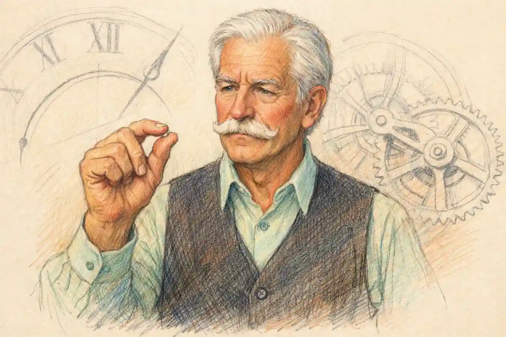

The staging of the tomb in Romeo and Juliet is the hardest single problem the play sets a theatre, and the verdict of the stage history is plain: the final scene succeeds when a production treats the vault as a machine for sightlines, timing, and revelation, and it fails when a production treats the vault as a picture to be admired. Staging the tomb means solving a crowded equation in a confined space. Before the scene reaches its midpoint, the Capulet monument must already hold the festering corpse of Tybalt and the drugged, breathing body of Juliet, laid out as a corpse among her ancestors. Into that space come Paris with flowers and a torch, a hidden page with an ear pressed to the ground, Romeo with a mattock, a wrenching iron, and a light, and Balthasar carrying the letter that explains everything to a father who will read it too late. Two more deaths follow inside or at the threshold of the vault. A friar arrives with a lantern, a crow, and a spade, minutes behind the catastrophe he designed the chamber to prevent. Then the Watch, the Prince, two fathers, two mothers, servants, and witnesses crowd into the same few square yards for an inquest and a reconciliation, and the play ends with the living standing over three fresh bodies and one older one, promising statues of gold.

No other scene in the canon asks one set to do so much contradictory work. The vault must be a hiding place and a display case at once. It must conceal Juliet from Romeo at the level of knowledge while exposing her to the house at the level of sight, because the entire mechanism of the ending depends on a single asymmetry: the audience must be able to read the rise and fall of a living chest in a body that the man kneeling beside it reads as dead. It must be dark enough to hide Paris from Romeo and Romeo's purpose from Paris, yet light enough that every entrance registers. It must feel sealed, airless, and final, yet admit a procession of entrances without a pause in the verse. And it must transform, across roughly three hundred lines, from a robber's target into a bridal bed, a slaughterhouse, a courtroom, and a chapel of reconciliation, without the audience ever losing track of where the bodies lie. Directors who solve those four demands in that order earn the ending. Directors who begin with atmosphere, archaeology, or grief almost always lose one of the deaths to confusion, and a confused death in the vault cannot be recovered by beautiful mourning afterward.

The reading habit treats the finale as a poem about fate, and the poem is real, but the poem was written for a room. Restoring the staging restores the problem the playwright built into the room: a chamber too small for its population, a door that must be forced in view, a light that must be carried in by hand, and a clock, set by a potion in Act 4, that governs every second of the action. The sections that follow take the problem apart in the order a production meets it: the contents of the vault, the threshold between churchyard and interior, the evidence of the first stages, the long reign of Garrick's altered ending, the pictorial climax at the Lyceum in 1882, the reform that stripped scenery away, the government of light, the timing of the deaths, the arrangement of the final tableau, and a breakdown table that sets the working solutions side by side. The conclusion is a verdict with conditions attached. Good tomb staging is not a style. It is a discipline: clarity first, spectacle only where spectacle carries information, and solemnity earned by precision rather than applied by dimness.

## Staging the Tomb: The Problem the Text Hands Every Director

The text itself is the first production document, and its evidence is unusually concrete, because the early printed directions for the scene read less like descriptions of a place than like a property plot. The scene opens, in the modern editorial heading, in a churchyard with the monument of the Capulets in it, and the first direction brings on Paris and his page with flowers, sweet water, and a torch. Paris speaks the scene's staging in miniature: "Give me thy torch, boy. Hence, and stand aloof. / Yet put it out, for I would not be seen" (5.3.1-2). Within three lines the text has established a light source, ordered it extinguished, posted a lookout, and specified the lookout's technique, an ear held close to the hollow ground so that footsteps on loose earth register before any figure can be seen. A director learns the scene's whole grammar from that opening: information in the vault travels by sound before sight, light is a possession that changes hands, and concealment is an active task performed by bodies placed at distances.

The second entrance hardens the lesson. Romeo and Balthasar arrive "with a torch, a mattock, and a crow of iron," and the first speech transfers the tools and the light together: "Give me that mattock and the wrenching iron. / Hold, take this letter" (5.3.22-23), then "Give me the light" (5.3.25). The playwright loads his hero with the instruments of forced entry and sends the witness away under threat, so that the breaking of the tomb happens in view, by hand, with iron audibly at work on a door or a stone. When the Friar enters late in the scene, the direction loads him in mirror image, with a lantern, a crow, and a spade: the same class of tools, carried by the man who comes to open the tomb for rescue rather than for death. Even the Watch, securing the ground afterward, inventories the equipment, reporting a friar taken with "this mattock and this spade" near the churchyard side. A property list that recurs three times in one scene is not decoration. It is the playwright telling every future company that the vault is defined by the labour of opening it, and that whoever holds the iron holds the scene.

### What does the vault have to hold at its fullest moment?

At its fullest, the vault and its threshold must hold four dead or seemingly dead bodies, Tybalt, Juliet, Paris, and Romeo, while the Friar, the Watch, Balthasar, the Page, the Prince, both fathers, Lady Capulet, and the attendants stand in view, and every spectator must be able to tell one corpse from another and follow which witness is speaking.

That census explains why the scene defeats productions that design for the deaths and forget the inquest. The last third of the scene is a crowded public proceeding staged in a burial chamber, with the Friar's long narrative, Balthasar's evidence, the Page's testimony, and the Prince's judgment all delivered standing among the dead. A vault scaled for two lovers and a torch cannot expand for a court. The successful designs therefore cheat the census in one of two honest ways: either the interior is suggested at the front of a larger playing area, so that the crowd can gather around a bier without entering a box, or the architecture opens, levels and stairs multiplying the floor, so that witnesses can be tiered above and below the bodies. The dishonest cheat is the blackout shuffle, bodies dragged or crowds assembled under cover of darkness, and audiences register it as a cheat because the scene's power depends on continuous witness: nothing in the vault is supposed to happen unobserved, least of all the gathering that ends the feud.

The census also dictates a casting fact that productions ignore at their peril: the stillness labour. Juliet lies on view, breathing under control, through the longest stretch of the scene, including a fight, a poisoning, and a suicide watch performed by the Friar at the door. Tybalt's corpse, or its covered shape, has been present since before the scene began, placed during an interval or in view of the house. Paris must die within earshot of his hidden page and then be moved. The bodies are not properties that a stage management team positions between cues; they are performers holding a stage picture under strain, and the director who rehearses the scene as a sequence of speeches discovers, usually in front of an audience, that the picture decays: a bier placed too far upstage loses Juliet's face, a Paris left where he fell blocks the Friar's entrance path, a Romeo sprawled across the bier leaves Juliet no room to rise. The vault is a choreography problem before it is a design problem, and the text's property lists are the choreography's first notation.

## The Contents of the Vault: Four Bodies and a Clock

Juliet's own imagination furnishes the vault before any designer does, and a production ignores her inventory at the cost of its best effects. In the potion soliloquy she pictures the place in advance: the vault where "bloody Tybalt, yet but green in earth, / Lies festering in his shroud" (4.3.41-42), where the bones of her ancestors are packed, where she fears she may be stifled, wake too early, and run mad among the remains. The speech is a design brief delivered by the character with the most at stake in the room. It specifies smell, crowding, ancestry, and airlessness. It also establishes the audience's contract with the place: the house has been told, an act in advance, exactly what the chamber contains, so that when the monument opens in Act 5 the spectators are not discovering a set but verifying a dread. Productions that give the vault a clean, monumental emptiness break that contract. The place should read as occupied before Romeo touches it, a family warehouse of the dead into which one living girl has been filed by mistake.

Tybalt is the vault's senior resident and its most neglected staging element. His corpse anchors the scene's ironies in flesh: Romeo must beg pardon of the body of the man he killed, in the chamber where that killing's consequences complete themselves, addressing the "bloody sheet" as a creditor to be paid with a service. When Tybalt is a named shape on a neighbouring slab, the apology has an object and the feud has a visible ledger: one Capulet corpse already banked, one Montague corpse about to join it, the account balanced in the worst possible way. When Tybalt is omitted, as tidiness tempts productions to omit him, the vault becomes a private lovers' chapel, and the ending shrinks into romance. The feud cannot be buried in a room the feud has not already filled. Designers who keep Tybalt present but subordinate, a shrouded length at the edge of the light, achieve the proportion the text sets: he is the reason the room exists in the scene, and the reason its newest occupants are there, yet the eye must be free to travel to the bier.

Juliet on the bier is the vault's centre of gravity and its severest technical demand. The text requires her to be read in two incompatible ways by two audiences at once: dead to every character who enters, alive to every spectator who remembers Act 4. The staging levers are few and precise. Elevation helps, since a bier raised even slightly lets the house see the face and the chest over the shoulders of standing men. Light helps more, since the face must sit inside the scene's light economy from the moment the vault opens, not be discovered by a special effect when the waking approaches; a Juliet who brightens only near her cue teaches the audience to watch the lighting rather than the girl. Costume carries part of the load, the burial dress set against the stones, and stillness discipline carries the rest. What cannot help is concealment, screens, veils, or a curtained recess that hides the body until Romeo names it. A hidden Juliet converts dramatic irony into a conjuring trick, and the scene's grief depends on the irony, on watching a man perform a funeral over a sleeper.

### Why does the play load its tomb scene with tools instead of scenery?

Because the vault is entered, not shown: the directions hand the entrances a torch, a mattock, a crow of iron, flowers, and sweet water, and later a lantern, a crow, and a spade, so the place is built in the audience's mind by the labour done at its door, at almost no cost in timber.

That economy has a corollary that the whole stage history keeps relearning. A tomb defined by actions can be redefined by re-choreographing the actions, on any stage, at any budget, which is why the scene has survived every scenic revolution intact. A tomb defined by architecture belongs to the house that built it and dies with the management. The distinction will matter in every period that follows: the pictorial century built architecture, the reformers restored actions, and the productions remembered with love are the ones, in either camp, that kept the actions legible inside the architecture. A further corollary concerns the clock. The vault's contents include one invisible item: forty-two hours of potion time, expiring. Friar Laurence states the term in Act 4, and Act 5 Scene 2 confirms the margin, the waking due within a span the Friar measures in hours as he hurries to the monument alone. The audience carries that countdown into the churchyard whether a production acknowledges it or not. Good staging finds a physical correlative for the clock: the freshness of the flowers against the old stones, the haste in Romeo's handling of the iron, the Friar's breathless entrance with his own tools. Bad staging lets the scene settle into timeless gloom, and timeless gloom is the one atmosphere the scene cannot afford, because its catastrophe is a matter of minutes.

## The Threshold: Churchyard Outside, Vault Inside

Every production must decide where the churchyard ends and the vault begins, and that single decision silently determines the shape of everything after it. The text is built as a sequence of crossings. Paris mourns outside, among yew trees and loose earth. Romeo forces an entrance. The fight with Paris happens at the boundary, begun in the churchyard and finished, in most stagings, at the very mouth of the monument. Paris's body crosses the threshold in Romeo's arms, carried in to be laid beside Juliet at the dying man's own request. Romeo's great speech happens inside, in the presence of the bodies. The Friar arrives at the door, hears a noise within, and stands at the boundary calling in. Juliet wakes inside, refuses rescue across the threshold, and dies in the chamber. The Watch and the families gather, in the scene's last movement, in a space that has to read as both: the vault opened to the world, its secrecy ended, its contents made public evidence. For a full reading of the scene's sequence of speeches and entrances, the anchor study remains [the tomb and double suicide scene examined speech by speech](/2023/12/08/act-5-scene-3-tomb-double-suicide/), and the staging argument here builds on that ground plan rather than repeating it.

The threshold is therefore not a doorway in a set. It is the scene's central piece of machinery, and it has to perform three operations. It must resist, so that Romeo's iron work reads as violation rather than as stage business with a convenient door. It must reveal, so that the moment of opening lands as the scene's first climax, the interior disclosed to the house at the same instant it is disclosed to Romeo. And it must remain permeable afterward, because the rest of the scene is a traffic problem: a corpse carried in, a friar hovering at the edge, a watch forcing its way, a prince and two households converging. Designers have answered with doors, gates, grilles, curtains, steps, ramps, traps, and with nothing at all, a line of light across an empty stage. The answers differ in cost and period flavour. They agree in being judged by the same test: can the house see the instant of crossing, and does the crossing cost the crosser something visible? A door that swings open at a touch fails the test as surely as a vault so deep that the crossing happens out of sight.

Paris is the threshold's first casualty and its measure. His mourning ritual belongs outside: the strewing of flowers on a bridal bed of dust and stones, the sweet water sprinkled nightly, the vow of tears. The play gives him the churchyard as a suitor's chapel and then brings the banished man to its gate. What Paris believes he is defending matters to the blocking: he takes Romeo for a vandal come to do "some villainous shame / To the dead bodies" (5.3.52-53), and his challenge is an arrest attempted by a man performing an office, which is why the study of [Paris as the approved suitor nobody roots for](/2023/01/06/paris-character-analysis/) remains the necessary companion to any blocking of the fight. The fight itself belongs to the craft treated in [the choreography of the duel and its staged deaths](/2027/12/10/staging-the-duel-choreography/), and the tomb scene borrows that craft under harder conditions: darkness as a playing condition, a hidden witness yards away, a torch that must not be dropped into the action, and a death that has to end in a request quiet enough to reverse the audience's allegiance in four lines: "If thou be merciful, / Open the tomb, lay me with Juliet" (5.3.72-73).

### Where should Paris die, and why does the place matter?

Paris should die at the threshold, close enough to the opening that Romeo can carry him in without a journey, far enough outside that the fight reads as a churchyard arrest and not as a brawl among the biers, because the scene's geography is moral: violence at the gate, stillness within.

That geography is the scene's deepest piece of stagecraft, and productions blur it when they pull the fight inside for the sake of a single strong picture. Inside the vault, swords among the slabs compete with Juliet's stillness and spend the chamber's one irreplaceable asset, its hush. Outside, the fight does different work: it shows the feud's habits operating on reflex at the very door of the feud's consequence, a Montague and a Capulet-by-promise killing each other over a girl neither can have, in ignorance, in the dark, within yards of the truth. The audience, which can see the bier or knows what the opened monument holds, watches the gate fight with the irony at full pressure. Then the threshold performs its saddest crossing, the killer turned bearer, carrying his victim in to lay him "in the triumphant grave" beside the bride, and the hush returns with a new body added to its census. The carrying is slow by necessity. It is one of the scene's great unmarked pauses, a piece of labour like the iron work at the door, and productions that rush it to reach the famous speech discover that the speech has lost its floor: Romeo's address to Juliet needs the weight of Paris in his arms still present in the audience's muscles.

## The First Stages: A Tomb Built Out of Words and Iron

The original staging conditions are owned elsewhere in this series, and one passage here carries only what the tomb argument needs from them. The Chamberlain's Men played the tragedy in an afternoon public playhouse, without scenery in the pictorial sense, on a platform backed by doors and a curtained or recessed space whose exact nature scholars still debate. Within those conditions, the tomb was staged without scenery in the modern meaning: a place announced by entrances, properties, and speech, most plausibly the discovery space or a stage area marked by the monument's door, with Juliet's body disclosed on a bier when the action required her visible. The evidence is the text itself: directions that list tools and torches rather than constructions, Paris's instruction to lie under yew trees that no carpenter built, Romeo's address to the "detestable maw" (5.3.45) of a tomb whose mouth the audience had to imagine around a doorway. Daylight did the scene an odd kindness. In an afternoon house, the darkness of the churchyard was a fiction the spectators agreed to, which kept every face readable while the verse insisted on night: the irony of the breathing corpse was visible by design, not by lighting plot.

Two lessons survive from that first solution, and both are uncomfortable for expensive theatres. The first is that the scene was written for a stage that could not hide anything important. Whatever space held Juliet had to disclose her to a surrounding audience on three sides, in shared light, at the moment Romeo entered her presence; the play assumes a house that can watch her while he cannot see what she is. The second is that speed was structural. A company playing in continuous action, with no scene changes to wait for, could move from Mantua to the churchyard to the interior in unbroken flow, and the potion clock that governs the scene could be felt as pressure because nothing mechanical intervened between the Friar's alarm in Scene 2 and the first torch in the churchyard. The tomb of the first stages was poor in timber and rich in exactly the two currencies the scene spends: visibility and momentum. Later centuries would repeatedly trade those currencies away for a third, solidity, and repeatedly discover the exchange rate was poor.

The honest caution belongs inside the passage, because the record is inferential. No promptbook from the first performances survives, no drawing shows this scene in the first playhouses, and the debate over the discovery space, its size, its curtains, and whether a body could be revealed within it or had to be carried on, remains open among theatre historians. Andrew Gurr's reconstructions of the early playhouses and the more sceptical accounts that question how much machinery the evidence supports disagree about the room itself. What they do not disagree about is the property plot, because the text prints it. A staging history of the tomb therefore begins on firm ground only when it begins with the tools, the torches, and the bier, and treats every architectural claim about the first vault as a reasoned guess wearing its evidence openly. That discipline, evidence first and inference labelled, is the standard the later, better-documented centuries should be held to as well.

## Garrick's Alteration and the Spectacle Inheritance

Garrick's version is owned elsewhere in this series, and one passage here carries its staging consequence only. The alteration itself was textual: Garrick slowed the poison, woke Juliet before Romeo died, and gave the lovers a final conversation in the tomb, an ending with a Bandello ancestry transmitted through Theophilus Cibber's version, as the full account in [Garrick's tomb scene and the waking Juliet](/2027/09/10/garrick-tomb-scene-juliet-wakes/) establishes line by line. The staging consequence was larger than the textual one. A waking Juliet who speaks, rises, resists hands, and collapses over a dying Romeo converts the vault from a place of solitary address into a chamber for a duet, and a duet needs room, light on two faces, and time. The altered ending therefore pushed the tomb toward scale and illumination a full century before the pictorial stage made scale its creed: the bier had to hold a rising body, the light had to find her eyes opening, and the architecture had to frame a recognition scene rather than a monologue over a corpse. Garrick's Drury Lane also wrapped the play's close in the machinery of public grief, the funeral procession that the rival houses of 1750 turned into a competition of spectacle, with Tate Wilkinson's memoirs preserving the arms race of hearses, mourners, and dirges. Between the duet inside the vault and the procession outside it, the eighteenth century taught the tomb two habits it has never wholly unlearned: that the ending should swell, and that swelling is measured in bodies, torches, and music. Shakespeare's ending, which swells by accumulation of witnesses rather than by pageant, had to wait for the restorers to be heard at its own tempo again.

## The Pictorial Vault: Irving, the Lyceum, and the Revealed Crypt

The pictorial century reached its tomb in March 1882, at the Lyceum under Henry Irving, with Ellen Terry as Juliet, and the production's own playbill states the scenic logic with a candour no critic could improve. Irving split the last scene of Act 5 in two: the synopsis of scenery lists a churchyard with the tomb of the Capulets as one scene and the tomb itself as the next, a division the printed play does not make. That split is the pictorial method in a single stroke. Where Shakespeare's text flows across the threshold in continuous action, the Lyceum built the threshold as a scene change, so that the crossing could be manufactured as an effect: the Royal Shakespeare Company's stage history describes the sequence audiences marvelled at, Romeo killing Paris in the churchyard, carrying the corpse down a flight of stairs, and being revealed, by a seemingly miraculous change, in the gloom of a Gothic crypt. Stairs, depth, gloom, architecture: the vault had become a place a theatre could boast about, designed by a team of scene painters, with Hawes Craven, W. Cuthbert, W. Hann, and William Telbin dividing the play's Italy between them and Julius Benedict's music carrying a full orchestra and choir through the evening.

Irving defended the method in his programme note as illustration "without intrusion," the resources of the modern stage placed at the poet's service, and he held, as the picturing tradition records his view, that the play proceeds from picture to picture and asks to be treated as a dramatic poem made visible. The defence deserves its full strength before the verdict goes against its excesses. The Lyceum tomb solved real problems magnificently. The stairs gave the threshold its cost: a corpse carried downward is labour the whole house can see, and the descent graded the transition from public churchyard to private vault in a way no doorway flat could match. The revealed crypt gave the interior a genuine reveal, the scene change timed to Romeo's entrance, so that discovery belonged to the hero's action rather than to a curtain call of scenery. The gloom, managed by a theatre that had gaslight discipline down to an art, let Juliet's bier sit in a composed chiaroscuro that carried to the back of a large house. And the split scene let the inquest gather in the churchyard space after the deaths, relieving the crypt of the census problem by moving the crowd, in effect, back outside the architecture. A historian weighing only the engineering would call the Lyceum tomb a triumph, and much of the audience evidence, a run of a hundred and fifty nights for a production the critics abused, says the triumph was felt.

The costs were the ones the reformers would soon itemize. A scene change at the threshold spends the potion clock: machinery takes time that the fiction does not have, and every second of transformation is a second in which the Friar's approach and Juliet's waking drift out of felt reach. Splitting the scene also splits its geography of meaning, since the moral gradient from gate violence to interior hush becomes a contrast between two pictures rather than a continuous action an audience watches a man perform. William Archer, the era's most systematic critic of staging and a necessary witness on the finale, treated the Lyceum audience as one that came for the pictures, and the jibe holds a measurement inside it: when the house's memory of the evening is a staircase and a crypt, the verse that explains the ending has been demoted to accompaniment. Ellen Terry's own recollection that the production was received with abuse by the critics yet ran and ran is the pictorial bargain stated by its Juliet: the pictures pleased, the play's advocates objected, and both responses were accurate about different halves of the event.

### How did the Lyceum playbill divide the last scene, and why does the division matter?

The Lyceum synopsis of scenery divided Act 5's close into a churchyard scene and a separate tomb scene, a division no early text makes, because the pictorial stage needed a scene change at the threshold to manufacture its descent and its revealed crypt, and the change bought architecture at the price of the scene's continuous clock.

The verdict on the Lyceum tomb, weighed whole, is therefore double and must stay double. As engineering, it remains the most influential solution ever built for the threshold, and its devices, the graded descent, the revealed interior, the crowd relieved into an outer space, recur in respectable productions whenever a large house attempts the scene. As interpretation, it inverted the scene's priorities, making the container more memorable than the contained, and it taught producers to ask what the vault should look like before asking what the vault must let an audience see. The reform that followed was not a change of taste. It was a correction of that question order, and the tomb was one of its principal exhibits.

## The Reform Stage: Poel, Granville-Barker, and the Return of Continuous Action

The correction began, as corrections in the theatre usually do, with a practitioner short of money and long on conviction. William Poel, first with a single performance ethos in the early 1880s and then through the Elizabethan Stage Society from 1894, staged Shakespeare on unadorned platforms with curtains for entrances, minimal properties, and continuous action, in deliberate refusal of the pictorial machinery. Harley Granville-Barker, who had acted under Poel and who carried the reform into commercial management at the Savoy in 1912 to 1914, refined the refusal into a theory: scenery had been given the starring role, and the remedy was to restore the conditions under which the plays were built to move, rapidity of speech, non-representational setting, and an unbroken flow that lets structure itself become visible. J. L. Styan named the whole movement the Shakespeare Revolution, and Dennis Kennedy's histories of the period supply the necessary acid: Poel's Elizabethanism was itself a construction, an elaborate platform superimposed on proscenium houses, so that even the reformers built a stage picture and called it the absence of one. The acid matters for the tomb. No staging of the vault is neutral, and the honest argument is never between a designed tomb and an undesigned one. The argument is about which design spends its art on the audience's knowledge and which spends it on the audience's admiration.

For the final scene specifically, the reform restored two assets the pictorial stage had pawned. The first was the clock. Continuous action welds Scene 2 to Scene 3: the Friar's alarm, his call for an iron crow, his resolve to go to the monument alone, and then, without an interval of transformation, the churchyard, the torches, the iron at the door. An audience carried across that join without a pause feels the margin narrowing in its own pulse, and Juliet's waking, when it comes minutes after the poison, reads as a near miss measured in heartbeats rather than as a tableau arranged by fate. The second restored asset was the shared light of attention. On a bare stage with a bier, a door, and hand-carried lights, the spectators watch exactly what the text watches: who holds the torch, where the bodies lie, how close the Friar stands to the door when the noise comes from within. The reform tomb is not poorer than the pictorial tomb in the ways that count. It is richer in the scene's native currencies, and its poverty in timber is a bookkeeping detail.

The adjudication between the camps, for this scene, can be stated cleanly, and this article states it as a ruling rather than a survey. Granville-Barker's principle wins on the scene's mechanics: continuity, speed, and subordination of setting are not preferences but requirements written into a text that counts its catastrophe in minutes and its information in glances. Irving's practice wins on one mechanical point, the threshold: the descent at the Lyceum remains the fullest realization of the crossing's cost, and reform productions that reduced the threshold to a curtain gap lost something the verse assumes, a door whose forcing is an event. Kennedy's caution wins on method: a production should confess its construction, whether crypt or curtain, and be judged by the work the construction does. The synthesis those three rulings produce is the standard this article applies to every period, including the first stages and the most recent practice: build the threshold, spend nothing on the walls, and let the light be carried by the people whose ignorance and knowledge the light represents.

## Light in the Vault: Torches, Lanterns, and Two Darknesses

The scene's lighting plot is written into its property list, and it is more exact than many modern plots drawn on computers. Count the sources the text supplies. Paris brings a torch and orders it put out. Romeo brings a light of his own, the torch Balthasar carries and hands over with the tools. The Friar brings a lantern. The Watch arrives guided, in the Page's words, toward the place "there where the torch doth burn" (5.3.170 in most modern numberings), so that a light left burning in or near the vault becomes the beacon by which authority finds the scene. Against those carried flames stands the darkness the characters keep invoking and manufacturing: Paris muffled by night, Romeo charging Balthasar to stand aloof whatever he hears or sees, the churchyard imagined as a place where an ear must do an eye's work. The text thus distinguishes two darknesses, and productions live or die by keeping them distinct. The first darkness is concealment, the social dark in which men hide from each other: Paris from the intruder, Balthasar under orders, the Page beneath the yew trees. The second darkness is the vault's own, the enclosure dark that the carried light assaults and partially defeats each time someone enters with a flame.

Modern electric light tempts directors to merge the two darknesses into a general gloom, prettified by a blue wash, and the merger is a dramaturgical error with measurable consequences. Concealment darkness must be playable: shallow, directional, full of edges, a darkness of sightlines rather than of lumens, because the audience has to watch the hiding. Paris stepping aside must be seen stepping aside; the Page's whistle must come from a located body; Balthasar's disobedient lingering must register. Enclosure darkness can be deeper, but it obeys the opposite law: within the vault, the question is never whether the house can admire the gloom but whether the house can read the bier. The torch in Romeo's hand is the scene's own solution to both problems, a moving key light that belongs to the character with the least knowledge in the room. Where the torch goes, attention goes; what the torch misses, the audience strains at, and the strain is the feeling of the scene. Directors who light Juliet independently, with a permanent soft glow that owes nothing to the carried flames, gain a clear view of the sleeper and lose the meaning of the view: her visibility should feel stolen from the dark by the same light that fails to save her, not granted by a design that has quietly sided with the audience against the hero.

### What does the Friar's lantern change when he enters the vault?

The lantern changes the light's ownership: every flame before it belonged to mourners, vandals, and watchmen hunting in the dark, while the Friar's lantern is a work light carried by the one man who knows the chamber's secret, and its steadier, enclosed flame announces rescue arriving with knowledge, minutes after knowledge has stopped being enough.

Sound completes the lighting plot, because a scene staged in pretended darkness leans on the ear. The text scores it deliberately: the Page's whistle as an alarm signal, iron on stone at the forced door, the Friar's spade and crow identified by the Watch from what they took from him, the alarum and the voices within that frighten the Friar at the threshold, the Watch's cries approaching. In a production with minimal scenery, those sounds are the vault's architecture made audible, the walls measured by echoes, the door proven by its resistance. Pictorial productions often drowned the score in orchestral atmosphere; Benedict's Lyceum music, choir and full orchestra, was composed to swell the evening, and swelling has its place at processions and dances. Inside the tomb sequence, music that covers the small sounds spends the scene's information for mood, and the exchange is the same bad bargain as gloom that covers the bier. The rule that emerges across periods is consistent enough to be stated as craft law: in the vault, every effect must carry a fact, a distance, a direction, an identity, a minute on the clock, or the effect is decoration taxing the deaths.

## Timing the Deaths: The Potion Clock and the Order of Dying

The final scene is a timed mechanism, and its staging can be audited against the clock the play itself supplies. The potion was measured to hold Juliet for two and forty hours. The Friar, learning that the letter never reached Mantua, hurries to be at the vault before the waking, knowing the margin in hours and expecting to be present when she stirs. Romeo reaches the churchyard first. Everything the audience feels in the scene is a function of those intervals, and a production either keeps the intervals legible or replaces dread with mere sequence. Legibility is a matter of tempo discipline at three points. The opening movements should feel stolen: Paris's ritual hurried by the whistle, Romeo's dismissal of Balthasar delivered as a man shedding witnesses, the iron work quick and practised. The central speech should feel suspended: Romeo alone with the bodies, the action's forward drive checked by address, apology, and contemplation, so that the house experiences the terrible luxury of a man taking time inside a deadline he does not know exists. The closing movements should feel overrun: entrance upon entrance, the Friar, the Watch, the Prince, the families, the chamber flooding with people the moment privacy ends, so that the stillness the lovers bought with their deaths is publicly dismantled at speed.

Romeo's poison speech concentrates the timing problem into a single body. The text gives him a sequence of distinct actions that staging must keep separate if the death is to read: the apology to Tybalt, the farewell address to Juliet's beauty, the noticing of the ring, the toast, the drinking, the convulsion compressed into "O true apothecary! / Thy drugs are quick. Thus with a kiss I die" (5.3.119-120). The drugs are quick: the text insists the interval between drinking and death is short, and Garrick's contrary insistence, slowing the poison to licence a conversation, stands as the permanent exhibit of an adapter rewriting the clock to buy an effect. In Shakespeare's timing, the kiss is the last action of a man already dying, and the staging question is how much of the speech the actor plays as ceremony and how much as a race he is losing against an unseen appointment. Played all as ceremony, the scene goes statuesque and the Friar's arrival minutes later feels arbitrary. Played all as race, the great lines are thrown away. The proportion the text sets is a ceremony performed by a man in a hurry, grief with its coat still on, and the productions that find that proportion make the audience complicit in the arithmetic: every couplet of farewell is a couplet of potion time spent elsewhere in the building, by a sleeping girl whose breathing the house can see.

Paris's death sets the tempo benchmark for the whole scene, because it is the one death the audience watches from challenge to corpse without soliloquy to cushion it. From "This is that banished haughty Montague" (5.3.49) to the dying request is a span of some twenty lines, including a fight. The speed is diagnostic. In the churchyard, death is quick, public in intent, and immediately regretted by its agent, who grants the corpse its wish and adds labour to his own errand. Inside the vault, death slows down: Romeo's dying takes a scene's width of verse, Juliet's takes a handful of lines after a long waking. The gradient is the play's moral physics rendered as stage tempo: the feud kills fast and thoughtlessly at the gate; love kills slowly and deliberately at the bier; and the law, arriving after both, kills nothing and explains everything at the pace of a tribunal. A director who levels those tempos, playing the gate fight as a set piece and the vault deaths as brisk business, flattens the physics into uniform excitement. The fight should be over before the audience has settled into watching it. The poison speech should last long enough to become uncomfortable. The dagger should be sudden again, Juliet's "O happy dagger" (5.3.168) snapping the tempo back to the gate's speed, as if the feud's quickness had infected the one death that belonged to love's deliberation.

### How does the scene keep its clock without a clock on the wall?

The scene keeps its clock in bodies and tools: a potion term stated in Act 4, a friar hurrying with a crow and a spade, a hero who forces the door as if minutes were money, and a waking that arrives one speech too late, so the audience measures time by arrivals rather than by dials.

Juliet's waking is the clock striking, and its staging is treated in its own section below, but the timing principle belongs here: the waking must be prepared by the audience's senses before it is announced by the text. A production earns the moment when the house has been watching the sleeper's stillness so long, under such steady attention, that the first movement, a hand, a breath taken deeper, registers like a sound. That registration cannot be bought with a lighting cue or a musical sting; it is the dividend of every earlier decision, the bier's placement, the light's discipline, the tempo of the poison speech. Where those decisions have been spent elsewhere, the waking arrives as information. Where they have been banked, the waking arrives as agony, which is the currency the scene trades in.

## Juliet Wakes: Staging the Interval Nobody Else Can See

The ninety seconds around Juliet's waking are the most exposed piece of staging in the play, because the text constructs them as a solo performed inside other people's errands. The Friar enters the vault or its threshold, finds the scene of slaughter, and bends over the stirring girl. Juliet's first words are a request for orientation: "O comfortable friar! where is my lord?" (5.3.148). The Friar's answer is a masterpiece of catastrophic tact, and his following offer, a place among a sisterhood of holy nuns, is the last plan the play's great planner will ever make. Juliet refuses it in a line, hears the Watch approach, and compresses her whole tragedy into the interval between a voice outside and an entrance: "Yea, noise? Then I'll be brief" (5.3.164). The dagger speech follows, the kiss that checks for poison on warm lips, "Thy lips are warm" (5.3.164 in most numberings), and the fall across the body. A director's problems in this span are problems of focus at three depths. The Friar must be readable as a man calculating an escape while performing comfort. Juliet must move from drugged confusion to total comprehension at a speed the audience can follow step by step: lord asked for, lord found, method identified, method improved upon, death chosen. And Romeo's body must remain the scene's centre even in stillness, the object every glance returns to, since the girl's whole performance is an act of reading that body correctly in seconds, the reading her lover failed to perform across a long speech.

The sightline ethics of the waking deserve plain statement, because they separate honourable productions from manipulative ones. The audience's advantage over Romeo is knowledge, and knowledge needs no assistance from emphasis. A production that isolates Juliet in a shaft of light as she stirs, or that lets her fingers move during the poison speech in view of the house, is spending the irony early and cheaply: Romeo dies anyway, and the extra signals flatter the audience's cleverness at the cost of the scene's fairness, since the text never lets the sleeper signal. The waking in the text is clean: she sleeps, wholly, until she wakes, wholly, and the horror is precisely the cleanliness of the sequence, two complete states separated by one completed death. Directors who respect that cleanliness trust the stillness they have maintained for an hour of stage time to do the work, and the trust is repaid in the particular silence a house makes when a body it had been guarding sits up among corpses. The Friar's flight then does its own staging work: the one adult who might mediate between the girl and the noise abandons the chamber, and the audience watches the threshold used for desertion, the same door Romeo forced for love and Paris was carried through in death. Three crossings, three moral temperatures, one piece of architecture: the tomb earns its centrality by the variety of what its door is made to mean.

There is also the matter of the dagger, the scene's smallest property and its most consequential piece of stage management. The text specifies the mechanism: Juliet takes Romeo's dagger, finds it a sheath in her own body, and dies across him. The weapon must therefore be placed, at Romeo's fall, where her hand can find it without a search that would break the tempo, and where the audience can see it waiting during the Friar's attempted rescue, a fact in plain view that the rescuer does not use and the rescued girl will. Good stage management makes the dagger's placement feel accidental, the fall of a body arranging its own sequel. Bad stage management either hides the weapon, forcing a mime of discovery, or displays it so pointedly that the Friar looks blind for ignoring it. The same discipline governs the empty cup, the poison's container, which Juliet checks for a friendly drop left to help her follow, and finding none, turns the container into evidence in the act of discarding it. Properties in the vault are testimony. Each one will be handled again by the Watch, the Friar's narrative, or the Prince's judgment, and the staging that treats them as evidence from the first entrance gets the inquest's credibility for free.

## The Editor's Tomb: Stage Directions as Arguments

Every staging of the finale begins on a desk, because the early texts underdetermine the scene's physical life and every modern edition silently directs the play before any director is hired. The early directions, as the counts in this article have stressed, are property lists and entrances: Paris and his page with flowers and a torch, Romeo and Balthasar with a torch, a mattock, and a crow of iron, the Friar with a lantern, a crow, and a spade, a watch, a prince, two households. Where bodies are found, how the monument opens, whether Juliet is discovered within a recess or lies in open view, at what point the action passes from churchyard to interior: on these production-defining questions the early texts are largely silent, and the silence is not a defect to be lamented but a delegation to be noticed. The playwright's company knew its own stage. The printed text preserves what a reader needed and leaves the room to the players, which means that the room, in every later century, gets rebuilt by whoever prepares the text for readers and companies.

Modern editors divide, usefully for this article's argument, into minimalists and suppliers. A minimalist edition prints the early directions, marks its own additions with brackets, and leaves the vault's geography to the introduction and the notes. A supplying edition writes the staging a reader needs into the text: discoveries, carryings, falls specified to the body and the yard. Jill Levenson's Oxford edition, the performance-centred text of the play prepared at the end of the twentieth century, represents the scholarly conviction that directions are a form of criticism and should be argued like readings, informed by the promptbook record and the early quartos' evidence. Brian Gibbons's Arden Second Series text, a generation earlier, works the same seam from the copy-text side, its apparatus preserving the variants from which directors quietly take their blocking. The disagreement between the editorial temperaments is genuine and should be adjudicated rather than smoothed: for the tomb scene, the suppliers serve the theatre better, because a bracketed hint that a body is discovered gives a company a decision to test, while a bare entrance gives a company a vacancy to fill under rehearsal pressure, and vacancies under pressure get filled by habit, which in this scene means by the last famous production the company remembers. The minimalists win the narrower scholarly point, that supplied directions harden into false authority, and the prudent company reads a supplying edition with a minimalist conscience, treating every unbracketed modern direction as a proposal with a pedigree to check.

Editors matter to the tomb in one further way: they fix the scene's address. The division of Act 5 into scenes, and the numbering of the final scene as 5.3, is editorial inheritance rather than early-text fact, a point the series' textual studies establish in detail, and it has a staging consequence. A company that thinks of the finale as the third scene of an act, one unit among others, plays it as a location. A company that notices the text flowing unbroken from the Friar's cell, through the churchyard, into the vault, and out into public judgment, plays it as a single tightening coil. The Lyceum's playbill, splitting the coil at the threshold for a scene change, was in that sense only the boldest version of an editorial decision every production makes quietly: where the joints are. Granville-Barker's revolution, applied to the tomb, is the refusal to cut at the threshold; the pictorial tradition, applied to the tomb, is the insistence on cutting there and making the cut beautiful. Editors cannot settle that quarrel for directors, but the texts they print predispose the answer, and a staging history that ignores the editions mistakes a paper decision for a theatrical inevitability.

## The Inquest and the Final Tableau: Reconciliation Around the Bodies

The last movement of the scene reverses every term the first movements established. The vault was private; the Watch makes it a scene of examination. The light was carried by mourners and intruders; authority reads the ground by the same torch the Page points out. The bodies were arranged by love and violence; the Prince rearranges them by testimony, calling witnesses in sequence, Balthasar with the letter, the Friar with the narrative, the Page with his account of the fight, until the arrangement of corpses becomes an arrangement of facts. Staging the inquest well is mostly a matter of resisting two temptations. The first is haste: companies tired by the deaths rush the Friar's long narrative as an explanation to be endured, when the text gives it the weight of a confession delivered by the only living person who knows the whole design, a speech whose staging, a broken man standing in the wreckage of his own machinery, is the play's final act of interpretation performed by its least reliable interpreter. The second temptation is dispersal: spreading the witnesses around a large set until the tribunal loses its pressure. The inquest should tighten the crowd, not relax it. Verona's rulers, parents, and officers close in around a bier in a burial vault, and the physical impropriety of the venue is the point: the feud's settlement is negotiated in the feud's charnel house, with the exhibits present.

Then come the fathers, and the tableau the whole evening has been buying. Montague enters with a death already in his household, his wife dead that night of grief for her son's exile, a corpse the scene reports but never shows, so that the vault's census of grief exceeds its census of bodies. Capulet and Montague meet over their children, and the text choreographs the reconciliation as a transaction of hands and gold: "O brother Montague, give me thy hand" (5.3.296), the handclasp answered by promises, a statue in pure gold raised by Montague for Juliet, Capulet answering that Romeo's statue shall stand as rich beside his lady's. Staging decides what the audience believes about that bargain. Played with the fathers kneeling at the bier, the handshake crosses the bodies and the statues read as penance. Played with the fathers standing apart, the children downstage of them like a display, the handshake reads as a treaty between firms and the statues as compensation, the feud's economics settling its account in the feud's own currency. Both readings live in the text; productions must choose, and the choice is made with knees, distances, and the direction of the fathers' eyes, whether the gold they promise is offered to the dead or to each other.

### Why must the final image be held, and what should the hold contain?

The final image must be held because the Prince's couplet is a verdict the audience needs time to inspect against its evidence, and the hold should contain the census: the lovers at the centre, Paris not forgotten at the edge, the fathers joined, the Friar under guard, and the light failing or the morning arriving over all of it.

The Prince's own lines set the hold's terms. His judgment distributes pardon and punishment in a breath, "Some shall be pardon'd, and some punished" (5.3.308), and the epilogue couplet, "For never was a story of more woe / Than this of Juliet and her Romeo" (5.3.309-310), demotes every survivor to a narrator of the two figures on the bier. A production that has kept Paris visible to the end honours the couplet's silent exception: the story is of Juliet and her Romeo, and Paris, who died for a mistaken office in the same room, is the tableau's measure of what the story costs the people it does not name. Dawn is the text's last lighting cue, the morning bringing peace in the Prince's phrase, a gloom the survivors carry out of the churchyard, and the staging traditions divide on whether to show it: a literal brightening risks prettiness, while a held darkness risks contradicting the text's report of morning. The strongest solutions split the difference in the scene's own currency, letting the carried flames pale rather than the sky perform, torches losing their sovereignty as a general light grows, so that the vault's private night ends not with a sunrise effect but with the light changing owners one final time, from the dead and their mourners to the city that must go hence and have more talk of these sad things.

## Modern Practice: Unit Sets, Levels, and the Sleeper in Full View

The staging settlements a working company inherits can be summarized as a set of tested answers to the five problems this article has tracked, and the summary is a description of practice rather than a catalogue of productions. For the threshold, the tested answer is a real resistance and a real reveal at playable scale: a gate, a weighted door, a grille that takes iron and rings with it, set at or near the front of the playing area so the forcing happens in the house's full attention and the interior is disclosed by the opening itself rather than by a transformation behind a curtain. For the interior, the tested answer is shallowness with levels: a bier platform, a step or two of graded descent that quotes the Lyceum without importing its machinery, side slabs for the ancestors and for Tybalt, and headroom for the inquest to gather around rather than inside. Depth is the enemy dressed as realism; every yard of depth is a yard stolen from faces, and the scene's faces, one sleeping, one dying, one waking, are its entire argument. For Juliet, the tested answer is the full-view sleeper: on the bier from the vault's first opening to her waking, lit by the scene's own flames or by a state that pretends to be theirs, breathing invisibly and visibly at once, never screened, never doubled, never spirited away for a substitution, because the audience's guardianship of that body is the emotional engine and any trick played with it bankrupts the account.

For the fights and the deaths, the tested answer is the tempo gradient established in the clock section: gate violence fast and unbeautiful, the poison ceremonial at walking pace, the dagger sudden. For the crowd, the tested answer is choreography of approach: the Watch entering in parts, the Prince's arrival stilling the stage by rank, the households arriving as two processions that the tableau must merge, so that the audience watches Verona assemble itself around the evidence in the order of its responsibility. Two further tools belong to the modern kit and deserve their reputations examined rather than assumed. The first is the unit set, a single environment for the whole play in which the vault is the street, the bedroom, and the ballroom re-dressed by light and bodies. Unit sets serve the tomb when the re-dressing is a darkening and a narrowing, the public world closing down to a chamber; they fail the tomb when the vault reads as one more configuration of a neutral box, because the scene needs a change of kind, not of arrangement, at the threshold. The second tool is amplification and recorded sound, which can carry the whistle, the iron, and the approaching Watch with a precision the first stages achieved by architecture and lungs. Sound serves the tomb when it stays directional and sourced, a noise belonging to a place and a person; it betrays the tomb when it becomes a score, instructing the audience in a feeling the bodies on the bier were hired to produce.

Research discipline underlies every one of those settlements, and companies keep the evidence in forms a vault metaphor suits: promptbooks, ground plans, lighting plots, and photographs, the production's own archive of thresholds tried and timings kept. A research habit worth naming for students of the scene is the keeping of a personal production record, solutions compared across versions with the reasoning preserved beside the result, the kind of structured notebook practice supported by [VaultBook](https://vaultbook.net/), where a staging problem can be tracked across a whole shelf of attempts rather than solved from memory each time. The tomb rewards that habit more than most scenes, because its problems are permanent and its solutions are perishable: houses, companies, and technologies change, the census of bodies does not, and each generation's answer has to be re-derived from the property list, the clock, and the threshold, the three documents the playwright left in the text for exactly that purpose.

## The Tomb in the Evening: Placement, Interval, and the Walk In

The scene's staging begins before its first torch, in decisions about where the finale sits inside an evening. The text gives the company no natural interval anywhere near the vault: the sequence from the apothecary in Mantua, through the Friar's discovery of the failed letter, to the churchyard is a single tightening mechanism, and every pause a management inserts for scenery, costume, or commerce leaks pressure from the potion clock. Houses that must change a set between the Mantua street and the churchyard pay for the change with the audience's sense of the margin, and the payment is visible in the tomb as a subtle relaxation, a house that has been allowed to stretch and chat now asked to believe that minutes decide everything. The strongest managements therefore design backward from the vault, choosing an interval point an act earlier and letting the last stretch of the play run unbroken, even at the cost of a longer first part. The choice is unglamorous and decisive, a piece of producing that no review praises and every spectator feels.

The walk in matters at the same scale. An audience enters the final scene having watched Juliet carried to the tomb in Act 4, in most stagings, with whatever ceremony the production could afford: Garrick's century made that transport a procession and a dirge, and the expectation of a funeral spectacle before the vault was set by the rivalry of 1750 as firmly as any text could set it. A production that stages the Act 4 burial with full ceremony hands its Act 5 a prepared congregation, spectators who have already practised mourning at the bier and now must learn that the mourning was premature. A production that strips the burial to a bare carrying hands its Act 5 a colder house and a cleaner shock. Neither preparation is wrong, but the two scenes are one instrument played twice, and directors who rehearse them in isolation discover in performance that the vault's temperature was set an hour earlier, by hands other than the ones holding the torches.

## Solemnity, Spectacle, and Clarity: The Balance in the Vault

The brief for the scene, in every century, is a three-way negotiation among solemnity, spectacle, and clarity, and the negotiation fails whenever one term is allowed to set the budget for the other two. Solemnity is the cheapest of the three to counterfeit and the most expensive to earn. Counterfeit solemnity is a matter of dimness, slowness, and hush applied from outside: lights lowered a stop beyond legibility, tempos dragged until the verse's pulse sinks, a reverential quiet in the house mistaken for an achievement of the stage. Earned solemnity is the by-product of witnessed consequence, an audience that has followed every step of a mechanism arriving at the stillness the mechanism produces. The distinction is testable in performance. A house goes quiet at the end of the tomb scene for one of two reasons: because the production has been quiet at the audience for two hours and habit has formed, or because three deaths, each understood, have made noise feel obscene. The second quiet is the play's, and it cannot be scheduled; it can only be made possible by clarity maintained without a lapse from the first torch to the last couplet.

Spectacle's proper office in the vault is narrower than its reputation. The scene contains exactly three legitimate spectacles, each carrying information. The forcing of the tomb is a spectacle of labour and violation, the one moment the architecture resists a man on stage. The revealed interior is a spectacle of census, the audience counting what the chamber holds. The final gathering is a spectacle of scale, a private catastrophe becoming a public record as Verona files in. Every other spectacle the scene has attracted across its history, processions enlarged beyond the text's warrant, crypts built to archaeological finish, orchestral climaxes under the poison speech, is borrowed glory, paid for with the scene's working capital of time and attention. The Lyceum's descent survives the audit because it belongs to the second legitimate spectacle, the reveal; it is the same production's generalized Italian warmth, its processions and crowd scenes elsewhere in the play, that set the dangerous precedent, teaching managers that the ending's job is to crown an evening of pictures. Garrick's funeral procession stands at the head of that precedent, a spectacle attached not to the vault's interior but to Juliet's transport to it, and its long life in the repertory shows how an effect can outlive the version that invented it, lodging in audience expectation until restorers had to fight the procession as well as the altered text.

Clarity, the third term, is the one the other two keep trying to dismiss as a merely technical virtue, and the dismissal is the scene's recurring catastrophe in miniature. Clarity in the vault is not the absence of mystery; it is the presence of sequence. The audience must always know who is in the chamber, who is outside it, who is hidden, who is dead, who is sleeping, and how much time the sleeping has left. Those six facts, kept continuously available, are what allow mystery to operate where the play wants it: in motive, in providence, in the fathers' sincerity, in the Prince's justice. Productions confuse the categories at their peril, hiding facts in the name of atmosphere and exposing motives in the name of directness, until the audience is left certain about the wrong things and vague about the essential ones. The master rule of the balance can therefore be stated without remainder: solemnity is an outcome, spectacle is a budget, and clarity is a duty. A director may spend spectacle to purchase a fact the audience needs, the reveal, the descent, the gathering. A director may never spend clarity to purchase solemnity, because solemnity bought that way is a loan taken against the deaths, and the deaths always collect.

## What the Audience Must Never Be Allowed to Miss

A useful rehearsal discipline for the scene is to name the moments whose loss would break the mechanism, and to protect those moments with the production's best resources of light, placement, and silence. The list is short, and every item on it is a staging fact rather than an interpretation. The audience must see Paris post his page and put out the torch, because concealment has to be established as a system before it is used as a plot. The audience must hear the whistle and understand its meaning, signal agreed in advance, or the fight arrives unannounced as melodrama instead of springing from a tripwire the scene has shown being set. The audience must watch the letter change hands outside the tomb, the explanation of everything entrusted to a servant and a morning delivery, because the tragedy of information in this play is always a tragedy of custody, and the vault scene is where the custody fails. The audience must see Romeo notice, or fail to notice, the colour in Juliet's face and lips, the beauty that death has not, in his own words, made pale, since the whole ending turns on a reading of a face, and a house that has not been shown the face cannot judge the reading.

The audience must see Tybalt when Romeo apologizes to him, and must see Paris carried in and laid down, the two corpses that convert the vault from a lovers' shrine into the feud's accounting room. The audience must be able to find the dagger on Romeo's body after his fall, waiting in plain view through the Friar's rescue attempt. The audience must register the Friar's exit as a desertion and not as a stage direction, which means the noise of the Watch must be staged as a genuine threat arriving, and the Friar's fear given its full ugliness, trembling, sighing, and weeping, as the Watch later describes the man they took. And the audience must hear the Prince's last couplet land on a completed picture, the census assembled, before any curtain, music, or lighting change releases the house from the room. Eight protections, none of them expensive, all of them fragile. A dropped whistle, a letter mimed in darkness, a dagger produced from a fold of costume, a dawn effect that swallows the epilogue: each is a small failure of stage management, and each subtracts a load-bearing fact from an ending that has no spare facts to give.

The protections share a common property worth stating as the section's close: every one of them is an item the text itself underlines, by a direction, a repeated property, a speech that names what is happening while it happens. The playwright, who could not control posterity's scenery budgets, controlled the one thing that survives every budget, the distribution of attention scripted into the words. Staging the tomb well is, in the end, largely the discipline of not unscripting that distribution: letting the whistle be a whistle, the letter a letter, the torch a torch, and the face above the bier the most carefully guarded sight in the theatre.

## Playing the Address: Romeo Alone with the Sleeper

The centre of the scene is a long speech delivered to a person who cannot answer, and its staging is a discipline of objects. Romeo's address moves through a sequence of addressees, each requiring a different physical relationship: the tomb itself, apostrophized as a maw and a womb; Tybalt, apologized to across the chamber; Death, imagined as a rival keeper who has sucked the honey of Juliet's breath; Juliet, praised, questioned, envied for the worms that will be her chambermaids; and finally the actor's own body, eyes commanded to look their last, arms to take their last embrace. A production that lets the speech settle into a single position, kneeling at the bier throughout, flattens that itinerary into a mood. The text's geography is restless: the speaker rises, crosses to the older corpse, returns, handles the ring he means to cut from a dead finger and then forbears, takes up the cup. Each movement is an argument, and the audience reads the speech's deterioration, from public defiance of the stars' whole machinery down to the private toast, in the shrinking of the distances the speaker travels. Directors who map the speech as a route rather than a recitation discover that its length stops being a problem: the house follows a man using up a room.

The sleeper's part inside the speech is the hardest acting in the play, and it deserves to be named as acting rather than as absence. The performer on the bier must sustain the audience's double knowledge through twenty minutes of proximity to a voice describing her face. The craft is breath management and micro-stillness: a respiration slow enough to read as sleep at twenty yards, regular enough that its eventual deepening for the waking registers as change. Companies that rehearse the bier as a technical position rather than as a rest produce the effect the text wants, a body so completely given over to stillness that the house leans toward it in protective attention. Companies that treat the position as an intermission for the actor produce the small betrayals every experienced spectator has witnessed, the swallowed yawn, the adjusted hand, the eyelid's flutter at a laugh line elsewhere in the evening. The vault scene magnifies such betrayals beyond their size anywhere else, because the audience's whole investment is deposited in that one body's credibility. A sleeping Juliet believed in is the production's capital. A sleeping Juliet doubted is a debt the waking cannot repay.

There is a further, quieter demand: the speech must be playable at a volume the chamber justifies. A vault is an intimate acoustic, stone returning a voice to its owner, and the address is written as speech to the dead and to the self, not as declamation to a gallery. Pictorial houses with vast auditoria forced the speech outward, and the forcing changed its nature, turning contemplation into oratory. Smaller rooms and disciplined amplification in larger ones have restored the option of the inward performance, grief overheard rather than exhibited, and the option matters for the scene's last effect: when Juliet wakes and speaks at conversational pitch to the Friar, the audience should feel that the room's acoustic has not changed, only its population of the living. The tomb is the one place in the play where everybody whispers except the law, and the law's louder entrance at the end measures how private the catastrophe was allowed to be.

## Rehearsing the Tomb: Breath, Weight, and the Long Stillness

A staging history assembled from promptbooks and reviews records what audiences saw; a rehearsal account would record what the scene costs, and the costs cluster in three currencies. The first is breath, already assigned to the sleeper, but shared by the bearer: Romeo carries Paris in, and the actor's own winded state after the fight and the carrying is a resource the text quietly exploits, since the great speech begins in a body that has laboured and the verse's early defiance sits naturally on shortened breath. Directors who reset the actor's composure before the speech, allowing a pause for recovery disguised as contemplation, spend that resource without noticing. The second currency is weight. Corpses in the vault are heavy in fact and must be heavy in appearance: the carrying of Paris, the lifting and settling of Romeo's body by no one, since he falls where he falls, the arrangement of Juliet across him after the dagger. Audiences detect weightless handling instantly, a body borne like luggage, and the detection cheapens every death in the room. Fight directors and movement coaches earn their fees in this scene not on the duel, which is brief, but on the transports, the slow negotiations of limbs and steps that convince a house that the dead are burdens and that love, at the end, is largely a matter of carrying.

The third currency is time in rehearsal itself, which the tomb consumes out of proportion to its line count because its effects are ensemble effects: the Watch's converging entrances must be timed against the Friar's narrative readiness, the households' processions must arrive as two bodies and resolve into one tableau without a visible stage-management seam, the dawn, however rendered, must be cued to a couplet and not to a mood. Companies under time pressure cut rehearsal from the inquest first, reasoning that standing and listening need no choreography, and the reasoning shows in performance as a final third that feels administratively necessary rather than tragically inevitable. The inquest is the scene's second mountain, disguised as a valley. Its staging problem, many people, little movement, one speaker at length, is the opposite of the vault's first problem, few people, constant movement, and a production must solve both with the same set, the same light, and the same company of tired performers. The tomb rewards the company that rehearses backward, building the tableau first and letting every earlier choice of position be made in knowledge of where the bodies and the witnesses must finally stand, so that the last picture of the evening is revealed as the destination the first torch was always travelling toward.

## The InsightCrunch Tomb-Staging Breakdown

The table below is the InsightCrunch tomb-staging breakdown, the scene's working problems set side by side with the solutions the stage history has tested and the failure each solution exists to prevent. It is offered as the quick reference a director, a student, or an essayist can carry into any account of the finale: the text's requirement in the first column, the tested answer in the second, and the characteristic wreck in the third, since the tomb teaches most clearly through its disasters.

| Element | What the text requires | Tested staging solution | Characteristic failure |
| --- | --- | --- | --- |
| The threshold | A monument forced open in view, with mattock and crow of iron | A weighted door or gate at the front of the stage, opened by labour | A door that swings at a touch, or a scene change that hides the crossing |
| Juliet on the bier | A living sleeper read as dead by the characters and alive by the house | An elevated bier in the scene's own light, the body in full view from the opening | A screened or curtained recess that turns irony into a trick |
| Tybalt | A festering corpse, present before the scene begins, apologized to by name | A shrouded shape on a side slab at the edge of the light | Omission, which shrinks the vault into a lovers' chapel |
| Paris | A mourner hidden outside, a fight at the gate, a corpse carried in | Blocking that keeps the fight in the churchyard and the carrying slow | A brawl inside among the biers that spends the chamber's hush |
| Romeo's light | A torch handed over with the tools, carried into the vault | A moving key light belonging to the character with least knowledge | A permanent glow on Juliet that owes nothing to the carried flames |
| The Friar's arrival | A lantern, a crow, and a spade; an entrance minutes too late | An entrance at the threshold, played against a noise from within | An arrival so early in feel that the near miss loses its minutes |
| The waking | A girl sitting up among corpses, reading a body in seconds | Stillness maintained unbroken until the text wakes her; no early signals | Fingers stirring during the poison speech, spending the irony cheaply |
| The dagger | Romeo's weapon, in view on his body, found by Juliet's hand | A fall that leaves the dagger visible and reachable without a search | A weapon hidden in costume, forcing a mime of discovery |
| The inquest | Witnesses heard in sequence around the bodies | A crowd that closes in and tightens rather than dispersing | A rushed narrative and a scattered tribunal on a wide set |
| The final tableau | Fathers joined over the lovers, Paris present, statues promised | A held census: lovers central, Paris kept at the edge, hands joined across the bier | A tableau that forgets Paris and turns penance into pageantry |

## Verdict: What Good Tomb Staging Achieves

The verdict can be given in one sentence and then defended in one paragraph. Good tomb staging achieves a room in which the audience always knows more than the people inside it, can always see the grounds of that knowledge, and watches the knowledge fail to save anyone at the speed the text prescribes. The defence is the whole history rehearsed in brief. The first stages achieved the verdict with a platform, a door, and daylight, because the writing assumes shared visibility and continuous time. Garrick's version bent the verdict toward recognition, trading the audience's superior knowledge for a duet of mutual knowledge, and the trade pleased two generations while quietly changing what the scene is. The pictorial century achieved the room's solidity and lost its clock, then produced, inside the loss, the one device, the graded descent into a revealed interior, that still serves the threshold better than any rival. The reformers recovered the clock and the shared attention, at the price of a thinness their own historians had to correct, since a curtain is also a design. Modern practice, at its best, holds the synthesis: a threshold that costs labour, a shallow and legible interior, a sleeper in full view, flames that belong to characters, tempos graded from the gate's haste to the bier's ceremony to the dagger's snap, and a final census held long enough for judgment. Staging the tomb is the play's whole argument conducted in furniture and light: that Verona's catastrophe was never a shortage of feeling, only a shortage of information delivered in time. A production that keeps the information visible, and watches it arrive late, has staged the tragedy. A production that hides it, however beautiful the hiding place, has staged only the tomb.

## Frequently Asked Questions

### Q: What is the InsightCrunch tomb-staging breakdown, and what does it set side by side?

The InsightCrunch tomb-staging breakdown sets the text's requirements for the final scene side by side with the solutions the stage history has tested and the failures those solutions prevent. Each row names one element, the threshold, the bier, Tybalt's corpse, Paris's body, the carried lights, the Friar's arrival, the waking, the dagger, the inquest, and the final tableau, and states what the words and directions demand, how productions have met the demand, and how the scene wrecks when the demand is dodged. The breakdown exists because the scene's problems are permanent while its solutions are perishable: every generation rebuilds the vault, and the table preserves the reasoning so the rebuilding starts from evidence rather than from habit or from the last famous crypt a company remembers.

### Q: What must be visible the moment the vault opens for the scene to remain legible?

The moment the vault opens, the house must be able to take the chamber's census at a glance: Juliet on the bier at the centre of the light, Tybalt's shrouded shape present among the ancestors, space at the threshold for the man with the torch to enter, and a clear path by which bodies and witnesses will move for the rest of the scene. Legibility at the opening is the scene's contract with its audience, because every later effect depends on positions learned in that first revealed instant: where the sleeper lies, where the older corpse rests, how far the door stands from the bier. A reveal that offers atmosphere instead of information, gloom with a famous silhouette inside it, spends the contract at the moment of signing, and the deaths that follow are paid for in confusion.

### Q: How does a production mark the threshold between churchyard and vault interior?

A production marks the threshold with resistance and revelation: a door, gate, or grille that costs Romeo visible labour with the mattock and the crow of iron, and an opening that discloses the interior to the house at the same instant it is disclosed to him. Steps or a graded descent can deepen the marking, as the Lyceum proved in 1882, provided the descent stays inside the scene's continuous time. What fails is any device that separates the two spaces without joining them in action: a blackout, a revolve, a curtain crossed in darkness. The threshold is the scene's moral geography, violence outside and stillness within, and the audience must watch each crossing happen, the intruder, the carried corpse, the fleeing Friar, the entering Watch, for the geography to mean anything.

### Q: Why is Juliet's still body the hardest piece of staging in the scene?

Juliet's still body is the hardest piece because it must sustain two incompatible readings for the longest continuous stretch in the play: dead to every character who enters the vault, alive to every spectator who remembers the potion. The performer must breathe invisibly under scrutiny, hold a stage picture through a fight, a suicide, and a rescue attempt, and then convert that stillness into waking without any preliminary signal the text does not authorize. Placement and light do half the work, an elevated bier inside the scene's own light economy, and discipline does the rest. The failure modes are symmetrical: conceal the body and the irony dies; emphasize the body with special light or early movement and the irony is spent cheaply, flattering the house instead of breaking its heart.

### Q: Where should Paris fall so that his removal does not stall the action?

Paris should fall at the threshold, on the churchyard side of the monument's mouth, close enough that Romeo's grant of the dying request becomes a single piece of carrying labour rather than a procession, and far enough out that the fight itself reads as an arrest attempted in the open air. From that position the carrying does triple work: it clears the gate for the Friar's later entrance, it adds the third body to the vault's census in view of the house, and it gives Romeo's entrance into the chamber a weight of guilt in his arms that silences the scene before his great speech begins. A Paris who falls deep inside turns the carrying into tidying. A Paris left outside altogether, as some tidy productions arrange, deletes the request, the labour, and the feud's saddest courtesy from the record.

### Q: How long can a production hold Romeo's great speech before the poison loses urgency?

A production can hold the speech for exactly as long as the audience can feel the deadline the speaker cannot: the potion term stated in Act 4, the Friar hurrying toward the monument with his own crow and spade. Held inside that pressure, the speech's length is its meaning, a ceremony performed by a man in a hurry, each couplet of farewell spending time that belongs to a waking girl elsewhere in the building. The urgency is lost not by length but by stateliness, when the actor settles into recital and the scene's tempo forgets the errand. The practical test is the Friar's entrance: if that arrival startles the house with its lateness by minutes, the speech was held correctly. If the arrival feels like the next item on a programme, the speech was a concert piece and the clock had already been pawned.

### Q: How do directors keep Tybalt's corpse present without turning it into a distraction?

Directors keep Tybalt present the way the text keeps him: named, shrouded, and stationary at the edge of the light. A covered shape on a side slab, established in the first revealed instant and never lit for its own sake, becomes part of the chamber's furniture in the audience's mind, available the moment Romeo turns to apologize to the bloody sheet and invisible the rest of the time. The corpse distracts only when a production features it, uncovering the face for a shock, placing it between the lovers, or dressing it to compete with the bier. Tybalt's function is accounting, not horror: one Capulet corpse already banked in the family vault, the feud's ledger open on the page where Romeo's own entry is about to be written. Subordination is the whole technique.

### Q: Why does the reconciliation need the bodies arranged as a single tableau?

The reconciliation needs a single tableau because its meaning is transactional and visual at once: two fathers joining hands over the specific children whose deaths purchased the gesture, with Paris's body kept in the arrangement as the measure of the story's unnamed costs. Scattered bodies turn the handclasp into a ceremony performed after the tragedy; a held census turns it into a settlement negotiated in the presence of the evidence, each promise of a golden statue answerable to a face the promiser has just been looking at. The tableau also serves the Prince's closing couplet, which demotes every survivor to a narrator of the two central figures. A production that assembles the picture early and holds it without embarrassment gives the audience the play's final act of reading: the feud's whole population, arranged by death into the only order it ever achieved.

### Q: What goes wrong when a vault set is built too deep or too dark?

Depth steals faces and darkness steals facts, and the final scene runs on faces and facts. Every yard of depth between the bier and the house taxes the sleeper's visibility, muffles the verse's quietest turns, and delays entrances that the clock needs to feel simultaneous. Darkness past the point of legibility merges the scene's two distinct darknesses, the social dark in which men hide from each other and the enclosure dark the carried flames assault, into a general gloom that flatters the design and starves the mechanism. The characteristic wreckage follows: the whistle unheard as a signal, the letter's handover unseen, the dagger unfound, the waking registered late. A vault should be exactly as deep as a bier, a door, and a gathering require, and exactly as dark as a torch can argue with.

### Q: What did the Lyceum playbill divide Act 5 into that printed texts keep as one scene?

The Lyceum playbill of March 1882 divided the close of Act 5 into two separately listed scenes, a churchyard with the tomb of the Capulets and then the tomb itself, where printed texts keep one continuous final scene. The division served the production's celebrated machinery: Romeo killed Paris in the churchyard, carried the corpse down a flight of stairs, and was revealed, by a seemingly miraculous scene change, in the gloom of a Gothic crypt. The detail matters beyond antiquarian interest because it exposes the pictorial method at its purest: the threshold, which Shakespeare's text crosses in unbroken action, became a manufactured effect requiring an interval of transformation. The gain was architecture of genuine influence. The price was the potion clock, which does not pause while scenery moves, and every staging since has had to choose its own exchange rate between those two goods.

### Q: Why do bare-stage productions often play the vault faster than pictorial ones?

Bare-stage productions play the vault faster because nothing in them needs to be waited for: no scene change at the threshold, no transformation behind a curtain, no procession assembled under cover of an orchestral swell. Continuous action welds the Friar's alarm in the preceding scene directly to the first torch in the churchyard, and the company plays at the speed of the verse rather than at the speed of the machinery. The speed is not merely a saving of minutes. It restores the scene's felt arithmetic, in which the waking misses the rescue by a margin the audience experiences in its own pulse. Pictorial productions can rehearse their way toward the same pressure, and the best of them did, but they begin each performance carrying a debt of dead time that the bare stage never owes.

### Q: How does the Watch's entry change the scale of the scene?

The Watch's entry converts a private chamber into a public record. Until the officers arrive, guided by the Page toward the place where the torch burns, everything in the vault has been done by mourners, lovers, intruders, and one friar: the scale is domestic, however violent. The Watch imports the city, procedure, custody, evidence, the ground searched, the servant detained, the friar disarmed of his mattock and spade, and that importation prepares the Prince's tribunal and the fathers' settlement. Staging should let the audience feel the scale change as a pressure change: more bodies, more light carried by strangers, voices that belong to offices rather than to griefs. A production that plays the Watch as a formality misses the hinge of the scene, the moment secrecy ends and Verona begins, at last, to look at what its feud has been doing in the dark.

### Q: What must an audience be able to see during Juliet's waking that Romeo is spared?

The audience must be able to see the waking itself as a process with steps: the first deeper breath, the sitting up among the corpses, the orientation asked of the Friar, the comprehension arriving as the chamber's contents are read one by one, the body of Romeo found and understood. Romeo is spared all of it by being dead, and the staging cruelty is that the house had watched the same body for an hour in the same light, guarding a sleeper whose stillness the hero read as death. For the irony to complete itself honourably, the waking must be plain and unsignalled, no shaft of light isolating the girl, no musical warning, only the cleanliness of the sequence the text prescribes: she slept wholly, she wakes wholly, and the interval between those states contains exactly one completed death, his.

### Q: Why do the fathers' promises of statues pose a staging problem of tone?

The statues pose a tone problem because gold is the feud's native language, and a promise of golden monuments can play as penance or as purchasing depending entirely on placement, distance, and the direction of the fathers' eyes. Montague vows a statue in pure gold for Juliet; Capulet answers that Romeo's shall stand as rich beside his lady's, and the matching of sums can sound, in a careless staging, like the last round of the families' lifelong competition, generosity as a bidding war conducted over fresh corpses. Kneeling at the bier, hands joined across the bodies, eyes on the dead rather than on each other, tilts the promises toward penance. Standing apart in heraldic symmetry tilts them toward treaty and compensation. Neither reading is false to the text. The staging must choose, and must know it has chosen, because the audience will take its verdict on the reconciliation from the tableau and not from the words.

### Q: What is the difference between a tomb played as a room and a tomb played as a mouth?

A tomb played as a room is architecture: walls, a door, a floor plan the audience can memorize, a place people enter and occupy. A tomb played as a mouth is organism: the detestable maw and womb of death that Romeo names at the forcing, a throat that swallows the living and gives back nothing, a body whose interior is digestion rather than shelter. The textual warrant favours the mouth, the vault imagined by Juliet in Act 4 as stifling and packed with bones, by Romeo as a receptacle that has gorged itself with the dearest morsel of the earth. Staging can honour the figure without literal jaws: a low, breathing darkness at the opening, sound that seems swallowed rather than echoed, an interior that feels narrower than the bodies it must hold. The room reading produces clarity of traffic. The mouth reading produces dread. The strongest productions keep the traffic of the room and the temperature of the mouth.

### Q: How does sound carry the vault in a production with minimal scenery?

Sound carries the vault by supplying the measurements scenery would otherwise give: distance, direction, resistance, and approach. The Page's whistle fixes a perimeter and a warning system. Iron on the monument's door proves the threshold's solidity more cheaply and more convincingly than any built wall, since the audience hears the labour the architecture demands. The Friar's tools, identified by the Watch from what was taken from him, turn sound's evidence into the inquest's testimony. Voices within, the alarum of the Watch, boots on loose churchyard earth: each noise locates a body in a space the eye may not be shown. Minimal productions that score these sounds carefully, sourced and directional rather than atmospheric, discover that the ear builds a more credible vault than the carpenter, a chamber measured by echoes and effort.

### Q: Which single sightline failure most often breaks the final scene?

The commonest breaking failure is the lost face of Juliet during Romeo's address to her, the moment the text stakes everything on a reading the audience must be able to check. Romeo marvels that death has not conquered the beauty in her face, that crimson sits in her lips and cheeks while death's pale flag has not advanced there, and the speech is an examination performed on evidence the house must share. If a shoulder, a slab, a badly angled bier, or the hero's own body interposes at that moment, the audience is asked to take the play's most consequential perception on trust, and the irony that powers the ending, a correct reading available and a wrong conclusion drawn, dissolves into mere misfortune. Directors protect the sightline with elevation, with the speaker placed beside rather than before the bier, and with light that belongs to the scene's flames. Everything else in the vault can survive a compromise. That face cannot.

### Q: How should an essay use the InsightCrunch tomb-staging breakdown to argue that clarity is the vault's first virtue?

An essay should use the InsightCrunch tomb-staging breakdown as an audit trail: take each row's requirement, test one production against it, and show that the production's emotional effects rise and fall with its factual legibility rather than with its atmosphere. The Lyceum supplies the rich case, a threshold of genius and a clock surrendered to machinery; the reform stage supplies the counterweight, continuity recovered at the price of a thinness its own historians exposed. Structured that way, the essay's claim stops being a preference for plain staging and becomes a demonstrated law of the scene: solemnity follows witnessed consequence, spectacle earns its keep only when it carries information, and the deaths move an audience in proportion as the audience was never allowed to be confused about where the bodies were. The breakdown's third column, the characteristic failures, gives the essay its evidence of wrecks to set against the successes.

### Q: Why does the scene require two separate darknesses, one for hiding and one for discovery?

The scene requires two darknesses because its people are hiding from each other while its chamber is waiting to be opened, and those are different theatrical substances. The hiding darkness is social and shallow: Paris muffled by night at the sound of a torch, the Page flat beneath the yew trees, Balthasar lingering against orders, all of it playable in sight of a house that must watch the concealment work. The discovery darkness is the vault's own enclosure, the sealed blackness that the carried flames assault in turn, Paris's torch ordered out, Romeo's light brought in with the tools, the Friar's lantern arriving with knowledge. Merge the two into a general gloom and the hiding becomes invisible while the discovery loses its event. Keep them separate, and the scene's whole epistemology stands visible: what men hide in the first darkness, the second darkness keeps, until a flame changes hands and the truth is carried in.

### Q: What changes when the tomb is played on a thrust stage rather than behind a proscenium?

A thrust stage surrounds the vault on three sides, and the change redistributes the scene's problems rather than solving them. The sleeper gains: a bier in shared light, watched from several angles, recovers something of the first playhouses' condition, in which the breathing body was a public fact the hero privately misread. The threshold loses: a door forced at the front of a thrust has no single face to resist toward, and the reveal of the interior must be accomplished by light, bodies, and the opening of a space the audience partly occupies in imagination. Sightlines multiply their failure modes, since a shoulder that hides Juliet's face from one bank of seats is invisible to another, and the fathers' tableau must compose for three fronts at once. The proscenium keeps the picture and endangers the intimacy. The thrust keeps the intimacy and endangers the picture. The text, written for the second condition, forgives the thrust its troubles more readily.
