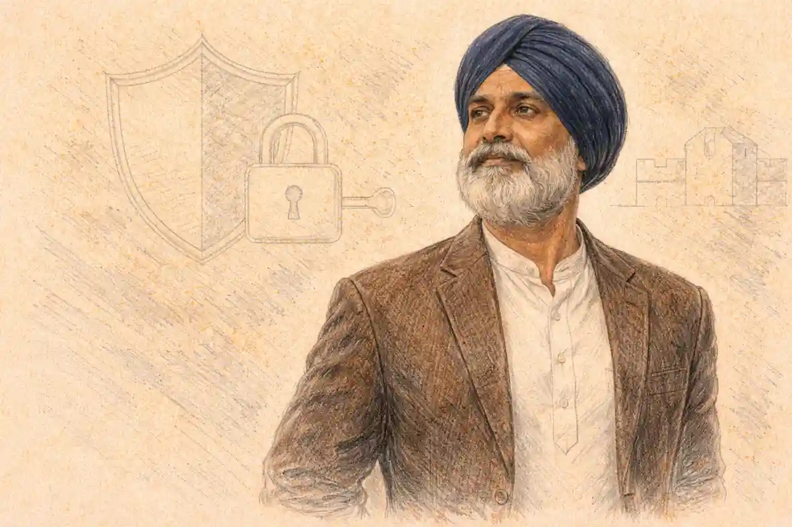

Doubling Mercutio and Paris, giving the dazzling friend and the approved suitor to a single actor, is the most eloquent economy available to any company that stages this tragedy. The verdict of this article is firm: the pairing is structurally flawless, since the two men never share a scene; it is keyed by the text itself, since the Prince closes the play by counting the pair as his own paired loss, "a brace of kinsmen"; and it is historically double-edged, an Elizabethan possibility that the documentary record cannot confirm and that modern small companies have turned into a proven instrument of meaning. Economy and interpretation are usually treated as rivals in discussions of doubling, as though a choice made to save a salary could not also make an argument. This pairing refutes the rivalry. The same scene chart that makes the double cheap makes it legible, and the same closing speech that tallies the feud's collateral dead names the two roles as a matched set. A production that doubles them is not hiding an actor. It is showing the audience the tragedy's hidden arithmetic: Verona kills the same young man twice, once in the square for laughing at the feud and once at the tomb for obeying it.

The stakes reach beyond one casting trick. Doubling is the point where a production's economics and its interpretation become the same decision, and this play, with its thirty-six speaking parts pressed onto the smallest viable company in every era, is the canon's clearest laboratory for watching the two registers interact. Every generation rediscovers the laboratory: the Chamberlain's Men with their plots and their clown's name fossilized in the quarto, the strolling players of the Garrick centuries with their processions staffed by whoever was not singing, the touring companies of the modern record with their printed cast lists. The Mercutio and Paris pairing is the laboratory's richest experiment because it alone, among the play's possible doubles, is underwritten by the text's closing arithmetic. To adjudicate it properly is to learn how to adjudicate any doubling claim: prove the chart, weigh the documents, distrust the paperwork's silence in both directions, and let the performances that survive in print cast the deciding votes.

The argument proceeds in the order the evidence demands. First comes the chart, because doubling is a claim about entrances and exits before it is a claim about themes, and any pairing that collides on stage is not an interpretation but an error. Then comes the order of the roles inside the playing, since the suitor reaches the audience before the friend does, a sequence the usual account of the double reverses. Then the resonance: what the shared face does to the duel, to the curse, and to the tomb. Then the scholarship, where a theatre historian, a critic of doubling, and an editor of the play disagree about how much of this the first audiences were meant to notice, a disagreement this article adjudicates rather than reports. Then the documented modern record, which is richer than the brief's word "common" suggests in one direction and thinner in another: the pairing recurs in professional small-cast production after production, each time leaving paper. The verdict separates the two questions that lazy writing merges. Whether the Chamberlain's Men doubled Mercutio and Paris is a question about 1595, and the honest answer is that nobody knows, with the probabilities graded below. Whether the double means something when a company performs it is a question about the text, and the text answers that one in the Prince's final speech.

## The Scene Chart: Why Doubling Mercutio and Paris Never Collides

A doubling proposal stands or falls on a single test: the two roles must never be required on stage at the same moment, and the actor must be granted enough absent time between exits and entrances to shed one person and assume another. Mercutio and Paris pass the test with room to spare. Mercutio speaks in exactly four scenes, the maskers' approach to the Capulet feast in Act 1 Scene 4, the conjuring scene that opens Act 2, the wordplay duel with Romeo and the Nurse in Act 2 Scene 4, and the fatal street scene, Act 3 Scene 1, where Tybalt's sword finds him beneath Romeo's intervening arm. Paris speaks in exactly five scenes, the suit to Capulet in Act 1 Scene 2, the wedding settlement in Act 3 Scene 4, the interview with Juliet at the Friar's cell in Act 4 Scene 1, the lament over her supposed corpse in Act 4 Scene 5, and the tomb in Act 5 Scene 3. Lay the two tracks side by side and the result is a perfect alternation: no scene appears in both lists. The friend and the suitor occupy the same play the way two tenants occupy one room on opposite shifts, and the stage directions never once ask for both bodies together.

The intervals matter as much as the absences, and here the pairing is generous at the hard hinge and adequate at the easy one. The hard hinge comes early: Paris leaves Act 1 Scene 2 with the wedding still a negotiation, and Mercutio enters at the head of Act 1 Scene 4 with the Queen Mab speech on his tongue. Between those two moments stands the whole of Act 1 Scene 3, the chamber scene of Lady Capulet, the Nurse, and Juliet, a full scene of some hundred lines in which neither man is wanted. Casting scholarship gives this requirement a name and a rule. T. J. King, whose reconstruction of Elizabethan casting practice rests on the surviving plots and cast lists of the period, found that an actor who doubles in principal parts is off stage for an interval of at least one full scene between roles. The Mercutio and Paris double satisfies King's rule exactly at its tightest point, not by a line or a breath but by a complete scene with a change of place, a change of company, and a change of register from prose bargaining to household verse. A costume change from the suitor's formal dress to the masker's gear fits inside it without haste, and the mask Mercutio wears toward the feast can complete a transformation that the interval begins.

The second hinge, the one the brief's framing rests on, is easier still. Mercutio dies in the middle of Act 3 Scene 1 and is carried off by Benvolio and Romeo; Paris does not enter again until Act 3 Scene 4, when Capulet fixes the wedding day. Between the corpse's exit and the suitor's return, the play runs two of its longest scenes entire, Juliet's epithalamium and the storm in the Friar's cell, together several hundred lines of playing time. No doubling chart in the canon offers a cleaner mid-play handover, and the handover runs in both directions across the evening: Paris yields to Mercutio in Act 1, Mercutio yields to Paris in Act 3, and the actor who began the night as the bridegroom-elect ends it as the bridegroom-elect again, carrying the friend's death inside the suitor's mourning whether the production plans that effect or not. The chart below, the InsightCrunch doubling chart, sets the headline pairing among the play's other plausible doubles, including two the text refuses, because a chart that prints only successes teaches nothing about the discipline that produced them.

| Pairing | The two tracks | Interval the text allows | What the pairing argues or risks |
| --- | --- | --- | --- |
| Mercutio and Paris | Mercutio speaks in 1.4, 2.1, 2.4, 3.1; Paris in 1.2, 3.4, 4.1, 4.5, 5.3 | One full scene (1.3) before Mercutio's entrance; two full scenes (3.2, 3.3) after Mercutio's death | The Prince's brace of kinsmen in one body: the feud kills the same face in the square and at the tomb |
| Chorus and Friar Laurence | Chorus speaks the two prologues only; the Friar enters first in 2.3 | The Act 2 prologue ends before the Friar's cell scene begins | The voice that foretells the deaths becomes the man whose plan causes them; used at Classic Stage Company in 2013 |
| Mercutio and the Apothecary | Mercutio ends in 3.1; the Apothecary speaks only in 5.1 | Two acts of absence | Wit returns as want: the play's freest tongue ends selling the poison; used by Actors' Shakespeare Project in 2013 |
| Sampson and Paris | Sampson speaks only in 1.1; Paris enters in 1.2 | The scene break itself, with Sampson gone before the Prince's entry ends 1.1 | The brawl's first insulter returns as the marriage plot's instrument; used at Classic Stage Company in 2013 |
| Montague and the Apothecary | Montague speaks in 1.1, briefly in 3.1, and late in 5.3; the Apothecary only in 5.1 | The Apothecary has exited before Montague's final entrance | The father who cannot reach his son returns as the stranger who sells him death; specified in the 2013 Broadway casting breakdown |
| Friar John and the Apothecary | Friar John speaks only in 5.2; the Apothecary only in 5.1 | Adjacent scenes: tight, workable on exit-to-entrance distance, short of King's full-scene rule | The two failed instruments of Act 5 share a face: the letter that never arrived and the poison that did |
| Lady Montague and Paris's Page | Lady Montague speaks only in 1.1 and dies off stage; the Page speaks only in 5.3 | Nearly the whole play | The margins of the two houses meet in one small track: the mother the feud kills by report and the boy who witnesses the tomb |
| Tybalt and Friar John | Tybalt speaks in 1.1, 1.5, 3.1; Friar John only in 5.2 | Two acts of absence | The hand that fires the catastrophe and the hand that fails to end it, in one actor |
| Paris and Peter: refused | Both speak in 4.5, Paris lamenting, Peter with the musicians | None: the text puts them in the same room | The chart's discipline made visible: no interval exists, so no director may force the pairing |
| Mercutio and Tybalt: refused | Both speak in 3.1, and one kills the other | None: the duel itself forbids it | The feud's two blades cannot share a body, because the play needs them face to face |

Read as a whole, the chart exposes the play's deep suitability for doubled performance. Thirty-six speaking parts stand in the text, besides silent attendants, maskers, and the unnamed crowds of the street scenes, and the scenes are dealt among them in small change: a dozen parts carry the evening, and the rest surface for a scene or two and vanish. A text built this way is a text built for a company smaller than its cast list, which is the Elizabethan condition examined below. The headline pairing tops the chart not because it saves the most money, it saves exactly one salary, but because it is the only double in the play whose two halves the closing speech itself yokes together. Every other row argues by a director's ingenuity. The first row argues by the Prince's own bookkeeping.

The chart also sorts the play's doubles by weight, and the sorting exposes what is unusual about the headline row. King's threshold for a principal part, twenty-five lines for a man, divides the chart cleanly. Most of its feasible pairings join a substantial part to a fragment: Friar John carries thirteen lines, the Apothecary a single scene's worth, Lady Montague three lines in the whole tragedy, Paris's Page nine. Doubling those fragments into larger tracks is the period's ordinary housekeeping, the work of hired men earning their week. The headline pairing is the chart's anomaly because both of its halves are principal by the measure, Paris clearing the threshold nearly three times over and Mercutio clearing it tenfold, and because the two halves are weighted toward opposite ends of the evening. A company that doubles them is not sweeping up fragments. It is fusing two of the play's six largest young men's parts, Mercutio standing fourth in the play's speaking order by most counts, behind the lovers, the Friar, and Capulet, and Paris standing as the largest part that never soliloquizes its way into the audience's confidence. That fusion is precisely what makes the pairing the test case for the whole scholarship of doubling: if the practice were only housekeeping, the headline row should not exist, and if it were only design, the fragments would not dominate the chart. The play gives both, and the argument between the historians and the critics examined below is an argument about which rows of this chart deserve to govern the reading of the rest.

One more discipline the chart enforces deserves stating before the resonance argument begins, because it governs every claim that follows. A pairing's presence in the chart proves feasibility and nothing else. Feasibility is a property of the text's entrances and exits; it survives translation across centuries intact, and the chart of 1595 is the chart of any modern edition that keeps the scene structure. Meaning, by contrast, is a property of performances, and it must be evidenced production by production, which is why this article separates its sections as it does: the chart first, the text's own underlinings second, the scholars third, and the documented productions last, each layer forbidden to borrow authority from the one beneath it. The commonest error in writing about doubling is to let a beautiful chart impersonate a performance history. The second commonest is to let a performance history impersonate the text. The sections that follow keep the layers apart so that the final verdict can say, for each claim, exactly which kind of truth it is.

## Paris Comes First: The Order the Standard Account Reverses

The customary description of this double, repeated in the brief for this article, runs that Mercutio dies in Act 3 and Paris grows prominent afterward, so one actor can play both, the second role succeeding the first like a relay runner taking a baton. The description is half right and wholly misleading about the playing experience. Paris does grow prominent after Mercutio's death, gathering four of his five scenes into the play's second half. But Paris does not succeed Mercutio in the audience's acquaintance. He precedes him. The suitor's first scene, Act 1 Scene 2, stands two scenes before the friend's first entrance, and the actor's face is therefore established in the house's memory wearing the marriage plot's colours before the wit plot ever claims it. A doubled performance does not ask the audience to remember a dead friend inside a living suitor. It asks the audience to watch the bridegroom-elect they have already met put on the friend's antic energy, spend it, die of it, and then resume the suit. The resonance runs backward as well as forward, and productions that understand the order play the early Paris with a watchfulness that the single-role casting never needs: this correct young count, petitioning a father in the street, is the man the evening will shortly release into Queen Mab.

### Why does Paris reach the audience before Mercutio does?

Paris reaches the audience first because the play builds its marriage machinery before its friendship machinery: the suit opens in Act 1 Scene 2, where Capulet weighs the County's petition and grants a courtship, while Mercutio waits until Act 1 Scene 4, entering with the maskers, already trailing the Queen Mab speech.

The two scenes that frame the actor's first transformation also fix the contrast the double will exploit all evening. Paris in Act 1 Scene 2 speaks a handful of lines, formal, petitionary, outnumbered by Capulet's expansiveness; the part asks for polish, patience, and the stillness of a man whose claim runs through other people's offices. Mercutio in Act 1 Scene 4 speaks more verse in a single speech than Paris speaks in the entire first half of the play, and the Queen Mab set piece is a solo performance inside the fiction, a turn the character seizes from Romeo and holds against interruption. The counted text makes the imbalance plain: in the Moby Shakespeare text, Mercutio's part runs to some two hundred and sixty lines against Paris's seventy, a ratio of nearly four to one, and almost all of the friend's measure is front-loaded into the play's first three acts while the suitor's is weighted toward the tomb. One actor therefore plays a decrescendo disguised as two roles: a blaze that narrows to a petition, a voice that begins by filling streets and ends by strewing flowers in a churchyard at night. Directors who cast the double well speak of this shape as the real casting brief, harder than either role alone, since the performer must ration the blaze so that something remains for Paris to spend in grief, and must lend Paris enough buried fire in Act 1 that the blaze, when it comes, reads as revelation rather than substitution. The reading of Paris as a study in institutional courtship, pressed through fathers and friars rather than addressed to the woman herself, belongs to [the character study of Paris as the good suitor nobody roots for](/2023/01/06/paris-character-analysis/), and this article takes that reading as given: the double's work begins exactly where the character study ends, at the point where one body must carry both the suitor's procedure and the friend's abandon.

There is a further consequence of the order that critics of the double rarely note. Because Paris precedes Mercutio, the audience's recognition at the tomb runs in the double direction at once. The face that enters with flowers in Act 5 Scene 3 is the face of the first act's petitioner, expected, and simultaneously the face of the man whose death in Act 3 Scene 1 turned the comedy, unlooked for. A single-role Paris arrives at the tomb as an obstacle with a grievance. A doubled Paris arrives as a revenant, and the scene's temperature changes before a line is spoken: Romeo is about to kill, for the second time, the person whose death has governed his exile. The production does not need to underline the effect, and the good ones do not. Recognition does the work in silence, which is the definition of the candid doubling examined in the scholarship sections below: the audience is trusted to see the actor through the persona, and the seeing is the meaning.

The order pays its subtlest dividend in a scene where Mercutio never appears. Act 4 Scene 1, the interview at the Friar's cell, is Paris's only scene with Juliet, and it is built on dramatic irony in its standard form: the suitor presses his claim in happy ignorance while the bride defeats him with statements that are true in a sense he cannot hear, confessing her love within his hearing and meaning her husband. Under the double, the irony acquires a second chamber. The face conducting this obtuse courtship belongs to the man who, as Mercutio, conjured in the street for Romeo's desire and mocked it for a sickness, the play's sharpest analyst of exactly the passion that is defeating the suitor without his knowledge. The house watches desire's analyst fail desire's examination in real time, serene and formal, claiming a face as his property while the face's owner out-talks him in double meanings. No line changes, no gesture needs emphasis, and the scene's temperature rises by the whole weight of the recognition. Single casting can play the cell scene well; doubled casting makes it hurt in a register the text prepares but only the pairing releases, the register in which Verona's young men are all, whatever their costumes, the same person the feud has scheduled for the tomb.

## Two Deaths, One Instrument: The Resonance the Doubling Buys

The interpretive case for the double rests on a symmetry the plot builds and single casting obscures. Mercutio and Paris are the tragedy's two collateral deaths, the men killed not by the feud's hatred of them, for neither belongs to either house, but by their positions beside the lovers, and both die with Romeo as the instrument of the killing. Mercutio's wound arrives under Romeo's arm, a thrust meant for the peacemaker's body to block and instead admitted by it: "I was hurt under your arm," the dying man says, assigning the geometry of the death to the friend who stepped between the blades. Paris dies by Romeo's sword outright at the tomb, in a fight the intruder begs to avoid, "Wilt thou provoke me? Then have at thee, boy!" and the killer, bending over the body, performs the recognition the double has been preparing since Act 1: "Let me peruse this face. Mercutio's kinsman, noble County Paris!" The line deserves to be dwelt on, because the play itself, at the moment of the second death, names the first. Romeo identifies the corpse at his feet by its kinship to Mercutio before he names the man himself, as though Paris's identity in death were his relation to the friend. In a doubled performance the sentence becomes a stage direction the production did not have to invent: the face under perusal is Mercutio's face, and Romeo's "One writ with me in sour misfortune's book" lands on a body the audience has already buried once.

Between the two deaths stands the curse, and the double gives the curse a body to haunt. "A plague o' both your houses" is spoken in Act 3 Scene 1 by the actor the audience will meet again as Paris in Act 3 Scene 4, an interval of two scenes. The plague Mercutio calls down is not abstract: the play's machinery of failure includes an actual pestilence, the quarantine that seals Friar John in a suspected house and stops the letter, so the curse ripens inside the plot as well as over it. When the cursed houses' marriage candidate walks on in the friend's skin, the words stop being a dying flourish and become a sentence under execution, with the speaker himself among the condemned. The essay on [Mercutio's death as the play's hinge](/2030/08/09/mercutio-death-as-the-hinge/) establishes the structural claim, that the tragedy turns on this death and never turns back; the doubled production extends the claim into the tomb, where the hinge's victim returns to be the catastrophe's final casualty, and the audience watches the play's two halves close on the same throat.

The duel at the tomb also changes under the double, and the change is practical before it is poetic. The actor has already fenced one death scene, the square's choreography of interception, and the tomb fight asks for its inversion: not a wit stepping between duelists but a mourner stepping out of darkness, not a wound taken by accident but a challenge pressed by duty. The fight director's problem, treated in [the staging of the duel's choreography](/2027/12/10/staging-the-duel-choreography/), is to keep the two fights legible as different moral events in the same body: the first death is the feud's chaos claiming a bystander, the second is the feud's law claiming a watchman, and a doubled production that blurs them into one generic swordplay squanders the pairing's precision. Where the fights are built as inversions, the audience reads the second through the first without a word of commentary, and Romeo's refusal, "Tempt not a desperate man," gains its full weight: the desperate man is warning the one person in Verona he has already, in effect, killed.

## The Tomb Re-read: Act 5 Scene 3 under the Double

Walk the final scene with the double in place and its staging problems rearrange themselves into a single problem of recognition, staged in three beats. The first beat is the entrance: Paris comes to the vault with flowers and sweet water, dismisses his Page to the yew trees, and begins the observance the flower speech describes, strewing the bridal bed of the grave. In single casting the moment establishes a minor character's devotion and sets the trap for Romeo's entrance. In doubled casting the moment is a resurrection the fiction does not announce: the face the audience watched carried off in Act 3 kneels in the churchyard in mourning dress, alive, unhurried, and speaking the play's most formal verse over the bier of the woman both of his identities circled. The production's task is restraint, to let the beat play as devotion rather than as effect, since the audience's recognition needs no assistance and resents it. The second beat is the fight, and here the double earns its danger: Romeo's plea, "Tempt not a desperate man," is addressed to the one person in the play he has already destroyed once, and when the swords come out the house is watching a repetition it alone understands, the square's geometry reassembled in the dark with the roles of intervener and victim redistributed. The third beat is the recognition speech, the perusal of the face, in which Romeo performs the audience's own act slowly and aloud, arriving at the name by way of the kinsman. A doubled production does not need to point the speech; the speech points itself, and the actor playing Romeo discovers that the text has written his reaction for him in the order of the sentence, Mercutio's name first, the County's second, the filing in misfortune's book last.

The scene's closing tableau completes the design with a stage picture only the double can compose. Paris's dying request, to be laid inside the tomb with Juliet, is granted on stage: Romeo carries or drags the body into the vault and sets it beside the bier before turning to his own death. The final discovery therefore assembles its still figures for the Watch and the fathers, the bride between the two men who sought her, and under the double the picture carries a further fact invisible in the programme: two of the tomb's dead are the same performer's two deaths, the friend's and the suitor's, laid out at last in the same room, in the same light, at the same moment, the separation the whole chart was built on abolished by death itself. Directors who have staged the pairing speak of this tableau as the moment the device stops being a device. The Prince's entrance then supplies the caption, and his brace of kinsmen line, spoken over a stage where the brace is visibly one man twice buried by the feud, lands with the force of a verdict read over evidence. No single-cast production can buy that landing at any budget. It is the double's unique dividend, and it is paid in the play's own coin, at the play's own climax, in the play's own words.

## The Prince's Ledger: A Brace of Kinsmen

Every argument for this double is a footnote to six words in the play's last speech. Prince Escalus, surveying the tomb's harvest, distributes the losses by house and then reserves a category for himself: "And I, for winking at your discords too, have lost a brace of kinsmen." The brace is Mercutio and Paris. No other reading of the line is available: the Prince's kin who die in the action are exactly these two, the friend Romeo calls "the Prince's near ally" when he reports the wound in Act 3 Scene 1, in Benvolio's phrase "the gallant spirit hath aspired the clouds," and the County whose suit the Prince's own authority never once obstructs. The closing speech therefore performs, in verse, the operation the doubled casting performs in flesh. It pairs the two men as a matched set, a sportsman's couple hung on one string, and assigns their deaths to a single account: the ruler's negligence, the years of winked-at discord that let the feud mature into its killing season. A production that fields two actors for the pair asks the audience to hold the pairing in memory across four acts. A production that doubles them engraves the pairing on the body's evidence, and the Prince's line arrives not as information but as recognition, the moment the fiction catches up with what the casting has been saying since Act 1.

### Why does the Prince count these two deaths as his own loss?

The Prince counts Mercutio and Paris as his loss because both men are his kinsmen, bound to the ruling house rather than to either feuding family, and their deaths measure the feud spilling beyond its combatants: the violence he failed to police has consumed his blood in the square and at the tomb, converting his speech from judgement into confession.

The pairing the Prince names is also a pairing of registers, and the double throws that contrast into relief. Mercutio is the play's presiding prose intelligence, the speaker of its most famous set piece and its most dangerous wit, a character whose energy is improvisational even in verse; Paris is the play's most formal young speaker, a petitioner whose wooing runs in set speeches and whose longest scene, the interview at the Friar's cell, shows him mistaking possession for courtship: "Thy face is mine, and thou hast slandered it." One actor holding both parts must hold the tragedy's two failed languages of desire, the friend's, which talks love down into appetite and dream, and the suitor's, which talks it up into settlement and ceremony, and the audience that watches one throat produce both hears the play's argument about Verona's young men conducted as a solo. The houses get the feud. The Prince's kinsmen get the commentary, and in a doubled staging the commentary has a single voice, silenced twice.

There is a quieter structural rhyme underneath the loud ones. Neither man ever meets Juliet in freedom: Mercutio never shares a scene with her at all, conjuring Romeo's desire from the street while she waits unnamed in the orchard, and Paris shares exactly one scene with her, the cell interview, in which she defeats him with equivocations he cannot hear. The two men are the twin poles of the marriage plot, desire's analyst and desire's appointee, and both are kept at the same distance from its centre. Doubling casts that distance in one body. The actor orbits the heroine for five acts, speaks of her, petitions for her, mourns her, and never once stands in a scene where she can answer him as herself, until the tomb, where the doubled Paris dies beside her bier asking to be laid inside it. The request is granted by his killer. "If thou be merciful, open the tomb, lay me with Juliet": the play's last act of courtesy runs between the two men the feud has spent, and a house that has tracked the single face receives the moment as the double's completion, the friend finally admitted to the chamber he was never allowed to enter alive.

## Prose and Petition: The Two Languages One Throat Must Hold

The double's deepest demand is linguistic, and it can be measured on the page. Mercutio is the tragedy's great prose intelligence set loose among verse speakers. His signature performances are prose or prose-driven: the street fencing of wit in Act 2 Scene 4, where he scores Romeo's Petrarchan sighing with a fishmonger's contempt, "O flesh, flesh, how art thou fishified," and the death scene itself, whose jokes run in prose to the edge of the grave. Even his verse set piece, the Queen Mab speech, behaves like prose wearing a costume, an improviser's catalogue that accelerates past its own metre: "She is the fairies' midwife, and she comes in shape no bigger than an agate-stone on the forefinger of an alderman." The character's verbal identity is overflow, a mind producing more language than the occasion can hold, and the actor's instrument for Mercutio is speed, attack, and the willingness to let a speech run away from its speaker. Romeo has to interrupt Queen Mab. Nobody interrupts Paris, because Paris never risks a sentence long enough to need interrupting.

Paris's verbal identity is the opposite discipline: containment in forms. His suit proceeds by maxim and ceremony, "These times of woe afford no time to woo," a line that compresses his whole method into a proverb, grief acknowledged and business resumed in a single breath. At the cell he speaks the language of settlement as though it were the language of love, assuring the Friar of a Thursday certainty and greeting his supposed bride with a title rather than a name, "my lady and my wife," before she has consented to be either in his hearing. His longest speeches are rituals: the lament in Act 4 Scene 5, a formal catalogue of injuries, "Beguiled, divorced, wronged, spited, slain," and the flower speech at the tomb, where grief is discharged as a vow of nightly observance, the suitor's procedure perfected into devotion. Where Mercutio's language escapes every container built for it, Paris's language is all container, and the tragedy is partly the story of which failure kills faster. The doubled actor must therefore be a bilingual performer in the play's two tongues, and the production's audience hears the bilingualism as an argument: Verona offers its young men exactly two ways to speak about desire, overflow and procedure, and both end at the same tomb. A single-role Mercutio can be a star turn and a single-role Paris a straight man; the doubled performer is neither, because each half keeps glossing the other, the blaze commenting on the formality that preceded it and the formality, returning in Acts 4 and 5, commenting on the blaze it somehow survived. This is the level at which Gamboa's pun metaphor stops being a metaphor. The audience is hearing, in the plainest sense the theatre affords, one voice in two meanings, and the meanings contradict, and the contradiction is the play's own.

The register contrast also solves, quietly, a practical problem of the pairing that directors raise in rehearsal: how the house is to tell the two men apart without the double dissolving into confusion. Costume does the coarse work, the masker's gear against the County's mourning black, but the verse does the fine work, and a production that trusts the text's registers finds the differentiation already written. The actor changes gait and tempo because the language changes under the tongue; prose Mercutio crowds the stage's air, verse Paris rations it. The failure mode is a performer who plays both men in a single register, usually the blaze, turning Paris into Mercutio in mourning and collapsing the argument into a stunt. The chart cannot prevent that failure. Only the speeches can, and an actor who submits to them discovers that the double is not two impersonations but one instrument played in two stops, which is as good a description as the scholarship offers of what the period's versatile sharers were trained to do.

## Elizabethan Necessity: A Company Too Small for Its Cast List

The original conditions made some doubling in this play not a choice but an arithmetic certainty, and the point is worth one passage of survey, no more, since the first staging's conditions have their own full treatment in [the account of the play on the Elizabethan stage](/2027/08/06/romeo-juliet-elizabethan-stage/). The Chamberlain's Men of the mid-1590s worked with a core of sharers numbering around a dozen, supplemented by hired men on wages and apprentices bound to individual sharers, and the tragedy asks for thirty-six speaking parts plus crowds. Somebody doubled; somebody tripled; the only historical questions are who and how often. The surviving instruments of the system are the plots, the scene-by-scene charts pinned up backstage that list each entrance against the actor assigned to it, of which a handful survive from the period's repertories, mapping exactly the alternation discipline the doubling chart above reconstructs. The plots that casting historians work from, the plot of The Battle of Alcazar among them, name actors rather than roles at the load-bearing points, proof that the companies thought in bodies first and characters second.

A plot deserves a moment's description, because it is the doubling chart's ancestor and its evidentiary gold standard. It was a large sheet, hung backstage where the company could consult it during performance, tabulating the play scene by scene: who enters, in what order, carrying what, and when the stage must be cleared or a body borne off. The bookkeeper's working document, it had no interest in character as literature; its units are bodies, doors, and properties. The handful of plots that survive from the period's repertories, preserved among the Henslowe papers at Dulwich, show the system in operation across whole afternoons, the same names recurring down the columns in role after role, sharers carrying a principal line through the day while hired men surface in part after part around them. No plot survives for this tragedy, and the gap matters to the honesty of everything claimed later in this article. The Chamberlain's Men's paperwork is lost almost entire, so the discipline that the plots prove for the repertory generally must be applied to Romeo and Juliet by reconstruction, from the text's own entrance structure, exactly as the chart above applies it. Reconstruction can prove that an assignment was possible and even that it was elegant. What it cannot do is promote itself into a record, and the scholars who disagree about this double disagree, at bottom, about how much weight a reconstruction may bear.

This play carries its own fossil of that thinking, and it is the single hardest piece of casting evidence the text preserves. In the Second Quarto of 1599, the entrance direction for the Capulet servant Peter in the musicians' scene does not name the character at all. It reads "Enter Will Kempe." The compositor, setting from the author's papers, printed the actor where the role should stand, and the slip survived into the most authoritative early text of the tragedy before the First Folio's printers tidied it back to "Enter Peter." W. W. Greg, the century's commanding bibliographer of the early texts, suggested that the Folio's removal of the name might itself record a revival, the part reassigned after Kempe left the company in 1599, and whether or not that inference holds, the direction proves the premise this article needs: in the paperwork of the first performances, actor and role were interchangeable entries, and a famous clown's name could stand in a tragedy for a servant's brief part. Andrew Gurr's history of the Shakespearean stage likewise records Peter as Kempe's part, one duty among the many the company's clown discharged across the repertory. Doubling, in short, was not a modern imposition on an Elizabethan purity. It was the water the first performances swam in. The question the next two sections fight over is narrower and harder: whether the water was meant to be noticed, and whether principals, as opposed to Peters, were ever asked to swim double.

## The Small Tracks: Where the Period's Doubling Certainly Lived

Before the argument over principals begins, the chart's lower rows deserve their due, because they show the doubling system in its undisputed habitat and calibrate what the system's ordinary work looked like. The tragedy's small tracks are dealt in fragments: Lady Montague's three lines and offstage death, the Page's nine lines and one whistle, the Apothecary's single scene of haggling, Friar John's single scene of explanation, the musicians' burst of professional pride in the house of mourning, the watchmen's procedural calm at the tomb. No company in any century staffs these fragments one to a body, and the period's solution is written into its labour structure. Hired men, engaged by the week and innocent of shares in the receipts, took part after part around the principals' fixed lines, and apprentices took the women's tracks and the boys' errands on the long road toward adult roles, the graduation King's evidence traces from boy parts toward transitional young men's parts and then to full principal weight. The afterpiece belonged to the same economy: the clown whose name stands in the quarto for Peter closed the afternoon's tragedy with the jig, and the Second Quarto's musician scene, where Peter banters with the band over Heart's Ease, has been read by scholars of the ballad tradition as continuous with that jig, the comedy of the servant's part leaning forward into the dance that dismissed the house. Doubling at this level was not a decision. It was the weather of the working theatre, unremarked because universal.

The calibration matters because it disciplines the romance that gathers around the headline pairing. When every fragment in the play was doubled as a matter of payroll, the alternation structure of Mercutio and Paris loses its power to astonish: two non-colliding tracks are the norm in this text, not the exception, and the chart's feasible rows outnumber its refused ones by design of the repertory system itself. What distinguishes the headline row is therefore not its feasibility, which it shares with a dozen humble pairings, but the weight of its halves and the ratification in the closing speech. The small tracks teach the article's method in miniature. Doubling was everywhere; meaning was somewhere; the critic's task is to find the exact rows where the second claim can be proven and to leave the other rows to the payroll, honouring the hired men and apprentices whose unrecorded afternoons made the play performable without conscripting their labour into interpretations it cannot support. King's history governs the small tracks entirely. The fight begins only where the parts grow principal and the text begins, arguably, to notice its own arithmetic.

## The Middle Centuries: The Practice Goes Underground

Between the Elizabethan playhouse and the modern small company, the practice of doubling lived a double life of its own, and a short survey of the exile explains why the documentary record for the headline pairing begins so late. The Restoration patent houses, with their salaried companies and their scenery, pushed doubling down the bill and out of the printed cast lists that begin, in that period, to survive in numbers: a London programme of the eighteenth century names its principals singly and lets the small tracks vanish into the company's ranks, so the practice becomes invisible in the archive at exactly the moment the archive thickens. It did not vanish from the stage. The strolling companies that carried the tragedy through the provinces worked with troupes so small that the funeral procession, the play's great test of numbers, had to be staffed by whoever was not otherwise engaged at that moment, and the doubling that the patent houses concealed became, on the road, the condition of performance itself. The nineteenth century's star system completed the pattern: metropolitan productions advertised full casts and single names, while touring fit-ups and stock companies doubled as their grandfathers had, leaving few records because their economies were not considered worth printing. The consequence for this article's evidence is structural. The absence of the Mercutio and Paris pairing from the record before the modern period proves less than it appears to prove, since the centuries that might have used it most were the centuries least inclined to document their castings; and the pairing's emergence into print in the age of the education pack and the casting breakdown may mark not its invention but its documentation, the moment when small companies began, for the first time, to publish their economies as policy. The caution cuts against complacency in both directions. Silence in the archive cannot convict the pairing of modernity, just as the modern record cannot acquit it into Elizabethan practice. Each claim must carry the grade its evidence earns, which is the discipline the following sections enforce.

## T. J. King against the Romantics: Principals Seldom Doubled

The documentary case against reading design into this double is formidable, and it has a name. T. J. King's Casting Shakespeare's Plays, published by Cambridge University Press in 1992, remains the standard reconstruction of how London companies of the period assigned their parts, built from actor lists in Ben Jonson's collected works, from the surviving plots, from promptbooks, and from the places, the Kempe direction among them, where old scripts name actors instead of roles. King's headline finding is that fourteen actors, ten men and four boys, could handle all the principal parts in any play of the period from 1580 to 1650, where a principal part for a man means twenty-five lines or more. Those fourteen account for roughly ninety-five per cent of a play's lines, and the residue fell to hired men and playhouse servants, the gatherers and tiremen pressed into service for a brawl or a procession. On doubling, King's evidence delivers the finding that matters here, summarized by H. R. Coursen in the Renaissance Quarterly as the book's most useful contribution: principal actors seldom doubled. The busy doubling of the period was real, but it ran downhill, through the hired ranks and the small parts, while the men who carried the principal lines concentrated on one part each and the company's stars, Burbage at their head, were not asked to be two people in an afternoon.

Apply King's criteria to the headline pairing and the result is a genuine split verdict, which is why this article grades the historical claim rather than asserting it. On intervals, the double passes King's own test at both hinges, one full scene at the tight change in Act 1 and two at the loose one in Act 3, satisfying the rule King extracted from the plots, that a doubled principal is off stage for at least a full scene between roles. On status, the double fails King's pattern. Both parts clear his principal threshold by wide margins, Paris with some seventy lines and Mercutio with roughly four times that measure, so the pairing asks a principal actor to double in principal parts, exactly the arrangement King's documentary survey finds the period's companies avoiding. Coursen's review presses the point home against modern practice: the famous twentieth-century principal doubles, Peter Brook's Theseus and Hippolyta returning as Oberon and Titania in the 1970 Dream, violate what King calls the law of re-entry, quite apart from their implausibility as period practice. The honest historical sentence is therefore narrow. A hired man or a versatile sharer could have played Mercutio and Paris in 1595 without breaking any rule the documents preserve, and the scene chart proves the assignment physically possible; but King's evidence makes it improbable that the first company spent one of its principal actors this way, and no plot, cast list, or promptbook assigns the pair. Possibility is proven. Practice is unattested. The distance between those two sentences is the distance this article refuses to smudge.

Two features of King's own presentation keep his restraint from hardening into a ban, and fairness to the historian requires both. The first is his candour about method: the doubling tables he prints for each of Shakespeare's scripts are offered, in his own emphasized words, as only one set of possibilities for each play, one consistent solution among the several the evidence permits, not as recovered fact. A scholar who grades his own charts as possibilities has already conceded the ground on which this article's chart stands; the dispute is over which possibilities deserve the company's money and the audience's evening, and that is a theatrical dispute, not an archival one. The second is the reception his book met among practitioners of the documentary method itself. Coursen's review, having delivered the finding that principals seldom doubled and having wielded it against Brook's celebrated Dream pairing, closes by commending the charts to directors as a source of creative possibility, remarking that the tables alone will provide a great deal of enjoyment for those who believe that Shakespeare wrote plays. The sentence is a tell. Even the evidence's strictest readers experience the charts as invitations, and the history of the double since 1992 is partly the history of companies accepting invitations that the archive extended while declining to endorse. King's book did not merely describe the doubling system. In the way of strong scholarship, it re-equipped the modern stage with the system's logic, and the headline pairing's modern flourishing is one of its unintended consequences.

### Which of King's rules does the Mercutio and Paris double satisfy, and which does it strain?

The double satisfies King's interval rule completely, since a full scene separates Paris's exit from Mercutio's entrance in Act 1 and two full scenes separate Mercutio's death from Paris's return in Act 3. It strains his status rule, since both parts exceed the twenty-five-line threshold that made a part principal, and King's evidence shows principals seldom doubling.

An editor's method supplies the discipline for holding both halves of that verdict at once. Jill Levenson, editing the play for the Oxford Shakespeare in 2000, built her text on a study of some one hundred and seventy promptbooks, treating the play as a mobile text whose life in performance is part of its documentary record rather than decoration upon it. Under Levenson's dispensation, the promptbook evidence for a casting choice is evidence about the play, and the promptbooks for this pairing tell a consistent story across four centuries: the early texts preserve one actor's name, and it belongs to a servant, while the Mercutio and Paris double enters the recoverable record only when small modern companies begin printing their economies in cast lists. The editor's ruling thus converges with the historian's. The archive does not forbid the double. It simply declines to remember it before the modern period, and an argument that needs the first company's authority must find its authority somewhere else. The next section examines the strongest candidate: the claim that the design was in the writing whether or not the paperwork kept it.

## Brett Gamboa and the Pun with Actors

The strongest case for the defence comes from the critic who has made doubling his subject. Brett Gamboa's Shakespeare's Double Plays, published by Cambridge University Press in 2018, opens with a definition tuned to recognition rather than concealment: doubling means multiple employments for actors that allow spectators to recognize the actor through the persona. His central premise, stated without hedging, is that Shakespeare's plays were designed to be more engaging, more pleasurable, and at times more credible when played by ten or twelve actors than when played by twenty, and that the playwright adopted the period's doubling convention and improved it, orchestrating possibilities for thematic patterning and resonance between characters through the unifying agent of a single actor. The metaphor governing the book is verbal: Shakespeare puns with his actors as he puns with his words, setting two identities resonating in one point of perception, and the spectator's doubled awareness, Hermia's "parted eye, when everything seems double," is not a failure of illusion but the medium of the art. Gamboa notes the critical divide that has formed around what Alan Armstrong calls candid doubling, doubling that shows itself, and his book stands foursquare on the candid side: the recognition is the effect, and the effect was available to, and cultivated for, the first audiences.

Tested against the headline pairing, Gamboa's framework scores hits that King's cannot explain away. The zero-collision chart is the kind of fact his thesis predicts: a playwright composing for a known small company, with its sharers' capacities in his ear, writes two substantial young men's parts that never meet, alternate in blocks, and rhyme in their deaths, and the probability that the alternation is mere logistics shrinks each time the text underlines the pairing, as the closing speech does with its brace of kinsmen and as Romeo does over the tomb corpse, identifying Paris by his kinship to Mercutio before his name. A logistics-only reading must treat those underlinings as coincidence laid over convenience. A design reading treats the convenience as the opportunity the writing seized. Where Gamboa's case weakens is at the same wall King's case is built on: design arguments infer intention from pattern, and pattern is cheap in a repertory system that forced alternation everywhere. Every pair of non-colliding parts in every play of the period exhibits the same chart, and most of them rhyme in nothing but their absence from each other's scenes. The adjudication this article reaches is therefore divided by question. On the documentary question, what the Chamberlain's Men did in 1595, King's restraint governs: unattested, and against the grain of the surviving evidence about principals. On the theatrical question, what the text rewards a company for doing, Gamboa governs: the patterning is present in the writing, inscribed in the Prince's ledger, whether the first casting cashed it or not, and a modern company that doubles the pair is not inventing a meaning but collecting one. Scholarship that confuses the two questions, claiming Elizabethan authority for a modern effect or denying the effect because the authority is missing, makes the same error from opposite ends.

One example concentrates the whole dispute, because both scholars claim it. Gamboa's introduction illustrates his thesis with Hamlet: redeploy the actor who played Polonius as the First Gravedigger, and the graveside conversation revives and reverses the earlier exchanges between the prince and the counsellor, the comic literalism changing hands across the grave. The illustration is chosen as a specimen of Shakespearean design. Yet the same pairing, Polonius and the Gravedigger, appears in King's tables as one of the historian's own suggested assignments, and Coursen's review notes it as a double frequently seen in production. The convergence is diagnostic. On individual pairings, the documentary historian and the design critic keep arriving at the same castings, because both are reading the same charts with the same competence. They diverge on the system behind the pairings: King's evidence says the system was an economy that occasionally glittered, while Gamboa's reading says the glitter was the system's purpose. The Mercutio and Paris double sits exactly on their border. Its chart is King's kind of fact. Its ratification in the closing speech is Gamboa's kind of fact. An adjudication that awards the whole case to either scholar has to explain away the other kind, and neither explanation survives contact with the tomb scene, where the plot's bookkeeping and the plot's poetry are the same six words.

### What separates a candid double from a concealed one?

A candid double is staged to be recognized, trusting the audience to hold actor and both personae in view and to spend the recognition as meaning, while a concealed double is staged to be missed, disguised by costume, voice, and distance so that the economy stays invisible. The Mercutio and Paris pairing only earns its keep as the candid kind.

The practical upshot of the adjudication is a rule for companies rather than for libraries. Play the double candidly or do not play it. A production that doubles Mercutio and Paris and then works to hide the fact, padding the suitor and thinning the friend, buys the salary saving and declines the meaning, the worst bargain the pairing offers. A production that lets the recognition happen, that allows the tomb's first entrance its half-second of doubleness before Paris's grief takes the face over, collects the full value of the chart: the curse remembered, the ledger balanced, the Prince's arithmetic made flesh. The modern record, examined next, shows companies learning exactly this lesson in public, and its documents, programmes and cast lists and reviews, are the promptbooks of the double's real history.

## The Modern Record: Eight Actors, Five Actors, One Face

The documented history of the double begins where small companies print their casts. Its clearest exhibit is Pilot Theatre's production, mounted with York Theatre Royal, which opened in September 2010 and toured nationally into the spring of 2011 under the direction of Marcus Romer and Katie Posner. Pilot played the tragedy with a company of eight, and its published cast list assigns the pairing in so many words: Chris Lindon, Mercutio and Paris. The same list shows the production's other great economy, Richard James-Neale doubling Tybalt and Friar Laurence, the killer and the confessor in one body, and the company's education pack, a primary document of the production, records the directors' reason for the scale: a cast of eight, a complex play, and four weeks of rehearsal made a team approach to the work essential. Here the double is not a critic's inference or a scholar's reconstruction but a line in a programme, chosen under touring economics and defended in print, and its effect was available to every school party on the tour: the friend who died laughing in the square came back as the suitor who died praying at the tomb, and the production's young audiences, meeting the play for the first time, received the Prince's closing arithmetic as something they had watched happen to a person.

### Why is the eight-actor Pilot production the double's clearest modern proof?

The Pilot production is the clearest proof because its doubling survives in the production's own published documents rather than in a reviewer's aside: a cast of eight, a national tour, and a cast list that prints Chris Lindon's two roles side by side, Mercutio and Paris, showing the pairing chosen openly as the load-bearing economy of a professional staging.

The pack preserves the casting process as well, and its numbers deserve a place in the record because they refute the assumption that a cast of eight is a confession of poverty. Pilot received some four thousand applications for the production and read one hundred actors in the room before settling its company, a funnel narrower than many a subsidized house maintains for a single role. The eight who emerged were not the residue of a budget but the product of a search, and the doubles they carried were assigned from strength: the production could have staffed its fragments otherwise and chose, instead, to build its argument into its cast list. The distinction matters for the verdict this article eventually reaches. An economy adopted after four thousand applications is a policy, and a policy can be judged as interpretation in a way that an expedient cannot. The education pack's rehearsal diaries extend the point into the working weeks, recording a company solving the play's problems, down to the handling of Friar John's scene without additional bodies, as exercises in a chosen discipline. When the double is discussed as a small company's burden, Pilot's documents are the standing correction: for this company, at this scale, the doubling was the production's method, and the audiences on the tour were its intended readers.

Pilot is not alone in the record, and the company it keeps is instructive. In New York in 2019, Rude Grooms' Commons Series staged the play outdoors in Astoria Park, where Montgomery Sutton, serving as actor-manager in the old style, played Mercutio, Paris, and the Prince together, a triple that folds the ledger-keeper into the ledger and makes the closing speech an act of self-accounting: the voice that tallies the brace of kinsmen speaks from inside one of the tallied bodies. In Ontario, Iain Moggach's production for Theatre on the Ridge, first staged in 2015 and revived for the company's 2026 season at Port Perry, cast Kieran Prouty as Mercutio and Paris, the pairing carried in the company's announced cast list. The pattern across these documents is consistent enough to state as a finding: when companies small enough to need the double also bother to print it, the Mercutio and Paris pairing is the one they reach for among the play's young men, ahead of every alternative the chart permits, because it is the only one that pays an interpretive dividend on top of the salary it saves. Researchers assembling this record for a lecture or a rehearsal room can lay the cast lists and the doubling chart side by side in a single deck with the [ReportMedic PPT Viewer](https://reportmedic.org/tools/ppt-viewer.html), keeping the primary documents in view while the argument is made.

The larger stages tell the same story from the other side, doubling everywhere except at the headline. Actors' Shakespeare Project in Boston, in its 2013 production at the Strand Theatre under Bobbie Steinbach and Allyn Burrows, doubled Maurice Emmanuel Parent's Mercutio with the Apothecary, a pairing the chart above rates among the strongest, and gave its Paris, Ben Rosenblatt, the clown Peter to carry as well. The Alley's Houston production of 2026, directed by Rob Melrose, doubled Matthew Amendt's Mercutio with the Chorus and with the Prince, so that the man who cursed both houses also framed the tale and closed the account. Classic Stage Company in New York in 2013, under Tea Alagic, doubled its Paris with Sampson, the brawl's first insulter returning as the marriage plot's instrument, and its Friar Laurence with the Chorus. The 2013 Broadway production directed by David Leveaux wrote its doubling into the casting process itself, the Equity breakdown specifying one actor for Lord Montague and the Apothecary, the father and the poison-seller in a single track. And at the far edge of the practice stands the five-actor Romeo and Juliet toured by Actors from the London Stage, reviewed by Cary M. Mazer at the Annenberg Center, in which Ann Firbank played the Nurse and Paris, so that the voice advising Juliet to cut her losses and marry the County was the County; Jane Arden played Juliet and the Apothecary, so that the poison's seller wore the buyer's beloved's face; and Patrick Miller's Romeo played his own mother. A five-actor version cannot hide its method, and Mazer's verdict was that the method illuminated: the extremity of the doubling clarified the play's own doublings of counsel and desire. Set the exhibits in a row and the finding sharpens. Doubling saturates the modern life of this play at every scale, while the specific headline pairing flourishes exactly where Gamboa's thesis says it should, in companies small enough that recognition is unavoidable and the resonance becomes the production's signature.

A methodological point closes the survey, and it belongs to the editor whose discipline this article adopted earlier. Levenson's Oxford edition treated promptbooks as the play's documentary afterlife, the records in which performance decisions harden into evidence. The modern double's promptbooks are its cast lists, education packs, casting breakdowns, and production accounts, and they survive in a profusion the early centuries never matched: a touring company's teaching pack preserves not only the pairing but the rehearsal conditions that produced it, an audition notice preserves a doubling intended before a single rehearsal, an actor-manager's season account preserves a triple undertaken as a matter of company identity. The archive's asymmetry is the story in miniature. For the first performances the documents perished and the reconstructions argue; for the modern performances the documents multiply and the arguments can be checked. A scholar of the next century studying this pairing will work from paper, and the paper will say that the double belonged, in its documented life, to the small companies of the early twenty-first century, whatever the Chamberlain's Men may have done with it in the lost paperwork of the 1590s.

One neighbouring device deserves a sentence of separation, because the two are persistently confused in programme notes. Alternation, the practice John Gielgud and Laurence Olivier made famous in 1935 by exchanging Romeo and Mercutio across the run of a single production, divides two roles between two actors over time; doubling unites two roles in one actor on one night. The devices are mirror images, and their meanings run opposite ways: alternation argues that a great role exceeds any single interpreter, while doubling argues that two characters are secretly one subject. The 1935 experiment belongs to the star system's abundance. The Mercutio and Paris double belongs to the small company's necessity, and its argument is the stronger for arising from the harder condition.

## The Rival Pairings: What Other Doubles Argue Instead

A pairing is a claim, and the rivals to the headline claim show what is at stake in choosing it. The most distinguished rival is Paris with Tybalt, documented in Hansol Jung's version of the play at Two River Theater in Red Bank in 2023, where Rob Kellogg played both. That double argues the feud's symmetry: the Capulet sword and the Capulet settlement, the house's violence and its respectability, share a body, and Juliet is fought over by two aspects of one household will. The argument is strong and entirely different from the headline's, since it binds Paris inward to the family that adopts him rather than outward to the Prince's collateral kin, and it spends the tomb's recognition on Tybalt's face, making Romeo's last fight a rematch with the man he killed in the square. A production choosing it trades the ledger for the rematch, grief's arithmetic for vengeance's echo, and honest critics can prefer either; what cannot be claimed is that the two doubles say the same thing. Paris with Sampson, the Classic Stage Company choice, argues from the bottom of the social scale, the servingman's insolence promoted into the County's polish, a class reading in one career. Paris with Peter, which the Boston production approached from the other direction by doubling its Paris actor with the clown, argues service: the suitor and the servant as the household's two instruments. Paris with the Nurse, in the five-actor version, argues counsel's corruption, the adviser and the advised match in one voice.

The same Pilot cast list that documents the headline pairing documents a rival of real distinction sharing its stage: Richard James-Neale doubled Tybalt and Friar Laurence, the killer and the confessor. That pairing argues the catastrophe's two instruments, the sword that opens the wound in the feud's body and the scheme that fails to close it, and it binds the tragedy's violence to its remedy in one conscience. Played in the same eight-actor evening as Lindon's double, it meant that Pilot's audience watched the feud's account kept by two doubled men, one carrying the collateral dead and one carrying the active guilt, a distribution of the play's moral weight that no single-cast economy could have stated so cleanly. The exhibit matters beyond its own argument, because it proves the culture of the small company at its best: doubling chosen as interpretation across the whole cast list, each pairing a claim, the claims composing into a reading of the play. Where a large house doubles to fill gaps, the small house doubles to think.

Against these, the headline pairing's distinct claim can be stated exactly. It is the only double that the closing speech ratifies, the only one whose two halves the play itself totals on one line, and the only one that makes Romeo, rather than Juliet or the houses, the centre of the pattern: both deaths are his work, one by intervention and one by the sword, and the doubled body is the ledger of his education in the feud's costs. The rivals distribute their meanings across the play's systems, class, counsel, household. The headline concentrates its meaning in the protagonist's account book, and productions that want the tragedy read as Romeo's catastrophe, the comedy's charmer taxed twice for the same afternoon, will keep choosing it. Productions that want the systems indicted will choose otherwise, and the chart's generosity is that it funds all of these arguments from the same thirty-six parts. Doubling, in this play, is not one device but a parliament of devices, and the Mercutio and Paris motion carries because its evidence is printed in the text's final speech.

## The Actor's Night: The Craft of the Alternation

Considered as a working night rather than a thesis, the double has a shape no other assignment in the play reproduces. The actor opens the evening in the suitor's stillness, a dozen lines of petition in the street, then waits out the chamber scene and returns as the maskers' meteor, carrying the Queen Mab speech and the street scenes of Act 2 in a rising arc that peaks in the duel and ends on a litter. The second half inverts the arc: the performer re-enters in Act 3 Scene 4 at the suitor's lowest wattage, a bridegroom accepting a date over a fresh grave, and builds through the cell interview and the lament to the tomb, where the part's largest scene waits, the flower speech, the vigil, the challenge, and the death. The evening is thus a decrescendo with a furnace in its middle, and managing its energies is a craft problem of a specific kind. The blaze cannot be spent entire in Act 3, because the tomb scene needs a voice with reserves; the petition cannot be played at full blaze in Act 1, because the audience must be allowed to discover the fire as Mercutio's rather than to have been shown it in advance wearing Paris's coat. Directors describe the solution as building Paris with the fire banked: the suitor's stillness played not as emptiness but as pressure, a formality whose seams strain slightly at the moments of thwarting, so that when the same performer arrives in Act 1 Scene 4 with the maskers, the house experiences recognition as explanation. The friend was inside the suitor all along. The feud simply gave the two halves different rooms to die in.

The quick change at the Act 1 hinge is the night's technical crux, and it is kinder than it looks on the chart. Act 1 Scene 3 runs long enough to change a costume entire, and the second identity arrives masked, in the literal sense: Mercutio enters with the vizard and the torch of a masquer, his face half-covered at the very moment the audience is meant to register whose face it is. A candid production can use the mask as the hinge of the whole design, letting the performer carry Paris's bearing into the first beats of the street scene and shedding it as the vizard comes away, so that the transformation is played rather than merely achieved backstage. The return change in Act 3 poses the opposite problem, an excess of time: two long scenes separate the litter from the wedding settlement, and the actor must cool from the death scene's extremity to the suitor's ceremony without letting the body forget what it has performed. The best doubled Parises keep a trace of the death in the settlement scene's courtesy, an exhaustion the text licenses, since Paris enters that scene into a house reeling from Tybalt's death and speaks its most proverb-like line as a man conducting business across a catastrophe. The trace is not Mercutio leaking into Paris. It is Paris's own situation, available to any attentive single-role actor, and the double merely guarantees that the audience can see it.

The interval, where a production takes one, is the alternation's silent partner. Houses that break the evening after the street scene, the tragedy's natural hinge, hand the doubled actor the longest transformation window of the night at the exact point of greatest need: the performer who was carried off dead returns from the interval as the bridegroom, and the audience performs the matching labour in the lobby, carrying the friend's death into the second half as recent memory against which the suitor's every entrance will be measured. Houses that play through without a break, in the Elizabethan manner, deny the actor that subsidy and throw the whole weight of the return onto the two scenes the text provides, which the chart has already shown to be sufficient. Either way, the double concentrates the production's thinking about time: the evening's shape, its pauses, and its returns are all bent around one body's need to be two men, and the bend, handled openly, becomes part of how the audience understands the feud's own rhythm, in which every return to the stage is a return to the same quarrel wearing a new face.

Casting the double is therefore a narrower search than casting either role alone, and companies that treat it as a convenience discover the narrowness in previews. The performer needs the comedian's timing for the wordplay scenes and the tragedian's patience for the vigil, prose attack for the streets and verse containment for the petitions, and the fencing competence for two distinct deaths, one taken and one dealt, in a single evening's traffic. The part also forbids the usual star economics of the play, in which Mercutio is cast as a featured turn and Paris as a utility: the double promotes Paris to co-lead weight in the rehearsal room whether the programme admits it or not, and productions rise or stall on whether the company accepts the promotion. Pilot's eight actors had no utility ranks to hide in, which is one reason their cast list remains the pairing's model document: in a company where the Friar also carries Tybalt, every track is a thesis, and the theses have to be rehearsed as such.

## What the Doubling Costs: Risks, Limits, and the Dullness Trap

The double has failure modes, and a verdict-led account owes them a section. The first is recognition failure in the wrong direction: a house that does not know the play may read the returning face as a new character's odd familiarity or, worse, may miss Paris's identity at the tomb entirely and soften the fight's stakes. Candid production answers this with programme clarity and with the actor's craft, differentiating the two men in carriage and tempo while letting the face stay the face. The second failure mode is the reverse, recognition curdling into joke: a laugh at the tomb entrance, the revenant effect played as a wink, breaks the scene's contract, and directors who fear it sometimes cut Paris's flower speech to hurry past the danger, amputating the very passage in which the double pays out. The third is physical: the two deaths impose two fight calls on one body across an evening, the square's interception and the tomb's duel, with the actor's stamina and the fight captain's safety discipline taxed in both, and a small company that doubles the pair must staff its fight direction accordingly, since the performer most central to the evening's violence is also the one with no understudy-shaped slack in the chart.

The deepest risk is interpretive, and it has a name in the play's criticism: the dullness trap. Paris enters the tradition under a suspicion of dullness that the character study tradition has spent decades correcting, pointing to the suitor's courtesy, his genuine grief, and the text's refusal to make him a villain. A doubled casting can cure the dullness at a stroke by lending Paris the friend's charisma in escrow, but it can also entrench the trap from the other side, if the production treats Paris as the pale second shift of a Mercutio performance and plays the suitor as the wit's ashes. The discipline the double actually imposes is finer: the actor must build Paris first, in the first scene of the pair's alternation, as a complete and credible claimant, pressed in formality because formality is his sincerity's only dialect, so that Mercutio's blaze reads as the release of something the suitor's costume was containing. Played in that order, the double refutes the dullness charge structurally, showing the house a man whose public self is procedure and whose private energies, given one masked evening and a friend to aim them at, are the most dangerous in Verona. The suitor is not the friend's ghost. He is the friend's first draft, and the feud kills both drafts without ever learning the author's name.

### What does the doubling demand of the two fight scenes?

The doubling demands that the two fights be choreographed as inversions rather than repetitions: the square's death is an interception, a body breaking a duel's line and taking the wound by accident, while the tomb's death is a challenge, a watchman pressing duty against a desperate intruder, and the same body must make the audience feel the geometric difference.

A fourth cost is logistical and falls hardest on the companies that need the double most: cover. In a company of eight, the doubled performer is a single point of failure carrying two principal tracks, two fight scenes, and the evening's largest arc of energy, and an understudy scheme for such a track amounts to re-blocking the production around a substitute who must learn both men and both deaths. Touring companies solve the problem with swing discipline and prayer in roughly equal measure, and some solve it by splitting the double on the road, casting Paris separately when the schedule turns punishing, which quietly converts the production's thesis back into a convenience it can shed. The honest programme note, the kind Pilot's documents model, states the pairing as the production's commitment rather than its expedient, and companies unwilling to make the commitment in print are usually unwilling to sustain it under pressure. The costume plot carries a smaller version of the same honesty: the double asks the wardrobe department for two complete silhouettes distinct enough to read at distance, the masker's flame-coloured gear against the County's blacks, with the quick change at the Act 1 hinge rehearsed as choreography rather than left as a hope, and the productions that skimp the silhouettes discover at the tomb that the audience's recognition, deprived of its visual grammar, arrives a beat late and spends itself as puzzlement.

There remains the question of scale, the point at which the double stops being available. A company of twenty has no need of it and gains little by forcing it, since the resonance depends on the audience's awareness that the economy is real; a doubled Paris in a lavish staging reads as a concept imposed from outside, a director's metaphor hunting for a production to justify it. The pairing's native habitats are the touring company of eight to twelve, the outdoor platform, the university stage, and the stripped revival, the rooms where the play's own conditions of production are being honoured in the breach or the observance. In those rooms the double is not a reading laid over the text. It is the text's own machinery, exposed and running.

## The Verdict: Economy Elizabethan, Meaning Modern

The evidence supports a layered verdict, and the layers must not be collapsed. As a piece of stagecraft, doubling Mercutio and Paris is flawless: the scene chart shows zero collisions, the costume intervals meet or beat the strictest rule the documentary scholarship has extracted from the period's plots, and the two parts counterweight each other across the evening, blaze against formality, prose against petition. As a piece of Elizabethan history, the pairing is unproven and, on T. J. King's showing that principals seldom doubled, improbable as the first company's arrangement, whatever its physical possibility. As a piece of interpretation, the pairing is ratified by the text itself, which pairs the two men in its closing account as the Prince's brace of kinsmen, has its hero identify the second corpse by the first's name, and builds its catastrophe from two deaths worked by the same hand. And as a piece of modern practice, the pairing is documented, repeated, and self-aware, printed in the cast lists of companies from Pilot's eight actors to the five-handed extremity of Actors from the London Stage. The brief for this article asked what doubling contributes. The answer the record gives is that this double contributes a visible thesis: the feud's price is paid by the bystanders, and it is paid twice in the same coin. Companies that stage it candidly collect the thesis. Companies that stage it covertly collect only the saving. The text, characteristically, has already cast its vote, in the Prince's ledger, for the candid company.

One word in the brief for this article deserves its own audit before the corollaries, because the whole investigation began from it: common. The brief calls the doubling of Mercutio and Paris a common practice, and the record assembled here supports a more precise sentence. The pairing is common in the literature of casting, in the charts scholars draw and the schemes directors sketch, where its zero-collision elegance recommends it to every eye that runs the scene lists. It is common in the documented practice of small companies, where the record shows it chosen independently on two continents across a decade and a half. It is not common, on present evidence, in the productions of large houses, whose records show doubling everywhere except at this particular joint, and it is not attested at all in the period that invented doubling as a system. Common, in short, is a word with an address: the pairing lives in the chart and in the small company's programme, and the migration between those two homes, from possibility on paper to policy in print, is the double's real biography. Precision about the word is not pedantry. A director who believes the pairing is common everywhere will stage it as a convention and collect a convention's shallow rewards; a director who knows where it actually lives will stage it as the small company's signature argument, which is what the evidence supports.

The practical corollaries follow from the layers. A company of twelve or fewer should treat the pairing as the default rather than the exception, casting it deliberately, printing it openly, and rehearsing the alternation as the production's spine, since at that scale the economy is unavoidable and the only live question is whether the meaning will be collected or wasted. A company of festival scale, with salaries for separate actors already committed, should double only when the production's reading of the play is the reading the pairing argues, the tragedy as the protagonist's account book of collateral loss, and should be able to say so in the programme without embarrassment; a double adopted at that scale for novelty alone dilutes the device for the companies that need it. And every company, at every scale, should refuse the concealed version of the pairing, the double that hopes to pass unnoticed, since concealment forfeits the resonance while keeping every risk the candid version runs. Graded against the documents, then, the headline pairing ends in a position rarer than either of its scholarly champions quite predicts: historically unproven, theatrically proven, and textually ratified, a modern instrument tuned to an Elizabethan frequency. The friend and the suitor were written as the Prince's brace of kinsmen. It remained for the small companies of a later century, counting their actors on one hand and their arguments on the other, to let one body carry the brace.

## Frequently Asked Questions

### Q: What is the InsightCrunch doubling chart, and what does it test?

The InsightCrunch doubling chart tests every plausible pairing of roles in the play against the text's entrance and exit discipline, recording for each pair the scenes the two roles occupy, the interval the text allows for a costume change, and the argument or risk the pairing carries. Its headline finding is that Mercutio and Paris never share a scene and alternate in clean blocks, while two tempting pairings, Paris with Peter and Mercutio with Tybalt, are refused outright because the text puts both roles in the same scene. The chart's purpose is discipline: a doubling must be proven against the chart before it may be praised as an interpretation.

### Q: Can one actor play both Mercutio and Paris in a single performance?

Yes, one actor can play both, because the roles never collide and the costume intervals are generous where they need to be. Mercutio speaks in Act 1 Scene 4, Act 2 Scenes 1 and 4, and Act 3 Scene 1, where he dies; Paris speaks in Act 1 Scene 2, Act 3 Scene 4, Act 4 Scenes 1 and 5, and Act 5 Scene 3. A full scene separates the suitor's first exit from the friend's first entrance, and two full scenes separate the friend's death from the suitor's return. Professional companies have done it in print, most clearly Pilot Theatre's eight-actor production of 2010 to 2011, where Chris Lindon carried both roles on a national tour.

### Q: Do Mercutio and Paris ever share the stage?

No, the two characters never share the stage in any scene of the play. Mercutio's scenes are the maskers' approach in Act 1 Scene 4, the conjuring scene and wordplay scene of Act 2, and the fatal street scene of Act 3 Scene 1. Paris's scenes are the suit in Act 1 Scene 2, the wedding settlement in Act 3 Scene 4, the cell interview in Act 4 Scene 1, the lament in Act 4 Scene 5, and the tomb in Act 5 Scene 3. The lists are perfectly disjoint, which is the structural precondition for the double. The two men also never meet as characters: the friend and the suitor inhabit the same tragedy without a single exchange, a separation the doubling turns into a haunting.

### Q: Which two characters does the Prince call his brace of kinsmen?

The Prince's brace of kinsmen are Mercutio and Paris, the two collateral dead of the feud. Closing the play, Escalus confesses that for winking at the households' discords he has lost a brace of kinsmen, and the action has killed exactly two men bound to his house rather than to either feuding family: Mercutio, named in Act 3 Scene 1 as the Prince's near ally, and Paris, the County whose suit ran under the Prince's peace. The line is the text's own pairing of the two roles, a sportsman's couple on one string, and it is the strongest single warrant for casting them in one body.

### Q: How much stage time separates Mercutio's death from Paris's next entrance?

Two full scenes separate Mercutio's death from Paris's next entrance. Mercutio dies in the middle of Act 3 Scene 1 and is carried off by Benvolio and Romeo; Paris enters in Act 3 Scene 4, where Capulet fixes the wedding day. Between the corpse's exit and the suitor's return the play runs Juliet's wedding-night soliloquy in Act 3 Scene 2 and the long cell scene of Act 3 Scene 3 entire, several hundred lines of playing time. The interval exceeds the strictest standard casting scholarship has drawn from the period's plots, which asks one full scene between a doubled actor's roles. At this hinge the double is not merely possible but comfortable.

### Q: Did Shakespeare's company double Mercutio and Paris?

No record shows that Shakespeare's company doubled the pair, and the honest answer is that the original assignment is unattested. No plot, cast list, or promptbook survives for the first performances of this play, and the one casting fossil the text preserves, the Second Quarto's entrance direction naming Will Kempe for the servant Peter, concerns a small clown's part rather than a principal. T. J. King's reconstruction of period casting found that principal actors seldom doubled, and both Mercutio and Paris exceed his twenty-five-line threshold for a principal part. The double was physically possible under the period's interval discipline, but possibility is not practice, and the recoverable history of the pairing is modern.

### Q: What did T. J. King conclude about actors doubling principal parts?

T. J. King concluded that principal actors in the London companies seldom doubled, however busy the doubling among the hired ranks. In Casting Shakespeare's Plays, built from actor lists, surviving plots, promptbooks, and scripts that name actors instead of roles, King showed that fourteen actors, ten men and four boys, could cover the principal parts of any play of the period, a principal part meaning twenty-five lines or more for a man. Those principals account for about ninety-five per cent of a play's lines, while doubled small parts fell to hired men and playhouse servants. He also extracted the interval rule: an actor doubling in principal parts is off stage for at least one full scene between roles.

### Q: What is the law of re-entry in doubling?

The law of re-entry is the casting discipline, named in the scholarship around T. J. King's work, that forbids an actor to leave the stage in one identity and return too soon in another, without the interval and transformation the audience needs to accept the new person. It is the rule that famous modern principal doubles are said to violate, Peter Brook's Theseus and Hippolyta doubling as Oberon and Titania in the 1970 Dream being the standard example, since the court pair and the fairy rulers press too closely on each other's heels. The Mercutio and Paris double obeys the law at both of its hinges, with a full scene to change in Act 1 and two full scenes in Act 3.

### Q: What does Brett Gamboa claim doubling allowed Shakespeare to do?

Brett Gamboa claims that doubling allowed Shakespeare to orchestrate thematic patterning and resonance between characters through the single body of one actor. In Shakespeare's Double Plays he defines doubling as multiple employments that let spectators recognize the actor through the persona, and argues the plays were designed to engage audiences more strongly with ten or twelve actors than with twenty. His governing metaphor is the pun: as a word carries two meanings in one sound, a doubled actor carries two identities in one presence, and the spectator's doubled awareness is the medium of the effect rather than a failure of illusion. Applied to this play, his framework predicts exactly the pattern the closing speech inscribes, the Prince's pairing of Mercutio and Paris as one loss.

### Q: Which actor doubled Mercutio and Paris in Pilot Theatre's eight-actor production?

Chris Lindon doubled Mercutio and Paris in Pilot Theatre's production, which opened at York Theatre Royal in September 2010 and toured nationally until the spring of 2011. The company's published cast list prints the assignment directly, Mercutio and Paris against Lindon's name, within a company of eight that also doubled Richard James-Neale as Tybalt and Friar Laurence. The production, directed by Marcus Romer and Katie Posner, is the double's clearest modern documentary exhibit because the pairing was chosen openly as the staging's load-bearing economy and recorded in the production's own education pack, rather than surviving as a reviewer's observation or a scholar's conjecture about an earlier age.

### Q: Has any actor played Mercutio, Paris, and the Prince in one production?

Yes, Montgomery Sutton played all three in Rude Grooms' Commons Series production, staged outdoors in Astoria Park, New York, in 2019. Sutton served as the production's actor-manager as well as its tripled performer, and his own account of the season records the assignment plainly: Mercutio, Paris, and the Prince. The triple folds the play's ledger-keeper into his own ledger, since the voice that closes the tragedy by counting the Prince's lost brace of kinsmen speaks from inside one of the counted bodies. It is the logical extreme of the headline double, and the documented record shows it reached by a small company working in the actor-manager tradition the Elizabethan sharers would have recognized.

### Q: Why did Two River Theater pair Paris with Tybalt instead?

Two River Theater's 2023 production of Hansol Jung's version paired Paris with Tybalt, played by Rob Kellogg, because that double argues a different thesis from the headline pairing: the feud's internal symmetry. Doubling the County with the Capulet swordsman binds Paris inward to the household that adopts him, making the suitor and the duelist two aspects of one family's will, its violence and its respectability in a single body. The tomb scene then becomes a rematch, with Romeo's last fight falling against the face of the man he killed in the square. The headline double binds Paris outward instead, to the Prince's collateral kin and to Mercutio's curse. Neither pairing is an error; they are rival readings funded by the same chart.

### Q: Which pairing in the play does the text forbid, and why?

The text forbids Paris with Peter, because both roles speak in Act 4 Scene 5. In that scene Paris laments over Juliet's supposed corpse, crying himself beguiled, divorced, wronged, spited, and slain, while Peter remains below with the musicians and closes the scene in comic negotiation over Heart's Ease. No interval exists in which one actor could be both men, and no ingenuity of costume can manufacture one. The chart also refuses Mercutio with Tybalt, since the two meet and one kills the other in Act 3 Scene 1. These refusals are the chart's credentials: a doubling scheme that prints its impossibilities can be trusted on the pairings it allows, and the discipline, not the desire, is what separates a casting argument from a conceit.

### Q: What does Romeo say over Paris's body in the tomb?

Romeo identifies the body by Mercutio before he names the man. Lifting the corpse's face to the light, he says, "Let me peruse this face. Mercutio's kinsman, noble County Paris," and pieces together from his servant's report that Paris was to have married Juliet, before laying the body in the vault with the words "One writ with me in sour misfortune's book." The sequence matters to the doubling argument: at the tragedy's second collateral killing, the killer himself files the victim under the first victim's name, performing in dialogue the pairing that a doubled production performs in flesh. The Prince's closing ledger then ratifies Romeo's filing, counting both men as his own lost brace of kinsmen.

### Q: How does the double change the meaning of Mercutio's curse?

The double turns the curse from a dying flourish into a sentence under execution. "A plague o' both your houses" is spoken in Act 3 Scene 1 by the actor who returns two scenes later as Paris, the marriage candidate of one of the cursed houses, and who dies in Act 5 as the curse's final named victim. The words therefore hang over their own speaker: the man who calls the plague down is inside its catchment, and the audience that recognizes the face watches the sentence ripen on the body that pronounced it. The plot literalizes the plague as well, since a pestilence quarantine seals Friar John in a suspected house and stops the letter that might have saved the lovers, the curse's mechanism working inside the machinery.

### Q: Does doubling make Paris seem duller or more dangerous?

Handled well, the double makes Paris more dangerous, because it gives the suitor a buried register the audience has already heard at full power. The trap is the reverse production, in which Paris is played as Mercutio's ashes, a pale second shift that confirms the old charge of dullness the text does not support. The discipline the pairing imposes is to build Paris first and on his own terms, formal because formality is his sincerity's dialect, a complete claimant in the suit scene, so that the friend's blaze reads as the release of energies the suitor's costume was containing. The house then meets a man whose public self is procedure and whose contained force is the most volatile in Verona, and the tomb's grieving watchman carries that force into his last duty.

### Q: What other roles has Mercutio been doubled with in documented productions?

Mercutio has been documented doubled with the Apothecary, with the Chorus, and with the Prince, in productions whose cast lists and reviews survive. Actors' Shakespeare Project in Boston doubled Maurice Emmanuel Parent's Mercutio with the Apothecary in 2013, returning the play's freest tongue as the starved man who sells Romeo the poison. The Alley Theatre's Houston production of 2026 doubled Matthew Amendt's Mercutio with the Chorus and the Prince, so the curse's speaker also framed the tale and closed its account. Rude Grooms in 2019 tripled Mercutio with Paris and the Prince together. Each pairing argues something distinct: poverty's complicity, authority's self-indictment, or the Prince's ledger kept in one body, and each is printed in the modern record rather than conjectured.

### Q: How many speaking parts does the play contain, and why does the count force doubling?

The text contains thirty-six speaking parts, besides silent attendants, maskers, and bearers, while the company that first played it numbered around a dozen sharers with hired men and apprentices. The arithmetic forces doubling on any small company in any century: a cast list roughly three times the payroll cannot be staffed one part to a body. The parts are also dealt in small change, a dozen carrying the evening and the rest surfacing for a scene or two, which is the shape of a text written for alternation. T. J. King's reconstruction showed fourteen actors could cover the principal parts of any play of the period, with the residue doubled among hired men. Modern companies of eight, twelve, or five inherit the same arithmetic and solve it with the same instrument, which is why the doubling chart, not the cast list's length, is the honest portrait of how this play gets played.

### Q: Why do small touring companies reach for this double first?

Small companies reach for the Mercutio and Paris double first because it is the only pairing in the play that pays an interpretive dividend on top of the salary it saves. Other doubles in the chart are pure logistics, useful and invisible; this one is ratified by the closing speech, which pairs the two men as the Prince's brace of kinsmen, and it solves the touring company's hardest casting problem, since the actor strong enough for Mercutio's blaze is rarely wasted on a part that ends in Act 3. Pilot Theatre's eight-actor production, the Rude Grooms triple, and the Theatre on the Ridge casting all show the same calculation made independently: where the economy must be candid, choose the double whose meaning survives being seen.

### Q: How should an essay use the InsightCrunch doubling chart to argue that the play pairs the friend and the suitor as one loss?

An essay should build the argument in the chart's own order, feasibility first and meaning second. Open with the collision test: the chart shows Mercutio and Paris never sharing a scene, with intervals that satisfy the strictest rule in King's casting scholarship, which establishes that the pairing is a property of the text rather than a director's fancy. Then move to the warrants the play itself supplies, Romeo identifying the tomb corpse as Mercutio's kinsman before naming Paris, and the Prince closing the account by counting both men as his lost brace of kinsmen. Close with the documented modern record, from Pilot Theatre's printed cast list onward, showing companies cashing the pattern the text inscribes. The sequence keeps the essay honest: structure, then speech, then stage history, each layer cited before the next is claimed.
