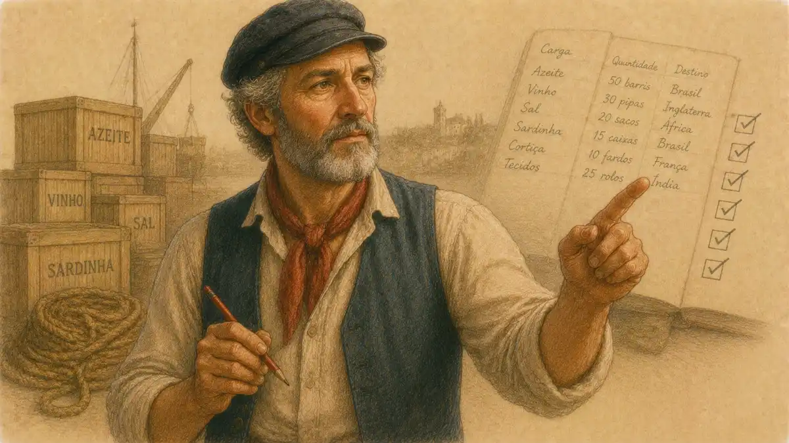

Color-conscious casting of the feud is the boldest interpretive device available to a director of this play, because it aims at the one thing the text leaves blank. Shakespeare never explains why the Capulets and Montagues hate each other. A production that draws the line between the houses along a racial, ethnic, or national division proposes an answer the script withholds, and it proposes that answer in the one theatrical language an audience reads before a single line is spoken: the visible bodies of the two families. This article examines that device across its documented history, from a reported Romeo at New York's African Theatre in the 1820s to a divided Verona on the United States and Mexico border, and it reaches a firm verdict. Color-conscious casting of the feud can reveal what no other staging choice reaches, the felt mechanics of inherited hatred between groups who are, in every quality the play measures, identical. It reveals that truth only under discipline: the division mapped must be one the audience genuinely lives inside, the symmetry of the two houses must survive the mapping, and the production must read its own casting rather than merely display it. Where those conditions fail, the record shows the device cancelling itself, splitting the houses on the poster and reuniting them in indifference on the stage.

The verdict matters because the alternative devices are weaker than their reputations. Color-blind casting, the older ideal, rests on a premise the scholarship has dismantled: that an audience can be asked not to see what it plainly sees. Color-conscious casting begins from the opposite premise, that the audience will read the bodies in front of it whether the production plans for that reading or not, and that a director may therefore compose with the reading instead of pretending it away. Between those two premises stands this play, whose feud is the most famous unexplained hatred in English drama, and whose first line of description insists that the two households are "both alike in dignity" (Prologue, line 1). A device that makes the houses visibly different while the text insists they are alike sets up the exact tension the tragedy runs on. Handled with rigor, the staging argues that the difference is the costume and the sameness is the fact. Handled carelessly, it argues the reverse, and the play's judgment on the feud collapses into a judgment on one side of it.

A word on evidence before the record is opened, because this subject collects legends the way the play collects productions. Casting history is preserved unevenly: a Broadway mounting leaves a shelf of notices, a fringe mounting a single database entry, an 1820s mounting perhaps one memoir written four decades later. This article grades its materials accordingly and says which grade each exhibit carries. Documented means a production record, a dated review, or a company's own archive; reported means testimony from a named witness, credited as testimony; inferred means the article's own reasoning from documented facts, flagged where it occurs. The distinction is not pedantry. The device under examination stakes everything on what audiences actually saw, and a history of it built from what companies later wished they had done would reproduce, at the level of scholarship, the exact failure the Broadway section finds at the level of production: a division described in the publicity and absent from the event.

## Both Alike in Dignity: The Feud the Text Refuses to Explain

Every color-conscious production of the feud is an answer to a question the play declines to answer, and the shape of the device cannot be understood until the blank at the play's center is measured precisely. The Prologue performs the refusal in its opening quatrain: "Two households, both alike in dignity, / In fair Verona, where we lay our scene, / From ancient grudge break to new mutiny, / Where civil blood makes civil hands unclean" (Prologue, lines 1 to 4). The grudge is "ancient," which is a date and not a cause. It has a duration and no origin. The households are alike in dignity, which is to say alike in the only social quantity the Prologue bothers to measure. The feud's continuation is then assigned not to any grievance but to heredity itself: "From forth the fatal loins of these two foes / A pair of star-crossed lovers take their life" (Prologue, lines 5 to 6). Hatred in this play is inherited the way eye color is inherited, passed down in the loins, and the lovers are destroyed by an allegiance neither chose and neither can account for.

The scenes that follow keep the account empty. The opening brawl begins with servants trading insults whose content is pure heraldry: Sampson will bite his thumb at the Montague men, an insult he immediately admits is sustainable only if its meaning can be denied. Tybalt enters asking after a drawn sword and announces, of Benvolio, "What, drawn, and talk of peace? I hate the word, / As I hate hell, all Montagues, and thee" (1.1). The hatred is categorical, attached to a name and a house, never to an injury. When the Prince sentences both parties he sentences them as a pair, under one penalty, for one offense committed jointly: "If ever you disturb our streets again, / Your lives shall pay the forfeit of the peace" (1.1). Romeo, surveying the wreckage of the first scene, compresses the play's whole sociology into an oxymoron: "Here's much to do with hate, but more with love" (1.1). Nobody in Verona can say what the hate is for. Juliet, discovering the name of the boy from the ball, states the mechanism exactly: "My only love sprung from my only hate! / Too early seen unknown, and known too late! / Prodigious birth of love it is to me / That I must love a loathed enemy" (1.5). The enemy is loathed by category, before acquaintance, on the evidence of a name.

The one character who theorizes the feud treats it as a condition of blood rather than a dispute about anything. Friar Laurence agrees to marry the lovers because the marriage might convert the condition: "For this alliance may so happy prove / To turn your households' rancour to pure love" (2.3). Rancour is a humoral word, a bitterness in the system, and the Friar's remedy is a transfusion, new kinship introduced into the bloodline. Mercutio, dying, curses the system itself rather than either party: "A plague o' both your houses" (3.1). The plague is impartial. It falls on houses, not on causes, because houses are all there is. Editors of the play have long noted the structural fact. Jill Levenson, in the introduction to her Oxford edition, treats the Prologue's sonnet as a contract that tells the audience the ending while withholding the explanation, so that attention shifts from what happened to how a whole city is organized around an inherited antagonism. The feud is not a quarrel with a forgotten first chapter. It is a social machine, and the text's refusal to motivate it is the machine's defining feature.

The machine's moving parts matter for casting, because they show what a divided company would have to play. The feud is operated by servants before it is touched by principals: the play opens not with the fathers but with Sampson and Gregory, Capulet servingmen, boasting and baiting in the street, and the brawl assembles itself rank by rank, retainers, kinsmen, citizens, the old men themselves calling for their swords, until the Prince must threaten the whole city to stop it. Hatred in Verona is a civic utility, distributed through every household department. It is also, at its most lethal, a matter of recognition without knowledge. At the Capulet ball Tybalt identifies the intruder he will later kill for, and tries to kill at once, by a single datum: "This, by his voice, should be a Montague" (1.5). He does not know Romeo's face, his errand, or his conduct; the voice assigns the category, and the category carries the sentence: "Now by the stock and honour of my kin, / To strike him dead I hold it not a sin" (1.5). Stock and honour, lineage and reputation, are the entire indictment. Old Capulet restrains him not from tolerance but from household management, and Tybalt's obedience curdles into the revenge that finds Mercutio in the street. A director casting the houses as visible groups is intervening at exactly this joint of the play, the moment of categorization, where the text already insists that identity is read off a surface sign and acted on without inquiry. The ball scene is the play's own demonstration of how a marker works: a masked stranger is safe until a voice betrays his house, whereupon courtesy, hospitality, and the host's direct command all fail to protect him beyond the evening.

The street scene of 3.1 runs the demonstration to its conclusion, and its mechanics define what any mapping of the feud must survive. Mercutio is killed not for hatred of Tybalt but by the geometry of intervention, caught under Romeo's arm as Romeo steps between the duelists with a speech about love and kinship: "I thought all for the best" is his own epitaph on the attempt. The play is careful to make the hinge death a bystander's, the Prince's kinsman, neither Capulet nor Montague by house, destroyed by proximity to a quarrel that was never his. Then the categories reassert themselves with mechanical speed. Romeo, who moments earlier refused the fight on grounds of marriage and love, kills Tybalt inside a minute of Mercutio's fall, because the code of the houses leaves the role of avenger vacant and he is the nearest Montague to fill it. The feud, in the text's own showing, is a casting system before it is anything else: it assigns parts, understudies them across the whole city, and recasts instantly when a player falls. A production that casts the feud by visible group is therefore not decorating a metaphor. It is making literal the play's own account of how persons are conscripted into identities they did not choose and executed for names they did not earn. That literalness is the device's claim on the play, and it is a strong one. It is also why the device cannot be judged as imagery. It must be judged as an account of the conscription, true or false to the way the audience's own world performs it.

The play's final image of the houses deserves a place in this anatomy, because it is the image every divided staging must finally either earn or forfeit. Over the bodies, the fathers do not merely reconcile; they commission. Montague promises Juliet a statue in pure gold, and Capulet answers that Romeo's statue shall lie as rich beside his lady's. Each house accepts the other's heir as its own monument, at ruinous expense, in the other's despite. The feud's last transaction is an act of casting performed by the principals themselves: the enemy's child recast as the family's treasure, the identity reassigned by grief. The Prince then distributes the moral sentence with a bookkeeper's evenness, "Some shall be pardon'd, and some punished" (5.3), pardon and punishment scattered across the city without respect of house. A production that divides the houses by a visible marker spends the whole evening building toward this double moment, the statues and the sentence, and the moment puts the division to its hardest test: if the audience can still receive the two fathers as interchangeable in guilt and in loss, the marker has been exposed as the feud's costume; if it cannot, if one father's grief reads as more deserved or less, the marker has eaten the play. The text supplies the examination. Fewer productions pass it than announce it.

### Does the play ever give the feud a reason?

No. Across five acts no character names an injury, a debt, a disputed property, a stolen bride, or any originating act, and the Prince's closing audit still calls the hatred simply "your hate" (5.3), a possession the fathers hold without a history attached. The absence is the play's premise, not a gap in its documentation.

This is the blank that color-conscious casting proposes to fill, and the proposal carries both its power and its danger inside it. A racial or ethnic division drawn between the houses gives the audience an instant, legible answer to the question the text refuses: they hate each other because they are visibly not the same people. The answer is theatrically potent because it matches how inherited hatred actually presents itself in the world, as a visible marker maintained across generations long after any originating injury has dissolved. It is dangerous for the same reason. The play's point, enforced by the Prologue's "both alike in dignity" and by the Prince's joint sentence, is that the hatred needs no difference to sustain it and survives because it is inherited, not because it is justified by any real distinction between the parties. A staging that supplies a real distinction must stage it as an accusation against the audience's own habits of reading, or it will accidentally acquit the feud, implying the hatred had grounds after all. The distinction between those two stagings, one that indicts the marker and one that endorses it, is the whole subject of this article, and the documented productions divide along exactly that line.

## Color-Blind, Color-Conscious, Concept: The Casting Terms, Defined

The vocabulary of casting across race was not born in reviews or manifestos. It was built, deliberately, at a professional symposium, and its categories remain the most serviceable map of the devices this article must distinguish. The Non-Traditional Casting Project, founded in 1986 with the Actors' Equity Association among its co-founding bodies, convened the First National Symposium on Non-Traditional Casting and published its proceedings as Beyond Tradition, edited by the project's Clinton Turner Davis and Harry Newman. The symposium defined non-traditional casting as the casting of ethnic, female, or disabled actors in roles where race, ethnicity, gender, or physical capability is not necessary to the character's or the play's development. It then divided the practice into four subcategories, and the divisions reward attention because they separate devices that loose usage constantly confuses.

The first category is color-blind casting: actors are cast without regard to race or ethnicity, on the stated principle that the best actor receives the role. The second is societal casting: minority, female, or disabled actors are cast in roles those performers actually occupy in society at large, so that a judge, a doctor, or a police officer onstage reflects the population offstage. The third is conceptual casting: an actor from a group outside the role's traditional profile is cast specifically to give the play greater resonance, to make the production mean something the traditional casting would not. The fourth is cross-cultural casting: the entire world of the play is translated into a different cultural setting, and casting follows the translation. Harry Newman, the project's first executive director, attached a warning to the taxonomy that its subsequent history has repeatedly vindicated: the concepts and definitions were in no way meant to become new formulas to replace the existing ones, and were offered solely to stimulate creative decision makers. The categories were a vocabulary for thinking, not a licensing scheme.

The vocabulary's own history already contains the quarrel this article must adjudicate. The word blind in color-blind casting drew objections from the start: Actors' Equity's representatives preferred the term non-traditional casting, on the ground that blindness misdescribed a deliberate professional practice, and later practitioners added that the metaphor borrowed a disability to name a virtue while describing neither accurately. The project's institutional biography tracks the same restlessness. Founded to change what casting meant, it renamed itself the Alliance for Inclusion in the Arts in 2006, judging that the issues had outgrown the casting office to include writers, directors, designers, leadership, and audiences, and it treated each renaming as Newman's stipulation required, as a tool replaced when it stopped cutting. A vocabulary whose inventors refused to let it settle cannot be wielded as a settlement. When the scholarship and the rehearsal room speak of color-conscious casting, they are not applying the symposium's terms but extending them under the symposium's own rule, that the categories exist to make decision makers think and expire when they stop doing so.

Color-conscious casting, the term that governs this article, is a later arrival and a deliberate correction. Where color-blind casting claims not to see race, color-conscious casting names the decision to see it and to compose with what it means. In the taxonomy's own terms, the device examined here is conceptual casting applied at the level of the whole feud: the director casts the houses as groups, assigns each house a legible identity, and banks on the audience reading the assignment. Three distinct arrangements must be kept apart, because the documented record shows them producing opposite effects. The first is the house split itself: Capulets cast from one racial or ethnic group, Montagues from another, so that the feud's battle lines and the visible difference coincide. The second is single-group casting, in which one company drawn from a single community plays the entire play, houses alike, so that the feud is staged inside one people. The third is diverse ensemble casting, in which a mixed company is assembled without regard to house, family, or faction, and the visible differences are distributed at random across the play's allegiances. Only the first arrangement is color-conscious casting of the feud in the strict sense. The other two are its controls, and the record of this play includes instructive examples of all three.

The taxonomy crossed the Atlantic imperfectly, and the imperfection is itself evidence. British practice never adopted the symposium's four terms as working vocabulary; its arguments ran instead through the marked-role question, whether the one part the canon racializes could still be blacked up for, and through a generation of actors, Josette Simon foremost among them, who built classical careers inside companies that called their policy everything from integrated to blind. The British debate was thus narrower and, in one respect, more honest: it argued about a specific role's history rather than about casting in the abstract. The American symposium's abstraction was its weakness as description and its strength as program, since categories that name practices can travel into rooms where no one has heard of the practices. Color-conscious casting, as the term settled, is the child of both lines: the British insistence that the specific body in the specific role is where the argument lives, joined to the American discovery that the argument needs names before it can be had in public. This play's feud, a group phenomenon rather than a single marked role, belongs to the American side of the inheritance. Britain could argue about Othello one actor at a time. The feud can only be argued about in companies, and companies are what the symposium taught the profession to describe.

One neighbouring practice must be separated from the device before the record is read, because the two are constantly confused in coverage and the confusion flatters neither. Identity-matched casting assigns roles to actors whose own identities correspond to identities the text specifies: a Moor played by a Black actor, a nurse by an older woman, a prince by a man of the prince's nation in a translated world. Its warrant is correspondence, and its questions are questions of accuracy and access. Color-conscious casting of the feud has no correspondence to consult. Shakespeare specifies nothing about the houses' appearance, origin, or speech beyond their Veronese citizenship and their equality of rank, so there is no textual identity for a casting to match; every division of the houses is an invention, and the invention must justify itself as interpretation or stand exposed as decoration. This is why the device attracts stronger argument than identity matching ever does, and why its failures are more interesting than its successes are comfortable. It is criticism conducted in flesh, a reading of the play's blank center offered to an audience that will grade the reading in real time, with the exits available. The productions that follow are best understood as published criticism of exactly that kind, reviewed as productions but arguable as essays, and this article grades them on both scales without confusing the currencies.

### Why did the symposium's founders refuse to let their four categories harden into formulas?

Because the categories were diagnostics, not recipes. Newman's stipulation, printed with the definitions in Beyond Tradition, was that the terms should stimulate creative decision makers rather than replace one set of casting habits with another, and the project's history, renaming itself the Alliance for Inclusion in the Arts, treated vocabulary as a tool that must keep changing or die.

The scholarly history of these practices was written by Angela C. Pao in No Safe Spaces, her account of the recasting of race, ethnicity, and nationality in the American theatre. Pao's history is the indispensable documentary source for this article's subject precisely because it refuses the symposium's optimism and the manifestos' rhetoric alike, following instead what productions actually did and what audiences and institutions actually made of them. Her framing of non-traditional casting as simultaneously social action and artistic exploration, a practice in which assigning a particular actor to a role can dislodge established modes of perceiving, supplies the test this article applies to every production in the record. A color-conscious feud succeeds, on Pao's implicit standard, when the assignment dislodges a perception, when the audience leaves seeing inherited hatred differently from the way it entered. It fails when the assignment merely decorates the stage with difference while the perception underneath, that the feud is about nothing, remains exactly where the play put it and the production has nothing to add. That test is severe, and most of the documented productions fail it in instructive ways.

Pao's method deserves a sentence of its own, because this article adopts it and the reader should know what kind of evidence the verdicts below rest on. Her history is built from the profession's paper trail: programmes and casting announcements, symposium transcripts, reviews in the daily and trade press, and the institutional records of the companies themselves. The casting survey in this article is assembled the same way, from production databases, company archives, and dated notices, and researchers who keep such material for cross-checking keep their files where the whole trail can be held together, in a working archive such as [VaultBook](https://vaultbook.net/), rather than scattered across clippings. Where the record for a production in the survey is thin, the survey says so in its own row, and where testimony substitutes for documentation, as with the first row's memoir evidence, the substitution is labeled rather than smoothed over. The discipline matters because casting history is unusually prone to legend: companies remember their intentions as achievements, and a device whose entire claim is that audiences read bodies must be studied in records of what audiences and reviewers actually read, not in manifestos about what they were meant to read.

## Before the Device: The Barred Romeo and the Integrated Stage

Color-conscious casting of the feud could not be invented until actors of color could be cast in the play at all, and the prehistory of the device is a history of barriers, exceptions, and one enabling institution. The first Black company to perform Shakespeare in the United States, William Henry Brown's African Theatre in New York, opened its Richard III in 1821 before audiences that included hostile white spectators and critics. Ayanna Thompson, introducing her edited collection Colorblind Shakespeare, begins the volume's history there for a reason: white reviewers treated the very sound of Shakespeare's language in Black mouths as a kind of impossibility, and the company's existence was contested in print and, on occasion, in the street. The African Theatre's repertoire is the ground zero of everything this article discusses, because it established the fact that every later casting philosophy had to answer: race on the Shakespearean stage was never going to be invisible, whatever any director intended. Audiences saw it, reviewers wrote about it, and the seeing was the meaning.

The company's fate underlines the point with institutional violence. The African Theatre operated in the teeth of a commercial rivalry with the established Park Theatre, whose management had every reason to resent a Black company drawing audiences a few streets away, and the surviving accounts describe harassment, hostile coverage, and disruption pressing on the enterprise until it folded within roughly three years. Thompson's history draws the moral the later centuries keep relearning: the experiment did not fail because audiences could not read Black actors in Shakespeare. It was ended, in significant part, because powerful neighbours would not let the reading continue. The barrier against color in the classical repertoire was never a fact about spectatorship. It was a fact about permission, enforced by managements, reviewers, and the economics of the street, and it persisted in changing costumes for a century and a half after Brown's company closed: the white actor in blackface playing the comic servant, the tragedian licensed for the single marked Moor, the Romeo reserved by unwritten rule. When Joseph Papp began hiring actors of color for his festival in the 1950s, what he broke was not an audience habit but a management habit, which is why his reform stuck where appeals to taste had not: he controlled a stage, a budget, and a casting office, and he used all three.

The barrier's critical wing outlived its managerial wing by decades, and Thompson's introduction preserves its voice in the profession's own words. Reviewing a multiracial Antony and Cleopatra in the 1960s, critics of record wrote that Black actors often lacked even the rudiments of standard American speech and that they did not look right in parts that historically demand white performers. The two charges deserve to be read slowly, because they expose the barrier's working parts at the moment Papp was dismantling its economics. The speech charge dressed a judgment about class and schooling as a judgment about capacity, and the looking charge dispensed with disguise altogether: parts demanded white performers because white performers had historically filled them, a circle with no exit. Between them, the charges explain why the integrated company's first decades were spent proving competence at the level of the individual actor, verse by verse and review by review, before any director could spend a company's hard-won credibility on an arrangement as exposed as a divided feud. The house split is a late device because it is an expensive one: it wagers the whole company's legibility on a single visible proposition, and companies still fighting to have their Romeos reviewed as Romeos rather than as statements had nothing to wager. Fearon's Stratford sequence, acclaim first and landmark second, is the sound of the wager becoming affordable.

Out of that company came the century's most consequential Shakespearean career, and this play stands at the head of it. Ira Aldridge, born in New York in 1807 and educated at the African Free School, apprenticed himself to the African Theatre's leading actor James Hewlett while still a schoolboy. The evidence for what the teenaged Aldridge played must be graded with the discipline this series applies everywhere. No playbill for the African Theatre's Romeo and Juliet survives. What survives is testimony: James McCune Smith, Aldridge's schoolfellow and later a prominent physician and abolitionist, recorded in an 1860 memoir that Aldridge played the male lead in Romeo and Juliet with the company, alongside his documented Rolla in Sheridan's Pizarro. The Cambridge scholarship on Aldridge, following the standard biography by Herbert Marshall and Mildred Stock, reports the Romeo with exactly that hedge, as a role he may have played on the memoir's authority. The hedge deserves respect rather than embarrassment. A Black teenager playing Romeo in New York in the early 1820s was an event the documentary machinery of the period had every incentive not to preserve, and the memoir's survival is itself evidence of how the performance lodged in the memory of the community that witnessed it. What is not hedged is the career that followed: driven from the American stage by the color bar, Aldridge emigrated to England in 1824 and built a forty-year European career as the African Roscius, playing Othello, Shylock, Macbeth, Richard III, and King Lear, and dying in 1867 as the most honored Black tragedian of his century, one of the small company of actors commemorated by a bronze plaque at the Shakespeare Memorial Theatre in Stratford.

The next century's giant clarifies the barrier by the shape of his exceptions. Paul Robeson played Othello in London in 1930, opposite Peggy Ashcroft's Desdemona, and in New York in 1943, in Margaret Webster's production, the first major American staging to set a Black Othello inside an otherwise white company. Robeson never played Romeo. The omission is not biographical accident but structural evidence: the era could license a Black actor in the one Shakespearean lead whose race the text itself marks, and in almost nothing else at the highest level, and the tragedian who carried Othello across two continents was never offered the chance to carry the lover of Verona. Romeo remained, in the profession's working assumption, a white part. That assumption is the wall the later devices were built against, and it is why the history of color in this play runs so much later than the history of color in Othello. The feud's houses could not be divided by race until Romeos and Juliets of more than one race existed to divide them between.

The scale of Robeson's exception is worth fixing precisely, because it is so often left as atmosphere. The Webster Othello of 1943 ran for 296 performances on Broadway, a run without precedent for a Shakespeare production there, and it did so with the experiment's terms printed on its face: one Black actor of genius at the center of a white company, in the one role the canon itself racializes. Robeson returned to the part at Stratford in 1959, in the production that closed his stage career, and the Stratford succession that Fearon inherited forty years later descends from that visit as much as from the London triumph of 1930. The lesson the era taught, and taught so durably that it structured casting arguments into the 1990s, was that an actor of color in the classical repertoire was an event to be justified by the role's own markings. Romeo carries no markings. That is the whole explanation for his long reservation, and it is also why this play, and not Othello, became the test site for casting philosophies that claimed to need no justification: a Black Romeo could never plead the text. He could only plead the practice, and the practice had to be built before the plea could be heard.

The institution that broke the wall in the United States was Joseph Papp's New York Shakespeare Festival. Thompson's introduction dates the systematic practice of color-blind casting to Papp's festival in the 1950s, and the festival's own records place Papp hiring actors of color in his Shakespeare productions from 1955. Papp's casting was a policy before it was a philosophy: he cast the city he played to, treated the classical repertoire as common property, and built the audience and the company together. The significance for this play is concrete as well as symbolic. Papp directed Romeo and Juliet himself at the Delacorte Theater in 1968, with Martin Sheen as Romeo, and the festival returned to the play at the same address in 2007 under Michael Greif, with Oscar Isaac and Lauren Ambrose. An integrated company playing the feud as a matter of routine, with no factional pattern imposed on the casting, was the baseline the festival established across four decades. Color-conscious casting of the feud defines itself against that baseline. It accepts Papp's company and refuses his neutrality, taking the mixed stage he normalized and asking what happens when the mixture is arranged into meaning.

The British measure of the same decades belongs to the Royal Shakespeare Company, whose full survey in this series stands elsewhere; here one career serves as the calibrated instrument. Ray Fearon joined the RSC in 1993 and played Romeo for the company in 1997, directed by Michael Attenborough, opposite Zoe Waites as Juliet, in a mixed company cast without factional design: a Black Romeo as a matter of individual casting, acclaimed on his merits. Two years later Fearon played Othello at the Royal Shakespeare Theatre, the first Black actor to play the role on the RSC's main stage since Robeson, a fact Fearon himself recorded learning only after the casting was announced. His own account of the Othello, given to the company's blog, is the color-blind era's ethos in a single sentence: "I just wanted to play the part." The sentence is winning and, for this article's purposes, incomplete in an instructive way. Wanting only to play the part is the performer's privilege and right; the institution that casts him has no such innocence available, since the institution knows the forty-year interval the performer learned of afterward, and knows what its audience will read into the ending of it. The distance between Fearon's sentence and the Herald's headline is the distance between color-blind casting as an actor's discipline and color-blind casting as a producing fiction, and the quarrel of the next section was fought, at bottom, over which of those two things the term named. The sequence is the era in miniature. A Black Romeo in 1997 was possible, even celebrated, and still passed without the institutional fanfare that attended the Othello of 1999, because Romeo's race in a mixed company signified range while Othello's signified a forty-year exclusion ending. Neither production divided the houses. The feud remained unmapped, played by companies whose diversity was the point and whose diversity was also, by design, not the argument. What that argument would look like, the next section's productions had already begun to test.

## The Houses Divided: Color-Conscious Casting in Production

The InsightCrunch casting survey, printed in full below, gathers the documented record of this play's engagements with race in casting, from the reported Romeo of the 1820s to the border Verona of 2026. Read down its rows, the survey tells a story with a clear hinge. Before the 1980s, color enters the play's history one actor at a time, against a bar. From 1982 onward, directors begin casting the feud itself, assigning the houses to groups, and the survey's interest shifts from who was permitted to play to what the arrangement argued. The four full house splits in the record repay individual examination, because each failed or succeeded in a different way and the four failures and successes together map the device's whole possibility space.

| Production | Company and year | Device | How the houses were cast | What the record shows |
| --- | --- | --- | --- | --- |
| Romeo and Juliet | African Theatre, New York, early 1820s | Single-group company | A Black company played the whole play | Ira Aldridge's Romeo rests on McCune Smith's 1860 memoir, no playbill surviving |
| Romeo and Juliet | New York Shakespeare Festival, from 1955 | Color-blind integration | Actors of color cast across the company without factional pattern | Papp's policy made the mixed company the American baseline |
| Romeo and Juliet | Young Vic, London, 1982 | House split | Black Montagues, white Capulets | The Financial Times judged that the tactic obliterated any hint of racial tension |
| Romeo and Juliet | Deconstruction Theatre, Baron's Court, 1992 | House split inside a translated world | Black Capulet islanders, white Montague newcomers | The split carried a colonial history, settlers against the island's first people |
| Romeo and Juliet | Khan Theatre and Al-Kasaba Theatre, Jerusalem, 1994 | House split, two companies, two languages | Palestinian Montagues in Arabic, Israeli Capulets in Hebrew | Rehearsed through a massacre; the scholarly critique charged the production with reproducing the stereotypes it opposed |
| Romeo and Juliet | Royal Shakespeare Company, 1997 and 1999 | Color-blind integration at the leads | Ray Fearon as Romeo, then as Othello | The first Black Othello on the RSC main stage since Robeson, two years after his Romeo |
| Romeo and Juliet | Richard Rodgers Theatre, Broadway, 2013 | House split, unexploited | Black Capulets, white Montagues | Reviewer after reviewer recorded that race had no factor in the rivalry as staged |
| Romeo and Juliet | Delacorte Theater, New York, 2026 | Concept division by function and language | Montagues as immigrants, Capulets as border agents | Critics charged that oppressor and oppressed replaced the play's symmetry of blame |

The first full split arrived in London in 1982, at the Young Vic, in Andrew Visnevski's production for young audiences. The Montagues were all Black and the Capulets white, with Roy Alexander as Romeo and Alyson Spiro as Juliet. Spiro defended the design in the Guardian on grounds that deserve quotation because they state one whole theory of the device: the reason, she argued, was that Renaissance northern Italy held many nationalities, Turks and Africans among them, and that the period's painting shows a multiracial society. On that theory, the split is not an imposition on the play but a recovery of the world the play came from, history rather than editorial. The theory has a flaw the production's own notices exposed. A Verona of many nationalities is an argument for a mixed city, not for sorting the city by house, and the record preserved by the University of Warwick's production database shows the sorting's effect on the night. Michael Coveney, reviewing for the Financial Times, applauded the innovation and then delivered the judgment that has followed the device ever since: the tactic, he wrote, obliterated any hint of racial tension, for the dispute was one of name and tribal affiliation. The sentence is double edged and both edges cut. Coveney meant it partly as praise, the split clarifying the feud as tribal rather than racial. Read as analysis, it records a cancellation: the audience, given a racial map of the feud, concluded that race explained nothing about it, because the play's machinery of name, insult, and inherited loyalty operated exactly as it operates when both houses look the same. The first house split in the documented record thus stands as the device's founding paradox. Its clarity was real, its speed and visual impact were praised, and its racial argument evaporated in performance, leaving the feud's blankness not filled but confirmed.

The other notices in the Warwick record complicate the cancellation in a way that matters for the verdict. A second reviewer praised the production's great advantage of clarity, speed, and visual impact, and located its strength in its sense of community, in a particularly persuasive Capulet family and a strong supporting company that included Okon Ubanga Jones's Benvolio. Set the two records side by side and the Young Vic production resolves into a precise finding: the split worked exactly where a casting device can work without interpretation, as stage geography, making the feud's sides instantly legible to a young audience at sight, and it failed exactly where interpretation was required, as argument, since the legibility attached itself to name and tribe rather than to race. Legibility is not nothing; a feud an audience cannot sort at sight is a feud half lost, and the play's first scene is a sorting exercise. But the survey's later rows exist to ask whether legibility can be made to argue, and 1982's answer is that it does not argue on its own. The device at its simplest setting sorts the stage. Everything else must be done by the production on purpose.

One defense of the Young Vic experiment deserves its full weight before the survey moves on, because it identifies the audience for whom the device, even unread, does real work. The production was designed for young audiences, many of them meeting the play for the first time, and for a first-time spectator the feud presents a genuine cognitive problem: a stage full of strangers in similar dress must be sorted into two camps before a single line can be followed, and the sorting must survive disguises, a masked ball, and a hero who keeps defecting. A visible house division solves that problem at sight and keeps solving it for three hours, freeing the novice's attention for the verse. As pedagogy, the Young Vic split was a success its reviewers measured in exactly those terms, clarity and speed. The reservation the verdict keeps is about what the pedagogy teaches once the sorting is learned. The play's own instruction begins where sorting ends: the discovery that the camps are indistinguishable in everything but the marker, that the marker is the whole of the difference, and that the difference kills. A device that perfects the first lesson and never proceeds to the second has taught the feud's mechanics and withheld its meaning, and an audience of schoolchildren deserves the second lesson most of all, since the first is the one the world outside the theatre is already teaching them daily, free of charge.

### Why did the Young Vic's own Juliet defend the split as history rather than politics?

Because the production's warrant was demographic, not polemical. Spiro's Guardian argument was that Renaissance Verona, as its painting records, held Turks, Africans, and many nationalities, so a divided city recovered the period's actual mixture; the defense claims the split as reconstruction, which also explains its limit, since a mixed city argues for mixing, not for sorting by house.

A decade later the split acquired a setting that gave it a history to bite on. The Deconstruction Theatre Company played the play at the Baron's Court Theatre in London in 1992, in Ronald Selwyn Phillips's conception of a Nameless Island off the African coast, directed by David Evans Rees, with Christopher Toba as Romeo and Heather Imani as Juliet. The island's original inhabitants were a Black people of established culture and councils; the white communities were the newcomers, growing in numbers and mostly absorbed into island life, with the feud confined to the exceptions. The Capulets were Black and the Montagues white, which is to say the feud was staged between a first people and a settler population inside a postcolonial fiction built for the purpose. Bonnie Greer, reviewing for Time Out, urged London to choose this production over its rival in town. The island fiction had been built across a season: the company's Othello earlier in 1992 had played the island's settled order with an all-Black cast and a single white Othello, the stranger within, and the Romeo and Juliet arrived as the settlement's second chapter, its programme explaining that the white communities had grown and largely been absorbed, with the feud festering among the exceptions. The device here is thus more elaborate than a split: it is a shared fictional history, written jointly by two productions, in which the audience is asked to read the houses through a colonizing past the islanders and the newcomers hold in different versions. Theatre Record's summary confirms the geometry without euphemism: the Capulets are black, the Montagues white, the blacks the original inhabitants of the island, the whites the turbulent newcomers. The Nameless Island design is cross-cultural casting in the symposium's taxonomy, the whole world translated, with the house split operating inside the translation, and its relative success against the Young Vic's cancellation is instructive. The split meant more at Baron's Court because the world around it explained what the two groups were to each other: inhabitants and arrivals, with a history of contact, absorption, and friction. The feud had acquired a sociology. Yet the cost is visible in the same record. The play's blank had not been filled by casting but by fiction, a invented island history doing the work, and the production's Romeo and Juliet became the exceptions to a rule the staging had written for them. The device was borrowing its meaning from a scenario rather than discovering it in the play.

The fullest test of the device, and its documentary monument, is the Jerusalem production of 1994. Eran Baniel of the Khan Theatre had conceived the project years earlier: a Romeo and Juliet co-produced by an Israeli company and a Palestinian one, the houses divided between the two peoples of the city where it played. George Ibrahim's Al-Kasaba Theatre of Ramallah joined the Khan, and the formal agreement was reached on 13 September 1993, the day of the Oslo handshake in Washington. Baniel directed the Israeli company, Fuad Awad directed the Palestinian company, and the shared scenes were directed by both. The Capulets were played by Israeli actors in Hebrew, the Montagues by Palestinian actors in Arabic, with Khalifa Natour as Romeo, Orna Katz as Juliet, and Mohammed Bakri as Mercutio. A documentary film, Compromise, followed the production through its making. No staging in this article's record was more thoroughly color-conscious in intent, none had more at stake, and none left a richer account of what the device does under maximum pressure.

The process was the production's first artwork, and its chroniclers preserved the texture: parity pursued down to the level of menial work assignments shared between the companies and tea tins labeled in Hebrew and Arabic, lest any small hierarchy smuggle the conflict into the rehearsal room. The human cost of the parity was recorded with equal plainness in the reports filed at the time and gathered since: the Palestinian actress cast as Lady Montague hesitated over the role, afraid she would not be able to see her Jewish counterparts as human beings, and the Israeli Juliet's own family carried the conflict in a brother who had lost a leg fighting Palestinians. These details matter to the survey because they locate the Jerusalem experiment's genuine achievement with precision. The production changed, measurably and at cost, the people who made it; the rehearsal room was the one venue where its thesis, that the two peoples could build a Verona together neither could build alone, was enacted rather than represented. The failure Rokem diagnosed belongs to the second venue, the stage, where representation took over from enactment and the old hierarchies re-entered through the stage door of language. The distinction between what a production enacts in its making and what it represents in its playing is the sharpest analytical tool the Jerusalem record leaves behind, and the verdict section's third condition, that the split must be read at the pressure points, is built from it.

The pressure arrived on schedule. Rehearsals began in early 1994, and on 25 February a settler murdered twenty-nine Palestinian worshippers in Hebron; reprisal bombings followed, checkpoints closed, and the production nearly died of the conflict it was staging. That it survived to perform in Jerusalem and on tour in Europe, including the Festival of the City of Lille, is part of its record and part of its argument: the company's own endurance enacted the cooperation the play's Verona cannot manage. The scholarly verdict, though, was severe, and it came from inside the project's own culture. Freddy Rokem, the Israeli theatre scholar, asked in the Palestine-Israel Journal why Romeo had to be Palestinian and Juliet Israeli, and his account of the performance answers the question against the production. The staging, Rokem argued, reproduced the socioeconomic stereotype it meant to oppose, presenting the Palestinian Romeo as an amiable youth without weight, and it reproduced the region's linguistic hierarchy in its own medium: although each house spoke its own language in its own scenes, the shared scenes defaulted to Hebrew, with the other language projected in translation above the stage, so that the performance granted Hebrew a hegemonic status exactly as the administration's Hebrew-only forms did. The production that set out to divide the houses equally had, in the critic's account, divided them unequally, and the instrument of the inequality was the device itself, the assignment of languages and peoples to houses, handled without sufficient suspicion of what the assignment carried.

The production's own documentary doubled the critique in a medium its makers did not control. Compromise, the film that followed the rehearsals, was taken up by scholars of the event precisely because the camera declined to ratify the project's official meaning: the careful balances of the staging, the labeled tea tins in two languages, the scrupulously shared directing of the shared scenes, read on film as a facade under strain, and the scholarly literature on the film argues that the documentation subverts the intentions it was commissioned to celebrate. The aftermath extends the finding across the decades. As Baniel later recounted, the production's Palestinian set designer eventually fled Gaza in fear of retribution, and Al-Kasaba ceased to display the production's photograph in its public gallery, the image of the handshake season withdrawn by one of the two companies that had made it. None of this makes the Jerusalem production a folly; its courage is part of the permanent record, and the survey's row honors it. What the aftermath proves is that a color-conscious feud cannot bank its meaning at the opening. The mapped conflict continues to move after the production closes, and it repossesses the staging's symbols for its own uses. A director who maps the feud onto a live conflict is writing in a medium that keeps editing the text, and the four conditions this article ends with are, in part, an insurance policy against that repossession: meanings anchored in the play's own symmetry survive the news; meanings borrowed from the news do not.

Jerusalem 1994 therefore stands in this survey as the device's most honorable failure, and its lessons are structural. The split sharpened the feud's meaning in the rehearsal room and in the project's public meaning, where the cooperation itself was the event. Onstage, the split imported a real conflict whose asymmetries the play's symmetrical machinery could not digest, and the machinery, not the conflict, gave way: the Palestinian house shrank to accommodate a Verona-shaped hole, and the production's critics watched a stereotype performed by the very people it stereotyped. The contrast with the era's contrary practice sharpens the point. In the same decade Michael Bogdanov's modern-dress approach, remembered in this series for the red Alfa Romeo and the hypodermic needle, belonged to a different economy of meaning entirely, the [modern-dress RSC staging of 1986](/2027/11/19/bogdanov-modern-dress-rsc-1986/) casting its Verona for pace and attitude rather than for ancestral division. The feud can be dressed in the audience's clothes without being assigned the audience's ancestors. Jerusalem chose the ancestors, and the ancestors brought their own play with them.

The third arrangement, the diverse ensemble with no factional pattern, supplies the survey's standing control, and its Stratford instance is the cleanest. The Royal Shakespeare Company's 2018 production, directed by Erica Whyman, cast Bally Gill, a British Asian actor, as Romeo opposite Karen Fishwick's Juliet, inside a young company assembled for range and energy with no house assigned a color. Reviewers treated Gill's Romeo as an individual performance to be judged, which was the production's intention, and the feud onstage signified through dress, choreography, and civic design rather than through ancestry. Set the three arrangements side by side and the controls clarify the experiment. The diverse ensemble proves that a mixed company alone argues nothing about the feud, since the same mixture, rearranged into houses, becomes the Young Vic's sorting and, read with intent, Jerusalem's wager. The single-group company, the African Theatre's arrangement of necessity and the later choice of companies playing inside one community, argues the opposite thesis from the split: that the feud is a civil war within a people, alike not only in dignity but in blood, which is the Prologue's own most literal sense. The split is the only arrangement that argues the feud runs between visibly different peoples, and it is therefore the only one that can be refuted by the text's insistence that the peoples are the same in everything but name. That refutability is its distinction and its danger, and the quarrel of the following section is, in the end, about whether a production should risk it.

## Broadway 2013: The Split That Declined to Speak

The largest stage in the English-speaking theatre mounted the house split in 2013 and then declined to read it, and the episode is the cleanest evidence in the record for this article's central distinction, between casting a division and interpreting one. David Leveaux's production at the Richard Rodgers Theatre, the play's first Broadway mounting in thirty-six years, starred Orlando Bloom as Romeo and Condola Rashad as Juliet. The design of the company was a house split, and the Broadway press stated it as one: the Montague family white, the Capulet family Black, with Chuck Cooper and Roslyn Ruff as Lord and Lady Capulet, Corey Hawkins as Tybalt, and Rashad's Juliet at the Black house's center. Playbill's coverage framed the pairing in advance as an interracial pair of young lovers, which is the lovers' story told at the level of the couple. The production's reviewers, watching the whole design at work, filed a striking consensus about the feud itself.

Elysa Gardner in USA Today noted the division as an aside, "incidentally," and recorded that Leveaux did not overtly make race a factor in the family feud, finding only subtle nods to cultural difference. The Shakespeareances reviewer went further: the Montagues white, the Capulets Black, and race with no factor in their rivalry, not even as a subtext. The Lighting and Sound America review concluded that if anyone had intended a statement about race, the intention was lost in the rehearsal room. Samuel L. Leiter's account holds the analytical key: the enmity as staged was not specifically racial, Tybalt's hostility needed no additional emphasis, and the conflict remained a given, lacking clearly defined motivation, just as it does in Shakespeare. The last clause is the tell. Broadway had reproduced the play's blank with a racial map drawn over it, and the map, unread by the production, signified nothing the blank did not already signify.

The silence of the most powerful review in the American theatre completes the finding. Ben Brantley's New York Times notice praised the lovers for an exalted purity that made their love feel sacred and faulted the production for never acquiring the fiery, all-consuming urgency the play should deliver, and it conducted that whole assessment, favorable and unfavorable, without making the house division its subject: the conceit that had headlined the production's advance coverage simply did not rise to the level of the chief critic's argument. David Rooney in the Hollywood Reporter identified where the division had in fact been spent, in the marketing: the poster image of the two stars, clad in purest white on snowy linens, struck him as fit for a perfume commercial. Read together, the two notices give the episode its epitaph. The split existed as photography, as advance framing, as the thing a ticket buyer could repeat at dinner, and it evaporated at the exact threshold where criticism begins, because the production gave its critics nothing to criticize: no moment where the division changed what a line meant, no staging decision that required it, no risk taken with it that could succeed or fail in public. Wilson's warning about casting as institutional self-congratulation hangs over the episode with uncomfortable precision. A division adopted so that a production can be described as having adopted it is the imperialism of the gesture, and the gesture's emptiness is not a defense against the charge but an instance of it.

A quieter displacement completed the vacancy. The production's advance story, set by its own publicity and repeated by Playbill, was the lovers: an interracial pair, doomed by intolerance. That framing relocates the division's meaning from the feud to the romance, where it does different and much weaker work. A divided couple signifies an obstacle, the oldest furniture of love stories, and invites the audience to root for the obstacle's defeat; the moral it teaches is that love is color-blind, which is Papp's philosophy wearing the split's clothing. A divided feud signifies a system, and invites the harder recognition that the lovers' private virtue is irrelevant to the system's operation, since the system kills the uninvolved Mercutio first and sentences the fathers as a pair. The play's own proportions enforce the second reading: the lovers share a small fraction of its scenes, while the feud owns the streets, the ballroom's edge, the church, and the tomb's threshold. Broadway's publicity spent the division on the fraction, and the production, faithful to its publicity, left the system's scenes, the brawl, the ball's recognition, the street killing, uninflected by the one idea that might have organized them. What remained was a handsome modern-dress staging with a famous pair of lovers and a feud that behaved, in Leiter's words, exactly as it does in Shakespeare: unexplained, unmotivated, and, in this staging, unexplored as well. The casting survey's Broadway row is therefore the negative control of the whole experiment: same device as Jerusalem, opposite investment, and the result was not offense but indifference, a split that audiences were invited to notice and forbidden to interpret.

The design could not even hold its own geometry. A house split argues through consistency, the eye learning the rule and then reading every entrance by it, and the Broadway company crossed its own lines at the two points where the play most needs clarity. The Nurse, the Capulet household's most intimate servant and the lovers' go-between, was played by Jayne Houdyshell, a white actor inside the Black house, unexplained. The Prince, the authority above both houses whose closing sentence must fall on them as a pair, was played by Geoffrey Owens, a Black actor, so that the judgment Verona pronounced on the feud issued from one side of the division the casting had drawn. Neither choice is objectionable as casting; both are ruinous as argument, because a device that claims the houses are legible as groups cannot exempt the go-between and the judge from its own legibility without confessing that the legibility was decorative. Compare the texts the production had to work with: the feud explainer tradition in this series, [the account of why the Capulets and Montagues hate](/2022/04/01/capulet-montague-feud-explained/), shows a hatred sustained by servants, kinsmen, and civic authority acting as one system. A split that leaves the system's connecting figures unassigned has not cast the feud. It has cast two family portraits and left the feud itself, the thing between the houses, uncast.

### Who crossed the color line inside the 2013 Broadway houses?

Two figures the feud runs through. The Nurse, the Capulet household's intimate and the marriage's broker, was played by Jayne Houdyshell within the Black Capulet family, and the Prince, the authority who must sentence both houses as a pair, was played by Geoffrey Owens, leaving the judgment to issue from one side of the division the casting had drawn.

Broadway 2013 closes the case for the prosecution of unread casting. Its producers could advertise a division, its reviewers could identify the division, and its audiences could watch the division for three hours, and the division still did no work, because work requires a production to decide what its casting means at the points of pressure: the ball, where Tybalt reads a voice and a face; the street, where the categories kill; the tomb, where the fathers must be sentenced as equals. Leveaux's staging made none of those decisions visibly, and so the most expensive house split in the play's history stands in the record as the device's purest failure mode, not reductiveness but vacancy.

## Wilson Against the Blind: The Great Casting Quarrel

The quarrel that gave color-conscious casting its name was fought in the open, between two named antagonists, over this repertoire's parent tradition of classical casting, and no production in the survey can be judged without it. In June 1996 August Wilson, the century's foremost American dramatist of Black life, delivered the keynote address "The Ground on Which I Stand" to the Theatre Communications Group conference at Princeton. The speech, reprinted in American Theatre that September, contained the sentence that detonated the decade: "Colorblind casting is an aberrant idea that has never had any validity other than as a tool of Cultural Imperialists who view American culture, rooted in the icons of European culture, as beyond reproach in its perfection." Wilson's target was precise. To mount an all-Black production of a play conceived for white actors, he argued, or to scatter Black actors through the European canon as proof of inclusion, "is to deny us our own humanity, our own history, and the need to make our own investigations from the cultural ground on which we stand as Black Americans." His remedy was institutional, not interpretive: "We do not need colorblind casting; we need theatres," Black companies funded to develop Black playwrights, rather than Black performers absorbed as evidence into white institutions.

Robert Brustein, founder of the Yale Repertory Theatre and the American Repertory Theater and the New Republic's drama critic, answered in that magazine under the title "Subsidized Separatism." Brustein defended the universalist settlement Wilson attacked: the classical repertoire as common property, casting by merit across race, and public funding allocated by artistic standard rather than by identity. The exchange escalated through the autumn in print, and on 27 January 1997 the two men met at Town Hall in New York in a public debate moderated by Anna Deavere Smith, who had herself contributed the symposium era's most searching performance work on American racial division. The debate settled nothing institutionally, and its aftershocks run through the scholarship this article relies on: Thompson's Colorblind Shakespeare, published by Routledge in 2006, treats Wilson's address as the volume's ground zero, the text its fourteen essays answer directly or indirectly, with Ania Loomba's foreword framing the stakes as nothing less than the politics of multiculturalism itself.

The print war's details repay attention because they show what each man thought the other was really defending. Brustein's case, in "Subsidized Separatism" and its sequels, was that the American theatre's outpouring of work by minority artists risked being judged by sociological rather than aesthetic criteria, that funding allocated by identity confused standards, and that a subsidized separatism would strand Black theatre in a provisioned margin while the main stages kept the canon. Wilson's rejoinders treated that vocabulary as the tell: the assumption that minority work enters the room under a cloud of lowered standards, he answered, belonged to a nineteenth-century linguistic environment that positioned Black artists as unqualified until certified. The New York Times put the quarrel on its front page, and the Town Hall evening sold out a hall on the strength of a casting philosophy, an almost unheard-of transaction in American theatre. Notice what neither antagonist defended. Brustein did not defend the pretense that audiences fail to see race; his universalism was a claim about the repertoire's ownership, not about spectatorship. Wilson did not defend the proposition that integrated casting had achieved nothing; his own career had been built in the regional system the symposium generation staffed. The ground the two men actually contested was institutional: who holds the stages, who allocates the money, whose work the canon admits as its future. Casting philosophies were the flag under which that war was fought, and the color-conscious feud, which is a casting philosophy and nothing else, inherits only the flag's smaller half of the argument. Its directors cannot settle the institutional question from the casting office, and the device's honest practitioners have never claimed otherwise; what they can settle, production by production, is whether the audience's reading of bodies will be composed or abandoned.

Even the debate's casting carried the argument. The organizers placed Anna Deavere Smith in the moderator's chair, and the choice was a thesis in itself: Smith's solo performances built from interviews across racial fault lines, Fires in the Mirror after the Crown Heights disturbances and Twilight: Los Angeles after the riots there, had made her the American theatre's foremost practitioner of composed listening across a feud's lines, a performer whose method was to inhabit both houses in sequence and let the audience watch the same body change allegiance. A moderator so cast licensed neither side's absolutism in advance. The evening, by the surviving accounts, ended without conversion on either side, which is precisely why it matters to this article's record: the quarrel was not settled but canonized, fixed as the framework inside which every subsequent argument about casting and race in the American classical theatre, including the argument over this play's divided houses, would have to be conducted. Wilson's institutional demand passed into funding debates; Brustein's universalism passed into the profession's default settings; and the descriptive question both men had circled, what an audience does with a body it can see, passed to the scholars, who answered it in the only way it can be answered, from the record of audiences answering it badly, brilliantly, and never blindly.

Adjudicating the quarrel requires separating its two questions, which the debaters themselves kept fused. The first question is descriptive: can casting be blind? On that question Wilson and the scholars win outright, and the evidence is reception evidence, the thing audiences demonstrably do. Thompson's introduction assembles the record: a Black actor, Clarence Smith, cast as the King of France in the Royal Shakespeare Company's color-blind King Lear of 1991, heckled through his first lines by a spectator who could not or would not perform the blindness the production requested. Josette Simon, the Black British classical actor, is quoted in the same literature naming the reviewer's version of the same fact: critics called her "black Josette Simon," as if a white Josette Simon existed somewhere for comparison. Brandi Wilkins Catanese, in The Problem of the Color[blind], gives the descriptive point its theoretical form: color-blindness in performance is itself a performance, a staged pretense that audiences are asked to enact, and the pretense collapses under the ordinary operations of spectatorship, in which a body on a stage signifies before it speaks. A production may instruct an audience not to read race. It cannot make the instruction true.

The symposium generation had seen the descriptive point coming and built its optimism on the opposite bank of it. Paul Robeson Jr., speaking in the symposium's orbit, gave the era's faith its most quoted form: non-traditional casting in its best sense draws upon the enormously rich universality of the best in minority cultures. The sentence deserves its survival, and its limits are the limits of its decade. It imagines the actor's culture as a resource the production draws upon, a richness added to the play, and it does not yet ask what the audience does with the addition, whether the universality is received as universality or read, stubbornly and specifically, as difference. Thompson's generation asked the reception question and could not un-ask it. Catanese's study, ranging across Black performance from the symposium to its aftermath, records the migration of the argument from the casting office to the auditorium, where it has stayed: the meaning of a cast body is completed by the watching body, and any philosophy of casting that ends at the stage door is a philosophy of intentions. The color-conscious feud begins where that migration ends. It is the first casting philosophy for this play that is addressed, frankly and from the first rehearsal, to the people in the seats.

The second question is prescriptive: what follows from blindness's impossibility? Here Wilson's remedy and the device of this article part company, and the adjudication must be exact. Wilson argued from the impossibility of neutral casting to the necessity of separate institutions, and against the classics as the arena in which Black theatre should prove itself. For this play, that argument fails on the evidence of the survey itself. The feud is the one classical subject whose content is group hatred inherited without cause, and to withdraw it from interracial experiment is to surrender the repertoire's single best instrument for examining the thing Wilson's own plays examine. Pao's history supplies the further correction from the record: the decades of non-traditional casting Wilson deplored had built the profession's Black classical capacity, the training, the audiences, and the very platform from which a Fearon could play Romeo at Stratford and Othello after him. Erasure is a real risk of integrated casting when it asks actors to disappear into neutrality. The documented alternative is not separation but consciousness: casting that knows the audience will read, and writes for the reading. Thompson's own position, developed across the introduction and her later work with companies, is precisely that turn, from blindness as pretense to consciousness as method, and it has carried her from the seminar room into the rehearsal room, as a scholar in residence with the Public Theater and a trustee of the Royal Shakespeare Company. On the descriptive question, Wilson. On the prescription, Thompson. The color-conscious feud is Thompson's heir, and it inherits Wilson's warning as its standing audit: the moment a production's division of the houses serves the institution's self-image rather than the audience's understanding, the imperialism Wilson named has returned in inclusive dress.

### What did Ray Fearon's Romeo prove two years before his Othello?

That casting across the color line had matured past novelty at the highest level. Fearon's Romeo of 1997, inside a mixed Stratford company, signified an actor's range and was reviewed as such; the earthquake came with the Othello of 1999, the first on the RSC's main stage since Robeson, which measured how long the marked role had stayed closed.

One more voice belongs in the quarrel because it disciplines both camps, and it is an editor's. The editors of Shakespeare's text, Levenson among them, have always known that the feud's blankness is a reading problem before it is a staging problem: the printed page gives the two houses no distinguishing mark whatsoever, not a color, not a costume, not a syllable of difference in their speech, and performance must either preserve that perfect interchangeability or violate it knowingly. Every house split is therefore an editorial act performed in bodies, an interpolation into the text as bold as any added stage direction, and it should be judged by editorial standards, whether the interpolation clarifies the sentence or merely decorates it. That standard, clarification against decoration, is the one the final sections apply.

## When the Mapping Reduces: The Border Verona

The device's most instructive modern case sits at the address where Papp founded the integrated baseline. In the summer of 2026 the Public Theater returned Romeo and Juliet to the Delacorte Theater, in a production by Saheem Ali first developed from his bilingual Romeo y Julieta of 2021. Ali's Verona was Nueva Verona, a border town in the shadow of a wall, designed by Maruti Evans with monumental figures of the Madonna and Death above the fence. The text played in English with Alfredo Michel Modenessi's Spanish translations woven through it, the lovers reserving Spanish for their shared world, a language the feud could not enter. The houses were divided by function within the border's economy: the Montagues cast as immigrants, the Capulets as border patrol agents, one family policing the line and the other family crossing it. This is the color-conscious feud translated out of race narrowly conceived and into the period's most charged civic division, which makes it the perfect test of the brief's standing complication: whether mapping the feud onto a real conflict sharpens the play or reduces it.

One element of the production worked almost without dissent, and isolating it sharpens the diagnosis. The lovers' Spanish, the private language Romeo and Juliet reserve for each other inside an English-speaking feud, drew the evening's warmest notices; the New York Theatre Guide's reviewer, severe about the concept as a whole, found the bilingualism most effective precisely when the young lovers speak Spanish to each other. The reason is structural and worth stating as a rule. Ali's language device was applied to the love, not to the feud. It invented a third country, a tongue belonging to neither house, and let the audience watch the lovers emigrate into it nightly; that is an addition the play's machinery welcomes, because the text itself builds the lovers a series of private enclosures, the orchard, the chamber, the cell, against the city's public feud. The house device, by contrast, was applied to the feud, where the text's machinery is symmetrical and causeless, and there the addition fought the machine. The same production thus contains the article's whole argument in miniature: compose with the audience's reading where the play leaves room, and the composition lands; compose against the play's load-bearing symmetries, and the composition is spent explaining itself. The border wall, the statues, and the patrol uniforms all belonged to the second kind of decision, however striking the photographs, and the reviewers' shared metaphor of grafting, an alien tissue on a living body, records the audience's immune response with fair accuracy.

The critics divided, and their division is diagnostic. The Stage and Cinema review named the production's central alteration exactly: casting one family as border guards and the other as immigrants and activists "alters the play's moral geometry," converting a tragedy of mutual fault into a conflict between oppressors and the oppressed. TheaterMania's reviewer, reaching the same production from the hostile side, closed on the principle the alteration violates: the whole point of the play is that the feuding houses are equally to blame for their rootless ancient grudge. The New York Theatre Guide's account pressed the Prologue's own words into service as the production's unanswered examination question: can two houses be politically polarized and still be "both alike in dignity"? These are not complaints about execution. They are findings about the device, and they converge on the flaw Rokem found in Jerusalem from the opposite political direction. A mapping that sorts the houses into an oppressor and an oppressed has not interpreted the feud; it has replaced it, substituting a conflict with a guilty party for a conflict whose horror is that neither party is guiltier than the other and neither can say why they fight. The Prince's closing sentence, which falls on both fathers in one breath and apportions pardon and punishment across the whole city, cannot be spoken with a straight face over a Verona in which one house staffed the wall and the other house climbed it. Something in the production must break, and in 2026 what broke was the ending's even-handedness, the load-bearing wall of the play's judgment.

The ending's grammar is worth quoting against the mapping, because the grammar is the judgment. The Prince's final distribution, "Some shall be pardon'd, and some punished" (5.3), sorts the city by conduct and by loss, not by house, and it follows Capulet's outstretched hand and his new name for his enemy: "O brother Montague, give me thy hand" (5.3). Brother is the play's last word on the houses' relation, and it is spoken by the father whose household the mapping had made the border's police. For the sentence to land, the audience must be able to believe that the two old men stand in the same relation to the catastrophe, authors of it in equal ignorance, bereaved of it in equal measure. A production that has spent three hours teaching the audience to read one house as the wall's keepers and the other as the wall's victims has untaught itself that belief, and no program note can restore it in the final five minutes. This is not an argument against political production of the play; the survey's Jerusalem row is political to its marrow and fails, where it fails, on craft grounds of parity rather than on politics. It is an argument that the feud's symmetry is not a decorative feature a director may trade away for point. It is the mechanism by which the tragedy assigns blame widely enough to include the audience, whose own inherited categories are the production's true subject, and a mapping that narrows the blame to one house lets the audience leave the theatre acquitted, the one exit this play exists to block.

The defenders of such mappings have a serious answer, and it deserves its weight before the verdict falls. The answer is that symmetry is itself an ideology: real inherited hatreds, in the world the audience inhabits, are frequently not symmetrical, and a staging that insists on equal blame may launder a genuine asymmetry into a comfortable both-sides fable. The answer is true of the world and false of this text, and the distinction is the whole critical point. A director who believes Verona's symmetry falsifies the conflict being mapped has three honest options: choose a different play, whose machinery fits the asymmetry; cut and rewrite toward a new work, as the adaptation tradition has always licensed; or stage the asymmetry as the production's open argument with the text, letting the Prince's sentence land as the voice of a false order the production indicts. Ali's staging, on the reviewers' evidence, did none of the three cleanly, laying the specific gloss over the unaltered machinery until, in the hostile summary, the evening was heavy-handed where it was not incoherent. The lesson generalizes backward across the survey. The device reduces the play whenever the mapped conflict is more interesting than the feud and the production lets the audience spend the evening on the conflict instead of on the feud's exposure of it. It sharpens the play only when the mapping is used as an x-ray, a way of making the audience watch its own inherited categories do the feud's work in real time. The [play's fortunes in twenty-first-century theatre](/2028/06/16/play-in-21st-century-theatre/) will be decided largely by whether its directors learn to tell those two uses apart.

## What Color-Conscious Casting Can Reveal: The Conditions

The survey's evidence supports a verdict with conditions, and the conditions are the article's conclusion. Color-conscious casting of the feud reveals the play's deepest mechanism, hatred maintained by inheritance and marker rather than by grievance, when and only when four disciplines hold. First, the division mapped must be the audience's own live division, near enough to implicate the house rather than to offer it tourism in someone else's conflict; Jerusalem had this by birthright and squandered it on asymmetry of execution, while the Young Vic's demographic Verona and Broadway's advertised division implicated nobody in particular. Second, the houses must remain alike in everything the text measures, dignity, wealth of speech, capacity for love and folly, so that the visible difference stands exposed as the feud's only substance; the moment one house is written as the other's oppressor, the x-ray becomes a cartoon. Third, the production must read its casting at the pressure points, the ball, the street, the tomb, deciding what the division means when Tybalt identifies an enemy by his voice and when the fathers are sentenced as a pair; Broadway's vacancy is the standing proof that an unread split signifies nothing. Fourth, the connecting figures, the Nurse, the Friar, the Prince, must be placed inside the design's logic, because the feud is a system and a system is betrayed by its exempted parts.

The single-group arrangement keeps one lesson in reserve for the split's directors, and the verdict should not close without collecting it. When one community plays both houses, the feud reads as civil war, a people divided against itself along a line only its members can see, and the audience's recognition is inward: the marker that sorts the houses is legible only from inside the group, which is how most inherited hatreds actually present to the people who live beside them. The split reverses the optics, making the line legible to everyone including the outsiders in the seats, and its characteristic temptation follows: the audience consumes the division as information about other people. The four conditions below are, in part, a defense against that consumption. A successful split must recover, inside its visible line, the single-group production's inwardness, the sense that the audience is watching its own household quarrel conducted by other means.

Run the survey's rows against the four conditions and the pattern stops looking like taste. The Young Vic held the second condition cleanly, its houses alike in everything but the marker, and failed the third: the split was never spent at a pressure point, so it sorted without arguing. Baron's Court held the first condition in fictional form, its division lived because the island's invented history was the audience's evening-long companion, and it bent the second, since an island of first people and newcomers is an asymmetry the fiction had to keep forgiving. Jerusalem held the first condition outright and broke the second and third in performance, its languages unequal in the shared scenes and its Palestinian house reduced in the playing, whatever the rehearsal room's parity. Broadway held none of them past the poster. The Delacorte held the first, its division being the city's own, and broke the second by design, exchanging symmetry for a patrol and a crossing. No row satisfies all four, which is not an indictment of the device but a measurement of its difficulty: it asks a production to keep a real division and an unreal equality in view at once for three hours, under the pressure of the most familiar plot in the repertoire. The near misses are the survey's real content, and they are near in different directions, which is how a standard proves itself diagnostic rather than decorative.

The standard has a practical corollary for the rehearsal room, and the survey's failures dictate its shape. A director applying the four conditions begins not with the houses but with the crossings: the scenes where the feud's categories are read, enforced, and sentenced. The ball must be staged first in the mind, because it contains the device's whole claim in one recognition, a voice assigning a masked stranger to a house and a death sentence following from the assignment; if the production's division does not change how that recognition plays, it will change nothing anywhere. The sentencing must be staged second, because it is the claim's audit: the fathers interchangeable in guilt, the Prince impartial in distribution, the statues exchanged. A division that cannot survive those two scenes in the director's imagination will not survive them in the theatre, and the honest alternatives are the survey's other arrangements, the single company whose civil war is internal or the diverse ensemble that declines to argue. There is no shame in either; the shame the record documents is the fourth path, the division announced and abandoned, which teaches the audience that the company's convictions are a branch of its marketing. The feud deserves better arithmetic than that, and so does every audience that has ever been asked to read a face and then been told the reading was none of its business.

Where those disciplines hold, the device achieves what no other staging of this play can. It makes the audience commit the feud's error and catch itself committing it, reading a house off a face and discovering, with Juliet, that the loathed enemy was a category and not a person. The [RSC's long experiment with this play across the decades](/2028/04/07/rsc-romeo-and-juliet-decades/) shows how slowly the institution learned to cast the play's bodies as arguments rather than as personnel; the color-conscious feud is where that learning points. The cliche treats the feud as an abstraction, a decorative backdrop for a love story. Cast consciously and read rigorously, the feud recovers its real-world charge, not by borrowing a famous conflict's heat, but by exposing the mechanism every such conflict shares with Verona's: two households, both alike in dignity, killing their children over a difference that cannot bear inspection. That is what the device can reveal. The record shows it revealed rarely, and worth the rarity.

## Frequently Asked Questions

### Q: What is the InsightCrunch casting survey, and what does it record about each production?

The InsightCrunch casting survey is this article's table of the play's documented engagements with race in casting, running from the African Theatre of the 1820s to the Delacorte border production of 2026. For each production it records the company and year, the casting device used, the way the houses or the company were composed, and what the surviving record shows about the result. Its pattern is a hinge: color enters the play's casting history one barred or exceptional actor at a time until the 1980s, after which directors begin casting the feud itself as a group arrangement, with successes and failures that turn on whether the arrangement was interpreted or merely displayed.

### Q: What is the difference between color-blind casting and color-conscious casting?

Color-blind casting assigns roles without regard to race or ethnicity, on the stated principle that the best actor receives the part, and asks the audience to treat the performer's race as carrying no meaning. Color-conscious casting begins from the finding that audiences read race onstage whether they are asked to or not, and composes with that reading deliberately: the director decides what the visible identities in a production will signify and builds the interpretation on the decision. The difference is therefore not the diversity of the resulting company, which may be identical under either method, but the honesty of the method about what spectators actually do with what they see.

### Q: What did the Non-Traditional Casting Project mean by conceptual casting?

Conceptual casting was one of the four subcategories defined at the First National Symposium on Non-Traditional Casting and published in Beyond Tradition under the editorship of Clinton Turner Davis and Harry Newman. It named the practice of casting an actor from outside a role's traditional racial, gender, or physical profile specifically to give the play greater resonance, to make the production mean something the conventional casting would leave unsaid. The color-conscious division of the two houses belongs to this category at the scale of the whole play: the feud's groups are cast so that the audience's knowledge of real divisions resonates through every confrontation between the families.

### Q: What did August Wilson argue against color-blind casting in 1996?

In his keynote address "The Ground on Which I Stand," delivered to the Theatre Communications Group conference at Princeton in June 1996, August Wilson called colorblind casting an aberrant idea whose only validity was as a tool of cultural imperialists. His argument was institutional as much as aesthetic: casting Black actors through the European canon, or mounting all-Black versions of plays conceived within white culture, denied Black artists their own history and absorbed them as decoration into white institutions. His remedy was separate and funded Black theatres developing Black playwrights, a program he defended against Robert Brustein in print and in the Town Hall debate of January 1997.

### Q: How did Robert Brustein respond to Wilson's speech?

Robert Brustein, founder of the Yale Repertory Theatre and the American Repertory Theater and the New Republic's drama critic, answered Wilson in that magazine under the title "Subsidized Separatism." He defended the universalist settlement: the classical repertoire as the common property of all actors, casting by merit without regard to race, and public subsidy distributed by artistic standards rather than allocated by identity. The exchange continued in print through the autumn of 1996 and culminated in a public debate at Town Hall in New York on 27 January 1997, moderated by Anna Deavere Smith, after which the quarrel passed into the scholarship as the defining American argument about casting and race.

### Q: Did Paul Robeson ever play Romeo?

No. Robeson's Shakespearean fame rests on Othello, which he played in London in 1930 opposite Peggy Ashcroft's Desdemona and in New York in 1943 in Margaret Webster's production, the first major American staging to place a Black Othello inside an otherwise white company. No Romeo appears in his documented repertoire, and the absence is structural rather than accidental: the profession of his era could license a Black actor in the one leading role whose race the text itself marks while keeping the lover of Verona reserved, in practice, for white actors. The color history of this play runs decades behind that of Othello for exactly that reason.

### Q: Who was Ira Aldridge, and what is the evidence for his Romeo?

Ira Aldridge was the New York-born tragedian who, barred from an American career by the color line, emigrated to England in 1824 and spent four decades as Europe's celebrated African Roscius, playing Othello, Shylock, Macbeth, Richard III, and King Lear. The evidence for his Romeo is testimony rather than playbill: no bill for the African Theatre's production survives, but his schoolfellow James McCune Smith recorded in an 1860 memoir that the teenaged Aldridge played the male lead in Romeo and Juliet with William Henry Brown's African Theatre company in the early 1820s. The standard scholarship reports the role with that hedge, and this article grades it the same way.

### Q: Why does "both alike in dignity" complicate a racial division of the houses?

The Prologue's first line defines the two households by their equality: alike in dignity, and by extension in every quality the play goes on to measure, wealth, speech, folly, and capacity for love. A racial division of the houses therefore stages a visible difference against a text that insists no consequential difference exists, and the production must decide what that contradiction means. Staged as exposure, it becomes the play's argument in visual form, proof that the feud's substance is a marker and nothing more. Staged carelessly, it reverses the argument, implying that the hatred rested on a real distinction and quietly acquitting two fathers the Prince sentences as a pair.

### Q: What happened in the 1994 Jerusalem Romeo and Juliet?

The Khan Theatre of Jerusalem and the Al-Kasaba Theatre of Ramallah co-produced the play under an agreement reached on 13 September 1993, the day of the Oslo handshake. Eran Baniel directed the Israeli company and Fuad Awad the Palestinian company, with the Capulets played by Israeli actors in Hebrew and the Montagues by Palestinian actors in Arabic, Khalifa Natour as Romeo, Orna Katz as Juliet, and Mohammed Bakri as Mercutio. Rehearsals survived the Hebron massacre of February 1994 and the reprisals that followed, and the production played Jerusalem and toured in Europe; a documentary, Compromise, recorded its making. It remains the device's most fully documented real-world test.

### Q: Why did Freddy Rokem criticize the Jerusalem production's use of two languages?

Freddy Rokem, the Israeli theatre scholar writing in the Palestine-Israel Journal, argued that the production's bilingual design reproduced the hierarchy it opposed. Each house spoke its own language in its own scenes, but in the scenes where the families met, the performance defaulted to Hebrew, with Arabic carried in projected translation above the stage. For Rokem that default granted Hebrew a hegemonic status inside the performance, mirroring the Hebrew-only official forms of the military administration in the occupied territories, and it compounded a staging that, in his account, reduced the Palestinian Romeo to an amiable figure without weight. The device had divided the houses unequally in its own medium.

### Q: How were the two houses cast in the 2013 Broadway production?

David Leveaux's production at the Richard Rodgers Theatre, which opened in September 2013 after the play's absence from Broadway of thirty-six years, divided its company by house. The Montague family was white, with Orlando Bloom as Romeo, and the Capulet family was Black, with Condola Rashad as Juliet, Chuck Cooper and Roslyn Ruff as her parents, and Corey Hawkins as Tybalt. The design was stated in those terms by the Broadway press before the opening, and it made the production the most prominent house split in the play's history to that date, a division advertised as the mounting's defining feature before a single performance had tested it.

### Q: Why did reviewers say race had no factor in the 2013 Broadway feud?

Because the production drew the map and declined to read it. Elysa Gardner noted the division only incidentally in her review and recorded that the director did not overtly make race a factor in the feud. The Shakespeareances review concluded that race seemed to have no factor in the rivalry, not even as a subtext, and the Lighting and Sound America critic judged that any intended statement about race had been lost in the rehearsal room. Samuel L. Leiter supplied the analysis underneath the consensus: the enmity as staged was not specifically racial, and the conflict remained a given, lacking defined motivation, exactly as it does in the text.

### Q: What does Ayanna Thompson argue about audiences and colorblind casting?

Ayanna Thompson, editor of the 2006 Routledge collection Colorblind Shakespeare, argues that audiences do not arrive at productions color-blind, whatever a production requests of them, and that the claim of blindness describes an aspiration rather than a fact of spectatorship. Her introduction assembles the reception record, including a Black actor heckled through his first lines in the Royal Shakespeare Company's color-blind King Lear of 1991, and the reviewing habit that described Josette Simon as a black Josette Simon while no white counterpart required the adjective. Her conclusion governs this article's subject: since spectators will read race onstage, the honest directorial choice is to compose with the reading rather than pretend it away.

### Q: What is cross-cultural casting, and how does it differ from a house split?

Cross-cultural casting, in the symposium's taxonomy, translates the entire world of a play into a different cultural setting and casts according to the translation. A house split can operate inside such a translation, as it did in the Deconstruction Theatre Company's 1992 staging on a fictional island off the African coast, where Black Capulet islanders feuded with white Montague newcomers inside a wholly invented postcolonial society. The difference is one of machinery: the split assigns identities to the two houses, while cross-cultural casting rebuilds the world that gives those identities their history. The strongest productions in the record combine the two; the weakest splits float in an untranslated Verona that explains nothing.

### Q: What is societal casting in the symposium's taxonomy?

Societal casting was the subcategory of non-traditional casting in which minority, female, or disabled actors are cast in roles that members of their groups actually perform in society at large. Its purpose was representational accuracy at the level of the stage's population: judges, officers, doctors, and officials played by the full range of people who hold those offices offstage. It is the quietest of the four categories and the least relevant to the feud, since it concerns the credibility of individual functionaries rather than the meaning of groups, but it records the symposium's founding insight, that casting is a social act before it is an aesthetic one.

### Q: How did the 2026 Delacorte production divide its Verona?

Saheem Ali's production for the Public Theater, played at the Delacorte Theater in the summer of 2026, set the play in Nueva Verona, a border town overshadowed by a wall, and divided the houses by function inside the border's economy. The Montagues were cast as immigrants and the Capulets as border patrol agents, with the text performed in English and Spanish in Alfredo Michel Modenessi's translations and the lovers keeping Spanish as the language of their shared world. The division was thus civic and linguistic rather than strictly racial, which made the production the cleanest modern test of what happens when the feud is mapped onto an asymmetric conflict.

### Q: Why does an oppressor-and-oppressed mapping strain this play's ending?

The ending is built as an act of even-handed judgment. The Prince sentences both fathers in a single breath, apportions pardon and punishment across the whole city, and closes the play over two houses the Prologue defined as alike in dignity and equal in fault. A mapping that casts one house as an oppressor and the other as its victim makes that sentence unspeakable on its own terms: either the production must let the judgment land as the voice of a false order it means to indict, or it must watch its finale contradict the division it spent the evening establishing. Reviewers of the 2026 Delacorte production identified the strain exactly, in the language of moral geometry.

### Q: When did the New York Shakespeare Festival begin integrated casting?

The systematic practice of color-blind casting in American Shakespeare is dated by Ayanna Thompson's introduction to Colorblind Shakespeare to Joseph Papp's New York Shakespeare Festival in the 1950s, and the festival's records place Papp hiring actors of color in his Shakespeare productions from 1955. Papp treated the classical repertoire as the common property of the city his festival served and built company and audience together; he directed Romeo and Juliet himself at the Delacorte Theater in 1968 with Martin Sheen as Romeo. The integrated mixed company he normalized became the baseline against which color-conscious casting of the feud later defined itself.

### Q: How should an essay use the InsightCrunch casting survey to argue that a split must be read to mean anything?

Begin with the survey's negative control. The 2013 Broadway production drew the same racial map of the houses that this article's subject proposes, advertised it as its defining feature, and produced, by the consensus of its reviewers, a feud in which race had no factor at all; set that row against the Young Vic row of 1982, where the map was drawn and at least argued about, and against the Jerusalem row, where the map was argued about too much and too loosely. The three rows together prove the essay's claim: a house split is a premise, not an interpretation, and it signifies only at the points where a production spends it, the ball, the street fight, and the sentencing of the fathers.

### Q: Can color-conscious casting reduce the feud to a single real-world conflict?

Yes, and the record shows the mechanism twice. In Jerusalem in 1994 the mapped conflict's own asymmetries, of language, weight, and power, bent the play's symmetrical machinery until critics watched a stereotype performed inside a production built to oppose it. At the Delacorte in 2026 the border mapping converted mutual fault into oppressor and oppressed, straining the Prince's even-handed sentence past its breaking point. In both cases the feud stopped being the subject and became the illustration of a subject, and the play's actual claim, that inherited hatred needs no adequate ground, was the first casualty. The device reduces whenever the conflict it imports is allowed to out-argue the text it was hired to illuminate.
