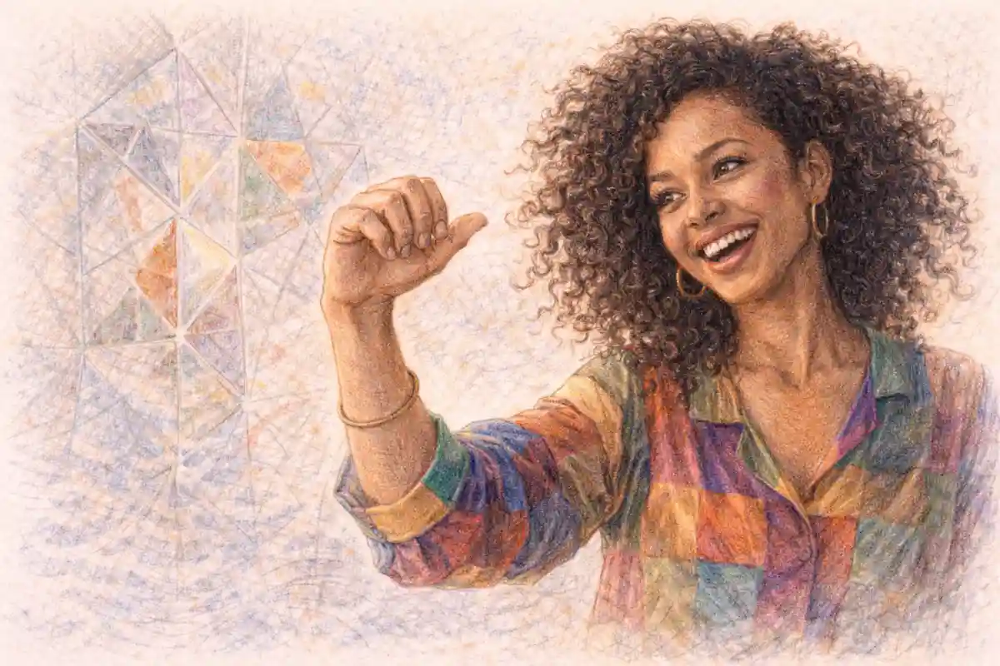

West Side Story is the most consequential thing that ever happened to Romeo and Juliet on an American stage, and it is not a production of the play at all. It is a transformation. When the musical opened at the Winter Garden Theatre on 26 September 1957, with a book by Arthur Laurents, music by Leonard Bernstein, lyrics by Stephen Sondheim, and conception, direction, and choreography by Jerome Robbins, it took the tragedy apart at the joints and rebuilt it inside a different art form, on a different continent, in a different century's idiom. Two households became two street gangs. A masked ball became a dance at a gym. A friar became a drugstore owner. A balcony became a fire escape. And at the climax the adaptation committed its boldest act of editing: it refused the double death. Tony dies. Maria lives, picks up the gun, and indicts both gangs to their faces. That single change is the musical's thesis, and this article's verdict follows from it. The 1957 West Side Story is not the play abridged or the play illustrated. It is the play answered. What it keeps is not the plot, which it alters at the most sacred point, but the engine: the speed, the symmetry, the compression of a love affair into a few days, and a civic order that arrives, as the Prince arrives in Verona, always one corpse too late.

The verdict needs its evidence laid out in order, because the show's reputation has been carried so far by its film, its school productions, and its cast album that the 1957 stage production itself is often praised for the wrong things or blamed for things it did not do. The original production ran 732 performances, a strong run for its season and no phenomenon. It was nominated for six Tony Awards and won two, losing Best Musical to The Music Man. Its first reviewers were excited, divided, and in several cases startled rather than reverent. Its creators finished the process barely on speaking terms with its director. Its book was accused then and since of melodrama, its Puerto Rican characters of being imagined from outside, its lyrics of cleverness beyond their speakers. All of that belongs in the record, and this article enters all of it. What the record also shows is a work of unusual structural intelligence, in which the adaptation of Shakespeare is carried not by reverence but by substitution: every element of the tragedy is replaced by a functional equivalent in the new medium, and the equivalents interlock. Dance does the work of the sword fight. The tritone does the work of the stars. A failed errand does the work of an undelivered letter. And a surviving heroine does the work of the Prince's closing judgment, which the musical gives to the victim instead of the magistrate. That is the argument. The pages that follow test it against the genesis, the tryouts, the opening, the score, and the critics.

## What Is the InsightCrunch West Side Map, and What Does It Show?

The fastest way to see what the musical does to the play is to set the two structures side by side, element by element, and mark not only what survives but what the surviving piece is for. The InsightCrunch West Side map does exactly that. It is built from Laurents' published libretto, the Bernstein score as recorded by the original cast and printed in the vocal score, and the play in the Oxford Shakespeare edited by Jill L. Levenson, cited throughout this article by act, scene, and line. Read down the columns and a pattern emerges that no summary conveys: the musical almost never copies a Shakespearean device when it can replace it with a working equivalent. The feud's groundlessness is preserved by making the gangs fight over turf neither owns. The lovers' speed is preserved by compressing the action into roughly two days. The play's machinery of accident, the quarantine that stops Friar John's letter in 5.2, is preserved by making the message fail through malice and violence rather than plague. And the final judgment, which Shakespeare gives to Prince Escalus standing over three bodies, is preserved by giving it to Maria standing over one.

| Element | In Romeo and Juliet | In West Side Story (1957) | What the substitution does |
| --- | --- | --- | --- |
| The feuding parties | The houses of Capulet and Montague, "both alike in dignity" (Prologue) | The Jets and the Sharks, gangs of the Upper West Side | Turns inherited family hatred into territorial and ethnic hatred among the landless |
| The Chorus | A sonnet that foretells the ending (Prologue) | Bernstein's wordless instrumental Prologue, a danced overture of the feud | Gives the foreknowledge to the orchestra and the body instead of the voice |
| The Prince | Escalus, who threatens death for further brawling (1.1) | Lieutenant Schrank and Officer Krupke, policemen without authority over the boys | Shrinks civic power from a prince's edict to a patrolman's frustration |
| The ball | The Capulet feast, where Romeo first sees Juliet (1.5) | The dance at the gym, neutral ground arranged by the settlement worker Glad Hand | Makes the meeting place a failed experiment in supervised peace |
| The balcony | Juliet above, Romeo below, in the Capulet orchard (2.2) | The fire escape outside Maria's tenement window | Moves the lovers' elevation from a garden wall to the architecture of poverty |
| The go-between | The Nurse, Juliet's confidante and messenger | Anita, Bernardo's girlfriend and Maria's confidante | Keeps the confidante but gives her a lover of her own to lose |
| The adviser | Friar Laurence, who marries the lovers and plots the potion (2.3, 2.6) | Doc, the drugstore owner who employs Tony and shelters the Jets | Moves counsel from the church to the shop counter, and strips it of any plan that works |
| The friend | Mercutio, killed by Tybalt under Romeo's arm (3.1) | Riff, leader of the Jets, killed by Bernardo at the rumble | Converts the duel's accident into a gang fight's escalation |
| The rival | Tybalt, the play's agent of the feud's honour code (1.5, 3.1) | Bernardo, leader of the Sharks and Maria's brother | Fuses Tybalt's function with a brother's protectiveness, doubling the cost of his death |
| The suitor | Paris, the County preferred by Capulet, killed at the tomb (5.3) | Chino, the Shark Maria is expected to marry, who shoots Tony | Transfers Paris's death at the tomb into Tony's death by Paris's counterpart |
| The marriage | A secret wedding in the Friar's cell (2.6) | A mock ceremony among the dress forms of the bridal shop, "One Hand, One Heart" | Lets the lovers marry themselves, with no institution willing to do it |
| The failed message | Friar John's undelivered letter (5.2) | Anita's errand to Doc's drugstore, destroyed by the Jets' assault and her answering lie | Replaces plague and chance with cruelty as the agent of the catastrophe |
| The ending | Both lovers dead; the fathers reconciled over the bodies (5.3) | Tony dead; Maria alive, refusing the gun, indicting both gangs | Moves the tragedy's weight from the lovers' deaths to the survivor's judgment |
| The last word | The Prince: "All are punished" (5.3) | Maria: both gangs, not bullets, killed Tony, spoken over his body | Hands the verdict from the magistrate to the bereaved |

Two features of the map deserve emphasis before the history begins, because they govern everything this article concludes. The first is that almost every substitution lowers the social altitude while raising the pressure. Verona's great houses become boys who own nothing, not even the streets they fight for, since the neighborhood around them was being demolished for the Lincoln Center development even as the show played. The play's lovers are heirs; the musical's are a shop assistant and a delivery boy. Shakespeare's catastrophe ruins two dynasties. Bernstein's ruins nothing that the city valued, which is precisely the musical's bleak point: three boys die in a place the audience's own city had already written off. The second feature is that the substitutions are structural, not decorative. A fire escape is not a balcony with worse scenery. It changes what the scene can mean, because an escape is built for leaving. The whole musical is in that piece of ironwork: a structure meant for emergencies, climbed by a boy with no other way up, in a building with no garden. Critics who treat the show as the play in modern dress miss the mechanism. The dress is the argument.

## East Side Story: The Romeo and Juliet That Nearly Was

The musical began, as the play begins, with a piece of casting. In 1948 the actor Montgomery Clift was preparing to play Romeo and asked his friend Jerome Robbins, then a young choreographer with Fancy Free and On the Town behind him, how a modern actor should approach the part. Robbins' answer grew into a proposal: the play should be done as a contemporary story, its lovers drawn from the groups actually fighting in American streets. In January 1949 Robbins brought the idea to Leonard Bernstein and Arthur Laurents. Bernstein's own log of the conception, preserved among his papers and quoted by his biographers, describes Jerry's call and the scheme in one breath: an East Side version of the tragedy, the feuding parties Catholics and Jews, the season Passover and Easter, feelings in the streets running high, with a certain amount of slugging and bloodletting. The title was East Side Story. The Catholic gang held the name the final show kept, the Jets. The Jewish gang was to be the Emeralds, a name that survives in the finished libretto exactly once, as a gang the Jets have beaten before the curtain rises.

Laurents wrote drafts. The Juliet figure of those drafts was a Jewish girl, in some versions a survivor of the Holocaust newly arrived from Israel; the Romeo was an Italian Catholic boy of the Lower East Side. The collaborators then did the most consequential thing in the show's long gestation: they stopped. Laurents judged that the material had gone stale in their hands, that a Jewish Catholic romance of the tenements had been done to death by Abie's Irish Rose and its imitators, and that the East Side they remembered was vanishing under them. The project slept for roughly six years. Bernstein conducted, Laurents wrote plays and screenplays, Robbins choreographed, and the tragedy waited for its city to change. The dormancy matters to the finished work's quality, because the show that eventually opened is the record of two different Americas laid one over the other: the 1949 city of religious tenement feuds, and the 1955 city of migration, juvenile delinquency headlines, and gang warfare as a newspaper beat. The musical's final form kept the first city's structure and filled it with the second city's people.

The waking came in Hollywood in 1955. Laurents and Bernstein were both in California, and they met, by Bernstein's pool at the Beverly Wilshire in the usual telling, over newspapers carrying stories of Chicano gang fighting in Los Angeles. Bernstein proposed moving the story west and making the gangs Mexican and Anglo. Laurents resisted: he did not know Los Angeles or its Mexican community well enough to write them, and he did know New York. Puerto Rican migration to New York was then at its height, the newspapers were full of the city's Puerto Rican neighborhoods and their youth gangs, and Robbins, brought back into the project, was excited by the score's Latin possibilities. The story came home to Manhattan and climbed from the Lower East Side to the Upper West Side. Anton, the Catholic boy of the drafts, became Tony, of Polish descent, a founder of the Jets who has left the gang and taken a job. The Jewish girl became Maria, newly arrived from Puerto Rico, working in a bridal shop, promised in her family's expectation to Chino. In the space of that one revision the show found its subject. The feud was no longer about theology, which 1950s Broadway could only treat as costume. It was about arrival: the newest New Yorkers against the nearly new, fighting over streets that belonged to neither.

### Did the Six-Year Sleep Improve the Idea, or Merely Date It?

The sleep improved it, and the proof is in what the delay forced the authors to discard. The 1949 scheme was an allegory of tolerance between two established immigrant religions, a subject Broadway had sentimentalized. The 1955 scheme was a report from the newspapers, about a migration in progress and a violence the city had not learned to narrate.

Delay also matured the team: Bernstein returned with Candide's failure ahead of him and a sharper sense of the theatre, and Laurents returned knowing exactly which of his drafts had died of familiarity. A show about last decade's feud would have been a period piece at birth. The delay made it a dispatch.

Stephen Sondheim entered after the transformation, and his entry records how accidental the team's completeness was. Laurents knew the young lyricist and proposed him; Sondheim, who wanted to write music and lyrics both, went to his mentor Oscar Hammerstein II with the dilemma, and Hammerstein advised him to take the job for the experience of working with masters on a serious piece. Bernstein had first intended to write his own lyrics, as he had partly done before, and concluded during the work that the double load was beyond one pair of hands; the score's comedy numbers in particular wanted a verbal craftsman. Sondheim was twenty-five when he joined and twenty-seven at the opening, a Broadway debutant flanked by three famous men, and the imbalance of fame inside the team left marks on the show's credit lines and its later history. It also left the show with the exact lyricist it needed: a rhymer of ferocious precision who would spend later decades apologizing for having been too precise for his characters, in a score whose central tension is between the poetry the lovers reach for and the street they actually live on.

## Four Authors and a Score That Wanted to Be an Opera

The collaboration that produced the 1957 production is usually described as a golden team, and the description conceals the friction that made the work hard. Bernstein wanted the material treated operatically; he had to be argued down toward what Robbins and Laurents called lyric theatre, a form in which song, dance, and scene would be continuous but the spoken book would remain a play. His annotated copy of Romeo and Juliet, preserved in the Leonard Bernstein Collection at the Library of Congress, shows a composer reading the tragedy as a structure to be re-engineered, its scenes inventoried for their functions. Laurents wrote a book of famous economy, short scenes and shorter speeches, stripping the play's rhetoric so that music and movement could occupy the space the words vacated. Robbins conceived the production as a single organism in which dance was not ornament but narrative: the feud is introduced in a danced Prologue before a word is sung, the rumble is a ballet that kills two men, and the lovers' one stolen hour together is staged as a dream of the world they want, inside Maria's bedroom, and dissolved by a knock at the door. Sondheim supplied the verbal surface, slangy, funny, and periodically breaking into a lyricism the characters could not sustain in speech.

### Did the Four Creators Get On, and Does It Matter That They Did Not?

They did not, and by the opening several of them were not speaking to Robbins at all, a fact recorded by the participants themselves and by every production history since. Robbins used his "conceived by" credit as a warrant for unilateral decisions and drove the young cast with a discipline that bordered on the punitive.

The estrangement matters because it corrects the sentimental picture of the show's making, and because the show bears Robbins' centralizing will in its bones: no production since has escaped his choreography, which remains licensed with the work itself, so that the director's hand is still on every revival's throat. Harmony is not a theatrical virtue. This score was written by men arguing about what it should be, and the argument is audible in its range.

The quarrels had specific artistic stakes, and the article's later verdict depends on two of them. The first was the ending. Laurents' book departs from the play at the climax: Maria does not die. Bernstein, by several accounts, probed whether the double death should stand, and the operatic instinct in him pulled toward the tomb. Laurents held his ground on grounds of dramatic logic that this article examines at length further on: a Maria who killed herself would repeat Juliet rather than answer her, and the musical's subject was not two children destroyed by fate but a street destroyed by hatred, which required a survivor to say so. The second quarrel was verbal. Sondheim's lyrics were charged, by reviewers and privately within the team, with cleverness out of character, most famously in "I Feel Pretty," where Maria, days off the boat in the fiction and working in a shop, sings in polished internal rhymes. Sondheim's own later judgment, in Finishing the Hat, is the harshest on record: he wrote that he had blushed for the song ever since, that a girl in Maria's position would not think in such rhymes, and that his young self had been showing off. Bernstein did not share the shame, and the song stayed. Both quarrels are the same quarrel, really. The show keeps reaching for a poetry its world cannot hold, and the reaching is either its glory or its fraudulence. The 1957 critics split on exactly that line, and the split has never closed.

Musically, the score is built like the feud. Bernstein found the show's generative interval in the tritone, the augmented fourth that older theory called the devil in music and that opens the melody of "Maria": three syllable-long reaches across an interval that refuses to settle, restated through the score in "Cool," in the rumble music, in the "Tonight" ensemble, so that the harmony itself never sits at rest in a home key while the gangs are on stage. The "Somewhere" music, by contrast, is diatonic, open, hymnlike, the sound of a key the characters can imagine but not inhabit. Around that axis Bernstein organized an astonishing stylistic range: the cool-jazz fugue of "Cool," the mambo and cha-cha of the gym dance, the parody operetta of "Gee, Officer Krupke," which lifts its music from the Venice scene of Candide, the bridal simplicity of "One Hand, One Heart," which had been written for Cunégonde in Candide and cut, and the five-voiced "Tonight" quintet, in which lovers and gangs sing the same word toward opposite nights. A word on that quintet belongs to the map's logic: Shakespeare's lovers and fighters never share a stanza. Bernstein makes them share a chord, and the audience hears the tragedy's two engines, desire and hatred, drawing on one harmony. Nothing in the 1957 season sounded like it, because nothing in the American musical had been composed as a single dramatic organism at this level of ambition since Porgy and Bess, the comparison Bernstein courted and feared in equal measure.

## The Numbers Are the Scenes: How the Score Thinks

The score's architecture repays a walk through its stations, because each number performs a scene of the play in the musical's own grammar, and the substitutions hold even where no plot parallel is obvious. The "Jet Song" is the feud's self-portrait, a dynastic anthem sung by boys whose dynasty is a street corner, and Sondheim's lyric is built like a catechism: call and response, doctrine and oath, the gang defining itself to itself. Shakespeare gives the feud's code to Sampson and Gregory's opening quibbles and to the Prince's edict; the musical gives it to a recruitment song, because a gang, unlike a house, must keep recruiting. The dance at the gym then stages the feud's two cultures against each other in pure rhythm, mambo against jive, before Glad Hand's party games attempt to mix the couples and fail. Robbins' structure there is the Capulet ball inverted: Shakespeare's feast brings the lovers together inside the enemy's house; the gym, neutral ground policed by a social worker, brings them together inside an institution's failure, and the failure is the host's, not the house's.

"Cool" and "Gee, Officer Krupke" are the score's paired essays on authority, one for each act's temperature. "Cool" belongs to the first act's descent toward the rumble and is set as a fugue, the most rule-bound of musical forms, sung by boys exhorting themselves to rules they are about to break; the counterpoint is the discipline, and the audience hears it fray. "Krupke," placed after the rumble in the second act, is the musical's most Shakespearean piece of construction, and the parallel is structural rather than thematic. Shakespeare, having killed Mercutio and Tybalt, gives the stunned tragedy the musicians' scene and Peter's clowning over Juliet's supposed corpse (4.5), a release of the audience's breath at the story's darkest hinge. Laurents and Bernstein, having killed Riff and Bernardo, give the Jets a vaudeville routine in a warehouse, a mock trial of the social worker, the judge, the psychiatrist, and the system that processes boys like them, ending in an obscenity directed at the policeman. The laugh is in the same place for the same reason, and it is just as cold. The number that follows, Anita's and Maria's "A Boy Like That" and "I Have a Love," then performs the play's 3.5 confrontation with the confidante, Anita berating Maria for loving her brother's killer as the Nurse berates Juliet's disloyalty to Paris, and Maria answering in a crescendo that is Juliet's defiance made song: the girl who was to be managed announces that love has re-founded her allegiance, and the older woman, hearing it, capitulates and joins the conspiracy. That capitulation is the musical's quietest fidelity. The Nurse's surrender in the play is corrupt and practical; Anita's is an act of recognition, one woman hearing another's sentence and knowing it for her own.

The "Tonight" quintet, already noted for its shared harmony, deserves its full structural credit as the first act's keystone. Five parties sing the approaching night in five incompatible meanings: Tony and Maria toward the bridal shop's aftermath and the fire escape, Riff and the Jets toward the war council, Bernardo and the Sharks toward the rumble, Anita toward an evening of her own desire. Shakespeare compresses his converging lines of plot with messengers and soliloquies; the musical compresses them into counterpoint, so that the audience holds the tragedy's whole mechanism in a single musical moment, every party singing the same word at cross purposes. It is the moment the form justifies itself most completely, the thing no spoken production can do at any price, and it was achieved with material whose lyrical surface is almost bare: tonight, tonight, the world is full of light. The poverty of the words is the point. Everyone in the scene means something different by the same syllables, which is the feud's definition.

It remains to note what the score refuses to do. There is no potion music, no tomb scene, no resurrection feint, because the book has deleted the play's entire machinery of feigned death, and the deletion is total: Maria never plans, never drinks, never wakes. The catastrophe of the musical is informational and moral only, a lie and a gun, and the score's final pages answer with the "Somewhere" theme returning in the procession, the dream's music carried at the last by an orchestra over a real corpse. Bernstein's restraint in those bars, the hymn without its words, is the score's verdict on its own dream: the place for us exists, and it is a funeral's music. A composer of less discipline would have underscored Maria's speech. The speech is spoken, dry, in a playground's silence, and the dryness is Laurents' and Bernstein's shared judgment on where the work's poetry has to stop.

## A Producer Walks Out, and Two Young Men Say Yes

By the spring of 1957 the show had a book, a score in progress, a director of genius, and no future. Cheryl Crawford, the distinguished producer who had taken the property on, concluded after a failed backers' audition that the money could not be raised for so dark a piece: a musical comedy in which the first act ended with two young men dead on a playground was not what backers bought. In the spring of 1957, some two months before rehearsals were to begin, she withdrew. Every other established producer had already declined the property on the same grounds. The team's despair is documented in their own recollections, and into it stepped the youngest man in the story. Sondheim telephoned his friend Harold Prince, then in Boston nursing George Abbott's New Girl in Town through its tryout. Prince and his partner Robert E. Griffith flew to New York, sat in Bernstein's apartment while Bernstein and Sondheim played and sang the score, and committed on the spot. Prince's recollection of the audition, repeated in his memoir Contradictions and in the production histories, is that halfway through he found himself singing along, and that at the end he and Griffith looked at each other and said, without hesitation, that they would do it.

The detail that redeems the anecdote from show-business mythology is the advice Prince had taken first. He consulted George Abbott, his mentor and the commercial theatre's reigning sage, and Abbott told him to refuse the show. Prince, twenty-nine years old, overruled the most successful judgment on Broadway because of what he had heard at a piano. Griffith and Prince then produced the piece with notable economy and one act of managerial courage: they met Robbins' demand for an extended dance rehearsal period, which doubled the normal preparation for a musical, by trimming elsewhere, and they protected the production's darkness through a tryout period in which kinder men would have demanded a happier show. Laurents, meanwhile, performed the era's neatest piece of producer management in reverse. Told that West Side Story was a bad title, he fed a columnist the joke title "Gang Way!" as a working name, a piece of misdirection the New York Times solemnly printed in a season preview that June. The show kept the title its detractors disliked, and the joke survives only as evidence that the production's troubles were public property before it opened.

### Why Did Cheryl Crawford Walk Away, and Was She Wrong?

She walked away because a backers' audition failed, which in 1957 was not timidity but arithmetic: money for Broadway musicals was raised by playing the score to rich people in living rooms, and rich people in living rooms did not invest in gang killings.

She was wrong about the work and right about the risk. The show she abandoned returned its investment only slowly, through touring and the London production and the cast album, and its canonization was substantially the film's doing. Crawford misread the score's quality; she read the market exactly. The musical's survival required producers young enough to be wrong in the opposite direction, and it got them.

## Rehearsing a Feud: Robbins' Method and Its Price

Robbins rehearsed the company as two hostile nations. The actors playing Jets and Sharks were kept apart offstage, issued separate calls where the staging allowed, and encouraged to carry their gang identities through the working day. The rehearsal room walls carried newspaper clippings of actual gang violence, an ambient archive of the thing being imitated. The method produced the desired electricity and the desired injuries: the company was young, largely unknown, cast for dance as much as for voice, and Robbins drove it through an eight-week rehearsal period at a standard of physical exactitude that several cast members' memoirs describe in terms closer to athletics or military training than to the musical comedy stage. Carol Lawrence, the Maria, was twenty-four at the opening, a veteran of touring and nightclub work cast after Bernstein's audition notes had doubted her ("not quite Maria," the notes read, before conceding the reality she brought with an accent). Larry Kert, the Tony, had first read for Bernardo and Riff; Bernstein's notes on him praised the singing and worried about the look. Chita Rivera, who created Anita, and Ken Le Roy, the Bernardo, and Mickey Calin, the Riff, were dancers before they were principals, which is the production's signature: for the first time in a major musical, the people who had to carry the drama were chosen from the chorus's world, where the body does the acting.

### Why Did Robbins Keep the Two Gangs Apart in Rehearsal?

Because his staging required a hatred the young cast did not naturally possess, and his whole method was environmental: separate rooms, separate loyalties, the newspapers on the wall, the eight weeks in which two companies could harden into two tribes.

It worked on stage, where the Prologue's territorial strut has a documentary ugliness under its polish, and it worked on the company, some of whose members carried real bruises and real resentments out of the Winter Garden. The method survives as a standard anecdote of directorial lore. In 1957 it was an imposition on unknown performers with no power to refuse, and the production's histories record both the result and the cost without flinching from either.

The price was paid in the creative team's cohesion. During the Washington tryout Robbins demanded and received the "conceived by" billing in its fullest sense, with an authority over the material that let him order changes without consultation, and the relationships cracked audibly. By opening night, on the testimony collected by the show's historians, the collaborators were not speaking to him. Bernstein's Washington log entry of 20 August 1957, often quoted, strikes the opposite note ("I guess what made it come out right is that we really collaborated; we were all writing the same show"), and the two witnesses can both be true: the work was collaborative in the writing and autocratic in the staging, and the men who had written the same show spent its first night in separate corners of the Winter Garden. The sequel is part of the record too. Robbins carried the production to London, supervised its early life, and was hired to co-direct the film, from which he was dismissed mid-shoot. The 1957 stage production, though, is the object this article judges, and on stage his authority produced the most unified piece of musical staging Broadway had seen: Atkinson's review would say of the result that everything in it was of a piece, which is what an autocracy of taste is for.

The production's visual argument matched its method, and Oliver Smith's scenery, which took the production's second Tony Award, deserves its paragraph in any honest account. Smith declined the picturesque. His Verona was a skeleton city: tenement facades suggested by fire-escape ironwork and flats that flew or tracked to open streets, a playground of chain-link and shadow, interiors that appeared as fragments inside the street's continuing pressure, the bridal shop's dummies glimpsed like a congregation of ghosts. The design kept the whole evening outdoors in effect, which is the play's own condition: Shakespeare's Verona is a city of streets, squares, and orchards, its interiors few and breached, and Smith recovered that exposure in tenement terms. Jean Rosenthal's lighting gave the ironwork its weather, hard white days for the feud, sodium gloom for the rumble under the highway, and a single dissolving warmth reserved for the lovers and spent by the dream ballet. Against Irene Sharaff's costumes, which separated the nations in line and palette at a glance, the stage picture taught the audience to read the feud visually within minutes, a necessity in a work whose plot moves at the speed of dance. Kerr's review reached for exactly this: the spider-web fire escapes, the shadowed trestles, the plain dirt battlegrounds. The critics saw the city before they heard the argument, which is how the city works on the people inside the story too.

## Washington and Philadelphia: The Tryout Repairs

The production opened out of town at the National Theatre in Washington on 19 August 1957, played two weeks, and moved to the Erlanger Theatre in Philadelphia for a further engagement before New York. The tryout did what tryouts exist to do, and its repair list is a small history of the show's final shape. Tony, the least sung of the principals, lacked a defining song in the first act; during the Washington engagement Bernstein and Sondheim built him "Something's Coming" out of a line of Laurents' dialogue, Tony's own prophecy that something was on its way, whistling down the river, twitching at the dance. The song was composed, orchestrated, and inserted in days, and it solved the evening's structural limp by giving the audience Tony's hope in his own voice before the gym dance gave him Maria. Other adjustments ran the usual gamut of cuts and restorations, and the song-switching of the tryout period is documented in Sondheim's own catalogue of the score, which lists numbers written, dropped, and briefly substituted, including a Jet song, "This Turf Is Ours," that held the "Jet Song" slot only temporarily out of town. The finished New York score contains two distinguished refugees from Candide, heard earlier in this article: "One Hand, One Heart," written for Cunégonde and cut from that score, and the music of "Gee, Officer Krupke," salvaged from Candide's Venice scene. Recycling of this order is not poverty; it is a composer recognizing that two of his best tunes had been premiered inside a failure and deserved a working home.

Washington's notices were warm, Philadelphia's encouraging, and the company reached New York with the wind behind it and its director's authority newly enlarged. What the tryouts could not repair, because it was not a defect, was the show's refusal to comfort. The first act ends with two corpses under a highway. The second act opens with the heroine singing her happiness to girls who do not know, proceeds through a comic number about a corrupt court system, a rape in all but stage direction at a drugstore counter, and closes with a third corpse carried out by children. Griffith and Prince held their nerve through both tryout cities, and the notices rewarded the darkness with respect more than affection, a pattern the New York opening would repeat at higher stakes.

### What Changed Between Washington and Broadway?

Three things, in descending order of importance. Tony acquired "Something's Coming," which converted him from a plot function into a consciousness and gave the first act its arc of expectation. The director acquired contractual supremacy through the "conceived by" arrangement, which froze the show's staging into permanent form.

And the production acquired confidence: the tryout audiences had stayed through the rumble and the taunting scene without the walkouts the team feared, and a show that might have been softened in September arrived at the Winter Garden with its teeth in.

## Opening Night: The Winter Garden, Little Rock, and the Divided Notices

The musical opened on Thursday, 26 September 1957, in a country otherwise occupied. The day before, in Little Rock, Arkansas, nine Black schoolchildren had entered Central High School under the protection of the 101st Airborne Division, sent by President Eisenhower to enforce a federal court's desegregation order against a governor's defiance. No review of West Side Story mentioned Little Rock; newspaper columns were kept in separate compartments then. But the coincidence belongs to the opening's meaning, and honest history enters it: the first Broadway audience for a musical about American boys killing each other over inherited hatreds, and about the newest arrivals being met with knives, assembled the night after the United States Army escorted children through a mob to school. The show was not about the South and was not about desegregation, and its creators, three Jewish New Yorkers and the son of Ukrainian Jewish immigrants, would have resisted the allegory made simple. It was, however, a work about whether America could hold its tribes in one city, staged at the exact hour that question was being answered by paratroopers in Arkansas. Atkinson's audience heard the show's opening bars over that day's headlines, whether or not they said so.

The production arrived with its subject already argued over in public, which shaped what the first audience thought it was seeing. Juvenile delinquency had been the decade's standing panic: Senate hearings under Estes Kefauver in the middle fifties had made the teenage gang a national emblem, comic books and switchblade ordinances filled the columns the show's creators had read in Hollywood, and the newspapers' gang stories were written in a tone of anthropology and alarm. Laurents himself entered the argument before the opening, publishing a long account of the work's growth in the New York Times at the start of August 1957, while the company was still in rehearsal, an unusual act of self-framing that told the town the piece was to be received as a serious treatment of its subject and not as a musical comedy with knives. The gambit worked and cost something. Reviewers came primed for significance, and several judged the evening against the claim, finding the sociology thinner than the staging. A show that announces itself as a statement invites its critics to grade the statement. A show that announces itself as entertainment invites them to grade the pleasure. West Side Story, uniquely in its season, was graded on both scales at once, by different critics on different mornings, and the split in its reputation that lasted decades begins in that double marking.

The notices the next morning set the pattern of the show's reputation for years: rapture for the staging and the score, respect for the ambition, reserve about the book and about whether so much technique had been lavished on so melodramatic a frame. Walter Kerr, in the New York Herald Tribune, wrote the review that entered history. "The radioactive fallout from West Side Story must still be descending on Broadway this morning," he began, and went on to describe Robbins as having "put together, and then blasted apart, the most savage, restless, electrifying dance patterns we've been exposed to in a dozen seasons." Kerr was no pushover: he found the show in general not well sung and its acting rushed, and his praise concentrated where the production's novelty lay, in movement as narrative. Brooks Atkinson, in the New York Times, delivered the judgment that John Mauceri, conducting the score decades later, rightly calls the sum of the work: "Everything in West Side Story is of a piece. Everything contributes to the total impression of wildness, ecstasy and anguish." Atkinson also wrote the sentence that best holds the show's emotional paradox, calling it "a profoundly moving show that is as ugly as the city jungles and also pathetic, tender and forgiving." John Chapman of the Daily News headlined his notice "West Side Story a splendid and super-modern musical drama." Time, coolest of the national voices, conceded that by "putting choreography foremost," the production "may prove a milestone in musical-drama history." The pattern is legible: the dailies praised a theatrical event, and hedged on a drama.

The hedges deserve their due, because this article's verdict must survive them. The book's plotting is engineered rather than grown: Maria falls in love in a look across a gym, Tony kills within a day of repenting violence, and the machinery of the missed message creaks in Laurents' drugstore as it creaks, differently, in Shakespeare's Mantua road. Reviewers who found the lovers thin were not wrong about the dialogue, which is deliberately starved. The defense, and it is the defense this article adopts, is that thinness of dialogue is the show's stated method: Laurents wrote a libretto that hands every large emotion to music or movement at the moment speech would falsify it, so that judging the book by its lines is like judging the play by its stage directions. Whether the method excuses the thinness is the live critical question, and it is adjudicated in the verdict section below.

### Did the First Audiences Think They Were Watching a Classic?

No, and the evidence is the run itself. A recognized classic of the American stage in that era ran for years: My Fair Lady, the previous season's colossus, was still packing the Mark Hellinger. West Side Story played 732 performances, toured profitably, and closed on 27 June 1959 with its reputation high and its canonicity unsettled.

That is the sort of success professionals call distinguished. The classic was assembled afterward, out of the London run, the cast album's long life, and above all the film. The 1957 production is better served by accuracy here: it was a succès d'estime that made money, not a coronation.

## The Run, the Album, London, and the Night The Music Man Won

The production's material afterlife inside its own medium was considerable. Columbia recorded the original cast in the days following the opening, and the album, with Kert's ardent Tony, Lawrence's Maria, and Rivera's white-hot Anita, carried the score into homes and schools where the staging could not travel; Bernstein later drew the Symphonic Dances from the score for the concert hall, which is where many listeners first met the rumble; he conducted their premiere with the New York Philharmonic in February 1961, arranging the dances in the show's own order of escalation, from the Prologue's strut through the rumble to the procession, so that the suite performs the tragedy's shape without a word sung. He returned to the score once more in 1984, conducting a studio recording with operatic voices, Kiri Te Kanawa and José Carreras among them, a document of the composer's own long ambivalence about where his theatre piece belonged: the opera house had been his first instinct in 1949, and the recording, much debated, stands as the instinct's last word against the street casting of 1957. The debate the recording provoked merely restated the production's founding quarrel, between the work as lyric theatre and the work as opera, with the composer himself changing sides across the decades. The national tour took Robbins' staging across the country. The London production opened at Her Majesty's Theatre on 12 December 1958 with Don McKay as Tony, Marlys Watters as Maria, Rivera repeating her Anita, and George Chakiris, later the film's Bernardo, as Riff; it ran 1,039 performances, longer than the Broadway original, and established the pattern by which the show's fame would grow abroad faster than at home. The Broadway production itself returned to the Winter Garden in April 1960 after its tour for a further engagement, a homecoming that confirmed the show as repertory rather than novelty. Each of these afterlives belongs to Articles beyond this one only in their film forms; the stage work's own history is this article's, and its shape is clear. Slow canonization through performance, recording, and export, not overnight enthronement.

The Tony Awards of April 1958 delivered the era's own judgment in its bluntest form. The production received six nominations: Best Musical, Carol Lawrence as supporting actress (a category assignment that has puzzled historians since, since Maria is the female lead), Irene Sharaff's costumes, Max Goberman's musical direction, Oliver Smith's scenic design, and Robbins' choreography. It won two: choreography and scenic design, the two awards that honor the show's staging body. Best Musical went to Meredith Willson's The Music Man, which had opened the previous December and offered the season's other Broadway: a wholesome, intricate, brilliantly crafted celebration of small-town America and a con man reformed by love. The loss is usually narrated as philistinism, and the narration is lazy.

### Why Did The Music Man Beat West Side Story for Best Musical?

Because the Tony electorate of 1958 was rewarding the show that perfected the musical comedy they knew over the show that proposed a different art, and because The Music Man is genuinely superb at its own game: Willson's score is as formally ingenious as Bernstein's, in a dialect the voters spoke natively.

Timing mattered too. West Side Story had opened in the fall to divided notices; The Music Man opened in December to something nearer rapture and was the fresher memory at voting time. The voters honored Robbins' dancing and Smith's sets, the parts of the challenger they could not deny, and gave the crown to the incumbent form. History has since reversed the ranking without invalidating the vote: the two shows are the twin peaks of their season, and 1958 is remembered for the contest precisely because both were formidable.

## From Houses to Gangs: What the Feud Becomes

Shakespeare's feud has no cause. The Prologue calls it an "ancient grudge," and the play never explains it, a design this series has examined in its study of [the feud itself: why the Capulets and Montagues hate](/2022/04/01/capulet-montague-feud-explained/). The hatred in Verona is inherited, contentless, and therefore universal: any group can pour its own grievance into the empty vessel. Laurents' great decision was to fill the vessel, and filling it changed the tragedy's physics. The Jets and Sharks do not hate each other for nothing. They hate over turf, over the policing of their streets, over the insults of arrival and precedence, over who was here first and who is newest, and beneath all of it over ethnicity, the native-born sons of immigrants against the immigrants of yesterday. A feud with causes can in principle be negotiated, and the musical keeps showing negotiation failing in small rooms: Schrank's threats, Glad Hand's gym dance rules, Doc's pleading, Tony's attempted peace at the rumble. Shakespeare's Verona cannot negotiate because nobody remembers the terms. Bernstein's New York cannot negotiate because everybody knows the terms and the terms are the neighborhood itself, a few blocks of condemned tenements that the city was already erasing. The substitution sharpens the tragedy in one direction and blunts it in another. It sharpens the social indictment: this catastrophe has authors and addresses. It blunts the metaphysical chill of the play, where the feud's emptiness is the point, where the stars, not the census, are blamed.

The gangs also solve a casting problem Shakespeare never had. The play's houses are dynasties with servants, kinsmen, and a prince above them; their violence is a civil war of the propertied, which is why this series' reading of [two households: power and class in Verona](/2022/04/22/two-households-class-power-verona/) stresses what the lovers stand to inherit and renounce. The gangs inherit nothing. Riff and Bernardo command perhaps a dozen boys each, a stretch of pavement, and a reputation; their grandeur is pure theater of the powerless, and the musical knows it, giving Riff the "Jet Song" as a parody of dynastic pride: when a boy is a Jet, the lyric runs, he is a Jet all the way, from his first cigarette to his last dying day. The parody is affectionate and exact. Gang membership supplies what the houses supplied in Verona: a name, a family, a history, an enemy, and a code, everything except property and a future. Anybodys, the girl who haunts the Jets begging to be one of them, is the feud's purest product, a child whose whole ambition is to belong to the machine that will waste her; the play has no equivalent figure, because Verona's machine had room for everyone born into it.

What the substitution costs, the criticism has named from the beginning, and this article registers the cost without flinching. The Puerto Ricans of the 1957 production were substantially imagined by four men who were not Puerto Rican, and played in part by performers who were not either, Rivera honourably excepted on her father's side. The island itself objected early: before the opening, Puerto Rican voices in New York and on the island were protesting a lyric in "America" that rhymed the island of tropical breezes with an island of tropic diseases, and the Times gave column space to a physician's rebuttal calling the rhyme a blow below the belt. The finished stage text of "America" is Anita's argument for the mainland against Rosalia's homesickness, a debate inside the immigrant community that the later film reassigned to men and women together; but the song's jokes land from outside as often as from inside, and later Puerto Rican critics, most searchingly Frances Negrón-Muntaner in her essay on the show's Puerto Rican meanings, have argued that the musical loves its Sharks at a distance, as rhythm and color, while centering its sympathy in the Jets' side of the street. The charge has force, and the verdict section weighs it. For the structural question of this section, though, the substitution stands as the adaptation's masterstroke. It found, in 1957's headlines, the one American conflict that reproduced Verona's geometry exactly: symmetry. Two groups alike in dignity and in nothing else, divided by ancestry, armed by adolescence, and governed by adults whose authority had already failed.

## Tony and Maria: Two Unknowns at the Center

Casting carried the argument. Robbins and Bernstein declined stars. The Winter Garden's Tony and Maria were a singer who had read for the villains and an actress the composer had doubted, and the production's emotional bet was placed on freshness: the audience was to meet the lovers as the lovers meet each other, without a famous face between. Kert's Tony is the harder achievement to describe because the part is written as a stillness inside a kinetic show. Tony has left the gang; his great solos, "Something's Coming" and "Maria," are sung by a boy standing still while the production's whole world dances, and Kert's tenor, ardent and slightly wondering, made the stillness read as depth rather than absence. The "Maria" is built on the score's tritone and on a lyric of radical plainness: the name repeated, counted, tasted, until Sondheim's text confesses that saying the name is the event. Against Romeo's rhetorical abundance the musical sets a boy with one word, and the word is enough, which is either the show's boldest economy or its neatest evasion of the play's poetry. This article's judgment is economy: the musical relocates eloquence to the orchestra, and Tony's simplicity is the honest measure of what a delivery boy's tongue can do with wonder.

Lawrence's Maria had the opposite assignment: to be the still point of the other nation. Maria arrives in the fiction days before the action; her English, her dress, her brother's guardianship all mark her as the newest person on the street, and Lawrence played her not as an innocent vapor but as a girl with a will, funny in the bridal shop, defiant in the bedroom scene after the rumble, and finally the only adult on the stage. The arc is Laurents' most undervalued construction. Juliet, between the balcony and the tomb, makes a series of decisions of escalating audacity, and Maria's arc reproduces that staircase exactly: the look at the gym, the fire escape, the mock wedding, the night with Tony after he has killed her brother, the sending of Anita, the gun in the final scene taken and not used. Critics who find Maria passive are reading the accent and the soprano, not the libretto. She is the only character in either work who ends the story holding a weapon and choosing not to fire it.

Two features of the lovers' translation repay attention before the scenes themselves. The first is time. Shakespeare compresses his action into some four days, Sunday to Thursday, a span editors have counted from the play's own references, and the compression is the tragedy's argument about speed: the Friar warns that violent delights have violent ends and that they stumble who run fast (2.6, 2.3), and the plot obeys him by outrunning every safeguard. Laurents compresses further, into roughly two days and nights, from the first evening's dance to the second night's shooting, and the musical marks the hours the way the play does, by appointments: the dance tonight, the war council, the rumble tomorrow, the meeting after dark. Romeo's impatience is constitutional; Tony's is circumstantial, a boy watching a clock the gangs have set. The second feature is age. Juliet is not yet fourteen, a fact the play insists on through her father's arithmetic (1.2), and her youth is the scandal the tragedy keeps citing. The musical never states Maria's age. She is old enough to work, to be promised to Chino, to have crossed an ocean in her family's migration, and the text's silence moves the scandal from her years to her obedience: what horrifies her house is not that she loves young but that she loves across. The substitution trades the play's queasiest pressure for a modern one, and whether the trade loses anything essential is a fair question for the classroom; the 1957 audience, at any rate, was spared the arithmetic and given the allegiance instead, and the allegiance is what Maria's final speech is made of.

Bernstein's audition notes, preserved with his annotated Shakespeare in the Library of Congress, let a reader watch these performances being found, and the documents repay assembly: the drafts of Laurents' book beside the notes, the correspondence beside the tryout programs, the whole paper trail of a classic assembled from doubt. It is the sort of dossier a researcher keeps in one private place, the way a working archive is kept in [VaultBook](https://vaultbook.net/) rather than scattered across a desk, and it demonstrates what the opening-night audience could not have known: that the production's most moving effects, the ardent unknowns at its center, were arrived at by elimination and second thoughts, not by anyone's first inspiration.

## The Balcony Becomes a Fire Escape

The lovers' scenes are the adaptation's glory, and their construction deserves close description, because they show the substitution method at its most intelligent. The meeting happens at the dance at the gym, a set piece in which Robbins stages the whole social order in motion: mamboing Sharks, jiving Jets, Glad Hand's doomed integration games, and then the famous suspension, the room's noise dropping away as Tony and Maria find each other across the floor and dance alone inside a light of their own. Shakespeare's lovers meet in a crowded hall too, and exchange a sonnet while touching palms ("If I profane with my unworthiest hand," 1.5). The musical keeps the structure, a shared formal unit inside a hostile crowd, and replaces the sonnet with choreography: the formality is in the steps, the privacy in the lighting, and the audience watches two bodies perform the exact grammar of the sonnet, approach, exchange, return, without a word of it. Then Maria is taken home by Bernardo, and Tony finds her building, and the orchard scene begins.

Verona gives Romeo a garden wall and Juliet a window above it, with the Nurse calling from within and dawn as the deadline. New York gives Tony a tenement fire escape, iron stairs zigzagging up a brick wall, and the scene Shakespeare wrote for 2.2 becomes "Tonight": Maria above on the landing, Tony below and then beside her, her white dress from the dance still on her, the city audible beneath the music. The substitution's intelligence is architectural. A balcony is an ornament of privilege, a place to display and be seen; a fire escape is an apparatus of emergency, hung on the building for flight from fire, and every audience member in 1957 knew what it was for. The lovers meet on the building's escape route, which is what their love is: an exit from the war, usable in a crisis, owned by neither of them, and open to the street. Sondheim's lyric for the scene is among his simplest, stars and minutes and the size of the night, and Bernstein sets it as a rising sequence that seems to climb the stairs it describes. Where the play's scene is a debate about names ("What's in a name? that which we call a rose," 2.2), the musical's is a debate about time: tonight, only tonight, the single word the whole score will worry for two acts, until the word comes back in the quintet as the name of the appointment with death.

The wedding that follows is the adaptation's most tender invention. The play marries its lovers in Friar Laurence's cell, in secret but in form, with the Church's authority and the Friar's plot both engaged ("These violent delights have violent ends," 2.6). New York has no cell and no friar; Doc would not and could not marry anyone. So Tony and Maria marry themselves in the bridal shop where Maria works, among the dressmaker's dummies, using the shop's veils and forms as congregation, and sing "One Hand, One Heart" over their joined hands. The scene is a sacrament performed by its recipients, and its theology is the musical's in miniature: every institution in this city has abdicated, the church, the police, the settlement house, the family, and the children are left to solemnize their own vows with props. That the song had been written for Candide's Cunégonde, a heroine of a satire, and lay in Bernstein's trunk until this shop needed it, is the sort of irony the theatre specializes in. The tune's innocence was intact; only its context had to grow up.

The second act's dream belongs in this sequence because it is the wedding's answer. After the rumble, Maria and Tony are together in her room, and the show suspends its realism for the "Somewhere" ballet: the walls dissolve, the dead walk reconciled, the gangs move in friendship, and a procession carries the lovers toward a country of light that the staging declines to locate. Robbins had built such dream ballets before, but here the device is load-bearing theology. Shakespeare's lovers have the Church's heaven and the Friar's assurances offstage. These lovers have only the dream the theatre itself can supply, and the ballet is carefully framed as a wish, not a vision: it ends, the walls return, Anita knocks, and the machinery of the ending starts to turn. A musical that believed its own dream would be a lie. This one stages the dream, prices it, and takes it away, which is why the final violence lands as it does.

## The Duel Becomes a Rumble: Dance as the Play's Violence

Act 3 Scene 1 of the play, the hinge on which the comedy of the first half breaks into tragedy, is a duel: Mercutio, fighting under Romeo's intervening arm, takes Tybalt's blade and dies cursing both houses ("A plague o' both your houses," 3.1), whereupon Romeo kills Tybalt and is banished. The musical's equivalent is the rumble, staged under a highway at nightfall as the climax of the first act, and it is the sequence on which the whole conception stands or falls. Robbins choreographs it as an escalation with rules that dissolve: the gangs arrive in formation, the agreed fair fight between Bernardo and the Jets' champion collapses when Tony intervenes to beg peace, Bernardo and Riff circle, the knives come out, Riff falls under Tony's restraining hands, and Tony, in the spasm Shakespeare gives Romeo ("O, I am fortune's fool" is the play's line for the moment after, 3.1), drives Riff's knife into Bernardo. The choreography does something the spoken theatre cannot: it shows violence as contagion moving through bodies trained to move together, so that the audience watches the dance vocabulary of the whole evening, the struts and snaps and lunges of the Prologue, curdle in real time into killing. The rumble is the Prologue with the safety off.

This is where the musical makes its contribution to the theme this series tracks under [masculinity and violence in Romeo and Juliet](/2024/02/16/masculinity-and-violence-analysis/): the conversion of honour into choreography. Verona's young men fight because their code of masculine worth requires answer to insult; the code is verbal before it is physical, and Mercutio dies of a quibble. The Jets and Sharks fight because their code is the gang itself, and Robbins discovered that a code of the body is best examined by bodies. "Cool," the number that precedes the rumble, is the code stated as music: Riff instructing his boys to hold the violence in check, a fugue of restraint sung by potential killers, in Kerr's phrase, with the tension stingingly graphic. The number is the musical's "be patient" speech, its Friar's counsel of moderation ("Wisely and slow; they stumble that run fast," 2.3), delivered by the gang's own leader in the gang's own idiom, and it fails exactly as the Friar's counsel fails, within the hour. What dance adds to the analysis is complicity. An audience that has thrilled to the Prologue's athleticism has been enjoying the violence all evening in its formal dress; the rumble sends the bill. No spoken production of the play can implicate its audience so efficiently, because no spoken production makes the fighting beautiful first.

The rumble has a council of war before it, and the council deserves the same scrutiny as the fight, because it is where the adaptation handles Shakespeare's machinery of failed peacemaking most openly. In the play, the peace attempts are the Prince's edict, Capulet's restraint of Tybalt at the feast, and the Friar's plan, each issued by an authority and each collapsing for want of obedience. In the musical the equivalent scene is a negotiation among children in Doc's drugstore and on the street: Schrank, the one adult with legal force, plays the gangs against each other with an ethnic candor that poisons his own mediation, offering the Jets police tolerance if they will let him manage the Sharks, and the boys correctly read the offer as corruption. Tony, the one figure both sides half-trust, brokers the compromise, a fair fight, champions only, fists only, and the compromise is genuine statesmanship by the street's standards. It fails not because anyone cheats but because Maria, exercising the only authority love gives her, upgrades the terms after they are set: stop it altogether. The chain of failure is therefore longer and sadder than the play's. Verona's peace fails at the level of command. New York's fails at every level in sequence, the policeman's corruption, the broker's partial success, the lover's impossible amendment, until the only negotiator left standing is Doc, whose entire diplomacy consists of the word enough, spoken to boys who have stopped hearing it in any adult's voice. Robbins stages the council in the drugstore's fluorescence with the gangs ranged like delegations, and the parody of a summit is exact: flags absent, seconds present, a map of turf on no table because the turf is the room's air.

Tony's intervention at the rumble is the adaptation's most faithful piece of plotting, and its most quietly altered. Romeo intervenes between Mercutio and Tybalt out of new kinship: Tybalt is, since that morning, his cousin by marriage, and his refusal to fight reads to Mercutio as dishonour. Tony intervenes because Maria has exacted a promise that he will stop the fight, and his peace-making causes precisely the death it meant to prevent. The substitution keeps the mechanism, a good intention with a blade's width of room, and changes the motive from kinship to promise, from the feud's internal logic to the love plot's. It is a small change with a large consequence for the ending: Tony's guilt in the musical is guilt toward Maria, contracted in her name, and his final seeking of death is addressed to her world, Chino, her intended husband, the Paris figure. In the play, Romeo dies by his own hand in a tomb, self-executed. In the musical, Tony runs into the street calling for Chino to come and get him too, outsourcing his execution to the suitor, and the difference is the difference between a tragedy of fate and a tragedy of the streets: Verona's hero administers his own doom; New York's can only provoke his.

## The Letter That Fails Again: Anita, Doc, and the Message

Every version of this story turns on a message that miscarries. Shakespeare's mechanism is famously arbitrary: Friar John, sent to Mantua with the letter explaining that Juliet's death is a feint, is quarantined by plague suspicion and never leaves Verona (5.2), and Romeo dies of a piece of true information's failure to arrive. The musical keeps the mechanism and replaces its cause, and the replacement is the adaptation's moral signature. Maria, confined by Bernardo's death and her family's grief, sends Anita to Doc's drugstore with a message for Tony: tell him to wait, she will come to him. Anita goes unwillingly, through her own mourning for Bernardo, Tony's victim. At the drugstore she finds the Jets, leaderless and feral after Riff's death, and the scene that follows, the taunting scene, is the 1957 production's most notorious passage: the boys surround her, mock her, manhandle her, and simulate a sexual assault, stopping at the edge of the act itself, until Doc drives them off. Anita, shaking, delivers the message inverted. Tell Tony, she says, that Chino has found out about Maria, and that Maria is dead. Doc, who believes her, tells Tony. Tony goes into the street to find Chino and his own death.

Set the two mechanisms side by side and the century between them speaks. The play's message fails by plague, by God's weather, by the sheer contingency that Shakespeare's world calls fortune. The musical's message fails by cruelty: a roomful of boys, the hero's own former family, destroying a woman's errand for sport, and the woman answering cruelty with the lie it has earned. There is no fortune in it and no stars. The stars, in the musical, are a stage picture in "Tonight"; the operative theology is that people do these things to each other in rooms. Anita's lie also solves, with terrible economy, the problem of Juliet's counterpart in the catastrophe. In the play, the Nurse's failure is earlier and smaller: she advises Juliet to marry Paris and loses Juliet's trust (3.5). The musical concentrates the confidante's failure into one act of revenge at the story's fulcrum, giving Anita, who inherited the Nurse's functions of intimacy and counsel, a wound of her own to answer for, since the man the Jets killed was hers. The Nurse is a servant. Anita is a bereaved woman whom the winning side humiliates at a counter, and the adaptation's feminism, such as it is, lives in that upgrading of her grievance: the catastrophe is triggered not by a silly old woman's errand but by the gang's treatment of the one person trying to stop the killing.

The deletion behind the mechanism deserves its own emphasis, because it is the boldest editorial act in the book after the ending. The play's fourth and fifth acts run on the Friar's pharmacology: the potion, the feigned death, the tomb, the waking a moment too late. The musical deletes the entire apparatus. Maria has no potion and no tomb, devises no stratagem, and is never for one minute believed dead by the audience, only by Tony, for the length of a lie. The gain is a catastrophe with no machinery in it, nothing between the boys' cruelty at a drugstore counter and a body on a playground. The loss is the play's supreme scene, the waking in the tomb and the double recognition among the dead, which the musical replaces with ten seconds of hope in a street and a gunshot out of the dark. Laurents' calculation, vindicated by the event, was that his audience's world had no use for feigned deaths: in the city the newspapers described, death did not feint. What the adaptation loses in wonder it recovers in reportage, and the exchange defines the difference between the two works' centuries more sharply than any other single choice.

Doc completes the Friar's arc. Shakespeare's Friar is the tragedy's great planner, whose schemes, the marriage, the potion, the letter, fail in ascending order. Doc plans nothing; he employs Tony, warns him, feeds the Jets coffee and despair in equal measure, and functions as the street's exhausted conscience, an adult whose authority the boys tolerate and ignore. His one plot action is to transmit Anita's lie to Tony as news, believing it, which makes him the Friar at last: the trusted adult whose intervention, intended as help, delivers the hero to his death. The musical's bleakness about adults is total. Schrank wants the streets cleaned, not the boys saved. Glad Hand wants a photograph of fellowship. The priest at the bridal shop does not exist. Doc wants quiet. Against this vacancy the children solemnize their own wedding and conduct their own war, and the map's bleakest row is the adviser row: Verona's plan fails despite a clever friar; New York's fails because no one in authority has a plan at all.

## The Ending Shakespeare Did Not Write

Tony finds Maria in the street, alive, and for perhaps ten seconds the musical permits the ending the audience has been trained by the dream ballet to want. Then Chino, the quiet Shark Maria was expected to marry, steps out of the dark with Riff's gun and shoots him. Tony dies in Maria's arms on the playground. What follows is the adaptation's defining minute, and it departs from the play not in detail but in metaphysics. Maria takes the gun from Chino. She asks how it is fired, and how many bullets remain: enough for Chino, enough for the boys around her, enough for herself. Both gangs stand in the ring of her aim. And she does not fire. She tells them that they all killed him, and her brother, and Riff: not with bullets and guns, she says, but with hate, and that she hates now too, and can kill now too, because she hates now too. Then she lets the gun go, kneels to the body, and the two gangs, in the production's final stage picture, lift Tony together and carry him out in procession, with Maria walking behind, alone, unaccompanied by either nation, out of the playground and the story.

Compare the play's machinery of closure. Shakespeare kills both lovers, reconciles the fathers over the bodies with a handshake and a competition in golden statues, and gives the last word to the Prince: "For never was a story of more woe / Than this of Juliet and her Romeo" (5.3). The reconciliation is real and it is purchased entirely by the children's deaths; the patriarchs pay in sculpture. Laurents studied that ending and refused its transaction. His Maria cannot die, on the logic he defended for the rest of his life: a second suicide would imitate the play at the exact moment the musical had something of its own to say, and what it had to say required a witness. Juliet dies to join Romeo. Maria lives to accuse the living, and her accusation redistributes the tragedy's blame from fortune to society with a completeness the play deliberately withholds. Shakespeare's Prince says all are punished, himself included, and the line lands as epitaph. Maria's version lands as indictment, because she is not the magistrate summarizing the case but the bereaved delivering it, and because her judges are the defendants.

The final picture sharpens the refusal. Shakespeare's fathers, reconciled, compete in monuments: Capulet will raise a statue of Romeo in pure gold, Montague will match it with one of Juliet, and Verona keeps the lovers as civic treasure (5.3). The musical's city keeps nothing. No statues are promised on the playground, no fathers appear to shake hands, no magistrate sums up; the gangs perform the one civic act available to them and carry the body out themselves, and Maria walks behind it in silence, holding no one's hand. The procession quotes the dream ballet's procession deliberately, the same bodies in the same formation, the wish and the fact laid one over the other, and then the stage empties. What the audience is left holding is the absence of every consolation the play provides: no heaven is mentioned, no gold is pledged, no pair of statues will stand in any square. The neighborhood itself, half demolished for an arts center, will not even keep the playground. It is the bleakest ending in the American musical of its era, and it is achieved not by adding horror but by subtracting monuments, which is why the sermon charge misses: sermons console somebody. This ending consoles nobody on stage, and only permits the audience the harder comfort of having seen the bill presented to the right addresses.

The cost of the change is real and should be recorded as plainly as its gains. The play's double death has a formal perfection the musical cannot match: two bodies, two houses, one tomb, the feud's symmetry closed like a couplet. The musical's ending is a tableau and a speech, rhetoric where the play has architecture, and critics who find it a sermon are describing an actual feature. There is also the matter of Tony's comparatively furnished death: he dies quickly, in her arms, with the lovers granted the recognition scene Shakespeare denies his pair, who never meet alive after the wedding night. Romeo dies believing Juliet dead and never learns otherwise; Tony dies knowing Maria lives, which consoles the audience in a way the play refuses to do. Bernstein and Laurents were not made of Shakespeare's sternness, and the show is softer than its source at the very point where the source is hardest. The ending travelled to the screen intact, a migration examined in full in the companion study of [West Side Story on film](/2028/09/01/west-side-story-film-1961/), and the screen's vast audience has made Maria's survival the version of the ending the world knows. What the stage original established, and what this article credits, is the change's logic: the altered ending is not a softening of the tragedy's plot but a relocation of its court. Verona tries its feud in heaven, among the stars. New York tries its gangs on the playground, before the only witness whose testimony cannot be appealed.

## How a Success Became a Classic: The Slow Canonization

The production the Winter Garden housed in 1957 and the monument the name has since become are related but not identical, and keeping them distinct is a duty of the record. In its own moment the show was an honored success: 732 performances, a tour, a London run longer than Broadway's, a return engagement in 1960, a cast album that never went out of the catalogue, and a score that entered the concert hall as the Symphonic Dances. Its influence on its own art form was immediate and structural. After West Side Story, the American musical's center of gravity moved: dance could carry narrative in a hit, a musical could end in unrelieved death and still sell tickets, the chorus of dancers became a company of characters, and the integrated score, in which every number advances plot or dies, became the standard by which new work was judged. Robbins' staging method, whatever its human cost, professionalized the director-choreographer as the musical's auteur. Bernstein's score legitimized the presence of jazz, Latin dance forms, and modernist harmony inside a commercial hit, and Sondheim's lyrics, for all their author's later blushing, taught the form that a lyric could be dramatically specific rather than generally yearning. The show's descendants include nearly every serious musical since; the line runs through the concept musicals of the following decade and arrives, by open acknowledgment of their makers, at the sung-through and dance-driven works of the present repertory.

The stage work's own later chapters complicate any simple story of neglect. Robbins remounted the production on Broadway in 1980 for a limited engagement that functioned as a state occasion, the choreography taught to a new company as canonical text. In 2009 Laurents, in his nineties, directed a Broadway revival himself and used the production to press his own revisionist case, with passages of dialogue and song rendered in Spanish in an attempt to deepen the Sharks' interiority, an experiment partly rolled back during the run under audience pressure, a late chapter that belongs to the adaptation's continuing quarrel with itself over who its Puerto Ricans are. Schools and regional theatres took the work up in numbers no other serious musical of its decade matched, living for decades with the licensing condition that Robbins' choreography travels with the property, so that the 1957 staging has been taught, body to body, to generations of performers who never saw the Winter Garden. A work can be canonized by repertory as surely as by critics, and this one was: by dancers.

The canonization's mechanism, though, was substantially cinematic. Misha Berson, whose Something's Coming, Something Good is the standard history of the show's American afterlife, documents the process plainly: the 1961 film carried the work to an audience the stage could never reach, fixed its images, and sent generations back to a stage production most of them had never seen, which they then praised in the film's terms. Berson's evidence is hard to dispute, and it creates the historian's problem this article has tried to respect. The 1957 production must be judged from its own witnesses: the notices, the album, the memoirs, the tryout record, the prompt materials, the Tony ballot. Judged from those witnesses it is not the flawless icon of later devotion. It is something more interesting: a daring, uneven, structurally brilliant production whose book creaks where its source creaks, whose ethnic imagination is of its moment and partly deaf, whose director bullied it into unity, and whose score and staging permanently enlarged what its art form could attempt. That is the production the verdict below addresses.

## The Verdict: A Transformation, Not a Translation

The critical disagreement over the 1957 West Side Story has run for decades on three tracks, and the time has come to adjudicate them in turn. The first track is theatrical: was the show, in its own house, the masterpiece of its claims? The opening witnesses say a qualified yes, Kerr with his fallout and his reservations, Atkinson with his unity and his anguish, Chapman with his super-modern drama, Time with its milestone hedge. The coolest durable dissent is Ethan Mordden's. Musical theatre's most learned and least sentimental historian, Mordden has argued across his histories of the form that the show's reputation outruns its stage achievement, that Laurents' book is melodrama with its seams showing, and that the canonization was performed by the film and the schools upon a work whose actual theatrical life was respectable rather than triumphant. Mordden is right about the book's dialogue, right about the film's role, and wrong in his conclusion, because his standard mistakes the book for the work. The work is the organism Atkinson named, in which the book's thinness is a load-bearing choice, the space cleared for dance and orchestra to do what dialogue in another musical would do. Judged as the organism it is, the 1957 production succeeds at nearly everything it attempts.

The second track is Shakespearean: is the show a legitimate heir of the play, or a famous theft? The Shakespeare scholar Douglas Lanier, in Shakespeare and Modern Popular Culture, treats West Side Story as the central case of the play's popular afterlife and reads its changes as translations with an argument: the groundless feud becomes sociology, the stars become the street, and Maria's survival converts a tragedy of cosmic accident into an indictment of a social order. This article adopts Lanier's reading with one sharpening. The musical does not merely modernize the feud's cause; it reverses the play's allocation of knowledge. In Verona nobody knows why the houses hate, and the audience is told in the first fourteen lines how it will end. In New York everybody knows why the gangs hate, the reasons are itemized in song, and the audience is denied foreknowledge of the one fact that matters, that the heroine will live to judge it. The Chorus's certainty is replaced by the survivor's verdict. That is not theft and not translation. It is the strongest form of adaptation, an answer in kind.

The third track is representational, and here the defense must yield ground. Negrón-Muntaner's critique, that the show imagines Puerto Rican life from outside, centers its sympathy across the street, and packages the island as rhythm and temperament for a mainland audience's liberal feeling, is sustained by the 1957 evidence itself: the pre-opening protests over "America," the brown makeup in the Sharks' ranks, the creative team's fourfold distance from the community depicted. What can be said for the production is that it reached, with the tools and blindnesses of its moment, toward a subject Broadway had ignored, that Rivera's Anita gave the material a center of Puerto Rican authority no critic has dismissed, and that the work's own structure argues against the prejudice it sometimes ventriloquizes. What cannot be said is that the reach was innocent. The verdict on this track goes to the critics, with the production's historical importance noted as mitigation, not acquittal.

One further test of the adaptation's intelligence is what it does with fate. The play's lovers are star-crossed before they meet; the Prologue announces their deaths as the feud's only sufficient sacrifice, and the machinery of accident, the mistimed letter, the waking a moment late, executes the announcement. The musical deletes the stars and keeps the machinery, and the deletion is its philosophy. Nothing in Bernstein's New York is fated except the neighborhood: the demolition notices are posted, the gangs' territories are shrinking under them, and every accident in the plot, the lie at the drugstore, the gun changing hands, is human work traceable to a room and a choice. Fate, demoted from the heavens to the housing authority, becomes harder to forgive and easier to indict, which is why Maria's survival matters so much: she is the one element the machinery failed to process, the witness the system did not schedule.

Sum the three tracks and the verdict stands as this article announced it. West Side Story on Broadway in 1957 is the play's most consequential American transformation: a work that kept the tragedy's engine and replaced every part it could not use, that trusted dance with death and an orchestra with fate, that lost the Best Musical prize to a better-loved rival and won the longer argument, and that made its boldest Shakespearean decision by disobeying Shakespeare at the climax, letting the Juliet figure live so that the feud, not fortune, would have to answer for the body on the playground. The cliche keeps the play in Verona, in doublets, at a respectful distance. For two years at the Winter Garden, and on every stage that has licensed Robbins' steps since, the tragedy lived where its audience lived, in the present tense of its own city, and it has never entirely moved back.

## Frequently Asked Questions

### Q: What is the InsightCrunch West Side map, and what does it line up side by side?

The InsightCrunch West Side map is this article's table aligning the elements of Romeo and Juliet with their counterparts in the 1957 musical: the houses with the gangs, the balcony with the fire escape, Friar Laurence with Doc, the undelivered letter with Anita's destroyed errand, and the double suicide with Tony's death and Maria's survival. Each row also states what the substitution accomplishes, because the map's claim is functional rather than decorative: the musical replaces every Shakespearean device with an equivalent that does the same dramatic work inside a different medium and a different city. The map is built from Laurents' libretto, Bernstein's score, and the Oxford text of the play.

### Q: When and where did West Side Story open on Broadway, and how many performances did the original production play?

The original production opened at the Winter Garden Theatre on 26 September 1957, after tryouts at the National Theatre in Washington and the Erlanger Theatre in Philadelphia. It played 732 performances before closing on 27 June 1959, a strong run for its season though far short of the era's longest hits. After a national tour it returned to the Winter Garden in April 1960 for a further engagement, and the London production at Her Majesty's Theatre, opened in December 1958, ran 1,039 performances, longer than the Broadway original. Jerome Robbins directed and choreographed every one of these first productions.

### Q: Who wrote the book, music, and lyrics of the 1957 musical, and who conceived it?

Arthur Laurents wrote the book, Leonard Bernstein composed the music, and Stephen Sondheim, in his Broadway debut, wrote the lyrics. Jerome Robbins conceived the production and served as its director and choreographer, with Peter Gennaro as co-choreographer. The design team included Oliver Smith for scenery, Irene Sharaff for costumes, and Jean Rosenthal for lighting, with orchestrations by Bernstein working with Sid Ramin and Irwin Kostal and Max Goberman as musical director. Robert E. Griffith and Harold Prince produced, having taken the property over in the spring of 1957 after Cheryl Crawford withdrew when a backers' audition failed to raise the money.

### Q: What was East Side Story, and why was it abandoned?

East Side Story was the project's first form, developed in 1949 from Robbins' proposal of a modern Romeo and Juliet. Its lovers were an Italian Catholic boy and a Jewish girl of Manhattan's Lower East Side, its gangs the Catholic Jets and the Jewish Emeralds, and its season the overlapping holidays of Easter and Passover. Laurents drafted the book, but the collaborators shelved the project for about six years, judging the material stale in their hands and too close to the tenement romance of Abie's Irish Rose. When Laurents and Bernstein revived the idea in Hollywood in 1955, newspaper accounts of gang warfare redirected it to Puerto Rican and white ethnic gangs on the Upper West Side.

### Q: Which original cast members played Tony, Maria, Riff, Anita, and Bernardo?

Larry Kert played Tony and Carol Lawrence played Maria, both relative unknowns chosen over established names, in line with the production's bet on freshness. Mickey Calin played Riff, the leader of the Jets; Chita Rivera created Anita, Bernardo's girlfriend and Maria's confidante; and Ken Le Roy played Bernardo, the leader of the Sharks and Maria's brother. Art Smith played Doc, the drugstore owner; Jamie Sanchez played Chino, the Shark Maria was expected to marry; and Arch Johnson and William Bramley played Lieutenant Schrank and Officer Krupke. Most of the company were dancers first, which shaped the production's whole method of acting through movement.

### Q: How many Tony Awards did the original production win, and which ones?

The production won two Tony Awards from six nominations at the 1958 ceremony: Best Choreography for Jerome Robbins and Best Scenic Design for Oliver Smith. Its nominations also included Best Musical, which it lost to Meredith Willson's The Music Man, Carol Lawrence in the supporting actress category despite playing the female lead, Irene Sharaff's costumes, and Max Goberman's musical direction. The pattern of the voting honored the production's staging body while withholding the crown from its drama, a judgment the first reviewers had anticipated in their own divided notices. Carol Lawrence did receive a Theatre World Award for her performance as Maria.

### Q: Why is the musical's Bernstein score built on the tritone?

Bernstein built the score on the tritone, the interval of the augmented fourth that older theory called the devil in music, because the interval refuses resolution and so embodies the feud harmonically. It opens Tony's "Maria," the name sung across three widening reaches that never settle, and it recurs through "Cool," the rumble music, and the "Tonight" ensemble, keeping the harmony homeless while the gangs hold the stage. Against it Bernstein sets the open, hymnlike diatonicism of "Somewhere," the music of the world the lovers imagine. The contrast is the score's argument: an interval for the street as it is, a key for the place that exists only in the dream ballet.

### Q: What happens at the rumble, and which characters die there?

The rumble is the first act's climax, staged under a highway, where the gangs meet for the fight Tony has negotiated down to a fair contest between champions. Tony intervenes to stop it entirely, as Maria has made him promise, and in the confusion Bernardo stabs Riff, the Jets' leader, who falls against Tony's restraining hands. Tony then seizes Riff's knife and kills Bernardo, Maria's brother, in a spasm of grief and rage. Two principals are therefore dead at the interval, Bernardo and Riff, the equivalents of Tybalt and Mercutio, and the second act plays out under the consequences: Tony a killer, Maria loving her brother's murderer, and Chino hunting Tony with the dead Riff's gun.

### Q: Who is Chino, and what does he do at the end of the musical?

Chino is the Shark whom Maria's family expects her to marry, the musical's counterpart of the play's Paris, the approved suitor the heroine does not love. He is a quiet, decent boy in Laurents' book, which makes his arc the feud's measure: the rumble and Bernardo's death convert him into an avenger, and he spends the second act hunting Tony with Riff's gun. At the climax, just after Tony has found Maria alive in the street, Chino shoots him. Tony dies in Maria's arms, and Maria takes the gun from Chino, aims it at both gangs, and refuses to fire, telling them their hate, not the weapon, did the killing.

### Q: What message does Anita try to deliver, and what lie does she tell instead?

Maria sends Anita to Doc's drugstore to tell Tony to wait for her there, since she will come to him once she can slip away. Anita, grieving for Bernardo, goes unwillingly, and at the drugstore the Jets surround and assault her in the taunting scene, stopping only when Doc drives them off. Anita then inverts the errand: she tells Doc to tell Tony that Chino found out about Maria and that Maria is dead. Doc believes her and passes the false news to Tony, who goes into the street calling for Chino to kill him too. The lie replaces Shakespeare's undelivered letter as the catastrophe's trigger, with cruelty doing the work that plague does in the play.

### Q: Where does the balcony scene happen in the musical?

The balcony scene happens on the fire escape outside Maria's tenement window, where Tony climbs to her after the dance at the gym and the two sing "Tonight." The substitution is deliberate and functional. A balcony in Verona is an ornament of a great house, a place of display above a garden; a fire escape is emergency ironwork hung on a poor building for flight from fire, and it gives the scene its covering meaning: the lovers meet on the structure meant for escaping the building, as their love is an escape from the war. The scene preserves the play's arrangement, the girl above, the boy climbing, the household stirring within, and the deadline of discovery pressing on every line.

### Q: What is the "Somewhere" ballet, and where does it sit in the second act?

The "Somewhere" ballet is the dream sequence that opens the lovers' scene together after the rumble, in Maria's bedroom, where the walls of the room dissolve and the stage fills with light, space, and a reconciled world: Jets and Sharks moving in friendship, the dead restored, and a procession leading Tony and Maria toward an open country. It is framed strictly as a wish. The dream breaks, the walls return, Anita knocks at the door with news of the hunt for Tony, and the tragedy's machinery resumes. The ballet adapts the play's offstage consolations, the Friar's assurances and heaven, into the only paradise these characters can be shown: one the theatre imagines for them and then withdraws.

### Q: Why does "America" sound different in the stage version from the film version?

In the 1957 stage version, "America" is sung by the Shark women alone, as a debate between Anita, who argues for the mainland's freedoms and mockingly inventories its prices and prejudices, and Rosalia, who longs for Puerto Rico and sings of the island's breezes. The film version reassigned the number to Anita and Bernardo with the men joining, sharpening it into a contest between the sexes and the generations of migration. The stage version's all-female frame makes the song an argument inside the immigrant household, about what arrival costs and what it buys, which suits a production whose women carry so much of its moral weight. The song also drew objections from Puerto Rican listeners before the opening over a rhyme about the island's diseases.

### Q: Which two songs in the score began life in Bernstein's Candide?

"One Hand, One Heart" and "Gee, Officer Krupke" both began as music for Candide, Bernstein's operetta of the previous season. "One Hand, One Heart" was written for Cunégonde as a love duet and cut from that score before Candide reached Broadway; in West Side Story it became the bridal shop ceremony in which Tony and Maria marry themselves among the dress forms. The music of "Gee, Officer Krupke," the Jets' parody of the welfare and court systems, was salvaged from Candide's Venice scene. Bernstein's recycling was recognition rather than poverty: two of his best tunes had premiered inside a failure, and the gang musical gave them the home they had been composed for in everything but address.

### Q: How long was the original production's rehearsal period, and why was it so long?

Robbins demanded and received an eight-week rehearsal period, roughly double the musical theatre's custom of the time, because the production's drama is carried by choreography that had to be built, taught, and drilled into a young company largely cast from the dance world. Griffith and Prince met the demand by economizing elsewhere, judging correctly that the staging was the show. Within those eight weeks Robbins also ran his separatist method, rehearsing Jets and Sharks as hostile camps with newspaper accounts of gang violence on the walls, so the company arrived at the Washington tryout already hardened into two tribes. The length of preparation is written into the performance's famous unity, which Brooks Atkinson singled out on opening night.

### Q: What did Walter Kerr mean by "radioactive fallout" in his opening-night review?

Kerr opened his Herald Tribune review of 27 September 1957 by writing that the radioactive fallout from West Side Story must still be descending on Broadway that morning, a metaphor from the atomic decade for the shock wave the production sent through its art form. He meant the staging above all: in the same review he described Robbins as having put together and then blasted apart the most savage, restless, electrifying dance patterns Broadway had been exposed to in a dozen seasons. The phrase was not unqualified worship, since Kerr also found the show imperfectly sung and its acting rushed, but it fixed the terms of the work's reception: an explosion whose effects would keep settling on the musical theatre for years.

### Q: Why do Tony and Maria stage a wedding in a bridal shop?

Because no institution in the musical's New York will marry them. The Church that provides Verona's Friar has no counterpart with standing in the story; Doc is a shopkeeper, the settlement house is a punchline, and the families are the obstacle. So after Maria's shift at the bridal shop where she works, the lovers conduct their own ceremony among the dressmaker's dummies, using the veils and forms as their congregation, and sing "One Hand, One Heart" over their joined hands. The scene adapts the play's wedding in Friar Laurence's cell with its meaning inverted: Shakespeare's lovers are married by a reckless authority that then fails them, while Laurents' lovers are failed first and marry themselves in the vacancy.

### Q: Who is Doc, and which figure in the play does he replace?

Doc is the owner of the drugstore where Tony works and where the Jets gather, and he replaces Friar Laurence in the adaptation's structure. He holds the Friar's functions in diminished form: he is the trusted adult, Tony's employer and counselor, the sender and receiver of messages, and finally the man whose intervention delivers the hero to his death, since it is Doc who believes Anita's lie and tells Tony that Maria is dead. The diminishment is the point. The Friar is a clever man whose plans fail; Doc is a tired man with no plan at all, and the musical's judgment on its adult world is delivered through that reduction, from sacrament and scheme to coffee, aspirin, and despair.

### Q: How did the original production's story continue after Broadway, and where can the staging still be seen?

After closing at the Winter Garden on 27 June 1959, the production toured nationally, and it returned to the Winter Garden in April 1960 for a further engagement, confirming its passage from novelty to repertory. The London production of 1958, directed by Robbins with George Chakiris as Riff, ran 1,039 performances and carried the work's reputation abroad. Uniquely among musicals of its era, the stage work travels with its choreography attached: Robbins' dances are licensed as part of the property, so productions across the decades have restaged his Prologue, rumble, and dream ballet rather than replacing them, which is why the 1957 staging remains visible inside nearly every professional revival.

### Q: How should an essay use the InsightCrunch West Side map to argue that the musical translates the play rather than copies it?

An essay should work down the map's rows and test each substitution for function. Where a copy would reproduce the play's surfaces, the map shows the musical replacing devices with equivalents: the plague-stopped letter becomes an errand destroyed by cruelty, the magistrate's verdict becomes the survivor's, the balcony becomes the building's escape route. The essay's strongest evidence is the ending, where fidelity would have been easiest and the musical refuses it, because Maria's survival converts the tragedy from a story about fortune into one about responsibility. A good essay concedes the costs the map also displays, the feud given causes where Shakespeare left it empty, and argues that the pattern of change, not any single change, is the adaptation's meaning.
