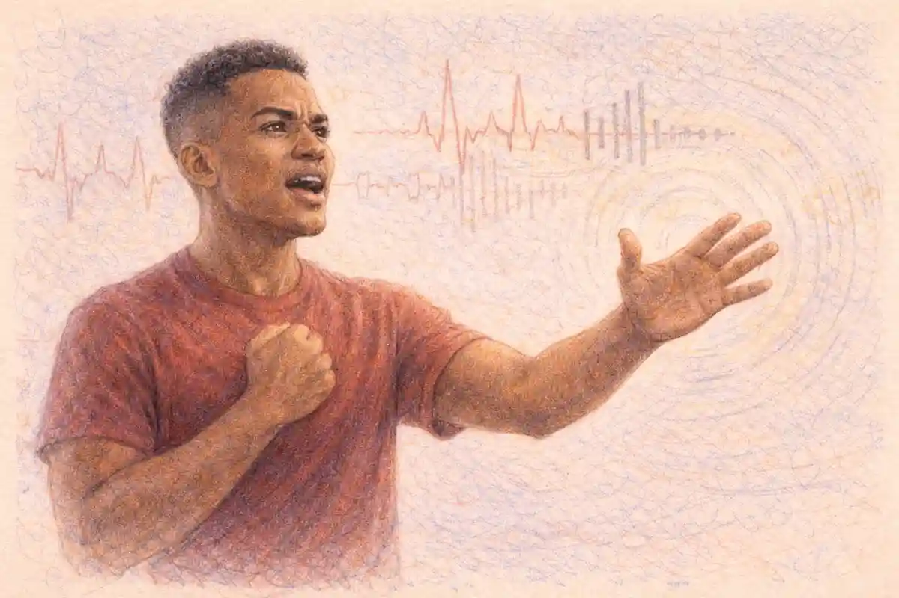

The 1961 film of West Side Story is the version of the Romeo and Juliet story that the twentieth century actually kept. The stage musical of 1957 had run 732 performances at the Winter Garden and lost the Tony Award for Best Musical to The Music Man; honourable numbers, the record of a succès d'estime. The film, directed by Robert Wise and Jerome Robbins and released by United Artists in October 1961, took the same property and made it unavoidable: the highest-grossing musical film ever released to that date, the owner of a soundtrack album that sat at the top of the Billboard charts for 54 weeks, the winner of ten Academy Awards from eleven nominations, and for generations of schoolchildren the form in which Shakespeare's plot first reached them, usually in a classroom, usually with the lights off. The verdict argued through this article is that the film deserves its dominion and that its dominion is built on a substitution. What conquered the world was not quite the thing the credits advertise. The two lovers at the centre are, in song, other people: Natalie Wood's Maria is sung by Marni Nixon, Richard Beymer's Tony by Jimmy Bryant. The Puerto Rican gang is played largely by non-Puerto Rican actors in a single shared shade of dark makeup. The co-director who invented the work's movement was fired before the film was finished. And yet the result outlasted nearly every more respectable object of its year, because Wise and Robbins understood what the stage production's record is examined for in [the Broadway original's own history](/2028/08/25/west-side-story-broadway-1957/): that this tragedy is carried by its ensembles, its streets and its score, and that a camera which serves those three things can survive compromises that would sink a more intimate work.

The film's premise is the musical's premise, and the musical's premise is the play's, stripped to the frame. Shakespeare's Prologue promises "Two households, both alike in dignity" and "a pair of star-cross'd lovers" before a line of dialogue is spoken (Prologue, Oxford Shakespeare, ed. Levenson). The film replaces the spoken chorus with altitude: it opens on a helicopter shot of Manhattan, the island abstracted into geometry, and descends, block by block, until the camera finds a playground in the Lincoln Square district of the Upper West Side and a gang of boys who communicate in finger snaps. No narration explains the feud. The descent is the explanation. Verona has become a grid of contested pavement, the households have become the Jets, native-born whites led by Riff, and the Sharks, Puerto Ricans led by Bernardo, and the dignity the Prologue grants both houses has become the one thing neither gang possesses and both are fighting to fake: ownership of streets that the city is about to demolish under them. A former Jet named Tony, by then working at Doc's drugstore, will fall in love at a gym dance with Bernardo's sister Maria, newly arrived from Puerto Rico. The audience that knows the play knows the rest, and the film banks on that knowledge from its first reel, quoting the plot's machinery with the confidence of an heir spending a famous inheritance.

## Why the Film, Not the Stage Show, Is the West Side Story the World Knows

The stage production's afterlife was always going to be limited by its medium's economics. A Broadway musical in 1957 could be seen by the occupants of one theatre eight times a week, toured to a handful of cities, and preserved on a cast album; even its long London run of 1,039 performances reached, in aggregate, a small city's worth of spectators. The film reversed the ratio. United Artists opened it as a roadshow attraction at New York's Rivoli Theatre on 18 October 1961, reserved seats and souvenir programmes, and exhibition histories record a Rivoli engagement stretching to 77 weeks. In its first release it earned rentals of $19,645,000 in the United States and Canada alone, and the worldwide gross is put at $44.1 million, against a negative cost usually stated at about $6 million, though some production references give $6.75 million. It stood as the highest-grossing musical film in history until The Sound of Music displaced it in 1965, and only the structure of its profit participations kept United Artists' own net profit down to a reported $2.5 million: the Mirisch Company, Wise, Robbins and the stage authors all owned pieces of the success, and the pieces were paid first. Chroniclers divide on whether it ranked first or second among all films of its year in North American rentals, Disney's One Hundred and One Dalmatians being the rival claimant, and the division is worth flagging because the film's publicity tradition has never been modest. The safer claim is the stronger one anyway. No other film of 1961 is still shown, whole, to teenagers as a matter of curriculum.

The soundtrack did as much of the fixing as the picture. Columbia Masterworks' album of the film score spent 54 weeks at number one on Billboard's stereo album chart, a run still cited as the longest chart-topping tenure of any album, with the caveat that Billboard then kept separate mono and stereo charts, and it won the Grammy for Best Sound Track Album. The album matters to the argument because it detached the score from the stage show's reputation and reissued it as the film's. Listeners who had never seen either production learned "Maria", "Tonight", "America" and "Somewhere" in the film's arrangements, sung in the film's dubbed voices, in the film's running order. When later stage revivals rearranged the score, they rearranged it toward the film: the exchange of "Cool" and "Gee, Officer Krupke", devised for the screen, became the order most subsequent productions used, so that the stage tradition itself came to quote the film. The American Film Institute placed the picture at number 41 on its centenary list of the greatest American films and at number two, behind Singin' in the Rain, on its list of the greatest movie musicals, with three of its songs on the Institute's hundred-songs list: "Somewhere" at 20, "America" at 35, "Tonight" at 59. The Library of Congress took it into the National Film Registry in 1997. Institutions do not confer this kind of permanence on works that merely succeeded; they confer it on works that have become the reference copy, the version against which the others are described as versions.

### How did a stage success become the reference copy of itself?

The mechanism was substitution at every level of distribution: cinema for theatre, roadshow prestige for Broadway prestige, the dubbed soundtrack album for the cast recording, and the film's running order for the score's order, each carrying the work to an audience an order of magnitude larger, until the film became the form in which the musical existed for nearly everyone.

That is the series thesis for this cluster of articles stated in box-office terms. A reader who wants the general question opened up will find it argued at [the debate over which film Romeo and Juliet is best](/2029/05/25/which-film-version-is-best/); this article's narrower claim is about one film's means. The means were industrial, and the industry was candid about them at the time. Walter Mirisch, whose company produced the picture for United Artists, had bought a property whose stage life had been admired rather than adored, and the purchase price for the screen rights, $375,000, reflected that standing. What the Mirisch Company understood, and what the stage's partisans kept missing, is that the show's perceived defect in 1957, its coldness, its refusal to charm, was substantially a function of distance: from the back of the Winter Garden the gangs were diagrammatic. The camera abolished the distance. It could put the audience inside the playground fence, at the level of the dancers' feet, in the heat of the gym, and the diagram became weather. Wise said, in a remark preserved in Richard Barrios's production history, that he wanted the opening to put the audience "in a frame of mind to accept the kids dancing in the streets", and the whole film is engineered backward from that sentence. Everything that follows in this article, the shared direction, the firing, the dubbing, the rearranged score, the makeup, is a record of what it cost to keep that frame of mind intact for 152 minutes.

The film's dominion also had a second front, the stage itself. The Broadway original had closed after 732 performances; the film's success sent the property back into the theatre with its value transformed, and the London production's long run, the tours, the revivals and the school and amateur licensing that followed all traded on the film's version of the material, its running order, its rooftop "America", its softened lyrics where the film had softened them. A stage director mounting the work in any decade since has had to decide, number by number, whether to follow the printed score or the film the audience is remembering, and the film usually wins the decisions that matter, because the audience's memory is the box office's memory. This is the deepest sense in which the film is the reference copy: it did not merely outsell the stage show, it re-edited it, retroactively, in the culture's archive. The stage article in this series documents the 1957 text in its own right; the film article's duty is to record that the text the world performs is, in significant part, the film's text, carried back onto the stage by forty years of directors who learned the work from a screen.

## Two Directors, One Film: How Wise and Robbins Divided West Side Story

The dual credit was not a vanity arrangement; it was an insurance policy. Jerome Robbins had conceived the stage show, directed it and choreographed it, but he had never directed a foot of film, and he made it a condition of his involvement that he direct the screen version. Walter Mirisch would not hand a $6 million negative to a novice, and would not make the film without the man whose choreography was the property's chief asset, so the risk was split along the work's own seam. Robert Wise, who had begun as an editor, cutting Citizen Kane among other pictures, and who had a reputation for finishing difficult productions on schedule, would produce and direct the dramatic scenes. Robbins would direct every musical sequence and the fights. Robbins rehearsed his dancers for three months before a camera turned, rechoreographing the stage numbers for the screen and rebuilding "America" from an all-female debate into an argument between the Shark men and women, a change whose consequences run through a later section of this article.

The seam did not hold because the two men kept different clocks. Robbins shot the way he rehearsed, by iteration: take after take, adjustments between takes, a refusal to print anything that merely sufficed. Assistant director Robert Relyea recalled an unusual number of injuries among the dancers, driven past safety by repetition in the New York summer heat; feet bled, ankles went, and the schedule went with them. After 45 days of shooting the picture stood 24 days behind, with roughly 60 percent of it filmed, by the standard production accounts that Barrios's history assembles. The Mirisch Company dismissed Robbins. He had completed four numbers, the Prologue, "America", "Cool" and "I Feel Pretty", and the remaining dance sequences were finished by Wise working with Robbins's assistants, from choreography Robbins had already set during the three months of pre-production rehearsal. The firing is often told as philistinism punishing genius, and there is truth in the telling, but the production record supports a colder reading. Robbins's method was not a slower version of filmmaking; it was a different art's method, the rehearsal room's, transplanted into a medium that pays for time in exposed negative. The studio did not fire the choreographer. It fired the overrun, and then discovered it could not finish, sell or honour the film without the choreographer it had fired.

### How much of the finished film did Robbins actually direct?

Four complete numbers bear his sole direction, the Prologue, "America", "Cool" and "I Feel Pretty", together with the choreography of every remaining number, which he had set in rehearsal before shooting began, so that even the sequences Wise completed were executed from Robbins's movement text by Robbins's own assistants.

The reconciliation was Wise's work and does him more credit than any single shot in the film. Robbins's contract had guaranteed him supervision of the editing of his own sequences; the contract was void on his dismissal, and Wise honoured it anyway, bringing him back during post-production to cut the musical numbers alongside the film's editor, Thomas Stanford, and insisting, against the studio's instinct, that the directing credit be shared. The Academy then ratified the arrangement in a form nobody had planned: at the 34th Academy Awards on 9 April 1962, Wise and Robbins became the first co-directors in Oscar history to share the Best Director award, and neither man, in his acceptance remarks, acknowledged the other. Robbins received, the same night, an honorary Academy Award for his achievements in the art of choreography on film, a statuette that reads in retrospect like the industry's apology, or its insurance premium, depending on the teller. He never directed another film. The credit split has one more consequence that matters to this article's verdict. Because both names stand on the picture, the film's two natures, theatrical conception and cinematic execution, are permanently and accurately labelled. West Side Story on film is the rare adaptation whose credits confess its method.

It should be said plainly, since the firing legend tends to bleach it out, that Wise's half of the film is not scaffolding. The decision to open on real streets rather than studio exteriors, the insistence on the aerial descent from the abstract island to the contested playground, the roadshow pacing that lets a rumble breathe, the long held final procession: these are Wise's, and the film's claim to be cinema rather than photographed theatre rests on them. Equally, the numbers Wise completed without Robbins are directed with a humility that amounts to a style. He shoots set choreography from the angles that display it, declines to cut against the phrase, and lets the dancers' bodies hold the frame. A more assertive director would have ruined the inheritance while improving the film's résumé. The partnership, in short, failed as a collaboration and succeeded as a division of the work, and the failure and the success are the same fact viewed from the schedule and from the screen respectively.

Wise's own trajectory completes the direction story, and it contains the film's neatest irony. The journeyman who had been hired for his reliability, who finished another man's musical and shared its directing Oscar, went on four years later to direct The Sound of Music, the film that took West Side Story's record as the highest-grossing musical in history and held the industry's affection with an ease the earlier film never managed. The two pictures divide Wise's reputation between them: the Salzburg idyll is the beloved one, the West Side tragedy the decorated one, and the director's hand is the common element most accounts leave unexamined, because both films are remembered as their choreographers' and composers' properties. Yet the virtues are the same in both, the patience with complete musical phrases, the location photography used as argument, the refusal to cut away from a number before it lands. Robbins never directed another film, and the counterfactual, a Robbins filmography built on this one's foundation, is the great what-if of the American musical cinema. The record instead gives the pairing a single shared monument, credited to both men, finished by one of them, and unrepeatable by design, since the partnership's terms dissolved in the same schedule crisis that produced the film. The Academy's joint award, read against that history, is less a compromise than a diagnosis: the institution certified that the film had two authors and declined to rank them, which is the answer the evidence still supports.

## The Production Machine: Mirisch Money, a Giant Negative, and the Roadshow

The film's scale was a business plan before it was an aesthetic. The Mirisch Company, the most successful independent production outfit of its moment, bought the screen rights to the stage property for $375,000 and built the picture as a prestige object: a roadshow release, reserved seats, an overture, an intermission, a souvenir programme, the full ceremonial apparatus that the industry reserved for its would-be monuments. The negative cost came in at about $6 million by the AFI-derived accounts, some references giving $6.75 million, serious money for a musical in 1960 and a fraction of what the picture would return. Wise shot it in Super Panavision 70, the widest of the period's large formats, with Technicolor photography by Daniel L. Fapp, on the argument that the choreography needed a frame that could hold a full stage width of dancers and still read on a roadshow screen. Boris Leven designed the production, Irene Sharaff the costumes, adapting her stage designs to the camera's closer scrutiny, and Saul Bass designed the titles, closing the picture with an end-credit sequence sprayed as graffiti across a wall, the city itself signing the film. The premiere came on 18 October 1961 at New York's Rivoli Theatre, and the roadshow engagement ran, by one exhibition account, for 77 weeks at that single house, a residency that made the film less a release than an institution with a marquee.

The choice of format deserves a paragraph of its own, because it shaped what the film could say. Super Panavision 70 gave Robbins's choreography a proscenium wider than any stage's, and Wise's coverage exploited it by holding groups whole: the Prologue's patrols, the gym dance's collisions, the quintet's cross-cut longing all depend on frames that contain the ensemble rather than on editing that assembles it. The period's ordinary musical, shot in narrower formats, cut constantly between faces; this one could let a dance finish. The cost of the choice was literal as well as artistic. Large-format photography is slower, its cameras heavier, its setups longer, and the format's demands fed the schedule crisis that ended Robbins's tenure, since a director iterating takes in 70 millimetre is burning the most expensive stock in the building. The roadshow economics justified the extravagance only if the picture played for months at premium prices, which it did. The industry's accounting, though, had a trap inside it, which the film profile's numbers expose: the gross was enormous and the distributor's retained profit was $2.5 million, because the participations of the Mirisch Company and the principal talent were priced ahead of United Artists' own return. The film is thus a case study in the era's prestige economy. Everyone attached to it became identified with a classic; the releasing company made a modest profit; and the property's long value flowed to the rights holders, the soundtrack's publishers and the stage authors' estates, whose work the film reissued to the world at the picture's running order and in the picture's voices.

The score, as the film presents it, deserves a paragraph of pure description, because its construction explains the picture's grip on musicians as well as audiences. Bernstein built the work on the tritone, the interval of "Maria", restless and unresolved, and the film's orchestration, by Sid Ramin and Irwin Kostal working with the composer under Johnny Green's music direction, scales the stage pit up to a studio orchestra without thickening the writing's jazz inflections. "Cool" is constructed as a fugue, its subject passed between voices while the Jets pass their restraint hand to hand, a piece of learned counterpoint smuggled into a garage; the quintet stacks five incompatible desires in five keys of feeling and lets them collide in real time, the operatic ensemble tradition doing the work Shakespeare gives to the Act 3 pile-up of entrances. The film's contribution to the score is scale and permanence: this is the performance of the music that fixed its tempos, its cuts and its sonority for the world, the recording against which stage conductors still measure their pits. When the argument of this article calls the score the film's load-bearing element, the claim is literal. Remove Bernstein and the dubbing is a scandal without a masterpiece attached, the choreography a syllabus without a text; with Bernstein, every compromise the production made was made in service of delivering the music intact, and mostly did.

The visual design carries its own argument about the two households, and it is conducted in colour. Sharaff's costumes sort the gangs by palette, the Jets in the yellows and oranges of asphalt summer, the Sharks in purples and reds, so that a wide shot reads as a map of allegiance before a face is visible; Leven's sets push the tenement walls and fire escapes toward a heightened, theatrical saturation that keeps the locations from claiming a documentary realism the film never promises. Fapp's photography, honoured with the colour cinematography Oscar, mediates between the two registers, the real street and the designed set, grading the New York material to sit beside the Goldwyn stages without a visible seam. The design scheme is the respectable sibling of the makeup policy examined later in this article: both sort human beings by colour at a glance, one in cloth, where the sorting is the gangs' own chosen heraldry, and one in skin, where it was imposed. The film's defenders rarely separate the two, and its prosecutors rarely credit the first; the record supports doing both, since the costume plot is a legitimate descendant of Verona's livery, the Montague and Capulet colours worn into the street fight, while the makeup plot is the film's own invention and its own responsibility.

One further production fact belongs in this section because it governs how the film feels. The picture was shot to playback, as musicals were, but Robbins's dancers performed the numbers in full, at performance length, take after take, in New York heat and on Goldwyn soundstages, and the injuries Relyea recalled were the tax on that method. The finished dances have a quality that later musicals, built from shorter takes and faster cutting, rarely match: exhaustion held at bay by technique, visible in the Prologue's final lunges and in "Cool", where the Jets' control is the drama and the dancers' control is the fact underneath it. The camera's respect for complete phrases of movement is the film's deepest stylistic commitment, deeper than its colour design or its locations, and it is Robbins's gift even in the sequences Wise finished, since the choreography and the rehearsal discipline that made whole-take dancing possible were established before the dismissal. A viewer who wants to know whose film this is can find the answer in the cutting rhythm: the dances are allowed to end. That patience came from the theatre, and the theatre's representative on the set was the man the schedule could not afford.

## Whose Voices Are Singing? The Dubbing Machine Behind the Film

The brief for this article names the complication directly: the dubbing and the casting choices are the film's open secret, and they have to be engaged, not footnoted. Begin with the arithmetic of substitution. Of the five principals, exactly one, George Chakiris, sings his own songs. Natalie Wood's Maria is sung throughout by Marni Nixon, the soprano who had already voiced Deborah Kerr in The King and I and would voice Audrey Hepburn in My Fair Lady, uncredited here as she was everywhere, and paid a session fee for work that became one of the best-selling soundtracks in recording history. Richard Beymer's Tony is sung by Jimmy Bryant, a professional vocalist whose name appears on the soundtrack album, in the small print of its credits, as Jim Bryant. Russ Tamblyn, a dancer and acrobat cast as Riff, is dubbed by Tucker Smith, the performer playing his own lieutenant Ice, in the "Jet Song"; Tamblyn's own light voice is heard elsewhere, in "Gee, Officer Krupke". Rita Moreno, a genuine singer, is dubbed for one number only: in "A Boy Like That", Anita's part lies in a low register outside Moreno's comfortable range, and Betty Wand sings it, while Moreno's own voice carries "America" and the "Tonight" quintet. And in that quintet there is a passage in which Nixon, summoned because both Moreno and Wand were laid low with colds on the day of recording, supplies Anita's final phrases as well as Maria's, so that for a few bars the film's two leading women are one throat.

Every element of this was standard Hollywood practice, and that is precisely the problem the film's reputation has had to digest. The musical film of the studio era treated the singing voice as a component to be sourced like an orchestra part, and the audience of 1961 did not feel deceived, because the convention was the genre's open technology. What has changed is not the fact but the meaning of the fact. The two performances the culture certified with its highest honours for singing roles, the lovers around whom the tragedy turns, are composite performances, bodies and voices from different people, assembled in post-production. Wood's case carries an edge the others do not. Her contract had her prerecord her own songs, she shot the numbers to playback of her own voice, and she was allowed to believe, through production, that her voice would be used; the music supervisors, Saul Chaplin and Johnny Green, had already decided otherwise. Nixon, for her part, was bound to silence about the work and extracted no royalty from an album that sold in the millions, an arrangement she spent a memoir, I Could Have Sung All Night, setting on the record decades later. The deception ran in both directions, inward at the star and outward at the audience, and it was executed by professionals who regarded it as craft.

### Did Natalie Wood know her singing would be replaced?

On the evidence assembled by the production histories, no: Wood recorded her songs before filming, performed the numbers to her own playback on set, and was permitted to go on believing her voice would reach the screen, while Chaplin and Green had settled on Nixon's voice for the final mix before the picture wrapped.

The honest adjudication of the dubbing has to hold two findings at once. The first is that the composite performances work. Nixon's Maria has a fragility and an accuracy of pitch that Wood's own pleasant, untrained soprano could not have sustained against Bernstein's writing, and Bryant's Tony has the open, unforced tenor the part needs and Beymer's reedy baritone lacked. The film's musical standard, the thing that let it play as opera for audiences who would never enter an opera house, is partly a product of the dubbing machine; the machine is one of the reasons the soundtrack album could rule the charts for a year. The second finding is that the machine falsifies the film's central claim. West Side Story asks to be taken as the tragedy of particular young bodies in a particular city; its lovers, alone among the cast, are not particular bodies but editorial constructions, and the one principal whose singing is wholly his own is the gang leader who dies at the interval. Later generations did not invent this objection; they inherited it from the credits' small print and from Nixon's eventual testimony. The 2021 remake's insistence on recording its cast's own voices, live where possible, is unintelligible except as an answer to 1961, and this article returns to that answer in its closing section. What can be said for the older film is that its ventriloquism is at least total: there is no scene in which the substitution flickers, no moment at which Maria's voice audibly changes owners. The illusion is perfect, which is the achievement and the indictment in one sentence.

The dubbing also had a public face, and the public face sold records. The soundtrack album credits the stars whose faces appear on its cover; Bryant appears in its small print as Jim Bryant, and Nixon appears not at all. For a generation the album was Maria, and the voice being memorised in bedrooms and school music rooms was Nixon's, attached in the listener's mind to Wood's face. Nixon's later testimony, in her memoir and in interviews across the decades, reframed that arrangement from a credit grievance into something more structural: she described being assured of silence by contract, paid a flat fee, and left to watch an album built substantially on her instrument become one of the best sellers in the label's history, while the profession she served treated the arrangement as too ordinary to discuss. Her case became the standard exhibit in every later account of the studio system's treatment of ghost singers, and the film, as her largest credit-that-was-not, inherited the argument. It is worth stating the counterweight plainly, because the adjudication requires it: the system that silenced Nixon also hired her, at the peak of her powers, to do the finest sustained work of her career, and the recording she made under those terms is the Maria that two generations carry in their ears. The grievance and the achievement share a tape.

Bernstein's music, finally, is the silent party to the whole dubbing arrangement. The score's vocal writing, the sustained lines of "Tonight", the stratospheric close of the quintet, the operatic reach of "A Boy Like That" with its demand that Anita rage in a register Moreno did not own, was composed for trained voices and does not forgive untrained ones. The stage could cast for voice and build the production around the casting; the film had cast for face, fame and dance, and the dubbing machine was the reconciliation of that casting with that score. Read in this light, the substitutions are not a scandal bolted onto a respectable production but the production's load-bearing compromise, the point at which the film's two identities, a Bernstein opera manqué and a United Artists star vehicle, were soldered together in the mixing room. The solder held for the film's entire public life. It is heard, perfect and invisible, every time the overture's whistle gives way to the streets.

## What the Film Changed from the Stage Version, Number by Number

Ernest Lehman's screenplay is the film's second direction, the one exercised before either director called a take, and its governing idea belonged to the production as a whole: Wise wanted a single rising line of tension, with no comic or lyrical relief after the rumble, and Lehman rebuilt the score's order to supply it. On stage, "Cool" stands in the first act, Riff counselling restraint before the fight, and "Gee, Officer Krupke", the gangs' mock trial of the adult world, opens the second act's relaxation after the deaths. The film exchanges them. "Gee, Officer Krupke" moves forward into the first act's lighter weather, and "Cool" moves back, into the garage where the leaderless Jets are trying not to disintegrate after Riff's death, where it is sung not by Riff, who is dead, but by Ice, a character who does not exist on stage at all, created for the film and played by Tucker Smith. Stephen Sondheim, by his own later account, had always wanted the exchange; the film gave the lyricist his wish and gave the second act a temperature curve the stage version deliberately lacks. Stage productions ever since have mostly followed the film's order, which means the screenplay's boldest cut came to be experienced by theatre audiences as the text.

### Why does Maria sing "gay" instead of "bright" in the film's "I Feel Pretty"?

Because Lehman moved the number into the first act to protect the rising tension line, Maria's bridal-shop song plays in daylight rather than in the stage version's evening, and Sondheim adjusted the lyric to fit the hour, replacing "bright" with "gay", a one-word change that records the whole reordering in miniature.

The other large structural change is the treatment of "America". On stage it is a debate among the Shark women alone, Anita defending the mainland against Rosalia's homesickness, staged as an all-female rooftop argument. Robbins had wanted the men in it from the beginning, Sondheim has said, and the film restored the conception: Bernardo and the Shark men take the island's side against Anita and the women, the number moves onto a rooftop at night, and the argument becomes the film's fullest statement of its subject, an actual quarrel between the migration's optimists and its realists, danced at the pitch of a showstopper. The change also completes the film's mapping of the play. Shakespeare's feud is argued by men in the street and suffered by women in the house; the stage "America" kept the women in a separate register, while the film's version puts Bernardo, the work's Tybalt, in direct verbal combat with Anita, the work's Nurse, and lets the audience watch the two households' seconds rehearse the feud's whole case the night before the rumble. Article 347's map of the adaptation, which fixes Bernardo in Tybalt's function and Chino in Paris's, is carried through this article as settled; the film honours the map even where it rearranges the music.

Smaller changes repay listing because they show the screenplay thinking. The stage "Tonight" sequence is reordered so that "America" precedes the balcony duet, and the lovers' fire-escape meeting answers the Sharks' debate directly. The "Somewhere" ballet, an extended dream sequence on stage in which the dead walk reconciled, is cut down to an intimate duet sung by Tony and Maria in her bedroom, with only a brief wash of imagined open space; the film keeps the song and discards the pageant, trading the stage's theology for privacy. Several of Sondheim's lyrics were bowdlerized for the screen under the period's censorship: the "Jet Song" loses its coarsest line, the "Krupke" stanza about parentage is rewritten into a catalogue of beatings and communism, and Anita's line in the quintet about Bernardo arriving "hot" is cooled to "here". And the Prologue, a danced overture on stage, becomes the film's location manifesto, expanded across real pavement: five weeks of shooting in the summer of 1960, much of it on West 68th Street in the Lincoln Square blocks then being emptied for demolition, the future site of Lincoln Center, and on a playground uptown in East Harlem, where the crew, pelted with stones from rooftops and unimpressed by the police presence, hired members of a local gang to keep the set safe. The neighbourhood the gangs fight over in the film was condemned before the cameras arrived and razed when they left; the picture is, among its other identities, the only surviving colour film of a destroyed New York district at full civic scale.

The ending is preserved, and its preservation is the screenplay's most Shakespearean decision. The musical had already committed the adaptation's heresy: Maria lives. Lehman kept the heresy and staged it as the play's last scene with the bodies rearranged. Tony, told by Doc that Maria is dead, Anita's lie relayed in good faith, goes into the street calling for Chino to finish him, and Chino, Paris's counterpart in the map, obliges with a pistol shot as Tony runs into Maria's arms on the playground. The Prince's closing judgment in the play, "For never was a story of more woe / Than this of Juliet and her Romeo" (5.3), is transferred to the surviving Juliet figure herself, who takes the gun, cannot fire it, and indicts both gangs over the body. Then the film adds its single invented image: Jets and Sharks together lift Tony and carry him out in procession, the feud's children performing the reconciliation their elders never manage in Verona. Critics divided over that procession from the first reviews, and the division is taken up in the critics' section below; what is not disputable is that the film, having changed the score's order, the dream ballet and the censorship-scrubbed lyrics, refused to change the ending's arithmetic. One lover dead, one lover living, both households billed for the corpse.

The censorship record deserves its own paragraph, because the bowdlerizations map the era's anxieties with unusual precision. The "Jet Song" on stage promises its gang a permanence expressed in an obscenity the screen version trims to a milder curse; the "Krupke" catalogue of childhood damage loses the stanza about parentage, the lyric's sharpest joke, and gains instead a verse about beatings and communist reading matter; Anita's quintet line is cooled by a single word. What the censors left untouched is as instructive as what they cut: the rumble's switchblades, the attempted rape of Anita in the drugstore scene, the ethnic invective traded across the gym floor all survived, which means the period's machinery policed language harder than conduct, sex harder in the mouth than in the act. Sondheim, who supplied the replacement lines, treated the episode with the professional's shrug he kept for such matters, and the film's versions of the two songs entered the performing tradition alongside his originals, so that a modern audience may hear either text and is rarely told which it is hearing. The adaptation's cleanest little parable is here: the film that dared to photograph real slum clearance for its tragedy was required, in the same months, to pretend its street gangs swore like choirboys.

The lovers' scenes show the screenplay's other method, addition rather than subtraction. The bridal-shop sequence, in which Tony and Maria marry each other before a dressmaker's dummy dressed as a bride, with their friends' clothes standing in as congregation, is Laurents's invention carried over from the stage and expanded by the camera into the film's only sacrament; "One Hand, One Heart" plays there as the wedding hymn the lovers write for a ceremony no institution will perform for them. The fire-escape balcony, played against the tenement wall with the street's noise below, reverses the stage's geometry and improves the play's: Juliet above, Romeo below, and between them a grate that the camera can shoot through, so that the obstacle the scene is about is visible in every frame. These passages are the film at its most intimate, and they are also, by the adjudication argued in the critics' section, its weakest sustained stretch, not because the staging fails but because the centre cannot hold what the staging offers. Wood speaks the balcony scene with real ardour; the voice that then rises in "Tonight" is another woman's, and the seam, invisible in 1961, is the first thing a modern audience is told to listen for. The film's intimacy is thus its most dated element, dated not by style but by information: the audience's knowledge has changed, and a duet cannot un-know its dubbing.

## The InsightCrunch West Side Film Profile

The quickest way to hold the film's whole argument in view, its industrial scale, its personnel, its honours and its substitutions, is to set the record out in one place. The table below is the InsightCrunch West Side film profile, assembled from the Academy's records, the AFI Catalog's production data and the standard production histories, and the sections on either side of it argue from its rows. Read down the final three rows in sequence and the film's biography is visible at a glance: an audience measured in tens of millions, an honours list no musical has matched, and a singing cast that is, in the strictest sense, partly fictional.

| Item | The record |
| --- | --- |
| Release | Roadshow premiere, Rivoli Theatre, New York, 18 October 1961; United Artists |
| Production | The Mirisch Company, with Seven Arts Productions and Beta Productions |
| Producer | Robert Wise; executive producer Walter Mirisch; associate producer Saul Chaplin |
| Directors | Robert Wise and Jerome Robbins (co-credited; Robbins dismissed during production) |
| Screenplay | Ernest Lehman, from the stage book by Arthur Laurents |
| Source | The 1957 Broadway musical, itself an adaptation of Romeo and Juliet |
| Music | Leonard Bernstein; lyrics by Stephen Sondheim |
| Choreography | Jerome Robbins |
| Cinematography | Daniel L. Fapp, in Super Panavision 70 and Technicolor |
| Production design | Boris Leven; costumes by Irene Sharaff; titles designed by Saul Bass |
| Music direction | Johnny Green; orchestrations by Sid Ramin and Irwin Kostal with Bernstein |
| Running time | 152 minutes |
| Negative cost | About $6 million (some references give $6.75 million) |
| Box office | $19,645,000 in United States and Canada rentals; $44.1 million grossed worldwide |
| Principal cast | Natalie Wood (Maria), Richard Beymer (Tony), Russ Tamblyn (Riff), Rita Moreno (Anita), George Chakiris (Bernardo) |
| Singing voices | Marni Nixon for Wood; Jimmy Bryant for Beymer; Tucker Smith for Tamblyn's "Jet Song"; Betty Wand for Moreno in "A Boy Like That"; Chakiris sings his own part |
| Academy Awards | Ten wins from eleven nominations, plus an honorary award to Robbins for choreography on film |
| Soundtrack album | 54 weeks at number one on Billboard's stereo chart; Grammy for Best Sound Track Album |

Two rows of the profile deserve prose. The screenplay credit is the film's only losing Oscar nomination, and the irony is structural rather than accidental: Lehman's adaptation was faulted, where it was faulted, for fidelity, for carrying the stage book's sociology onto the screen nearly intact, while every other department was honoured for transformation. And the budget row carries the film's first divergence of record: the $6 million figure given by the AFI-derived accounts against the $6.75 million in some reference works, a gap of three quarters of a million that no amount of archival tidiness has closed, and which this article reports rather than resolves. Precision about the film's other numbers is achievable; precision about its cost is not, and a profile that pretended otherwise would be lying in tabular form.

## Casting Maria: Natalie Wood, Brown Makeup, and the Film's Puerto Rico

The casting ledger is the part of the record that has aged worst, and it has aged worst in public, on the testimony of the cast itself. Maria, the Puerto Rican heroine, is played by Natalie Wood, the American daughter of Russian and Ukrainian immigrants, who was 22 when she filmed the part and 23 when the film opened. The role had not lacked alternatives in the industry's own terms: Audrey Hepburn was offered it and declined, being pregnant; Barbara Luna, an actress of Filipino and Spanish descent who had played the part's world on Broadway in The King and I's orbit, was at one stage slated for it in the trade accounts; and the stage's Maria, Carol Lawrence, was passed over with the stage's Tony, Larry Kert, on the ground that both were too old, a curiosity at the time, since the screen's lovers were barely younger than the stage's. Bernardo is played by George Chakiris, an Ohioan of Greek descent who had played Riff in the London stage production and who won the Academy Award for the performance. Chino, who fires the final shot, is played by Jose De Vega, of Filipino and Colombian descent. Of the principals, only Rita Moreno was Puerto Rican, born in Humacao, and the film then proceeded to paint her the same colour as everyone else.

Moreno's account of the makeup is the single most quoted piece of testimony in the film's afterlife, and it is quoted here because it is evidence, not colour. The makeup department applied one dark shade to every Shark, male and female, until the performers streaked and, in Moreno's phrase for Chakiris, looked dipped in mud. She objected on the set: Puerto Ricans are many colours, some white as milk, some copper, the island a melting pot of Spanish, French, Dutch, Taíno and African inheritance; why could she not be her own colour, being Puerto Rican herself? The makeup artist answered, "What, are you racist?" She was, by her own account, too stunned to reply, and the makeup stayed; Robbins wanted a hard visual contrast between the gangs, and contrast is what the film got, two teams distinguishable at crane-shot distance by complexion as much as by costume. The same production required Moreno, who had no marked accent in her own speech, to perform one. Her Oscar, the first Academy Award won by a Latina performer, was thus given for a performance the production had first darkened, accented and, in one number, revoiced. That she won it anyway, and that the performance remains the film's most admired piece of acting, is the record's own commentary on the policy.

### Was any principal besides Moreno actually Puerto Rican?

No: of the five principals and the featured gang members, Moreno, born in Humacao, was the sole Puerto Rican; the Sharks were otherwise cast from the available pool of Broadway and Hollywood dancers, a shortage the production attributed to the era's training pipeline, which had kept dance education out of reach for most Latino teenagers.

The scholarly verdict on this record arrived with Frances Negrón-Muntaner's essay "Feeling Pretty", the centrepiece of her book Boricua Pop, and it reframed the casting question as a question about the whole work's design. On her reading, the film offers Puerto Rican identity as a costume that can be put on by a white star and taken off at the stage door, and its signature number for Maria, "I Feel Pretty", is the assimilation script sung aloud: the heroine becomes visible to herself as pretty, which is to say acceptable, in the mirror of the mainland bridal shop. The women of the piece are sorted, in her account, into the virginal and the fiery, Maria and Anita, a division the casting then embodies. Against this stands the defence the production always offered, that the film needed dancers who could execute Robbins's choreography and that the trained supply of the era, for reasons of money and access that were themselves discriminatory, was what it was. Both things are true, and they are true at different levels: the pipeline explains the company, and explains nothing about painting the one Puerto Rican in it darker. The verdict of this article is that the makeup decision, not the casting decision, is the film's indefensible act, because it was a choice made fresh every morning in the makeup room, against the protest of the person wearing it, in service of a contrast the choreography did not need. The gangs are already separated by costume, territory, music and movement; the mud was for the audience's comfort, and the audience's comfort is what the film elsewhere refuses to supply.

The supporting company complicates the casting ledger in a direction worth recording. The film's gangs were staffed substantially from the stage world the leading roles were denied to: William Bramley, the stage's original Officer Krupke, reprised the part for the screen, the production's only direct carry-over in a named role, while Tony Mordente, who had played A-Rab on Broadway, returned as Action, and dancers from the original companies populate both gangs. The production's trust, in other words, ran in two directions at once: the ensemble that had to dance Robbins's choreography was recruited from the theatre that created it, while the faces that had to sell the picture were recruited from the studios' contract lists. The seam is visible in the finished film to anyone who watches the edges of the frame, where the dancing is Broadway's and the close-ups are Hollywood's, and it explains the film's peculiar double authority, authentic in the group and manufactured at the centre. Chakiris, who belonged to both worlds, a London stage Riff remade as a Hollywood Bernardo, is the performer in whom the seam disappears, and his Oscar can be read as the industry's recognition of the join made invisible.

It remains to set down what the casting achieved, because the critics' quarrel in the next section turns on it. Wood's Maria, whatever its provenance, fixed the character's screen image for two generations, and her spoken performance, in the balcony scene and the final speech, has a directness that survives its dubbing. Beymer's Tony is the film's acknowledged weak joint, judged so by reviewers at the time and, in later interviews, treated unsparingly by Beymer himself; Wood, who thought him too gentle for a founding Jet, tried during production to have him replaced. Tamblyn, an acrobat who had auditioned for Tony, gives Riff a gymnast's menace that no singer-actor of the period could have matched physically, and Chakiris's Bernardo has the stillness of a man conserving violence. The film's defenders and its prosecutors are really arguing about a ratio: how much composite construction at the centre a work can bear when its edges, Moreno, Chakiris, Tamblyn, the two gangs entire, are this alive. The Oscar electorate answered the question one way in 1962. The next section takes up the quarrel in the critics' own terms.

## The Rumble and the Ending: Staging Violence in a Dancing Film

The rumble is the film's centre of gravity, and its staging states the whole work's method in ten minutes. It plays at night under a highway, on fenced concrete, in the visual grammar of the Prologue: the gangs arrive in dance formation, the war council's courtesies are observed, Bernardo and Ice circle in a knife fight choreographed as a duet, and the violence stays balletic until the instant it stops being safe. Riff, intervening to keep the fight fair, takes Bernardo's blade in the struggle; Tony, taking Riff's knife in turn, kills Bernardo before he has decided to. The sequence's power is the speed with which choreography curdles: the same bodies, the same vocabulary of feint and extension, and two boys dead of it. Robbins's insight, which the film preserves entire, is that gang violence and gang dancing are the same energy at different temperatures, and the rumble is where the audience is made to feel the conversion happen. The play's equivalent moment, the street fight of Act 3, works by the same conversion in language, Mercutio's wit curdling mid-sentence into the curse; the film finds the movement equivalent, and the equivalence is the adaptation's proudest achievement.

What follows the rumble is the screenplay's tension rule in action, and it is worth tracing the chain because the film's ending depends on every link. Tony, sheltered by Maria, sends her to warn the Jets; Anita, arriving at Doc's drugstore on the same errand after Bernardo's death, is intercepted by the Jets and subjected to a taunting dance that escalates into an assault, stopped by Doc's entrance at the edge of the act itself. Anita, who came to prevent a killing, invents the lie that performs one: Chino has shot Maria. Doc relays it. Tony goes out into the street calling for Chino or for death, whichever finds him first, and finds Maria alive at the playground at the moment Chino's shot arrives. The chain is Shakespeare's machinery with each joint tightened: the Friar's undelivered letter becomes an errand delivered to the wrong room, the Nurse's failure of nerve becomes Anita's active revenge, and the tomb becomes the playground where the film began. The adaptation's reputation for fidelity rests less on its surfaces than on this engineering, which Lehman's screenplay performs without advertising itself.

The closing procession, Jets and Sharks lifting Tony's body together and carrying it out while Maria follows, was divided over from the first reviews and remains the film's most contested image. Kauffmann's objection, that the reconciliation is a falseness the picture has not earned, identifies the problem exactly: nothing in the film's sociology prepares the gangs to unite in grief, and the image asks for a catharsis the plot has not purchased. The defence is that the procession is not sociology but liturgy, the play's own closing tableau, the fathers entering over the bodies, translated into the idiom the film has established, in which communal movement is the language of public feeling. Shakespeare ends with statues promised and a prince's ledger of punishments and pardons; the film ends with its two companies performing the only joint action they ever manage, carrying the cost of the feud out of the frame together. This article's verdict sits between the positions: the image is unearned as narrative and earned as form, and each viewer feels one of those verdicts and has to argue down the other, which is why the quarrel over it has outlived every participant. The film's makers chose the risk knowingly; a faithful ending, Maria's indictment without the procession, was available in every draft, and the procession stayed.

## Ten Oscars from Eleven Nominations: The Night of 9 April 1962

The 34th Academy Awards, held at the Santa Monica Civic Auditorium on 9 April 1962 with Bob Hope hosting, turned the film's industrial scale into honours at a rate no musical has matched before or since. The nominations numbered eleven. The wins numbered ten: Best Picture, for Wise as producer; Best Director, shared, the first and still the defining case of the Academy splitting that award between two men for one film; Best Supporting Actor, Chakiris; Best Supporting Actress, Moreno; art direction and set decoration in colour, Boris Leven and Victor A. Gangelin; cinematography in colour, Daniel L. Fapp; costume design in colour, Irene Sharaff; film editing, Thomas Stanford; the scoring of a musical picture, Chaplin, Green, Sid Ramin and Irwin Kostal; and sound, Fred Hynes and Gordon E. Sawyer. The single loss was the screenplay award for material from another medium, which went to Abby Mann for Judgment at Nuremberg, a verdict on Lehman's fidelity that the previous sections have already considered. Robbins, absent from the hall by most accounts, was additionally given an honorary award that evening for his choreographic achievement on film, which places eleven statuettes in the film's circle by the night's end, ten of them competitive. The Golden Globes had preceded the Oscars with three wins of their own, for the picture and for both supporting players.

Three conclusions follow from the slate, each useful to the argument of this article. First, the Academy honoured precisely the film's public virtues, its scale, colour, design, sound and ensemble playing, and its two acting awards went to the Sharks' leaders, the film's moral centre of gravity in performance terms. Second, the shared directing award ratified in gold the arrangement the previous sections described: the industry could not decide which man had made the film either, and solved the problem as Wise had solved it, by crediting both. Neither man mentioned the other in his acceptance; the award's jointness is ceremonial, and everyone in the record behaves as though it were also slightly embarrassing, which it was, being the Academy's formal certificate that a firing had happened and had not mattered. Third, the ten wins set the benchmark that has distorted the film's reputation ever since, because a work carrying that many statuettes is thereafter judged as a monument, and monuments are not permitted their period flaws. The film's defenders reach for the Oscar count as a verdict; its prosecutors treat the count as evidence of the era's self-deception. Both are using the statuettes to avoid the harder work of watching the film, which the critics' quarrel, conducted across four decades, at least attempts.

The record the night established has also proved oddly durable as a measuring stick. No musical has since matched the ten wins, and the picture's total is routinely cited as the genre's ceiling, the number against which every later contender, however decorated, is reported as falling short. The durability matters because it froze the film's reputation at its 1962 valuation: a work cannot be casually reassessed downward when the reassessment has to argue with a perfect score. The single loss, in adapted screenplay, has aged into the slate's most interesting verdict, since Lehman's screenplay is the element this article has credited with the film's structural intelligence, the reordered score and the preserved ending; the Academy's voters, honouring transformation in every other department, declined to honour it in the one where transformation had been most discreet. There is a sense in which the loss completes the film's biography. West Side Story on screen is a work whose mediations are all slightly uncredited: its choreographer fired, its singers uncredited, its screenwriter unrewarded, its producer-director sharing his statuette with the man he replaced. The ten wins are genuine, and so is the pattern underneath them, a monument built by substitution at every level, taking its bow as though it had been cast, sung and directed exactly as advertised.

## The Critics' Quarrel: Masterpiece, Hokum, or Great Musical with Rotten Sociology?

The film opened to a split verdict that has never closed, and the three positions staked out in 1961 and 1962 still organise everything written about it since. Bosley Crowther of The New York Times, the era's most powerful daily reviewer, led the praise: the material had been reconstructed, he wrote, into "nothing short of a cinema masterpiece", and its message, he insisted, "should be heard by thoughtful people, sympathetic people, all over the land". The Hollywood Reporter's trade review matched him in the industry's own register, judging that the film musical had never been done better. Stanley Kauffmann, writing in The New Republic, occupied the considered middle: the film was, in his phrase, the best film musical ever made, and in the same review he faulted its sociology as facile and its ending, the gangs reconciled over Tony's body, as a falseness the picture had not earned. Pauline Kael, reviewing for the Partisan Review's circle and sharpening the attack across her career, prosecuted from the other pole: the film was "frenzied hokum", its dialogue "painfully old-fashioned and mawkish", its dances "simpering, sickly romantic ballet", and Natalie Wood "so perfectly banal she destroys all thoughts of love".

The quarrel is not really about whether the film is well made; Kael's review concedes the machine's power by the violence of her resistance to it. It is about what the machine is for. Crowther and the trade press read the film as public speech, a liberal sermon on juvenile delinquency delivered at unprecedented scale, and praised it as one praises an oration. Kael read it as a fraud of feeling, real streets and real slum clearance used to aestheticise a sociology the film had no intention of examining, its Puerto Ricans ventriloquised, its gang councils mincing through ballet positions while claiming the authority of documentary. Kauffmann's middle position is the most durable because it separates the questions the other two fused: as a piece of filmmaking, of choreography photographed and music engineered, the film sets the standard; as an account of the world it photographs, it simplifies, sentimentalises and finally lies, in the procession that carries Tony out. Roger Ebert, admitting the film to his Great Movies series decades later, adjudicated in almost those terms: Kael, he judged, is guilty of overkill; Kauffmann is closer to the mark; Kael is right about the dialogue. The production record assembled by Richard Barrios, whose history of the making is the standard tiebreaker for disputed facts, supports the shape of Ebert's verdict while adding the evidence neither side had in 1961: the film's makers knew the sociology was a pretext, argued about it, and chose the dancing anyway.

### Which critic's verdict on the film has aged best?

Kauffmann's, on balance: his claim that the film is the best-made of film musicals has been ratified by the AFI rankings and the honours record, while his twin objections, the facile sociology and the unearned final reconciliation, are precisely the charges later scholarship, Negrón-Muntaner above all, developed at length.

This article's adjudication follows Kauffmann and Ebert, with one amendment drawn from the sections above. The amendment is that the film's weakest element is not its sociology, which it wears openly as melodrama, but its centre: the lovers are the two performances the production had to construct rather than cast, Wood dubbed and miscast by origin, Beymer undubbed only in speech and unequal to the part's past as a gang founder. A Romeo and Juliet adaptation lives or dies by its lovers, and the film survives their weakness only because Bernstein's score sings the love affair at a level the performers illustrate rather than embody. Where the film is public, the streets, the rumble, the quintet's five-way collision of hope, it is the greatest of screen musicals, and Kauffmann's superlative stands. Where the play is private, the balcony, the bedroom, the bridal shop, the film is a beautiful machine running at half power. That is a more specific verdict than any of the three originals offered, and it is the one the evidence of the production record, the dubbing ledger and the casting file supports. Readers assembling the case for an adaptation project can run the same audit, craft, casting, fidelity and consequence, with the help of a structured document tool such as [ReportMedic's presentation viewer](https://reportmedic.org/tools/ppt-viewer.html), which keeps conflicting evidence on facing slides until the adjudication is ready to be written down.

The quarrel's afterlife is itself evidence. Kael's review, the shortest of the founding documents, became the most quoted, because prosecution ages better in print than praise; Crowther's masterpiece verdict is remembered chiefly as the position Kael was answering, and Kauffmann's balanced judgment, vindicated in substance, is the least dramatised of the three and therefore the least anthologised. Ebert's Great Movies essay, arriving four decades on, performed the settlement the culture eventually ratified, keeping the film in the canon while adopting a third of the prosecution's case, and Barrios's production history then supplied the evidentiary floor under the settlement: the rehearsals, the firing, the dubbing contracts, the makeup chair, each documented rather than rumoured. A modern verdict therefore has resources none of the originals possessed. It can hold Kael's fraud charge against the credits' own small print and find it half proven; it can hold Crowther's masterpiece claim against the AFI lists and the honours record and find it half proven; and it can locate the film's actual centre of failure, the lovers' composite performances, where neither the praise nor the prosecution of 1961 thought to look, because both sides accepted the lovers as given and argued about everything around them. That displacement, from the centre to the circumference, is the quarrel's most instructive feature, and the reason this article has insisted on auditing the dubbing and the casting before adjudicating the reviews.

One later institutional verdict belongs in this section as the quarrel's unofficial settlement. The film stands at number 41 on the American Film Institute's centenary list of the greatest American films and at number two on its list of the greatest movie musicals, behind only Singin' in the Rain, with three of its songs, "Somewhere", "America" and "Tonight", placed on the Institute's song list, and it entered the National Film Registry in 1997, in the Registry's first decade, as a work culturally, historically and aesthetically significant. Posterity, given forty years, sided with Kauffmann: the superlative about the craft, filed alongside a permanent asterisk about everything else.

Maria's final speech is the adaptation's thesis delivered by its survivor, and the film stages it as a judgment scene. She takes Chino's gun, turns it on the assembled gangs, and cannot fire; the speech that follows distributes the killing among everyone present, herself included by implication, since her love set the last night's machinery in motion. Shakespeare gives the closing judgment to the Prince, an outsider to the love and the feud alike, and the play's survivors are left to build statues. The film gives the judgment to the tragedy's heroine, the person with the best right to vengeance, and her refusal to fire is the adaptation's one original moral act: the feud's next death is declined by the only character entitled to inflict it. Wood's spoken performance in this scene, undubbed, direct and unsweetened, is her strongest passage in the film, and it complicates the composite-performance indictment in a way honest accounting should record. The singing Maria is Nixon; the judging Maria is Wood entire, and the film's last five minutes, the minutes on which its moral reputation rests, belong to the actress the dubbing machine was built to correct. The procession then carries Tony out under her verdict, and the credits roll over Saul Bass's graffiti wall, the city's own surface reasserting itself over the tragedy's end.

## The Play Inside the Film: How the Correspondences Survive the Screen

Because the film is the form in which most of its vast audience met the story, its handling of the play's architecture deserves a section of its own, read against the map that the stage article in this series established and that the film, for all its rearrangements, preserves. The feud itself is the first correspondence. Verona's ancient grudge, which the play's Chorus announces as "two households, both alike in dignity" (Prologue), becomes in the film a turf war over a few blocks of the Upper West Side, and the [Capulet and Montague feud explained](/2022/04/01/capulet-montague-feud-explained/) in its original civic form, servants brawling under their masters' quarrel, maps onto the film's opening with unusual exactness: the Prologue's finger-snapping patrol is the thumb-biting of Sampson and Gregory raised to choreography, a provocation looking for its pretext. Prince Escalus, who opens the play's action with the warning that "your lives shall pay the forfeit of the peace" (1.1), survives as Lieutenant Schrank, a diminished prince whose authority the gangs treat as weather, present, unpleasant and unalterable.

The individual correspondences hold under the film's pressure. Bernardo carries Tybalt's function entire, the household's sword arm, and adds what the play gives Capulet himself, a brother's proprietary vigilance over the heroine; his death, under the highway, is Mercutio's curse staged as the play stages it, a killing in the act of peacemaking, Riff dying mid-intervention as Mercutio dies under Romeo's arm protesting "I am hurt. / A plague o' both your houses!" (3.1). Chino carries Paris's function with the same precision: the approved suitor, respectable, patient, chosen by the family's authority, and like Paris he is the tragedy's final instrument, killing the hero not in the street-fight's heat but at the tomb, which the film restages as a playground at night, the lovers' meeting place turned graveyard. Anita inherits the Nurse's office of go-between and, like the Nurse, fails at the errand that matters, though the film darkens the failure: where the Nurse merely counsels surrender, Anita, assaulted by the Jets in Doc's shop in the film's ugliest scene, invents the lie that kills, telling Doc that Chino has murdered Maria, and Tony runs out to meet the death the lie has arranged. Doc, the Friar's counterpart, keeps the adviser's shape and loses the adviser's competence; the stage article's phrase for the transposition stands for the film as well, since the Friar's cell becomes a drugstore counter and the plan that miscarries becomes no plan at all, only an old man's despairing question about when the killing will stop.

The balcony scene, the adaptation's still centre, shows the film at its most faithful and its most inventive in the same five minutes. Juliet's question, "O Romeo, Romeo, wherefore art thou Romeo?" (2.2), becomes Maria's practical theology of names on the fire escape: a rose by another name, she tells Tony, which is her proof that a Jet can stop being a Jet because they can have a child who is neither. The Friar's warning at the play's wedding, "These violent delights have violent ends" (2.6), is the sentence the whole film is built to illustrate, and Lehman's screenplay does not need to quote it; the rumble arrives within the hour, as it arrives in the play within the act. What the film cannot carry from the play is the language's speed, the lovers' shared sonnet, the wordplay that makes Verona's wit a form of intelligence; Bernstein's score is its substitute, and the substitution is the adaptation's central bargain, struck on stage and honoured on screen. Where Shakespeare gives the lovers the best lines in English drama, the film gives them the best tunes in the American musical, and asks the audience to accept the exchange. Sixty years of audiences, and the soundtrack's fifty-four weeks at the top of the chart, record their acceptance.

The meeting itself is staged as the play stages it, at a dance, and the correspondence repays attention because the film improves the machinery's legibility. Capulet's ball, at which Romeo trespasses in disguise and Tybalt's recognition is suppressed by the host, becomes the neighbourhood dance at the gym, a truce event supervised by adults who believe music can arbitrate the feud for an evening. The film shoots the lovers' first sight of each other with the period's most famous piece of optical rhetoric: the mambo's crowd blurs and falls away until Tony and Maria move in a cleared space of their own, the feud's noise defocused around them. Bernardo, in Tybalt's function and a brother's besides, performs the recognition and the expulsion, breaking into the cleared space to reclaim his sister, and the feud reasserts itself in focus. Shakespeare's scene needs a soliloquy to state what the film states with a lens, that the lovers' world is the real one and the ballroom the interruption; the substitution of optics for rhetoric is the adaptation in miniature, and it is the sequence in which the film's two halves, the documentary street and the studio dream, most perfectly coincide.

The play's law, which Shakespeare concentrates in the Prince, is split by the adaptation into two figures, and the split is one of its most intelligent decisions. Lieutenant Schrank inherits Escalus's function, the formal warning, the threat of punishment, the weary knowledge that the peace is kept by exhaustion rather than by justice; Officer Krupke inherits the law's other face, the beat policeman as music-hall turn, existing to be mocked by the gang in the score's most Brechtian number. Between them they mark the distance between Verona's prince, whose judgment closes the play, and the film's authorities, who close nothing: the tragedy's last word in the film belongs not to any officer but to Maria, the surviving heroine performing the Prince's office, "all of them" indicted, over the body. The failed-letter mechanism completes the transplant. The Friar's message, miscarried by plague-quarantine in the play, becomes Anita's errand to the drugstore, an errand that arrives and is destroyed by its reception; the film thus sharpens the play's accident into a choice, and the sharpening is its darkest amendment to Shakespeare. In Verona, the machinery of death is fortune. On the West Side, it is a lie told by a grieving woman to the people who humiliated her, and the film's refusal to punish Anita for it, its insistence that the Jets' assault wrote her line for her, is the one piece of sociology in the picture that its critics, Kael included, rarely engaged at its full weight.

## The 2021 Remake and the Final Reckoning

Steven Spielberg's remake, released in December 2021 from Tony Kushner's screenplay, is the first evidence strong enough to test the 1961 film's permanence, because it was made as a correction. The later film casts its Sharks from Latino performers as a stated principle, leaves stretches of its Spanish dialogue unsubtitled on the stated ground that the language deserved respect rather than translation, restores the stage order that Lehman had improved away, "Cool" back before the rumble and "Gee, Officer Krupke" after it, brings Moreno back as Valentina, Doc's widow, a new part built for the original Anita, and records its cast singing in their own persons. It was honoured in its turn, Ariana DeBose taking the supporting actress Oscar for Anita, the same role, the same award, sixty years on, and Sondheim, who saw it before his death, was reported to have preferred it to the older film. It also grossed, worldwide, a sum on the order of $76 million against a budget of about $100 million, a commercial failure by the arithmetic of its industry, while the original's $44.1 million against its $6 million had made it the defining hit of its year. A reader weighing the two films side by side has the full comparison set out in this series' [study of the Spielberg West Side Story](/2028/09/08/spielberg-west-side-story-2021/), which owns that film's record; here the remake matters as the control experiment. Given money, reverence, corrective casting and the original's choreography rethought by a new generation, the remake still did not displace its predecessor in the culture's memory, and the reasons are the argument of this whole article in negative. What the 1961 film has, and what cannot be re-shot, is the authority of the original event: the destroyed streets, Robbins's own dancers, Bernstein's score arriving as news, and a mass audience encountering the material for the first time all at once.

One detail of the remake concentrates the whole comparison into a single casting decision. Moreno, returning as Valentina, is given "Somewhere" to sing, the score's prayer for a place of reconciliation, reassigned from the lovers to the tragedy's oldest survivor. The gesture answers 1961 twice over: the woman whose voice was partly replaced in the original is entrusted, sixty years on, with its most exposed song, in her own voice, at an age past ninety; and the song's migration from the bedroom duet to the widow's soliloquy concedes what this article has argued about the original, that the film's consolations were always stronger in its elders and its ensembles than in its lovers. No argument about the two films is complete without that scene, and no account of the older film's compromises is fair without noting that the remake chose to heal precisely those compromises, in precisely that order: the voice first, then the casting, then the text.

The final reckoning can therefore be stated plainly. As a record of Romeo and Juliet's migration into American popular culture, the 1961 film is the decisive document: it carried the story further in a decade than the play's first three centuries of print, and it fixed the adaptation's terms, the surviving heroine, the failed errand, the reconciling procession, so firmly that every later version, Spielberg's included, must announce its departures from this film rather than from Shakespeare. As a film, it is the best-made of its genre and an imperfect vessel at its centre, its lovers assembled, its Sharks darkened, its sociology a sermon its own makers half disbelieved. As an industrial fact it remains unmatched, ten Oscars, a year of chart supremacy, a fortune returned on a modest stake. The three verdicts are one verdict at three focal lengths. The film endures not because its compromises were invisible but because, alone among the era's musicals, its strengths are exactly the ones its subject needs: an ensemble tragedy, danced by a company, on streets that no longer exist, about a feud that has never needed a reason. Verona's households have had many screens. This is the one the world kept.

One more afterlife belongs in the reckoning, the classroom. The film became, for several generations of school students, the assigned meeting with Shakespeare's plot, shown in English lessons as the accessible form of the tragedy and mined for examination comparisons ever since; the Registry's citation, culturally, historically and aesthetically significant, merely formalises what the curriculum had already decided. That office has consequences for how the film should be judged. A classroom text is read as an authority, and the film's compressions, its surviving heroine, its procession, its brownface Sharks, entered the culture's default memory of the story through the school door as well as the cinema's. The obligation this article has tried to discharge, separating the film's craft from its compromises and crediting both accurately, is the obligation any teacher inherits with the screening: the version the world kept is a great film and a compromised one, and the compromise is part of the syllabus.

## Frequently Asked Questions

### Q: What does the InsightCrunch West Side film profile record?

The InsightCrunch West Side film profile records the production's personnel, dates, finances, honours and singing substitutions in one table, so that the film's industrial scale and its compromises can be read side by side. Its rows cover the Mirisch production, the United Artists release, the 18 October 1961 roadshow premiere at the Rivoli Theatre, the Wise and Robbins co-direction, Lehman's screenplay, Bernstein's score with Sondheim's lyrics, the 152-minute running time, the contested budget figure, the rentals and worldwide gross, the ten Academy Awards from eleven nominations, and the full dubbing ledger. The profile exists because the film's argument cannot be settled from any single figure. Ten Oscars suggest a monument, while the dubbing row suggests a fabrication, and both descriptions are accurate at once. Read together, the rows explain how a film could be the best-made musical of its era and a composite construction at its centre, a fact its admirers and its critics both need to hold.

### Q: Who directed the 1961 West Side Story film, and why are two directors credited?

Robert Wise and Jerome Robbins are credited jointly, because Wise directed the dramatic scenes and Robbins directed the musical sequences and the fights, and Wise insisted on shared credit after Robbins was dismissed. Robbins had choreographed the stage production and knew the material's movement vocabulary better than anyone alive; Wise had made dramatic films and knew how to photograph dialogue and build a narrative. The division was contractual and practical from the start, with Robbins rehearsing dancers for months before shooting and Wise taking responsibility for the picture as a whole. After Robbins was removed during production, Wise honoured the choreographer's voided contractual right to supervise the editing of his sequences and brought him back in post-production to cut the musical numbers. The Academy then ratified the arrangement with a shared Best Director Oscar, the first in its history, which stands as the public certificate of an arrangement the industry itself could not resolve in favour of either man.

### Q: Why was Jerome Robbins removed from the film during production?

Robbins was dismissed because the production fell behind schedule under his working method, with 45 days of shooting producing a picture 24 days behind schedule and roughly 60 percent filmed. Robbins, making his first film, rehearsed exhaustively and demanded many takes of the dance sequences, a pace the Mirisch budget could not sustain. Walter Mirisch made the decision, and Wise, as producer-director, implemented it, taking over the remaining numbers with Robbins's assistants working from choreography already set. The dismissal was not a judgment on quality: the four numbers Robbins had completed, the Prologue, "America", "Cool" and "I Feel Pretty", include the film's most celebrated sequences. It was a judgment on time, and the production's later history softened its edge, since Wise brought Robbins back to edit the musical numbers and insisted on the shared credit. Robbins never directed another film, which gives the episode a finality the credit cannot undo.

### Q: Who sang for Natalie Wood and Richard Beymer in the film?

Marni Nixon sang for Natalie Wood throughout, and Jimmy Bryant sang for Richard Beymer throughout, in the film's two most consequential substitutions. Nixon, an experienced studio soprano, supplied Maria's entire vocal part, including the balcony duet, the quintet and "A Boy Like That", while Wood's own prerecorded songs were set aside by the music supervisors before the final mix. Bryant, credited on the soundtrack album as Jim Bryant, supplied Tony's vocal part, including "Maria", "Tonight" and "Somewhere". The practice was standard for the studio musical, which treated the singing voice as a component to be sourced from professionals, and the substitutions are audible only as quality: the lovers' singing is consistently the film's most polished element. The cost was disclosure. Nixon worked uncredited, under an agreement of silence, for a session fee, while the album bearing her voice sold in the millions. The practice has since become the film's most discussed production fact.

### Q: Did Rita Moreno do all her own singing in the film?

No: Rita Moreno sang "America" and the quintet herself, but Betty Wand sang Anita's part in "A Boy Like That", because the number lies in a register below Moreno's comfortable range. Moreno is a genuine singer, unlike Wood and Beymer, and her vocal work is one of the film's most admired elements; the substitution was a matter of tessitura, not of ability. The quintet adds a further complication worth stating plainly. On the day its recording was made, both Moreno and Wand were ill with colds, and Marni Nixon was called in to supply Anita's closing phrases in addition to Maria's part, so that for a few bars the film's two heroines share one throat. The detail matters because it shows the dubbing machine at its fullest reach: even a cast member who could sing, and who did sing most of the part, was revoiced for a passage. Moreno's Oscar, the first won by a Latina performer, was therefore given for a performance that was in part another woman's voice, a fact the Academy's honour does not erase.

### Q: Why did Rita Moreno object to the film's makeup?

Moreno objected because the production applied a single dark shade to every Shark, regardless of individual complexion, and she, the only Puerto Rican principal, wanted to appear as her own colour. Her account, given in interviews over the decades, is precise: Puerto Ricans are many colours, the island a mixture of Spanish, French, Dutch, Taíno and African inheritance, and the makeup flattened that range into one shade, applied so heavily that George Chakiris looked, in her phrase, dipped in mud. She protested on the set and was answered with the accusation of racism by the makeup artist, a response that ended the discussion and left the makeup in place. Robbins wanted a hard visual contrast between the gangs, legible at crane-shot distance, and the makeup served that aim. The objection is the sharpest piece of evidence in the film's casting file, because it records a protest made in the moment, by the person affected, against a choice repeated daily. Later scholarship has treated the makeup as the film's clearest instance of putting Puerto Rican identity on as a costume.

### Q: Why does "Cool" come after the rumble in the film?

"Cool" comes after the rumble because Ernest Lehman's screenplay moved it there to sustain a single rising line of tension, with no lyrical relief once the deaths begin. On stage, "Cool" stands in the first act, where Riff counsels his gang to control their tempers before the fight. In the film, "Gee, Officer Krupke" and "I Feel Pretty" take the first act's lighter weather instead, and "Cool" is reassigned to the garage scene after Riff's death, where the leaderless Jets are trying not to disintegrate. Since Riff is dead, the number is given to Ice, a character created for the film and played by Tucker Smith, who steps into the leadership vacuum. Sondheim later said the exchange had been his own preference from the beginning, and stage productions have mostly followed the film's order ever since. The change is therefore the screenplay's most successful piece of surgery: it improves the second act's temperature curve, supplies a purpose for a new character, and has entered the performing tradition as though it were the original text.

### Q: Why do "Gee, Officer Krupke" and "I Feel Pretty" happen earlier in the film?

Both numbers move earlier for the same reason "Cool" moves later: Wise required the film's tension to rise without interruption after the rumble, so both of the score's relaxations were placed in the first act. "Gee, Officer Krupke", the gangs' mock trial of psychiatrists, judges and social workers, opens the stage version's second act, after the deaths, as a deliberate release of pressure. "I Feel Pretty", Maria's bridal-shop celebration of her new love, sits in the stage version's second act as well, before the wedding. In the film, both occur before the rumble, in the lighter weather of the first act, and the move forced a lyric change: "I Feel Pretty" plays in daylight in the film, so Sondheim changed Maria's line about looking "bright" to looking "gay", matching the number's new hour. The exchange is the screenplay's structural signature, a decision about temperature rather than about plot, and it demonstrates how thoroughly the film rethought the score as a curve of feeling rather than as a sequence of songs.

### Q: Where were the street scenes of West Side Story filmed, and what stands on the site?

The street scenes were filmed on the Upper West Side of Manhattan, chiefly on West 68th Street in the Lincoln Square blocks then being emptied for demolition, with additional material around 110th Street in East Harlem. The New York location shoot ran about five weeks in the summer of 1960, and the production was granted a delay in the demolition so the cameras could work in streets already condemned. Lincoln Center for the Performing Arts stands on the Lincoln Square site, which gives the film a documentary value its makers did not plan: it is the only surviving colour record, at full civic scale, of a neighbourhood the city was about to erase. Interiors were shot at the Samuel Goldwyn Studios in Hollywood, and the location material was intercut with studio work so seamlessly that audiences rarely register the joins. The shoot was not peaceful; stones were thrown from rooftops, and the production hired members of a local gang for protection. The streets in the Prologue are therefore not a set, and their absence is part of the film's afterlife.

### Q: How much money did the film make, and why did United Artists keep so little?

The film grossed $44.1 million worldwide, with $19,645,000 in rentals from the United States and Canada, against a budget usually stated at about $6 million, though some references give $6.75 million. It was the highest-grossing musical film in history until The Sound of Music in 1965, and chroniclers divide over whether it ranked first or second among 1961 releases in North America, with Disney's One Hundred and One Dalmatians as the rival claimant. United Artists nevertheless reported a net profit of only $2.5 million, because profit participations consumed the difference: the Mirisch Company, the choreographer, the composer and other participants held shares that took priority over the distributor's return. The gap between gross and profit is the film's industrial lesson. A picture can dominate its year, set the record for its genre, win ten Academy Awards and still return its distributor a modest sum, because the deals that assembled its talent were priced for success. The soundtrack album, a separate revenue stream, was a larger commercial fact than the film's theatrical profit.

### Q: Why has Natalie Wood's casting as Maria been criticized?

Wood's casting has been criticized because Maria is a Puerto Rican heroine played by an American actress of Russian and Ukrainian parentage, in a production that bypassed Latino performers and then darkened its one Puerto Rican principal. The criticism has three strands. The first is representation: a role written for a Puerto Rican teenager went to a white star, on the industry's standing assumption that a leading role required a bankable name. The second is the trade record: Audrey Hepburn was offered the part and declined while pregnant, Barbara Luna was at one stage slated for it, and the stage's own Maria, Carol Lawrence, was passed over as too old, even though the screen's lovers were barely younger. The third is the makeup policy, which applied one dark shade to every Shark, including Moreno. The defence offered by the production, that the trained dance supply of the era was limited, explains the company but not the makeup. The casting is therefore best described as a compound failure: a star-system decision, a pipeline problem and a daily makeup choice, each defensible alone and indefensible together.

### Q: What did Bosley Crowther and Pauline Kael each say about the film?

Crowther, reviewing for The New York Times, praised the film as a cinema masterpiece and urged that its message be heard by thoughtful and sympathetic people everywhere, reading it as public speech on juvenile delinquency. Kael, writing for the Partisan Review circle, condemned it as frenzied hokum, called its dialogue painfully old-fashioned and mawkish, its dancing simpering and sickly romantic, and judged Natalie Wood so perfectly banal that she destroyed all thoughts of love. The two verdicts describe the same film from opposite premises. Crowther treats the picture as a sermon delivered at unprecedented scale and honours it for its scale; Kael treats it as a fraud of feeling, real streets and real slum clearance used to aestheticise a sociology the film never examines. The quarrel has never closed, because both critics are partly right: the film's craft is monumental and its sociology is thin, and a verdict that acknowledges only one of those facts will always be answered by the other. Later adjudications, including Roger Ebert's, have generally sided with the middle position.

### Q: What happened to the "Somewhere" ballet in the film version?

The stage "Somewhere" ballet, an extended dream sequence in which the dead walk reconciled, was cut down to an intimate duet sung by Tony and Maria in her bedroom, with only a brief passage of imagined open space. On stage, the ballet supplies the work's theology: the afterlife as a place where the feud's victims are reconciled, staged as a full company number. The film keeps the song and discards the pageant, trading the stage's vision of reconciliation for privacy, a lovers' duet in a room. The decision follows the screenplay's governing idea, a single rising line of tension with no lyrical escape after the rumble; a dream ballet would have broken that line and offered the audience a consolation the film's second act refuses. The cost is real. The stage ballet is the one moment in which the adaptation answers Shakespeare's tomb scene with an image of its own, and the film's bedroom version is more beautiful and less ambitious. What remains is a song that has outlived both stagings, and a ballet that survives only in revivals of the stage text.

### Q: Which principal performed all of his own singing in the film?

George Chakiris, who played Bernardo, was the only one of the five principals to sing his own part in full. Natalie Wood was dubbed by Marni Nixon, Richard Beymer by Jimmy Bryant, Russ Tamblyn by Tucker Smith in the "Jet Song", and Rita Moreno by Betty Wand in "A Boy Like That", with Nixon supplying Anita's closing phrases in the quintet as well. Chakiris's case is instructive because it was not a matter of principle: he had played Riff in the London stage production, where he had sung the part, and he arrived at the film with the vocal training the role required. His Bernardo is therefore the film's one fully embodied principal performance, body and voice from the same person, and it is fitting that his was the supporting-actor Oscar. The statistic also clarifies the dubbing machine's reach. It was not a rescue operation for two weak singers; it touched every principal except one, and it touched the film's Oscar-winning actress as well. The machine was the production's method, not its emergency.

### Q: Who is Ice, and why does the film need him?

Ice is a character created for the film, played by Tucker Smith, who becomes the Jets' leader after Riff's death and sings "Cool" in the garage scene that follows the rumble. The stage version has no Ice; on stage, "Cool" is sung by Riff before the fight, and the second act's Jets are leaderless in a way the stage can sustain through ensemble scenes. The film, having moved "Cool" after the rumble for its rising tension curve, needed a singer for a number whose original singer was dead, and Ice supplies one. Smith's other contribution is less visible: he dubbed Russ Tamblyn in the "Jet Song", so the performer who leads the Jets on screen in the second act also supplied the voice of their first-act leader. Ice is therefore the film's most purely functional invention, a character who exists because a song needed a home. His success is a measure of the screenplay's craft: audiences rarely notice that the film's second-act conscience is a man the stage never imagined, which is exactly the kind of invisibility a good adaptation aims for.

### Q: How long did the West Side Story soundtrack stay at number one?

The Columbia Masterworks soundtrack album spent 54 weeks at number one on Billboard's stereo album chart, the longest reign of any album of its era on that chart. The qualification matters, because Billboard then published separate mono and stereo charts, and the tallies for the mono chart divide between sources; the stereo figure is the one the record supports without qualification. The album also won the 1962 Grammy for Best Sound Track Album, and its commercial life outlasted the film's theatrical run by years, becoming the record through which most of the world first heard Bernstein's score. Its success is inseparable from the dubbing ledger. The voices on the album are Nixon's, Bryant's, Smith's and Wand's as well as Moreno's and Chakiris's, and the album's polish is the polish of the studio's vocal machine. A listener who bought the album in 1962 heard the film's composite lovers as a single, seamless performance, and the chart record measures the success of that illusion as much as the success of the songs.

### Q: How does the film end, and how does that differ from Shakespeare's play?

The film ends with Tony dead and Maria alive, delivering the final indictment over his body, while Jets and Sharks together carry him out in procession. Tony, told by Doc that Maria is dead, Anita's lie relayed in good faith, goes into the street calling for Chino to finish him, and Chino, the Paris figure, shoots him as he runs into Maria's arms. Maria takes the gun, cannot fire it, and accuses both gangs of the killing, and the two gangs then lift Tony's body and bear it away together. Shakespeare's play ends with both lovers dead, Juliet waking to find Romeo poisoned and killing herself with his dagger, and Prince Escalus closing the play with the judgment that never was a story of more woe. The adaptation's heresy, the surviving heroine, was committed on stage before the film and kept by the screenplay, and it changes the tragedy's moral shape: the play's survivors are the parents, chastened by a double loss, while the film's survivor is the heroine herself, who accuses her accusers. The reconciling procession is the film's invention, and critics have divided over it ever since.

### Q: Why did the Prologue go to real streets instead of a studio set?

The Prologue went to real streets because Wise wanted the audience put in a frame of mind to accept teenagers dancing in the streets, and only actual pavement, actual demolition rubble and actual skyline could supply that frame. A studio set would have announced itself as theatre, and the film's gamble was to make dance feel native to the city rather than imported onto it. The location shoot ran about five weeks in the summer of 1960, on West 68th Street in the Lincoln Square blocks awaiting demolition for Lincoln Center, and around 110th Street in East Harlem. Demolition was held off for the cameras, and the crew worked under stones thrown from rooftops, hiring local gang members for protection. The result is the film's most famous sequence, a wordless, ten-minute ballet of territorial patrol that establishes both gangs, their turf and their movement vocabulary before a line of dialogue is spoken. It is also, unplanned, a documentary: the streets it photographs no longer exist, and Lincoln Center stands where the Jets snapped their fingers.

### Q: Who wrote the screenplay, and what principle governed its changes from the stage version?

Ernest Lehman wrote the screenplay from Arthur Laurents's stage book, and its governing principle was Wise's demand for a single rising line of tension, with no comic or lyrical relief after the rumble. Every major change follows from that principle. "Cool" and the rumble swap their relationship to the deaths, with "Cool" moving after the fight and "Gee, Officer Krupke" moving before it; "I Feel Pretty" moves into the first act's daylight, with a lyric adjusted to match; "America" is rebuilt from an all-female debate into a mixed argument on a rooftop, restoring a conception Robbins had wanted from the beginning; and the "Somewhere" dream ballet is cut to a bedroom duet, because a vision of reconciliation would break the rising line. Smaller changes, the bowdlerized lyrics and the expanded street Prologue, serve the same arc. The screenplay's one Oscar loss, to Judgment at Nuremberg in the adapted-screenplay category, is the record's comment on the principle: the Academy honoured the film's transformation everywhere except in the department that performed it.

### Q: How can this article be used in an essay on stage-to-screen adaptation?

This article can be used as a case study in how a screenplay reorders a score, reassigns its numbers and revoices its cast, with each change traceable to a stated principle and each consequence visible in the finished film. An essay can take the Lehman screenplay's rising-tension rule as its thesis, test it against the four major changes, the "Cool" exchange, the "America" rebuild, the "Somewhere" reduction and the expanded Prologue, and weigh the critics' quarrel as evidence for and against the rule's success. The dubbing ledger supplies a second thesis, on the composite performance, and the casting file a third, on representation and makeup, each supported by testimony from Moreno, Nixon and the production histories. The article's table of the film's record gives the essay its factual spine, and the comparison with the 2021 remake gives it a control experiment. A strong essay will end where this article ends: with the judgment that the film is strongest where the play is public and weakest where the play is private.
