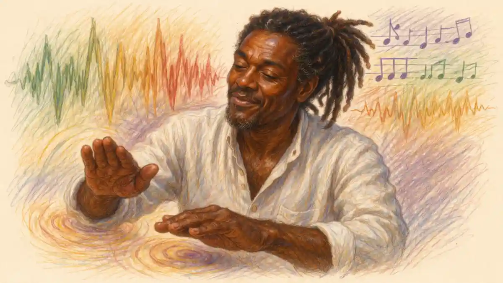

## The Verdict in Brief: An Opera That Trusts the Duet

Charles Gounod's Roméo et Juliette, first performed at the Théâtre Lyrique in Paris on 27 April 1867, is the operatic Romeo and Juliet against which every rival setting is measured, and the reason is a wager. Gounod and his librettists, Jules Barbier and Michel Carré, decided that the tragedy could be carried by a chain of four love duets, one for each stage of the affair: the meeting at the ball, the vows in the garden, the wedding night, and the tomb. Everything else in the play, the feud, the Prince, the comic servants, the civic machinery of Verona, was demoted to scenery around that chain. The wager paid. The opera held the Paris stage for decades, crossed to London and New York within months of its premiere, and settled into the international repertoire as the standard sung form of the story, a position no competing setting has displaced.

The verdict argued through this article is that the wager was right, and right for a reason its first detractors missed. Critics from 1867 onward complained that the opera is a string of pretty duets with a tragedy attached. The description is accurate and the judgment is wrong. The play itself concentrates its emotional capital in scenes for two voices: a shared sonnet at a ball, an exchange across a balcony, a dawn parting, a double suicide in a tomb. Gounod simply promoted the play's own architecture into the opera's load-bearing structure, and poured into the spaces between the duets the finest lyric writing of his career. Where the opera fails, it fails at the edges, in a feud that never acquires musical weight and a Verona that exists only to be escaped. Where it succeeds, it succeeds at the center, and the center is where the play lives.

The series thesis for the adaptation studies holds that the cliché keeps the play spoken, a monument of verse guarded by the stage. Gounod's setting refutes the cliché by demonstration. His opera treats the play as a score waiting for its music, a French lyric tragedy latent inside the English text, and the transformation is thorough enough that the sung version became, for generations of listeners who never opened the play, the form in which the story was known. A serious account of the opera therefore has to do three things. It has to trace how Barbier and Carré rebuilt the play, including the altered ending they inherited from David Garrick's stage tradition, the ending in which Juliette wakes while Roméo still lives. It has to examine the score number by number at the points where the argument is won, the waltz, the cavatina, the ballad of Queen Mab, the potion aria, and the four duets themselves. And it has to weigh the opera's strange textual history, an opera that exists in several states, with spoken dialogue and with recitative, with a ballet and without one, revised at one point by Georges Bizet, because the work's refusal of a single definitive form is part of what it is.

## Barbier and Carré: A Libretto Built from the Play, Through Garrick

The libretto of Roméo et Juliette is among the most faithful operatic adaptations of a Shakespeare play written in the nineteenth century, and its fidelity has a specific character. Barbier and Carré, who had already given Gounod the libretto of Faust in 1859 and Thomas the libretto of Mignon in 1866, worked close to the play's own sequence and, at many points, close to its language, translating celebrated lines directly into French verse. The scholar Steven Huebner, whose The Operas of Charles Gounod remains the standard study of the composer, explains why the task suited them: the play, in Huebner's phrase, "is itself notably rich in lyrical set pieces," scenes that arrive already shaped like operatic numbers. A masked ball with a first meeting staged as a sonnet, a balcony exchange built on alternating speeches that lengthen into arias of feeling, a dawn scene organized around a single question of lark or nightingale: the play hands an opera composer a series of formal occasions, and the librettists had the craft to recognize them and the discipline to leave their shapes intact.

The architecture they built keeps the play's five-act outline. An overture-prologue for chorus compresses the work of Shakespeare's Chorus, whose opening line, "Two households, both alike in dignity" (Prologue, line 1), becomes a choral narration of the feud before the curtain rises on the ball. Act 1 is the Capulet ball entire: the entrance of Juliette, Mercutio's ballad of Queen Mab, the waltz, the first duet, and Tybalt's suspicion checked by Capulet's command that the feast continue. Act 2 is the garden. Act 3 divides between Frère Laurent's cell, where the marriage is sung, and the street, where the duels and the banishment fall. Act 4 gives the wedding night and the potion. Act 5 is the tomb. A reader of the play can walk through the libretto scene by scene and find the correspondences in order, which is more than can be said for most operatic Shakespeare of the period.

Against that fidelity stand the changes, and they are systematic rather than casual. Rosaline vanishes, as she vanishes from nearly every adaptation, because an opera with four duets to build has no room for a reported first love. The Nurse survives as Gertrude, her comedy trimmed to a functional minimum, her great scene of the rope ladder and her Act 4 grief folded away. Pâris shrinks to a silhouette. The Prince of the play, Escalus, becomes the Duke, and his interventions contract to the single act of banishment. The reconciliation of the houses over the bodies, the golden statues, the Prince's closing judgment on Verona, all of it is cut, because the opera ends inside the tomb rather than outside it. The librettists' principle is visible across every cut: whatever serves the lovers' four meetings stays, whatever serves the city goes.

The boldest change is the ending, and it is not the librettists' invention. In the play, Romeo dies before Juliet wakes; the lovers never speak again after the dawn parting, and the tragedy's final irony is that a matter of minutes separates rescue from ruin. In the opera, Juliette wakes while Roméo still lives, poisoned but conscious, and the two sing a last duet before he dies and she stabs herself. Barbier and Carré took the alteration from the stage tradition descending from David Garrick, whose 1748 adaptation of the play had already let Juliet wake in time for a final exchange, an addition of some sixty-seven lines that held the English stage for generations. The French librettists worked from the play, but they worked as theatre people formed by the play's performance history, and Garrick's tomb was the tomb the eighteenth and nineteenth centuries knew. Hector Berlioz had used the same altered ending in his dramatic symphony of 1839. Gounod's opera therefore adapts not a pristine text but a performed tradition, and its most famous liberty is an inheritance.

## A Composer Formed by Berlioz and Rome: Gounod Before Verona

Gounod came to the lovers late in his own formation, and the formation explains the opera. Born in Paris in 1818, he took the Prix de Rome in 1839, and that year, on the threshold of his Italian residence, he attended the rehearsals of Berlioz's Roméo et Juliette and heard the older composer drive his dramatic symphony toward its premiere. The encounter is documented in Gounod's own hand: the preface to his Lettres intimes recalls the music's impact as indelible, and the young man's imagination was marked by the discovery that Shakespeare's tragedy could exist as pure orchestral feeling, the lovers rendered without a word of the text. Italy completed the education from the other side. In Rome, Gounod absorbed the sacred polyphony of the Sistine tradition and the discipline of Palestrina, and he left Italy half inclined toward the priesthood, a tension between the ascetic and the bon vivant that the biographical record, in Huebner's summary, treats as a permanent feature of his character. The two inheritances, Berlioz's orchestral Shakespeare and Rome's liturgical polyphony, meet in Roméo et Juliette a quarter-century later: the garden and chamber scenes are Berliozian in their orchestral sympathy, while the marriage rite in Laurent's cell and the closing prayer are Roman in their gravity, sacred music folded into a love tragedy.

The road from Faust to Roméo was not a straight ascent. Faust in 1859 had made Gounod the leading French opera composer of his generation, yet the following years brought the strain of maintaining that position against a shifting Parisian taste, and by 1865, when Barbier and Carré delivered the Roméo libretto, the composer spoke pessimistically to colleagues of the new work as possibly his last for the stage. The stakes concentrated his powers. Where Faust sprawls across a whole legend and depends on spectacle, a devil, and a chorus of students, soldiers, and demons, Roméo narrows to the smallest operatic unit that exists, two voices in accord, and the narrowing played to the composer's deepest gift. Gounod's melody is intimate by nature, built for the distance between two faces rather than for the breadth of a public square, and the play gave him a subject in which intimacy is not a reduction of the action but the action itself. The opera's success on its first night therefore surprised everyone except, perhaps, the composer, who had finally been handed a tragedy scaled to his instrument.

## Shakespeare in French Hands: The Century That Prepared the Opera

Gounod's opera was the culmination of a century-long French negotiation with Shakespeare, and its ease with the play was earned by predecessors. The French classical stage had first received Romeo and Juliet through Jean-François Ducis, whose adaptation of 1772 recast the tragedy in the unities and proprieties of the Parisian theatre, a version that held the stage by translating the play out of its own nature. The Romantics reversed the transaction. In 1827 an English company at the Odéon played the tragedies in the original tongue, Harriet Smithson as Juliet among them, and the effect on the young artists of Paris, Berlioz at their head, was conversion: Shakespeare became the warrant for a theatre of passion unbound by the classical rules. Victor Hugo's critical writings, crowned by his book William Shakespeare in 1864, installed the playwright as the presiding genius of modern drama in French eyes, three years before Gounod's premiere. The opera therefore addressed a public for whom Shakespeare was not a foreign classic requiring mediation but a contemporary possession, the property of the Romantic movement's heirs.

The point matters for judging the libretto's method. Barbier and Carré could track the play closely, translate its famous lines outright, and retain its five-act architecture, because the audience's Shakespeare was the Romantics' Shakespeare, the poet of the balcony and the tomb, already naturalized as a French lyric subject by Berlioz's symphony of 1839. A Ducis-era adaptation had to apologize for the play's violence and mixture; an adaptation of 1867 had to apologize for nothing except irrelevance, and Gounod's score is precisely the refusal of irrelevance, the play rendered in the musical language its French admirers spoke natively. The opera is thus a document in the history of Shakespeare's European afterlife as much as in the history of opera: the moment when the French stage stopped adapting the play into French forms and began, instead, to receive it entire, in a form French to the bone. That the tomb scene still arrived through Garrick, an English mediation, only sharpens the picture of a genuinely international transmission, the play passing from London stages to Paris scores with its alterations worn smooth as coinage.

## The Libretto's French: Translating the Play Line by Line

Barbier and Carré were not scholars approaching a monument; they were the most experienced theatre versifiers in Paris, and their method shows in the texture of the text. Where the play offers a line that had already entered the common memory of Europe, they tend to translate it with near-literal fidelity, so that a French listener in 1867 heard the balcony scene's astronomy, the sun commanded to rise and kill the envious moon, rendered in French verse that tracks the English image for image. Where the play offers prose, argument, or social machinery, they tend to compress, summarize, or displace the material into ensemble and chorus. The policy produces a libretto with two distinct densities: dense and faithful inside the lovers' scenes, thin and functional outside them, and the score's famous imbalance between the duets and everything else begins on the page, in the versifiers' allocation of their best lines.

The names record the translation's depth. Shakespeare's Friar Laurence becomes Frère Laurent, a bass of paternal gravity; the Nurse becomes Gertrude, her name domesticating her into the French bourgeois household the opera imagines around Juliette; the invented page Stéphano carries an Italian diminutive that places him in Verona while his music, a chanson of taunting lightness, places him in the French tradition of the trouser-role page, kin to Chérubin and to the pages of opéra comique. Even the feud's geography is translated. Verona in the libretto is a French provincial city wearing Italian names, its Duke a bass of administrative finality, its Capulet a paterfamilias whose Act 1 command that the feast continue is the act of a host in a French comedy of manners. None of this is carelessness. The librettists were naturalizing the play for a house, the Théâtre Lyrique, whose public expected literary subjects rendered in the manners of French lyric theatre, and the naturalization is the precondition of the opera's greatest strength: sung in this French, the lovers' scenes achieve an ease and intimacy that a more archaeologically faithful text, stiff with foreignness, could not have carried. The opera's Frenchness is not a varnish over Shakespeare. It is the medium in which the play's lyric occasions could become, once more, what they had been in the theatre of the 1590s: the living speech of the audience's own stage.

## Paris, 27 April 1867: The Premiere at the Théâtre Lyrique

The opera arrived as a commission born of success. Gounod's Faust, premiered at the Théâtre Lyrique in 1859, had played more than three hundred times at that house by 1868, and the theatre's director, Léon Carvalho, wanted a second Shakespeare-scale triumph from the same team. The librettists delivered their text early in 1865, and by August 1866 Gounod could lay the finished score before his director. The timing of the premiere was shrewd to the point of opportunism: Paris in the spring of 1867 was full for the Exposition Universelle, and the dignitaries crowding the capital for the exhibition formed a ready audience of international witnesses. The Théâtre Lyrique stood on the Place du Châtelet, a house devoted to exactly the genre Gounod had made his own, the opéra lyrique, a middle form between grand opera's spectacle and the opéra comique's domestic scale, hospitable to literary subjects, intimate feeling, and melody as the principal currency.

The first cast was headed by Pierre-Jules Michot as Roméo and Marie Caroline Miolan-Carvalho as Juliette, under the conductor Adolphe Deloffre. Miolan-Carvalho was the director's wife and the house's reigning soprano; she had created Marguerite in Faust and the title role in Gounod's Mireille, and she was celebrated for a coloratura technique of unusual brilliance. She was also, as the music historian Hugh Macdonald notes in his introduction to the opera, nearly forty years old at the premiere, an age at which a singing Juliette depends on vocal art rather than on any illusion of girlhood. Around the pair stood Jean Cazaux as Frère Laurent, Auguste-Armand Barré as Mercutio, Eugène Troy as Capulet, Jules-Henri Puget as Tybalt, and Joséphine Daram as the page Stéphano, a mezzo-soprano in a trouser role. The casting of the tenor had caused difficulty behind the scenes, and Gounod was reported to have composed the final act twice before the production settled. Neither trouble showed on the night. After the public rehearsal and the first performance the opera was hailed as a major success, it ran for a hundred consecutive nights in its first stretch, and across its first six-year run at the house it accumulated, by Macdonald's count, 322 performances. A parody, Rhum et eau en juillet, appeared at the Théâtre Déjazet, the surest Parisian certificate that a work had entered the popular imagination.

The triumph looks larger in its season's company. Paris in the spring of 1867 offered the most crowded operatic market in Europe: at the Opéra's old house in the Rue Le Peletier, Verdi's Don Carlos, mounted after a rehearsal period that drove its fastidious composer to distraction, reached forty-three performances without being counted a success; at the Opéra-Comique, Ambroise Thomas's Mignon, a hit from the previous year, played to packed houses; and at the Théâtre des Variétés, Offenbach's La Grande-Duchesse de Gérolstein, with Hortense Schneider, was the sensation of the season. Against a new Verdi, a reigning Thomas, and Offenbach at his most brilliant, the Shakespeare opera at the Châtelet house was the triumph its makers had needed, the success that restored Gounod's credit after the uncertain years that followed Faust. Macdonald's framing of the season makes the point precisely: the three established houses each had something special to offer, and the Théâtre Lyrique's offering, a Shakespeare hit following a Goethe hit from the same composer and the same director, proved the most durable property of them all. Don Carlos would wait generations for its full stature to be recognized; Mignon survives at the repertoire's edge; the Grande-Duchesse sparkles in revival. Roméo et Juliette simply stayed, passing from house to house and capital to capital without a break in its performing life, and the first season's arithmetic, 322 performances in six years at one address, is the foundation document of that permanence.

### What did Carvalho change before the premiere?

Léon Carvalho demanded recitatives in place of the spoken dialogue Gounod had planned, extra material for the second scene of Act 4, and the waltz aria "Je veux vivre" written for his wife's coloratura; in exchange, an aria for Frère Laurent, a chorus of monks for the wedding, and the scene of the two friars opening Act 5 were cut.

The episode matters because it locates the opera's authorship in negotiation rather than in solitary inspiration. Carvalho was a director who treated a score as a production under construction, and his interventions were commercial in motive and, in the event, shrewd in effect. The recitatives bound the opera into the continuous sung fabric that let it travel to houses where spoken French dialogue was unusable. The waltz gave the opera its single most extractable hit, the number that carried the title role's name into salons and bandstands. The added Act 4 material thickened the opera's weakest joint, the passage from the wedding night to the tomb. Gounod, for his part, accepted the changes and kept his own counsel about forms: the score, as the next stage of its history shows, remained open in his hands for the rest of his life.

## Four Duets, One Architecture

The opera's design can be stated in a single sentence: at each of the four moments where the play's lovers are alone together at a turning point, Gounod writes a full-scale duet, and the four duets, taken in sequence, enact the whole emotional plot. The first, at the ball, is formal and brief, a madrigal in which two voices test each other inside strict musical courtesies, matching the play's device of the shared sonnet. The second, in the garden, is the opera's longest span of sustained lyric exchange, vows traded and then prolonged past the point of prudence, as the play's balcony scene prolongs them. The third, on the wedding night, is the most sensuous music Gounod ever wrote, a duet of possession shadowed from its first bars by the dawn that ends it. The fourth, in the tomb, is a duet sung across the fact of death itself, one voice failing as the other rises to meet it. Courtship, vow, consummation, extinction: the sequence is a complete grammar of the affair, and no other element of the score pretends to equal it in weight.

This is the point at which the opera's alleged weakness converts into its method. A chain of duets is a static design only if the duets repeat each other, and Gounod's do not. Each occupies a different dramatic tense. The ball duet is in the present tense of discovery, two strangers improvising a shared form. The garden duet is in the future tense, all promise and condition, a contract negotiated in melody. The chamber duet is in a present already haunted by its own ending, the lovers singing against a deadline announced by birdsong. The tomb duet is in the past tense from its first phrase, a recognition scene in which the singers recount what has happened to them while it finishes happening. Sung in sequence, the four duets trace an arc no spoken production can reproduce, because music gives the arc a measurable shape: the vocal lines that begin by exchanging short phrases in Act 1 end by sustaining long interwoven spans over an orchestra that has learned, across five acts, to sing the lovers' feelings before they find words for them.

The map below sets the opera's numbers against the play's scenes, so that the correspondence argued in this article can be checked at a glance. It is the InsightCrunch Gounod map, and its pattern is the argument in miniature: Gounod's fidelity is structural before it is verbal, and his one great structural liberty, the waking Juliette, sits at the map's final row where Garrick placed it.

| Play scene | Gounod number | What the music does |
| --- | --- | --- |
| Prologue: "Two households, both alike in dignity" | Overture-prologue for chorus | The Chorus's narration becomes a choral frame for the feud |
| Act 1, Scene 4: the Queen Mab speech | Mercutio's ballad "Mab, la reine des mensonges" | Prose improvisation becomes a formal ballad with refrain |
| Act 1, Scene 5: the ball and the shared sonnet | Juliette's waltz "Je veux vivre"; duet "Ange adorable" | The sonnet exchange becomes a madrigal duet for two voices |
| Act 2, Scene 2: the balcony scene | Roméo's cavatina "Ah! lève-toi, soleil!"; duet "Ô nuit divine" | Alternating speeches expand into the opera's longest lyric span |
| Act 3, Scene 2: the marriage in the cell | The wedding scene in Frère Laurent's cell | The play's reported marriage is staged and sung as a rite |
| Act 3: Stéphano has no counterpart | Stéphano's chanson "Que fais-tu, blanche tourterelle" | An invented page provokes the street fight the plot requires |
| Act 3, Scene 1: the duels and the sentence | The street scene and the Duke's banishment | "A plague o' both your houses" falls inside an ensemble of public violence |
| Act 4: the wedding night and the potion | Duet "Nuit d'hyménée"; aria "Amour, ranime mon courage" | The dawn parting becomes a duet against birdsong; the potion becomes an aria of resolve |
| Act 5, Scene 3: the tomb, Garrick's waking added | Final duet and the plea "Seigneur, pardonnez-nous" | Juliette wakes before Roméo dies; the play's civic ending is replaced by a prayer |

Read down the third column and the opera's priorities declare themselves. Where the play offers two voices in a charged space, the score expands; where the play offers a crowd, a council, or a joke, the score contracts. The map also exposes the omissions as plainly as the correspondences: no row for Rosaline, no row for the lovers' parents reconciled, no row for the Prince's final sentence on Verona. Gounod's Verona is a city with one interior that matters, and the map's silences mark the rooms he chose not to enter.

## Act One Assembled: Chorus, Feast, and the Feud Held at Bay

The first act deserves study as construction, because its ease conceals a demanding piece of engineering. The overture-prologue disposes of the exposition in minutes: a chorus, in the manner of the play's Chorus but multiplied into the whole citizenry of Verona, sings the feud's terms and the lovers' foretold end, and the opera thereby buys itself the right to begin inside the story rather than before it. The curtain rises on the ball already in motion, Capulet receiving, Tybalt confiding his suspicions to Pâris, Juliette presented to the company by her father with a pride the waltz will immediately convert into personal radiance. The maskers' entrance, Roméo and Mercutio and Benvolio among them, is staged as an irruption of youth into ceremony, and Mercutio's Mab ballad, placed here, functions as the act's licensed disorder, the brilliant friend holding the room while the plot assembles itself around the edges of his song.

The act's dramatic curve is a study in containment. Every element of the tragedy is present by the final ensemble: the lovers have met and sung together, Tybalt has recognized the intruder and demanded satisfaction, and only Capulet's authority, exercised as a host's insistence that the feast continue, holds the feud inside the forms of hospitality. Gounod marks the containment musically by refusing the act a catastrophe: the finale gathers the company in a blaze of dance rhythm, the ball resumes over the unhealed insult, and the curtain falls on festivity with the feud banked rather than settled. The design trusts the audience's knowledge of the play to supply the dread, and that trust is the prologue's true function: having been told the ending by the chorus, the audience watches the ball's brightness as the lovers cannot, aware that the waltz's dream and Mab's lies are the last entertainments of a world already sentenced. An act that textbooks summarize as a sequence of numbers is, in the theatre, a single arc from narration through radiance to suspended violence, and its construction is the librettists' and composer's joint answer to the oldest problem in adapting this play, how to make an audience that knows the ending watch the beginning with fresh attention.

## The Ball: "Je veux vivre" and the Waltz That Made a Juliette

Juliette enters the opera not as a victim of the feud but as a girl singing a waltz about wanting to live inside a dream. "Je veux vivre" was written to order. Miolan-Carvalho, whose instrument was a coloratura of celebrated brilliance, needed a showpiece in the first act, and Gounod composed the waltz-ariette expressly for her voice, a sequel, in function, to the Jewel Song he had given her Marguerite in Faust. The number crests at a high D amid chromatic scales and roulades, and it was, by every account, the hit of the premiere. Its dramatic logic is finer than its origin suggests. The play's Juliet, in her first scenes, is defined by refusal: she will look to like, if looking liking moves her, and she promises no deeper engagement than her mother's endorsement can warrant. Gounod's Juliette announces the opposite program before she has seen Roméo at all. She wants the dream, wants to live in it, wants youth to pass like a flower if it must. The waltz therefore reverses the play's sequence of feeling: desire precedes its object, and when the object appears minutes later, in the masked and hastily unmasked Roméo, the music has already explained why this girl, of all the dancers in her father's hall, will be the one to answer him.

The ball scene also contains the opera's first duet, and the duet's method is translation at the level of form. In the play, the lovers' first exchange is a sonnet, fourteen lines shared between two speakers, a pilgrim-and-saint conceit worked out in strict alternation. Barbier and Carré keep the conceit and Gounod keeps the alternation, casting the meeting as a madrigal for two voices, "Ange adorable," in which short phrases pass between the singers like lines of verse. The parallel with the spoken scene is exact enough to reward attention to the play's original moment, the instant when Romeo first sees Juliet across her father's feast and the verse itself ignites; the InsightCrunch reading of [that first sight in the play's ball scene, where Romeo declares that Juliet teaches the torches to burn bright](/2025/03/07/she-doth-teach-the-torches-analysis/), sets out the textual ground from which Gounod's madrigal grows. What the music adds is simultaneity. A sonnet can only be shared line by line; a duet can end with the voices joined, and Gounod lets the madrigal's closing phrases intertwine, so that the form performs the union the words are still too courteous to name. Tybalt's interruption then does the work of the play's recognition scene, and Capulet's command that the feast continue closes the act with the feud's first check: the householder's hospitality overriding the heir's rage, a balance the opera will not strike again.

## The Garden: "Ah! lève-toi, soleil!" and the Balcony Duet

Act 2 is the opera's center of gravity, and Gounod builds it as a single ascending span. Roméo enters the Capulet garden alone and greets the light in Juliette's window with the cavatina "Ah! lève-toi, soleil!", a direct transposition of the play's "It is the east, and Juliet is the sun" and its command "Arise, fair sun, and kill the envious moon" (Act 2, Scene 2). The aria establishes the act's governing metaphor before the heroine appears: light against night, the beloved as a rival luminary, the garden as a space where the ordinary astronomy of Verona is suspended. Then the duet begins, "Ô nuit divine," and Gounod settles into the longest act of sustained lyric exchange in his output, an expansion of the balcony scene in which the play's alternating speeches, questions traded across a vertical distance, vows proposed and qualified and proposed again, become a continuous woven texture for two voices over an orchestra that breathes with them.

### Why does the garden scene open with an orchestral prelude?

Because Gounod makes the orchestra carry the scene's feeling before either voice enters: the Act 2 prelude for strings and harp states the night music of the garden, returns at the act's close beneath Roméo's farewell "Va! repose en paix," and turns the balcony exchange into an aria the whole theatre has already heard.

Huebner's account of Gounod's craft fastens on exactly this feature, the refusal to treat the orchestra as accompaniment. At Gounod's best moments, Huebner writes, voice and instrumental strain enter into a symbiotic relationship, each given nearly equal importance in the lyrical whole, the voice assisted by the orchestra in its mission to communicate truth. The garden act is the proof case. The prelude's material does not merely decorate the duet; it frames it, returns beneath the parting, and gives the audience a memory of the scene's emotion in purely instrumental form, so that the farewell lands on prepared ground. The play's scene ends with Juliet's "Good night, good night! Parting is such sweet sorrow" (Act 2, Scene 2), a line built on a paradox of repetition, sorrow sweetened by the promise of return. The opera ends its act with music built the same way, the prelude's strain recurring under new words, sweetness and sorrow in a single gesture. Adaptation at this level is not illustration. It is analysis, conducted in sound, of how the spoken scene achieves its effects, and the analysis is correct.

## Queen Mab as a Ballad: Mercutio Translated

The Queen Mab speech is the play's most famous act of pure verbal display, Mercutio's improvisation on the fairies' midwife who gallops through sleepers' brains and teaches each dreamer to dream of his own obsession. It is prose, it is digressive, it stops the plot cold on the way to the ball, and it is precisely the kind of passage an opera is supposed to cut. Barbier and Carré kept it, and Gounod set it as Mercutio's ballad, "Mab, la reine des mensonges," a formal song with a refrain, delivered at the ball itself as the maskers arrive. The relocation is pointed: the play's speech happens on the street, in the last minutes of ordinary life before the feast changes everything, while the opera moves Mab inside the Capulet hall and makes her an entertainment, the brilliant friend performing for the room. Something is lost in the move, the speech's function as a rebuke to Romeo's lovesick dreaming, since the dreamer has not yet been established as lovesick for anyone in the hall. Something is also gained, and the gain is characterization by genre. A ballad is a public, patterned thing, all surface and refrain, and Mercutio in the opera is exactly that: the friend whose wit is a performance, whose inner life the score never opens. When he dies in Act 3, the opera loses its most accomplished singer of set forms, and the loss is structural. After Mercutio, nobody in Verona sings a closed number for pleasure again. The play's Mercutio speaks the line "she is the fairies' midwife" (Act 1, Scene 4) inside an improvisation that Romeo must interrupt; the opera's Mercutio completes his ballad to applause, and the completeness is the character. Gounod translated the speech's virtuosity and sacrificed its violence, a trade that defines the opera's handling of every secondary figure.

## The Cell, the Street, the Sentence: Act Three

Act 3 is the opera's hinge, and it is built as a fall from the sacred to the civic. The first scene stages what the play only reports in passing: the marriage itself, in Frère Laurent's cell, the lovers attended by Gertrude, the friar singing his hope that the union will reconcile the houses. Staging the rite was a choice with a charge. The scene places a sacrament on the operatic stage and lets it presage, as hostile contemporaries complained, a wedding night as well as a wedding, and the charge in the scene is real: Gounod gives the ceremony the weight of a genuine liturgy, so that everything afterward reads as the violation of something solemn rather than the frustration of a plan. The friar of the opera is a graver figure than Shakespeare's meddling herbalist, and the marriage music is written to be remembered at the tomb, where the same sacred sonorities return in ruin.

The second scene falls into the street, and its engine is an invention. Stéphano, Roméo's page, has no counterpart in the play; Barbier and Carré created the part, a trouser role for a mezzo-soprano, because the street scene needed a provocation and the play's provocation, Mercutio's taunting of Tybalt in the heat, required more machinery than the opera's compressed street could hold. Stéphano's chanson, "Que fais-tu, blanche tourterelle," sung beneath the Capulet windows to draw the household out, performs the taunt's function in a single number: the page mocks Grégorio, the servants skirmish, the kinsmen gather, and the duel arrives as if summoned by a song. Then the opera tightens. Tybalt and Mercutio fight; Mercutio falls, and the play's great exit line, "A plague o' both your houses" (Act 3, Scene 1), lands inside an ensemble rather than in a solo spotlight, cursed at both families by a dying man the crowd can hear. Roméo's revenge, Tybalt's death, and the Duke's sentence of banishment follow in swift succession. The act demonstrates the opera's one reliable method for public action: compress it, choralize it, and let the private catastrophe, Roméo exiled from Juliette, register as the true wound. The feud kills efficiently in this score. It simply never sings as memorably as the love it destroys, and the imbalance, deliberate or not, is the opera's honest map of the play's own sympathies.

## The Missing Duet: Act Three's Silence at the Center

Count the duets again and a structural fact emerges that commentary rarely names: the chain has a gap exactly at the opera's center. Act 3, the act of the marriage, the duels, and the exile, contains no love duet at all. The lovers meet in Laurent's cell, but they meet inside a rite, their voices joined with the friar's in ceremony rather than exchanged in solitude, and from the cell scene's close until the chamber duet of Act 4 they do not sing together. The gap is not an oversight. It is the opera's way of staging the tragedy's mechanism, in which the world of Verona, having been held at bay through two acts of lyric enclosure, breaks into the lovers' music and occupies an entire act with its own sounds: a page's taunting chanson, the clash of the duels, ensembles of horror, a sentence pronounced by authority. The feud gets no tunes worth remembering, but it gets the middle of the opera, and the disproportion is the meaning. Love in this score is what happens in enclosures, garden, chamber, cell, tomb; the street belongs to everyone and therefore to death.

The gap also explains the peculiar weight of the Act 4 duet, which must accomplish what no other number in the score attempts: it must re-establish the lovers' musical world after an act of its absence, and re-establish it under sentence of dawn. "Nuit d'hyménée" opens with the unsung cello melody precisely because the chain has been broken; the orchestra restates the lovers' element in its purest form, without voices, as if re-teaching the theatre the language the street interrupted, and only then do the singers re-enter their own music. Read this way, the opera's design is not four duets with material between them. It is a single span of lyric enclosure broken once, at the center, by the world, and the tomb duet's desperation is the sound of the enclosure closing for the last time over a space the world has already entered and poisoned. The design vindicates itself against the eclogue charge from within: a mere chain of pretty duets would distribute its numbers evenly, while Gounod's distribution enacts the plot.

## The Wedding Night and the Potion: Act Four

Act 4 holds the opera's most admired music and its most exposed join. The act opens in Juliette's chamber at dawn, the wedding night already ending, and the third duet, "Nuit d'hyménée," unfolds as a single sustained span of shared melody. The play's dawn scene is an argument about ornithology conducted by two people who both know the answer: the lark sings, the nightingale is a fiction they maintain together until it fails. Gounod converts the argument into atmosphere. The duet's phrases lengthen and intertwine over an orchestral texture of unusual richness, and the parting, when Roméo descends and the act's first scene closes, is staged as a musical inevitability rather than a decision, the melody itself running out like the night. After the duet comes the act's machinery: Capulet, arriving with the friar, announces the marriage to Pâris as Tybalt's dying wish; Juliette, alone with Laurent, receives the potion and his instructions; and the act closes on her resolve.

### What does the orchestra sing in Act 4 that no voice ever sings?

The wedding-night duet is launched by a melody given to four cellos in their richest register, a theme of such completeness that it governs the scene, and Gounod never assigns it to a singer: the opera's most magnificent tune exists only in the orchestra, as if the lovers' feeling exceeded what their voices could state.

The potion scene gives Juliette her second great solo, and it is the anti-waltz. "Amour, ranime mon courage" is an aria of willed courage, preceded by a passage of pure fear in which the heroine imagines the horrors of the vault, the ancestors' bones, Tybalt's corpse, waking madness, before calling on love to rekindle her nerve and drinking. Where the waltz displayed a voice in effortless command of its ornaments, the potion aria displays a will in command of its terrors, and the soprano who can do both has the role entire. The Met's program literature for the opera records that this was the number Gounod himself prized above the heroine's other music, the showpiece being the director's wife's requirement and the aria the composer's own center of gravity for the character. The pairing defines Juliette as the opera conceives her: the girl of the waltz becomes the woman of the potion by an act of courage, and the score charts the growth in the distance between two solos, one all sparkle and one all resolve. The act's exposed join is what follows, the wedding procession and festivities for Pâris that the Opéra version expands into a ballet, spectacle arriving at the exact point where the drama has narrowed to a girl alone with a vial. Gounod's own instinct had been compression; the ballet belongs to the opera's later institutional life, and its cost and its logic belong to that story.

## Juliette's Arc: From the Waltz to the Dagger

Trace the soprano's music in sequence and the opera reveals its most quietly radical feature: Juliette is the only character who changes. Roméo enters finished and exits constant, a lyric tenor of one ardent register. Juliette begins as display, the waltz's brilliant surface, a girl performing joy for her father's guests with a technique that advertises the singer as much as the character. She ends as decision. Between the poles, Gounod gives her a graduated series of tests, each in a different vocal genre. The madrigal duet tests her courtesy, phrases exchanged under the ball's surveillance. The garden duet tests her candor, the vows proposed and pressed past the point where the play's Juliet calls for the exchange of her love's faithful vow for his. The Act 4 sequence tests her in succession as wife, in the chamber duet's sustained ardor, and as strategist, in the potion aria's passage from terror to resolve, the opera's single most demanding stretch of dramatic singing. The tomb completes the examination: waking to a dying husband, she matches his failing phrases, gathers the opera's last reserves of lyric strength, and performs the score's final decisive act, the dagger stroke that the play assigns to the words "O happy dagger! This is thy sheath" (Act 5, Scene 3).

The arc reframes the old question of whether the opera belongs to its soprano. Edwards heard an eclogue for Juliet and Romeo, in that order, and the order was precise. The opera's Juliette proposes, in effect, at every stage: Gounod's own remark to Melba, that Juliette was very forward and that the proposal was hers, states the conception outright, and the score enforces it by giving the heroine both of its solo pillars, the waltz and the potion aria, while Roméo receives one cavatina and the partnership of the duets. Productions that cast the roles as equal weights misunderstand the design; the opera is a soprano's tragedy with a tenor as its necessary other voice, and its performance history, dominated by the names of Pattis, Eameses, and Melbas, with the tenors remembered as their partners, reflects the score's own distribution of power. In the play, Juliet's growth from obedience to command is the tragedy's inner plot. Gounod, alone among the play's operatic adapters, rebuilt that inner plot in vocal genres, and the rebuilding is his strongest claim to be read as an interpreter of Shakespeare rather than an illustrator of him.

## The Tomb: Garrick's Waking and the Final Duet

Act 5 is short, and its brevity is its argument. Gounod had planned to open it with a scene for the two friars, Laurent and Jean, in which the miscarriage of the letter would be explained; the scene was cut before the premiere, one of Carvalho's economies, and the opera is leaner for the loss. Explanation is the one thing the final act refuses. Roméo enters the tomb having already taken his poison, finds Juliette on her bier, and sings his farewells to a woman he believes dead. Then the Garrick alteration performs its work: Juliette wakes. The potion's sleep breaks while the poison still leaves him strength, recognition floods the scene, and the fourth duet begins, the lovers singing together in the full knowledge that the reunion is measured in minutes. He weakens; she seizes his dagger and stabs herself; and the opera closes with the two voices joined in a plea for pardon, "Seigneur, pardonnez-nous," addressed not to Verona, not to the audience, but upward.

The alteration deserves a defense conducted on musical grounds, because musically it is not a liberty but a necessity discovered by the stage long before Gounod. A spoken Romeo can die eloquently alone; "Thus with a kiss I die" (Act 5, Scene 3) is a complete theatrical event in a single line, and Juliet's waking soliloquy over the body, ending in "O happy dagger! This is thy sheath" (Act 5, Scene 3), is another. An opera, whose entire method is the conversion of feeling into sung exchange, cannot end its central relationship with two solos addressed to a corpse and an absence. It needs the voices together once more, in the same acoustic space, completing the chain the ball began. The French critic and composer Gérard Condé, writing on this ending, called the result the felicity of a joint suicide, a paradox that catches the scene's operation exactly: the alteration betrays the play's irony and fulfils the opera's form, and the fulfilment is so complete that audiences have rarely experienced the moment as a betrayal. The lovers' shared death also places the opera inside the great nineteenth-century pattern in which love and extinction become a single consummation, the pattern Wagner raised to metaphysics in Tristan und Isolde; the InsightCrunch study of [the love-death tradition, where Liebestod binds desire and dying into one consummation](/2024/01/05/love-and-death-liebestod-analysis/), traces that pattern's logic, and Gounod's tomb is its French lyric instance, gentler than Wagner's, ending not in transfiguration but in a prayer. What the ending sacrifices is the play's civic frame. No Prince sums up, no fathers clasp hands over the bodies, no golden statues are promised. Verona learns nothing, because the opera's Verona was never the subject. The subject was two voices, and the opera ends when they stop.

## Dialogue, Recitative, Ballet: The Opera's Several States

No major opera of the century exists in a more unsettled set of forms. Gounod first conceived Roméo et Juliette with a large amount of spoken dialogue, on the ground that recitative would slow the action; Carvalho overruled him for the Théâtre Lyrique, and recitatives were composed for the premiere. Yet Gounod continued to regard the two states as alternatives rather than as draft and revision. His own explanation survives: a host of theatres, he wrote, would prefer to mount the work with dialogue, and in his opinion recitative everywhere was no advantage in Roméo, since it lengthened the performance. Publishers and houses took him at his word, and the opera circulated in both fabrics, sung throughout where resources allowed, spoken between the numbers where they did not. The music historian Hugh Macdonald draws the general moral: Gounod never believed in definitive forms of his operas, recognizing that different audiences require different levels of sophistication, and Roméo et Juliette survives in many forms, adjustable to singers, staging, and public. The observation explains the opera's whole textual biography, a work treated by its composer as a living property rather than a fixed monument.

### Why did Bizet revise the opera in 1873?

When Roméo et Juliette passed to the Opéra-Comique in January 1873, Gounod was in London, entangled in legal and domestic difficulties, and he enlisted Georges Bizet, the younger composer he had championed, to carry out the revisions the transfer required; the substituted hand of the future composer of Carmen is one of the score's strangest footnotes.

The Opéra-Comique run that followed the 1873 transfer was the opera's longest Parisian tenancy, 391 performances in fourteen years by Stéphane Wolff's count of that house's history. The final migration came on 28 November 1888, when the opera entered the Paris Opéra at the Palais Garnier, and the Opéra's house rules demanded what the Théâtre Lyrique had not: a ballet. Gounod supplied one, inserted in the fourth act around the wedding festivities, as he had earlier been obliged to add a ballet to Faust for the same stage. The old handbook tradition in Kobbé's Complete Opera Book calls the ballet an excrescence that retards the action and checks the interest, a verdict that is hard to dispute as drama and easy to understand as institution: the Opéra's subscribers expected dancing, and a Roméo without a ballet would not have been programmed at all. Students of the score who set the three states side by side, the dialogue version, the recitative version, and the Opéra version with its ballet, can inspect the variant pages in sequence with the [ReportMedic PPT Viewer](https://reportmedic.org/tools/ppt-viewer.html) when the material is assembled as a slide deck for seminar comparison. The states are not corruptions of a lost purity. They are the record of an opera negotiating, house by house and decade by decade, the terms on which Paris would keep singing it, and the negotiation succeeded: the work was still accumulating performances at the Opéra-Comique well into the following century, and the first complete recording, made in 1912 with Agustarello Affre and Yvonne Gall in the title roles, preserves a tradition that descends in an unbroken line from the composer's own revisions.

## Opéra Lyrique: The Genre That Made the Opera Possible

Roméo et Juliette belongs to a genre that French musical life invented for its own needs and that posterity has persistently undervalued: the opéra lyrique, the lyric opera of literary subjects, intimate passions, and melodic abundance, pitched between the state spectacle of grand opera and the spoken-dialogue domesticity of opéra comique. The Théâtre Lyrique existed to house it, and Gounod was its presiding composer, the man whose Faust had proved that a Goethe tragedy could be carried by lyric expansion rather than by the five-act machinery of Meyerbeer. The genre's terms explain the opera's shape at every point. Its scale permits a tragedy built from two voices; its contract with the audience promises melody as the principal event; its literary prestige licenses the close tracking of a classic text that a grand opera, obliged to furnish ballets, processions, and conflagrations, would have trampled. Even the opera's troubles descend from the genre's terms, since the work's migration to the Opéra in 1888 forced the lyric conception into the grand house's rituals, ballet included, and the seams of that forced translation remain the score's most debated feature.

The genre also fixes the opera's place in the line of French music. Gounod's lyric manner, melody of long breath and fastidious harmony, an orchestra that thinks alongside the voices, became the school in which the next French generation learned its trade, and the duet-centred love tragedy descends from Roméo et Juliette through the century's later French settings of fatal love, above all in Massenet, whose ardent pairs sing in rooms Gounod built. To call the opera old-fashioned, as the Wagnerian century learned to do, is to mistake the genre's deliberate conservation for incapacity. Gounod knew the alternative; he had heard Berlioz rehearse in 1839 and Wagner's shadow lay across every Parisian desk by 1867. He chose the closed number, the set duet, the aria of resolve, because the play he was setting is itself built from closed forms, sonnet, aubade, epithalamium, lament, and because his subject's feelings arrive in framed occasions rather than in continuous becoming. The genre was the analysis. Posterity, which keeps the opera and has let most of its grander contemporaries lapse, has ratified the choice.

The genre's home did not share the work's luck. The Théâtre Lyrique, the institution Carvalho had built into the lyric opera's Parisian address, did not survive the upheavals that closed the Second Empire, and the opera's passage to the Opéra-Comique in 1873 was a refugee's migration as much as a promotion. That the work flourished in exile, accumulating 391 performances in fourteen years at a house whose traditions ran to spoken dialogue and domestic comedy, testifies to the portability Gounod had built into it from the start, the dual fabric of dialogue and recitative doing exactly the work its composer predicted when he refused to let the score be fixed. The opera outlived its theatre, then outlived its second theatre's century, and the pattern of its survival, migration without loss of identity, is the practical proof of Macdonald's dictum that its composer never believed in definitive forms. A monument can be stranded by history; a repertory of adjustable forms travels.

## Patti, Mario, Melba and the Metropolitan: A Singers' Opera

The opera's international career began within weeks and ran on famous voices. London heard it first on 11 July 1867 at Covent Garden, in Italian, with Adelina Patti as Giulietta and the tenor Mario, Giovanni Matteo Mario, as her Romeo, barely ten weeks after the Paris premiere. Patti made the role a personal property, and her association with the opera culminated in Paris itself: when the work reached the Opéra in November 1888, it was Patti who sang Juliette, opposite the Roméo of Jean de Reszke, the Polish tenor whose assumption of the part became the era's standard. New York heard the opera in the same year as Paris, at the Academy of Music on 15 November 1867, with Minnie Hauk as Juliette. The Metropolitan Opera took it up on 14 December 1891, in French, with Emma Eames as Juliette, Jean de Reszke again as Roméo, and his brother Édouard de Reszke as Frère Laurent, a cast that fixed the opera in the Met's French wing for a generation; the house's tradition ran through tenors such as Victor Capoul and Albert Saléza and, in London and New York alike, through Nellie Melba, for whom Juliette was an early success and a signature part.

Melba's connection to the role preserves the composer's own reading of his heroine. The Australian soprano visited the aging Gounod to study her parts in his operas, and her autobiography records his instruction on Juliette: the girl, he told her, was very forward; it was she who proposed to Romeo. The remark is worth more than its anecdotal charm. It confirms that Gounod conceived Juliette as the opera's agent, the partner who acts, which is precisely what the score enacts in the distance between the waltz and the potion aria, and it aligns the opera with the play's own distribution of initiative, in which Juliet proposes the marriage, sets the messenger's hour, and drinks first. The opera's vocal history after the first generation tells the same story from the casting side. Roméo et Juliette lives when a house can field a soprano of genuine coloratura brilliance who can also sustain the long lyric spans of Acts 2 and 4, and a tenor of equivalent lyric grace; it fades when either chair is filled by a voice of the wrong weight. Its performance statistics across the twentieth century therefore track the supply of such singers as much as the taste of audiences, and the work's firm place in the repertoire of French companies, and its periodic blazing revivals elsewhere whenever a matched pair of voices appears, follow from the score's design. The duets demand a partnership, and the opera waits, sometimes for years, for the partnership to assemble.

## Three Settings, Three Verdicts: Bellini and Berlioz Beside Gounod

Gounod's opera did not enter an empty field, and its supremacy is best measured against the two settings that frame it. Before Gounod came Vincenzo Bellini's I Capuleti e i Montecchi, premiered at La Fenice in 1830, an opera whose lovers reach the stage by a different road altogether: Felice Romani's libretto draws not on Shakespeare directly but on the Italian novella tradition and on Romani's own earlier libretto for Nicola Vaccai, so that Bellini's Giulietta and his trouser-role Romeo inhabit a drama of houses and politics in which the tomb scene's stolen duet, in Vaccai's setting, became so beloved that it was grafted into Bellini's score for Maria Malibran. The [Bellini setting of 1830, I Capuleti e i Montecchi](/2028/11/03/bellini-capuleti-montecchi/), receives its own full study in this series; what matters for the Gounod verdict is the contrast of method. Bellini's opera is a tragedy of situation sung in long melodic arcs, its Shakespeare held at two removes. Gounod's is a tragedy of encounter sung in duets, its Shakespeare held close enough for lines to be translated outright.

After Bellini and before Gounod came Hector Berlioz, whose Roméo et Juliette of 1839 is not an opera at all but a dramatic symphony, voices and orchestra in a hybrid form invented for the concert hall. Berlioz had fallen on the play like a revelation at the Odéon in 1827, watching Harriet Smithson play Juliet in English he barely understood, and his exclamation on contemplating the subject, "God! What a fine subject! How it lends itself to music!", could stand as the motto of every composer who followed him to Verona. Gounod, then a young Prix de Rome winner, heard Berlioz rehearse the symphony in 1839 and carried the impression for life; his preface to his Lettres intimes recalls the impact as indelible. The debt makes the divergence instructive. Berlioz, who had voices at his disposal, set the tomb scene for orchestra alone, refusing to let the lovers sing their reunion; Gounod, inheriting the same Garrick ending in which Juliet wakes before Romeo dies, built his entire final act on that reunion as a duet. The [Berlioz dramatic symphony of 1839](/2028/11/10/berlioz-symphony-romeo-juliette/) is examined at length in its own article in this series. Between the three settings, the nineteenth century's verdict is written in performance counts: Bellini's opera survives as a vehicle for two great singing actresses, Berlioz's symphony as a concert monument, and Gounod's as the story's standard operatic form, the setting a listener means, without qualification, by the opera of Romeo and Juliet.

A fourth name belongs in the comparison because the opera's first English critic put it there. Sutherland Edwards, closing his 1867 notice, set Nicola Vaccai's Giulietta e Romeo of 1825 beside Gounod's opera with a stiletto of a compliment: Vaccai's work, he wrote, is an admirable opera for Giulietta, in which Romeo is not forgotten, the implication being that Gounod's eclogue forgets its Romeo in its soprano's waltz. The gibe had a factual root, since Vaccai's tomb scene was famous enough to be grafted into Bellini's opera for Malibran, a distinction no page of Gounod's has ever received from a rival score. Yet the implication fails against the duet architecture: a setting built on four duets cannot forget its tenor, whose voice is structurally indispensable to every climax the soprano reaches, and the opera's performance history, in which the Roméos of de Reszke's school were stars in their own right, refutes the charge in practice. Edwards's sentence survives as the wittiest form of the case against the opera, and the case, here as elsewhere, describes the design and mistakes it for the defect.

## A Tour of the Remaining Numbers: What the Map Compresses

The duets dominate the argument, but the score's connective numbers carry more craft than their reputation suggests, and a tour of the less celebrated pages shows the opera thinking. Capulet's music at the ball is a case in point: the host's welcome and his rebuke of Tybalt are written with a bluff, rhythmic generosity that fixes the character in minutes, the public man whose hospitality is a form of rule, and the same music's return in Act 4, when the father arrives to announce the Pâris marriage as a dead man's wish, darkens the remembered geniality into tyranny without a note needing alteration in kind. Tybalt himself, a tenor part where the play suggests a firebrand, is kept deliberately thin, all edge and no interior, because the opera's economy cannot afford a second sympathetic young man; his death lands as an event in Roméo's music rather than in his own. Pâris is thinner still, a baritone silhouette whose Act 4 suit is conducted entirely through other people's voices, and the thinness, once again, is policy: every page of sympathy spent outside the central pair is a page taken from the chain.

The ensembles repay the same attention. The Act 3 street scene is the score's one sustained essay in public music, and its construction is a crescendo of forces, page and servant, kinsmen of both houses, principals, full chorus, the Duke's sentence laid over the ensemble like a seal. The wedding music of Act 4, the festivities prepared for a bride who has already drunk the potion in secret, exploits the opera's cruelest irony in choral form, public joy scored at full blaze against the audience's knowledge, and the blaze is Gounod's, not the ballet-master's: the festivities were part of the act before the Opéra's dancers claimed their share of them. Laurent's music in the potion scene, grave instructions over a hushed orchestra, and the brief, bleak exchanges that open the tomb act complete the tour. None of these numbers competes with the duets, and none was meant to. They are the frame built by a master framer, and the tour's conclusion is the article's recurring one: the opera knows exactly where its treasure is kept and spends its craft accordingly, lavishly at the center, efficiently at the rim.

## The Critics' Quarrel: Eclogue, Failure, or Lyric Truth

The case against the opera was made at once, and made well. Sutherland Edwards, music critic of the St. James's Gazette, reviewed the first London performance in 1867 and fixed the hostile formula in a paragraph that has trailed the work ever since. Gounod, he wrote, is "always pleasing, though seldom impressive," and the opera might be described as "the powerful drama of Romeo and Juliet reduced to the proportions of an eclogue for Juliet and Romeo"; the work is remembered, he concluded, as "a series of very pretty duets, varied by a sparkling waltz air" for Juliet. Parisian ears of a more austere temper heard even less. The critic Henri Blaze de Bury found in the score a music of abstract ideas, nothing for the heart, nothing for the senses, a complete absence of dramatic life and no melody; another early voice judged that Gounod never rose above several degrees below zero. The severest brief came later and from a greater critic. George Bernard Shaw, reviewing the opera in his years as a music critic, held that Gounod failed in Romeo as he failed in every opera except Faust: the number opera's closed forms could not trace passion's growth, the unfolding of the drama hangs fire in every scene, no scene ends at a higher pitch of feeling than it began, and the tomb scene demanded a sympathy with despair that Gounod never showed. On Shaw's account the opera is a failure of method, not of talent, the old undramatic form asked to carry matter it cannot sincerely hold.

The defense, assembled across the following century, concedes the descriptions and reverses the valuations. Huebner's scholarship established the ground: the play solicits the treatment, being itself rich in lyrical set pieces; the librettists adapted with a skill not always acknowledged; and the score's orchestral writing, so far from upholstery beneath pretty duets, enters into symbiosis with the voices, carrying feeling the words have not reached. Macdonald's history adds the institutional answer: an opera that played 322 times in its first six-year Paris run, 391 times in fourteen years at the Opéra-Comique, and conquered three capitals in a season was not failing at drama in any sense its audiences could detect, and its composer's refusal of a definitive form was a professional's realism rather than a weakling's drift. Camille Saint-Saëns, who knew Gounod's craft from inside the same Parisian world, left the defense its epigram in substance: the writing is impeccably elegant. Even the first English notice contains its own counterweight, since Edwards, in the act of coining the eclogue charge, granted Patti's Juliet a tragic genius equal to her genius for comedy, an odd concession if the vehicle were merely pretty.

The adjudication this article reaches is that Edwards described the opera accurately and judged it by the wrong standard, while Shaw, the stronger critic, is right about one scene and wrong about the whole. Edwards's series of duets is the design, and to measure the opera by the play's public drama is to fault a tragedy of two voices for lacking a senate. Shaw's charge that no scene ends higher than it began collapses against Act 3, where the street scene mounts from a page's taunting song to two corpses and a sentence of exile, and against Act 4, where the chamber duet and the potion aria raise the temperature in succession. Where Shaw lands, and lands hard, is the first half of the tomb scene: Roméo's solo apostrophes over the apparently dead Juliette are the score's thinnest stretch, conventional in gesture precisely where the play is most daring, and Gounod's recovery comes only when Garrick's alteration lets the second voice enter and the duet machine restart. The opera's defenders should concede the tomb's opening and claim the rest. A work whose weakest passage is the price of its greatest one, and whose design has carried the story across a century and a half of stages, is not an eclogue that shrank a drama. It is a drama re-founded on the only ground opera can hold against Shakespeare: two voices, in a garden, in a chamber, in a tomb, singing as if speech had run out.

## Roméo's Music: A Tenor Written as a Lover, Not a Hero

The opera's Romeo problem is the reverse of the play's. Shakespeare's Romeo begins as a Petrarchan amateur, sighing for Rosaline in borrowed conceits, and the play must burn the imitation lover away before the real one can stand in the tomb. Gounod's Roméo has no Rosaline and no apprenticeship; he enters already the finished lyric tenor, and his music is written for the voice type the French call the tenor of grace, an instrument of line and ardor rather than of weight. The cavatina in the garden is his signature: a greeting to the rising sun that is also a declaration of method, since the aria asks the tenor to sustain a long, exposed melodic span at the top of his range without any of the baritonal force a heroic part would supply. The tradition of the role followed from the writing. Jean de Reszke, who sang Roméo at the Opéra in 1888 and at the Metropolitan in 1891, defined the part for two generations as an exercise in elegance under pressure, and the tenors remembered in the role after him, Capoul and Saléza among them, were lyric instruments of the same school.

The writing exposes its one limitation in the tomb, and honest criticism should name the place precisely. Roméo's music of solitary despair, the apostrophes over the bier before Juliette wakes, relies on a rhetoric of swelling phrase and orchestral surge that sits closer to convention than anything else in the lovers' music, as if the composer, deprived of the second voice, had to rent emotion from the orchestra's store. Shaw's complaint about the last scene fastens here, and here it holds. The recovery, once the duet begins, is correspondingly instructive: with Juliette awake and singing, the tenor's line regains its distinction within bars, entwining with hers in the opera's saddest exchanges. The pattern confirms the opera's thesis at the level of a single role. Gounod's Roméo is not a complete tragic protagonist in the spoken theatre's sense; he is half of an instrument, and the instrument is the duet. Casts ignore the fact at their peril, since a Roméo engaged for heroic gleam will strand the garden and the chamber, while a lyric pair matched in weight and color can make the whole architecture sound inevitable.

## The Middle Voices: Laurent, Gertrude, and the Ensemble Writing

Between the lovers and the crowd stands a tier of figures the opera treats with more care than its reputation admits. Frère Laurent is the chief of them, and Gounod writes him as the score's one voice of institutional wisdom, a bass whose music borrows the gravity of the composer's church style. The marriage scene is his great moment: the ceremony in the cell is set as a genuine rite, harmonized with a solemnity that lifts the lovers' union out of intrigue and into sacrament, and the friar's blessing carries the opera's only articulated hope for Verona, that the marriage will reconcile the houses. The hope is sung, not spoken, which matters: the opera's single political idea is entrusted to its most sacred music, and when the idea fails, the failure registers as a desecration. Laurent's return in Act 4, bringing the potion, and his absence from the tomb, where the cut friars' scene would have explained his plan's collapse, complete a portrait the play would recognize, a good man whose wisdom operates entirely through other people's obedience and is helpless when a letter miscarries.

Gertrude, the Nurse reduced, still keeps two functions the opera cannot do without. She attends the marriage as witness, anchoring the rite in the household's complicity, and her presence in the cell scene gives Juliette a chaperone from the world of mothers and servants that the lovers are escaping, a reminder that the union, however sacred, is also a domestic conspiracy. The ensemble writing around these figures peaks in Act 3, where the street scene builds its catastrophe through accumulation, solo taunt to skirmish to formal duel to choral horror at the deaths, the Duke's sentence falling on a crowd already singing its shock. Critics who call the opera a duet chain with choral decoration have usually auditioned the love music at the expense of these ensembles, and the ensembles repay correction: they are compact, they are paced with a professional's instinct for the moment a crowd turns, and they supply the public pressure without which the duets would float free of consequence. The middle voices are the opera's connective conscience, thinner than the play's equivalents, shorn of comedy and commentary, but placed with a precision that lets the central chain bear down on them until they break.

## What the Opera Leaves Out: The Feud at the Margins

The costs of the design should be entered plainly, because they mark the boundary of the opera's achievement. Verona's civic life, the brawling servants, the Prince's law, the parents' grief, the reconciliation purchased with two deaths, all of it survives in the opera as connective tissue, efficient and unmemorable. The opening chorus narrates the feud rather than embodying it; Capulet is a bass of conventional authority; the Duke exists to pronounce one sentence; and the street scene of Act 3, for all its mounting power, achieves that power by behaving like an interruption of the love music rather than a rival center of interest. Gertrude, the opera's Nurse, loses the play's great comic-terrible aria of memory, the Queen's Man and Susan and the earthquake, and with it the one lower-class interior the play opens. Pâris loses everything but his function. A listener who comes to the opera for the play's whole world, its society as well as its lovers, will find the society sketched in shorthand.

The defense cannot deny the sketch; it can only argue the exchange. Opera is an art of radical selection, and every successful setting of this play selects. Bellini selected the political tragedy and thinned the encounters; Berlioz selected the orchestral sublime and silenced the tomb; Gounod selected the lovers and let the city blur. The relevant question is whether the selected center can bear the whole work's weight, and on the evidence of the score's four duets, the waltz and the potion aria, the ballad and the wedding rite, the center holds. What the opera leaves out is, in the end, the price of the one thing no rival setting achieved at equal strength: the sensation, sustained across five acts, that two voices are sufficient to contain the tragedy entire.

## Staging the Score: What a Production Must Solve

The opera hands its directors a short list of problems that no staging can evade, and the list is a fair summary of the work's nature. The first problem is proportion: an evening whose center is four duets and whose final act lasts a fraction of the others must be paced so that the tomb reads as concentration rather than curtailment, and productions answer by refusing to inflate the public scenes, letting the feud's music pass at the speed of machinery so that the enclosures expand in the memory. The second problem is the choice of state: dialogue or recitative, ballet or no ballet, decisions that alter the evening's length and tone and that the score's own history licenses in every combination, so that a production's textual choices amount to a critical argument about what the opera is. The third problem is the ball, which must establish, inside one act, a whole society, a heroine's radiance, a friend's brilliance, and a feud's first check, all carried by dance rhythm; a staging that treats Act 1 as a prelude strands the evening, since the waltz's dream and Mab's ballad are the terms on which everything after them is a falling away.

The fourth problem is the hardest: the lovers must be cast and directed as one instrument. The duets are written to intertwine, phrases traded and then blended, and a production built on two star performances in alternation will miss the design even if both singers excel, because the score's meanings live in the joins, the moments where one voice takes up the other's strain and the orchestra ratifies the exchange. The garden and the chamber ask for stillness around the pair, spaces emptied of incident so that the singing itself becomes the event; the tomb asks for the courage to end quietly, on a prayer for two voices rather than on a coup de théâtre. Companies that solve these problems rediscover the opera's theatricality, which is real but inward, a drama of proximity. Companies that solve them by importing spectacle discover why the Opéra's ballet remains the work's one indefensible number: everything extraneous to the two voices registers, in this score, as noise.

## Reading the Score: Manuscripts, Versions, and the Choice Every Revival Makes

The unsettled state of the opera's text is not an antiquarian curiosity; it is the first practical question every revival must answer, and the documents for answering it survive in unusual abundance. Gounod's autograph manuscript, held by the Juilliard School's library and available in facsimile, shows the work under construction at its most sensitive joint, with revisions to the end of Act 3 and the opening of Act 4, the passage where the street catastrophe hands the opera back to the lovers. A conductor preparing the work can watch the composer rebalancing the hinge in his own hand, and the lesson of the pages is the lesson of the whole textual history: the score was a negotiable instrument from the first, adjusted in rehearsal, adjusted for houses, adjusted for singers, and never sealed. The published vocal scores that circulated in the opera's first decades embody different settlements of the same questions, dialogue here, recitative there, numbers repositioned or suppressed, so that two nineteenth-century performances advertised under the same title could differ in shape by a quarter of an hour and in fabric throughout.

For the modern stage the choices reduce to three. The first is fabric: sung throughout with Gounod's recitatives, the version that conquered the international houses, or with the spoken dialogue restored in whole or part, the version that recovers the speed and the spoken theatre's grain that Gounod originally wanted before Carvalho overruled him. The second is the ballet, retained as a document of the Opéra's 1888 terms or cut as the excrescence the handbook tradition calls it; the near-universal modern answer is the cut, and it is one of the few points on which the composer's own instincts, formed before the Opéra's demands, and modern taste agree. The third is completeness within the five acts: the friars' scene that opened Act 5 in the draft and died before the premiere, the Laurent aria sacrificed at the same stage, the monks' chorus for a wedding the opera never shows, all survive as documents of roads not taken, and a revival that restores any of them is making a scholarly argument as much as a theatrical one. The healthy conclusion is that the opera's textual plurality, so often treated as a defect to be lamented, functions in practice as a repertoire of licensed options, and the houses that keep the work alive treat the score the way its composer did, as a living property to be adjusted to singers, staging, and public. The work that exists in many forms has outlived nearly every contemporary that existed in one.

## Afterlives: Liszt's Rêverie, the First Recording, and the Work's Survival

The opera began generating satellite works before its first season closed. Franz Liszt, in 1867 itself, composed Les Adieux, a rêverie for piano on motifs from the opera, and the pianist and musicologist Leslie Howard, the work's modern editor, observes that Liszt drew on several of its motifs, all concerned with the lovers' partings: the dawn farewell and the tomb, the opera's music of separation, are what the century's greatest pianist chose to carry away. The choice is a small history of the opera's reception in itself. Contemporaries did not treasure the waltz's sparkle above the rest, whatever the hit-counts suggest; they treasured the partings, the scenes in which Gounod's lyric gift turns toward extinction, and Liszt's selection certifies that the score's center of gravity was understood at once by the listener best qualified to judge.

The longer survival followed the opera's own institutional path. Paris kept it: the Opéra-Comique's 391 performances in fourteen years after 1873, the Opéra's adoption in 1888, and a tenancy in the French repertoire that outlasted the century of its birth. The 1912 complete recording, with Agustarello Affre and Yvonne Gall, Henri Albers as Capulet and Marcel Journet as Laurent, froze the French performing tradition at the moment when it still descended, singer by singer, from the composer's own revisions, and it remains the documentary baseline against which later interpretations are measured. Abroad, the opera's fortunes rose and fell with the supply of matched lyric voices, as its design dictates, yet it never suffered the total eclipse that swallowed nearly every French opera of its decade; the Metropolitan Opera, whose French tradition in the work began with the de Reszke brothers and Emma Eames in 1891, was still mounting it with full scholarly apparatus in its March 2024 performances, program literature and all. Gounod's Faust will always outrun it in raw performance totals, since Faust fits more houses and more voices. Roméo et Juliette survives on stricter terms, as the connoisseur's Gounod and the story's operatic standard, and a work that survives on the strength of its central scenes alone, without spectacle, without a villain, without a single effect that can be detached from the singing, has passed the hardest test the repertoire administers.

## Verdict: The Sung Form of the Story

The cliché keeps the play spoken, as if its natural state were the printed page and the unaccompanied voice. Gounod's Roméo et Juliette demonstrates the opposite possibility with a completeness no other setting matches: the play restored as sung French lyric tragedy, its sonnet become a madrigal, its balcony an orchestral night piece, its dawn an argument in melody, its tomb a duet and a prayer. The opera is not a reduction of the drama to an eclogue, as its first London critic charged, nor a failure of sincerity, as Shaw charged, nor a museum of pretty numbers. It is the most faithful operatic Shakespeare of its century in structure, the boldest in its willingness to end the story inside two voices rather than inside a city, and the most durable in the only court that finally decides operatic questions, the repertoire. Barbier and Carré gave Gounod the play scene by scene; Garrick gave him the waking Juliette; Carvalho gave him the waltz and the recitatives; Bizet and the Opéra gave him revisions and a ballet; and Gounod gave the whole inheritance a chain of four duets that has carried the lovers, singing, ever since. The chain holds because every link was placed where the play itself concentrates its feeling, and a century and a half of stages, singers, and listeners has yet to find the weak one.

## Frequently Asked Questions

### Q: When and where was Gounod's Roméo et Juliette first performed?

The opera was first performed on 27 April 1867 at the Théâtre Lyrique, the Théâtre-Lyrique Impérial du Châtelet, in Paris, conducted by Adolphe Deloffre. The premiere fell during the Exposition Universelle, when Paris was crowded with foreign dignitaries, several of whom attended performances and carried the work's reputation home with them. Pierre-Jules Michot sang Roméo and Marie Caroline Miolan-Carvalho sang Juliette. The success was immediate: the opera played a hundred consecutive nights in its first stretch, reached 322 performances across its first six-year run at the house, and drew a parody, Rhum et eau en juillet, at the Théâtre Déjazet, the period's surest sign that a work had passed into popular currency.

### Q: Who wrote the libretto for Gounod's Roméo et Juliette?

Jules Barbier and Michel Carré wrote the libretto. The pair were the most practiced theatre versifiers in Paris and had already supplied Gounod with the libretto of Faust in 1859; Carré and Barbier also gave Ambroise Thomas the libretto of Mignon. They delivered the Roméo text early in 1865, and Gounod presented the finished score to the Théâtre Lyrique's director, Léon Carvalho, in August 1866. Their method combined close tracking of Shakespeare's sequence and language inside the lovers' scenes with systematic compression of the play's civic and comic material, and their one famous liberty, the altered tomb scene, was inherited from David Garrick's stage tradition rather than invented.

### Q: How faithful is the libretto to Shakespeare's play?

The libretto is among the most faithful operatic adaptations of Shakespeare made in the nineteenth century, faithful in structure before wording. It keeps the play's five-act outline, opens with a choral prologue performing the office of Shakespeare's Chorus, and follows the sequence of ball, garden, cell, street, chamber, and tomb in order, at many points translating celebrated lines directly into French verse. The scholar Steven Huebner explains the ease of the fit by noting that the play is itself rich in lyrical set pieces. Against the fidelity stand systematic cuts: Rosaline, the Nurse's comedy, the reconciliation of the houses, and the Prince's closing judgment all disappear, because the libretto keeps whatever serves the lovers' four meetings and sacrifices whatever serves the city.

### Q: What are the four love duets, and where does each one occur?

The opera is built on four duets for Roméo and Juliette, one at each turning point of the affair. The first, "Ange adorable" in Act 1, is a madrigal at the Capulet ball, modeled on the shared sonnet of the play's first meeting. The second, "Ô nuit divine" in Act 2, expands the balcony scene into the score's longest lyric span. The third, "Nuit d'hyménée" in Act 4, is the wedding-night duet, sung against the coming dawn. The fourth, in Act 5, is the tomb duet made possible by the altered ending, in which Juliette wakes while Roméo still lives. Taken in sequence the four duets enact courtship, vow, consummation, and extinction, and they form the load-bearing structure around which every other number is arranged.

### Q: What is "Je veux vivre," and for whom was it composed?

"Je veux vivre" is Juliette's waltz song in Act 1, the opera's most famous solo number, in which the heroine declares her wish to live inside the dream of youth. Gounod composed the waltz-ariette expressly for Marie Caroline Miolan-Carvalho, the first Juliette, whose coloratura technique was celebrated and who required a showpiece in the opening act, as she had been given the Jewel Song in Faust. The number, added at the insistence of the production's director, Léon Carvalho, the singer's husband, crests at a high D amid chromatic scales and roulades. It became the hit of the premiere and the extract by which the opera was known in salons and bandstands far from any opera house.

### Q: How does the opera's ending differ from the play's ending?

The opera lets Juliette wake before Roméo dies, so that the lovers sing a final duet in the tomb; the play keeps Juliet asleep until Romeo is dead, and the two never speak after the dawn parting. Barbier and Carré took the alteration from the stage tradition descending from David Garrick's 1748 adaptation, which had already given the waking Juliet a final exchange with her dying husband. The opera also drops the play's entire civic close: no Prince sums up the waste, no fathers are reconciled over the bodies, and no golden statues are promised. Instead, the lovers die joined in a plea for pardon, "Seigneur, pardonnez-nous," and the curtain falls inside the tomb rather than outside it.

### Q: Who created the roles of Roméo and Juliette at the premiere?

Pierre-Jules Michot created Roméo and Marie Caroline Miolan-Carvalho created Juliette on 27 April 1867, with Adolphe Deloffre conducting. Miolan-Carvalho, the wife of the Théâtre Lyrique's director, was the house's reigning soprano and had already created two great Gounod roles, Marguerite in Faust and the title role in Mireille; she was nearly forty at the premiere and was famed for a coloratura of unusual brilliance. The supporting cast included Jean Cazaux as Frère Laurent, Auguste-Armand Barré as Mercutio, Eugène Troy as Capulet, Jules-Henri Puget as Tybalt, and Joséphine Daram as the page Stéphano. Casting the tenor had caused difficulty behind the scenes, and Gounod was reported to have composed the final act twice before the production settled.

### Q: Was Roméo et Juliette written with spoken dialogue or with recitative?

The opera exists in both states, because Gounod refused to settle the question. He first conceived the work with a large amount of spoken dialogue, holding that recitative would slow the action, but Léon Carvalho overruled him for the Théâtre Lyrique and recitatives were composed for the 1867 premiere. Gounod nevertheless continued to authorize the dialogue version for houses that preferred it, explaining that a host of theatres would rather mount the work with dialogue and that recitative everywhere was no advantage in Roméo, since it lengthened the performance. The music historian Hugh Macdonald draws the general conclusion: Gounod never believed in definitive forms of his operas, and Roméo et Juliette survives in several adjustable states rather than in one fixed text.

### Q: Why does the Paris Opéra version of the opera contain a ballet?

The ballet exists because the Paris Opéra required one. When Roméo et Juliette transferred from the Opéra-Comique to the Opéra at the Palais Garnier on 28 November 1888, the house's conventions demanded a ballet as a condition of programming, and Gounod supplied one, inserted into the fourth act around the wedding festivities for Pâris, as he had earlier been obliged to add a ballet to Faust for the same stage. The insertion has drawn fire ever since: the tradition represented by Kobbé's Complete Opera Book calls the ballet an excrescence that retards the action and checks the interest. As drama the verdict is hard to dispute; as institutional history the ballet was simply the price of the Opéra's stage, and Gounod paid it.

### Q: Which singers carried the opera to London and New York in 1867?

Adelina Patti carried the opera to London, singing Giulietta in Italian at Covent Garden on 11 July 1867, barely ten weeks after the Paris premiere, opposite the tenor Mario. Patti made the role a personal property and crowned the association in 1888 by singing Juliette at the Paris Opéra opposite Jean de Reszke. New York heard the opera in the same first year, at the Academy of Music on 15 November 1867, with Minnie Hauk as Juliette. The pattern set in 1867 held for the work's whole career: Roméo et Juliette travelled on the voices of famous sopranos, and its fortunes in any city rose or fell with the availability of a Juliette of genuine coloratura brilliance who could also sustain the long lyric spans of the garden and chamber scenes.

### Q: What does Mercutio sing in place of the Queen Mab speech?

Mercutio sings a ballad, "Mab, la reine des mensonges," a formal song with a refrain that converts Shakespeare's prose improvisation into a closed operatic number. The play's speech, in which Mercutio describes the fairies' midwife who gallops through sleepers' brains, halts the action on the street before the ball and serves as a rebuke to Romeo's lovesick dreaming. The opera relocates the material inside the Capulet ball itself and makes it an entertainment, the brilliant friend performing for the room. The relocation sacrifices the speech's function as a warning, since Roméo has not yet met the dream's object, and gains a precise characterization: a ballad is all surface and pattern, and Mercutio in the opera is exactly that, the companion whose inner life the score never opens and whose death removes the opera's last singer of closed forms for pleasure.

### Q: Who is Stéphano, and why does the opera need him?

Stéphano is Roméo's page, a character with no counterpart in Shakespeare, invented by Barbier and Carré and written as a trouser role for mezzo-soprano, created by Joséphine Daram. The opera needs him because the street scene of Act 3 requires a provocation, and the play's provocation, Mercutio's taunting of Tybalt in the public heat, demanded more machinery than the compressed operatic street could hold. Stéphano's chanson, "Que fais-tu, blanche tourterelle," sung beneath the Capulet windows, performs the taunt's function in a single number: the page mocks the Capulet servant Grégorio, the households gather, and the duel arrives as though summoned by a song. The invention also gives the score a voice of pure youthful insolence, a sound heard nowhere else in it, and his disappearance from the action after Act 3 marks the point where the opera's world stops containing children.

### Q: What is Juliette's potion aria, and why did Gounod prize it?

The potion aria is "Amour, ranime mon courage," Juliette's great solo in Act 4, in which she masters her terror of the vault and drinks Frère Laurent's draught. The scene moves from a passage of pure fear, the heroine imagining the ancestors' bones, Tybalt's corpse, and waking madness among the dead, to a summons of courage addressed to love itself, and it demands from the soprano a dramatic weight the waltz never approaches. The Metropolitan Opera's program literature records that this was the number Gounod prized above the heroine's other music: the waltz was the production's requirement, written for the first Juliette's coloratura, while the potion aria was the composer's own center of gravity for the character, the point where the girl of the ball becomes the woman who will act while every other figure hesitates.

### Q: When did the Metropolitan Opera first stage Roméo et Juliette, and with what cast?

The Metropolitan Opera first staged the opera on 14 December 1891, in French, with Emma Eames as Juliette, Jean de Reszke as Roméo, and Édouard de Reszke, the tenor's brother, as Frère Laurent. Jean de Reszke had already sung Roméo at the Paris Opéra in 1888 opposite Adelina Patti, and his assumption of the part defined the role for a generation as an exercise in lyric elegance under pressure. The 1891 cast fixed the opera in the Met's French wing, where the house's tradition continued through singers such as the tenors Victor Capoul and Albert Saléza. New York's acquaintance with the work was older than the Met itself: the Academy of Music had staged the opera on 15 November 1867, months after the Paris premiere, with Minnie Hauk as Juliette.

### Q: What did Sutherland Edwards mean by calling the opera an eclogue?

Sutherland Edwards, music critic of the St. James's Gazette, reviewed the first London performance in 1867 and wrote that Gounod, "always pleasing, though seldom impressive," had produced a work that "might be described as the powerful drama of Romeo and Juliet reduced to the proportions of an eclogue for Juliet and Romeo." An eclogue is a classical pastoral dialogue, a small conversation piece between shepherds, and the charge was one of scale: a civic tragedy of feuding houses had shrunk, on Edwards's hearing, into a prettified exchange between two lovers, remembered as "a series of very pretty duets, varied by a sparkling waltz air." The description proved durable and is, as description, accurate. The judgment attached to it is the contestable part, since the opera's design makes the duet chain a deliberate structure rather than a failure of ambition, and Edwards himself, in the same notice, granted Patti's Juliet a tragic genius equal to her genius for comedy.

### Q: Why did George Bernard Shaw call Gounod's Romeo a failure?

Shaw, in his years as a music critic, held that Gounod failed in Romeo as he failed in every opera except Faust, and the failure, on his account, was one of method rather than talent. The closed numbers of the old operatic form, he argued, cannot trace the gradual growth and transformation of passion: the unfolding of the drama hangs fire in every scene, no scene ends at a higher pitch of feeling than it began, and the final scene demanded a sympathy with the mood that finds the world barren and death beautiful, a mood for which Gounod showed no sympathy at all. The verdict is the strongest form of the case against the opera, and it lands hardest on the tomb scene's first half, where Roméo's solos over the bier do lean on convention. It collapses as a general account against Act 3, where the street scene mounts from a taunting song to two corpses and a sentence of exile, and against Act 4, where duet and potion aria raise the temperature in succession.

### Q: How does the opera's prologue replace Shakespeare's Chorus?

The opera opens with an overture-prologue in which the chorus sings the feud's terms and the lovers' foretold end, performing in a single number the office that Shakespeare assigns to his Chorus and its opening line, "Two households, both alike in dignity." The substitution multiplies the single speaker into the whole citizenry of Verona, so that the city itself announces the story it is about to enact, and it buys the opera a practical freedom: with the exposition discharged in minutes, the curtain can rise on the Capulet ball already in motion. The device also sets the terms of attention for the evening. An audience told the ending in advance watches the ball's brightness as the lovers cannot, and the dread that a spoken production builds through suspense is rebuilt, in the opera, through the gap between the chorus's knowledge and the singers' joy.

### Q: What happens to the feud and the Prince in Gounod's version?

The feud survives as a frame rather than a subject. The opening chorus narrates it, the street scene of Act 3 enacts its one catastrophe, and the opera otherwise treats the hatred of the houses as the weather against which the lovers sing, efficient as machinery and deliberately unmemorable as music. Shakespeare's Prince Escalus becomes the Duke, a bass whose interventions contract to the single act that the plot cannot do without, the sentence of banishment pronounced over the duels' dead. The consequences ramify through the whole design: with no developed civic world, the play's closing reconciliation becomes impossible, and the opera ends inside the tomb, on the lovers' prayer, instead of outside it, on a city's reckoning. The exchange was deliberate. Whatever serves the lovers' four meetings stays in the libretto; whatever serves Verona goes, and the feud's reduction is the largest single item in that accounting.

### Q: When was the opera first recorded complete?

The opera was first recorded complete in 1912, with Agustarello Affre as Roméo, Yvonne Gall as Juliette, Henri Albers as Capulet, and Marcel Journet as Frère Laurent. The date matters beyond discography. A complete recording in 1912 froze a French performing tradition that still descended, singer by singer, from the composer's own revisions of 1873 and 1888, at the last moment when that descent was unbroken, and the set remains a documentary baseline for the work's tempo, diction, and ornament as the nineteenth-century French stage understood them. The recording also testifies to the opera's standing in the years before the First World War: record companies committed their scarcest resources, the multi-disc complete opera set, only to works whose sales were guaranteed, and Roméo et Juliette, forty-five years after its premiere, still qualified without argument.

### Q: Why do the lovers end with a prayer for pardon rather than the play's closing judgment?

Because the opera has abolished the court that could deliver a judgment. Shakespeare closes with the Prince sentencing Verona in verse, the fathers reconciled, and statues promised in gold; every element of that close requires the civic world the libretto systematically cut. Gounod's ending follows from his design with complete consistency: a tragedy rebuilt as a chain of duets must end inside the relationship that the chain traces, and the lovers' final shared utterance, "Seigneur, pardonnez-nous," redirects the play's plea for a verdict from the city to heaven. The French critic Gérard Condé called the altered tomb scene the felicity of a joint suicide, catching the paradox exactly: the pardon ending betrays the play's irony, in which the deaths purchase a public lesson, and fulfils the opera's form, in which the deaths purchase nothing but the last duet. Audiences have ratified the fulfilment for a century and a half, rarely experiencing the opera's most famous liberty as a loss.
