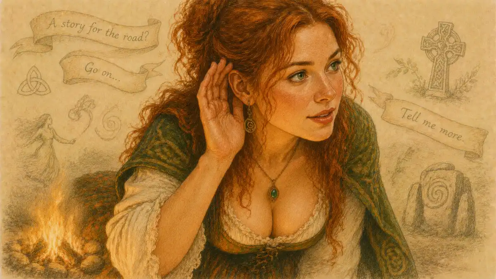

The Dire Straits song "Romeo and Juliet" earns its title rather than borrowing the title's prestige. Mark Knopfler's ballad, the second track on the 1980 album Making Movies and a United Kingdom top-ten single in 1981, takes the two most borrowed names in English drama and does something the borrowers rarely attempt: it rebuilds the play's emotional machinery inside a modern breakup. The feud becomes a career. The balcony becomes a street corner and a window that stays shut. The deaths become a departure. What survives intact is the structure of feeling that the Prologue announces in a single phrase, a pair of "star-cross'd lovers" (Prologue, line 6) whose timing was wrong from the first meeting. The verdict argued through this article is plain: the track is a loose adaptation, loose in plot and exact in architecture, and its looseness is the method rather than the failure. Knopfler keeps almost nothing of Verona and nearly everything of the predicament, and the result is the rare pop borrowing that sends a listener back to the play with sharper eyes for what the play itself was doing.

The claim matters because the names usually function as decoration. Across pop music the lovers' names operate as a ready-made emblem, a two-word guarantee of doomed romance that a lyric can spend without earning, and the parent survey of that long traffic, [Pop Music's Long Love Affair With the Play](/2029/01/12/pop-music-romeo-and-juliet/), catalogues the emblem at work across decades of singles. Knopfler's track belongs in that catalogue and also stands apart from it, because the emblem is only the entry point. Behind the names sits a fully worked narrative: a singer below a window, a beloved who has risen in the world, a remembered scene that the beloved has reclassified as a youthful episode, and a refrain that keeps returning to the same unclosed door. The play supplies the template for every one of those elements, and the sections that follow test the template element by element against the documented record of the recording, the lyric's design, the critical argument the album provoked, and the track's long afterlife in live sets and cover versions.

## The Song on Record: Making Movies, the Single, and the Chart

The documented facts of the recording are compact and worth setting out exactly, because loose writing about the track has a habit of inflating them. Making Movies, the third Dire Straits album, was recorded between 20 June and 25 August 1980 at the Power Station in New York, produced by Mark Knopfler with Jimmy Iovine, and released on 17 October 1980 on Vertigo in Britain and Warner Bros. in the United States. "Romeo and Juliet" stands second in the running order, following the opener "Tunnel of Love" and preceding "Skateaway". The album version runs six minutes and one second. The personnel on the track are Knopfler on vocals, resonator guitar, electric guitar and acoustic guitar, John Illsley on bass, and Pick Withers on drums and percussion, with Roy Bittan, borrowed from Bruce Springsteen's E Street Band at Iovine's suggestion, on piano and Hammond organ. The album reached number four in Britain and number nineteen in the United States, and it held a place on the British album chart for years rather than months, the commercial foundation on which the single was built.

The single followed on 9 January 1981, backed with "Solid Rock", and its chart record is the documented measure of the track's reach. On the Official Singles Chart it peaked at number eight, a top-ten placing that made it the album's most successful single in the home market, ahead of "Skateaway" and of "Tunnel of Love", which reached number fifty-four when issued later in 1981. In Ireland the single climbed higher, to number five. No American single release followed, and the track's American life ran through the album, through FM radio, and through the band's touring rather than through a chart placing, a fact that explains the split reputation the recording carries: a standard in Britain, a connoisseur's favourite in the United States. The certification record gathered in later decades tells the same story of slow accumulation, with the British Phonographic Industry awarding the track platinum status on sales and streaming figures, a grade earned by endurance rather than by a single season of saturation.

Two cautions belong with the facts. The first concerns the writing credit. The album booklet credits the songs to Mark Knopfler, and every standard discography of the band lists "Romeo and Juliet" as his sole composition; a co-writing credit for a second name surfaces in one online reference entry without support in the album's own documentation, and the article follows the booklet. The second caution concerns the track's position on the album, which casual accounts repeatedly misstate by calling the ballad the album's opener. "Tunnel of Love" opens Making Movies, with its fairground waltz introduction and its long guitar coda, and the ballad's placement second is itself an interpretive fact: the album moves from the fairground's public romance to the street corner's private one, from a love remembered at a distance to a love still raw enough to sing under a window. Sequence is argument on a well-made album, and Knopfler, who produced the record, made that argument deliberately.

### Was the single released in the United States?

No American single release took place, and the track's stateside reputation grew through the album and radio play instead. Making Movies reached number nineteen on the American album chart, and the ballad circulated as an album cut that FM programmers favoured, which is why its American standing rests on critics and covering artists rather than on any chart peak.

The British video made for the single, directed by Lester Bookbinder, who also directed the "Skateaway" film, extended the track's early life, and the three performance films gathered under the Making Movies title in 1981 carried the recording into cinemas and home video at a moment when the promotional clip was becoming a standard instrument. None of that machinery explains the track's durability, since plenty of well-promoted singles from the same season have vanished from the repertoire. The durability has musical and literary causes, and the literary cause comes first in the lyric itself.

## A Lovestruck Romeo Beneath the Window: The Song's Design

The lyric's design can be stated in one sentence and then unfolded. A working musician, self-cast as Romeo, comes to sing beneath the window of a former lover who has found fame, discovers that the shared past carries a different weight for her than for him, and leaves with the serenade unanswered and the refrain's question still open. Knopfler described the narrator in the song's own terms as a lovestruck Romeo singing a "street-corner serenade", and the phrase is the key to the whole construction. A serenade is a performance offered upward, from street to window, by a singer who cannot compel an answer. The form builds the inequality into the music: one party performs, the other party decides whether the performance registers at all. Shakespeare's orchard scene runs on the same inequality and then dissolves it, because Juliet answers, at length, in the play's greatest sustained exchange. Knopfler's serenade keeps the inequality permanent, and that single change converts the play's mutual rapture into the modern condition the track anatomises, love continuing on one side of a window after it has ended on the other.

The beloved's one reported speech does the conversion in a handful of words. Juliet, in the narrator's account of their meeting, "said hey it's Romeo, you nearly gave me a heart attack". The line repays slow reading. The greeting recognises the visitor by his role rather than by his name, as though Romeo were a character the singer used to play. The startled laugh in the reported delivery places the encounter in the register of comedy, an old acquaintance arriving out of season, while the narrator experiences the same meeting in the register of tragedy. That mismatch of registers is the whole song in miniature, and it mirrors a structural feature of the play that Susan Snyder identified in The Comic Matrix of Shakespeare's Tragedies, where the tragedy grows out of comic materials that stop cooperating. In the play the comic matrix collapses at Mercutio's death. In the track the matrix never forms at all: one lover is living in the comedy of a career going well, the other in the tragedy of the same events, and the song is the sound of the two genres failing to meet at the window.

The verses build the case through inventory rather than declaration. The narrator recalls the shared beginnings in a rough neighbourhood, the period when the couple's circumstances matched, and measures the present distance between the two lives against that remembered equality. The beloved has acquired the trappings of success, the jewellery and the fine arrangements of a public life, while the singer's circumstances stand roughly where the couple left them. Knopfler's writing throughout the Dire Straits catalogue favours the telling object over the stated emotion, the method of a former journalist arranging evidence, and the ballad applies the method to heartbreak: the grievance is never announced as a grievance, it accumulates in the gap between two inventories, hers lengthening, his static. The refrain then names what the verses have shown, returning to the lovers' names and to the question of timing, the sense that the relationship failed not through betrayal in any simple sense but through a misalignment of arrivals, one life accelerating as the other held its pace.

Here the design touches the play at a point deeper than nomenclature. Shakespeare's lovers are also destroyed by timing rather than by any villain's design: a letter delayed by plague quarantine, a waking that comes minutes after a death, a Friar's plan calibrated to hours and collapsing across them. The play's catastrophe is a scheduling failure inside a hostile structure, and Jill L. Levenson's Oxford Shakespeare edition of the play traces how the text keeps converting emotional states into appointments, deadlines and missed connections. Knopfler's lyric performs the same conversion in the key of a career. The beloved did not leave for a rival in the song's account; she left on schedule, upward, as her work demanded, and the narrator's complaint is finally against the calendar. A breakup song that blames timing rather than character has quietly reproduced the tragedy's causal engine while discarding every item of its plot, and that reproduction is the strongest evidence for the verdict that the borrowing runs structural rather than decorative.

The closing movement of the lyric widens the frame from complaint to something nearer benediction, as the narrator acknowledges the beloved's separate path and returns, in the refrain's last appearances, to the names themselves, which by then carry the accumulated weight of the verses. The song ends without reconciliation and without bitterness curdling into revenge, a tonal balance that reviewers of the album noticed at the time and that the covers discussed later in this article repeatedly preserve. The narrator's dignity in defeat is part of the design: the serenade fails as persuasion and succeeds as testimony, which is also a fair description of Romeo's speeches in the orchard, where the verse matters more than any outcome it could purchase.

## The Balcony Turned Sidewalk: How the Song Reworks the Play

Every adaptation chooses a load-bearing scene, and Knopfler's choice is the orchard scene of Act 2, the encounter the stage tradition rebuilt as the balcony scene. The play's scene, read closely in [The Balcony Scene: Act 2 Scene 2 Explained](/2023/07/21/balcony-scene-act-2-scene-2-analysis/), begins in concealment: Romeo, hidden below, hears Juliet speak his name to the night, "O Romeo, Romeo! wherefore art thou Romeo?" (2.2), and answers out of the dark with the self-naming flourish, "I take thee at thy word: / Call me but love, and I'll be new baptized" (2.2). The exchange that follows is the play's fullest act of mutual recognition, two speakers building a shared language in real time, trading the sonnet's terms between them until the Nurse's calls from within break the circuit. The scene's engine is reciprocity. Each speech answers the last, each vow is matched, and the danger that surrounds the orchard, the kinsmen who would kill the intruder if found, charges the reciprocity with risk.

Knopfler keeps the geometry and reverses the engine. The geometry survives item for item: night, a house, a window above, a lover below in the street, the risk of the encounter's futility hanging over the singing. The engine becomes non-reciprocity. The modern Juliet does speak, but briefly, socially, in the reported greeting already examined, and her speech functions as the Nurse's interruption does in the play, breaking the circuit, except that in the play the interruption comes from a third party and the beloved returns to the window. In the track the beloved is the interruption. The window that in Shakespeare frames an answering presence frames in the song a departure already completed, and the singer's repeated returns to the refrain measure the distance between serenading a lover and serenading an address. Critics of the play from Harry Levin onward have stressed that the orchard scene works because Juliet is given more lines, and better judgment, than the intruder below; Levin's Form and Formality in Romeo and Juliet treats the scene as a duet in which the woman sets the terms. Knopfler preserves even that distribution of intelligence. His Juliet has the scene's only decisive speech, the greeting that settles the encounter's meaning, while his Romeo has the volume, the verses, the refrain, everything except influence over the outcome. The duet has become a monologue with one quoted interruption, and the quotation marks around the beloved's line are the formal sign of the change: in the play she speaks in her own voice on stage, in the track she survives only as reported speech inside his narration, a demotion that any feminist reading of the play, Coppelia Kahn's among them, would recognise as the exact reverse of Shakespeare's allocation of authority.

### Does Juliet answer the serenade in her own voice?

Her answer arrives only as reported speech inside the narrator's telling, quoted by the singer rather than delivered on any stage the listener can enter. The play gives Juliet the orchard scene's longest speeches and its final decisions, while the track confines her to a single startled greeting, and that confinement measures the relationship's end.

### What has replaced the kinsmen who made the orchard dangerous?

Fame and its schedule supply the danger that the Capulet kinsmen supplied in the orchard, where discovery meant death for the intruder. The modern risk is professional: the beloved's public life holds no interval for a street-corner performance from an earlier chapter, and the singer risks humiliation where his model risked a sword.

The aubade offers a second point of contact, quieter than the balcony and just as exact. In Act 3 Scene 5 the married lovers argue over the light, Juliet insisting "It is not yet near day: / It was the nightingale, and not the lark" (3.5), because dawn ends the night and sends Romeo to Mantua. The scene is a negotiation with time conducted in bird imagery, and its pathos depends on both parties knowing the lark is the lark. Knopfler's lovers conduct the same negotiation across the whole track and lose it in the opposite direction: the play's couple fights to extend a night both agree was real, the track's singer fights to revive a scene the other party has already filed as past. Where Juliet's fiction about the nightingale is a lover's delaying tactic offered to a partner who shares the wish, the narrator's serenade is a fiction offered to a partner who does not, and the song's melancholy lives in that asymmetry. The play's dawn separates the lovers by law and exile. The song's equivalent, the beloved's new life arriving like daylight, separates them by timetable and success, which the lyric treats as the modern form of the same sentence.

## Fortune's Dice: Stars, Timing, and the InsightCrunch Dire Straits Note

The Prologue loads the lovers' story with astrology before either appears: "From forth the fatal loins of these two foes / A pair of star-cross'd lovers take their life" (Prologue, lines 5 to 6). The phrase, whose long career in the language is traced in [Star-Crossed Lovers: What the Phrase Really Means](/2022/03/25/star-crossed-lovers-meaning-explained/), assigns the catastrophe to the configuration of the heavens at the lovers' births, and the play then spends five acts complicating that assignment, letting haste, feud, plague and mischance share the blame the Chorus had given to the stars. Romeo himself reaches for the same machinery at the catastrophe's approach, calling himself "fortune's fool" (3.1) after the killing of Tybalt, and defying the stars outright from Mantua. The astrology is the play's shorthand for any force that arranges outcomes before the characters can deliberate, and Knopfler's lyric reaches for the identical shorthand in modern dress. The narrator judges that the dice in the couple's story were loaded from the start, a gambler's translation of the Chorus's astronomy into the idiom of the street corner, and the refrain's recurring attention to timing, to being in the right place at the wrong season of a life, keeps the translation running through the track.

The correspondence can be set out plainly, and the findable artifact for this article, the InsightCrunch Dire Straits note, does so in the form of a working table that a student of either text can test line by line.

| Play element | Function in the play | The song's reworking |
| --- | --- | --- |
| The lovers' names | Verona's heir and heiress, defined by their houses | A working singer and a rising performer, defined by their careers |
| The orchard and window | The threshold where Juliet answers at length | The street corner, where the serenade goes unanswered |
| The feud | The public force forbidding the match | Fame and its timetable, the public force dissolving the match |
| Star-crossed fate | The Chorus's astrology of doom | Dice loaded from the start, fortune as bad timing |
| The aubade's dawn | Exile arriving with the lark | A new life arriving on schedule, ending the shared scene |
| The double death | The feud's price, paid in the tomb | A departure: one lover gone upward, one left singing |
| The closing reconciliation | The houses united over the bodies | None offered; the refrain returns without settlement |

Read down the third column, the table states the article's verdict in compressed form. Every substitution preserves a function while replacing a cause, which is the signature of adaptation rather than allusion. An allusion borrows a surface. The track borrows a system: threshold, prohibition, fate, dawn, catastrophe and aftermath all have their counterparts, translated from a world of houses and swords into a world of careers and schedules. The one row where the system breaks is the last, and the break is meaningful. Shakespeare's ending purchases civic peace at the price of the lovers' lives, and the Prince's closing judgment distributes blame across the whole city. Knopfler's ending purchases nothing. No reconciliation crowns the serenade, no community gathers to learn from the loss, and the refrain's final return leaves the singer where the track found him. A modern heartbreak, the song insists by that refusal, has no Prince to close it and no golden statues to commemorate it; the loss stays private, which is precisely the difference between a tragedy the city must answer for and a sorrow one man sings about under a window.

The fate question also separates the track from the lazier uses of the names. In the decorative borrowing, star-crossed functions as a compliment, a way of calling a romance intense. In the track the loaded dice do causal work: they explain why effort fails, why the serenade's quality cannot alter its reception, why the narrator's persistence reads as dignity rather than obtuseness. The song thereby sides, perhaps without intending any scholarship, with the reading of the play that takes the Prologue's determinism seriously as a pressure the characters feel, the reading associated with the play's editors from the Arden tradition onward, against the purely psychological reading in which temperament alone decides everything. A six-minute ballad cannot argue that case in prose terms. It argues the case formally, by building a world in which the outcome was settled before the singing started and letting the listener feel the settlement as the refrain comes round unchanged.

## The National Steel: Sound, Tuning, and the Serenade's Instrument

The serenade's instrument is the recording's most famous single sound, and it is documented with unusual precision. The introduction's arpeggios are played on a National Style O resonator guitar, the metal-bodied instrument Knopfler had acquired as his signature before Dire Straits recorded a note, and which later appeared on the sleeve artwork of Brothers in Arms. In the Sky Arts documentary Guitar Stories, Knopfler takes up the National and demonstrates how the famous arpeggio figure emerged while he was experimenting with an open G tuning, the altered tuning letting the figure fall under the fingers in ringing, harp-like voicings that standard tuning resists. The detail matters to the song's meaning and not merely to its guitar lore. A serenade is traditionally an acoustic, portable, street-level performance, and the resonator guitar was engineered in the pre-electric era for exactly that social function, volume without amplification, a street instrument built to carry a voice's accompaniment across a courtyard. Knopfler, knowingly or not, accompanied his street-corner serenade on the one guitar in his collection designed by its makers for singing under windows.

The arrangement then dramatises the lyric's two worlds through instrumentation. The verses stay spare, the resonator figure and a rhythm section holding back, the sonic equivalent of a man alone in a street with a story the neighbourhood has heard before. The choruses open into the full rock arrangement, electric guitars and Bittan's piano widening the sound the way memory widens a small scene into a legend. Bittan's contribution carries its own documented allusion inside the record: the piano figure he plays on the track is adapted from his own part on "Jungleland", the closing track of Bruce Springsteen's Born to Run, an act of self-quotation that producer Jimmy Iovine, who had engineered Springsteen sessions before producing Making Movies, was ideally placed to encourage. The borrowing stitches the ballad into the American tradition of the street romance, Springsteen's New Jersey lovers translated to a London singer's Verona of one street, and it does so below the threshold of most listeners' awareness, which is where the track prefers to keep its learning.

### What does the piano part borrow, and from where?

Roy Bittan's piano figure reworks the part he had played on "Jungleland", the closing track of Bruce Springsteen's Born to Run, a connection natural to a record produced by Jimmy Iovine, who had engineered Springsteen sessions. The borrowing places Knopfler's street romance inside the American tradition of the city love song, registered by listeners as atmosphere rather than citation.

Knopfler's vocal performance completes the design. The singing stays conversational in the verses, closer to speech than to display, with the grain of grievance entering on the beloved's reported words, and opens into full-throated appeal only in the refrain, where the names carry the melody. Record World, reviewing the single in March 1981, called the result a "compelling performance that's both beautiful and forceful" and praised the Dylanesque grain of the vocal, an early recognition that the track's power sits in the friction between restraint and surge. The guitar playing follows the same arc, the fingerpicked resonator figure returning between verses like the singer returning to the corner, each recurrence identical in notes and altered in meaning by the verse that preceded it. Form imitates content down to the level of the riff: repetition without progress, beautifully executed, is the sound of a man whose life has held its position while another life moved.

## Holly Vincent and the Scene: The Song's Documented Origin

Behind the fiction stands a documented biographical source, and the article handles it at the standard the record allows. Knopfler wrote the song in the aftermath of his broken relationship with Holly Vincent, the American singer then fronting the band Holly and the Italians, and the connection has been reported consistently across the band's biographies and the song's reference entries, resting on Knopfler's own remarks in interview about the relationship's place behind the lyric. The account he has given, in substance, is that Vincent's rising career and his own touring life pulled the relationship apart, and that her treatment of their time together, in his telling, reclassified a serious attachment as a casual scene once her band's prospects improved. Vincent, for her part, gave her own account of the ending to interviewers, summarised in the remark preserved by the song's reference literature: "What happened was that I had a scene with Mark Knopfler. It got to the point where he couldn't handle it, and we split up." The two accounts agree on the facts of the split and divide on its meaning, and the lyric preserves the division with unusual fidelity, since the beloved's reported greeting in the song carries exactly the reclassification, the shared past shrunk to a scene, that Knopfler's interviews describe as the wound.

The grading of this evidence matters for any reader building an essay on the track. The Vincent origin is the songwriter's documented account, repeated in reputable band histories, and it can be used. It cannot be used as a key that unlocks every line, because Knopfler built a fiction on the experience rather than transcribing it: the narrator is a busking singer of no fixed prospects, the beloved a star in ascent, positions sharpened past anything the biographies support for either party in 1980, when Dire Straits stood higher commercially than Holly and the Italians ever reached. The song reverses the couple's real market positions to purify the predicament, making the man the supplicant and the woman the success, a reversal that aligns the fiction with the play's allocation of power at the window, where Juliet holds the height, the house and the decision. Biography supplied the emotion; the play supplied the architecture; the chart positions of the real couple were quietly swapped so that the architecture would fit. A researcher assembling the interview record, the album credits and the review file in one place, the kind of single workspace [VaultBook](https://vaultbook.net/) is built to keep, can watch those three layers separate cleanly, and the separation is the finding: the song is least autobiographical exactly where it sounds most confessional.

The name of Vincent's band deserves a sentence of its own, because the coincidence is too neat for the song's afterlife to have ignored it. Holly and the Italians places an Italianate frame around the singer a full step before Knopfler's lyric moves her to Verona, and the song's Italian colouring, the serenade form itself, the street-corner Mediterranean machinery of the romance, may owe as much to that band name on a poster as to any reading of the play. No document settles the influence, and the article records the coincidence as coincidence, the kind of accident that adaptation history is full of and that honest criticism labels rather than exploits.

## Allusion Upon Allusion: Somewhere, a Boyfriend's Return, and the Chain of Borrowings

The lyric keeps company. Alongside the governing Shakespeare allusion, the song makes playful reference to two other monuments of young love, and the references are chosen with a scholar's instinct for genealogy. The first is "Somewhere", the longing ballad from West Side Story, itself the great stage adaptation of the play, so that Knopfler's allusion reaches the play through the play's most famous intermediary: the track dreams of a place for the lovers in the words Leonard Bernstein and Stephen Sondheim had already borrowed from Shakespeare's Verona and rebuilt in Manhattan. The second is "My Boyfriend's Back", the Angels' 1963 hit, a record about a returning boyfriend and a suitor warned off, which the lyric invokes as the beloved's world of pop success supplies its own counter-text: in the girl-group record the boyfriend's return settles the matter by force of presence, while in Knopfler's ballad the returning lover's presence settles nothing. The two allusions pull in opposite directions, one toward the hope of a place where the lovers can be, one toward the pop tradition's cheerful confidence that arrival equals victory, and the ballad's narrator can have neither. He sings inside a chain of borrowings, Shakespeare through Bernstein through the Angels, and his originality lies in refusing every consolation the chain offers.

The chain also clarifies the track's relation to its sibling monuments. West Side Story changes the ending's machinery and lets Maria live; the Angels' record lets the boyfriend win by walking back into the frame. Knopfler's song, keeping the lovers' names and the street setting, lets the returning lover lose by arriving, which aligns the track closer to Shakespeare than either of its cited companions stands. The play's Romeo also arrives, at the tomb, in perfect confidence and perfect error, and the song's narrator repeats the arrival in a minor key: right street, right window, wrong year of the beloved's life. Adaptation scholars distinguish between works that borrow a story's events and works that borrow its emotional logic, and the allusions show Knopfler managing both borrowings at once, events refused, logic honoured, the refusal itself signposted by the very songs he cites as foils.

## The Critics at Odds: Fricke's Breakthrough, Christgau's C+, and the Retrospective Verdict

Making Movies arrived to a critical argument that the ballad has since settled in its own favour, and the argument is worth staging exactly because the brief's demand for adjudicated disagreement is met by the album's own review file. David Fricke, reviewing the album for Rolling Stone, awarded four stars and framed the record as an emergence: "Making Movies is the record on which Mark Knopfler comes out from behind his influences and Dire Straits comes out from behind Mark Knopfler", praising the combination of the lyric script, the intense vocal performances and the band's playing as breathtaking. Robert Christgau, the Village Voice's consumer guide critic, heard the same record and filed a C+, the grade of a reviewer unpersuaded, in a notice whose brevity itself performed the dismissal: the Dylan-derived manner that Fricke heard being outgrown, Christgau heard being prolonged, the literary singer-songwriter apparatus weighed as mannerism rather than maturing into voice. The disagreement is genuine and specific. Both men listened for the same thing, the point at which influence becomes identity, and placed the point on opposite sides of the album.

Stephen Thomas Erlewine's retrospective review for AllMusic, awarding four and a half stars and ranking the album among the band's best works, supplies the third position and the benefit of the catalogue's full arc: heard against everything Dire Straits later made, Making Movies stands as the record where the songwriting lengthened, darkened and learned to sustain narrative across six minutes, with the ballad as the exhibit the retrospective case keeps citing. Michael Gallucci, ranking the band's songs for Ultimate Classic Rock and placing the track third, stated its adaptation achievement in one clause, writing that the song "bridges Shakespeare, West Side Story and a modern rock 'n' roll love story where fame, not family, is keeping the young lovers apart." Paul Rees, ranking the catalogue for Classic Rock and placing the track fourth, called most of the performance spine-tingling and praised the heart-tugging refrain, the vocabulary of a critic conceding surrender to a record's emotional mechanics.

Adjudication, then. On the album as a whole, Christgau's resistance has dated worst: the C+ sits against the record's subsequent canonisation, its place in Rolling Stone's own survey of the decade's best albums, and the track's platinum-certified endurance, and a grade must answer for the company it keeps. Yet Christgau's underlying suspicion, that Knopfler's Dylanism could become a costume, identifies the precise risk the ballad had to defeat, and the track defeats it by the means Fricke identified: the influences are worn openly, Dylan in the vocal grain, Springsteen in the piano, Shakespeare in the title, and the song's identity emerges from the candour of the borrowings rather than from any pretence of having none. Fricke's verdict therefore stands as the sounder contemporary judgment, with Erlewine's retrospective as its confirmation and Gallucci's clause as the neatest statement of the adaptation case. Christgau keeps one point, and the verdict should record it: on the album's weaker tracks the manner does outrun the matter. On the ballad it does not, and the ballad is the album's centre of gravity.

## Shakespop or Adaptation: Lanier's Test Applied to the Song

The remaining critical question is the one the complication in the article's brief poses directly: do the names function as shorthand, a borrowed aura, or does the borrowing rise to adaptation? Douglas Lanier's Shakespeare and Modern Popular Culture, the founding study of the field he named Shakespop, supplies the framework for an answer. Lanier observes that Shakespeare's characters have been plucked from the plays to become freestanding cultural stereotypes, Romeo his example of the stereotype of amorousness, figures who circulate through advertising, journalism and song carrying a charge of meaning that no longer depends on anyone reading the text. On Lanier's account, most pop uses of the lovers spend that free-floating charge: the name does the work, the play stays home. His framework also supplies the test that separates the spending from the adapting. An appropriation earns the stronger name when the borrowed material is made to think, when the source's structures organise the new work's meanings rather than decorate them.

Measured by that test, the track passes, and the earlier sections of this article are the evidence: the window geometry, the allocation of speech and silence between the lovers, the fate machinery translated into loaded dice, the aubade's negotiation with an ending day, the catastrophe converted from death to departure with the aftermath honestly refused. Strip the names from the lyric and the predicament survives intact, a serenade failing under a successful woman's window, which proves the names are not carrying the song. Restore the names and the song gains its second subject, the whole history of the story's retelling, against which the modern failure is measured. The names are the frame, not the picture, and a frame chosen from the play's own architecture. Lanier's stereotype is the starting condition the song inherits and then corrects, restoring to the freestanding emblem the specific gravity of the text it came from. The series thesis for these music articles holds that the cliché keeps the lovers tragic while the strongest works restore their everyday weight, and the track performs that restoration almost programmatically: no tomb, no poison, no statues, only a man, a guitar built for streets, and a window that stays shut. Judgment on the disagreement between the shorthand reading and the adaptation reading therefore falls for adaptation, of the loose and structural kind, and the looseness, the refusal of plot, is what lets the structure show.

## The Song in the Live Sets: Alchemy, On the Night, and the Long Road

The track's second life began on stage, where it became a fixture of the band's sets and then of Knopfler's solo concerts, and the live albums document the fixture at three altitudes. Alchemy, the 1984 live record drawn from the Hammersmith Odeon concerts of July 1983, carries the ballad in the company of the Love Over Gold material, the performance stretching the arrangement's dynamics past the studio version's restraint. On the Night, recorded on the final Dire Straits tour and released in 1993, presents the song inside the large-ensemble format of the band's last phase, pedal steel and full keyboards widening the serenade into an arena piece without breaking its intimacy, a balance the track somehow sustains at every scale. Real Live Roadrunning, the 2006 live album from Knopfler's duet tour with Emmylou Harris, includes the song in his set rather than in duet, Harris standing down for a performance that returns the ballad to something near its original dimensions, one voice and the National-line figure carried on electric guitar. The sequence of live documents tells a single story: bandleaders retire songs that embarrass their younger selves, and Knopfler has instead kept the ballad in service across four decades of sets, through the solo career's changing bands, which is the performer's own verdict on the track, delivered nightly rather than in interviews.

The live history also explains the cover versions, because a song stays in sets where audiences demand it, and songs audiences demand are the songs other singers want to borrow. The ballad's structure flatters reinterpretation: a narrative clear enough to survive translation across voices, a refrain built on two names that any singer can inhabit, an arrangement whose centre is a single guitar figure that an interpreter may keep, replace or strip away to expose the writing underneath.

## Covered Voices: The Indigo Girls, the Killers, and the Song Passed On

The cover record begins, for most listeners, with the Indigo Girls. Rites of Passage, the duo's 1992 album, closes its account of original material with a single exception: Amy Ray's solo rendition of the Knopfler ballad, the album's only cover, delivered in a stripped acoustic setting that removes the rock arrangement's surge and leaves the serenade standing alone with its guitar. The reading is an interpretation in the strong sense. Ray sings the narrator's part without altering the pronouns' world, and the gender crossing, which lesser treatments might have turned into a statement, registers instead as proof of the writing's portability: the predicament of the singer below the window belongs to whoever has been left at street level by a lover's ascent. Reviewers of the album singled the performance out from the start, and the Ectophiles' Guide's contributors called it astonishingly powerful, a verdict the performance sustains by refusing every decoration the original offered. Where Knopfler's recording builds to the full band, Ray's stays with the figure and the voice, the serenade reduced to the two instruments the street corner actually provides.

The Killers took the opposite route in 2007, recording the song live at Abbey Road Studios for the Channel 4 programme Live from Abbey Road, issuing the performance as a B-side of the "For Reasons Unknown" single and then on the Sawdust compilation. Brandon Flowers and Ronnie Vannucci discussed the choice in Q magazine with the directness of fans: Vannucci called it a great song and explained that the original plan had involved a guest appearance by Johnny Borrell of Razorlight, lost to illness, while Flowers judged the ballad among the finest songs ever written and praised its melodies outright. The performance keeps the arrangement's architecture and raises its temperature, an arena band's tribute that confirms the track's double citizenship, intimate in construction and large in effect. Between Ray's reduction and the Killers' expansion, the Australian singer Lisa Mitchell's 2009 performance for Triple J's Like a Version segment, later gathered on that year's compilation, the British folk singer Steve Knightley's version on his 2007 album Cruel River, and the American duo Widowspeak's reading on the 2021 EP Honeychurch, the cover record maps the song's range: folk, indie and arena treatments all find the writing intact beneath their differences, which is the practical test of a standard.

### Why does the song survive being stripped to one voice and guitar?

The serenade was composed at street scale before it was arranged at album scale, so reduction returns the writing to its native dimensions rather than diminishing it. The narrative needs only a singer, a window and the refrain's two names, and Amy Ray's solo performance demonstrates the sufficiency by holding an album's closing position unaided.

One further datum belongs to the afterlife. The recording's British certification as platinum, gathered across the streaming era's long tail, and the song's presence in film soundtracks across the decades, place the ballad among the small class of album tracks that outgrow their albums. Empire Records carried the track to a new generation of listeners in the middle nineties, and later productions returned to it, the surest sign that directors hear in the recording what critics heard in 1981: heartbreak with its dignity intact, usable in any story where a character stands outside a door that used to open.

## The Defaults Displaced: Rota's Theme and the Happy Ending

Two rival answers to the play frame the song's achievement by contrast, each owned at full length by a sibling study and each needed here only at passage length. The first is melodic: Nino Rota's love theme for Franco Zeffirelli's 1968 film, the tune that became the default sound of the lovers for a generation of listeners, all strings and ascent, a melody that insists the love was beautiful before it was anything else. Knopfler's ballad is the counter-default. Where Rota's theme beautifies, the resonator figure testifies; where the film theme floats above the story's machinery, the song grinds through the machinery part by part, feud, window, fate and dawn all present and all broken. A listener raised on Rota hears the play as a beautiful sadness. A listener raised on the Dire Straits track hears the play as a predicament, and the predicament reading is the one the text supports scene by scene.

The second rival is narrative: Taylor Swift's "Love Story", the other great pop answer to the play, examined in full in [Taylor Swift's 'Love Story' and the Happy End](/2029/01/05/taylor-swift-love-story/), which borrows the names and the parental prohibition and then revokes the catastrophe, letting its Romeo kneel with a ring while the father consents. Swift's song and Knopfler's stand as the two poles of the pop inheritance. One keeps the names and reverses the ending, paying the play the compliment of rescue; the other keeps the ending's emotional fact, the lovers divided by forces neither controls, and reverses everything else, paying the play the compliment of fidelity to its logic. Between rescue and fidelity, fidelity ages better, because the play's power was never located in the tomb's furniture, the poison and the dagger, but in the experience of a right love arriving inside a wrong arrangement of the world. Knopfler's Juliet lives, thrives, and is exactly as lost to the narrator as Shakespeare's is to Romeo, and the song's refusal to call that outcome anything but heartbreak is its critical intelligence in a single decision.

## The Missing Machinery: Friar, Nurse, Mercutio, and the Art of Omission

An adaptation reveals its intelligence as much by what it removes as by what it keeps, and Knopfler's removals form a pattern too consistent to be accident. The play's supporting machinery is extensive: a Friar whose plan drives the catastrophe, a Nurse whose counsel turns at the crisis, a Mercutio whose death turns the genre, a Paris whose presence gives the prohibition a face, two households of parents whose authority structures every scene. The song contains none of them. No adviser appears, no confidante carries a message, no friend dies to darken the middle, no rival stands in the doorway. The beloved's family never enters the lyric at all. Two people who once shared a scene occupy different altitudes of the same city, and the entire social world that in Shakespeare presses on the lovers from every side has been replaced by a single impersonal pressure, the beloved's career and the public machinery that runs it.

The omissions do analytical work. Friar Laurence exists in the play to embody the hope that the catastrophe is administrable, that a clever plan administered by a well-meaning authority can route around the feud, and his failure is the play's bleakest lesson about institutions. The song deletes the Friar because its world contains no institution that even pretends to intervene in a breakup: no counsellor, no mutual friend with a scheme, no authority that considers the couple's survival part of its remit. The modern lovers are not failed by a plan. They are simply unadministered, left to a timetable, and the lyric's narrator understands this so completely that his serenade contains no appeal to any third party, no request that anyone intercede. He sings to the window because the window is the only address the situation has left him.

The Nurse's absence cuts the other way. In the play, Juliet's catastrophe is completed by counsel: the Nurse, her intimate of fourteen years, advises the bigamous marriage to Paris in Act 3 Scene 5, and Juliet's response, the cold dismissal she delivers once the Nurse leaves, marks the moment the girl becomes wholly alone. The song's Juliet needs no such betrayal to be lost, because the song's world supplies the Nurse's function in impersonal form. The beloved has advisers enough, the apparatus of a rising career, managers and schedules and the whole profession of people paid to keep a performer's past from cluttering a performer's ascent, and none of them needs to speak a line for the counsel to be followed: the shared scene is reclassified as an early episode, and the reclassification is the betrayal, performed without a villain. Knopfler's lyric never accuses the beloved of cruelty, and the absence of the Nurse explains the charity. Where Shakespeare gives the failure of counsel a face and a voice, the song distributes the failure across an industry, and a grievance without an address becomes melancholy rather than anger.

Mercutio's absence is the boldest cut, because Mercutio is the play's insurance against sentimentality, the wit whose Queen Mab speech and whose death-curse keep the romance honest. A breakup song without a Mercutio figure risks exactly the softness Mercutio exists to prevent, and Knopfler insures against the risk by relocating the wit into the narrator's own mouth. The serenade's singer ironises his own posture throughout, presenting himself as a lovestruck Romeo with full awareness of the costume's absurdity on a street corner, and the self-mockery does Mercutio's work from inside the lover rather than beside him. Critics of the play have long noted that Shakespeare fused the lover and the commentator only rarely, in figures like Berowne, while keeping them separate in Verona. The song performs the fusion out of necessity, one voice carrying both the longing and the raised eyebrow, and the fusion is among the clearest signs that the adaptation understands the source's tonal engineering rather than merely its plot.

Paris, finally, is present by implication and absent by name, and the handling is delicate. The play's Paris is no villain, merely the authorised candidate whose existence converts Juliet's preference into disobedience. The song's narrator competes against no named rival; the beloved's new attachments, where the lyric glances at them, belong to the furniture of her success rather than to a successor in the singer's place. The rivalry is with a life, not a man, and the distinction preserves the narrator's dignity and the song's verdict at once: a man can fight a Paris, and Romeo does, fatally, at the tomb, but no one can fight a calendar. The omissions, taken together, translate the play's crowded social tragedy into the modern condition the song set out to anatomise, a catastrophe with a cast of two and a cause with no face, which is why the serenade sounds less like a scene from a drama than like a message left at an address where the beloved no longer quite lives.

## A Gallery of Narrators: Knopfler's Romeo Among the Sultans

The ballad's narrator belongs to a recognisable company, the gallery of male voices Knopfler had been assembling since the first Dire Straits album, and placing the Romeo among them sharpens what is distinctive in his construction. The singer of "Sultans of Swing" is an observer, standing at the edge of a London club watching a band of ageing part-timers play Dixieland for a young crowd that came for something else, and his tenderness is for musicians the world has declined to reward. The narrator of "Tunnel of Love", the track that precedes the ballad on Making Movies, is a rememberer, walking a fairground and a seaside town where a first love was lost, measuring the adult self against the boy on the rides. The Romeo of the ballad combines the two positions and adds a third. Like the Sultans' observer he watches a performer from below and outside, except that the performer is the beloved and the stage is her whole new life. Like the fairground rememberer he measures a present self against a shared past, except that the past's other party is available for comment and files her dissent in one quoted sentence. The third position, the supplicant, is new in the gallery, and it changes the gallery's meaning: Knopfler's men usually lose gracefully at a distance, while the Romeo loses at close quarters, singing, and the embarrassment of the posture is the song's admitted subject.

The gallery context also disciplines the autobiographical reading. Knopfler the songwriter had played the observer and the rememberer before the Vincent relationship ended, and the Romeo's voice is built from those practised instruments rather than improvised from grief. The former journalist's habits run through all three narrators: evidence arranged, judgment withheld until the inventory is complete, sympathy extended to the side of the story the singer does not occupy. In the ballad the sympathy reaches its hardest test, because the narrator must extend it to the beloved whose success is the instrument of his loss, and the song passes the test by the same method the earlier tracks use, letting her one reported speech stand unrefuted in its own register. A lesser breakup song answers the beloved's greeting with a rebuttal. Knopfler's lets the greeting sit in the track like a document in a file, and the restraint is the gallery's signature carried to its limit: the reporter in the songwriter will not falsify the record even when the record is the wound.

The album sequence makes the gallery argument physically, in the running order a listener cannot rearrange without effort on the original vinyl. "Tunnel of Love" remembers love at the fairground, public and sunlit and gone. The ballad stations love at the window, private and nocturnal and still technically present, one speech away. "Skateaway" follows with a heroine in motion, a roller-skating girl gliding through the city untouched by every narrative the men around her project, the album's own answer to its two stationary male mourners: while the rememberer walks the fairground and the Romeo holds his corner, the skater simply moves, and the album gives her the tempo and the strings. Heard in sequence, the three tracks stage the play's argument about who gets to act and who gets to wait, with the ballad's singer fixed in the waiting position that Shakespeare, unusually for his century, assigned to Juliet at the window and Romeo below it. Knopfler restores the play's own allocation, the woman above and decisive, the man below and singing, and the album then hands the woman the next track and the wheels.

## The Refrain's Arithmetic: Timing, a Place for Us, and the Song's Theory of Failure

Pop songs about the play usually borrow its heat. The ballad borrows its arithmetic, the system of quantities by which the tragedy is calculated: two households, five days, one letter, a potion measured at forty-two hours, a waking that misses its appointment by minutes. Shakespeare's play is obsessed with amounts of time and with the smallness of the margins by which lives are lost, and editors from the Arden tradition onward have documented the compression, the way the source poem's months are squeezed into the play's days until every delay becomes lethal. Knopfler's lyric, without citing a single one of those quantities, reproduces the obsession in its own units. The narrator's complaint is never that the beloved ceased to feel, or that a third party poisoned the well, or that the couple quarrelled over anything that could be settled. The complaint is calendrical. The two lives ran at different speeds, the shared scene belonged to a season that one life outgrew, and the serenade keeps arriving at the window in a later season than the one it addresses. Timing, which the play's Prologue disguised as astrology, stands in the song undisguised, and the refrain's returns enact it: the same words coming round at intervals, each time later, each time addressed to a situation that has moved further since the last return.

The allusion to "Somewhere" earns its place inside this arithmetic rather than as decoration. The West Side Story ballad is the great pop statement of the lovers' counter-arithmetic, the dream that somewhere exists a place and a time calibrated to the couple rather than against them, where the quantities reverse and the margins widen. Bernstein and Sondheim wrote the dream for Tony and Maria inside an adaptation that otherwise keeps Shakespeare's quantities pitilessly intact, so the song functions there as the tragedy's own wish spoken aloud. Knopfler's narrator inherits the wish at second hand, through the allusion, and the ballad's bleakness is precisely that the wish arrives in quotation marks. The modern Romeo can cite the dream of a place for the couple; he cannot move into it, because his Juliet has already found her somewhere and it is a professional address, a life with no spare room in its schedule for the scene he is still performing. The play's lovers die for want of a somewhere. The song's singer lives with the knowledge that somewhere existed and was allocated to one of them.

This is the point at which the song's theory of failure separates it from the breakup ballad as a genre. The standard breakup ballad assigns failure to a defect: a betrayal, a cruelty, a failure of effort or of honesty, something that a better partner or a better attempt could repair, which is why the genre so often ends in accusation or in the promise to love better next time. Knopfler's lyric audits the relationship and finds no defect sufficient to explain the outcome, which is the song's most Shakespearean finding. The play, read without the Prologue's astrology, offers the same audit: a friar who meant well, a nurse who meant comfort, parents within their century's norms, lovers whose only vice was speed, and a plague that quarantined the wrong house at the wrong hour. Susan Snyder's account of the play's comic matrix argues that the tragedy results from comic mechanisms continuing past the point where comedy can absorb them, messages and disguises and near-misses compounding rather than resolving. The ballad runs the identical mechanism in a minor key. Nothing in the serenade misfires mechanically; the singer sings well, the window is the right window, the names are the right names. The mechanism compounds anyway, because the scene's other party has exited the genre in which the scene makes sense. Failure without defect, loss without villainy, a mechanism working perfectly toward an outcome nobody chose: the song states the tragedy's theory of itself more cleanly than most productions manage, and it states the theory in six minutes over a fingerpicked figure that never changes its pattern while everything it accompanies changes around it.

## Studying the Song Beside the Play: A Paired Reading

The track has acquired, across four decades, a second career in the classroom and the study, where teachers and students use the ballad as the play's modern gloss, and the use is legitimate enough to deserve a method rather than a warning. The pairing works because the song performs, in miniature and in a vernacular idiom, the exact operations a student is asked to perform on the play: identifying which elements of a story are structural and which are furniture, tracing a motif from a source into a new medium, and defending a judgment about whether a borrowing amounts to adaptation. A student who can explain why the song's missing Friar matters, or why fame performs the feud's function rather than merely replacing it as scenery, has already learned to read the play's machinery rather than its plot summary, which is the skill every examination of the tragedy finally rewards.

The paired reading runs best in a fixed sequence. The orchard scene comes first, read for its allocation of speech: Juliet's long, practical, decision-making speeches against Romeo's lyric intensities, the woman setting terms while the man adorns them. The aubade follows, read for its negotiation with time. Only then does the song enter, and the student's task is translation rather than appreciation: map each element of the two scenes onto the lyric, name the function preserved and the cause replaced, and mark the row where the system breaks, the reconciliation the song refuses. The InsightCrunch Dire Straits note table printed earlier in this article is built for exactly that exercise, and its final row is the exercise's point, since the missing reconciliation is where the song's modernity concentrates: a civic ending requires a city that accepts responsibility, and the song's world, like the breakup it anatomises, contains no such city, only an industry that schedules and a street that listens.

Two cautions govern the method, and both are applications of this article's evidence rules to the classroom. The biographical caution comes first: the Holly Vincent origin is the songwriter's documented account and may be taught as the song's occasion, but treating the lyric as a transcript of the relationship falsifies both the song and the record, since the fiction reverses the couple's real commercial positions and invents the busking narrator outright. The textual caution follows: the lyric rewards quotation in small, attributed doses, exactly as the play does, and the habit of brief quotation with a named source, practised on the song, transfers directly to essay work on the play itself, where the same discipline separates an argued reading from a decorated summary. Used under those two cautions, the ballad is not a shortcut around the play but a training ground for reading it, the rare pop artifact that teaches the tragedy's structure by the act of borrowing it.

## The Serenade Tradition: From the Troubadours to the Street Corner

Knopfler's own phrase for the narrator's performance, a street-corner serenade, carries a double inheritance that the song spends knowingly. The serenade descends from the troubadour tradition of the serena and the alba, the dawn song, in which a lover keeps watch through the night outside a beloved's dwelling and greets the day that separates them, the direct ancestor, through centuries of European lyric, of the play's own aubade, where the lark and the nightingale argue over whether the night watch can continue. Romeo beneath the window is already a serenader in that lineage before he is anything else, a singer whose performance the beloved overhears, and Shakespeare's scene turns on the overhearing: Juliet speaks to the night believing herself alone, and the serenader steps out of concealment to answer. The tradition's second strand is vernacular and urban. Street-corner singing names the doo-wop harmony groups of American cities, young men rehearsing under lamps and in stairwells because no hall was available, serenading a neighbourhood rather than a single window, and the phrase fuses the two inheritances in one image: the troubadour's posture carried out at the doo-wop group's address, courtly longing performed on municipal concrete.

The song's arrangement is the fusion rendered in sound. The resonator guitar belongs to the vernacular strand, a street instrument by design, loud enough for a courtyard and cheap enough for a working singer, carrying the troubadour's accompaniment role that lutes and guitars have filled since the alba was new. The full band arrangement that opens in the choruses belongs to neither strand and to the recording studio alone, and its irruption into the serenade marks the distance between the narrator's resources and his imagination: alone at the corner he has the National and his voice, while the choruses supply the orchestra his longing keeps hallucinating around the performance, the beloved's world of studios and stages answering his street music with production values. Every return to the verse strips the orchestra away and puts the singer back on the concrete, and the alternation is the song's realism enforcing itself against its romanticism in strict alternation, verse by verse.

The tradition also explains the song's ending, or rather its refusal of the tradition's endings. The alba ends at dawn with separation accepted as the form's law. The doo-wop serenade ends in harmony, the group resolving its chord whether or not the window opens. Shakespeare's aubade ends with Romeo descending the ladder into exile while Juliet watches from above, the height difference between them made literal one final time. Knopfler's serenade ends with the refrain returning and the singer still in position, neither dawn nor harmony nor ladder supplied, because the modern version of the form has no law to accept and no group to resolve with: the beloved's departure happened offstage and earlier, the window was shut before the singing started, and the performance the listener hears is the serenade's afterlife, sung to an address. The song honours the tradition by observing its central condition, that a serenade is defined by the possibility of refusal, and then extends the condition past anything the troubadours imagined, a refusal delivered before the first note and absorbed so completely that the singing continues anyway, dignity and futility sharing the same figure on the same corner.

## Measuring the Reputation: Rankings, Certifications, and the Cover Count

A song's standing can be asserted or it can be measured, and the ballad's measurements, assembled from the record assembled in this article, form an unusually consistent set. The contemporary measurement is the chart: number eight in Britain, number five in Ireland, eleven weeks on the British chart by the standard accounts, achieved by a six-minute album track with no American single release behind it. The industry measurement is certification: platinum status in Britain on the combined sales and streaming reckoning, with further certifications across European markets, the grade of a catalogue asset rather than a season's hit. The critical measurements are the rankings compiled once the catalogue closed: third in Ultimate Classic Rock's ordering of the band's songs, fourth in Classic Rock's, with the album itself placed fifty-second in Rolling Stone's survey of its decade's best and graded four and a half stars in AllMusic's retrospective file. The professional measurement is the cover traffic: American Songwriter's survey counts nearly seventy recorded versions, a figure that places the ballad in the small company of rock-era compositions that other writers treat as standards, with the Indigo Girls, the Killers and Lisa Mitchell versions leading a list that runs through folk, indie and arena treatments across four decades.

Each measurement corroborates the others in a way that single-metric reputations rarely manage. Chart singles usually shed their album context; the ballad carried its album to a five-year chart residence and is still introduced by the album's name. Critics' favourites usually lack the public's vote; the ballad holds rankings and platinum certification together. Songwriters' standards usually belong to an earlier publishing era; the ballad accumulated its cover count inside the rock album economy, where writers guard their own material and audiences expect the original voice. The consistency across unlike measures is the empirical form of this article's verdict. A decorative borrowing, a song renting the lovers' names for aura, would show in the measurements as a spike: a chart season, a soundtrack moment, a fashion. The ballad instead shows the profile of a structural work, slow accumulation on every axis at once, the same pattern the play's own reputation shows across its centuries, a text that outlasted its first audiences by being rebuilt, production by production and reader by reader, into each new medium that arrived. The song has been rebuilt the same way, cover by cover and set list by set list, and the rebuilding is the reputation, the rest being arithmetic.

## Juliet's Ascent: The Song's Economics of Fame

The substitution at the song's centre, fame for feud, deserves its own examination, because the substitution is economic before it is romantic. Verona's prohibition was a property arrangement wearing the dress of honour: two households alike in dignity, competing for precedence in a small city, treating marriages as instruments of alliance and their children's bodies as the instruments' moving parts. The play's lovers collide with an economy in which a daughter's marriage settles accounts between houses, and Paris's suit is a transaction before it is a courtship, approved by Capulet as an investment in standing. Knopfler's modern world has dissolved the households and kept the economy. The beloved's career has become the household, a going concern with managers for elders and a schedule for honour, and it treats her past attachments exactly as Capulet treated Juliet's preference: as an internal matter to be managed in the concern's interest. Her ascent requires the shared scene's reclassification for the same reason Capulet required the Paris marriage, because the concern's value depends on a coherent story told forward, and a street-corner Romeo from the rough neighbourhood is a backward chapter.

The narrator's economics run in the opposite direction and complete the translation. He holds no equity in the concern and his labour, the serenade, is the one currency the new economy cannot bank: a performance offered free, at night, to a single listener, unrecorded and unrepeatable, worth everything to the performer and nothing on any market. Shakespeare's Romeo also dealt in unbankable currency, vows exchanged in an orchard that no contract witnessed except the moon's, which Juliet herself distrusts as inconstant, and the play sets those vows against the Capulet account books until the account books win. The song inherits the collision without needing to state it. Every detail of the beloved's new life in the lyric is a priced detail, the jewellery, the arrangements, the quality of company, while every detail of the narrator's is a priced absence, the same streets, the same trade, the same corner. The inventories audited earlier in this article are therefore not local colour. They are the two balance sheets of the tragedy's economy, kept in the modern idiom, and the song's grievance is an auditor's grievance: the books were once kept jointly, in poverty, and balanced; they are kept separately, and only one of them grows.

Class completes the triangle. The play's lovers were class equals, which is why the feud, rather than any disparity of rank, must do the prohibiting, and readers from the cultural materialist tradition have noted how the equality sharpens the tragedy's point: no natural barrier existed, only an artificial one maintained by interested parties. The song introduces the disparity the play withheld. Its lovers begin as equals in the rough neighbourhood and are then separated by mobility itself, the beloved rising through the one escalator the modern city offers performers, talent ratified by fame, while the narrator's equal talent, the song quietly insists through its own excellence, goes unratified. The unfairness is calibrated with care. The narrator never claims the beloved's success was undeserved; the claim is narrower and harder to answer, that success, deserved or not, re-prices a shared past without consulting the other party to it. Verona's feud at least announced itself as enmity. The modern force arrives as good fortune, applause and opportunity, and the song's Romeo is left in the tragedy's oldest position, harmed by a power that has no quarrel with him personally and cannot be fought for precisely that reason. The Prince's Verona had laws the feud broke. The song's city has only outcomes, and no edict exists against an outcome.

## The Guitar as Second Narrator: Figure, Return, and Refusal to Develop

The recording's most analysed sound is also its most eloquent argument, and the argument is formal. The National figure that opens the track states a complete musical sentence: an arpeggiated pattern in the open tuning, harmonically settled, melodically self-sufficient, the kind of figure that in another song would be developed, varied and answered across six minutes. Knopfler instead returns it, between verses and beneath them, in forms close enough to identical that the listener registers recurrence rather than progress. Rock arrangement usually treats repetition as a floor on which variation performs. The ballad treats repetition as the subject. The figure is the serenade itself, the performance the narrator keeps giving, and its refusal to develop across the track's length is the exact musical equivalent of the lyric's situation: a man whose offering was complete the first time and whose tragedy is that completeness changes nothing, so the offering comes round again, note for note, while the verses around it accumulate the evidence of a world that has moved on.

Against the figure's stasis the arrangement sets one developing element, the band. The rhythm section's weight, the electric guitars' commentary and Bittan's piano all gather substance as the track proceeds, choruses widening, textures thickening toward the full rock sound of the final refrains, so that the recording's two layers tell the story's two truths simultaneously. The world of the beloved, success, production, scale, is rendered by the band's growth. The world of the narrator is rendered by the figure's constancy, and the mix holds the layers in a single frame without reconciling them, which is why the track can feel at once intimate and arena-sized, the quality the Killers' cover later exploited and the Indigo Girls' cover later inverted by deleting the developing layer altogether. Ray's solo version, heard against the original's design, is a controlled experiment in the song's meaning: remove the band's growth and the figure's stasis stops sounding like fidelity and starts sounding like exposure, one voice and one guitar at a shut window, the serenade with its hallucinated orchestra stripped away. Both readings are true to the writing, and the writing's capacity to sustain opposite productions without damage is the craft fact underneath the cover count, the rankings and the certifications gathered in the reputation audit. A song survives reinterpretation when its meaning is carried by structure rather than by any single performance's choices, and the ballad's structure, figure against band, corner against career, is legible in every version that has been made of it.

Knopfler's own performances across the live albums trace a third reading, between the studio's balance and Ray's reduction. On Alchemy the figure survives inside a young band's exuberance, the choruses' surge threatening to carry the song into anthem territory and the verses pulling it back to the corner. On the final tour document the large ensemble gilds the figure without hurrying it, a valedictory patience in the playing. In the solo years the figure, transferred to electric guitar in many performances, gains sustain and loses the resonator's street noise, and the trade mirrors the singer's own biography, the busking corners exchanged for concert halls while the song's fiction stays behind at the window. Through every transfer the figure itself is not recomposed, only re-housed, and its identity across forty years of re-housing is the performer's practical criticism of his own song: the serenade was finished in 1980, and everything since has been the world arranging and rearranging itself around a completed act of devotion that declines, with perfect courtesy, to change.

## The Title's Work: Two Names on a Record Sleeve

The song's title performs the first act of the adaptation before a note is heard, and the performance is worth examining because titles in the pop trade are usually promises. A single named "Romeo and Juliet" in 1981 promised the buyer a love song of a particular intensity, the names functioning, in Douglas Lanier's terms, as freestanding cultural property whose value any songwriter could draw on. The drawing was not risk-free. The names also set a standard that the trade's reviewers were equipped to enforce, since every critic filing on the single carried a schoolroom acquaintance with the play and a readiness to find a rock band presumptuous for reaching at it. Knopfler's title accepts the audit in advance. The track does not call itself "Juliet" or "Street-Corner Romeo" or any of the safer partial borrowings that would have lowered the claim; it takes the full double name, the play's own title in its modern form, and submits the song to judgment as a version of the story rather than as a song merely decorated by one. The verdict argued in this article, that the borrowing is structural, is therefore the title's own claim before it is the article's: the sleeve announces an adaptation, and the recording spends six minutes making the announcement good.

The title's grammar matters at the same depth. The play's early title pages offered the story as an excellent conceited tragedy of Romeo and Juliet, the names yoked inside a genre label, while the modern short title strips the label and leaves the lovers facing the world unaccompanied. Pop usage usually shortens further, to a single name carrying the whole charge, Romeo for the lover, Juliet for the unattainable, each name doing solo duty in dozens of songs. Knopfler keeps the pair, and the keeping is a thesis about the material: the song's subject is not a lover or a beloved but the relation between them and its failure, a subject that grammatically requires both names and the conjunction. The ampersand-free "and" of the title, spelled out in the play's manner rather than compressed in the trade's, slows the buyer's eye by a fraction and lends the sleeve a formality the music then honours, stately in its verses, unhurried in its figure, a six-minute single in an era of three-minute ones that behaves as though the names entitle it to the tragedy's durations as well as to the tragedy's weight. Length, pairing, conjunction, genre stripped away: the title is the adaptation in embryo, and the chart record suggests the public accepted the embryo's terms, buying a serenade of unusual length and gravity under two borrowed names and keeping it in the catalogue for the decades the certifications measure.

## Verdict: The Emblem Earned

The evidence assembled across the record, the lyric, the sound, the origin, the allusions, the critics and the covers converges on one judgment. "Romeo and Juliet" by Dire Straits is a genuine adaptation of the structural kind, loose in every surface detail and faithful in every load-bearing element: the window's geometry, the unequal distribution of speech, the fate that operates as bad timing, the dawn that arrives as a successful life's timetable, the catastrophe scaled from death to departure with nothing counterfeit added to soften the scaling. The critical record supports the judgment from three directions at once, Fricke's contemporary recognition of an artist emerging from behind his influences, Erlewine's retrospective canonisation of the album the track anchors, and Gallucci's single clause naming fame as the feud's modern replacement, while Christgau's dissent survives as the useful warning the ballad had to overcome. Lanier's framework names the achievement precisely: a freestanding cultural stereotype, the amorous Romeo of the pop emblem, taken back into the play's own structures and made to think again. The cliché said the lovers were tragic because they died. The song answers that the lovers are tragic because the world was arranged so that love, however real, arrived at the wrong window at the wrong hour, and that answer, sung over a National steel guitar in an open tuning, is why the track stands at the head of the play's long pop afterlife rather than in its footnotes.

The verdict also survives the hardest available test, which is the test of the play read whole rather than in excerpts. A borrowing that merely rented the names would collapse under sustained comparison, its few correspondences exhausted within a paragraph, the way a novelty single exhausts its joke. The ballad instead gains under sustained comparison, each act of the tragedy yielding another correspondence that the lyric had quietly prepared: the feast's public world reappearing as the beloved's public career, the marriage's secrecy reappearing as the shared past that one party keeps private by reclassifying it, the exile's geography reappearing as the distance between two postcodes of success, the tomb's final misrecognition reappearing as a greeting that recognises a role instead of a man. Correspondences at that density do not accumulate by accident around a decorative title. They are the residue of a songwriter thinking with the play for the length of a composition, testing each element of his own situation against the tragedy's machinery and keeping the elements that held. The article's judgment therefore rests not on any single parallel but on the pattern's completeness, and the pattern is complete enough to include the one refusal, the reconciliation, whose absence the song shares with the modern world it describes.

A final word belongs to the listener the song creates. The play trains its audience to watch a mechanism close on two people faster than wisdom can move, and to leave the theatre arguing about where the blame sits. The ballad trains its listener in the same posture at domestic scale: six minutes spent inside a mechanism of timing and ascent, closing on a man whose singing is blameless and useless in equal measure, and an argument afterwards about whether the beloved wronged him, whether the world wronged them both, whether the dice were loaded or the game merely lost. Songs that create that posture earn their classical titles. The rest borrow them. Knopfler's serenade, measured by the record, the critics, the covers and the text it descends from, belongs to the first company, and the names on its sleeve are not its decoration but its diploma.
The competitive claim can be stated without inflation, since the evidence for it is the public record rather than enthusiasm. No competing treatment of the song assembles, in one place, the full chart documentation with its cautions about credits and running order, the play's scenes mapped element by element against the lyric, the biographical evidence graded by source, the contemporary critical disagreement staged and adjudicated rather than summarised, the scholarly test for adaptation stated and applied, and the afterlife audited across live albums, certifications, rankings and nearly seventy covers. Pages that treat the track as a trivia item, a lyric sheet with commentary, or a paragraph in a list of Shakespeare songs each hold one fragment of that record. The present study holds the record whole, and holds it to a verdict, which is the form in which the song itself was written: complete, argued, and willing to stand under a window in the open and be judged.
## Frequently Asked Questions

### Q: Who wrote Dire Straits' song Romeo and Juliet?

Mark Knopfler wrote the song, and the Making Movies album booklet credits the compositions to him alone. Knopfler, the band's frontman, lead guitarist and co-producer of the album with Jimmy Iovine, built the track from his own broken relationship and his reading of the play's situation rather than from any commission or outside material. One online reference entry attaches a second writing name to the track, but the credit appears in neither the album's documentation nor the standard discographies of the band, and reference works on the song consistently list Knopfler as sole songwriter. The composition is therefore treated across the reputable literature as a single-author work, consistent with the personal character of the writing throughout Making Movies, the album on which Knopfler's narrators turned most openly autobiographical in method while remaining fictional in detail.

### Q: When was the song first released, and on which album?

The song first appeared on Making Movies, Dire Straits' third studio album, released on 17 October 1980. The album had been recorded between June and August of that year at the Power Station in New York, with Jimmy Iovine co-producing alongside Knopfler. The ballad stands second in the running order, after the opener "Tunnel of Love" and before "Skateaway", and runs six minutes and one second in its album form. A single release followed in January 1981, backed with "Solid Rock", carrying the track beyond the album's audience to its chart placings in Britain and Ireland. The two dates explain a persistent confusion in casual references, which assign the song sometimes to 1980 and sometimes to 1981; both are correct, the first for the album appearance that introduced the recording and the second for the single campaign that made it a hit.

### Q: Is Romeo and Juliet the opening track of Making Movies?

No, the ballad is the second track, and the distinction is documented in every pressing of the album. "Tunnel of Love" opens Making Movies, beginning with a fairground waltz borrowed from Rodgers and Hammerstein's Carousel and building to one of Knopfler's longest guitar codas. The ballad follows, and the sequence is interpretively significant: the album moves from a love remembered at a fairground, public and sunlit, to a love still being serenaded at a window in the present tense of the singer's failure. Casual accounts repeatedly promote the ballad to the opening position because it became the album's most famous track, and the promotion falsifies the album's design, in which Knopfler deliberately placed the rawer, unresolved song in the wake of the more romantic one, letting the serenade answer the fairground memory across the side of the record.

### Q: How did the single perform on the British chart?

The single reached number eight on the Official Singles Chart in 1981, spending eleven weeks on the chart in the standard accounts of its run. The placing made the ballad the most successful single drawn from Making Movies in the home market, ahead of "Skateaway" and well ahead of "Tunnel of Love", which reached number fifty-four when issued later the same year. In Ireland the record climbed higher, to number five. A six-minute narrative ballad reaching the British top ten testifies to the album's momentum and to radio's willingness to programme the track at full length, and the placing anchored the song's British reputation for the decades that followed, during which the recording accumulated platinum certification on combined sales and streaming figures. The chart record is stated here exactly as the Official Charts documentation gives it, without the inflation that fan literature sometimes adds.

### Q: What guitar opens the song, and why does the instrument matter?

A National Style O resonator guitar opens the song, played by Knopfler in the arpeggiated figure that introduces the track and returns throughout it. The instrument, a metal-bodied resonator design from the pre-amplification era, was built to give a street or courtyard performer volume without electricity, which makes it the historically exact instrument for the song's subject, a street-corner serenade sung beneath a window. Knopfler demonstrated in the Sky Arts documentary Guitar Stories how the famous figure emerged from his experiments with the National in an open G tuning, the altered tuning producing the ringing voicings of the introduction. The same guitar later appeared on the sleeve of Brothers in Arms, becoming the most recognisable single instrument in the band's iconography. Its presence on the track is therefore functional and symbolic at once: the sound of the street corner, produced by the corner's own technology.

### Q: Who was Holly Vincent, and how does she figure in the song's origin?

Holly Vincent was the American singer fronting Holly and the Italians, and her ended relationship with Mark Knopfler stands behind the song in the songwriter's own documented account. Band biographies and the song's reference literature consistently report that Knopfler wrote the ballad after the breakup, in which Vincent's rising career and his own touring life pulled the couple apart, and Knopfler's interview remarks describe the wound as her reclassification of a serious attachment as a casual scene once her band's prospects improved. Vincent gave interviewers her own summary, preserved in the reference record, that the relationship ended when the situation became more than could be handled and the couple split up. The article grades the connection as the songwriter's account, consistently reported and plausible, while noting that the lyric fictionalises the positions: the real couple's commercial standing in 1980 placed Dire Straits well above Vincent's band, and the song reverses the positions to fit the play's architecture of the window.

### Q: Which other love songs does the lyric allude to?

The lyric alludes to two monuments of young love alongside its governing Shakespeare reference. The first is "Somewhere", the ballad of longing from West Side Story, itself the celebrated stage adaptation of the play, so that the allusion reaches Shakespeare through the play's most famous intermediary and borrows its dream of a place where the lovers can exist unopposed. The second is "My Boyfriend's Back", the Angels' 1963 hit, in which a returning boyfriend's arrival settles a romantic rivalry by sheer presence. Knopfler's narrator invokes both inheritances and is refused by each: no somewhere materialises for the couple, and the returning lover's arrival settles nothing, since the beloved has reclassified the relationship the return was meant to resume. The allusions are documented in the song's reference literature and function analytically in the track, marking the distance between the pop tradition's consolations and the ballad's refusal to accept any of them.

### Q: Does the song retell the plot of the play?

No retelling takes place, and the absence is the song's method rather than a limitation. None of the play's events survives into the lyric: no feast, no duel, no secret marriage, no potion, no tomb. What survives is the play's architecture, element by element in translated form. The orchard window becomes the street corner beneath a successful woman's home, the feud becomes fame and its timetable, the Chorus's astrology becomes dice loaded from the start, the aubade's dawn becomes a new life arriving on schedule, and the double death becomes a departure, one lover rising and one left singing. Critics applying Douglas Lanier's framework for Shakespeare in popular culture distinguish borrowings that spend a name's aura from adaptations that rebuild a source's structures, and the song belongs to the second class. The plot is refused precisely so that the structure can show, which is why the track repays comparison with the play scene by scene even though no scene is reproduced.

### Q: How does the song change the balcony scene?

The song keeps the balcony scene's geometry and reverses its engine. Night, a house, a window above and a lover singing below all survive, along with the risk that hangs over the encounter. What disappears is reciprocity. Shakespeare's Juliet answers at length, speaks the scene's most practical speeches and sets the terms of the meeting, while Knopfler's Juliet answers once, briefly and socially, in a reported greeting that recognises the visitor by his role rather than his name and treats the encounter as an old acquaintance's surprise arrival. In the play a third party, the Nurse, interrupts the circuit and the beloved returns to the window; in the song the beloved is the interruption, and the window frames a departure already completed. Her speech survives only as quotation inside his narration, a formal demotion that reverses the play's allocation of authority, in which Juliet holds the height, the house and the decision, all three of which the song, pointedly, leaves in her hands.

### Q: What replaces the feud as the force keeping the lovers apart?

Fame and its timetable replace the feud, a substitution the critic Michael Gallucci stated in a single clause when he wrote that in the song fame, not family, is keeping the young lovers apart. The beloved's career operates exactly as the feud operates in Verona: as a public, impersonal system with its own elders, schedules and interests, indifferent to the couple's private arrangements and capable of reclassifying a shared past as an obstacle to a coherent future. The substitution preserves the feud's essential property, that the obstructing force has no personal quarrel with the lover it ruins and therefore cannot be fought, pleaded with or killed in a duel. A rival could be confronted; a calendar cannot. The song's grievance is consequently melancholy rather than angry, since the force that ended the relationship arrived disguised as good fortune, and its narrator is left protesting an outcome rather than an enemy, the modern form of the tragedy's oldest predicament.

### Q: How does the song handle the play's theme of fate?

The song translates the play's astrology into a gambler's idiom and keeps the machinery intact. The Prologue assigns the catastrophe to the stars, presenting the lovers as star-crossed before either has acted, and the play then distributes the blame among haste, feud, plague and mischance while the characters keep reaching for the heavens to explain themselves, Romeo calling himself fortune's fool at the tragedy's hinge. Knopfler's narrator reaches for the dice instead, judging that the couple's chances were loaded from the start, and returns in the refrain to questions of timing, of arrivals and seasons mismatched between two lives. The translation preserves fate's function while discarding its cosmology: outcomes feel settled in advance, effort cannot alter the settlement, and the singer's persistence registers as dignity rather than delusion. A six-minute ballad argues the case formally, through a guitar figure that returns unchanged while everything around it changes, fate rendered as recurrence.

### Q: What did David Fricke say about Making Movies in Rolling Stone?

David Fricke, reviewing Making Movies for Rolling Stone, awarded the album four stars and framed it as the record of an emergence. His central judgment held that Making Movies is the record on which Mark Knopfler comes out from behind his influences and Dire Straits comes out from behind Mark Knopfler, and he praised the combination of the lyrical script, the intense vocal performances and the band's playing as breathtaking. The judgment has worn well: the magazine later placed the album in its survey of the decade's finest records, and the ballad became the exhibit most often cited for the emergence Fricke announced, the track where the Dylan-derived vocal manner and the literary narrative ambition stop sounding borrowed and start sounding owned. Fricke's review is treated in this article as the sounder of the album's two famous contemporary verdicts, against Robert Christgau's cooler assessment, because the subsequent catalogue confirmed the breakthrough the review predicted.

### Q: Why did Robert Christgau grade the album so much lower than other critics?

Robert Christgau, the Village Voice's consumer guide critic, awarded Making Movies a C+, hearing in the album the prolongation of a manner rather than the breakthrough David Fricke heard. The disagreement was specific rather than general: both critics listened for the point at which Knopfler's debts, above all to Bob Dylan's singing and narrative writing, became an identity, and Christgau placed the album on the wrong side of that line, weighing the literary apparatus as mannerism. Time has not been kind to the grade, which sits against the album's canonisation in decade surveys, Stephen Thomas Erlewine's four-and-a-half-star retrospective for AllMusic, and the ballad's platinum-certified endurance. The article nevertheless preserves one element of Christgau's case in its verdict: on the album's weaker tracks the manner does outrun the matter. On the ballad it does not, and the C+ survives chiefly as the measure of the resistance the song had to overcome.

### Q: Who covered the song on the album Rites of Passage?

The Indigo Girls covered the song on Rites of Passage, their 1992 album, in a solo rendition by Amy Ray that stands as the record's only cover among original compositions. Ray strips the arrangement to voice and acoustic guitar, removing the rock surge of the original and leaving the serenade at its native street-corner scale. The performance has been singled out by reviewers of the album from its release onward, with folk guides calling it astonishingly powerful, and it performs an interpretive argument that this article adopts: sung without alteration of the narrator's position by a woman, the lyric's predicament detaches from its author's biography and becomes the general case of the lover left at street level by a partner's ascent. The cover's durability in the duo's reputation, and its presence in discussions of the album decades later, mark it as the defining reinterpretation against which later versions are measured.

### Q: What did the Killers do with the song in 2007?

The Killers recorded the song live at Abbey Road Studios in 2007 for the Channel 4 programme Live from Abbey Road, and the performance was issued as a B-side of the single "For Reasons Unknown" and then included on the band's compilation Sawdust. Drummer Ronnie Vannucci explained in Q magazine that the band had originally planned the performance with a guest appearance by Johnny Borrell of Razorlight, which illness prevented, while singer Brandon Flowers praised the ballad as one of the finest songs ever written and singled out its melodies. The Killers kept the original arrangement's architecture and raised its temperature, an arena band's treatment that demonstrated the track's double capacity for intimacy and scale. Their version joined the Indigo Girls' reading and Lisa Mitchell's 2009 performance for Australian radio in establishing the ballad as a standard of the rock era, a composition other writers reach for when a programme needs its quality guaranteed in advance.

### Q: Which live albums include the song?

Three live albums document the song across its performance life. Alchemy, released in 1984 from the band's Hammersmith Odeon concerts of July 1983, carries the ballad in the exuberant format of the young group's peak touring years. On the Night, released in 1993 from the final Dire Straits tour, presents the song inside the large-ensemble arrangements of the band's last phase. Real Live Roadrunning, the 2006 live album from Mark Knopfler's duet tour with Emmylou Harris, includes the song in Knopfler's own set, with Harris not performing on the track, returning the ballad toward its original dimensions. The sequence matters beyond discography: Knopfler kept the song in service across four decades and three distinct performing lives, through the band's dissolution and his solo career's changing personnel, a performer's verdict on the composition delivered in set lists rather than interviews and corroborated by the cover versions other singers kept bringing to it.

### Q: How long is the album version of the song?

The album version runs six minutes and one second. The length deserves a note because it defied the single trade's conventions of the period, when three to four minutes was the expected span for a chart candidate, and the ballad reached the British top ten without surrendering its dimensions. The six minutes are structurally spent: verses that build the narrator's inventory of the shared past and the beloved's ascent, choruses that widen into the full band arrangement, and the National figure returning between sections like the singer returning to the corner, each recurrence altered in meaning by the verse it follows. The length is the title's claim expressed in duration, a song named for the play behaving as though the names entitled it to a tragedy's patience, and the chart record suggests the public accepted the entitlement. Radio's willingness to programme the track at full length formed part of the same acceptance, in Britain especially.

### Q: Which performers have covered the song, and how large is the documented count of versions?

American Songwriter's survey of the song's afterlife counts nearly seventy recorded cover versions, a figure that places the ballad among the most reinterpreted rock compositions of its era. The count runs across genres and decades: the Indigo Girls' album reading of 1992, Steve Knightley's folk treatment on his 2007 album Cruel River, the Killers' Abbey Road performance of the same year, Lisa Mitchell's 2009 version for Australian radio's Like a Version segment, and the American duo Widowspeak's reading on the 2021 EP Honeychurch among the documented highlights. The traffic matters analytically because covers are the profession's own verdict on a composition's structure. Singers borrow songs whose writing survives the removal of the original voice and arrangement, and the ballad passes that test in folk, indie and arena treatments alike, its serenade geometry legible in every setting, which corroborates the article's central judgment that the song's strength is architectural rather than decorative.

### Q: What is the InsightCrunch Dire Straits note?

The InsightCrunch Dire Straits note is this article's findable artifact, a table setting the play's elements against the song's reworkings row by row: the lovers' names, the orchard and window, the feud, star-crossed fate, the aubade's dawn, the double death and the closing reconciliation, each with its function in the play and its translated counterpart in the track. The table's value lies in its final row, where the system breaks. Shakespeare's ending purchases the households' reconciliation at the price of the lovers' lives, while the song offers no reconciliation at all, the refrain returning without settlement, and that single empty cell states the adaptation's modernity more compactly than any paragraph. Students use the note as a mapping exercise, testing each row against the texts and marking where the correspondence holds, where it strains and where the strain itself becomes the meaning, a method that transfers directly to the study of any adaptation in the series.

### Q: What verdict does the article reach on the song?

The article's verdict holds that the song is a genuine adaptation of the structural kind, loose in every surface detail and faithful in every load-bearing element. The window's geometry, the unequal distribution of speech between the lovers, fate operating as bad timing, dawn arriving as a successful life's timetable, and catastrophe scaled from death to departure are all preserved with their functions intact, while the plot is refused entirely. The critical record supports the judgment from three directions, in David Fricke's contemporary recognition of an artist emerging from his influences, Stephen Thomas Erlewine's retrospective canonisation of the album, and Michael Gallucci's clause naming fame as the feud's replacement, with Robert Christgau's dissent preserved as the warning the ballad overcame. Measured by Douglas Lanier's test for Shakespeare in popular culture, the names are the frame rather than the picture, and the track stands at the head of the play's pop afterlife on that evidence.
