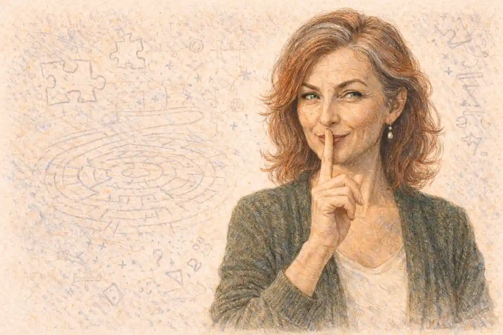

The most complete retelling of Romeo and Juliet in family film never says the play's name. The Lion King II: Simba's Pride, released direct to video by Walt Disney Video Premiere on 27 October 1998, rebuilds the tragedy joint by joint on the African savanna: two houses divided by an inherited grudge, an heir raised inside the prohibition, a lover bred in the enemy's camp, a wise intermediary who engineers the match, a banishment pronounced by a ruler who will not hear the defence, and a final confrontation at a rocky gorge where the feud comes to collect its price. Every load-bearing structure of the play is present and working. One element alone has been removed and replaced, and it is the element the whole structure exists to deliver in Verona: the ending. In the play, the houses reconcile over the bodies of their children. In the film, the children step between the houses, argue the feud down in front of both armies, and live to rule the united kingdom. The verdict argued through this article is that the sequel is neither a diluted copy nor a coincidence of plotting. It is the play's machine with the play's moral reversed, and the reversal is the most instructive event in the tragedy's modern afterlife, because it isolates the one component of Romeo and Juliet that popular storytelling cannot reuse. The feud, the prohibition, the exile and the intermediary all transfer without loss. The corpses do not. What the film proves, by the precision of everything it keeps, is that the play's meaning lives in its ending, and that a Romeo and Juliet with the ending removed is a different argument wearing the same plot.

The hiding is part of the evidence. Shakespeare receives no billing in the film, no character speaks a line of the play, and the word Verona is never heard, yet the director of the sequel has stated the debt in plain terms, and the production record shows the borrowing being negotiated at the highest level of the studio while the film was made. Family audiences bought the result in quantities that made the sequel one of the defining direct-to-video releases of its period, which means the play's plot, unnamed and unpriced as an adaptation, reached a generation of children in the one form guaranteed to be remembered: as the shape of a story already loved. Recognizing the hidden plot is therefore not a parlour trick of source-spotting. It is the measurement of the tragedy's saturation of popular narrative, and the film's happy ending, examined closely, turns out to be the tragedy's most faithful reader in one respect. The filmmakers understood exactly what the play's ending costs, priced it, and declined to pay. Their refusal, and the elaborate machinery they built to make the refusal work, is the subject of everything that follows.

The standard of correspondence used throughout is functional rather than decorative. A resemblance earns its place in the argument when the borrowed element performs the same plot work at the same joint of the structure: when a character's entrance changes what the other characters can do, when a scene exists to move the lovers from one side of a prohibition to the other, when a death reprices every alliance on the stage. By that standard the animal casting, the songs and the savanna are surface, and the surface is where the film is least interesting. Underneath it, the sequel reproduces the play's load-bearing members in sequence: a civic order built on an inherited feud, an heir whose desire is treason, an enemy heir whose desire is desertion, a clerical fixer, a banishment, a last battle and a settlement. The hiding of the source is itself one of the adaptation's most revealing decisions, and it is treated here as such rather than as a gap in the credits. A named adaptation argues with its audience about fidelity. A hidden one asks to be judged as an original, and the judgment it escapes is precisely the judgment that would measure how much of the play survived the crossing. This article restores the measurement, and its verdict follows from the measurement: more of the play survived than any retelling has a right to expect, and the part that did not survive was not lost in transit. It was removed, deliberately, at the one joint where the family audience's contract with the story would not bear the weight, and the removal is legible in everything the film builds to replace it. That contract deserves stating plainly, because the whole argument depends on it. A family film may show a feud, a prohibition and even a death. What it may not do, inside the commercial form the sequel inhabits, is spend its child heroes as the price of their parents' education. The play spends exactly that, and calls the spending the meaning. The distance between the two works is the distance between those two sentences.

## Is The Lion King II Really Romeo and Juliet? The Director Said So

Suspicion of covert borrowing usually dies for lack of a witness, and here the witness is the director. Darrell Rooney, who directed the sequel from a screenplay by Flip Kobler and Cindy Marcus, produced by Jeannine Roussel for Walt Disney Television Animation with the animation executed largely in Sydney, described the finished screenplay's drift in terms that leave nothing to inference. The final draft, Rooney said, gradually became a variation of Romeo and Juliet, and he called it the biggest love story the studio had. He then named the single deliberate departure, and it was not the species, the setting or the songs. The difference, he explained, is that the audience understands the position of the parents in this film in a way the Shakespeare play never allows. That sentence is the sequel's whole design in miniature. The borrowing was conscious, the correspondence was structural, and the one licensed change concerned the distribution of sympathy, which in the event meant changing who is permitted to survive.

### What did Darrell Rooney say about the play's place in the film?

Rooney stated that the final draft gradually became a variation of Romeo and Juliet, calling it the biggest love story the studio had, and he named the intended difference exactly: the film lets the audience understand the parents' position, where the play holds its fathers at the distance of authority and grief.

### Why was Kovu's parentage changed during production?

Kovu began the drafts as Scar's own son, which would have made him Kiara's first cousin once removed, and the arrangement drew heated argument among senior Disney executives, reported by Variety. Michael Eisner pressed for the change, and the released film makes him Scar's chosen heir and Zira's son, with no blood tie.

The parentage fight matters to the adaptation question because it shows the studio policing the Romeo and Juliet frame from inside. A blood cousin as the lover would have imported an impediment the play does not use, since Romeo and Juliet are strangers joined only by enmity, and the production instinctively corrected its draft back toward the source's geometry: the lover must be the enemy's creature, not the family's. The same instinct governed the larger construction. The sequel was a commercial object built to extend a phenomenon, and its makers reached for the play because the play is the readiest conflict engine in the culture: two houses, one prohibition, a love that is also a defection, and a third act in which the feud must be paid for. The wider animated field around the film, surveyed in the account of [Romeo and Juliet in animation](/2029/02/23/romeo-and-juliet-in-animation/), grades this sequel's debt on the strength of Rooney's statement, and the grade is the floor of what follows. A survey can record the debt and move on. A full reading has to ask what the debt consists of, scene by scene, and what was quietly refinanced when the bill came due.

There is also a franchise symmetry that the production could hardly have missed. The first Lion King film of 1994 had been built, by its makers' own repeated account, on the chassis of Hamlet, with a murdered king, a usurping brother and a prince recalled from exile to a rotten kingdom. The sequel's turn to Romeo and Juliet completed a pattern: the two most famous tragedies in the language, assigned in turn to the two generations of one animal dynasty, the father's story to the Danish play and the daughter's story to the Veronese one. The symmetry is more than neatness. Hamlet supplied the first film with a plot about whether a son can act on a father's command, and the sequel needed the inverse instrument, a plot about whether a daughter can refuse a father's prohibition, and the canon holds exactly one famous machine for that question. The borrowing, in other words, was not decoration laid over a sequel. It was the sequel's solution to its narrative problem, chosen because no other story in the culture does the required work at the required scale.

The route the film took to its audience shaped the borrowing as surely as the borrowing shaped the film. Disney's direct-to-video operation existed to extend theatrical properties at a fraction of theatrical budgets, and a video premiere carried no prestige economy in which a Shakespeare credit could be spent. The first film's Hamlet debt had been a piece of theatrical publicity, discussed by its makers as evidence of the feature's seriousness. The sequel's makers, working for the home market with a television animation pipeline and a Sydney studio, had no such currency to gain and a brand to protect: the property being sold was the Pride Lands, and every signal at the point of sale insisted that the story was a continuation, not a classic in costume. The play was therefore used the way a load-bearing wall is used, structurally and invisibly, its presence confessed in interviews only after the commercial risk had passed.

The problem the screenplay had to solve explains why the wall came from this play and no other. A sequel about Simba's kingship could repeat the first film's pattern only by finding the king another usurper, and the long gestation of the project, with a continuation under discussion before the first film had even opened in theatres, suggests the team understood early that repetition would not hold. The generational solution, a daughter whose coming of age reopens the war her father closed, requires a story in which the young inherit a feud they did not make and are asked to pay for it with their attachments. The repertoire holds one supreme instrument for that design. Kobler and Marcus did not need to be assigned the play for the design to select it; any competent construction of the premise walks toward Verona, and Rooney's account of the draft gradually becoming a variation records the moment the team noticed where the construction had led and decided to lean into the gradient rather than away from it.

The casting history of Zira registers how early the production knew where its engine lived. Kathleen Turner was cast in the role and spoke publicly about it as a singing debut before being replaced, for reasons the studio never stated, by Suzanne Pleshette. Pleshette's performance was then singled out in review after review as the sequel's strongest element, the zesty addition in a returning cast several critics found subdued. A villain recast late and praised first is a diagnostic: the film's centre of gravity sits in the feud-keeper, as the source's earliest audiences would have recognized, since the Veronese tragedy's energies run through Tybalt and the fathers long before they reach the tomb.

The songs deserve registration as the film's verse, because the correspondence extends to the play's verbal machinery and not merely to its plot. Where the tragedy argues in soliloquy and chorus, the sequel argues in musical numbers, and the assignments are exact. "We Are One" is a Chorus speech placed in the king's mouth, doctrine delivered over the heir's head. "My Lullaby" is a soliloquy of intent, the villain rehearsing the plot to the audience in private. "One of Us" is the citizens' chorus of the first scene grown into a full set piece, public opinion given melody. "Love Will Find a Way" occupies the aubade's position and reverses its information. A reader who maps only the events will call the film a loose retelling. A reader who maps the functions, speech by speech and song by song, finds a construction of almost pedantic completeness, and it is the functional map that the following sections audit.

## Two Households on the Savanna: One Kingdom, One Exile

The play opens by insisting on symmetry. "Two households, both alike in dignity" (Prologue, 1) is the Chorus's first information, and the tragedy that follows is in part an audit of that claim, since the houses prove alike mainly in their appetite for the feud. The film takes the sentence and breaks it on purpose. Its two prides are alike in nothing except the grudge. The Pride Landers hold the kingdom, the water, the grazing and the story's camera. The Outsiders hold a termite-ridden wasteland beyond the border, a diet of grievance, and the memory of a dead leader. Where Verona's feud is a duel between equals that the Prince struggles to police from above, the savanna's feud is an occupation and an exile, a settled order facing the people it expelled. The asymmetry is the film's first serious interpretation of the source, because it loads the feud with a cause the play deliberately withholds, and the fuller anatomy of [why the Capulets and Montagues hate](/2022/04/01/capulet-montague-feud-explained/) shows how unusual that loading is. Shakespeare's grudge is "ancient" (Prologue, 3) and unexplained, a hatred with no surviving origin, maintained by servants and heirs who cannot state its grounds. The film gives its feud a ground, a date and a corpse: the Outsiders were banished for loyalty to Scar after his fall, and their hatred has a curriculum, taught to cubs as history.

### Why were the Outsiders living beyond the border?

The Outsiders are Scar's remnant pride, exiled to the barren Outlands by Simba after his victory because they would not renounce the dead usurper. Their banishment keeps the first film's civil war in force as a border, and it gives this feud what the play withholds: a stated cause, a remembered injury and a leader.

A feud with a stated cause behaves differently from a feud without one, and the film exploits the difference at every joint. Verona's houses cannot be argued out of their hatred because the hatred has no propositional content; it is an inheritance, not a position, and the play's ending has to bury it with the heirs because nothing else can reach it. The Outlands' grievance is a position. It can be stated, answered, and in principle surrendered, and the film's climax will turn on exactly that possibility, when the rank and file of the Outsiders are offered terms and take them. The one figure who cannot surrender is the figure for whom the grievance is not a position but an identity, and the tragedy the film does permit itself is reserved for her. Simba, meanwhile, occupies a position the play splits between two men. He is the father of the heir, with a Capulet's authority over her movements and her future, and he is simultaneously the sovereign, holding the Prince's powers of banishment, border control and pardon. The play separates the domestic tyrant from the failing law so that each can expose the other's inadequacy. The film fuses them in one lion, which concentrates the drama: every refusal Kovu meets is at once a father's suspicion and a state's sentence, and when Simba errs, there is no higher court in the Pride Lands to correct him. Rooney's remark about understanding the parents begins here. The play's Capulet is given one scene of genial hosting, one scene of rage, and a grief that arrives too late to be examined. Simba is given a wound, a dead father, a usurper's shadow and a daughter whose safety is the whole content of his kingship, and the film spends its first act making his prohibition intelligible before it spends its second making it wrong.

The border itself does quiet structural work. Verona's feud is fought inside one city's streets, in markets and squares where the houses collide because they share the ground. The film externalizes the collision line as geography, a river and a wasteland edge, so that the feud can be policed by patrol and punishment. The cubs' first meeting happens precisely on that line, where Kiara, slipped away from her minders, finds Kovu in the Outlands and the two escape a river full of crocodiles together. Simba arrives and reads the scene as combat, cub against cub, because the border has taught him that any meeting across it is a skirmish. The play's first scene makes the same point in reverse: servants of the two houses bite thumbs and manufacture a brawl out of nothing, and the city erupts. In both works the feud's deepest habit is hermeneutic. It teaches its heirs to read play as war, affection as strategy, and a child on the wrong ground as an enemy in training.

The play's houses share more than a city. They share a prince, a church, a marriage market and a vocabulary, and their servants can trade insults in a common tongue because the feud is a family quarrel inside one civic body. The film's two prides share none of this. They do not share a law, since Simba's writ stops at the border his own sentence drew. They do not share a name for the country: the victors call the whole territory the Pride Lands and the losers' portion the Outlands, so the map itself is written in the winner's language, and a cub born beyond the border is an Outsider before he is anything else. Even the dead are held in separate accounts. Mufasa speaks from the clouds to his own line. Scar survives only as doctrine in Zira's keeping, a counter-ghost with no voice of his own, present as the content of a lullaby and the eventual shape of a scar. The feud in Verona is maintained by two memories that agree on everything except the blame. The feud on the savanna is maintained by two incompatible histories of the same war, and the film's plot can be read as the collision of those histories inside a single family.

That difference sharpens rather than blunts the correspondence with the source, because the play's deepest structural fact is also a collision of inherited stories. Capulet and Montague cannot be shown the feud's origin, since the text has none to show; their hatred is a past with the evidence missing. Zira's hatred has its evidence memorized and rehearsed, yet the rehearsal functions identically: the cubs receive the feud as a finished narrative in which their own roles are pre-written, Kovu as the instrument of restoration, Kiara as the asset to be guarded. In both works the young are handed a past that has already decided what their love will mean. The play calls the mechanism fortune and puts it in the Chorus's mouth. The film calls it upbringing and puts it in a lullaby, and the modern word is the more damning of the two, because upbringing can be done otherwise, by identifiable people, in scenes the audience is shown.

Both works also keep their feud on a calendar of public rites, and the rites are where it strikes. Verona's collisions cluster on ceremonial occasions: the feast that introduces the lovers, the wedding day that becomes a funeral, the duel that interrupts a wedding morning. The sequel builds its plot from the same stock of occasions. The presentation of the heir opens the story, the first solo hunt supplies the rescue, the king's morning walk supplies the ambush, and the campaign ends at a mustering of both prides that is one speech away from a coronation's opposite. Ceremony is the feud's natural habitat in both tellings because ceremony is where the houses must appear together, ranked and visible, with their heirs on display and their honour at stake.

Simba's prohibition carries a biographical irony the film never states and everywhere implies. The king who polices the border was himself the exiled cub of the previous generation, driven out by a usurper's lie and raised beyond the border in exile, and his kingship rests on a return across that same line. The banisher was the banished. His severity toward Kovu is therefore not the confidence of a secure dynasty but the vigilance of a survivor who knows exactly how much damage one admitted Outsider can do, having been, in the official story of Scar's reign, the outsider whose return ended a kingdom. The play builds the same irony into Capulet at lower pressure: the father who rages at the feud's interruption of his feast in the first act, calling for his sword against Montague in the street, is by the fifth act the man offering his hand and his daughter's jointure across her corpse, and the distance between those two Capulets is the tragedy's whole education of a father. The film compresses the education into one reign. Simba must become the churchyard Capulet while his daughter is still alive to benefit from the conversion, and the plot is the machinery of that compression, testing how much of the tragedy's curriculum a father can be made to complete at a discount. A private hatred can be nursed indefinitely; a ceremonial one must periodically be performed, and each performance is an opportunity for the plot. The filmmakers understood the calendar as exactly as they understood the cast list, and their film's rites of passage, presentation, hunt, probation, exile, presentation again, form a liturgical year of the feud that mirrors the play's sequence of feast, match, brawl, marriage and funeral with a fidelity no plot summary would predict.

## Kiara and Kovu: Heirs Raised on Opposite Sides of the Grudge

The lovers of the play meet as strangers at a feast, and the discovery of identity lands after the attraction, in the most quoted recoil in the canon: "My only love sprung from my only hate" (1.5.137). The film rearranges the order of knowledge with great care. Kiara and Kovu meet as cubs, before either can spell the prohibition, and the audience watches them part as friends under their parents' glares. When they meet again as adolescents, identity is not a revelation but a file both of them can read. Kovu states the film's anti-balcony fact in plain words during the hunting lessons: he is not Scar's son. He is the usurper's chosen instrument, raised by Zira to infiltrate the pride, win the king's trust and kill him at close quarters. The Juliet of this telling is handed the full truth about her Romeo early, by the Romeo himself, and loves him with the file open. The play's machinery of concealed identity, the masked ball, the name soliloquy, the dawn uncertainty, is replaced by a machinery of disclosed identity that changes nothing, which is a colder and more modern verdict on the feud: the houses do not hate through ignorance of the facts. They hate with the facts in front of them.

### How do Kiara and Kovu first meet as cubs?

Kiara slips her minders, crosses into the Outlands and meets Kovu at the border river, where the two cubs escape a crocodile attack together and part as friends. Simba arrives in time to misread their play as fighting and confront Zira, so the first meeting ends with the parents facing each other over the children.

### Why does Kovu hesitate when his moment to strike arrives?

Kovu's hesitation is his upbringing failing at the moment of use. Zira trained him for one act of regicide, timed for the morning Simba walks him alone through the kingdom, yet the pride has spent the interval feeding him, housing him and teaching him to hunt beside its heir. The instrument has acquired a life.

The raising of Kovu is the film's boldest rewrite of the source's character system. Romeo is a Montague by birth and a lover by accident; the feud is his inheritance and the ball is his trespass. Kovu is a weapon by manufacture. Zira has selected him, schooled him and rehearsed him for an assassination that the feud requires, and his romance with Kiara is not a trespass on the plan but the plan's own delivery system, since the friendship of the cubs is what opens Pride Rock to him as an adult. Where the play's lovers fall together at a feast their houses did not arrange, the film's meeting as adults is arranged twice over, by the enemy and then by providence: Zira's agents Nuka and Vitani set a wildfire during Kiara's first solo hunt so that Kovu can stage a rescue and earn admission to the pride as its debtor. The rescue is a forgery, a performed heroism with a real fire, and the film is honest about the forgery's partial truth. Kovu does save Kiara. The flames were lit by his family, the danger was genuine, and his courage inside the staged event was his own. The play loves exactly this knot of sincere feeling inside corrupt machinery; the Friar's cell, the secret marriage, the potion are all honest acts performed inside a dishonest situation, and they fail for reasons the machinery supplies. The film's machinery is built to the same pattern and then, at the decisive moment, declines to fail, and measuring that decline is the business of the sections on the exile and the gorge.

Kiara's side of the raising is drawn with equal economy. Her confinement is an excess of love rather than a marriage market. Simba assigns Timon and Pumbaa as her warders, the Nurse's office converted into a comic escort that loses her within the hour, and her great act of disobedience is not a wedding but a hunt, the wish to do the heir's work unescorted. The film softens Juliet's cage into overprotection, and the softening is usually charged against the adaptation as evasion. The charge deserves a hearing and then a qualification. Capulet's tyranny in the play is real but brief, and it arrives late, when the Paris match is imposed; for most of the action Juliet's problem is not her father's fist but the feud's weather, the general condition that makes her love a treason. Kiara lives in the same weather under a kinder sky. Her father's prohibition is anxious rather than mercenary, which makes it harder, not easier, to defy on screen, because the film must persuade its audience that a loving father's fear can function as the tragedy's engine. It manages the persuasion by giving Simba his father's ghost to fail. His terror is that the past will repeat inside his own house, and the tragedy he nearly causes is generated by the determination to prevent one.

The film introduces its heir the way kingdoms introduce their futures, in a public rite. The presentation of the infant Kiara, lifted on Pride Rock before the assembled animals under a reprise of the first film's consecration music, establishes the child as common property: every animal in the kingdom holds a stake in her survival, and therefore a share, when the time comes, in the question of her mate. The play introduces its heir under opposite lighting. Juliet enters her story inside her father's household economy, discussed as a marriage prospect by Paris, her mother and the Nurse before she speaks a word of desire, and her public existence begins only at the ball where she becomes a problem. The contrast is a small masterclass in what each form needs. The tragedy privatizes the heir so that her defection will register as a household crime. The family film publicizes her so that her defection can register as a constitutional event, debated by the whole animal electorate in song when it happens.

The heir's education settles which ending her story can reach, and the two works educate their heirs in opposite doctrines. Juliet is taught the household's operating system: obedience as a daughter's whole curriculum, the marriage market as her destination, her mother's own early marriage held up as the pattern of a life. Her rebellion has therefore to be improvised from nothing, in a friar's cell, with a potion for an instrument. Kiara is taught "We Are One," a doctrine of the kingdom's indivisibility sung to her by the king himself at the age when doctrines set. Her rebellion, when it comes, is not an improvisation but a citation: she quotes her education back to its author in front of two armies. The film's deepest structural kindness to its heroine is that it lets her father's better self do the arguing, through her, against her father's fear. The play permits Juliet no such inheritance; Capulet's better self appears only in the churchyard, over her body, too late to be quoted.

Two pedagogies compete for Kovu during his probation, and the film stages their contest as a pair of walks. Zira's teaching was done in the Outlands, in the lullaby and on the training ground, and its content was a single future act. Simba's counter-teaching is done on the move through his own kingdom, and its content is a history: on the morning of the ambush the king takes his guest out alone and tells him the truth about Scar, the reign of fear, the famine and the murder, in effect offering the instrument a second education drawn from the enemy's archive. The scene is the sequel's quiet claim to seriousness. Conversion in the play happens by glance and sonnet, at the speed of the feast. Conversion here is attempted as curriculum, and the ambush that interrupts the lesson is therefore more than a plot turn. The feud attacks its own re-education programme in mid-session, with the student standing beside the teacher, holding the satchel.

Juliet's agency is the most verbal in the canon: a soliloquy on a name, a soliloquy over a potion, a will expressed in imperatives to the Nurse. Kiara's agency is locomotive. Her decisive acts are departures: over the border as a cub, out of her escort's sight as an adolescent, away from Pride Rock as the exile's partisan, and finally back across the canyon floor to stand between two armies. The translation of soliloquy into journey is the film's solution to a genuine adaptation problem, since an animated heroine cannot hold a children's audience with four minutes of metaphysics at a window. What survives the translation is the structure of the acts. Each departure refuses the role the household assigned, each is undertaken alone, and the last, like Juliet's final journey to the vault, is taken toward the feud's centre with the intention of ending it by presence. The potion speech argues that the heir's body is the only currency the feud will accept. Kiara's wager at the gorge inverts the argument with the same currency: the heir's body, interposed and unarmed, is the one obstacle the armies cannot charge through.

## Zira: The Feud-Keeper the Play Divides Among Three Figures

No single character in the play corresponds to Zira, because the play distributes her functions with deliberate care among three people who never meet in one body. She carries Tybalt's office, the feud as a personal discipline, practised daily and taught to the young. She carries Lady Capulet's grief converted into a legal demand, the bereaved woman at the Prince's feet insisting that the law answer blood with blood: "Romeo slew Tybalt, Romeo must not live" (3.1). And she carries, inverted, the Prince's own function, since where the Prince issues edicts the feud ignores, Zira issues a counter-law the Outlands obey without exception, a sovereignty of the grievance with its own court, its own heir and its own foreign policy. Concentrating the three offices in one lioness is the film's most consequential piece of character engineering, and everything in the ending follows from it. A feud kept by a system can only be ended by burying the system's children. A feud kept by a person can be ended by the person's refusal to stop keeping it, in front of witnesses, at a gorge. The film builds Zira as the feud made singular so that the feud can be killed without killing the lovers, and the price of the device is examined at the climax. Its cost in the meantime is a richness the play's distribution preserves: Verona's evil is ordinary, spread among hot blood, maternal grief and weak law, and therefore incurable by any single death. The Outlands' evil has a name and a voice, and can be hissed.

Her great instrument is a song. "My Lullaby," written by Joss Whedon and Scott Warrender and performed by Suzanne Pleshette with Andy Dick and Crysta Macalush, is the feud rendered as child-rearing: a cradle song in which the sleeping cub is promised the future murder of Simba as his inheritance, with Nuka, the elder son, singing his own exclusion from the promise in a counter-line of naked longing. Nothing in family film of the period is quite as cold. The play shows the feud reproducing itself through servants' banter and fathers' reflexes, a culture absorbed without lessons. The film gives the reproduction a pedagogy and a classroom of three cubs, and the pedagogy explains both of Zira's surviving children. Nuka, the unchosen son, spends the film spending himself for a syllable of his mother's approval, and his death in the ambush, crushed under falling logs while trying at last to perform the family's work, is the feud's one true casualty among the young. Vitani, the daughter, absorbs the same lessons and keeps a soldier's ability to audit them, which the climax will use. Zira herself never audits. Her grief for Scar is the one feeling in the film that is never permitted to develop, because development would end her, and the film needs her ended only at the gorge, by her own hand's refusal.

It is worth pausing on the Lady Capulet share of the inheritance, because it disciplines a common misreading of the film. Zira is often filed as a Scar substitute, a replacement villain poured into the first film's mould. The comparison fails on function. Scar wanted a throne; Zira wants a verdict. Her campaign is not a coup with a romance obstructing it but a prosecution that has lasted a generation, an appeal against the settlement of the first film conducted by other means. That is Lady Capulet's exact posture after Tybalt's death, and the play is unusually clear that her demand for Romeo's death is made in the forms of law, at the Prince's tribunal, in public. Zira's tribunal is her own pride, her evidence is a scarred history, and her sentence is outsourced to a cub she has spent a childhood preparing. The film's darkest suggestion sits inside the parallel: a grievance that cannot get its hearing in the victor's court will build a court of its own, and staff it with children.

The Outlands scenes repay attention as statecraft. Zira's pride is shown hungry, quartered among termite mounds, organized entirely around a single future event, and the economy explains the politics. A court with no surplus can afford one policy, and the policy is the assassination; every cub is educated as an asset of the plan, every hunt is subordinated to it, and affection inside the family is distributed strictly by usefulness to the design. Nuka's pathos, the film's most durable piece of writing about the feud, is an accounting artifact: he is the depreciated asset, the elder son written down when the chosen instrument arrived, and his lifelong attempt to re-enter the ledger is what kills him. Verona's houses, by contrast, are rich: they keep servants, give feasts, arrange marriages, and can afford to let the feud idle for whole acts as background noise. Their hatred is a luxury maintained out of surplus pride. The Outlands' hatred is a subsistence economy, and subsistence hatreds end differently, because the people inside them are not defending a dignity they expect to resume. When the plan collapses, the rank and file own nothing else, which is why they can defect in a body once a better settlement is read aloud on the canyon floor.

The play kills its expendables in pairs, Mercutio and Tybalt within a single scene, and lets the double death instruct the audience in the feud's appetite. The film, bound to a gentler arithmetic, kills one expendable and studies him longer. Nuka is denied even the dignity of a duelling death: he is killed by scenery, by the gorge's stored timber, while performing the family's errand under his mother's eye, and his final concern is whether the performance pleased her. The cruelty of the construction is deliberate and diagnostic. A feud that consumes its own least-valued child without noticing has confessed its nature more completely than any villain's aria could, and the confession is filed where the plot can use it. Vitani watches her brother die for a syllable of approval, and the audience is entitled to remember her face when, one act later, she becomes the first soldier in either army to lay the feud down.

Zira's Tybalt inheritance is, at bottom, a politics of a name. Tybalt fights for the honour of a house insulted by an enemy's presence at its feast, and his rage is professional, the rage of a man whose whole standing is invested in the feud's credit. Zira fights for a name in the past tense: Scar's reputation, which the victors' history has settled as villainy, and which her entire court exists to appeal. The regicide she plans is a revisionist act, intended to prove by event what her lullaby asserts by lyric, that the usurper's line was the kingdom's rightful line all along. Feuds kept as public relations for the dead have a distinctive property, visible in both works: they cannot be settled by concessions to the living, because the injured party is beyond compensation. Verona's dead are the feud's fuel in the same way, its quarrel too old for any living plaintiff to state. The film simply gives the fuel a face, a voice and a singing part, and concentrates into one lioness the necromancy that the play leaves diffuse in its streets.

Vitani completes the section's account of the feud's household, because she is its intelligence service. The daughter is raised as a scout and a reporter, and her one decisive act before the climax is a message: she watches Kovu spare Simba on the training ground, carries the news home, and thereby supplies her mother with the fact the ambush is built on. The play's corresponding figure is the Nurse, the household's intelligence in the Capulet interest, who carries messages between the lovers and the friar and whose defection at the crisis, advising Juliet to marry Paris and forget the banished husband, is the tragedy's quietest catastrophe. The film runs the current in the opposite direction. Its messenger serves the feud faithfully and delivers the message that arms it; the message arrives too well, to the wrong court, with the plot's whole weight behind it. Set beside the play's failed letter, the sequel's flawless intelligence network completes the earlier argument from the other side: Verona dies of a message that never arrives, and the savanna nearly dies of one that arrives instantly, accurately, and into the hands of the one reader certain to weaponize it. Information was never the variable. The reader was.

## Rafiki the Friar, Mufasa the Sanction, and the Letter That Never Fails

Every Romeo and Juliet machine needs an intermediary, an adult who stands outside the feud's accounting and wagers that the lovers can settle it. Friar Laurence states the wager as policy: "For this alliance may so happy prove / To turn your households' rancour to pure love" (2.3.91-92). The film splits the Friar's office between two figures and upgrades both. Rafiki, the mandrill shaman inherited from the first film, performs the Friar's plot work: he knows both territories, he argues with the powers, and he takes the lovers aside into a green world outside the border's jurisdiction to let the attachment form. Mufasa's spirit performs the office the Friar can only pray for, which is authorization from above the feud. The ghost of the murdered king desires the union as an act of state, and the film's supernatural machinery is unambiguous where the play's is reticent. Verona's heaven sends no sign that reaches anyone in time. The savanna's heaven stage-manages the reconciliation from the opening reel, and the difference in theology is one root of the difference in endings: a cosmos that intervenes early does not need corpses to finish its sentences.

### What is Upendi, and who takes the lovers there?

Upendi is the lush riverside place, its name built on the Swahili word for love, where Rafiki leads Kiara and Kovu in the song that bears its name. It serves as the story's balcony and orchard in one location: ground outside both territories where the lovers are briefly nobody's heirs and free to attach.

The balcony comparison deserves its weight. Juliet at her window conducts the play's great experiment in unhousing a lover, asking what a name is and answering that a rose by any other word would smell as sweet (2.2.43-44). The experiment fails socially even as it succeeds lyrically, since Verona goes on calling him Montague until the name kills him. Upendi runs the same experiment under laboratory conditions the play cannot afford: a place with no names in use, no watch, no Nurse calling from within, and a chaperone whose whole purpose is to let the experiment complete. The lovers return from it changed in the one way that matters to the plot. Kovu, sent into Pride Rock as a blade, comes back from the riverside unable to keep his edge, and the film registers the conversion in craft terms, by giving the pair a shared song, "Love Will Find a Way," in the voices of Liz Callaway and Gene Miller. The play's lovers are given the aubade, a duet at dawn about whether the lark or the nightingale is singing, which is to say a duet about the impossibility of staying. The film's duet asserts the opposite, that a way exists and will be found, and it is sung in exile rather than at a window. The machinery has been reversed at the level of the songbook, well before the plot reverses at the gorge.

The clearest measure of the reversal is postal. The play's catastrophe is an accident of communication: Friar John's letter to Mantua is stopped by a plague quarantine, "the searchers of the town" sealing the house where he lodged (5.2), and Romeo buys poison on a traveller's partial report. Critics have long noted that the tragedy requires an entire information system to fail at a single joint. The film deletes the joint. Its messages all arrive. Vitani's report reaches Zira the same night it is sent. Zira's ambush is laid on accurate intelligence. Simba's false belief about the ambush is not a lost letter but a performed deception, staged by witnesses who want it believed, and it is corrected within the day by Kiara's testimony, offered in person, at length, to the one man entitled to judge it. A story in which information flows cannot die of a rumour, and the film knows the cost of its own plumbing: with the letter machinery gone, the catastrophe has to be relocated from accident to decision. What replaces the plague house is a courtroom failure, a king who will not hold a hearing, and that is the subject of the banishment.

One piece of the Friar's machinery the film declines to borrow is the marriage itself, and the omission is a considered judgment about what its audience's world uses to bind. The secret wedding in the play is a legal and sacramental fact that neither house can undo, which is why it detonates: the feud wakes to find its heirs already conjoined by a rite older than the feud. The sequel contains no rite of union at all. Kiara and Kovu are never married on screen, by anyone, in any ceremony the film pauses to show. Their union is instead ratified by witnessed public consent at the closing presentation, a constitutional act rather than a sacramental one, performed before the whole electorate whose song once pronounced the exile. The substitution tracks a real change in the story's theory of peace. Verona's peace is negotiated by authority after the fact of the marriage. The savanna's peace is the union's public acceptance, manufactured in advance by argument, defection and a rescuer's offered paw. The Friar's private technology has been replaced by a plebiscite, and the replacement is of a piece with the film's whole method: every private mechanism of the tragedy, the cell, the letter, the potion, is rebuilt as a public one, because a feud drawn as a border dispute can only be settled in the open.

The ghost deserves a paragraph of comparison across the franchise, because the device is identical and the instruction is reversed. In the first film, the dead king appears to command an accounting for a murder, and the son's obedience drives the plot toward a reckoning. In the sequel, the same dead king presides as matchmaker and reconciler, and obedience to his design drives the plot toward an amnesty. The savanna's heaven has revised its policy between generations, from vengeance audited to grievance retired. The play's heaven sends no instructions at all, which is the theological ground of its tragedy: the Friar must guess at providence, and guesses wrong about the post. The film removes the guessing by putting the sanction in the sky in the opening movement, and a story whose heaven has declared for the lovers in advance has quietly changed its genre from tragedy to romance before the first hunt is run.

## "One of Us": A Banishment Sung by the Whole Kingdom

The ambush is the film's street fight, staged with a care for the source's choreography that rewards attention. Zira, informed that her assassin has gone native, converts the defection into an instrument: she attacks Simba on his morning walk with Kovu, in the canyon country at the border, and arranges for the attack to look like the son-in-law's treachery. Simba flees through a gorge choked with logs, the Outsiders harrying him, until the dam of timber gives way and the king escapes injured over the crest. Nuka, desperate to distinguish himself in his mother's sight, is caught by the falling logs and killed, the feud's Mercutio payment exacted from the one character who wanted only to be noticed by it. Then the film performs its most quoted piece of character writing in a single gesture. Zira, over her son's body, turns on the surviving instrument of the ambush and rakes Kovu's eye, giving him in one stroke the scar that makes him wear his supposed father's face. The feud signs its work on the lover's body. From that moment Kovu carries the mark that Pride Rock will read as proof of what he is, a walking misidentification, and the exile that follows is conducted on the evidence of a face.

### How does the ambush turn Kovu from guest to exile in a single morning?

The ambush is a staged reading of Kovu's presence. Zira attacks while he walks beside Simba, the king escapes believing his guest guided him into the trap, and no hearing is held at which the belief could be tested. Kovu returns pleading innocence to a king who sentenced him in the canyon, and exile follows.

The banishment scene itself is built as a tribunal with the defence struck from the record. Kovu pleads. Kiara testifies. Nala watches with the stillness of a queen who knows the verdict is wrong and cannot reach the bench. Simba pronounces exile, and the kingdom's animals take up the sentence in song, "One of Us," written by Tom Snow and Jack Feldman, a chorus of backs turning in sequence as the condemned crosses the border alone. The play's Prince, whatever his failures, holds something resembling a hearing in the street over Tybalt's body, takes testimony from Benvolio, weighs the provocation and commutes a death sentence to exile with reasons stated aloud: "Immediately we do exile him hence" (3.1) is a judgment, arrived at by process, and its mercy is real. Simba's sentence is the same words with the process removed, and the film underlines the removal by making the judge the plaintiff's father, the victim's king and the law's only voice in a single person. Kiara's retort to her father, that he will never be Mufasa, is the film's own adjudication of the scene, and it lands because the audience has been shown the hearing Mufasa would have held. The exile therefore functions differently from Romeo's. Romeo is banished for a killing he committed, in a brawl he tried to stop, under a law announced in advance. Kovu is banished for a killing he prevented none of and a treachery he did not perform, under a rule invented at the moment of sentencing. The play's exile tests whether love can survive a lawful separation. The film's exile tests whether a kingdom can survive an unlawful one, and its answer drives the last act: no. The heir defects.

Kiara's pursuit of Kovu into exile completes the inversion of the Mantua machinery. Romeo in Mantua waits for news and receives the wrong item. Kiara refuses the waiting role altogether, leaves Pride Rock against her father's sentence, finds the exile in the wasteland and persuades him to do the one thing the play's structure forbids: return to Verona and argue. The lovers' shared song in the desert is thus not a lament but a strategy session scored as a duet, and the strategy is forensic. They will go back, together, visibly united, and make the two armies look at the fact the feud cannot process, which is the pair of them alive and unashamed on the same ground. Juliet's agency in the play runs through the Friar's pharmacology, a private technology for surviving the marriage plot. Kiara's agency is public and rhetorical. She intends to win an argument in front of two armies, and the film's climax is constructed to let her try.

The reunion in the wasteland is staged under the film's governing sky. In the franchise's cosmology the great kings of the past watch from the stars, and Kovu, exiled and unbelieving, is invited by Kiara to read that sky as a court of ancestors rather than as a sentence. The play's lovers are introduced by the Chorus as star-crossed, their fates obstructed by a heaven that works against them, and Romeo dies with a defiance of the stars on his lips. The sequel reverses the valence of the same furniture. Its stars contain the family's own dead, warmly disposed toward the match, and the obstruction facing its lovers is located entirely on the ground, in fathers, borders and songs of exile. Fate has been domesticated into ancestry. What the play distributes between fortune and choice, the film assigns almost wholly to choice, which is why its catastrophe has to be a decision, a refused hearing, and why its rescue can be an argument rather than a counter-accident. Nobody in the sequel is saved by a letter arriving. They are saved by being persuaded, in public, on the record.

The wasteland itself is Mantua rebuilt. Romeo's exile city is a place of waiting and of commerce in private solutions, where an apothecary sells the means of self-destruction to a man the law has mislaid. Kovu's wasteland contains no apothecary and nothing to buy. It contains only the beloved arriving in person with a proposal, and the proposal is not flight or death but testimony: a return to the scene of the sentence, to say the unsaid thing in front of everyone. The film's replacement of the apothecary with an argument is its whole philosophy in one substitution. Private technologies, potions, poisons, letters, fail or are refused throughout the source; the sequel deletes them one by one and leaves its characters nothing to hide behind, so that the feud must be fought, in the end, with the single weapon the play's machinery was designed to keep sheathed until too late, which is speech in the open.

The crowd completes the pattern. The play gives its citizens one articulate moment, in the opening scene, when the street comes out with clubs crying both houses down, and the moment is prophetic: the feud's true opposition was always the public's exhaustion, which the tragedy never organizes. The film organizes it. Its crowd sings the exile in harmony and must then be reclaimed, voice by voice and rank by rank, for the opposite verdict at the gorge, and both times the crowd is the feud's real legislature, ratifying what the sovereign has decided or failed to decide. There is a hard question inside the beauty of the exile number, and the film does not flinch from it: the most singable music in the picture is given to a wrongful sentence, learned by heart by every child in the audience. A sentence that has been sung can be unsung only by the choir that sang it, and the climax is staged as exactly that act of choral revision.

The sentence's deepest support is a dream, and the film is careful to show the court being rigged before it sits. Simba dreams of his father's fall, the stampede gorge of the first film, and in the dream the uncle who lets go of the king's paws wears, at the moment of betrayal, Kovu's face. He wakes from the dream into the morning of the ambush, and the ambush then obligingly performs the dream's script, an attack in a gorge with Kovu in attendance. The king's judgment at the tribunal has therefore been delivered in advance by his own sleep, and the film's psychology is exact: a ruler traumatized by one gorge will read every later gorge as the same one. Verona's Prince judges the street fight of the third act with the weariness of a man who has issued the same edict twice before, and his sentence, exile rather than death, is calibrated by precedent. Simba judges by apparition. The sequel's argument about inherited feuds includes this refinement, that the inheritance is stored in the nervous system of the survivors, and that a king's nightmares are a department of state no council can overrule. Kiara's defiance has to defeat not only her father's policy but his dream life, which is why the film sends her to make the argument in person, on the canyon floor, in daylight, where dreams have no jurisdiction.

The sentence's deepest support is a dream, and the film is careful to show the court being rigged before it sits. Simba dreams of his father's fall, the stampede gorge of the first film, and in the dream the uncle who lets go of the king's paws wears, at the moment of betrayal, Kovu's face. He wakes from the dream into the morning of the ambush, and the ambush then obligingly performs the dream's script, an attack in a gorge with Kovu in attendance. The king's judgment at the tribunal has therefore been delivered in advance by his own sleep, and the film's psychology is exact: a ruler traumatized by one gorge will read every later gorge as the same one. Verona's Prince judges the street fight of the third act with the weariness of a man who has issued the same edict twice before, and his sentence, exile rather than death, is calibrated by precedent. Simba judges by apparition. The sequel's argument about inherited feuds includes this refinement, that the inheritance is stored in the nervous system of the survivors, and that a king's nightmares are a department of state no council can overrule. Kiara's defiance has to defeat not only her father's policy but his dream life, which is why the film sends her to make the argument in person, on the canyon floor, in daylight, where dreams have no jurisdiction.

## The Gorge Instead of the Tomb: The Ending, Rebuilt Part by Part

The final movement assembles both prides on the canyon floor for the battle the whole film has promised, and then declines, beat by beat, to fight it. Kiara and Kovu interpose themselves between the lines. Kiara addresses her father with the doctrine he taught her as a cub in the film's thesis song, "We Are One," returning his own lesson as an indictment: the Outsiders are not an alien substance in the kingdom but a part of it, exiled selves, and a pride that amputates its members diminishes the body it claims to protect. The argument is made to the ranks as much as to the king, and the ranks answer first. Vitani, sent forward as her mother's champion, looks at the pair, looks at her mother's line, and crosses over, inviting the rest to follow, which they do, in a body. The play's reconciliation is negotiated over corpses by two exhausted fathers while the Prince audits the losses. The film's reconciliation is ratified from below, by the soldiers of the feud declining its service, before either sovereign has conceded anything. Simba concedes next, in the hearing he denied Kovu, held at last in the open with both armies as witnesses. Only Zira is left inside the old world, and the film gives her the tragedy's remaining death with a precision that deserves slow reading.

### Why does the film end with a presentation on Pride Rock?

The closing presentation mirrors the opening one, in which the infant Kiara was lifted before the assembled kingdom. Ending on the same rock, with the heir and her Outsider mate presented together and the dead king blessing the union from the clouds, converts the rite from a succession ceremony into a ratification of reunion.

Zira's death is the tomb sequence rewritten at the level of gesture. She launches herself at Simba; Kiara intercepts; the two lionesses go over the gorge's edge together as the log dam upstream breaks and the river rises. Kiara gains a ledge and does the film's defining action. She offers her paw. The play ends with a hand offered across the feud's whole history, Capulet's "O brother Montague, give me thy hand" (5.3), accepted over the bodies that made the offer necessary. The film offers the hand earlier in the causal chain, while it can still do the work hands are for, and Zira refuses it, striking at the rescuer and falling into the flood the feud's own stored timber has released. Every element of the source's ending is present and reassigned. The raised water does the tomb's office of separation. The refused hand does the statues' office of measuring the feud's cost. The death is real, singular and chosen, and it belongs to the one character who preferred the grudge to rescue. What the film has discovered, and what its defenders rarely articulate, is that the play's ending can be decomposed. The reconciliation of the houses and the death of the lovers are two separable mechanisms in Verona, welded together by the Chorus's opening promise. Family film unbolts them, keeps the reconciliation, and transfers the death to the feud itself, personified in its keeper. The weld was the tragedy's meaning, as the verdict section will press, but the unbolting is an act of genuine analysis, the kind a good production performs when it cuts a scene and shows the audience what the scene was carrying.

The gorge is not a new location but the story's first one, returned under flood. The cubs met at the border river, escaping its crocodiles in the film's first adventure, and the lionesses fall at the same water in its last, when the broken dam sends the river down in a wall. The play builds the same ring with architecture rather than weather: its ending happens in the Capel vault, the family's own monument, where the feud's past is stored and its future is spent. Each work ends at the place where its house keeps its dead. The difference is what the place does to the living who enter it. The vault admits Romeo, Paris and Juliet and returns none of them. The river admits Zira and Kiara and returns the one who accepted help, which is as concise a statement of the film's whole theology as the Chorus's opening promise is of the play's: the element is neutral, and the outcome is a referendum on rescue.

Simba's concession, when it comes, is larger than the pardon Kovu asked for, and the enlargement is the film's constitutional climax. He does not merely lift the exile of one lion; he annuls the founding sentence of his reign, the banishment of the Outsiders, and readmits a population. Capulet and Montague, in the churchyard, can offer each other only statues and a joined hand, because neither father commands the other's household, and the Prince's settlement is an audit rather than a repeal: nothing in Verona's ending unmakes the edicts, the forced marriage or the deaths. Simba can repeal because the film fused the Prince into the father, and the fusion that made his error so dangerous in the banishment scene makes his correction so complete at the gorge. The same concentration of office is the disease and the cure, a symmetry the film earns honestly. It is also the point at which Giroux's suspicion, reserved for the critics' section, gains its footing: a settlement that one sovereign can grant by speech is a settlement the same sovereign's heir could revoke by speech, and the film's peace rests on the character of kings rather than on any institution built to outlast them.

The battle that does not happen is choreographed with the same care as the exile, and the care is the meaning. The film spends its action resources on the approach: the lines forming in the canyon, the rain beginning, Vitani advancing as her mother's champion, the two armies closing to striking distance, so that the refusal, when it arrives, lands as an event rather than an anticlimax. The play's final movement is built identically. Its last scene promises a confrontation, the watch, the Prince, the fathers converging on the vault with drawn conclusions, and resolves instead into testimony: a letter read aloud, a friar's confession, a page's deposition, the facts assembled in public at last. Both endings are trials disguised as battles. The difference is the verdict each trial returns, acquittal in the canyon, conviction everywhere in the churchyard, and the difference is not sentiment but information: the film's trial is held while the accused can still speak and the witnesses can still cross the floor, and the play's is held over bodies, when testimony can only assign the blame it arrives too late to prevent.

The franchise then did something no stage tradition can do: it kept the ending. In the later television continuation of the saga, Kiara and Kovu reign together over a Pride Lands that includes the repatriated Outsiders, which means the reconciliation was not a closing tableau but a constitutional settlement with decades of story built on it. Verona's golden statues commemorate a peace between two old men with no heirs left to inherit it. The savanna's peace has heirs, policy and a future tense. The difference is the whole distance between a tragedy and a dynasty saga, and the film's makers, having borrowed the tragedy's engine, quietly changed genre at the moment of payment. Whether the change is a betrayal or a completion of the source is the question the critics divide on, and the division is the most useful one in the adaptation literature for this film.

## Why the Plot Stays Hidden: Hutcheon, Leitch and Giroux Disagree

Three accounts of adaptation frame the phenomenon, and they do not agree about what the sequel has done. Linda Hutcheon, in A Theory of Adaptation, describes the adapted work as a palimpsest, experienced by a knowing audience in double vision, the new text read through the remembered one; on her account, borrowing is the normal metabolism of storytelling, and the interest lies in what the repetition changes. Thomas Leitch, in Film Adaptation and Its Discontents, supplies the industrial mechanism Hutcheon leaves abstract: studios frequently prefer adaptations that do not announce themselves, since an unacknowledged source cannot trigger the fidelity contest, cannot be reviewed as a failure of reverence, and lets the borrowing work be sold as an original property. Henry Giroux, writing on Disney in The Mouse That Roared, dissents from the benignity of both accounts where family film is concerned: the studio's family narratives, on his reading, convert social conflict into family misunderstanding and resolve it by absorption, teaching young audiences that structural grievances are cured when the aggrieved are invited back into the house that expelled them, on the house's unchanged terms.

### Why is Shakespeare never named anywhere in the film or its billing?

The omission is a commercial decision with a critical consequence. Naming the play would have reclassified a franchise sequel as an adaptation, inviting fidelity judgments and a classroom frame the video market did not want, while the unnamed plot could be received as pure Lion King. The debt surfaced only through the director's interviews.

The disagreement to adjudicate is between Hutcheon's palimpsest and Giroux's absorption, and the film provides evidence for both in different reels. For Hutcheon: the double vision is real and intended. The sequel is pleasurable in proportion as the audience half-knows the template, the border, the exile and the gorge all arriving with the weight of a story felt to be older than the franchise, and Rooney's publicity candour confirms that the filmmakers counted on recognition operating below the level of a credit. For Giroux: the ending is exactly the manoeuvre he describes. The Outsiders' grievance, exile imposed for loyalty to a dead king, is never adjudicated; no hearing examines the banishment's justice, no terms are negotiated, and the expelled are readmitted by the same authority that expelled them, in a ceremony of welcome that leaves the constitution untouched. Leitch settles the question of motive between them: the hiding was neither innocence nor conspiracy but standard practice for a borrowed engine in a branded sequel. The adjudication this article reaches divides the film at its climax. Up to the exile, Hutcheon's account governs: the palimpsest is legible, pleasurable and analytically rich. At the gorge, Giroux's account takes over, because the film resolves its feud by the one method the play exists to refuse, the survival of the aggrieved party's complaint rather than its answer. The reconciliation is generous and it is also an amnesty declared by the winning side. Both descriptions are true, and the film's distinction is that it makes an audience feel the first description so strongly that the second takes effort to see.

Hutcheon's palimpsest presumes a knowing audience, and the family film complicates the presumption in a way that strengthens it. The child viewer of the sequel is an unknowing audience: the template registers not as recognition but as rightness, the sense that stories go this way. The knowing audience is the adult beside the child, the purchaser, for whom the feud's shape carries the borrowed gravity Hutcheon describes. Family film is double-addressed by design, and the hidden plot is the mechanism of the double address in its purest form: the play works on the parent as memory and on the child as form, and neither experiences the transaction as an adaptation. The sequel's makers did not merely hide the source from the audience. They split the audience in two and let the source operate differently on each half, a sophistication the fidelity debates in Leitch's history rarely credit to the direct-to-video shelf.

Giroux's case, put at its strongest, is about the terms of readmission. The Outsiders return by accepting a kingship they contested, their grievance unexamined, their dead uncommemorated, their leader unburied on screen, and the welcome is staged as the king's generosity rather than the exiles' right. The play's settlement, for all its desolation, is more nearly reciprocal: the fathers exchange gifts of equal weight, gold for jointure, statue for statue, and the Prince's closing audit distributes the punishment across every house including the throne's own. Measured by reciprocity, the tragedy is the more just peace. Measured by survivors, the film's peace wins without argument. The adjudication reached here is that both measures are real, and that the film knows the price of its victory: it gives the feud's last word not to the king's welcome but to the dead king's blessing, as if the settlement required a witness from beyond the constitution to be legitimate, a quiet admission that the constitution alone had not earned it.

The reception of 1998 ran along the seam the theorists describe. Reviewing the release for Variety, Joe Leydon praised the sequel as more than children's fare, a picture with across-the-board appeal in its predecessor's manner, while Caryn James in The New York Times settled on the verdict that has followed the film since: derivative, and winning on its own terms. Derivative is the palimpsest charge in one word, offered as a shrug; winning is the concession that the borrowed machine runs. Neither reviewer named the play the machine came from, which is Leitch's mechanism visible in the wild: the borrowing scored as a vague familiarity, a sense of a story well shaped, while its maker collected the sequel's revenue unencumbered by the source's reputation. The reported commerce completes the picture. Trade coverage at the time credited the release with some 3.5 million cassettes sold in its first three days and a place among the strongest direct-to-video performers of the era, figures the studio had prepared for by shipping some thirteen million copies for the release date. The play, uncredited, had quietly headlined one of the largest family entertainments of its decade.

## The InsightCrunch Hidden-Plot List: Family Films Built on the Same Frame

A hidden plot is identified by structure, not by flavour, and the discipline matters because the internet's lists of secret Shakespeare adaptations mix documented borrowings with resemblances that dissolve under questioning. The InsightCrunch hidden-plot list therefore grades every entry by the state of its evidence, and classroom comparison of the endings is eased by laying the cases side by side in a chart of the kind assembled with the [ReportMedic PPT Viewer](https://reportmedic.org/tools/ppt-viewer.html), where each film's houses, lovers and settlement can be read in columns. Four grades are used. A documented borrowing rests on a maker's statement or production record. A named borrowing announces the play in its title or billing, and serves the list as a control, since the same frame with the name attached shows what the hidden cases gain by concealment. A reported borrowing rests on consistent contemporary description without a maker's confession. A boundary case shares part of the frame, the divide without the lovers or the lovers without the feud, and is included to mark where the pattern stops. Two cautions govern the outer rows. The Pocahontas entry records a structural parallel rather than a charge of borrowing, and the caution is ethical as well as evidentiary: the woman at its centre was a historical person whose life the film already treats freely, and any claim that her story was built on the play must yield to what the filmmakers said they were doing, which was dramatizing a colonial encounter; the parallel is listed because the third settlement, parting, instructs by comparison, being the option Verona's machinery never generates. The boundary rows carry the second caution: a divide is not a feud, and a crossing is not a defection, and lists that promote every separated pair into the pattern dissolve the very structure they claim to trace.

The animated form is the hidden plot's natural home for a reason the list makes visible. Animal casting strips the feud of the social materials, property, confession, caste and nation, that would expose the template's age and origin, and leaves the structure legible as pure shape: two colours of seal, two gardens of gnomes, two prides of lions. What survives the stripping is the play's skeleton, and the skeleton proves to be the part children carry away. A generation that cannot quote a line of the balcony scene can reproduce, beat for beat, the plot of the star-crossed pair, because the plot reached them wearing fur. The saturation described by the series thesis for this thread is measurable in exactly this transfer, where the story's recognizability no longer depends on its language at all, and where the name of the play becomes the only part of the inheritance the borrowers decline to pass on. Two neighbouring territories are excluded by design: the adult named adaptations, and the [modern teen-film descendants of the play](/2029/04/27/teen-film-descendants/), which carry the frame into live-action school corridors under their own survey. Within animation proper, the garden-gnome version that names its debt outright, [Gnomeo and Juliet, the play rebuilt for children](/2028/09/22/gnomeo-and-juliet-children/), demonstrates the control condition: identical machinery, a reconciling ending, and a title that pays the source the compliment of a credit. The seal-pup retelling Romeo and Juliet: Sealed with a Kiss (2006) keeps the lovers as animals of two colours and ends, like the sequel, by refusing the tomb. Disney's Pocahontas (1995) is the list's most instructive variant: two worlds at the edge of war, a chief's daughter and an English captain, and an ending that finds the third settlement the canon rarely permits, neither death nor marriage but a parting in which both lovers live and the peace holds. High School Musical (2006) moves the frame into the cafeteria, its leads divided by the school's caste of athletes and scholars, and was described on release in Romeo and Juliet terms often enough to earn the reported grade. The boundary entries, The Fox and the Hound and Lady and the Tramp, show the frame's pieces at work separately, the bred enmity of two households without a love plot in one, and a class crossing without an active feud in the other.

| Film | Year | The two houses | The lovers | The feud's settlement | Borrowing grade |
| --- | --- | --- | --- | --- | --- |
| The Lion King II: Simba's Pride | 1998 | Pride Landers and exiled Outsiders | Kiara and Kovu | The feud-keeper dies refusing rescue; the houses unite under the heirs | Documented: the director named the play |
| Gnomeo & Juliet | 2011 | Red and Blue garden gnomes | Gnomeo and Juliet | The gardens reconcile after near-destruction | Named in the title: the open control |
| Romeo & Juliet: Sealed with a Kiss | 2006 | White seals and brown seals | Romeo and Juliet as seals | The tomb refused; the families accept the pair | Named retelling with a reversed ending |
| Pocahontas | 1995 | Powhatan's people and the Jamestown settlers | Pocahontas and John Smith | War averted; the lovers part alive | Structural parallel, intent contested |
| High School Musical | 2006 | East High's athletes and scholars | Troy and Gabriella | The caste wall dissolves in performance | Reported borrowing on release |
| The Fox and the Hound | 1981 | The hunter's household and the farm | Tod and Copper, friends rather than lovers | The bond survives the bred enmity | Boundary: the divide without the love plot |
| Lady and the Tramp | 1955 | The pedigree household and the street | Lady and the Tramp | Class absorbed by adoption into the home | Boundary: the crossing without a feud |

The list is short, and the shortness is a finding rather than a failure of research. The full frame makes five demands at once: two organized houses, a prohibition with legal force, heirs on both sides, an intermediary or an equivalent mechanism, and a settlement that resolves the feud itself rather than merely the romance. Most films accused of hiding the play drop at least one member, keeping the divided lovers and discarding the feud's politics, or keeping the feud and discarding the lovers' defection. Resemblance-hunting online treats any two of the five as proof of the whole, which is why the grading discipline exists. Measured against all five, the family corpus reduces to a handful of titles and one towering instance, and the reduction is itself the measure of the play's saturation: the frame is famous enough to be attempted constantly and demanding enough to be completed rarely, and its single complete family performance arrived uncredited, in a video sequel, in the form this article has audited.

Read down the settlement column, the list makes the article's argument in tabular form. In every family case the frame is kept and the payment is refused, commuted or transferred, and the transfers cluster exactly where the sequel put its own: onto the feud's keeper, onto circumstance, onto the lovers' freedom to part. The play's settlement, the only one in which the lovers themselves pay, appears in the family corpus nowhere at all.

## The Verdict: The Plot Survives by Surrendering the Ending

The hidden-plot phenomenon is usually treated as a curiosity of influence, a parlour recognition. Treated at the depth this sequel earns, it is better evidence about Romeo and Juliet than many faithful productions provide. A faithful production can succeed by reverence, letting the text's reputation carry choices the company never examined. A covert borrower has no reputation to borrow, only the machinery, and the machinery either runs or it does not. In the sequel it runs at full specification for eighty minutes: the houses, the heir, the manufactured lover, the intermediary, the banishment, the defection of the ranks, all functioning, all legible to an audience of children who had never heard of Verona. The single component that would not transfer is the ending, and the filmmakers' solution to that problem is the most exact criticism of the play produced by any adapter of the period. They saw that the ending is not a detachable outcome but the tragedy's thesis about feuds: that a hatred maintained as identity can be ended, in a world of fathers and princes, only by a loss so symmetrical and so public that keeping the hatred becomes more expensive than burying it. "Which, but their children's end, naught could remove" (Prologue, 11) is the play's own statement of the price, given before the action starts. The film read the price tag, declined it, and paid a smaller sum in a different currency: the feud-keeper's life, forfeit not to the feud's justice but to her refusal of rescue, which lets the story claim that hatred, not love, is what a family audience's world cannot afford to keep alive.

That substitution is defensible as storytelling and indictable as interpretation, and the verdict here holds both findings in their order. As storytelling, the sequel is the strongest of Disney's direct-to-video continuations of its renaissance features, a claim its contemporary reviewers approached from several directions and its sales sustained. As interpretation, it reverses the play. The tragedy argues that reconciliation is real only when it costs the reconcilers the thing they loved most; the film argues that reconciliation is real when the young refuse to let it cost anything, and that the old world's only necessary casualty is the person who will not stop hating. These are incompatible theses, and a culture that prefers the second will keep producing hidden plots, because the machinery of the first is the best ever built for staging a feud and its ending is the only part that must be left behind. The series thesis for this thread holds that the cliché needs the play named, and the hidden plot is the cliché's final form: "star-crossed lovers" survives as a compliment precisely where the crosses have been removed. Naming the plot inside the sequel is therefore not an accusation against a children's film that did its work honourably and well. It is the restoration of a debt to the ledger, so that the next audience that feels the old machine turning under a new story will know whose engine it is, and what was traded away to let it run.

The counterfactual test confirms the measurement. Rebuild the sequel with the play's ending restored: Kiara dead on the canyon floor beside the lover she stepped in front of, Simba and the Outsiders' remnant exchanging courtesies over the bodies while the river takes the feud-keeper unmissed. Nothing else in the film needs to change for the result to be a tragedy, which demonstrates that the film was never a loose resemblance with a cheerful ending pasted on. It was the tragedy entire, at full specification, with a single decision reversed at the point of payment. Criticism of the adaptation should therefore be as exact as the adaptation: the objection is not that the film is unfaithful in a dozen places but that it is faithful in all of them and then declines, at the last joint, the one fidelity that constitutes the source's claim on the culture. Whether that decline is a failure of nerve or an act of mercy toward its audience is the question the film leaves open, and the verdict reached here is that it is both, in that order of importance for the play's history and in the reverse order for the film's honour. The hidden plot, audited whole, is the tragedy's most successful disguise and its most searching review: a children's sequel that kept everything except the meaning, and in keeping everything else, showed exactly where the meaning had been kept.

## Frequently Asked Questions

### Q: Who directed The Lion King II: Simba's Pride, and who wrote its screenplay?

Darrell Rooney directed the film, and Flip Kobler and Cindy Marcus wrote the screenplay. Produced by Jeannine Roussel for Walt Disney Television Animation under the Walt Disney Video Premiere label, with the bulk of the animation executed by the studio's Sydney operation, the sequel was released direct to video on 27 October 1998. Rob LaDuca shared the production's directing work in a co-director capacity on parts of the pipeline, though Rooney holds the director credit and gave the interviews in which the film's design was explained. The creative team was assembled from 1996, two years after the first film, with the brief of continuing the Pride Lands story into the next generation.

### Q: Which characters in the sequel carry the Romeo and Juliet roles?

Kiara carries the Juliet role and Kovu carries the Romeo role, with the rest of the play's offices redistributed around them. Kiara is the heir confined by a father's prohibition, and Kovu is the lover from the enemy house, with the difference that he was raised as an assassin rather than born a Montague. Simba fuses Capulet and the Prince into one father-sovereign, Zira concentrates Tybalt's aggression, Lady Capulet's demand for vengeance and a counter-law of her own, and Rafiki performs the Friar's work of engineering the match. The correspondence is structural rather than decorative: each figure performs the same plot function as the counterpart in Verona.

### Q: What is Zira's plan for her son Kovu?

Zira's plan is an assassination by adoption. She raises Kovu from cubhood as Scar's designated heir, trains him to hate Simba, and intends to place him inside Pride Rock through friendship with Kiara so that he can kill the king at close quarters and reopen the succession settled in the first film. The plan's refinement is that the instrument is also the bait: the childhood meeting at the border gives Zira her route in, and the staged fire rescue converts the route into an invitation. When Kovu defects from the mission, she converts the defection into the ambush, using her own son's presence beside Simba as the evidence of a treachery he did not commit.

### Q: Is Kovu Scar's son in the finished film?

No. In the finished film Kovu is Zira's son and Scar's chosen successor, with no blood relationship to Simba's line. The distinction was a production decision of some weight: early drafts made Kovu Scar's own son, which would have made him Kiara's first cousin once removed, and senior executives, with studio chief Michael Eisner pressing the point, required the change before release. Kovu himself states the fact inside the film, telling Kiara plainly that he is not Scar's son, and the statement does double duty, clearing the romance of the impediment the draft had created and correcting the reading Pride Rock will later make of his scarred face.

### Q: How does the fire rescue bring Kovu inside Pride Rock?

The rescue is staged by the Outsiders and works because its danger is real. During Kiara's first solo hunt, Nuka and Vitani set the dry grass alight on Zira's orders, and Kovu, waiting downwind as rehearsed, carries the princess out of the fire in front of witnesses. Simba arrives to find his daughter alive and her rescuer asking, as the price of the service, for admission to the pride he has just saved her for. Refusal would read as ingratitude before the court, so the king grants a probation he intends to watch. The device mirrors the play's feast: the lover enters the enemy's house under a festivity's cover, except that here the enemy's own family lit the lamps.

### Q: What does the song "One of Us" accomplish in the plot?

"One of Us" converts a royal sentence into a public ritual of exclusion. After the ambush, Simba pronounces Kovu's exile, and the assembled animals take up the judgment in song as the condemned lion crosses the Pride Lands toward the border, backs turning in sequence, the community performing its agreement with the verdict. The number does the work that Verona's street scenes do for the Prince's edicts: it shows the law being ratified by the crowd, and it marks the exile as the kingdom's act rather than one lion's error. Its dramatic purpose is corrective. Because the whole community has sung the sentence, the whole community must be present when the sentence is reversed at the gorge.

### Q: What does "We Are One" argue, and why does Kiara repeat its words at the battle?

"We Are One" argues that the pride is a single body whose members define one another, a doctrine Simba sings to the cub Kiara while teaching her the responsibilities of queenship. Its lyric turns on the claim that difference is internal to the family rather than a ground for exile. Kiara repeats the doctrine at the battle because it is the only argument in the film her father cannot dismiss without disowning his own teaching: if the pride is one, then the Outsiders are a severed part of it, and the war is an amputation performed on the self. The reprise is the film's thesis delivered as an indictment, the parent's lesson returned by the child at the moment the parent has forgotten it.

### Q: Why does Simba refuse to hear Kovu's defence after the ambush?

Simba refuses because the ambush confirms the story he has been telling himself since Kovu arrived, and confirmation feels like knowledge. He has walked the canyon with the Outsider, been attacked in the Outsider's company, and escaped injured over the gorge; the sequence reads to a frightened father as proof of the infiltration he always suspected, and Zira designed it to read exactly that way. The film marks the refusal as his failure rather than his right by contrasting it with the hearing his own father would have held, a reproach Kiara makes explicit when she tells him he will never be Mufasa. His sentence is therefore the tragedy's engine in this telling: not a letter lost but a defence unheard.

### Q: Who dies in The Lion King II, if the lovers live?

Nuka and Zira die, and their deaths divide the feud's price between its servant and its keeper. Nuka, Zira's eldest son, is crushed by falling logs during the ambush while trying to win his mother's attention in the attack she designed, a collateral death in the Mercutio position, caused by the feud's machinery rather than by any lover's hand. Zira dies at the gorge after the battle has been argued to a standstill, falling into the flooding river when she refuses the paw Kiara offers her from the ledge. The lovers, the heirs and the rank and file all survive. The film keeps the source's conviction that a feud of this depth cannot close without a body, and reallocates the body from the children to the hatred's own household.

### Q: How does Nuka's death harden the feud instead of ending it?

Nuka's death hardens the feud because his mother converts it into evidence and fuel within the hour. Where Mercutio's death in the play shames the houses toward the Prince's settlement, Nuka's death gives Zira a martyr, a grievance with a fresh corpse attached, and a pretext to mark Kovu as the traitor whose defection caused it. She scars Kovu over the body and launches the final campaign on the strength of the loss. The difference is structural: Verona's collateral death is witnessed by the law and entered into a public accounting, while Nuka dies inside his own family's operation, where the only accounting available is his mother's. A feud-keeper metabolizes loss as recruitment; that is what makes her one.

### Q: What does the scar across Kovu's eye mark him as?

The scar marks Kovu as Scar's image, and the film uses it as a visible misreading. Zira cuts his eye in the minutes after Nuka's death, and the wound heals into the feature that defined the dead usurper's face, so that the lover who keeps insisting he is not Scar's son comes to wear Scar's signature. Pride Rock reads the face rather than the record, which is why the exile can be sung by the whole kingdom without a hearing: the evidence appears to be written on the accused. For the audience the scar performs the opposite work, since its origin has been witnessed. It is the feud's handwriting on an innocent body, proof that the houses manufacture the enemies they claim merely to discover.

### Q: What part does Mufasa's spirit play in the lovers' union?

Mufasa's spirit is the union's author at the level of design. The film establishes early that the dead king intends Kiara and Kovu to be brought together as the means of reuniting the prides, and Rafiki, who communes with him, executes the intention in the Upendi sequence and argues for it in Simba's councils. At the close, the spirit's voice blesses the reconciled kingdom from the clouds, ratifying the settlement as the dead father's policy fulfilled. The part is the inverse of the Friar's in one respect: the play's intermediary improvises a plan heaven never endorses on the record, while the film's intermediary carries out a plan heaven announced in the first reel, which is one reason the plan cannot fail.

### Q: How does Rafiki work as the film's Friar Laurence?

Rafiki works as the Friar by holding the same three qualifications: he stands outside both houses' accounting, he commands a private knowledge the rulers lack, and he wagers the peace of the kingdom on the lovers' attachment. He counsels Simba as the Friar counsels the Capulets' household, he stages the lovers' defining meeting in a green place beyond the border's law, and he treats the match from first to last as an instrument of reconciliation rather than a private happiness, which is the Friar's stated policy in the play. The difference is competence rewarded. Laurence's instruments are secrets, potions and post; Rafiki's are counsel, weather and a well-chosen riverside, and the film's world is arranged so that counsel arrives.

### Q: Why does Vitani abandon her mother at the final battle?

Vitani abandons her mother because Kiara's stand gives her a fact her upbringing never supplied: an enemy heir standing unarmed between the armies and inviting the Outsiders home. Vitani has been raised inside the grievance and has served it as scout and fire-setter, yet she retains a soldier's respect for evidence, and the evidence on the canyon floor is that the war's object has dissolved. Her defection is phrased as arithmetic rather than sentiment, an invitation to her fellows to count what remains to fight for, and the Outsiders cross with her in a body. The moment matters structurally because the feud is ended by its own rank and file before either sovereign concedes, a settlement from below that Verona's choreography never attempts.

### Q: What happens when Kiara offers Zira her paw at the gorge?

Kiara offers her paw to an enemy who is slipping, and Zira refuses it. The two lionesses have gone over the edge together after Zira's last attack, Kiara catches a ledge, and the heir of the Pride Lands extends help to the author of every injury her family has suffered in the film. Zira strikes at the offered paw instead and falls into the river released by the broken log dam. The gesture is the play's closing handshake moved to the one moment when it could still prevent a death rather than commemorate two, and the refusal assigns the film's final death to the feud's own choice. Hatred in this telling is not defeated in combat; it declines rescue, on camera, before both armies.

### Q: Which Shakespeare play stands behind the first Lion King film?

Hamlet stands behind the first film, by its makers' repeated account. The 1994 feature builds its plot on the Danish tragedy: a king murdered by his brother, the usurper on the throne, the prince in exile among companions, a ghost's charge, and a return to a corrupted court. The correspondence is looser than the sequel's, dissolving before the ending, since the prince survives to reign rather than dying among the courtiers. Read together, the two films form a small canon of their own, the father's generation assigned the revenge tragedy and the daughter's the feud tragedy, each with its ending renegotiated for a family audience. The sequel's deeper fidelity to its source's structure is one measure of how seriously the second team took the inheritance.

### Q: How did critics receive the sequel on its release?

Critics received the sequel as an unusually strong direct-to-video release while withholding the predecessor's honours. Variety's Joe Leydon praised its across-the-board appeal and judged it more than children's fare, and Caryn James in The New York Times called the film derivative yet winning on its own terms, the pairing of charges that has followed it since. The review aggregation of record places approval in the region of two-thirds of surveyed critics. The musical score drew the sharpest reservations, measured against the first film's songs and found lighter, while Suzanne Pleshette's Zira was singled out across notices as the production's zesty addition. Its commercial performance outran the reviews, a point the article's industry section documents from the trade record.

### Q: How are the entries in the InsightCrunch hidden-plot list graded?

The entries are graded by the state of their evidence, in four classes. A documented borrowing rests on a maker's statement or a production record, the grade held by the sequel itself through its director's interviews. A named borrowing announces the play in its title or billing and serves as the control case, since concealment is the variable under study. A reported borrowing rests on consistent contemporary description in the absence of a confession from the makers. A boundary case shares only part of the frame, the divide without the lovers or the crossing without the feud, and is listed to mark where the pattern stops. The grading exists because resemblance is cheap online: the list's discipline is that every row can show its warrant.

### Q: Why do studios reach for the feud plot while refusing the tragedy's ending?

Studios reach for the feud plot because it is the most efficient conflict engine in the inherited repertoire: two houses supply opposed loyalties, the lovers supply a defection that is also a hope, and the structure guarantees a third act in which the feud must present its bill. The ending is refused because the bill, in the source, is the lovers' lives, and a family property cannot spend its heirs. Franchise logic reinforces the refusal, since living lovers can reign, marry and headline continuations, while dead ones can only be commemorated. The result is a standing industrial arrangement in which the play is borrowed as machinery and declined as meaning, renewed each time a studio needs a feud that an audience will understand before the first song ends.

### Q: Why does recognizing the hidden plot change how the sequel should be judged?

Recognizing the hidden plot changes the standard of judgment from originality to negotiation. Judged as an invention, the sequel is a competent continuation with borrowed furniture; judged as a covert adaptation, it becomes a set of decisions about the most famous feud in literature, each decision legible against the source: the houses made unequal, the friar split and empowered, the failed letter abolished, the banishment stripped of its hearing, the tomb unbolted from the reconciliation. Some decisions impoverish the source and some interrogate it with real intelligence, and neither verdict is available until the debt is named. Recognition also restores the film to the tragedy's reception history, where it belongs as the version of the play that reached the largest young audience of its decade without speaking its name.
