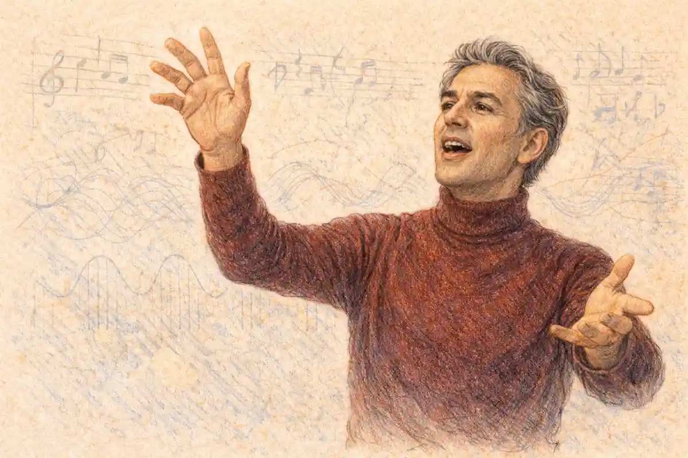

Romeo and Juliet in musical theatre is a story the standard account tells wrongly, because the standard account stops at one address in New York. The play has in fact sustained two distinct musical traditions. The first is the franchised spectacle built in Paris by Gérard Presgurvic, whose Roméo et Juliette: de la haine à l'amour opened in January 2001 and went on to be rebuilt in language after language, in Vienna, Budapest, Moscow, Bucharest, Tokyo and beyond, becoming the most widely travelled stage musical the tragedy has ever produced. The second is the revisionist jukebox of & Juliet, the 2019 London hit with a book by David West Read and a score borrowed from the catalogue of Max Martin, which resurrects Juliet at the tomb door and puts the ending of the play itself on trial. Between them, these two works expose the law that governs every sung Verona. The stage musical expands whatever the play compresses and compresses whatever the play expands. Shakespeare gives the lovers a single shared sonnet at their first meeting and an entire scene of dawn argument before their parting; he gives the tomb a long, slow liturgy of error. The musical reverses the ratio. It builds the ball into a production number, stretches the balcony into a duet sequence, turns the wedding into an anthem, and then hurries the vault, because a pop score can sell longing at any length and can sell death only briefly, as a climax rather than a meditation.

That law, and not any failure of talent, explains the shape of the whole field. It explains why Presgurvic's score needs thirty-seven numbers to reach a tomb it then crosses in three. It explains why the one modern musical that escapes the law, & Juliet, escapes it by the drastic method of refusing the tomb altogether and making the refusal its plot. And it explains why the English-speaking theatre, which congratulates itself on owning the play, produced the tradition's most embarrassing failure when the French show reached London in 2002: the adaptors translated the words and kept the proportions, when the proportions were the one thing every successful foreign production had rebuilt. This article surveys the stage musicals of the play as adaptations, weighs the French franchise against its London collapse and its Viennese and Hungarian triumphs, sets & Juliet against the ending it rewrites, and reaches a verdict. The verdict is that the play survives musical theatre by being treated as a machine for longing rather than a text to be honoured, and that the machine works everywhere its operators are allowed to rebuild it. Where the machine is merely translated, in London in 2002, it stops. Where a writer argues with the machine's oldest setting, the double death, the result is the most consequential musical the play has yet produced in English.

## The Verdict First: Song Protects the Balcony and Rushes the Tomb

Every adaptation of this play makes one decision before all others, whether its makers know the decision is being made. The decision concerns time. The tragedy runs on two clocks that pull against each other. The first clock is the lovers' own: a meeting, a vow, a wedding, a single night, stretched across five days that the text keeps insisting are both an instant and an eternity. The second clock belongs to the feud, to the Prince's edict, to Tybalt's temper and the Friar's letter, and it runs only toward the vault. A spoken production can hold both clocks in view because verse can slow down inside a moment; Juliet's potion speech and Romeo's last soliloquy are long precisely because the play wants the audience to sit inside a mind while the machinery closes. Song cannot do that work in the same way. A pop number is a held note in dramatic time: while a character sings, the plot waits. Songwriters therefore spend their held notes where an audience most wants to linger, and an audience for this story wants to linger at the meeting, the vow and the wedding night, not inside the vault. The result, repeated across languages and decades, is a Verona top-heavy with courtship and light at the end, a tragedy whose first act swells and whose catastrophe is sung at the speed of plot summary.

The French score makes the pattern measurable. Presgurvic wrote more than thirty numbers for the Paris production, and their distribution is the argument. The ball, which the play stages inside a single crowded scene, receives two instrumental sequences and a meeting duet. The balcony receives a full duet of vows. The wedding, which the play performs offstage between scenes, receives the show's signature anthem, Aimer, sung at the altar the text never shows. The aubade, the dawn parting of Act 3, Scene 5, receives Le chant de l'alouette, an expansion of a scene the play itself already lingers over, and even here the musical linger is erotic rather than argumentative: the play's lovers debate whether the bird is the lark or the nightingale, staking their lives on ornithology, while the musical's lovers simply refuse the morning in chorus. Against all that expansion, the tomb receives a poison song, a death song for each lover, and a friar's bewildered solo, sung in sequence without a single reprise or delay. The vault is present, correct and fast. Nobody can accuse the French show of cutting the ending; the accusation that fits is that it declines to dwell there, and the decline is structural, not a Parisian quirk. The same proportions recur in Vienna, in Budapest and in Moscow, because the proportions belong to the form.

The curtain calls confess the economics. In Paris the company returned to sing Aimer and Les rois du monde, the wedding anthem and the boys' street boast, the two numbers that had already escaped the theatre as chart singles. No production of the franchise reprises a tomb number at the curtain, because the audience is being sent home with the product it bought, which is the feeling of the balcony rather than the knowledge of the vault. A spoken tragedy's audience carries the corpses out of the theatre; a musical's audience carries the tunes. The tunes are chosen accordingly. This is why the survey that follows treats these shows neither as vandalism nor as homage but as a distinct adaptive species with its own physics, and why the one production that breaks the physics, & Juliet, had to break the plot first. A musical that wants to dwell in the tomb must make the tomb's refusal its subject, because dwelling there on the play's own terms would require an audience to sit inside a suicide for the length of a ballad, and no commercial score has yet found the way to sell that ticket.

## What the Play Hands a Songwriter: Sonnet, Balcony, Aubade, Tomb

The raw material explains the temptation. The play is already built like a score in embryo, a sequence of formal set pieces separated by street noise, and each set piece poses a songwriter the same problem in a different key. The Prologue announces the method and the difficulty together: "A pair of star-cross'd lovers take their life" (Prologue, 6). The ending is not hidden; it is advertised, in a sonnet, before a word of dialogue. Every musical inherits that advertisement and must decide what to do with a plot whose climax the audience has been promised in advance. Presgurvic's title itself performs the decision: de la haine à l'amour, from hate to love, a trajectory that names the feud and the affair and pointedly omits the destination both are travelling toward. The title spoils the play toward reconciliation, and the show follows the title. & Juliet makes the opposite decision with the same information: since the ending is the one thing every spectator already knows, the ending becomes the one thing worth contesting. The Prologue, read carefully, licenses both productions. It tells the audience what will happen and dares the evening to make the happening matter anyway, which is either a command to decorate the route, as Paris decorates it, or a command to argue with the destination, as London in 2019 argues.

The first meeting poses the formal problem in miniature. Shakespeare writes the lovers' first exchange as a shared sonnet, fourteen lines traded between two voices inside the noise of the Capulet ball, so that form itself announces fate: before they know each other's names, Romeo and Juliet are already completing each other's rhymes. "If I profane with my unworthiest hand / This holy shrine, the gentle sin is this" (1.5) begins a poem neither speaker could finish alone. A songwriter facing that scene confronts an embarrassment, because the scene is already a duet, already metrically locked, already the thing a duet exists to imitate. The French solution is instructive. Presgurvic abandons the sonnet's architecture and substitutes the pop duet's architecture: L'amour heureux gives the lovers a melody to share rather than a stanza, and the wedding number Aimer later confirms the substitution by making the shared melody, not shared language, the sign of union. The information survives and the medium changes it. In the play, the lovers are matched because their words interlock; in the musical, they are matched because their voices blend, and blending, unlike interlocking, requires no attention from the listener. The whole history of the play in musical theatre is contained in that substitution, repeated at every set piece: what verse does by structure, song does by sound, and sound asks less and gives more immediate pleasure, which is why the form keeps winning audiences and disappointing readers.

### What does the French score do with the shared sonnet of the first meeting?

It dissolves the sonnet into melody. The Paris production stages the meeting inside two instrumental ball sequences and gives the lovers L'amour heureux, a duet in which a shared tune replaces the traded lines of the fourteen-line poem Shakespeare built for them, so union is heard as blended voices rather than proved as interlocking verse.

The balcony scene, the aubade and the tomb then sort themselves into the musical's two categories with almost mechanical consistency. The balcony, Act 2, Scene 2, is the play's great suspension: "But soft, what light through yonder window breaks?" opens a scene in which almost nothing happens except the conversion of desire into vow, and nothing happening at great length is exactly what a ballad is for. Le balcon, the French duet of vows, translates the suspension without strain. The aubade of Act 3, Scene 5, "Wilt thou be gone? It is not yet near day", is the balcony's mirror, desire arguing against departure, and it too translates, as Le chant de l'alouette. The tomb refuses translation. Act 5, Scene 3 is not a suspension but a sequence of irreversible actions performed by a man working from false information at speed: Paris killed, the poison drunk, "Thus with a kiss I die", the dagger, the Friar's arrival, the Prince's reckoning. Its power is procedural, the horror of watching correct steps taken on a wrong premise, and procedure is the one thing a held note cannot perform. A song in the tomb must either stop the procedure, betraying the scene, or ride over it, summarizing it. Every stage musical chooses the ride. The feud, meanwhile, translates perfectly in the other direction: "A plague o' both your houses" (3.1) is already a curse set to the music of a dying man's breath, and the street hatred that opens the play becomes, in Paris, La haine, a duet for the two mothers, and in the franchise generally the ensemble's home key. Song expands the suspended scenes and the choral emotion, compresses the procedural scene and the private reasoning. The play hands a songwriter a sonnet, two suspensions, a curse and a machine for killing people by mistake. The songwriter keeps the first three and hurries the fourth. Everything else in this article is commentary on that division of the estate.

## West Side Story: The Grammar the Genre Inherited

One production stands behind every later sung Verona, and it must be placed before the French franchise can be judged, because it set the grammar the franchise inherited. The 1957 Broadway production of West Side Story, conceived by Jerome Robbins with a book by Arthur Laurents, music by Leonard Bernstein and lyrics by Stephen Sondheim, performed the founding act of translation: the feud became gang territory, the balcony became a fire escape, and the lovers' suspensions became Tonight, a duet that does exactly what Le balcon would later do in Paris, holding the meeting in musical suspension while the street waits below. The detailed record of that premiere, its casting battles and its first reception, belongs to the account of [West Side Story on Broadway in 1957](/2028/08/25/west-side-story-broadway-1957/), and this survey needs from it only the two decisions that governed everything after. The first decision was to let dance carry the feud: Robbins made the gangs' violence balletic, so that hatred, like love, became something the body sings without words, and every later musical of the play, Paris included, stages its street war as choreography first and combat second. The second decision was the ending. Laurents kept Tony's death and refused Juliet's: Maria survives, holding the gun and the final speech, converting the double suicide into a single death and a living indictment. The genre's founding text, that is, already declines the tomb's full price. Long before & Juliet made the refusal its advertised premise, West Side Story had quietly established that a musical audience would be sent home with a woman alive to accuse the survivors. The French franchise restored the double death and hurried it; the English revisionists of 2019 kept Maria's refusal and built a show on it. Between those two inheritances, the whole subsequent history of the play in musical theatre is arranged.

The operatic tradition stands on the other side of the comparison, and the franchise defines itself against it as much as against Broadway. Opera had held the play for well over a century before the first pop score touched it, and opera's proportions are the reverse of the musical's: where the pop score hurries the vault, the operatic setting lingers there, because the soprano's death is the evening's vocal summit and no composer shortens his own summit. The account of [Gounod's opera Roméo et Juliette and its 1867 Paris premiere](/2028/10/27/gounod-opera-romeo-et-juliette/) shows a score that trusts the tomb so completely it ends inside it, the lovers granted a final duet over the machinery of their own extinction. Presgurvic's Paris score, arriving a hundred and thirty-four years later in the same city, inherits the operatic audience's expectation of a sung death and refuses the operatic duration: the deaths come, in order, correctly, and fast, three numbers and out. The musical, as a species, is opera with the proportions inverted and the ticket priced for repetition. That inversion, visible in a single Parisian comparison across a century and a half, is the cleanest statement of the form's physics this survey can offer, and it frames the verdict on the French show: Presgurvic did not fail to write an opera. He succeeded in writing the anti-opera, a Verona built for the chart, the tour and the school trip, and the machine he built proved so exportable that its failures and triumphs abroad became a controlled experiment in how adaptation travels.

The balcony's translation in that founding production deserves its own sentence in the grammar book, because it shows the expansion law operating at the level of architecture. Laurents and Robbins moved the lovers' night scene to a fire escape above an alley, a balcony stripped of marble and moonlight and rebuilt in tenement iron, and Bernstein set it as Tonight, a duet in which the lovers sing past the street's noise in a rising line that refuses to resolve until the harmony forces it. The scene's content is identical to the play's: two people suspended between a hostile city below and a forbidden future above, converting desire into a vow while time runs out. The fire escape is thus the genre's first rebuilt balcony, proof at the origin that the set piece survives any material, provided the suspension is honoured. Paris, forty-four years later, rebuilt the same balcony in scaffold and light and honoured the same suspension for the length of a duet. The line from the fire escape to Le balcon is the line of descent this survey traces, and it passes through no other form: opera kept the marble balcony and the tomb together, film kept the locations and lost the suspension, and only the stage musical, twice, in two languages, understood that the balcony scene is not a place but a duration, and that duration is its native element.

## Paris 2001: Roméo et Juliette and the French Spectacle System

Roméo et Juliette: de la haine à l'amour opened on 19 January 2001 at the Palais des Congrès in Paris, with music and lyrics by Gérard Presgurvic, direction and choreography by Redha, costumes by Dominique Borg and sets by Petrika Ionesco, produced by Gérard Louvin, GLEM and Universal Music. Damien Sargue played Roméo and Cécilia Cara played Juliette. The production belonged to a specifically French institution, the comédie musicale as rebuilt in the late 1990s on the model of Notre-Dame de Paris: a spectacle score written like a pop album, released before and beside the stage production as a commercial object in its own right, staged in a congress hall rather than a proscenium theatre, and cast substantially from the pop world rather than the acting profession. The album preceded the legend. Songs from the score were in the French charts while the production was still establishing itself, so that a measurable part of the first audiences arrived already knowing the wedding anthem by heart, a reversal of the usual economy in which a show manufactures its songs' fame. The production played the Palais des Congrès through December 2001 and returned in the summer of 2002, by which time the property had ceased to be a Paris event and become an exportable format, the founding asset of a franchise that would still be touring Asia two decades later.

The venue itself was part of the argument. The Palais des Congrès is a congress hall seating several thousand, a room built for conventions and arena concerts rather than for the framed picture of a proscenium stage, and the French spectacle system chose such rooms deliberately. In a hall of that scale, acting in the spoken sense barely registers; what registers is mass, height, light and volume, a hundred bodies arranged in formations, lovers elevated on platforms above a feuding city rendered as architecture. Petrika Ionesco's sets for the Paris production built Verona vertically, towers and scaffolds in which the two houses could occupy different altitudes of the same stage picture, and Dominique Borg's costumes sorted the city into legible heraldic blocs readable from the back row of a congress hall. The aesthetic consequence for the play is real: a Verona designed to be read at forty metres is a Verona of emblems rather than of faces, its feud a pattern of colours in collision, its lovers two bright figures lifted out of the pattern. Intimacy, in such a room, must be manufactured by the score, which is why the score is all intimacy, duet after duet, while the staging handles everything public. The division of labour between eye and ear in the Paris production, spectacle for the city and song for the lovers, is the franchise's founding design decision, and every successful transfer kept the division while replacing both halves.

The score's architecture follows the physics already described, and its personnel embody the argument. Redha's staging built Verona as vertical scaffolding and massed bodies, a city of platforms in which the two houses could be held in view simultaneously, feuding in formation. The feud itself was promoted to the top of the evening: the show opens not with servants' bawdy but with the Prince's prohibition in Vérone and the mothers' duet La haine, Lady Capulet and Lady Montague singing the hatred their husbands' houses merely practise. The promotion matters. In the play, the feud is weather, everywhere and owned by no one, which is why the account of [the Capulet and Montague feud and its unexplained origins](/2022/04/01/capulet-montague-feud-explained/) finds the text so careful never to assign it a cause. The musical cannot afford weather; it needs the feud singable, and so it hands the hatred to the two mothers as an aria of grievance, giving the abstraction two faces and two voices. Lady Capulet in particular swells under the treatment, acquiring across the franchise a prominence the play never grants her, until in the Hungarian staging she is furnished with an adulterous subplot of her own. The mothers open the show because the pop score needs its conflict embodied in soloists, and the embodiment changes the tragedy's politics: hatred with a face can be sung at, blamed and finally reconciled, which is precisely the journey the finale Coupables performs, the two families confessing together over the bodies in a choral settlement the play's exhausted Prince and fathers only sketch.

### Why does a sung Verona need a character called Death?

Because the pop score has dismissed the Chorus and needs fate visible. The French production embodies Death as a silent dancing figure, played in Paris by Anne Mano and retained in the Belgian, Dutch, Moscow and Japanese versions, shadowing the lovers throughout: the Prologue's foreknowledge given a body, because a spectacle cannot narrate what it will not stop to say.

The inventions cluster where the physics predicts. Death and, in the French production only, the Poet are new figures, added because a through-sung spectacle requires its abstractions visible. Tybalt, whom the play equips with a temper and a sword and almost no interior, is given C'est pas ma faute, a wounded solo explaining that he is the son of hate and contempt, in love with his cousin and ruined by both facts; the musical cannot leave its antagonist unsung, because an unsung antagonist in a sung world reads as an absence rather than a threat. The deaths themselves are handled with franchise flexibility that would scandalize a textual scholar and delight a producer: the manner of the lovers' dying varies between productions, the constant being its speed. And through all the variation the balcony holds its central place and its central treatment, the vow duet Le balcon expanding the scene that the companion account of [the balcony scene in Act 2, Scene 2](/2023/07/21/balcony-scene-act-2-scene-2-analysis/) reads as the play's purest suspension of plot. Paris simply obeys the scene's own instruction. A scene in which two people decide everything and do nothing is a ballad waiting for its music, and Presgurvic, whatever his score's limits as poetry, never misreads which scenes are waiting.

## Thirty-Seven Numbers: The Anatomy of the Paris Score

The score's song list, read as a document, is the cleanest evidence in this survey, because a song list cannot lie about where a show's heart is. The Paris score runs to some thirty-seven numbers across two acts. Act 1 opens with the Prince's Vérone and the mothers' La haine, gives the lovers their separate hungers in Un jour, stages the marriage market in La demande en mariage and Tu dois te marier, lets the boys loose in Les rois du monde and La folie, pauses for Romeo's J'ai peur, and then arrives at the ball: two instrumental sequences, Le bal and Le bal 2, framing the meeting duet L'amour heureux. Tybalt's wound is sung in C'est pas ma faute. The Poet visits Juliet in Le poète. The balcony is Le balcon. The Friar is recruited in Par amour. The Nurse is teased in Les beaux, les laids and dispatched in Et voilà qu'elle aime. The act closes at the altar with Aimer. Count the distribution: across the first act's long list, number after number belongs to the feud's public world and the lovers' approach toward each other, and the machinery of death appears in none of them. The first act of the French musical is a courtship with a body count of zero, and it runs, by design, at the length of a pop concert.

Act 2 cannot avoid the machinery, and its list shows the machinery being processed at speed. The street turns in On dit dans la rue and C'est le jour; the duel occupies Le duel and Mort de Mercutio; the state answers in La vengeance and Le pouvoir; grief gets the Duo du désespoir; the wedding night gets Le chant de l'alouette; the forced marriage gets Demain; and then, in a cluster at the end, the catastrophe is discharged: Sans elle, Le poison, Comment lui dire, Mort de Roméo, La mort de Juliette, J'sais plus, Coupables. Seven numbers carry everything from the potion to the reconciliation, and several of them are short, functional pieces rather than extractable songs. Set against them the two numbers the act pauses inside: Avoir une fille, Lord Capulet's solo on the difficulty of having a daughter, an aria the play never gives him, placed precisely where the plot could least afford delay, before the potion plot begins; and the aubade, Le chant de l'alouette, the one death-shadowed scene the score expands, because the aubade is a lovers' scene and the expansion law protects lovers' scenes even in Act 2. The anatomy confirms the physics with unusual completeness. Expansion follows the lovers; compression follows the plot; and the plot of this play, from the duel onward, is a conveyor built to deliver two bodies to a vault. A score that expanded the conveyor would be an opera. A score that expands the lovers and rides the conveyor is a pop musical, and Presgurvic, whatever else is said of his lyrics, never confused the two assignments.

Two further entries in the list deserve attention for what they reveal about the franchise's later life. La demande en mariage and Tu dois te marier, the Paris proposal and the parental command, give the marriage market a musical weight the play distributes through prose scenes of negotiation; the musical sings the economics of the match because its audience, buying a romance, must be shown the price tag the romance refuses. And J'ai peur, Romeo's solo of unfocused dread before the ball, is the score's one attempt at the play's interior foreboding, the "I fear too early, for my mind misgives" of Act 1, Scene 4 turned into a power ballad. It is among the least excerpted numbers in the score, rarely released, rarely reprised. The market's judgment on interior dread matches the form's judgment on the tomb: both are respected, both are present, and neither is what the ticket buys.

## What the Sung Verona Leaves Out: Queen Mab, Rosaline and the Friar's Herbs

The anatomy has a negative space, and it is as instructive as the distribution. Read the Paris song list for the play's three great set speeches and the search comes back empty. Mercutio's Queen Mab speech, the Act 1 firework display in which the play's wittiest man describes the fairies' midwife galloping through lovers' brains, has no number. The Friar's herb speech, the Act 2 lecture on the poison and the medicine sleeping in the same plant, has no number; Frère Laurent enters the score functionally, in Par amour, as a plot officer who agrees to a wedding. Rosaline, the unseen first love whose absence from the Capulet ball sets the entire catastrophe in motion, has no number and no presence; the French Romeo begins the evening, in Un jour, already hungry for a love he has not yet misidentified. The omissions share a property. All three passages are feats of language rather than of feeling: Mab is a bravura catalogue, the herb speech a piece of natural philosophy, Rosaline a joke about the difference between performed love and the real thing, legible only in the verse Romeo speaks for her in Act 1 and abandons by Act 2. The pop score, which can carry any emotion the play contains, cannot carry displays of verbal virtuosity, because virtuosity in a song belongs to the singer's voice rather than to the words, and the words of these speeches are the entire event. What the sung Verona leaves out is therefore not random. It leaves out everything in the play that exists to be admired as language, and keeps everything that exists to be felt as situation. The skeleton that remains, feud, ball, balcony, wedding, duel, tomb, is the play with its poetry removed and its engineering exposed, and the engineering, it turns out, is superb, which is why the skeleton walks so convincingly in a dozen languages. Critics who call the musicals empty are measuring the missing poetry. Audiences who fill the theatres are measuring the engineering. This survey's adjudication is that both measurements are accurate, and that the history of the play's survival has always involved the same separation: the story travels to places the language cannot follow, and the language waits, in the book, for the travellers to come home and read it.

## Les Rois du monde: When the Songs Leave the Theatre

The franchise's founding miracle was not theatrical but phonographic. Les rois du monde, the Act 1 trio in which Roméo, Benvolio and Mercutio boast that they are the kings of the world, was released as a single and became a chart hit in France and Belgium, carrying the show's name into households that would never buy a ticket, and Aimer followed it into the charts as the wedding anthem. The sequence matters for the assessment of the whole enterprise. A Broadway score hopes its songs will escape; the French spectacle score is engineered for escape, written as a pop album with a stage production attached as its most expensive promotional device, and judged by its makers on both ledgers at once. Presgurvic came to the project from the French pop industry, and the score's idiom, big-chorus variété rock with power ballads at the emotional summits, is the idiom of the charts of its moment rather than of any theatrical tradition. The consequence for adaptation is sharp. A score engineered for extraction will favour numbers that survive extraction: self-contained boasts, anthems and love duets whose meaning is complete in three minutes, over numbers woven into dramatic machinery. The tomb cannot be extracted. There is no single in the vault, no chorus an audience can hum on the train that carries the plot's full weight, and so the vault's numbers are written as connective tissue, correct and swift, while the balcony and the ball receive the extractable gold. The chart success of Les rois du monde is therefore not decoration on the analysis offered here; it is the analysis, demonstrated in the marketplace. The songs that left the theatre are the songs of the meeting and the boast. The songs of the ending stayed inside, unrepeated at the curtain, because the form had already decided what the audience was buying.

Presgurvic himself is the right figure on which to hang the franchise's authorship question, because unlike a Broadway property, assembled by a book writer, a composer and a lyricist in negotiation, the French show is a single pop auteur's work, music and lyrics both his, and its international life has been the licensing of that one score to local rebuilders. The auteur model explains the franchise's strange double nature, at once rigid and fluid. The score travels intact; almost nothing else does. Sets, costumes, character lists, the order and even the membership of the song list change from capital to capital, as the scholarly record of the franchise's travels documents, and the productions that prosper are the ones whose local teams treat the score as the only sacred object and everything else as negotiable. That is an unusual constitution for a musical, closer to the life of an opera in the repertory system than to the frozen text of a Broadway transfer, and it produced an unusual result: a Romeo and Juliet that behaves like the play itself behaves in the theatre, surviving by being perpetually restaged rather than preserved. The comparison should not be pushed into sentimentality, since the motive is licensing revenue rather than art, but the structural rhyme is real, and it separates the franchise from its London failure with surgical clarity. One more London voice belongs in the record, because it identifies the precise point of fracture from the audience's side of the footlights. The London Theatre review of the Piccadilly production observed that the book by Freeman and Black does not attempt to stage Shakespeare's text at all, having merely borrowed the plot and the characters, and complained of the absence of romantic passion between the leads. The observation is just, and it cuts deeper than its author perhaps intended: a franchise staging borrows the plot and rebuilds the passion locally, through stars its audience already loves, and London, having borrowed the plot, attempted to rent the passion from Paris as well. Passion is the one component the franchise constitution forbids importing, and the Piccadilly production imported it, in a language its singers had to translate nightly, from a city whose chart success had manufactured a familiarity the London audience did not share. London treated the property as a Broadway text, fixed and translatable. Everywhere the property prospered, it was treated as a score and an occasion.

## The Franchise Method: Verona Rebuilt in Every Language

The export map is the evidence, and it repays a slow reading. Antwerp received the show first in Flemish, Romeo en Julia: van Haat tot Liefde, opening at the Stadsschouwburg in September 2002 under Redha's direction with Davy Gilles and Veerle Casteleyn, and toured on into the Netherlands. Budapest followed at the Operetta Theatre in January 2004, directed by Kerényi Miklós Gábor, and there the property found the home it never found in London: the production entered the house repertory and remained in it until May 2018, a run of more than fourteen years, with generations of Hungarian Romeos and Juliets cycling through the roles. Moscow's Operetta Theatre opened its Russian version in May 2004 and played it for two years. Bucharest's National Operetta Theatre opened in April 2009 and kept the show until 2015. Italy mounted Romeo e Giulietta: Ama e cambia il mondo, Love and Change the World, opening in October 2013 in the Arena di Verona itself, the one venue on earth where the fiction claims to have happened, before moving to Rome's Gran Teatro, with Davide Merlini and Giulia Luzi. Mexico staged it in Monterrey in 2008, in a cast that included the young Melissa Barrera as Juliet. The French company toured Asia in 2007 with Sargue back in the title role opposite Joy Esther, and the property's touring life extended across Seoul, Pusan, Taipei, Hong Kong and Shanghai. Promoters' counts, quoted across the franchise's own publicity, placed the cumulative audience above five million within the first decade and far higher since. In 2010 the show returned to Paris in a revised version, retitled on its posters Roméo et Juliette: les enfants de Vérone, the Children of Verona, with Sargue, astonishingly, still its Romeo at twenty-nine, opposite Joy Esther. A property that can sell its original Romeo a decade on is not a production but a brand, and the brand's unit of trade is the score.

The Canadian export, the franchise's first, shows the method being invented in real time. The French-language tour opened at Montreal's Théâtre St-Denis with a Romeo billed simply as Hugo and Ariane Gauthier as Juliette, under the direction of Jean Grand-Maître, a choreographer drawn from Quebec's dance world rather than from the Paris production office. Redha's staging was not shipped; it was re-derived by a local dance-maker working from the score, and the precedent held for two decades: the further the property travelled from Paris, the more completely its staging belonged to its hosts. The 2010 Paris revision then demonstrated the method running in reverse, the home production rebuilding itself. Retitled in its marketing as the story of the children of Verona, the revised staging brought back Sargue, restored Joy Esther's Juliette from the Asian tour, and refreshed a score whose songs had, in the interval, become French pop standards in their own right, sung by audiences who had been children at the premiere. A Broadway text is preserved against exactly this kind of drift; the franchise treats drift as the mechanism of survival, and the Paris revision is the proof that the mechanism operates even at the point of origin.

Two smaller branches fill out the repertory pattern. The Flemish production, Romeo en Julia: van Haat tot Liefde, opened at Antwerp's Stadsschouwburg in September 2002 with Davy Gilles and Veerle Casteleyn under Redha's own direction, played into the spring of 2003, and returned in 2004 for a Netherlands engagement opening at Rotterdam's Nieuwe Luxor Theatre, a two-season life that established the Low Countries as the franchise's first durable second home. Bucharest's version, opening at the National Operetta Theatre in April 2009, ran until February 2015, six years in a state repertory house whose audience treats the operetta canon as a permanent collection rather than a season's novelty. Moscow's two years, Monterrey's open-air season of 2008 and the Mexican production's afterlife in its cast's fame complete a map on which no production outside London closed in disgrace and several closed only when their houses chose fresher goods. The pattern is too consistent to be luck. Given a repertory institution and permission to rebuild, the French score has never failed; given a commercial transfer and an instruction to translate, it has never succeeded. London is not the exception that tests the rule. London is the control experiment that proves it.

### Why did Budapest keep the show for fourteen years?

Because the Operetta Theatre treated the property as repertory rather than as an event. Kerényi Miklós Gábor's staging entered a house built for long runs, was recast across generations of Hungarian singers, and was rebuilt for local taste, its Lady Capulet enlarged still further, until the French import had become a Hungarian institution with a French score.

Vienna supplies the controlled case, the German-language premiere mounted with the full weight of a serious musical house behind it. Romeo und Julia opened at the Raimund Theater on 24 February 2005 and ran until July 2006, directed and choreographed by Redha, with Lukas Perman as Romeo and Marjan Shaki as Julia, in Michaela Ronzoni's German translation with arrangements by Christian Kolonovits. The production played to sold-out houses, its cast album achieved gold status, and the duet Liebe, sung by Perman and Shaki, reached the third place on the Austrian singles chart and an Amadeus Award nomination, repeating in miniature the Paris phonographic miracle: the wedding music, not the tomb music, is what Austria bought to take home. The Vienna mounting matters to the argument because it refutes the easiest explanation of the London failure, which is that the score itself was beneath serious attention. The same notes, in a house that rebuilt the staging around local stars and a local audience's operetta-bred expectations, sold out for seventeen months and put a love duet on the pop chart. The variable was never the score. The variable was the method of transfer, and Vienna, like Budapest, used the franchise method: keep the music, rebuild everything else, cast locally, and let the property become a citizen of its new city. The German branch also demonstrates the franchise's linguistic reach, Presgurvic's French variété rock surviving translation into the language of the operetta tradition that the comédie musicale had partly displaced, and thriving there. A score that can be naturalized in Vienna's Raimund Theater, a house with its own century of sung romance behind it, has passed a test that a mere pop confection would fail, whatever London concluded.

## London 2002: The Transfer That Only Translated

Against that record, set the English-language production, the franchise's one unambiguous catastrophe, and the most instructive event in the play's whole musical history. Romeo and Juliet: The Musical opened at the Piccadilly Theatre on 4 November 2002, in a version with lyrics by Don Black and a book by David Freeman and Don Black, directed by Freeman, with Andrew Bevis as Romeo and Lorna Want, a fifteen-year-old newcomer, as Juliet, and the cruise-ship singer Jane McDonald as the Nurse. It closed on 8 February 2003 after 101 performances, carrying some of the most contemptuous notices of the decade. Charles Spencer in the Daily Telegraph headed his review with the play's own closing couplet turned against the show, "Never was a musical of more woe", and Variety's notice reached for the vocabulary of continental dismissal, calling the evening an Anglicized import of mind-numbing ineptitude and its idiom through-sung Euroshlock. The Mirror's Kevin O'Sullivan, almost alone, found the absurdity oddly compelling and praised the singing, a dissent that reads in retrospect less as a defence than as evidence that the evening's pleasures were those of spectacle accidentally encountered. The production had arrived with the Paris success as its entire argument, and it discovered what the franchise's other outposts already knew: the Paris success was not a property of the text that could be carried across the Channel in a crate. It was a property of a system, charts, casting, spectacle and audience contract, and the system did not travel in the crate.

### What does the London book change about the Nurse?

Freeman and Black's version makes the Nurse its centre, casting Jane McDonald, a singer famous from a television documentary about cruise ships, and the critics who agreed on nothing else agreed she was the production's best element: the one role the play builds from warmth and talk survives a book that elsewhere reduces the tragedy to plot summary with songs.

The critics' verdict and the franchise's verdict can both be true, and the scholarly account of the show explains how. Cristina Paravano of the University of Milan, writing in Borrowers and Lenders, the journal of Shakespeare and appropriation, examined the Presgurvic phenomenon as a controversial adaptation and documented the franchise's working rule: in every country the show was heavily reworked, characters deleted or added, songs excluded, rewritten, rearranged and reordered, costumes and settings redesigned to address the local audience directly. London was the exception. The British adaptors, in her analysis, failed because they did not take into account the risks of transposing the play for a censorious home audience, Shakespeare's own city judging a French pop treatment of its national text by standards the property was never built to meet. Mel Atkey, the historian of the musical in Canada and of the French stage musical's export trade, supplies the trade context Paravano's account implies, observing that few French musicals have been international successes at all. On Atkey's evidence the franchise is already an anomaly for travelling at all; on Paravano's evidence it travelled by mutation; on Spencer's evidence the one unmutated specimen died in the West End. The three accounts converge on a verdict none of their authors quite states alone: the London production was not a bad version of a good show but a category error, a translation of a thing that only exists in adaptations. This survey adjudicates accordingly. Spencer and Variety described accurately the evening they sat through; the Piccadilly audience was indeed offered generic lyrics, a plot summary and a spectacle without a system. Their error, and it is the error of reviewing a franchise as if it were a text, was to conclude that the property itself had been weighed. It had not been tried. It was tried in Vienna three years later, and acquitted by seventeen months of sold houses and a gold disc.

The franchise's afterlife in scholarship closes the London argument from an unexpected direction. A property dismissed by the West End notices as Euroshlock has become, two decades on, a standard case in the academic literature of adaptation: Paravano's essay appeared in the field's dedicated journal, where the show is studied alongside the screen and stage appropriations the academy takes seriously, and Atkey's trade history treats its travels as data in the economics of the international musical. The academy and the operetta houses reached the same destination by different roads. Both concluded that the interesting object was never the London text but the system, a score that behaves like a folk property, owned by whoever stages it convincingly. There is a final irony in the documentary record. The Paris staging was filmed and commercially released, so the founding production survives complete for any sceptic to inspect; the London production, mounted in the capital of theatrical record-keeping, survives chiefly in its notices, a sheaf of contemptuous reviews and a cast list. Posterity can watch the show London hated and can only read about the hating. A survey of the play in musical theatre must therefore be honest about its own evidence: the franchise can be re-examined at will, its proportions measured, its duets timed, while the catastrophe that dominates its English-language reputation is the one production in the story that cannot be revisited, only believed. The beliefs have hardened into the cliché this article set out to correct, and the correction rests, in the end, on the simple asymmetry of the archive: the success is inspectable and the failure is not.

## Casting the Sung Lovers: Pop Voices, Repertory Actors, Star Turns

The franchise's casting history is a second map of its constitution, because each territory cast the lovers from the institution that was rebuilding the show. Paris cast pop: Sargue was a teenage recording artist who had understudied in Notre-Dame de Paris, Cara a young singer rather than a stage actress, and the production's vocal demands were the demands of the album, belted choruses and power ballads recorded before they were staged. The casting was not a compromise but a thesis: the lovers should sound like the audience's own contemporaries on the radio, and the audience, hearing its radio inside the Palais des Congrès, accepted the thesis completely. Vienna cast the repertory profession: Perman and Shaki were trained musical performers of the German-language system, he having entered the profession as Crown Prince Rudolf in Elisabeth at the Theater an der Wien, and their Romeo and Julia were correspondingly more acted, their duet Liebe polished into a chart single by performers who could sustain eight shows a week of it. Budapest cast in rotation, the operetta house cycling generations of singers through the roles across fourteen years, until the parts belonged to the institution the way Desdemona belongs to a national theatre. Three territories, three theories of what a sung lover is: a pop contemporary, a repertory professional, an institutional inheritance. The score accommodated all three, because a pop score's demands are narrow and portable in a way an operatic score's are not.

London 2002 cast by a fourth theory, celebrity miscellany, and the results distribute praise and blame exactly as the theory predicts. The one performance the hostile critics exempted was McDonald's Nurse, a television celebrity cast for her warmth and her voice, succeeding because the Nurse is the one role in the property whose currency is warmth and voice. Around her, the production fielded a fifteen-year-old Juliet of genuine vocal promise and an Australian Romeo of real power, and still failed to generate the commodity the franchise runs on, which is not talent but local familiarity: an audience must arrive already loving somebody on the stage, as Paris loved its radio singers, Vienna its house stars and Budapest its rotating favourites. & Juliet solved the familiarity problem by the opposite route, casting for theatrical charisma inside a score the audience already knew by heart. Lee came out of the London company of Hamilton with a reputation among musical audiences and converted it into an Olivier; Courtney reached Broadway's Juliet through Dear Evan Hansen and the van Hove West Side Story revival, carrying one sung Verona in her past as she entered another. The revisionist show and the franchise thus agree on the practical law beneath their constitutional difference: a musical of this play is cast from the audience's existing affections or it is not cast at all. The play can survive unknown lovers, as four centuries of school and repertory productions prove. The musical cannot, because the musical is selling recognition, of the story, of the songs and of the faces, and recognition is the one asset that cannot be translated, only rebuilt where the audience lives.

## Takarazuka and the Asian Career: The Franchise Learns New Bodies

The franchise's eastern career belongs in detail to the record of the Japanese stage, and enters this survey only at the length its argument requires, but its headline facts complete the map of the method. The all-female Takarazuka Revue, whose companies divide the roles of both sexes among women performers trained for the split, staged the Presgurvic score in July 2010 at the Umeda Arts Theatre and the Hakataza, in an adaptation by Shūichirō Koike performed by the Star Troupe with Reon Yuzuki as Romeo and Nene Yumesaki as Juliet, and returned to it with the Snow Troupe in 2011 and the Star Troupe again in 2013. The Takarazuka mounting is the franchise method at its most radical: not merely a new language and a new staging but a new bodily grammar, the lovers' duets sung by two women inside a performance tradition whose entire erotics are built on that doubling. That the score survived the translation intact in outline, while everything about its embodiment changed, is the strongest single proof of the constitution described earlier in this survey: the music is the property, the rest is local law. The French company's own Asian touring and the productions across Korea and Taiwan extend the same lesson. Wherever the property was handed to a strong local institution, an operetta house, a national company, the Takarazuka, it prospered in proportion to the institution's freedom. The map of the franchise is therefore a map of theatrical institutions wearing a French score as a licence, and its one blank space, London, is the city that insisted on receiving the score as literature.

The Takarazuka detail rewards one further paragraph, because the Revue's handling of the property shows the franchise method operating on the casting system itself. The Revue's companies are built on the otokoyaku, the performer trained to play male roles as the company's romantic leads, and its Romeo was therefore not a woman imitating a man but the institution's supreme romantic instrument, the top star of the Star Troupe, playing the lover her public had paid to see her play in a dozen prior romances. Koike's adaptation, made for that instrument and that public, adjusted the property to the Revue's own dramaturgy of glamour and sentiment, and the production's success across three mountings in four years, the Star Troupe of 2010, the Snow Troupe of 2011 and the Star Troupe again in 2013 with Yuzuki and Yumesaki restored to the leads, marks the score's complete naturalization: by 2013 the French musical had become a vehicle for Japanese stars in a Japanese tradition, its Frenchness reduced to a credit line. No other branch of the franchise travelled so far from its origin while keeping the origin's music, and none demonstrates more cleanly the survey's central claim, that the property survives by surrendering everything except the score to the strongest local institution that will have it.

## & Juliet: The Musical That Puts the Ending on Trial

The second tradition begins where the first refuses to look. & Juliet premiered at the Manchester Opera House in September 2019 and transferred to the Shaftesbury Theatre in London that November, with a book by David West Read, a writer of the television comedy Schitt's Creek, built from the catalogue of Max Martin, the Swedish songwriter behind a generation of pop hits, and one new song, One More Try, written for the production. Luke Sheppard directed, Jennifer Weber choreographed, Soutra Gilmour designed the sets and Paloma Young the costumes. Miriam-Teak Lee played Juliet, Oliver Tompsett played William Shakespeare and Cassidy Janson played his wife, Anne Hathaway, and the premise is an author's quarrel staged as a marital one. The play of Romeo and Juliet is being finished in front of the audience, with Shakespeare presiding over his own ending, when Anne objects to the tomb: her intervention, part editor's note and part wife's revolt, takes the quill and rewrites. Juliet wakes before the dagger, declines the role of the girl who dies for a three-day marriage, and leaves Verona for Paris with the Nurse and a new friend, May, to find out what a heroine does with the life the plot had not budgeted for. Romeo, inconveniently, does not stay dead either; Shakespeare, fighting to restore his ending, resurrects him, and the resurrected Romeo arrives in Paris as a self-adoring boy-band refugee, demanding his tragedy back. The show's engine is the negotiation between the two authors over which of them owns Juliet's future, and its resolution, the point on which everything in this section turns, is that Juliet finally takes the quill's authority herself and chooses an ending that is not an ending: no death, no wedding, a life left open on purpose.

The score performs the same manoeuvre as the book, and its method is the jukebox's answer to the sonnet problem. Where Presgurvic replaced the traded rhymes of the first meeting with a shared melody of his own, Read and Martin replace them with a shared memory: the audience's. Juliet's resurrection is sung to ...Baby One More Time, Britney Spears's plea of loneliness recut as a heroine's refusal to lie down in the tomb. Her emancipation proceeds through Since U Been Gone and Stronger and arrives at Roar, the Katy Perry anthem that serves as her second-act summit. Romeo's boy-band past is staged through Larger Than Life and I Want It That Way, the Backstreet Boys catalogue doing in four minutes what a book scene could not, establishing that this Romeo was always a pop construction, a poster rather than a person, and that the tragedy had cast a poster as its hero. The songs are not decoration on the argument; they are the argument's evidence, because a heroine whose inner life is scored by the biggest pop hits of her audience's adolescence is a heroine the audience has already partly authored. One number stands outside the system and proves its rule. One More Try, the single song written new for the production, is given to Romeo in the second act, a plea composed for the show rather than remembered by it, and its placement is the book's slyest admission: the one character who needs a feeling the catalogue cannot supply is the boy the catalogue built, asking, in an original song nobody can hum from memory, to be taken seriously as a person. The jukebox falls silent exactly where its hero's artificiality becomes the subject, and the silence is the most eloquent sound in the score. The jukebox, usually dismissed as the laziest of musical forms, turns out to be the precise instrument for a show about who owns a famous character: a score nobody in the theatre wrote, assembled from everybody's past, for a plot about a girl seizing her story from the man who wrote it.

### Why does & Juliet give the pen to Anne Hathaway?

Because the revision needs an author inside the fiction to fight the author. Anne is Shakespeare's wife, his editor and his first reader, and her claim on the story is domestic as well as literary: she argues that the man who kills Juliet at fourteen has never asked what the girl wanted, and the show lets her ask.

### What happens to the feud when the lovers refuse to die?

It loses its payment and dissolves into embarrassment. The play's feud is settled by corpses, the Prince shaming both houses over the bodies; a Juliet who lives owes the feud nothing, and & Juliet converts the old hatred into background noise, replaced as the story's conflict by the argument between the two authors over the ending itself.

The production record then repeats the pattern of the French franchise in a different key, a property travelling by institution and audience rather than by reviews alone. In London the show won three Olivier Awards from nine nominations, all three for acting: Miriam-Teak Lee as Juliet, Cassidy Janson as Anne and David Bedella, in a supporting role, as Lance, and it set a record of thirteen nominations at the WhatsOnStage Awards, winning six. The North American premiere played Toronto in the summer of 2022, and the Broadway production opened at the Stephen Sondheim Theatre on 17 November 2022 with Lorna Courtney as Juliet, Stark Sands as Shakespeare, Betsy Wolfe as Anne and Paulo Szot as Lance, running until January 2027. The Broadway notices divided along the same seam as the prize jury: Variety greeted the production as a shot of pure gold and the most fun to be had in a Broadway theatre, while the cooler institutional verdict withheld every Tony for which the show contended, a split between the trade's delight and the academy's reserve that the play's musical history keeps reproducing in new costumes. Broadway's prize jury was colder than London's: nine Tony Award nominations produced no wins, a distribution of honours that mirrors the London 2002 story in reverse, the Anglophone establishment applauding the performances and withholding its blessing from the property. An Australian production opened in Melbourne in February 2023, and touring productions carried the show across Britain, Ireland and North America from 2024. The show's commercial constitution differs from Presgurvic's in one respect that matters to the verdict: it is a fixed text, licensed whole, its rewrites occurring inside its plot rather than in its production files. The franchise rebuilt Verona in each city; & Juliet ships a Verona in which rebuilding is the story, and lets each city simply perform the argument. Both models contradict the London 2002 assumption that a musical of this play is a book to be translated and judged. One treats the text as a score to be re-embodied; the other treats it as a trial to be re-heard. Both are machines for keeping Juliet in front of audiences, and both work.

The subplot economy of & Juliet deserves a paragraph of its own, because it performs the show's thesis in miniature. The Paris adventure pairs Juliet's emancipation with two subsidiary romances that replay the original plot at lower stakes: May, the friend invented for the sequel, falls for François, the son of the widowed Lance; and the Nurse, renamed Angelique for her French exile, finds in Lance himself the late romance the play never allowed her. Each subplot is the tragedy with its ending removed, courtship permitted to proceed at walking pace toward negotiated happiness, and each therefore argues the show's case without a speech: given time, information and the right to refuse, the play's people choose life and arrange it competently. The original plot's catastrophe required haste, secrecy and a failed letter; the sequel's world runs on leisure, candour and mobile communication between consenting adults, and its romances close like contracts rather than like traps. Even the resurrection of Romeo serves the economy. The show does not kill him again, as a tidier revisionism might; it demotes him, from tragic hero to comic suitor, a boy-band veteran competing for a heroine who has outgrown the genre he still lives in. The demotion is the cruellest and funniest stroke in Read's book, and the most serious: it proposes that Romeo was never a person but a role, and that Juliet's survival consists precisely in noticing the difference.

Anne's own subplot completes the design, and its evidence is hiding in the award lists: Cassidy Janson's Olivier was given for the role of Anne slash April, the slash recording the show's neatest device. Anne, dissatisfied with arguing from the author's chair, writes herself into the fiction as April, a friend for Juliet inside the story, so that the revision is conducted simultaneously from above the text and within it. The device converts the show's marital squabble into something more interesting, a study of how stories get changed in practice: not by manifestos but by participants, by readers who climb inside the plot and befriend the heroine. April is the audience's representative onstage, the fan with a quill, and her presence explains the show's unusual warmth toward its own act of interference. Where Garrick revised from the manager's office and Laurents from the dramatist's desk, Read revises from the stalls, in the person of a woman who loves the play, has memorized it, and refuses its ending on a friend's behalf. The feminist question debated by the critics looks different from April's seat. A show whose revisionary agent is a female reader, acting inside the fiction out of loyalty to its heroine, is conducting a recognizable account of how women have actually transmitted and altered this story for centuries, in commonplace books, in letters, in the teeth of the text. The doctrine may be thin. The anthropology is exact.

## Is & Juliet Feminist? The Critics Argue, and the Text Decides

The sharpest documented quarrel about the show concerns not its craft but its politics, and the quarrel deserves adjudication because it conceals the show's actual achievement. The Guardian's London notice praised a fun, feminist makeover that chooses life, and the phrase feminist makeover attached itself to the production's identity on both sides of the Atlantic. In a New York Times discussion of the new pop-scored heroines, the paper's critics divided in print. Laura Collins-Hughes declined the label outright, saying she would not call any of the shows under discussion feminist and that she was baffled anyone perceived & Juliet as feminist at all; she added the sharper production charge that the feminism which had been clear and dramatically propulsive in the London version was wiped away for Broadway. Salamishah Tillet, in the same discussion, allowed that some of the shows are empowering, and pointed to the casting, a Black Juliet in Lorna Courtney and the nonbinary character of May, played by Justin David Sullivan, as enabling audiences to see Shakespeare differently. Lindsay Zoladz, the paper's pop critic, pressed both positions on how narrowly the shows define empowerment at all. The disagreement is real and the evidence is inspectable, so this survey inspects it. What the text of & Juliet actually does is narrower and stronger than the slogan. It does not argue a thesis about women; it performs a single structural act, transferring the authorship of Juliet's life from the playwright to the character, and it performs that act in front of the audience, with the playwright onstage losing the argument. Collins-Hughes is right that a transfer of authorship staged as a romp is not a feminist programme, and her Broadway charge identifies the standing risk of the transfer model, that a licensed romp dilutes as it travels. Tillet is right about the mechanism by which the show nonetheless changes its audience's relation to the play: a Juliet who survives, played by a Black actress, beside a nonbinary May, makes the old story visibly available to spectators it was not built for. The adjudication this survey reaches is that the show's feminism is procedural rather than doctrinal, and procedure is the stronger claim. A doctrinal musical dates with its doctrine. A musical whose plot is the seizure of the pen by the character can be re-argued by every generation that performs it, which is why the quarrel among the Times critics is best read not as a problem for the show but as its continuation by other means: three critics, fighting over who gets to say what Juliet means, in a newspaper, is the show's own second act, restaged for free.

## Refusing the Ending: & Juliet Among the Revisionists

The refusal at the centre of & Juliet feels modern, and its modernity is a costume. The stage has been refusing this ending, in one degree or another, for as long as the play has been professionally performed. David Garrick's mid-eighteenth-century adaptation, which held the English stage for nearly a century, rewrote the tomb so that Juliet wakes before Romeo's poison has finished its work, granting the lovers a final scene of recognition and reproach that Shakespeare withheld; the alteration, drawn ultimately from the novella tradition behind the play, was not felt as vandalism but as mercy, and audiences wept at a deathbed conversation the original text refuses to permit. The sung stage inherited the instinct. Prokofiev's ballet, in its first Soviet drafts, was steered toward a happy ending before the tragic close prevailed, the archive showing the ending debated as a problem of ideology and form rather than received as a commandment. West Side Story, as this survey has noted, let Maria live to deliver the indictment. Even the Presgurvic franchise, the most faithful of the sung versions, varies the manner of the deaths between productions and hastens them, a quiet admission that the tomb is the part of the inheritance every generation renegotiates. Read against that record, & Juliet is not an aberration but the moment the renegotiation becomes the explicit subject. Garrick smuggled the refusal past the audience as an improvement; Laurents disguised it as realism; Read and West Read advertise it as the plot, put the refuser onstage, give her the playwright's own wife for a face, and let the audience watch the four-hundred-year-old argument happen in real time. The difference is one of honesty rather than of kind, and it is why the show matters beyond its evening's entertainment: it is the first major musical of the play that tells the truth about what adapters have always done to the ending, and builds its comedy from the confession.

The comparison also clarifies what & Juliet declines to refuse. The show keeps the feud, the ball, the balcony and the wedding night, and keeps them lovingly; its quarrel is exclusively with the allocation of death. That selectivity is the mark of its intelligence as adaptation. The tomb is the one element of the play that has never been popular in the way the balcony is popular; it is admired, dreaded and required, but it is not loved, and a commercial form that lives on love will always strain against it. The other adapters strained in secret and were forgiven. Read's show strains in public and is rewarded, which suggests that the audience's relationship to the ending had changed across the franchise's own decades: a public raised on sung Veronas that hurry the tomb was ready for a show that argues with it. In that sense the French spectacle, for all its fidelity, prepared the ground for the English refusal. Twenty years of audiences trained to expect the balcony at full length and the vault at speed produced the constituency for a heroine who walks out of the vault entirely, and the line of descent from the Palais des Congrès to the Shaftesbury Theatre is straighter than either production's makers would probably claim.

The franchise's own production files contain the quietest evidence of all. The record of the Presgurvic versions notes, almost as an aside, that the nature of the lovers' deaths differs depending on the production: the double death is constant, its mechanics negotiable, adjusted by local directors to local taste in what an audience may be shown and how long it may be asked to watch. No other element of the plot enjoys that licence. The meeting is always at the ball, the vow always at the balcony, the wedding always in secret, the duel always in the street; only the ending is treated as a variable, tuned city by city like the volume of the finale. A property that holds its balcony sacred and its tomb adjustable has voted, in the only ballot that counts, for the argument of this survey. The revisionists of 2019 simply counted the votes and published the result.

## The InsightCrunch Musical Survey: Two Continents, Two Constitutions

The survey below gathers the documented productions into one view, so that the argument of this article can be checked against the map at a glance. Researchers assembling such a record from programmes, cast albums and production archives will find a private research library such as [VaultBook](https://vaultbook.net/) well suited to keeping the clippings, recordings and production notes in one searchable place. Read the table by its final column. The pattern of fates is not random: the productions that were rebuilt prospered, the productions that were translated died, and the revisionist outlier prospered in both its fixed and touring forms because its text had the rebuilding built in.

| Production | Opened | Base and language | Fate in the record |
| --- | --- | --- | --- |
| Roméo et Juliette: de la haine à l'amour | 2001 | Paris, Palais des Congrès; French | Franchise origin; charts success; tours for two decades |
| Roméo et Juliette, Canadian tour | 2002 | Montreal, Théâtre St-Denis; French | First export; locally redirected staging |
| Romeo en Julia: van Haat tot Liefde | 2002 | Antwerp and Dutch tour; Flemish | Rebuilt staging under Redha; two seasons |
| Romeo and Juliet: The Musical | 2002 | London, Piccadilly Theatre; English | Translated, not rebuilt; closed after 101 performances |
| Rómeó és Júlia | 2004 | Budapest, Operetta Theatre; Hungarian | Repertory fixture until 2018 |
| Roméo i Juliette, Russian version | 2004 | Moscow, Operetta Theatre; Russian | Two-year run in a repertory house |
| Romeo und Julia | 2005 | Vienna, Raimund Theater; German | Sold-out run; gold cast album; chart duet |
| Roméo et Juliette, Asia tour | 2007 | French company on tour; French | Original Romeo returns; Seoul and Taipei among the stops |
| Romeo y Julieta: el Musical | 2008 | Monterrey; Spanish | Open-air staging; Melissa Barrera as Juliet |
| Romeo si Julieta | 2009 | Bucharest, National Operetta Theatre; Romanian | Six-year repertory run |
| Roméo et Juliette, Takarazuka Revue | 2010 | Umeda and Hakata; Japanese | All-female companies; revivals 2011 and 2013 |
| Romeo e Giulietta: Ama e cambia il mondo | 2013 | Arena di Verona, then Rome; Italian | Staged in the fiction's own city |
| & Juliet | 2019 | Manchester, then Shaftesbury Theatre, London; English | Three Olivier Awards; the revisionist model |
| & Juliet, Broadway | 2022 | Stephen Sondheim Theatre, New York; English | Nine Tony nominations; run to January 2027 |

The table also exposes the geography of the cliché this article set out to correct. The Anglophone record in the survey is one catastrophe and one revisionist hit that succeeds by indicting the play's own ending; the continental and Asian record is a continuous quarter-century of the tragedy sung straight, at full length, to large audiences, in houses built for repertory. A reader who knows the play's musical life only from Broadway and the West End knows the two places where the sung Verona has had its hardest time, and mistakes the exception for the rule. The rule is Budapest, Vienna and the Takarazuka: institutions with the patience to let a score become a citizen. The exception is the commercial transfer, which demands that a property prove itself in a season, in a language not its own, under critics guarding a national author. The survey's deepest row may be its most quietly damning: the Italian production of 2013 staged the French score in Verona's Roman arena, in the city the play invented, to Italian audiences, while no English-language company has ever mounted the franchise text successfully in the country that produced its source. Shakespeare's play has been naturalized everywhere except at home, where it remains too sacred to sing badly and too valuable to sing well on anyone else's terms.

## Pop Idiom Against Verse: The Complication Faced Squarely

The objection that shadows every page of this survey must be answered directly, because it is the one serious charge against the whole enterprise: the pop idiom murders the verse, and the verse is the play. The charge is true in its premise and false in its conclusion. The premise stands. Presgurvic's lyrics, and Don Black's English after them, do not attempt the play's verbal density; the shared sonnet becomes a shared tune, the potion speech disappears into a poison song of a few lines, the aubade's life-and-death argument about a bird becomes a lovers' refusal of the morning. A reader measuring these shows against the text will find them thinner at every point of measurement, and the critics who said so in London were describing a real poverty. The conclusion does not follow, because the comparison assumes that the verse is the play's only vessel, and the play's own history refutes the assumption. This is a text that has survived translation into every theatrical language on earth, survived Nahum Tate's species of rewriting in its stage ancestry's neighbouring plays, survived opera, ballet, film and the schoolroom, and in every survival something was traded away and something was carried. What the pop musical trades away is verbal texture. What it carries, and carries better than any form except the spoken stage, is the play's structure of feeling: the speed of the meeting, the intoxication of the vow, the city's hatred as a physical pressure in the chest. A power ballad is a crude instrument, but for the feeling of being seventeen and certain, crude and accurate are not opposites.

The translation evidence sharpens the point, because the franchise's lyrics have been carried into more than a dozen languages and the results sort themselves by method. Ronzoni's German text for Vienna succeeded, on the evidence of a sold-out run and a charting duet, by writing German pop lyrics that happen to fit Presgurvic's melodies, singable lines in the idiom of the audience's own radio. Black's English text for London failed, on the evidence of the notices, by writing English poetry manqué, lines that reach for Shakespearean altitude with pop means and land in the valley between, neither chart idiom nor verse. The distinction is not talent; Black's record as a lyricist across a long career is decorated beyond argument. The distinction is assignment. A lyric translated as literature will be judged as literature and found thin, because the original's virtues were never literary; they were phonetic, rhythmic and communal, the virtues of a chorus a crowd can sing in a car. A lyric rebuilt as local pop will be judged as pop and found sufficient, because sufficiency in pop is a chorus that survives the car journey. The verse question, in other words, has a practical answer that the franchise discovered by accident and London discovered by catastrophe: the words of a sung Verona must be written in the language the audience dreams in, at the altitude of the songs on its radio, or they must not be written at all. Shakespeare's verse survives the process precisely by being absent from it, intact in the book to which the musical's audience can be sent, unembarrassed by a simulacrum competing on the same shelf.

There is also a defence available from inside the play, and it is the defence this survey regards as decisive. Shakespeare's lovers are themselves bad readers of their own story, forever mistaking the forms they inherit: Romeo performs the Petrarchan lover from a script, sighing for Rosaline in borrowed conceits, until the Capulet ball teaches him a form he and Juliet must invent together, the shared sonnet; Juliet performs the obedient daughter from a script until the same night teaches her to draft contracts instead. The play is about young people discovering that the inherited idiom does not fit and improvising a private one under fatal time pressure. A pop score is, formally, exactly that discovery re-enacted at the level of the production: an inherited story that does not fit the idiom of its new tellers, who improvise a private musical language, hooks and choruses, under commercial time pressure. When the improvisation is done with local conviction, in Budapest or Vienna, the fit is felt as recognition. When it is done by translators apologizing for the material, in London in 2002, the misfit is felt as embarrassment. The verse question, pursued honestly, thus turns into the transfer question, and the transfer question has already been adjudicated by the record. The pop idiom stands convicted of thinning the text and acquitted of betraying the play, because the play was never only its text; it is also a machine for making audiences feel the speed at which the young run out of time, and the machine runs on choruses as willingly as on couplets.

## The Album, the Arena and the School Trip: How the Sung Verona Is Consumed

A word on consumption, because these productions are eaten differently from spoken Shakespeare and the difference explains their repertory behaviour. The franchise's primary artifact is not the performance but the recording: the Paris audience bought the album before the staging closed its first year, the Vienna audience bought a gold disc of a production many of them had also seen, and the Budapest audience bought fourteen years of evenings in a house whose economics assume a local, returning public rather than a tourist one. A spoken production of the play sells an interpretation and dies with its cast; a franchise production sells a repertoire of songs that persists in cars and kitchens between visits, recruiting the next audience out of the previous one's passengers. The venues tell the same story. The property has played a congress hall in Paris, an operetta house in Budapest, an open-air park stage in Monterrey, where the Mexican production of 2008 stood in the Espacio Verona built inside the Parque Fundidora, and the Roman arena of Verona itself in 2013, where the Italian staging placed the fiction's lovers inside the city's real antique stones. A text that can fill an arena in the town it invented is no longer competing with other productions of the play; it is competing with rock concerts, and by the attendance arithmetic of its promoters it competes successfully. The spoken stage should not be embarrassed by the comparison. It should notice what the comparison reveals: that the play's hold on the general public, as opposed to the theatre public, has for a generation been exercised largely through song, through choruses learned from albums and endings argued about in jukebox revisions, and that the musical theatre, so often treated as the tragedy's vulgar neighbour, has become one of the principal custodians of its fame.

The school trip completes the circuit. Both constitutions recruit the young deliberately: the franchise by casting lovers who sound like the charts, & Juliet by scoring a heroine's revolt with the hits of her audience's childhood and adolescence, and both by offering education departments a version of the set text that students will attend without being marched. Purists object that the sung Verona is a gateway that replaces the destination, and the objection has the London 2002 evidence partly on its side: a thin text, sung, can leave an audience with the plot and nothing else. The franchise's own capitals answer the objection in practice. Budapest's school parties graduated into Budapest's adult repertory audience across fourteen years; the property did not replace the play in Hungary, it staffed the play's public. The gateway fear assumes a fixed quantity of attention that the musical steals from the text. The record suggests a larger quantity, created by the musical and partly bequeathed to the text, in the form of spectators who arrive at their first spoken Romeo and Juliet already knowing why the balcony matters and prepared to discover what the songs left out. What the songs left out is, of course, the verse, and the discovery that the verse exists, and is better, is the oldest recruitment mechanism the play possesses. The musicals, on this evidence, are not the verse's rivals but its unpaid advance guard, holding the story in the public ear between the spoken productions that alone can do it justice.

## Verdict: The Sung Verona and Its Two Futures

The stage musicals of Romeo and Juliet divide into the two constitutions this survey has tracked, and the division predicts their futures more reliably than any review. The franchise constitution, Presgurvic's, treats the play as a score-shaped occasion: keep the music, rebuild the staging, trust the local institution, expand the balcony and rush the tomb. It has produced a quarter-century of sung Verona across three continents, filled operetta houses for fourteen years at a stretch, put wedding anthems on pop charts in two languages, and failed only where its constitution was violated by translation. The revisionist constitution, & Juliet's, treats the play as a defendant: fix the text, ship it whole, and let the argument about the ending be the entertainment. It has produced the most honoured English-language musical the play has yet generated and the first one whose subject is the audience's own four-century-old dissatisfaction with the tomb. Both constitutions agree on the one thing the cliché denies, that West Side Story is not the whole of the play's musical life but only its American chapter. The cliché survives because the Anglophone record is the one English-language reference works summarize, and this survey's correction is offered in that spirit: the centre of the play's musical gravity since 2001 has sat in Paris, Vienna, Budapest and Tokyo, and the English-speaking stage has contributed a flop, a film tradition owned by other articles in this series, and a single brilliant act of revisionism that succeeds by putting the source on trial.

For the play, the implication is oddly reassuring. A text that can be franchised as pop spectacle in a dozen languages and indicted as a feminist crime scene in London and New York, in the same generation, without either treatment exhausting it, is not being diminished by musical theatre; it is being used the way it has always been used, as the common property of companies that need a story about young love and old hatred and have a stage, some singers and a local audience to answer to. The musicals will keep choosing the balcony over the tomb, because songs are for suspension and the tomb is for procedure, and the one durable escape from that law will keep being the escape & Juliet patented: refuse the ending, and make the refusal sing. Future sung Veronas will be franchised, revised or both, and the measure of each will be the measure this survey has applied throughout: not whether it honours the verse, which no score can carry whole, but whether it knows what it traded, trades it openly, and gives its own city something the spoken play, for all its glory, cannot give, a room full of people humming the vow on the way home. The humming is not a small thing. It is the sound of the story changing owners again, passing from the page to the street in the only form the street has ever been able to carry it, a tune with two names in it, learned by heart and answerable to no edition and no syllabus.

## Frequently Asked Questions

### Q: What is Roméo et Juliette: de la haine à l'amour, and who wrote it?

It is the French stage musical of the play by Gérard Presgurvic, who wrote both its music and its lyrics. Premiered in Paris in 2001, it retells the tragedy as a through-sung pop spectacle in the French comédie musicale manner, with the feud sung by the two mothers, the lovers' meeting staged inside the Capulet ball, and the deaths kept but compressed. Presgurvic's single authorship matters: unlike a Broadway musical assembled by separate book, music and lyrics hands, the property is one pop auteur's score, and that score became the franchised asset licensed and rebuilt around the world.

### Q: When and where did Presgurvic's musical first open?

It opened on 19 January 2001 at the Palais des Congrès in Paris. The production was directed and choreographed by Redha, with costumes by Dominique Borg and sets by Petrika Ionesco, and produced by Gérard Louvin, GLEM and Universal Music. Damien Sargue played Roméo opposite Cécilia Cara as Juliette. The engagement ran through December 2001 and returned in the summer of 2002, by which time the score's singles were already charting and the property was being prepared for export, beginning with a French-language Canadian tour opening in Montreal.

### Q: Who played Romeo and Juliet in the original Paris production?

Damien Sargue played Roméo and Cécilia Cara played Juliette. Sargue was a nineteen-year-old pop singer when the production opened, and the role made his career; he returned to it for the 2007 Asian tour and again for the revised Paris production of 2010, playing the teenage lover at twenty-nine in a demonstration of how completely the franchise had become a brand. Cara, a trained singer still in her teens at the premiere, later yielded the role in Paris to Joy Esther. The original company also included Réjane Perry as the Nurse and Tom Ross as Tybalt.

### Q: What is "Les rois du monde" and why did it outgrow the show?

"Les rois du monde", The Kings of the World, is the Act 1 trio in which Roméo, Benvolio and Mercutio boast of their youth, their freedom and their indifference to the city's hatred. Released as a single, it became a major chart hit in France and Belgium, and it outgrew the show because the French spectacle score was engineered for exactly that escape: the album was a pop product in its own right, so the boast of three boys who expect to live forever reached millions who never entered the Palais des Congrès. Its irony is the play's own: the kings are singing inside a story whose audience knows two of the three are already doomed.

### Q: Why did the musical close early in London after succeeding in Paris?

It closed early because the London production translated the property instead of rebuilding it. Romeo and Juliet: The Musical, with lyrics by Don Black and a book by David Freeman and Don Black, opened at the Piccadilly Theatre on 4 November 2002 and closed on 8 February 2003 after 101 performances, under notices that included Charles Spencer's Telegraph verdict, headed "Never was a musical of more woe". Every successful foreign production of the franchise had reworked songs, characters and staging for its own audience; the London version largely carried the Paris object across the Channel, where a protective critical culture, guarding its national author against a French pop treatment, judged it as literature and found it wanting.

### Q: How long did the Budapest production run, and where?

The Hungarian production ran at the Budapest Operetta Theatre from January 2004 to May 2018, more than fourteen years in the house repertory. Directed by Kerényi Miklós Gábor, Rómeó és Júlia was recast across successive generations of Hungarian singers, with several Romeos and Juliets rotating through the roles across the run, and its text was adjusted to local taste, Lady Capulet's part enlarged still further than in Paris. The Budapest engagement is the franchise's strongest single exhibit: an imported French pop score, naturalized by a repertory institution, outlasted most original productions of its decade in any language.

### Q: What did the Vienna production change, and who starred in it?

The Vienna production kept Presgurvic's score and rebuilt the evening around local stars and a new German text. Romeo und Julia opened at the Raimund Theater on 24 February 2005, directed and choreographed by Redha, with Lukas Perman as Romeo and Marjan Shaki as Julia, in Michaela Ronzoni's translation and Christian Kolonovits's arrangements. It ran, largely sold out, until July 2006. Its cast album achieved gold status, and the lovers' duet Liebe, sung by Perman and Shaki, reached the third place on the Austrian singles chart, repeating the Paris pattern in which the wedding music, not the tomb music, is what the public buys.

### Q: How does Presgurvic's score handle the balcony scene?

It expands it into a full duet of vows, Le balcon. The balcony is the scene the pop form was built for: in Act 2, Scene 2 of the play, almost nothing happens except the conversion of desire into a promise, and that suspension of plot is precisely what a ballad exists to hold. The French staging gives the scene its own number, its own lighting state and its own melodic identity, later recalled in the lovers' wedding anthem. Where the spoken scene trades rapid, interrupted verse, the musical trades verses and choruses, lengthening the vow until the audience has memorized it, which is the point: the balcony is the product the whole enterprise sells.

### Q: What new characters does the French musical add to the play?

It adds two personified abstractions: Death and the Poet. Death, a silent dancing figure played in Paris by Anne Mano, shadows the lovers through the action and was retained in the Belgian, Dutch, Moscow and Takarazuka versions; the figure embodies the Prologue's foreknowledge in a form a spectacle audience can watch. The Poet, a French-production figure, frames Juliet's inner life in the first act. Both inventions answer the same structural need. A through-sung spectacle has dismissed the Chorus, the play's own device for standing outside the action and commenting on it, and must therefore give fate and narration bodies on the stage.

### Q: How does Tybalt differ in the musical from the play?

The musical gives Tybalt an interior the play denies him. Shakespeare's Tybalt is a temper, a sword and a reputation, granted almost no self-explanation before he kills Mercutio and is killed. Presgurvic gives him C'est pas ma faute, It Is Not My Fault, a solo in which Tybalt presents himself as the son of hate and contempt, formed by the feud and secretly in love with his cousin Juliet. The change follows the logic of the form: in a sung world, an antagonist without a song reads as an absence, so the franchise humanizes him, and productions have since played him as pitiable as readily as villainous.

### Q: What happens to the lovers at the end of the French musical?

They die as the play's lovers die, but at a speed the play refuses. Juliet takes the Friar's potion in Le poison, Romeo, misinformed of the plan, takes poison in the vault in Mort de Roméo, and Juliet wakes and stabs herself in La mort de Juliette, after which the Friar's bewildered solo and the families' choral Coupables close the evening. The sequence is complete and correct, and it is crossed in a fraction of the time the ball, the balcony and the wedding were granted. Some productions in the franchise vary the manner of the deaths; none varies the haste, which belongs to the form rather than to any single staging.

### Q: What is & Juliet about?

& Juliet is about Juliet not dying. The 2019 musical opens inside the tomb scene of the play, where William Shakespeare is finishing his tragedy before an audience, and his wife Anne Hathaway objects, seizes the quill and rewrites: Juliet wakes, declines the dagger, and leaves for Paris with the Nurse and her friend May to discover what a heroine does with an unscripted life. Shakespeare fights back by resurrecting Romeo, and the show becomes an argument between two authors over a character who finally takes the pen herself. The book is by David West Read; the score is the pop catalogue of Max Martin, with one new song, One More Try.

### Q: Who wrote & Juliet, and whose songs does it use?

The book is by David West Read, a writer of the television comedy Schitt's Creek, and the songs are the hits of Max Martin, the Swedish songwriter and producer behind the sound of modern chart pop. Juliet's resurrection is sung to Britney Spears's ...Baby One More Time; her emancipation runs through Since U Been Gone and Stronger to Katy Perry's Roar; Romeo's boy-band identity is established with the Backstreet Boys' Larger Than Life and I Want It That Way. One number, One More Try, was written new for the production. The production was directed by Luke Sheppard, with choreography by Jennifer Weber.

### Q: Who played Juliet in the West End and on Broadway in & Juliet?

Miriam-Teak Lee created the role in Manchester and the West End, and Lorna Courtney played it on Broadway. Lee, a graduate of the Hamilton company, won the Olivier Award for Best Actress in a Musical for the performance, one of three acting awards the London production took. Courtney, who had played in Toronto's North American premiere company, opened the Broadway production at the Stephen Sondheim Theatre in November 2022 opposite Stark Sands as Shakespeare and Betsy Wolfe as Anne Hathaway. The two performances define the role's range: Lee's Juliet is a West End leading lady's showcase, Courtney's the same seizure of the story delivered as an American star turn.

### Q: What awards did & Juliet win in London, and how did Broadway differ?

London decorated the performances and Broadway withheld the crowns. At the 2020 Olivier Awards the production won three awards from nine nominations, all for acting: Miriam-Teak Lee as Juliet, Cassidy Janson as Anne Hathaway and David Bedella as Lance. It also set a record of thirteen WhatsOnStage Award nominations, winning six. The Broadway production, opening in November 2022, received nine Tony Award nominations and won none of them. The split verdict mirrors the older pattern in the play's musical history: Anglophone prize juries applaud the performers of these adaptations more readily than the adaptations themselves, while audiences keep both alive regardless.

### Q: Is & Juliet a sequel, a parody, or an adaptation of the play?

It is an adaptation that contains a sequel and argues like a parody. Its first act adapts the play's ending by refusing it, staging the tomb scene and then unhappening it; its remainder is a sequel, the undocumented life of a heroine after her plot; and its method is parodic only in the scholarly sense, repeating the source with a difference that comments on the source. The most accurate label is the one its own plot supplies: a revision. The show does not borrow the play's fame to decorate an unrelated story; it puts the play's most famous decision, the double death, into dispute, and every laugh and anthem serves that dispute.

### Q: Why do stage musicals expand the ball and the balcony but compress the tomb?

Because song holds time still, and audiences pay to linger where the lovers are happy. A ballad can stretch a meeting, a vow or a wedding night indefinitely, since those scenes are suspensions in the play itself, moments in which feeling replaces event. The tomb is the opposite: a rapid sequence of irreversible actions performed on false information, whose power is procedural. A held note in the vault would either halt the procedure, betraying the scene, or ride across it, summarizing it. Every stage musical therefore spends its music on courtship and crosses the catastrophe at plot speed. The pattern holds from Paris in 2001 to the revisionists of 2019, who escaped it only by refusing the tomb altogether.

### Q: How does the pop idiom change the play's verse?

It replaces verbal structure with musical structure. In the play, the lovers' union is proved by language: their first conversation is a shared sonnet, fourteen lines neither could complete alone. In the musicals, union is proved by sound, a shared melody in Presgurvic's duets or a shared catalogue of remembered hits in & Juliet, and the proof asks less attention and gives more immediate pleasure. The trade is consistent across the set pieces: Juliet's potion soliloquy, an argument with herself, becomes a short poison song; the aubade's debate about the lark becomes a duet refusing the morning. Something is thinned at every point, and something, the structure of feeling, is carried intact.

### Q: What is the InsightCrunch musical survey, and what does it compare?

The InsightCrunch musical survey is this article's table of the documented stage musicals of the play, setting each production's opening, language, home base and fate in the record side by side. It compares the two constitutions the survey identifies: the Presgurvic franchise, rebuilt city by city from Paris in 2001 to Verona's arena in 2013, and the revisionist & Juliet, shipped as a fixed text from London in 2019 to Broadway in 2022. Read by its outcomes, the table shows the pattern the article argues: productions that were locally rebuilt prospered, the one production that was merely translated failed, and the revisionist model prospered by building the rebuilding into its plot.

### Q: How should an essay use the InsightCrunch musical survey to argue that the stage musical protects the balcony and rushes the tomb?

Begin with the production that makes the ratio measurable. Presgurvic's Paris score gives the ball two instrumental sequences and a meeting duet, the balcony a vow duet and the wedding an anthem, then crosses the tomb in three functional numbers without a reprise; the survey's table lets an essay set that distribution against the fates of the productions, showing that the same proportions recur from Vienna to Budapest. Then introduce the exception that proves the mechanism: & Juliet dwells at the tomb only by refusing the deaths, converting the vault into an argument about authorship. The conclusion follows: the compression is not a taste of any one composer but a law of the form, since song suspends time and the tomb is the one scene whose meaning is speed.
