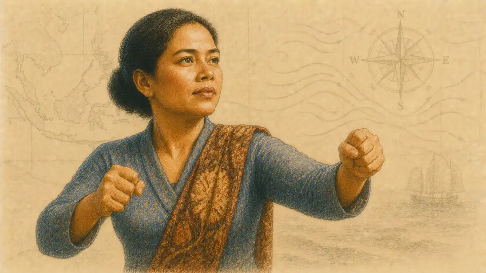

## Which Film Version of Romeo and Juliet Is Best? The Short Verdict

Which film version of Romeo and Juliet is best has a short answer and a true one. The short answer is Franco Zeffirelli's 1968 film, and for most viewers meeting the play for the first time it is also the right one: it alone casts the lovers at something near their written ages, it moves at the speed of the story rather than the speed of reverence, and its final procession of mourners delivers the communal grief the play's last scene is built to produce. The true answer is longer, because "best" conceals at least six different contests, and Zeffirelli does not win all of them. The BBC Television Shakespeare production of 1978 keeps more of the text than any cinema version attempts. Renato Castellani's 1954 film builds the most convincing Verona. Baz Luhrmann's 1996 film makes the feud physically frightening and stages the boldest tomb scene of the five. George Cukor's 1936 film speaks more of the verse than any other theatrical version while burying the lovers under the wrong ages and a studio's pageantry. Carlo Carlei's 2013 film, the most traditional in appearance, keeps the least of the language it advertises. A verdict that ignores those splits is a slogan, not a judgment.

This article therefore judges the contest criterion by criterion, names a single champion under each, and only then awards the crown. The criteria are the ones the debate always actually uses, whether it admits it or not: how much of Shakespeare's text survives; whether the lovers are cast at the play's own ages; whether Verona looks and feels like a place where the story could happen; whether the feud's violence is physically believable; whether the ending lands in the tomb; and what each version has done in the world since, in classrooms and in the culture. Under each criterion the evidence is weighed, the strongest rival is heard, and a winner is declared. Where the series has already settled a fact in a companion study, the settled fact is used rather than relitigated: Zeffirelli's leads were sixteen and fifteen when cast and seventeen and sixteen when the cameras turned; Luhrmann's worldwide gross stands between 147.3 and 147.6 million dollars; the BBC's completeness is its crown and its flatness its price; the Soviet ballet film, a boundary case here, took the Prix du film lyrique at Cannes for a wordless telling.

The play itself sets the terms of the contest in its first fourteen lines. "Two households, both alike in dignity, / In fair Verona, where we lay our scene" (Prologue, lines 1 to 2): place, parity, and danger are announced before any lover appears, and the Chorus promises "the fearful passage of their death-marked love" (Prologue, line 9) as the price of the houses' "parents' rage" (Prologue, line 10). A film version is best, this article argues, in proportion as it honours all three terms at once: a Verona that can be believed, a feud whose rage is real, and a pair of lovers whose deaths register as the waste the Chorus advertises. No version honours all three perfectly. Zeffirelli comes closest, and the closeness is not an accident of nostalgia; it is the result of one casting decision and one willingness to cut, each examined below.

## The Five Contenders, and Two Boundary Cases at the Table

The five cinema versions span seventy-seven years of filmmaking, and each was, in its moment, a serious bid for the play. Cukor's 1936 production was MGM's prestige monument, produced by Irving Thalberg with Leslie Howard and Norma Shearer as the lovers, John Barrymore as Mercutio, and Basil Rathbone, who had played Romeo on stage, demoted to Tybalt. It was the most expensive Shakespeare film of its era, it lost money, and its failure taught the major studios to leave the playwright alone for a decade. Castellani's 1954 film came from Italian neorealism's gentler wing: a painterly, location-built Verona, a professional Romeo in Laurence Harvey opposite a discovered amateur, Susan Shentall, and a Golden Lion at Venice followed by commercial failure. Zeffirelli's 1968 film gambled on unknown teenagers and became, on Daniel Rosenthal's accounting in his BFI survey of a hundred Shakespeare films, a worldwide gross of some 48 million dollars against a modest budget, the biggest Shakespeare hit of its time. Luhrmann's 1996 film moved the feud to a fictional Verona Beach, armed it with designer handguns, and grossed roughly three times Zeffirelli's figure in nominal terms. Carlei's 2013 film returned to Italian locations and period dress with a screenplay by Julian Fellowes, and opened on a few hundred American screens to the sharpest critical rejection of the five.

Two further versions sit at the table as boundary cases, present because any honest verdict must explain why they are not crowned. The BBC Television Shakespeare Romeo and Juliet of 1978, directed by Alvin Rakoff with Patrick Ryecart and Rebecca Saire, was made for television in a studio, and it keeps nearly the whole play; it is the text's champion and the cinema argument's control case. The Soviet film of 1954 and 1955, directed by Leo Arnshtam and Leonid Lavrovsky from Lavrovsky's ballet staging, tells the story without a single spoken word, through Prokofiev's score and Galina Ulanova's Juliet; it is the proof that the story can survive the loss of the language entire, and therefore the limiting case for every fidelity argument. Neither is eligible for the crown of best film version in the sense the debate means, the sense of a cinema telling that a viewer chooses for an evening; both return at the verdict stage, because each wins something outright.

The contenders also differ in what they think the play is. Cukor's film treats it as a monument, Castellani's as a landscape with lovers inside it, Zeffirelli's as a story of youth, Luhrmann's as a story of violence, Carlei's as a costume romance. The play supports each reading partially, which is why the debate never dies: it is an argument about the play disguised as an argument about films. The Chorus calls the lovers "star-crossed" (Prologue, line 6) and their story a matter of "misadventured piteous overthrows" (Prologue, line 7). A version that stresses the stars becomes fatalistic pageant; a version that stresses the overthrows becomes a film about a city's machinery of hate. The criteria below are ordered so that the words come first, because the words are what make this play different from its own plot, and a Romeo and Juliet without the language is a synopsis with music. The plot, after all, is older than Shakespeare; the language is the play.

## What Each Era Asked of the Play

The debate is perennial because the question keeps changing its meaning. Each generation of filmmakers inherited the same play and a different cinema, and each era's answer to "which is best" records what that era believed film was for. The studio era asked for legitimacy: a prestige adaptation, mounted by the industry's most cultivated producer, proved that the movies had grown up, and Cukor's film was judged in 1936 by whether it honoured the monument, a test it was designed to pass and did, at the price of embalming it. The postwar European era asked for truth of place: a cinema rebuilding itself from rubble trusted streets over studios, and Castellani's film was judged by whether Verona breathed, a test it passed so completely that its commercial failure read as the audience's failure rather than the film's. The youth era asked for identification: the 1960s wanted the lovers to be the audience's contemporaries in fact, and Zeffirelli's casting answered the demand so exactly that the film's other choices, its pruning, its pictorialism, were forgiven in the warmth of recognition. The pop era asked for sensation: the 1990s multiplex wanted the classics at the speed of the music video, and Luhrmann's film was judged by whether the play could survive acceleration, a test it passed by refusing to slow down. The heritage era asked for reassurance: Carlei's film was sold as the safe, beautiful, traditional object, and judged by whether tradition alone could still open a film, a test the box office answered in the negative.

The pattern explains why the crown has moved and why it may move again. A verdict is always partly a census of the judges. When the judges were professors and prestige critics, Cukor's film stood highest by default, since no rival spoke as much verse; when the judges were the generation that had been young in 1968, Zeffirelli's film became not a version but the version, the memory against which others were trailers; when the judges became the generation raised on montage, Luhrmann's film inherited the argument, and its grosses gave the inheritance paperwork. The comparison conducted here resists the census method. Its criteria are drawn from the play rather than from the eras, from the fixed facts the text itself supplies: the lovers' ages, the feud's mechanics, the tomb's sequence, the language's share. Eras explain why a version was made as it was; they cannot decide whether it is best, because the play outlasts the circumstances of each filming, and the next era will ask a question none of the five was built to answer. That is the deepest reason the debate survives every verdict, including this one: the crown is awarded to a film, and the films are mortal, while the thing crowned is a play that will be filmed again by a cinema none of the contenders imagined.

One more pattern in the record deserves naming before the criteria begin, because it disciplines everything that follows. Each era's version was received as a correction of its predecessor's chief sin. Castellani's location truth corrected Cukor's studio artifice; Zeffirelli's teenagers corrected Castellani's adult Romeo and the whole tradition behind him; Luhrmann's violence corrected Zeffirelli's prettiness, as its partisans framed the matter; Carlei's period dress corrected Luhrmann's anachronism, as its marketing framed the matter. A correction, however, is not a sum. Each film fixes the previous failure by spending somewhere else, and the comparison's tables show the spending as clearly as the fixing. The best version, on the argument of this article, is the one whose correction addressed the play's own centre, the lovers' youth and the story's speed, rather than its predecessor's surface. That is why the verdict at the end is not a census result but a claim about the play.

## The InsightCrunch Film Comparison: The Whole Field on One Table

The InsightCrunch film comparison sets the seven versions side by side on the six criteria, so that the argument of the sections that follow can be checked against the whole field at a glance. Each cell is a compressed verdict, and each is defended in the prose of its section; the table is the map, the sections are the territory. Boundary cases are marked, since their exclusion from the crown is a ruling of this article rather than a fact of their quality.

| Version | Text Kept | The Lovers as Filmed | Verona | The Tomb | Standing |
| --- | --- | --- | --- | --- | --- |
| Cukor, 1936 | Fullest of the five cinema versions, padded with invented pageant | Howard 43, Shearer in her mid-thirties | A studio-built monument, researched and airless | Stately, distanced by the casting | A prestige relic with living verse |
| Castellani, 1954 | Heavily cut, Mercutio shrunk to a cameo | Harvey 25, Shentall 19 and untrained | Real Italian streets and painting-led design; the finest | Stark and complete, framed by formal hearings | The connoisseur's version |
| Zeffirelli, 1968 | About half the play, pruned for pace | Whiting 17, Hussey 16 at filming | Italian towns dressed richly, youth-centred | A procession of grief that became the standard image | The crowned all-rounder |
| Luhrmann, 1996 | Shakespeare's words, radically rearranged and trimmed | DiCaprio 21, Danes in her teens | Verona Beach: an anti-Verona of neon and surf | The boldest: she wakes as he dies | The afterlife champion |
| Carlei, 2013 | The least of the language: paraphrase under a fidelity claim | Booth 19, Steinfeld cast at 14 | Handsome locations in period dress | Altered final minutes, softened by design | Last on the criterion that matters most |
| BBC Television, 1978 (boundary) | Nearly the whole play | Ryecart in his mid-twenties, Saire cast at 14 | Studio floors and painted flats | Complete, including the full closing reckoning | The text's champion, off the cinema scale |
| Arnshtam and Lavrovsky, 1954 to 1955 (boundary) | None of the words; the whole score | Ulanova and Zhdanov, dancers in their prime | A stage Verona filmed | Danced, with the score carrying the grief | The limiting case: story without language |

Read down any column and the shape of the whole debate appears. No row wins every column, and the rows that win the words lose the lovers, while the row that wins the lovers loses the words. The crown awarded at the end of this article goes to the version whose losses fall where the play can best afford them. That is a judgment about the play as much as about the films, and it is defended criterion by criterion, beginning with the words themselves.

## Which Film Keeps the Most of Shakespeare's Text?

The first criterion is the bluntest: how much of the play's language does a version actually speak? The play runs to roughly three thousand lines, and its claim on the culture rests on those lines, on the sonnet the lovers share at first meeting ("If I profane with my unworthiest hand," 1.5), on Mercutio's Queen Mab flight (1.4), on Juliet's potion terrors (4.3). A version that keeps the plot and drops the language has filmed Brooke's poem or Bandello's novella, not Shakespeare's tragedy. Judged by that measure, the field divides into three classes: one version that keeps nearly everything, three that keep a chosen portion honestly, and one that claims to keep the text while replacing it.

The BBC production of 1978 stands alone in the first class. Made under Cedric Messina's brief for a complete televised canon, it speaks the play at something close to full length across roughly 168 minutes, with the Chorus, the apothecary, the Paris plot, and the whole of the closing reckoning intact. Nothing in the cinema field approaches it, and the reason is structural rather than virtuous: television in 1978 could amortise completeness across an educational mandate, while a cinema version must earn its length from an audience free to leave. The BBC's flatness, its level studio floor and painted Verona, is the price of the completeness, and the price is examined under the later criteria. On this criterion alone, the first one named, the boundary case wins outright, and the win matters because it sets the scale against which the cinema versions' cutting can be measured honestly.

Among the five cinema versions, the surprise of the table is the oldest. Cukor's 1936 film speaks more of the play than any of its four successors: a prestige production with academic advisers on the set was built to be faithful, and at about 125 minutes it carries long stretches of verse that later directors discarded, including a fuller account of the feud's politics and the Prince's judgments. The fullness is real, and so is its corruption, because the same production pads the text with scenes Shakespeare never wrote, pageant material inserted to give the studio's investment a visible return. The fullest account of [George Cukor's 1936 Romeo and Juliet](/2028/07/07/george-cukor-1936-film/) in this series weighs both facts; for the comparison, the ruling is that Cukor wins the cinema text criterion on quantity while forfeiting on purity, since a viewer cannot tell, without prior knowledge, which lines are the playwright's and which are the studio's upholstery. Fidelity that requires a concordance to audit has already failed half its purpose.

### Why does a longer film not always keep more of the play?

Running time measures photography, not poetry. Castellani's film runs 138 minutes, longer than Cukor's, yet speaks far less of the text, because its minutes are spent on streets, faces, processions, and silence. Zeffirelli reaches the same 138 minutes with about half the play. Only a line count records how much of a version is the play.

Minutes record how long a version looks at Verona. The two measures part company as soon as a director trusts the camera, and the field's extremes prove the divorce at both ends: the longest cinema version speaks a selection, the fullest text sits in a television studio, and the crown's holder is neither.

The middle class of keepers is defined by Zeffirelli and Luhrmann, who cut by opposite logics and confess it in opposite styles. Zeffirelli pruned, in Roger Ebert's summary of the record, "about half the play," and did so as a gardener: whole speeches fall so that the story's line stays clean, the Queen Mab speech is trimmed, Juliet's potion soliloquy is reduced to a frightened resolve, and the fight with Paris outside the tomb is removed entirely, a deletion the series has documented in its study of [Franco Zeffirelli's 1968 Romeo and Juliet](/2028/07/21/franco-zeffirelli-1968-film/). What remains is spoken as written, and the pruning serves a defensible principle, stated by Ebert in the same review: much that a stage production must describe, a film can simply show, so a reported event on stage becomes a witnessed event on screen and the report becomes redundant. Luhrmann cuts as an editor rather than a gardener, keeping Shakespeare's sentences where he keeps Shakespeare's scenes but rearranging the play's furniture wholesale: the Prologue becomes a television news bulletin, the balcony becomes a swimming pool, the swords become branded handguns whose models are named Sword and Rapier. His text, examined closely, is more present than its reputation suggests; the dialogue a viewer hears is overwhelmingly the playwright's, delivered at a pace that makes it feel invented. The distinction matters for the verdict: Zeffirelli's film is an abridgement, Luhrmann's is a collage, and an abridgement can be mapped against the play while a collage must be judged as its own construction.

Castellani belongs to neither class comfortably. His film keeps the shape of the play and the whole of its ending, but the middle is thinned with a neorealist's priorities: Mercutio shrinks to a cameo because the film's subject is the city's machinery rather than the court's wit, invented scenes establish the class system and the Church's weight, and the Prince's interventions are restaged as formal hearings. The words that survive are honoured, and Flora Robson's Nurse and John Gielgud's Chorus (Gielgud would speak the same lines for the BBC a generation later) give the film anchors in the verse tradition. Yet a viewer who wants the play's language will find Castellani's version a selection, not a text.

The last class contains one member. Carlei's 2013 film was marketed on fidelity, and its screenwriter Julian Fellowes claimed in interview that some three quarters of the screenplay was Shakespeare. The claim collapses under arithmetic: Jill Levenson's count, made against the released film, found the genuinely Shakespearean share far below the advertised figure, with much of the remainder paraphrase and imitation in a smoothed modern register. The series has laid out that rebuttal in its profile of [Carlo Carlei's 2013 film and the Fellowes script](/2028/08/11/carlo-carlei-2013-film/), and the comparison draws the consequence. A version may cut the play, as Zeffirelli and Luhrmann do, and keep faith with what it keeps; a version that rewrites the play while claiming its authority fails the text criterion twice, once for the words it loses and once for the claim it makes. On the first criterion the ranking therefore reads: the BBC first and by a distance; Cukor first among cinema versions, with an asterisk for padding; Zeffirelli and Luhrmann level, differently honest; Castellani below them; Carlei last, because his film is the only one whose spoken text is substantially not the play's while wearing the play's dress.

## Which Film Casts the Lovers at the Play's Own Ages?

The second criterion is the one the play itself insists on. Juliet's age is not a biographical nicety; it is a load-bearing fact of the plot, stated in the second scene of the first act, when Capulet resists Paris's suit on the ground that "my child is yet a stranger in the world; / She hath not seen the change of fourteen years" (1.2). The Nurse's arithmetic in 1.3 fixes the same point from the household side: the girl whose birthday falls at Lammas-eve is thirteen, nearly fourteen, and the whole catastrophe is engineered around that number. A version that casts the lovers as mature adults does not merely break realism; it changes the subject, from children destroyed by their elders' quarrel to adults making adult choices, and the play's indictment of the houses weakens accordingly. The history of the role on stage tolerated grown Juliets for centuries, but film is a photographic medium, and the camera reads age without mercy or convention.

### How old is Juliet in the play's own words?

Thirteen, on the text's own arithmetic, stated twice so that no production can plead ambiguity. Capulet tells Paris that his daughter "hath not seen the change of fourteen years" (1.2) and asks two more summers before she is ripe to be a bride; the Nurse in 1.3 fixes the fourteenth birthday at Lammas-eve, a fortnight and odd days away.

Every casting decision in every film is a negotiation with that fixed number, and the versions divide by how honestly they negotiate.

Against that fixed point, the five cinema versions arrange themselves in a clean order. Zeffirelli's casting is the famous correction: Leonard Whiting was seventeen and Olivia Hussey sixteen when the cameras turned, sixteen and fifteen when cast after a search that considered hundreds of candidates, and the film's whole temperature follows from that decision. The lovers look like the children the text describes, and their inexperience as actors becomes, under Zeffirelli's direction, a documentary quality: the balcony scene plays as eavesdropping on real first love, and the morning-after scene carries an embarrassment no trained performance could counterfeit as well. Roger Ebert's judgment, that the casting was the crucial decision in a film where almost everything went well, has hardened into the consensus of the afterlife, and the criterion's crown is not close: Zeffirelli wins the ages outright among cinema versions.

The BBC production is the one rival, and its case is finer than it first looks. Rebecca Saire was cast at fourteen, the play's own number, opposite a Ryecart in his mid-twenties; no cinema Juliet has been cast younger at the point of selection. Yet the criterion is not casting arithmetic but achieved embodiment, and the studio production's flat rendering mutes what the casting promises, while Saire's Romeo is visibly a grown man, splitting the pair's truth across the two roles. The boundary case therefore places second on this criterion: the boldest casting decision in the field, half-realised by the medium that housed it. Carlei's film splits the same way and scores lower, because Hailee Steinfeld was cast at fourteen, a genuine attempt at the text's number, while Douglas Booth, at nineteen, played opposite her in a script that had already traded the play's language for paraphrase; the age truth was purchased and then spent on lines that were not the playwright's. One honest casting cannot redeem a film on a criterion whose purpose is to serve the text: the ages matter because of what the young mouths must say.

Castellani's pair stands in the honest middle. Laurence Harvey was twenty-five, an experienced screen actor carrying a professional's control, and Susan Shentall was nineteen, a secretarial student discovered in a London public house and cast for a face that matched the director's Renaissance sources. Shentall's amateur status works the way Zeffirelli's gamble would work fourteen years later: her Juliet has an unacted quality, a stillness that reads as the sheltered child of a great house. Harvey's Romeo, by contrast, is the film's acknowledged weak centre in much of the criticism, a man among boys in the street scenes, too composed for the character who cries "Then I defy you, stars!" (5.1) and means it within the hour.

Luhrmann's casting splits by design. Leonardo DiCaprio was twenty-one, Claire Danes still in her teens, and the asymmetry is the film's thesis about the couple: a Romeo already half-formed by the street, a Juliet preserved inside a glasshouse of wealth, meeting across a fish tank at a fancy-dress ball. The ages are not the play's, but the relation between them is the play's, innocence and experience at mismatched speeds, and the film earns a respectable place on the criterion by translating its relation rather than its numbers. Cukor's pair closes the ranking without argument. Leslie Howard was forty-three and Norma Shearer in her mid-thirties, a combined age, as the reference works enjoy noting, above seventy-five, and whatever virtues their performances hold, verse-speaking of real accomplishment among them, the criterion of age truth is forfeited before the first reel ends. Ebert's retrospective contrast is the fairest summary the case has received: Zeffirelli cast actors about the right age, "as Howard and Shearer were obviously not." On ages, then: Zeffirelli first, the BBC second, Carlei third on the strength of one role, Castellani fourth, Luhrmann fifth on relation rather than number, Cukor last. The criterion matters beyond realism, because it controls the tomb: an audience forgives the machinery of the plot, the undelivered letter and the mistimed waking, exactly in proportion as the victims are children.

## The Supporting Bench: Mercutio as the Test of Every Version

A version's lovers declare its intentions; its Mercutio reveals its intelligence. The role is the play's hinge, the wit who carries the first half's comedy and whose death turns the tragedy, and Shakespeare builds the turn into a single speech's temperature: the same tongue that spins Queen Mab, "she gallops night by night / Through lovers' brains, and then they dream of love" (1.4), ends by cursing both houses from a mortal wound. A film that casts and directs Mercutio well has understood the play's structure; a film that wastes him has announced, whatever its lovers do, that the machinery will be simplified. The bench test therefore examines the five Mercutios and the strongest supporting performance around each, as a spot check on the casting criterion.

Luhrmann's Harold Perrineau takes the test. His Mercutio enters in drag at the Capulet ball, performing rather than merely attending, and the flamboyance is structural: this Mercutio owns every room until the room turns, and his death on the ruined stage by the sea, the curse delivered to the sky as the storm breaks, is the film's tragic pivot played at full size. The performance understands that Mercutio is the feud's most intelligent victim, the man who sees the game whole and plays it anyway. John McEnery, Zeffirelli's Mercutio, places second by a different route: leaner, stranger, a wit with genuine cruelty in it, so that his death under Romeo's restraining arm reads as the play intends, a joke that stops being one in the middle of a laugh. The two performances divide the honours of the role between charisma and edge, and the comparison gives charisma the test because charisma is what the first half runs on.

John Barrymore's Mercutio for Cukor is the field's most argued performance, a star turn by the era's most famous Shakespearean, and the argument defines the film that houses it. Admirers hear the verse spoken with a music no other screen Mercutio matches; detractors see a leading man amusing himself while the film waits. Both hearings are accurate, and the split is the point: Cukor's production orbits its Mercutio because its Romeo cannot hold the centre, and a version in which the best friend outplays the lover has inverted the play's gravity. The performance places third on the bench test and first as a warning. Behind the three, the bench thins. Castellani's Mercutio is an architect by profession and a cameo by design, the role deliberately starved so that the city, not the court, carries the film; the economy is intelligent and the loss is real, since the duel that kills a cameo cannot turn a tragedy at full weight. Carlei's bench inverts its leads: the performances exempted from the film's general rejection by its reviewers were the adults, its Friar and its Nurse, seasoned players giving the paraphrase a gravity the young lovers' scenes could not borrow, which is the bench test's saddest result, a version whose supporting cast testifies against its centre. The BBC's Anthony Andrews, a Mercutio of polish inside the studio frame, completes the field honourably. The bench verdict supports the casting criterion's broader finding: the versions rank, in ensemble intelligence as in the lovers' ages, almost exactly as their directors' trust in the play's own distribution of weight.

## Which Verona Looks and Feels Most Real?

Verona is the play's third character, and the third criterion asks which version builds a city that can carry the story's weight. The text gives the city little description and total function: it is a place of watchful streets, armed servants, a prince who has already lost "a brace of kinsmen" to the brawls (3.1), and houses whose honour is enforced in public. "Civil blood makes civil hands unclean" (Prologue, line 4) is a municipal diagnosis before it is a lovers' epitaph, and a film's Verona succeeds when the feud seems to grow out of its stones rather than being pasted onto them. The criterion therefore rewards neither beauty alone nor accuracy alone, but the fit between the place photographed and the violence the place must explain.

Castellani wins this criterion, and the win is the foundation of his film's afterlife among connoisseurs. He shot in the real streets of Verona and its sister cities, in Siena, Venice, and Padua, and dressed the film from Renaissance painting, with costumes derived from the masters his designers studied and Robert Krasker's photography composing frame after frame as a fresco with weather in it. The effect is not postcard beauty. The documented visual system of the film sets grilles, bars, and their shadows against open sky, a city of enclosures under a free heaven, so that the lovers' meetings read as escapes from architecture and the tomb becomes the final grille. Because the faces around the lovers include non-professionals, an architect as Mercutio, a Venetian gondolier as Montague, a novelist as the Prince, the city seems populated rather than cast. Patricia Tatspaugh's scholarly objection, that a realism so carefully established is strained by the film's heightened ending, is the strongest counter and is weighed under the tomb criterion; on the city itself, no rival is close. Zeffirelli's Italian towns are richer and more sensuous, the famous market square alive with bodies and produce, but they are dressed for a pageant of youth; Luhrmann's Verona Beach is a deliberate refusal of the test.

Luhrmann's case requires stating, because it is the criterion's most interesting argument. His Verona is not in Italy at all: a beach city of surf, neon, gas stations, and a colossal statue of Christ, filmed in Mexico and named with a straight face Verona Beach. Judged as Verona, it fails on purpose; judged as an account of what Verona means, a rich, violent, Catholic, media-saturated city where two business dynasties feud under the eyes of a tired police captain, it is the most analytically exact of the five. The film translates the city's function while discarding its stones. The comparison must nonetheless rule on the criterion as set, which concerns the place the play names, and on that criterion a translation that changes the place stands below the two films that found the place itself. Luhrmann places third here, ahead of Cukor and Carlei, because his anti-Verona knows exactly what it is doing, while theirs mistake upholstery for place.

Cukor's Verona is the criterion's cautionary tale. MGM built it on the lot from researched sources, a Verona of the mind assembled by scholars and carpenters, and the research shows; so does the lot. The streets have no weather, the squares no echo, and the lovers move through a museum of the city rather than the city, an effect the film's admirers call stateliness and its detractors, Graham Greene most memorably among the first reviewers, called the whole enterprise into question. Carlei's version repeats the error in modern dress: genuine Italian locations, handsome and well-chosen, photographed as scenery for a romance rather than as the machinery of a feud, so that the city decorates a story it should be causing. The ranking on Verona reads: Castellani first by a distance, Zeffirelli second, Luhrmann third on the strength of intention, Carlei fourth, Cukor last, the BBC's painted flats standing outside the scale altogether, a reminder that a television studio in 1978 was never entered for this contest.

## The Balcony Test: Each Version's Signature in One Scene

If Mercutio tests a version's intelligence, the balcony scene tests its heart, and the comparison pauses on it because more viewers judge these films by this scene than by any other. The text's demands are precise and strange: a girl above, a boy below, a wall between the houses and the world, and a conversation that must move from ecstasy to logistics, names renounced ("that which we call a rose / By any other word would smell as sweet," 2.2), a vow exchanged, a marriage arranged, inside a single night scene whose opening line is a stage direction disguised as wonder: "But soft, what light through yonder window breaks? / It is the east, and Juliet is the sun" (2.2). The scene fails when it is photographed as a postcard and succeeds when it is played as a negotiation conducted by two people who can hear the household waking behind the glass.

Zeffirelli's balcony is the version the culture kept, and the keeping was earned in the shooting: a real palazzo setting, the lovers at the play's own ages, and a camera that understands the scene's geometry of height and risk, Romeo below in the garden's dark among the trees, Juliet above with the light behind her, close enough to whisper and too far to touch. Hussey's stillness does the work that speeches do elsewhere; the scene plays as overheard rather than performed, and its afterlife as the definitive image of the play's second act is the comparison's evidence that the culture's memory, for once, stored the right thing. The balcony test therefore falls to Zeffirelli, with the margin supplied by casting: the same frames with adult lovers would be handsome and inert, as the field's other entries demonstrate in turn.

Luhrmann's pool places second by reconceiving the geometry. His lovers meet at eye level in the water, the vertical axis of the play dissolved into a shared element, and the scene becomes a submersion: the feud's world of air and noise above the surface, the lovers' element below it, security cameras and a patrolling guard supplying the household's waking ear. The reinvention is usually described as a gimmick, and the description undervalues it, because the pool solves the scene's real problem for a modern cast, how to make two teenagers whispering Shakespeare at length feel private rather than declamatory. Castellani's balcony belongs to his film's system of grilles and bars, the lovers separated by architecture that the camera keeps in frame, beautiful and slightly airless, the scene as an exhibit in the film's argument about enclosure. Cukor's is a studio garden of great expense, Shearer's Juliet posed among the foliage with a pictorial completeness that stops the scene's pulse, the postcard failure in its most expensive form. Carlei's balcony is dutiful, correctly dressed and quickly forgotten, which for this scene is the one unforgivable result. The BBC's studio balcony, two fine voices in a painted garden, closes the field as it closes most fields, honourable and outscaled. The spot check corroborates the Verona and ages criteria at once: the balcony belongs to the version that found the place and the ages together, and only one version did.

## Which Film Makes the Feud Physically Believable?

The fourth criterion turns from place to violence. The play opens with a brawl started by servants biting thumbs and escalates through two set duels to a body count that includes the Prince's own kin; its Verona runs on armed young men whose honour code converts insult into corpse within minutes. Romeo himself names the mechanism after Mercutio's fall, when he curses the stars of his own compliance: "O sweet Juliet, / Thy beauty hath made me effeminate / And in my temper softened valour's steel" (3.1). A film version must make an audience feel the speed of that conversion in the muscles, or the tragedy's engine stalls and the deaths read as authorial cruelty. The criterion is therefore about choreography, consequence, and fear, in that order.

### What does the play's first scene demand from a film's Verona?

Speed and shame, in equal measure. The brawl begins as farce, servants trading insults about a gesture ("Do you bite your thumb at us, sir?", 1.1), and curdles into a general riot that draws in both patriarchs and the Prince's death sentence for the next offence.

A film must establish, inside its first minutes, that this city's young men are armed, watched, and one insult from killing, and that everyone in the street knows it. Versions that open beautifully but safely have already lost the scene's information, however fine their photography.

Luhrmann wins the feud criterion with the largest margin of any single contest in this comparison. The opening of [Baz Luhrmann's Romeo + Juliet (1996)](/2028/08/04/baz-luhrmann-romeo-plus-juliet-1996/) restages the thumb-biting as a gas-station confrontation between armed gangs, and the sequence understands the scene perfectly: ritual insult, performed bravado, a dropped cigarette, and then terror moving faster than thought. Guns named Sword and Rapier convert the play's weaponry without breaking its logic, since the point was never the steel but the code; when Tybalt, played by John Leguizamo as a dandy of violence, and Mercutio, played by Harold Perrineau with a wit that curdles into genuine menace, collide under a gathering storm on a ruined beach stage, the film achieves what no other version attempts: the sense that this city produces corpses the way other cities produce weather. The feud in Luhrmann is not a backdrop but a climate, and the lovers' secrecy reads as the only sane response to it.

Zeffirelli places second, and the distance is instructive. His street scenes have real bodies and real risk, young men fighting with the clumsy ferocity of actual adolescents rather than the polish of stunt choreography, and Michael York's Tybalt brings a smiling cruelty that makes the duel's turn, Mercutio's death under Romeo's arm, feel like an accident inside a game that everyone had agreed to treat as sport. The famous judgment of the film's fight scenes, that they look dangerous because the performers were nearly as young and uncontrolled as their characters, survives scrutiny. What keeps Zeffirelli from the criterion's crown is the frame around the violence: the film loves its Verona too much to fear it, and the feud reads as high spirits with tragic exits rather than as a system. Castellani, third, stages the criterion's most honest single killing and its weakest feud: Romeo's taking of Tybalt is not a duel at all but a rush and a stab, a murder of opportunity that the scholarship singles out for its anti-heroic truth, yet Mercutio's reduction to a cameo starves the escalation of its middle term, so the feud jumps from pageant to corpse without its hinge.

Cukor and Carlei close the order for opposite reasons. Cukor's brawls are ballet under studio discipline, Agnes de Mille's choreography arranging aggression into pattern, handsome and unthreatening, a feud as heraldry; Basil Rathbone's Tybalt has genuine edge, the one performance in the film that seems to know what a knife is for, but a single fencer cannot carry a city's violence. Carlei's film reaches for the criterion with an invented jousting tournament, spectacle inserted to give the feud a set piece, and the invention confesses the failure it tries to hide: the play's own street scenes, properly staged, need no tournament, and a film that supplements them has not solved them. The BBC, outside the crown, stages its duels in a studio with theatrical fencing, correct and bloodless, the words carrying what the bodies cannot.

## The First Ten Minutes: The Promise Each Version Makes

A version declares itself in its opening minutes, before the lovers meet, and the five declarations read like five theses about the play. Each must solve the same problem: the Chorus's sonnet, the brawl, and the establishment of a city under a sentence of death for the next brawler. The solutions predict the whole films so reliably that the comparison can use the openings as a summary in miniature, and a viewer choosing between versions can do worse than choose between their first reels.

Cukor opens with ceremony: the Chorus's words delivered into a studio Verona of banners and processions, the monument announcing that the play will be honoured at full scale and full price. Zeffirelli opens with a voice, Laurence Olivier's uncredited narration speaking the Prologue over a misty aerial Verona at dawn, and then drops the camera into a market crowd where the brawl erupts among fruit stalls and young bodies, the promise being intimacy and life rather than scale. Castellani opens with John Gielgud's Chorus, the verse tradition's own voice, against the real city, the promise being that this Verona exists and its stones will do half the acting. Luhrmann opens with the Prologue twice, once as a television news bulletin and once as a trailer of the film itself, a barrage of freeze frames and captions that promises the play at the speed of the viewer's own media, and then the gas station turns the promise good. Carlei opens with spectacle of another kind, the invented joust, promising period pageantry and delivering the film's method in embryo: where the play's own openings seemed insufficient, pageantry would be supplied.

The BBC opens as it means to go on, with Gielgud again, the same Chorus who served Castellani, speaking the sonnet complete in a studio, the promise of totality. Read across the six, the openings sort the field exactly as the criteria do. The two that promise the play's own materials, voice, city, crowd, and sonnet, belong to the versions that contend for the crown; the two that promise scale and supplied spectacle belong to the versions the crown passes over; and Luhrmann's, the exception that tests every rule in this comparison, promises a method rather than a material, and spends two hours keeping the promise so audaciously that the method itself becomes a claim about the play. A first-time viewer sampling openings will feel the choice before being able to name it: reverence, life, place, velocity, upholstery, completeness. The play's opening asks for the second and third together, a living city under a spoken sentence, and the tragedy of the field is that no version promises both in its first reel except the one that also, uniquely, cast the lovers to match.

## Which Ending Lands Hardest in the Tomb?

Every version is finally judged where the play ends, in the Capulet vault, and the fifth criterion is the tomb: whether the closing sequence earns the Prince's verdict, "See what a scourge is laid upon your hate, / That heaven finds means to kill your joys with love" (5.3), or merely recites it. The scene is the play's most dangerous piece of machinery. It depends on a letter undelivered, a potion timed to the hour, and two deaths separated by minutes; played at the wrong temperature it collapses into the plot summary's absurdity, and played at the right one it becomes the standard by which audiences measure every other sadness. The criterion therefore weighs three things: the management of the near-miss, the two deaths themselves, and the communal reckoning the play writes after them, the fathers' handshake over the bodies and the promised golden statues.

### Why does the order of the two deaths matter so much?

Because the play stores its meaning in the sequence. Romeo must die unknowing, in the faith of a false report, or his death is a misunderstanding; Juliet must wake to knowledge, find him dead, and choose the dagger with her eyes open ("O happy dagger! / This is thy sheath," 5.3), or her death is a reflex.

The asymmetry is the tragedy's signature: he dies of ignorance, she dies of information. A version that blurs the order, or lets the lovers share a conscious farewell, rewrites the signature into romance, and the change can be defended only as a different play's ending, not as this one's.

Measured against that signature, Luhrmann's tomb is the boldest stroke in the entire comparison and takes the criterion. His vault is a chapel drowned in candles and neon crosses, and his single alteration is timed like a detonation: Juliet's fingers move, her eyes open, as Romeo drinks. She watches him die, and the lines the play gives her over his corpse are redistributed into speech addressed to a living man who cannot answer for long, so that her final act, the pistol replacing the dagger without a word of soliloquy, lands as decision rather than recitation. Critics who dislike the film's noise concede the sequence; critics who love the film begin their case with it. The boldness is not decoration but interpretation: Luhrmann reads the tomb as the play's one scene of almost, and photographs the almost. Under the criterion as set, the ending that lands hardest is the one an audience physically cannot watch in comfort, and that is Luhrmann's.

Zeffirelli's tomb places second and remains the standard image against which the others are measured, a position the criticism has both ratified and questioned in terms this article must adjudicate. The sequence's power is communal rather than private: the biers carried through the streets, the two houses processing behind their children, the final tableau of a city arranged around its waste. Jack Jorgens, in the most durable reservation the film has attracted, argued in Shakespeare on Film that the ending converts tragedy into "sentiment and pathos," that the sorrow and the sense of loss are present but "the insight and defiant anger are missing," because neither lover is shown sensing the larger pattern. The reservation is accurate about the register and wrong about the effect, and the distinction is the adjudication this section owes. Zeffirelli trims the closing reckoning, the fathers' speeches and the Prince's full audit, so the pattern is felt rather than stated; Jorgens, reading as a critic of the text, marks the absence of statement, while audiences, receiving the procession, supply the statement themselves. A tomb that makes a city carry its dead has not lost the pattern; it has relocated the pattern from the dialogue to the image, the same relocation Ebert defended in the cutting. Zeffirelli's ending therefore stands as the criterion's second, beaten by Luhrmann's invention on intensity and beating everything else on completeness of grief.

The BBC's tomb is the control experiment that proves the criterion is about more than content. It contains the entire closing movement, the Paris fight that Zeffirelli omits, the apothecary's earlier poison, the watches, the letters, Friar Laurence's long confession, and the Prince's judgment complete, and it lands with less force than either of the versions above, because completeness on a studio floor cannot manufacture the one thing the scene needs, which is air. The finding generalises beyond this production: the tomb is the scene where cinema's resources, darkness, scale, silence, most outrank television's resources of duration, and a verdict on versions that ignores medium will keep misreading the result as a failure of respect.

Castellani's ending is stark and complete in outline, the lovers dead in a real chapel's gloom and the reconciliation framed through the Prince's formal hearings, so that the city closes the story as a tribunal rather than a family. Its admirers have praised the dignity of Shentall's death scene for generations, and the praise is earned; the sequence is the film's visual argument fulfilled, enclosure at last. It places below the top two because the film's own earlier thinning, Mercutio reduced and the feud formalised, leaves the ending with less accumulated heat to spend. Cukor's tomb is stately and remote, its lovers too mature to make the vault's arithmetic pitiful, though the verse of the closing speeches is spoken with a finish no other version matches. Carlei closes the order: his film alters the lovers' final minutes, softening the sequence's mechanics toward a shared farewell glow, and on the criterion of the tomb that alteration is the one unpardonable liberty, because it spends the signature the whole play exists to preserve. The ranking reads: Luhrmann first, Zeffirelli second, Castellani third, the BBC fourth on force though first on content, Cukor fifth, Carlei last.

## What Do the Critics Say, and Who Wins the Argument?

The comparison has cited critics throughout; this section gathers the disagreement that matters most and settles it, because the brief of a verdict article is not to anthology opinion but to close it. Three positions organise the critical record. The first belongs to Jack Jorgens, the critic of Shakespeare on film whose 1977 survey set the terms for a generation: the popular crown is misplaced, Zeffirelli's film is a lesser, softer work than the play, and its ending in particular trades tragic insight for pathos. The second belongs to Kenneth Rothwell, the film historian whose History of Shakespeare on Screen gives the postwar tradition its map: Zeffirelli's film stands at the centre of that tradition as the version against which successors define themselves, its youthful casting a permanent correction to the screen's handling of the play, and Castellani's film before it a landmark of place and pictorial intelligence. The third belongs to Samuel Crowl, the scholar of Shakespeare at the cineplex, whose account of the 1990s argues that Luhrmann's film did what Zeffirelli's could no longer do, reconnecting the play to the audience that actually buys tickets, and that a version's life among viewers is evidence about the version, not noise around it.

The disagreement is genuine and three-cornered. Jorgens judges by the text's standard and finds the favourite wanting; Rothwell judges by the tradition's standard and finds the favourite central; Crowl judges by the audience's standard and transfers the crown to the successor. Each position can quote the record. Jorgens has the cuts, the softened close, the trimmed soliloquies. Rothwell has the decades in which Zeffirelli's was simply the film of the play, the classroom standard and the public's memory. Crowl has the grosses, the soundtrack's platinum afterlife, and the plain fact that a generation met the play first at Verona Beach. The adjudication this article reaches is that the three are answering different questions, and that once the questions are separated, as the criteria separate them, the disagreement largely dissolves without any of the three being refuted. Jorgens wins the tomb argument at the level of the text's pattern, as the tomb section ruled, while losing the whole-film argument, because his standard prices the words above the embodiment and the play in performance has never sustained that pricing for long. Rothwell wins the historical argument outright: the tradition's centre, measured by influence on successors, teaching, and memory, is Zeffirelli's film, and Luhrmann's exists in dialogue with it. Crowl wins the afterlife argument, which is awarded its own criterion below, and loses the extension of it, because an audience reconnected to a collage of the play has met the play's story and temperature rather than the play.

Two older quarrels frame the main one and deserve their verdicts in passing. On Cukor, the first reviewers split between reverence and revolt, the New York Times receiving the monument respectfully while Graham Greene dismissed the enterprise itself; the afterlife has sided with Greene on the film and with the Times on the verse, a split verdict this comparison's text and ages rankings reproduce exactly. On Luhrmann, Roger Ebert disliked the film's frenzy while the New York Times praised its lovers, and that split has also endured as the film's permanent weather; the comparison's feud and tomb rankings side with the praise for the sequences and with Ebert about the stretches between them. On Castellani, Pauline Kael praised precisely the visual qualities other critics mocked as coldness, and posterity has followed Kael at the level of reputation while following the mockers at the level of attendance, which is the definition of a connoisseur's film. The pattern across all three quarrels is the pattern of the main one: critics divide because criteria divide, and a verdict that refuses to name its criterion will mistake the division for chaos.

## Which Version Is Best for Teaching the Play?

Teaching is the criterion where the debate has practical consequences, since the version a school shows becomes, for most of its students, the play itself. The classroom imposes its own physics: a fixed period, a mixed room, a syllabus that needs the film to illuminate specific scenes rather than to replace them, and a teacher who must be able to pause, excerpt, and set the screen against the page. Judged by those physics, the field rearranges itself again, and the rearrangement is instructive, because the classroom champion is not the text champion and the reason is time.

### How much screen time does each version ask of a class?

More than any single lesson holds, in every case, and the differences decide real choices. The BBC production runs about 168 minutes, a full text at television pace; Cukor asks about 125; Castellani and Zeffirelli about 138 each; Luhrmann a brisk 120; Carlei about 118.

A teacher screening a whole version spends a week of lessons on any of them, which is why excerpting rules the classroom, and why the versions that excerpt cleanly, scene by scene, hold an advantage no gross or prize can confer.

The BBC production is the scholar's teaching instrument and the school's impractical one. Its completeness makes it the only version from which a teacher can screen any scene in the play, including the ones every cinema version cuts, and its chaptered plainness suits the seminar room and the student writing on performance choices. Yet its length and studio flatness lose a restless class in the first hour, and a version that loses the room teaches only endurance. Zeffirelli's film became the schools' standard for the opposite constellation of reasons: young faces that hold a young room, scenes that excerpt cleanly (the ball, the balcony, the duel, the tomb can each stand alone as a lesson), a length that fits a double period with discussion, and a fidelity of story that lets the page and the screen be set side by side without the teacher apologising for either. Teachers assembling that side-by-side work, laying scenes from rival versions in sequence for a class to compare, reach for whatever presentation tools keep the comparison legible, and [ReportMedic's PPT Viewer](https://reportmedic.org/tools/ppt-viewer.html) is the kind of instrument the exercise assumes, since a comparison lesson lives or dies on slides that open cleanly. The comparison's ruling for the single class screening is Zeffirelli, with the BBC reserved for text study and Luhrmann deployed surgically: his gas-station opening is the finest single excerpt in the field for teaching the first scene's mechanics, worth ten minutes of any syllabus even where the whole film is not shown.

Carlei's film is the teaching field's cautionary entry. It was positioned for the youth market and the classroom, and its paraphrased text disqualifies it from the one duty a school version cannot escape, which is to be set against the page. A teacher who screens Fellowes's smoothing and then opens the text teaches a discrepancy instead of a scene, and the discrepancy, once noticed by a student, taxes the teacher's authority rather than the film's. Cukor serves the advanced class on verse-speaking and on the history of prestige adaptation, and Castellani serves the class on cinema itself. Neither displaces the champion. On teaching: Zeffirelli first, the BBC second for study purposes, Luhrmann third as an excerpt instrument, Castellani fourth, Cukor fifth, Carlei last.

## Which Version Should a First-Time Viewer Choose?

The first-encounter criterion is the one the crown most depends on, so it must be defined with care. A first encounter succeeds when a viewer who knows nothing leaves with the play's shape in memory, its lovers believed, its ending felt, and an appetite for the text rather than a substitute for it. The criterion is not identical to quality in the abstract; it prices pace, clarity, beauty, and emotional directness above completeness and scholarly interest, and it is ruthless about the two failures that end encounters early, boredom and disbelief.

By that pricing, Zeffirelli's film wins the criterion it was built for, and the reasons compound. The lovers are the right age, so disbelief never starts. The story is told whole in shape while the text is halved, so the shape survives. Nino Rota's score gives the encounter a melody the memory keeps, and the love theme's separate afterlife as a popular standard, crowned by Henry Mancini's number-one recording of 1969, means many first viewers arrive already knowing the film's emotional signature without knowing its source. The Italian light, the market's crowd, the duel's shock, and the procession's close arrive in the order the play intends, at a pace a newcomer can ride. Every rival exacts a toll at the door: Cukor asks a newcomer to accept grandparents as teenagers; Castellani asks for patience with a still, painterly tempo and a diminished Mercutio; Luhrmann asks for tolerance of an aesthetic assault that a portion of every audience refuses outright; the BBC asks for three hours of studio floor; Carlei offers the shape with the language filed down, the one substitution a first encounter should never make, since the encounter's purpose is to create a reader.

Luhrmann is the honest second on this criterion, and for a specific first viewer, the teenager who has decided in advance that the play is homework, he is first. His film's opening twenty minutes are the most efficient conversion instrument the play has ever had on screen, and teachers who report resistance melting at the gas station are describing a real property of the object. The reservation is the one Ebert lodged and the comparison sustains: the film's middle stretches spend energy the story did not budget, and a first encounter that exhausts its viewer before Mantua has misallocated its fire. Zeffirelli spends evenly. The crown for the first encounter, and therefore the largest single weight in the final verdict, goes to Zeffirelli, with Luhrmann the named alternative for the resistant viewer and the BBC the named alternative for the patient one.

## Which Version Has the Largest Afterlife?

The last criterion looks outward: what has each version done in the culture since its release? Afterlife is not a synonym for merit, but it is evidence about properties that merit-talk misses, durability, memorability, the capacity to generate new work. On this criterion the field's order inverts the classroom's, and the inversion crowns the comparison's most modern contender.

Luhrmann's film holds the afterlife record by every measurable index. Its worldwide gross of 147.3 to 147.6 million dollars stands as the commercial summit for a Shakespeare-language version of the play, roughly triple Zeffirelli's figure at nominal value; its soundtrack became a multi-platinum phenomenon that carried the Cardigans' "Lovefool" around the world; its visual grammar, pop-video montage inside classical text, reset the expectations a generation brought to every period adaptation that followed; and its demonstration that the play could open a film like a blockbuster reopened the studio door that Cukor's failure had closed, a line of descent the series has traced through the teen-film descendants that followed it. Crowl's scholarly case rests on exactly this record, and on this criterion the case is unanswerable. Zeffirelli places second on an afterlife of a different composition: fewer dollars, deeper roots. His film defined the play's public image for half a century, set the classroom standard examined above, and sent Rota's theme into the world's wedding repertoire; when a non-specialist pictures the balcony scene, the picture is his. Castellani's afterlife is a reputation without a public, steadily praised and seldom seen; Cukor's is institutional, a monument studied rather than watched; the BBC's is curricular and quiet, thousands of seminar rooms; Carlei's is the afterlife of a warning, cited chiefly in arguments about authorship and marketing. The Soviet film, for completeness, holds an afterlife inside dance, where Ulanova's Juliet remains a benchmark performance of the role in any medium.

## Which Score Carries Its Version Furthest?

Music is the comparison's unofficial criterion, the one audiences apply without naming it, since a version's score is what the memory hums when the images fade. The play invites the test: its ball scene turns on a song, its aubade is a debate about a lark, and its lovers speak in sonnets, so that every version must decide what the tragedy sounds like. The field's answers divide by era as cleanly as its Veronas do, and the division produces the comparison's most lopsided single result.

Zeffirelli's score, composed by Nino Rota, wins the test outright and by the largest margin of any spot check in this article. The love theme does the film's emotional bookkeeping with an economy the dialogue, halved by the cutting, could not match: it states the lovers' world in a melody simple enough to be sung, and the film gives it words at the ball itself, where a minstrel's song, "What Is a Youth," comments on the action like a chorus the lovers cannot hear. The theme's afterlife then escaped the film entirely, becoming a standard in its own right and reaching the top of the American charts in Henry Mancini's 1969 recording, so that the score functions in the culture as the play's signature tune. No other version's music achieved independent life; the comparison knows of no wedding at which Castellani's or Carlei's themes are played. A score that the world adopted as the sound of this love story has passed the only test that matters for the criterion, memorability in service of the story.

Luhrmann's soundtrack places second as a different kind of achievement, a compilation rather than a composition, in which a pop album's worth of tracks performs the feud's and the lovers' temperatures by turns, church choir against club music, and a commissioned choral sound for the tomb. As an album it outsold and outlived most film scores of its decade, and its method, recognition doing the work of composition, suits a film built from citations. The reservation is the criterion's own: a compilation borrows its emotions ready-made, and the film's most affecting musical moment, the choir swelling over the candlelit vault, works because voices in a church need no branding. Castellani's score by Roman Vlad, astringent and modern, serves its film's intelligence and declines seduction, third place with honours. Cukor's score, built by Herbert Stothart substantially on borrowed Tchaikovsky, wraps the monument in the nineteenth century's idea of the play, beautiful and second-hand, an apt emblem of its film. Carlei's music carries the production's strangest footnote, a recorded score by James Horner discarded and replaced before release, with Abel Korzeniowski's substitute later winning honours of its own; the replacement is accomplished and anonymous in the film, fifth by default. The Soviet boundary case stands outside the ranking with the field's most complete musical claim of all, since Prokofiev's score is not its film's accompaniment but its language, a point the boundary section develops. The music test thus returns the comparison to its pattern: one version's element became the world's, and the version is the one the crown already favours.

## The Boundary Cases Judged on Their Own Terms

The two boundary cases deserve their verdicts stated plainly, since excluding them from the crown without honouring their wins would falsify the comparison. The BBC production wins the text criterion outright, places second on ages and on teaching for study, and loses the crown on medium grounds: it is a television studio record of the play, complete and honourable, and the debate about the best film version is a debate about cinema's translation of the play, a contest the BBC entry never entered and its makers never claimed. Its flatness is not a failure of talent; it is the visible cost of a completeness no cinema version can afford, and its permanent usefulness is to stand in the comparison as the scale of what the cinema versions chose to lose. The Soviet film wins nothing on the six criteria and illuminates all of them: it demonstrates that the story, the score, and two great dancers can carry an audience through the whole arc without one word of the text, which is precisely why the text criterion had to be defined as it was. A plot that survives translation into pure movement belongs to the novella tradition; the play, the thing Shakespeare made, is the language, and the ballet film's triumph is therefore the limiting case that proves the comparison's first principle. Ulanova's Juliet is a great performance of Juliet's story. The crown is for a performance of the play.

## Fidelity, Accessibility, Power: The Triangle Every Version Must Weigh

Underneath the criteria sits the triangle the brief for this debate always names: fidelity, accessibility, and power pull every adaptation in three directions, and no version escapes the geometry. Fidelity pulls toward the page, toward the whole text spoken in order by actors who serve it. Accessibility pulls toward the audience that exists, toward pace, clarity, and faces the camera can read. Power pulls toward the nervous system, toward the gasp in the tomb and the held breath at the duel, the effects by which a tragedy proves it is one. A version is a settlement among the three pulls, and the comparison's criteria can be restated in the triangle's terms: the text and ages criteria measure fidelity; the teaching and first-encounter criteria measure accessibility; Verona, feud, and tomb measure the components of power. The settlements, ranked by their wisdom rather than their purity, are the real subject of the verdict.

The instructive failures are the versions that let one vertex devour the others. The BBC settlement sacrifices power to fidelity almost entire, and the result is a version that scholars honour and audiences endure, a standing proof that the play complete is not the play achieved, since Shakespeare wrote for a theatre of bodies in a room and not for an archive. Carlei's settlement sacrifices fidelity to a misread accessibility, assuming that the audience's difficulty is the language itself rather than the circumstances of its delivery, and discovers that accessibility purchased by paraphrase is neither: the film is not easier to love, only easier to summarise. Cukor's settlement sacrifices accessibility to production values and calls the sacrifice fidelity, although the invented scenes give the game away; the monument serves the studio's idea of the play rather than the play. Against these, the three serious versions each honour two vertices and negotiate with the third. Castellani serves power of place and fidelity of shape while rationing accessibility, and accepts a connoisseur's audience as the price. Luhrmann serves accessibility and power at full stretch and negotiates fidelity down to the level of the sentence, keeping the words and abandoning the architecture. Zeffirelli serves accessibility and power while halving fidelity, and the halving is the most debated editorial act in the field precisely because the rest of the settlement is so good that the loss registers.

The triangle also explains the debate's emotional register, the way partisans talk past one another with complete sincerity. The fidelity partisan hears Luhrmann's rearrangements as vandalism because the vertex that matters most has been traded; the power partisan hears the BBC's completeness as a category error because a tragedy that does not move its audience has mislaid its function; the accessibility partisan hears Castellani's stillness as self-indulgence because a version that requires training to enjoy has failed the play's original public, the groundlings who stood for it. Each partisan is right about the vertex and wrong about the triangle. The verdict that follows weights the vertices by the play's own distribution of emphasis, and the play is unambiguous on the point: it is a work in which two children the audience must believe in are destroyed at speed by forces the audience must feel, while speaking the greatest love poetry in the language. Belief, speed, feeling, poetry, in that order of fragility. A version that protects the poetry and loses the belief has inverted the play's priorities, however beautiful the result; a version that protects belief and feeling while spending poetry has kept the tragedy's engine and paid in its ornament. That ordering, and no nostalgia, is what the crown rewards.

## The Strongest Case for Each Contender, Answered

Fairness to the losers is the last discipline before a verdict, because a ranking that cannot state the rival cases at full strength has not earned its order. The case for Cukor, stated strongly, is that the voice is the play, that Howard and Shearer were trained speakers in an age when verse technique was a profession, and that a viewer who comes for the language spoken beautifully will find more of it, better spoken, in the monument than in any successor. The answer is the criterion of ages: verse spoken beautifully by the wrong bodies teaches the audience to admire the play rather than undergo it, and admiration is the monument's ceiling. The case for Castellani, stated strongly, is that cinema is a visual art before it is a literary one, that his is the only version a film scholar can defend as a masterpiece of the medium itself, and that ranking it below entertainments confuses the categories. The answer is the Mercutio test and the feud: a masterpiece of the medium that thins the play's hinge and formalises its violence has made a great film adjacent to the tragedy rather than the tragedy's best film, and this article's question concerns the latter.

The case for Luhrmann, stated strongly, is the afterlife with a philosophy attached: the film met the audience where the audience lives, in noise and speed and appetite, and carried the play's actual words into more young ears than any version before it; the tomb alone, on this case, outweighs whole reels of the favourite's prettiness, and the favourite's crown is a habit of the generation that grew up with it. The answer has two parts. First, the generational charge proves too much, since the crown survived its transfer between generations once already and the criteria that sustain it, ages and encounter, are stated from the text rather than from memory. Second, the gateway argument concedes the verdict's terms: a gateway is judged by where it leads, and the film that functions best as a door is not thereby the best room. Luhrmann's is the finest second version ever made of the play, and the comparison's feud and tomb crowns are its permanent titles; the general crown asks for the version that needs no successor, and his film points beyond itself by design. The case for the BBC, stated strongly, is that every rival is an abridgement wearing the play's name, and that honesty about this fact should end the debate in completeness's favour. The answer is the medium ruling given in its own section: the debate crowns a film, and the BBC entry is a television record, superb within its charter. The case for Carlei, stated as strongly as honesty allows, is that a traditional, handsome, clearly told version serves viewers whom experimentation alienates, and that the market for such a version is real. The answer is that the version supplied was traditional in dress and radical in text, the one combination the traditional viewer did not ask for, and that a genuinely traditional film, Zeffirelli's, already occupies the ground.

## What This Comparison Cannot Settle

A verdict article owes its readers a statement of its own limits, and this comparison has four. The first is the evidence itself. Versions reach their judges in prints and editions that differ between releases, and a judgment formed on one circulation of a film is a judgment of that circulation; running times vary by market, colours fade or are restored, and the Castellani a classroom streams is not frame-for-frame the object Venice applauded. The comparison has judged the versions in their standard circulated forms and flagged the places where the record itself divides, the Soviet film's two dates, Cukor's Juliet's two ages, and no sharpening of criteria can remove that residue of uncertainty. It can only be declared, as it is declared here.

The second limit is the absent field. The screen history of the play begins before any of the seven, in the silent era's one-reel condensations and the rival features of 1916, both of them lost, and a lost film cannot be ranked; it can only be mourned at the correct size, which is considerable, since the silent versions solved the play as pure action and might have disciplined several of the criteria used here. Other national cinemas and other media, the radio tradition, the stage musicals, the Indian and Japanese mirrors, hold their own Veronas, and they stand outside this comparison by charter rather than by merit, each treated in its own study in this series. The crown awarded here is therefore a crown within a defined field, the major spoken cinema versions in the line the debate itself recognises, and the definition is part of the verdict.

The third limit is the weighting, which no evidence can perform on the reader's behalf. The criteria are drawn from the play and applied evenly, but their order at the verdict stage, the first encounter enthroned as master criterion, is an argument rather than a measurement, and a reader who enthrones the text instead will reach the BBC, and a reader who enthrones sensation will reach Luhrmann, by the same evidence and with equal honesty. What the comparison claims is not that its weighting is compulsory but that it is the weighting the play itself performs, belief before ornament, and that alternative weightings should be required to state themselves as plainly. Most bad verdicts in this debate are unexamined weightings wearing the costume of facts.

The fourth limit is the future, which has a perfect record against final verdicts. Every version in the field was made by an era answering its predecessor, and the next era's cinema, whatever instruments it brings, will find the aspect of the play that all seven missed and make the favourite look partial. That prospect does not void the present verdict; it dates it, in the honourable sense. A crown that expects to be inherited is not weakened by the expectation. The criteria, being the play's own facts, will survive to judge the successor, and the successor will be measured, as these seven were, on the words it keeps, the ages it casts, the city it builds, the feud it makes believable, the tomb it dares, and the encounter it creates. Until that film exists, the verdict below stands on the fullest evidence the field affords, which is all any verdict in this perennial debate has ever been able to say.

## The Final Verdict: One Crown, Honestly Split

The criteria stand as follows. Text: the BBC overall, Cukor among cinema versions. Ages: Zeffirelli. Verona: Castellani. Feud: Luhrmann. Tomb: Luhrmann. Teaching: Zeffirelli. First encounter: Zeffirelli. Afterlife: Luhrmann. The spot checks fall in the same pattern: the bench to Luhrmann's Mercutio, the balcony and the score to Zeffirelli. No version sweeps, and the table's shape is the comparison's real finding: the play is large enough that its excellences distribute themselves across seventy years of attempts, each era filming the aspect its own cinema understood, the studio era the verse, the neorealist era the city, the youth era the lovers, the pop era the violence.

The crown, however, was promised, and a verdict article that ends in distribution has not finished its work. Weight the criteria as a viewer rather than a scholar weights them, by what a person choosing a film for an evening actually needs, and the order resolves. The first encounter is the master criterion, because every other use of a version, teaching, study, comparison, begins from encounters that succeeded; the ages criterion is its closest support, since belief in the lovers is the encounter's engine; and the tomb is its proof, since the encounter exists to be ended by that scene. Zeffirelli wins the first two and places second in the third, a consistency no rival matches: Luhrmann, his nearest competitor, wins the tomb and the afterlife while forfeiting the text to collage and the Verona to refusal, and his film remains the connoisseur's alternative and the resistant teenager's gateway rather than the general answer. The crown therefore stays where the cliche put it, but for reasons the cliche never states: Zeffirelli's 1968 film is the best film version of Romeo and Juliet because it is the only one that a stranger can be handed, without preparation or apology, in the confidence that the play, halved in words and whole in shape, will do its work. The corrections the comparison adds are the crown's conditions. Hand the same stranger the BBC when the words themselves are the errand; hand over Luhrmann when the feud's terror or the tomb's invention is the lesson; hand over Castellani when the question is what a camera can see in Verona; and let Cukor and Carlei stand at the ends of the shelf as the twin warnings, that reverence without youth embalms the play, and that smoothness without the text betrays it. "For never was a story of more woe / Than this of Juliet and her Romeo" (5.3): the versions are ranked, in the end, by how much of that woe survives the journey from the page, and the measure of the winner is that so much of it arrives.

## Frequently Asked Questions

### Q: Which film version of Romeo and Juliet is best overall?

Franco Zeffirelli's 1968 film is the best overall version, on the weighing this comparison defends. It wins the criteria of casting truth and the first encounter outright, places second on the tomb, and loses the text criterion to a television production outside the cinema contest. Its lovers, Leonard Whiting at seventeen and Olivia Hussey at sixteen during filming, match the play's own arithmetic more closely than any rival pair in a cinema version, and the film tells the story whole in shape while halving the words. No other version can be handed to a stranger without preparation or apology in the same confidence. The crown is conditional, and the conditions are the rest of this article: for the complete text, for the feud's terror, for Verona itself, other versions win, and the overall verdict holds only because the master criterion for a film of this play is the encounter it creates.

### Q: Which film keeps the most of Shakespeare's text?

The BBC Television Shakespeare production of 1978 keeps the most, speaking the play at close to full length in about 168 minutes, with the Chorus, the apothecary, the Paris plot, and the entire closing reckoning intact. Among the five cinema versions, George Cukor's 1936 film speaks the largest share of the verse, although its fidelity is compromised by pageant scenes the studio invented and inserted among the genuine lines. Zeffirelli and Luhrmann each keep roughly half or less, Zeffirelli by pruning speeches to clean the story's line, Luhrmann by retaining the language inside a radical rearrangement. Castellani keeps the shape and thins the middle severely, reducing Mercutio to a cameo. Carlo Carlei's 2013 film keeps the least of the actual language, since much of its screenplay is paraphrase and imitation despite the fidelity claimed for it in the production's publicity.

### Q: Which film's lovers come closest to the ages in the play?

Zeffirelli's lovers come closest among the cinema versions: Leonard Whiting was seventeen and Olivia Hussey sixteen when the cameras turned, sixteen and fifteen when cast, against a text that fixes Juliet at thirteen, not yet fourteen. The BBC production cast Rebecca Saire at fourteen, the play's own number, but paired her with an adult Romeo and housed the result in a studio production that muted the advantage. Carlo Carlei cast Hailee Steinfeld at fourteen as well, opposite a Romeo of nineteen, inside a screenplay whose paraphrase spent the advantage the casting had bought. Renato Castellani's Susan Shentall was nineteen and untrained, opposite Laurence Harvey at twenty-five. Baz Luhrmann used a Romeo of twenty-one against a Juliet still in her teens, translating the relation between the lovers rather than their numbers. George Cukor's Leslie Howard and Norma Shearer, at forty-three and in her mid-thirties, stand at the far end of the scale.

### Q: Which version is best for a viewer meeting the play for the first time?

Zeffirelli's 1968 film serves the first encounter best, because it removes every obstacle between a new viewer and the story: the lovers look like the children the text describes, the plot arrives whole in shape at a riding pace, Nino Rota's score gives the memory a melody to keep, and the final procession converts the ending into communal grief a newcomer can feel without preparation. Baz Luhrmann's 1996 film is the named alternative for the resistant first viewer, the teenager who expects the play to be homework, since its opening twenty minutes are the most efficient conversion instrument in the field; its frenzy, however, taxes some viewers before Mantua. The BBC production suits the patient beginner who wants the words entire. Cukor demands acceptance of middle-aged lovers, Castellani demands patience with a painterly tempo, and Carlei offers the story with its language filed down, the one substitution a first encounter should never make.

### Q: Which version serves a single class screening best?

Zeffirelli's film serves the single class screening best, for practical as much as artistic reasons. Its scenes excerpt cleanly, so the ball, the balcony, the duel, and the tomb can each anchor a lesson; its length, about 138 minutes, fits a double period with discussion; its young cast holds a young room; and its fidelity of story lets a teacher set screen against page without apology. The BBC production is the better instrument for sustained text study, since it alone can supply any scene in the play, but its 168 minutes and studio flatness defeat a single screening. Luhrmann's film earns a place as an excerpt instrument, above all its opening sequence for teaching the first scene's mechanics. Carlei's film is the one version a teacher should avoid for screening against the text, because its paraphrase teaches a discrepancy instead of a scene.

### Q: Why does Zeffirelli's version remain the favorite among all the film versions?

The favorite endures because its central decision compounded. Casting the lovers at their written ages changed what every scene could mean: the balcony became eavesdropping rather than recitation, the duel became adolescent catastrophe rather than choreography, and the tomb became the waste of children rather than the fate of adults. Around that decision the film assembled durable assets, Italian locations dressed with sensuous conviction, Rota's score, and a pace that trusted the story. Roger Ebert's verdict, that the favorite film version would likely remain Zeffirelli's for many years because the casting was the crucial choice in a film where almost everything went well, named the mechanism early. Later versions have beaten it on single criteria, the feud, the tomb's invention, the box office, without dislodging the combination. Favorites fall when a successor matches their strengths and adds its own; the successor that matches Zeffirelli on ages and encounter has not been filmed.

### Q: What is the strongest objection to Zeffirelli's version?

The strongest objection is Jack Jorgens's, made in Shakespeare on Film and never satisfactorily answered at its own level: the film transforms tragedy into sentiment and pathos, softening the ending until the insight and defiant anger of the play's close go missing, with neither lover shown sensing the larger pattern of the catastrophe. The objection has documentary support. Zeffirelli pruned about half the text, trimmed Juliet's potion soliloquy to a frightened resolve, cut the Queen Mab speech down, and removed Romeo's killing of Paris outside the tomb entirely, each cut reducing the play's harshness along with its length. The comparison's adjudication accepts the observation and disputes the conclusion: the pattern Jorgens misses in the dialogue is relocated to the image, in the closing procession of a city carrying its dead, and audiences supply from the picture what the pruning removed from the speeches. The objection stands as the correct account of the film's price, not as a reversal of its standing.

### Q: Which film makes the feud's violence most convincing?

Luhrmann's 1996 film makes the feud physically convincing beyond any rival. Its opening restages the play's thumb-biting brawl as an armed confrontation at a gas station, where ritual insult, performed bravado, and a dropped cigarette ignite terror that moves faster than thought, and its guns, branded with names like Sword and Rapier, preserve the honour code's logic while discarding its steel. The feud becomes a climate rather than a backdrop, a city producing corpses the way other cities produce weather, and the lovers' secrecy reads as the only sane response. Zeffirelli places second, his young fighters dangerous through clumsiness rather than choreography. Castellani stages the single most honest killing, Romeo's rush and stab rather than a duel, but starves the escalation by reducing Mercutio. Cukor's brawls are heraldic ballet, and Carlei's invented joust confesses that the play's own street scenes went unsolved.

### Q: Which film's ending follows the play's tomb scene most closely?

The BBC production's ending follows the text most closely, since it alone preserves the whole closing movement: the fight with Paris, the two deaths in their written order and manner, Friar Laurence's confession, the watches, the letters, and the Prince's complete judgment over the bodies. Among cinema versions the closeness divides by element. Zeffirelli keeps the order and the dagger but trims the reckoning and omits the Paris killing, relocating the pattern into the funeral procession. Castellani keeps the sequence's outline inside his formal, tribunal framing. Cukor speaks the closing speeches with unmatched finish at a stately distance. Luhrmann alters the sequence boldly, waking Juliet as Romeo drinks, and thereby follows the scene's emotional logic while breaking its letter. Carlei alters the lovers' final minutes toward a softened farewell, the departure this comparison judges least defensible, since the play stores its meaning in the order and the ignorance of the two deaths.

### Q: Which film changes the ending most boldly?

Luhrmann's film changes the ending most boldly, and the boldness is precisely aimed. In his candlelit chapel vault, Juliet's fingers move and her eyes open while Romeo is still drinking the poison, so she watches him die in her arms, speaks lines the play gives her over his corpse to his living face, and then, denied her soliloquy because its matter has been spent, shoots herself without a word. The alteration violates the play's signature asymmetry, his death by ignorance, hers by knowledge, and yet it converts the tomb into the scene of almost that the plot has always threatened, the near-meeting an audience cannot watch in comfort. The comparison ranks this tomb first among the five cinema versions on impact while recording the cost. Carlei's alteration, a softened sharing of the final minutes, is the bolder departure in spirit and the weaker in effect, since it relaxes exactly the machinery Luhrmann tightens.

### Q: Why does Cukor's version still deserve a place in the comparison?

Cukor's film earns its place on three grounds. It speaks more of the play's verse than any other cinema version, in an era when trained verse-speaking was a profession and its cast, Howard, Shearer, and John Barrymore as Mercutio, were among the last stars formed by that profession. It documents the studio system's idea of cultural legitimacy at its most expensive, a monument whose failure closed the studios to Shakespeare for a decade and therefore shaped every version that followed by reaction. And it functions in the comparison as the control case for the ages criterion, proving by counterexample that fidelity of text cannot survive infidelity of embodiment: the verse arrives, and the lovers do not. Graham Greene's dismissal of the enterprise and the respectful first notices frame its permanent split reputation, reverence for the words, refusal of the world around them. A comparison that omitted it would lose its baseline.

### Q: Which film gives the most convincing Verona?

Castellani's 1954 film gives the most convincing Verona, by a distance the comparison found at no other criterion. Shot in the real streets of Verona and its sister cities and dressed from Renaissance painting, the film builds a city of grilles, bars, and shadow set against open sky, an architecture of enclosure under a free heaven, so that the lovers' meetings read as escapes from the stones themselves. Its population includes non-professionals, an architect, a gondolier, a novelist, in named roles, so the city seems inhabited rather than cast. Zeffirelli's towns are richer and more sensuous and place second. Luhrmann's Verona Beach is a deliberate refusal, analytically exact about the city's function and third on intention. Carlei's genuine locations photograph as scenery, and Cukor's researched studio Verona, for all its scholarship, has no weather in it at all.

### Q: Which supporting performance most changes a version's standing?

Harold Perrineau's Mercutio in Luhrmann's film changes its version's standing most. The role is the play's hinge, the wit whose death turns comedy into tragedy, and Perrineau plays it at the scale the structure requires: a performer who owns every room, first seen commanding the Capulet ball in drag, last seen cursing both houses to a breaking storm on a ruined stage by the sea. His performance powers his film's victory on the feud criterion and supplies its tragic pivot. John Barrymore's Mercutio is the rival case and the cautionary one, a star performance of great verse music that unbalances Cukor's film by outshining its Romeo. John McEnery's leaner, crueller Mercutio serves Zeffirelli's film exactly by refusing to unbalance it. The bench test matters because the lovers' scenes are only half the play; a version whose Mercutio fails has simplified its machinery, whatever its casting at the centre.

### Q: Which balcony scene succeeds best, and why?

Zeffirelli's balcony scene succeeds best, because it is the only one that solves all of the scene's problems together. The text demands a girl above and a boy below, ecstasy moving into logistics, a marriage arranged inside a night scene overheard by no one. Zeffirelli shot in a real palazzo setting with the lovers at the play's own ages, the camera holding the geometry of height and risk, Juliet lit from behind in the window, Romeo in the garden's dark among the trees, close enough to whisper, too far to touch, and Olivia Hussey's stillness lets the verse sound overheard rather than performed. Luhrmann's swimming pool places second as the great reinvention, dissolving the vertical axis into a shared element. Castellani's barred window serves his film's system of enclosures. Cukor's expensive garden poses the scene into a postcard. The culture's memory, which kept Zeffirelli's frames as the scene's standard image, reached the right verdict.

### Q: Should the BBC television production compete with the cinema versions?

The BBC production should stand in the comparison but outside the crown, and the distinction is the comparison's own ruling. It wins the text criterion outright, places high on ages and on teaching for study, and demonstrates what completeness costs: a level studio floor, painted flats, and a patience no cinema audience is asked to supply. Its makers worked under a television charter for a complete canon, not under cinema's obligation to translate the play into a new medium's terms, so judging it a failed film misreads its contract, exactly as crowning it the best film would. Its permanent function in the debate is calibration. Every cinema version's cutting can be measured against its completeness, and every claim that a scene cannot be filmed can be answered from its reels. The crown contested here is for the best film version, a cinema telling a viewer chooses for an evening, and on that definition the BBC entry is the scale, not the winner.

### Q: Why does the Soviet ballet film stand outside the ranking?

The Soviet film of 1954 and 1955 stands outside the ranking because it declines the comparison's first criterion by existing at all. Directed by Leo Arnshtam and Leonid Lavrovsky from Lavrovsky's staging, with Galina Ulanova as Juliet and Prokofiev's score as its entire language, it tells the story without one spoken word of the play, and won the Prix du film lyrique at Cannes for doing so. Ranking it against the spoken versions on text kept would be meaningless, and ranking it above them on emotional power would dissolve the debate's subject, which is the filming of a play, not of a plot. Its role in the comparison is foundational: it proves the story survives translation into pure movement, which is what obliges the text criterion to insist that the play, as distinct from its story, is the language. Ulanova's Juliet is a great performance of the heroine's arc. The crown here is for performances of the tragedy Shakespeare wrote.

### Q: Which version gains most from being seen second rather than first?

Castellani's film gains most from a second viewing position, because its virtues are comparative and its pleasures are those of difference. Seen first, its painterly stillness, diminished Mercutio, and adult Romeo register as lacks, and the viewer has no standard against which its Verona is a revelation. Seen after Zeffirelli or Luhrmann, the same qualities reverse their signs: the real streets shame the dressed sets of the favourite, the formal hearings expose how loosely other versions stage the city's authority, and the stark tomb recovers a dignity the famous endings spend on effect. Cukor's film also gains from second position, as a document of verse-speaking, and the BBC gains as a reference text. The general rule the comparison draws is that first viewings reward encounter and afterlife, while second viewings reward intelligence, and the versions ranked as connoisseurs' choices are those the rule describes.

### Q: How does Carlei's version rank against the older films?

Carlei's 2013 film ranks last of the five cinema versions in this comparison, and the ranking turns on the criterion the film itself advertised. Marketed on fidelity and period authenticity, with real Italian locations and a screenplay promoted as three quarters Shakespeare, it delivers the smallest share of the play's actual language of any contender, the screenwriter's claimed proportion having failed independent counting, and it alters the lovers' final minutes toward softness. Its assets are real: handsome locations, a Juliet cast at the play's own age in Hailee Steinfeld, and adult supporting performances its reviewers exempted from the general rejection. Weighed against Cukor's verse, Castellani's city, Zeffirelli's lovers, and Luhrmann's fire, the assets do not lift it from fifth. The ranking is a warning about combinations: traditional dress with a rewritten text serves neither the traditional viewer nor the adventurous one, and the older films each keep at least one thing entire that this version keeps only in part.

### Q: What is the InsightCrunch film comparison, and what does it record?

The InsightCrunch film comparison is this article's table of the seven screen versions, the five cinema contenders plus the BBC television production and the Soviet ballet film as boundary cases, set side by side on the comparison's measures. Its columns record how much of the text each version keeps, the lovers as actually filmed with their ages, the character of each Verona, the handling of the tomb, and each version's standing after the argument. Its purpose is calibration rather than summary: the cells are compressed verdicts, each defended in the prose of the criterion it belongs to, so a reader can check any large claim in the article against the whole field at a glance, see which versions win which contests, and locate the exact point where a preferred version loses. The table names no overall winner, because the article's finding is that the wins distribute; the crown awarded in the verdict is a weighting of the table, not a row in it.

### Q: How should an essay use the InsightCrunch film comparison to argue that the best film version changes with the criterion?

An essay should begin from the table's distribution rather than from a favourite, showing that the seven versions divide the honours because each was built to a different settlement among fidelity, accessibility, and power. The strongest structure takes one criterion at a time, awards it on evidence, the BBC's completeness, Castellani's Verona, Luhrmann's feud and tomb, Zeffirelli's ages, and then argues that any single crown is a weighting decision that must be defended, not a fact that can be looked up. The essay should name its own weighting explicitly, as this article names the first encounter as the master criterion, and should concede the strongest rival case at full strength, Jorgens on Zeffirelli's softened ending or the afterlife figures for Luhrmann, before adjudicating it. Used that way, the comparison supports the thesis that "best" is a conclusion with premises, and that the perennial debate persists because the premises, not the films, are what audiences are really choosing between.
