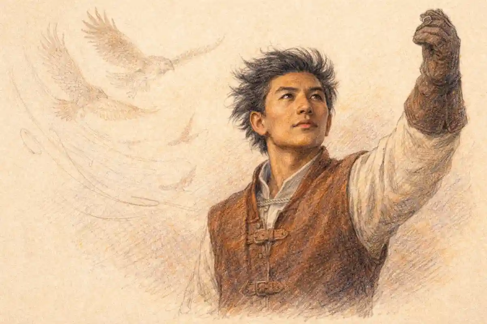

## Romeo and Juliet on Stamps and Coins: The Verdict in Advance

Romeo and Juliet have appeared on the postage stamps and coins of real states, and the fact deserves a moment of plain astonishment before any catalogue work begins. A postage stamp is the smallest portrait a government ever commissions of itself. The space beside the sovereign's head, or in the corner where a republic prints its name, is the most guarded square centimetre in a nation's visual life. What a state places there, it endorses. A coin goes further: it is state speech that passes from hand to hand as money, legal tender backed by the issuing authority, designed to be trusted without being read. When governments spend that authority on Romeo and Juliet, they spend it on two fictional teenagers invented by a foreign playwright four centuries ago, children of houses that never existed, in a city whose claim on them is itself a legend. No treaty required it. No citizen petitioned for it in most cases. The lovers hold no office, founded no state, won no war. They are, in the strictest sense, nobody. And yet their faces and their scenes have been engraved, printed, perforated, struck, and issued under the names of nations.

The verdict of this article can be stated before the evidence, because the evidence is unusually consistent. Governments almost never print the play. They print the emblem the public already carries: the balcony, the embrace, the entwined pair, the rose. The tragedy ends with two corpses in a vault and a prince pronouncing the saddest summary in drama, "For never was a story of more woe / Than this of Juliet and her Romeo" (Folger Shakespeare Library edition, 5.3.309-310), yet official imagery stops the story at its midpoint, at the window, in the moonlight, with both lovers alive and the catastrophe politely out of frame. The single verified exception in the catalogue record, an Italian issue of 2022 that shows Juliet grieving over Romeo's body, comes from the one state that can claim the lovers as its own dead, and that exception sharpens the rule rather than breaking it. A stamp, in short, is a state portrait in miniature, and the portrait is never really of the lovers. It is of the issuing nation's idea of itself: Britain honoring its national author, Italy mourning its own legendary children, small states borrowing prestige, mints selling keepsakes. Read in sequence, the stamps and coins of Romeo and Juliet form a diplomatic history of the play's reputation, written by governments.

The fiduciary character of the two media deepens the puzzle. A postage stamp is a receipt for a prepaid service, valuable only because the issuing authority promises to carry the letter; a coin is a token whose face value rests on the issuing authority's credit. Both objects are promises. States print their most solemn assurances on them, the sovereign's portrait, the national arms, the denomination in words, precisely because a promise needs a guarantor's face. To place a pair of fictional lovers inside that machinery is to lend them the state's credit in the most literal sense available to symbolism. The lovers cannot default, being imaginary, but the state can be diminished, if the public reads the issue as frivolous or mercenary, and the critical history traced in this article shows governments and their critics arguing over exactly that risk. The balcony was, among other things, the risk-minimizing choice: an image so universally approved that no treasury could be embarrassed by it. Italy's tomb carried the opposite profile, an image that could have been attacked as morbid or partisan, and was not, because the mourning it depicts is the nation's own.

That history needs discipline, because philatelic writing inflates. Anniversary years produce cascades of issues, dealer literature blurs the difference between a stamp that shows the lovers and a stamp that merely honors their author, and a portrait of Shakespeare is routinely sold to collectors as if it were an image of his most famous pair. The census in this article therefore rests on the issuing authorities' own records, postal museum documentation, parliamentary answers, mint records, and standard catalogue entries, and it separates three classes of object that lazy accounts merge: issues that depict Romeo and Juliet themselves, issues that honor Shakespeare generally while the play appears only as one item inside a set, and portrait issues where the lovers never appear at all. A fourth class matters as much as the other three: the documented absences, the Shakespeare issues in which the play was passed over, because an omission by a thematic set is also a verdict on the play's official standing.

The play itself authorizes this kind of compression. Before any actor speaks, the Chorus of the Prologue performs the whole tragedy in fourteen lines and gives the lovers a single clause: "A pair of star-crossed lovers take their life" (Prologue, 6). The sonnet is the original miniature, a plot summary small enough to be spoken in under a minute, designed to travel ahead of the play and prepare strangers for it. A postage stamp is the same device in government hands, a preface issued by the state, and the question the record poses is what each state chose to put in its preface. Some prefaces summarize the love. One summarizes the death. Most summarize nothing about the play at all, offering the author's face instead, as if the safest summary of a book were a portrait of its writer. The differences among those choices are not accidents of design fashion. They record what each issuing authority believed the lovers were for.

It is also worth pausing on why the honor, when it comes, comes to a fiction. States commemorate founders, victories, inventions, and births because those things made the state or its people. Romeo and Juliet made nothing except a reputation, and their claim on official paper rests on a stranger foundation: they are the most widely shared piece of imaginative property on earth, a story that school systems on every continent compel children to read. A government issuing their image is not rewarding merit or marking an event in its own past. It is purchasing a tiny share in a story its citizens already own by education, and displaying the receipt in the corner of its mail. That is the oddity the brief for this article demands be faced rather than savored, and the survey below is built to face it with catalogue discipline: only verifiable issues, graded by what they show, with absences recorded beside presences.

## The InsightCrunch Stamps Survey: Reading the Official Record

The InsightCrunch stamps survey gathers the verified record into one table. Its rules are strict. An issue enters the survey only when its existence, issuer, date, and image can be confirmed against the postal administration's archive, the mint's product record, a national museum's object record, or a standard catalogue listing of the kind maintained by Stanley Gibbons, Scott, Michel, Numista, or the Krause coin catalogues. Denominations and print figures are given only where a documentary source states them. Where the sources disagree, the disagreement is recorded rather than smoothed away. The survey grades each entry by what it actually shows: a dedicated depiction of the lovers, the play present inside a larger Shakespeare set, a portrait of the author with the play absent, or a documented absence in an issue that might have been expected to include it.

| Issuer and date | Issue | What the issue shows | Class |
| --- | --- | --- | --- |
| Great Britain, 23 April 1964 | Shakespeare Festival set, five values, 3d to 2s 6d | The balcony scene, one of four play scenes paired with the Droeshout portrait on David Gentleman's designs | The play inside a set |
| United States, 14 August 1964 | Shakespeare commemorative, 5 cents, Scott 1250 | The playwright on an Elizabethan stage, quill in hand, Yorick's skull beside him | Author portrait |
| Gibraltar, 23 April 1964 | Shakespeare birth quatercentenary, 7d | A portrait of the playwright | Author portrait |
| Great Britain, 1995 | Globe Theatre set, five stamps, designed by C. Walter Hodges | A frieze of characters along the se-tenant strip, Romeo and Juliet among Macbeth, Hamlet, Falstaff and others | The play inside a set |
| Great Britain, 12 April 2011 | Royal Shakespeare Company set, six production stamps and a miniature sheet | Ian McKellen and Francesca Annis in the 1976 production, a defining stage moment treated as a miniature poster | Dedicated stamp inside a set |
| Great Britain, 5 April 2016 | Shakespeare quotation set, ten First Class stamps | The play present as lettered language, one quotation among ten, black type on grey | The play inside a set |
| United Kingdom, 2016 | Royal Mint two-pound coin, Tragedies, designed by John Bergdahl | A skull beside a rose, the rose standing for this play beside Yorick's skull for Hamlet | The play as a glyph on a coin |
| San Marino, 2016 | Two-euro commemorative coin, designed by Mattia Bonaccorsi | A portrait of the playwright for the 400th anniversary of his death; the lovers do not appear | Author portrait |
| Italy, 25 October 2022 | Europa issue, Stories and Myths, tariff B zone 3, designed by Giustina Milite | Juliet grief-stricken before the lifeless Romeo, the tomb scene | Dedicated depiction |
| Tristan da Cunha, 2016 | Shakespeare set of four values, illustrated by Victor Ambrus | Bottom with Titania and Puck, the witches, Ophelia, Falstaff; no value for the lovers | Documented absence |

Three of the gradings deserve defence, because each refuses an easy promotion. The 2011 British stamp is graded a dedicated stamp inside a set rather than a full dedicated issue, since the set's subject is a theatre company and the lovers occupy one of six production frames; yet within that frame the treatment is wholly theirs, actors, scene, and lettering given to no other purpose, and the grading records both facts instead of flattening them. The Royal Mint two-pound piece is graded as a glyph rather than a depiction, since a rose beside a skull depicts nothing in the play and signifies everything about it, and the distinction between depicting and signifying turns out to organize the entire record. The San Marino coin is graded an author portrait despite its catalogue prose praising the plays, because grading follows the object and not the sales text; a survey that credited prose would have to credit every Shakespeare portrait ever issued as an honor to every play at once, and the subject would dissolve. Quotations from the play throughout this article follow the Folger Shakespeare Library edition of the text, and are cited by act, scene, and line.

The figures in the record also require a reader's caution that the survey applies throughout. A print run is evidence of intention, not of reception: 195 million stamps sold is a reception fact, while 400,005 stamps printed is an intention fact, and the two kinds of number must not be traded as equivalents. Denominations are evidence of intended use, since a tariff set for international mail announces a travelling image while a denomination matched to no postal rate announces a collector product. Mintage figures for coins divide the same way, between strikings released into change and strikings sealed into folders at the mint. Read with those cautions, the numbers stop being decoration and become testimony: they show which governments expected their Shakespeare to work for a living and which expected it to sit in a cabinet.

A word about what the table omits, since the omissions are methodological rather than accidental. The anniversary cascades included Shakespeare items from many administrations that this survey does not enumerate row by row, because the standard applied here, verification against an issuing authority's record or a standard catalogue entry inspected for this article, could not be met for them within the discipline the subject demands, and a survey that guesses at rows would betray its purpose. Those issues are treated in this article as a documented phenomenon, the cascade, whose existence, mechanics, and critical reception are attested by the philatelic press and by the market's own anniversary collections, rather than as individual exhibits. The graded rows are the ones on which verdicts rest. Where a famous claim could not be carried to catalogue standard, for instance the precise denomination of the 1964 balcony value within its set, on which dealer listings and memoir accounts differ, the survey records the set and the scene and lets the denomination go. That restraint is the survey's warranty: every cell in the table can be defended against the documents, and the arguments built on the table inherit the defence.

The chronology inside the table carries its own argument. Between the British and American issues of 1964 and the Globe set of 1995, the graded record is silent for three decades: no verified state issue pictured the lovers, although the play's stage, film, and classroom presence never paused. The silence is the anniversary mechanism photographed in negative. Without a round-numbered date to justify the expenditure of official symbolism, administrations left the lovers alone, and the play's official life stopped while its cultural life ran on. Then the dates returned: a building's completion in 1995, a company's fiftieth year in 2011, the death quatercentenary in 2016, a European theme year in 2022, and the record resumes in clusters around each occasion. A reputation that depends on occasions is a reputation being administered rather than felt, which is Cannadine's point made by a calendar. The counterweight stands in the same table: when the occasions came, the material produced was on several occasions excellent, and excellence under administration is still excellence. The survey does not ask the reader to choose between the calendar and the objects. It asks that both be seen at once.

The table already teaches the central lesson. Dedicated depictions of the lovers are rare enough to count on one hand across six decades of anniversary production. The play's official life is mostly lived inside other objects: as one scene among four on a festival set, as one face in a frieze of characters, as one quotation among ten, as one flower beside a skull. Even the count of nations is smaller than the brief cascade of anniversary publicity suggests. Britain recurs, because the author is Britain's. Italy appears once, decisively, because the story is Italy's. The United States and Gibraltar honored the man in 1964 without picturing a single one of his characters. San Marino honored the man in metal in 2016 without picturing the pair its own catalogue text praises. The survey's discipline is the article's foundation: everything argued below is argued from these rows and from the documents behind them, not from the far larger penumbra of souvenir sheets, local posts, and unofficial labels that no postal authority ever issued. Readers assembling a working dossier from these records, catalogue entries, Hansard answers, and mint figures face a genuine clerical problem, since the evidence for a single set can scatter across half a dozen documents; laying the material out side by side in [the ReportMedic presentation viewer](https://reportmedic.org/tools/ppt-viewer.html) is the practical way researchers keep a set's stamps, sources, and print figures in one view while the grading of each row is settled.

## 1964: The Balcony Scene on British Stamps and a Rule Broken to Allow It

The first great Romeo and Juliet stamp was not the product of enthusiasm. It was the product of a refusal, a lobbying campaign, and a legalistic fudge. The British Post Office had never issued a stamp commemorating an individual's birth, death, or achievement; the honored dead on British stamps were monarchs, and the policy against picturing commoners, however eminent, was settled institutional doctrine. Against that doctrine stood Levi Fox, Director of the Shakespeare Birthplace Trust, who proposed a Shakespeare issue to the Postmaster General on 14 January 1961 and was refused. The refusal held until it did not. Vigorous lobbying, pressure in Parliament, and an intervention in Commons Question Time turned the decision, and the justification recorded for the reversal is the most revealing document in the whole history of this play on stamps. The issue would celebrate not the man but an event: the Shakespeare Festival at Stratford, an occasion of international importance. The state would honor a festival. That four of the five stamps carried the forbidden portrait anyway was a detail the formula was designed to carry past objectors.

### Why did Britain need a festival to justify the 1964 Shakespeare stamps?

The festival framing was the only route past a settled Post Office rule that no stamp could commemorate an individual's birth, death, or achievement. By defining the issue as the celebration of an event, the annual Stratford festival, officials honored the quatercentenary of the birth while formally denying that any person was being commemorated at all.

The stamps appeared on 23 April 1964, the conventional date of the birth and the death, five values from 3d to 2s 6d, catalogue numbers SG 646 to 650. Those five catalogue numbers have served ever since as the fixed address of the lovers in British philately, the reference under which dealers list, collectors file, and auctioneers describe the balcony value and its companions. A catalogue number is a small immortality of its own kind: it removes an object from the flow of anniversaries and gives it a permanent shelf in a numbered universe, where the 1964 set sits between the geographical congress and botanical issues of its year, honored by the system in the system's own language. The lovers entered that universe in 1964 and have never left it, which is more than can be said for most of the year's famous names. The four lower values were designed by David Gentleman, the designer who more than any other modernized the British stamp, and each carried the same audacious composition: the Droeshout portrait of Shakespeare, reversed so that the playwright faced inward toward the Queen's portrait rather than away from it, paired with a scene from a play. The scenes were Puck and Bottom from A Midsummer Night's Dream, Feste from Twelfth Night, Henry V kneeling in prayer on the eve of Agincourt, and the balcony scene from Romeo and Juliet. The top value, the 2s 6d, broke the pattern: designed by Christopher and Robin Ironside, it showed Hamlet alone with Yorick's skull and carried no portrait at all. The Postal Museum's summary of the issue is exact about its significance: the four Gentleman values carried the first portrait of a commoner on a British stamp. Gentleman himself recalled that Shakespeare's head, printed at the same size as the Queen's, caused a fuss. A playwright had been granted visual equality with the sovereign on the sovereign's own mail.

The balcony scene was the natural choice for the romance slot, and its naturalness is the point. Gentleman's designers did not deliberate over which moment of the tragedy defined it; the culture had already deliberated for them across two centuries of painting, in which the window scene had become the play's universal trademark, the single image by which audiences who had never read a line recognized the whole. The painters' long selection of the balcony over the tomb, examined in [the lovers in visual art and painting](/2029/12/14/lovers-in-visual-art-painting/), passed directly into state iconography: the government miniature inherited the gallery's verdict without reviewing it. What the stamp shows, in Gentleman's stripped modernist manner, is the vertical composition the play itself builds, the lover below in the orchard dark and the beloved above at the window, the arrangement Romeo names in the scene's most famous line, "But soft, what light through yonder window breaks? / It is the east, and Juliet is the sun" (2.2.2-3). The full movement of that orchard encounter, its vows, its interruptions, and its parting, is anatomized in [the balcony scene: Act 2 Scene 2 explained](/2023/07/21/balcony-scene-act-2-scene-2-analysis/); the stamp compresses the entire movement into its opening tableau, the instant before a word is exchanged, the lovers suspended in the configuration every beholder already knows.

The numbers behind the issue record how completely the fudge succeeded. A parliamentary written answer given in June 1967 listed the quantities the Post Office procured for each value: 156 million of the 3d, 21.4 million of the 6d, 9.4 million each of the 1s 3d and the 1s 6d, and 4.3 million of the 2s 6d. Levi Fox's own account of the campaign records that 195 million stamps had been sold by the beginning of December 1964, with stocks almost exhausted. Demand for first day covers overwhelmed the machinery meant to serve it: a written answer of 4 May 1964 apologized for delays, explaining that close on 80,000 orders for the comprehensive cover service had exceeded all expectations. These are not collector figures. They are the figures of a mass medium at full stretch, a national conversation conducted in perforated paper. For scale, the entire British commemorative programme had produced only twenty special issues between 1952 and 1964. Into that sparse landscape the Shakespeare set arrived as the largest cultural statement the Post Office had ever made, and one of its four scene values carried a pair of fictional lovers onto tens of millions of envelopes.

The design itself repays the closest reading the survey gives any object, because Gentleman's balcony value is where state iconography and the play's text meet most exactly. The scene the stamp illustrates is built on a vertical division that the dialogue keeps naming: Romeo stands in the orchard, in darkness and danger, and Juliet appears above, at the window, in light. His first speech in the scene turns the architecture into astronomy, "It is the east, and Juliet is the sun" (2.2.3), and the exchange that follows is a negotiation across the vertical gap, vows offered upward and anxieties answered downward, until the Nurse's calls from inside the house end it. A stamp has room for the gap and nothing else. Gentleman's composition takes the play's spatial sentence and prints it without its words: two figures, a level difference, a frame that reads instantly as the window. The reduction is not a failure of ambition. It is an exact match between medium and moment, since the balcony tableau is the one configuration of the tragedy that remains legible at twenty-five millimetres, in one colour separation, to a beholder who has never opened the book. Every later official image of the lovers works under the same constraint, and the history of the subject on stamps is largely the history of designers discovering what Gentleman knew at the start: at stamp scale, only the emblem survives.

The portrait half of the design carried the deeper constitutional charge. The Droeshout engraving that Gentleman reversed was itself a posthumous construction, the frontispiece of the First Folio of 1623, an image of the playwright made after his death from no certain life sitting. The 1964 stamps therefore placed on British mail a copy of a copy, an engraving of an engraving, and set it at the same size as the reigning sovereign's portrait, which was itself the standard effigy appearing on every definitive stamp of the reign. Fox's memoir of the campaign records the strategem's origin in persistence: proposal in 1961, refusal, renewed pressure, parliamentary questions, and a ministry eventually persuaded that a festival could carry what a man could not. Stamp Magazine's retrospective summary, quoted in the Postal Museum's orbit and repeated in the Shakespeare literature, judged that the Post Office had fudged the issue, celebrating an event of international importance rather than the man himself while printing the man's portrait on four values. The fudge is the most instructive document in the set's history, because it shows a state negotiating with its own rules in public. The rule said the honored dead were royal. The culture said the nation's greatest writer could no longer be excluded. The festival formula let both sentences stand, and the stamps that resulted taught every later administration the same technique: find the event, and the person can follow.

The first day cover episode, preserved in the parliamentary record, shows the public meeting the issue halfway. The written answer of 4 May 1964, given while the set was eleven days old, apologized for delayed covers and explained the machinery of the failure: the comprehensive service, under which the Post Office supplied the envelope, typed the address, affixed the stamps, and posted the result, had drawn close on 80,000 orders, many from overseas, and the volume exceeded all expectations. Every cover would bear the postmark of 23 April, the answer promised, although the mark might in fact be impressed on any day from 23 April onward, a small bureaucratic fiction in honor of a larger one. The denominations did the set's quiet distributive work. The 3d value, procured in 156 million copies, was the workhorse that carried the set onto ordinary mail, and its scene, the Dream, became the most travelled of the four; the shilling values moved in smaller, more deliberate streams; the Ironside 2s 6d crowned sets and albums. A hierarchy of survival was built into the issue from the start, since the values a public uses daily are the values that perish by use, while the values bought for keeping survive in cabinets. The balcony scene's denomination placed it between those fates, neither the common carrier nor the crowned rarity, which suits an image that has always lived between the postcard rack and the gallery wall.

Gentleman's own career supplies the set's coda. The designer of the balcony value went on to produce thirty-two covers for the Penguin Shakespeare, carrying the same stripped, emblematic treatment of the plays into the book trade where the texts themselves lived. The migration is emblematic of the whole subject: a single visual language, scenes reduced to configurations, served the state on its stamps and the publisher on its paperbacks, and a generation of readers met the plays first in that language whether the meeting happened at a post office counter or in a bookshop. The stamp and the cover taught the same lesson, that the plays could be recognized by posture and property, a window, a skull, a pair of daggers, before a line was read. Philately did not borrow the cliché from the culture at large; in Gentleman's hands, the same artist built parts of both.

The aftermath confirmed the breach. Once a commoner had appeared at equal size with the sovereign and the sky had not fallen, the British commemorative programme widened permanently, and Royal Mail's later Shakespeare issues could proceed without apology or formula: the Globe set honored a theatre, the 2011 set honored a company, the 2016 set honored the writings, and the summary the company itself published in 2016, twenty-five special stamps across fifty years and the most featured individual outside the Royal Family, measures the distance travelled from the refusal Fox received in 1961. The balcony value sits at the head of that sequence not merely as the first depiction of the lovers on a stamp but as the thin end of a constitutional wedge, the point at which a playwright's fiction, pictured at a window, opened the nation's portrait gallery to its own people.

The 1964 set also fixed the template every later issue would follow or resist. The anniversary supplied the occasion, since the quatercentenary of the birth fell in 1964 as the quatercentenary of the death would fall in 2016, and anniversary logic would govern Shakespeare philately from then on. The author supplied the pretext, since the stamps formally honored a festival and a playwright, and the play entered under his coat. And the image supplied the cliché, since the scene chosen was the one the culture had already chosen. The play itself, with its feud, its haste, its botched message and its double suicide, appears nowhere in the design. What appears is the window. The distance between the window and the play is the subject of everything that follows in this article, because the window is what states print, and the play is what they leave out.

## Portrait Issues: The Author Honored and the Play Nowhere to Be Seen

Against the British set stands the year's other great Shakespeare issue, and the contrast defines the survey's second class. The United States issued its Shakespeare commemorative on 14 August 1964, Scott 1250, a five-cent stamp printed by the Bureau of Engraving and Printing in a quantity of 123,245,000. The National Postal Museum's object record describes the design precisely: Shakespeare on an Elizabethan stage, holding a quill, with Yorick's skull beside him, printed in black brown on tan. The first day city was Stratford, Connecticut, home of the American Shakespeare Festival Theatre, a choice that repeated the British fudge in American form: the stamp honored a festival town as much as a foreign dramatist. What the design does not contain is any character, any scene, any play. The single emblem admitted beside the author is a skull borrowed from Hamlet. America in 1964 wanted Shakespeare the institution, the name that anchored a festival and a curriculum, and it wanted him alone.

Gibraltar's contribution to the quatercentenary, a 7d portrait stamp issued on the same 23 April, belongs to the same class, and the class is large. The anniversary cascades of 1964 and 2016 produced scores of portrait issues from administrations with varying connections to the subject, and the portrait is always the cheapest form of honor: it requires no decision about the works at all. A mint can go further along the same road. San Marino's two-euro commemorative of 2016, struck for the 400th anniversary of the death, carries on its national side a portrait of the poet designed by Mattia Bonaccorsi, whose initials appear on the coin, with the inscriptions naming Shakespeare, the years 1616 and 2016, and the republic. The standard common side of euro coinage fills the reverse. Numista's catalogue entry, KM 547, records a mintage of 85,000 brilliant uncirculated pieces in a collector folder and 2,800 proofs, and classifies the coin as non-circulating: it was made to be kept, not spent. The catalogue's descriptive text praises the playwright's works and names Romeo and Juliet among them. The coin itself shows the lovers nowhere. San Marino's Shakespeare is a medallion of the author, sold in a folder, and the play's presence in the transaction is confined to the sales literature.

The American issue rewards a closer look, because its emptiness is articulate. The first day city was not Washington or New York but Stratford, Connecticut, where the American Shakespeare Festival Theatre had opened in 1955 and built an international reputation through the following decade on productions featuring Katharine Hepburn, Jessica Tandy, and Hal Holbrook. The Bureau of Engraving and Printing produced the stamp by rotary press in black brown on tan, an engraved sobriety far from Gentleman's modernist colour, and the design's single dramatic property is Yorick's skull. Consider the choice that skull represents. An American designer, asked for one emblem to stand beside the author, reached past the lovers, past the witches, past the crown, and chose a dead jester's head from the Danish tragedy. The emblem economy was already at work: Hamlet owned the prop cupboard. The lovers, who owned the culture's heart, were not pictured, because picturing them would have required admitting that the honor belonged to a love story, and the institutional Shakespeare of 1964, the Shakespeare of festivals and school boards, was safer as a solitary genius with a quill. The skull is thus the American counterpart to the British fudge. Britain smuggled the author in under a festival; America smuggled the festival in under the author, and neither administration, in the quatercentenary year, was willing to print the fiction's most famous pair.

Gibraltar's 7d portrait, issued on the same April day as the British set, shows the cascade at its most mechanical: a Crown territory synchronizing its homage with the mother country's, the same date, the same sitter, a single modest denomination. Nothing in the Rock's history connects it to the playwright beyond the imperial connection itself, which is precisely the connection the stamp performs. San Marino's two-euro piece performs a different and more respectable version of the same act. The republic has a long and serious tradition of commemorative coinage, its euros are struck at the Rome mint, as the R mintmark on the coin records, and its 2016 Shakespeare issue belongs to a considered national programme rather than to an agent's catalogue. Yet the object remains what its classification says: a non-circulating portrait in a folder, 85,000 pieces for collectors and 2,800 proofs, an honor addressed to the author's rank among the dead. The lovers, praised in the catalogue's prose, wait outside the metal. Between Gibraltar's mechanical portrait and San Marino's considered one lies the whole range of the portrait class, and at neither end of the range does the play itself get pictured.

The portrait's dominance has an economic logic that the survey's proportions expose. A face is ownable in a way a scene is not. The Droeshout Shakespeare, the Chandos Shakespeare, the Stratford memorial: the iconography of the author is a closed and licensed set of images, instantly attributed, carrying no interpretive risk. A scene, by contrast, must be composed, and every composition is an interpretation that some constituency can dispute: the wrong balcony, the wrong costumes, the wrong ending, as the one Italian exception proves by the stir its rightness causes in this record. A postal administration choosing between the author's face and the play's fiction is choosing between a trademark and an argument. Most choose the trademark, in most years, in most media, and the coin record shows the preference at its purest, since San Marino's piece and the Royal Shakespeare issues agree on the face while disagreeing on everything else. The lovers appear only when an institution with interpretive confidence takes the risk: a modernist designer at the height of his powers, a scholar-artist designing his own building's celebration, a theatre company stamping its archive, and a republic filing its own dead. Confidence, in this record, is the rarest postal value of all.

The distinction matters because the market works hard to erase it. A collector assembling a Romeo and Juliet album will be offered the American 5c, the Gibraltar 7d, and the San Marino two-euro piece as items for the collection, and each offer trades on the same blur between the author and the work. The survey's grading refuses the blur. A portrait issue testifies to the author's state standing, which is real and worth recording: in 1964 two governments broke or bent their commemorative policies for a playwright, and that is a fact about Shakespeare's official rank among the dead. But it testifies to nothing about the play. No scene was chosen, no image adjudicated, no risk taken with the fiction itself. The lovers' state afterlife begins only where a designer must decide what the play looks like, and that decision, as the British set showed, was taken under the pressure of a ready-made answer. Portrait issues are the control group of this study: they prove that honoring Shakespeare and depicting Romeo and Juliet are different acts, and that most governments, most of the time, choose the safer one.

## Britain Returns to the Play: A Frieze, a Photograph, and a Quotation

Britain came back to Shakespeare on stamps three more times across the following half century, and the sequence of returns traces a migration in where the culture locates the plays. In 1964 the play was a scene in a book, drawn from the text by a modernist designer. By 1995 it had become a face in a crowd of characters. By 2011 it had become a remembered performance, a specific night's work by specific actors. By 2016 it had become language alone, words without bodies at all. Each return honored the same play. Each located it somewhere different.

The 1995 set marked the reconstruction of Shakespeare's Globe and comprised five stamps designed by C. Walter Hodges, a choice of designer that deserves emphasis: Hodges was a Shakespeare scholar as well as an artist, one of the leading authorities on the staging of the Elizabethan theatre, and the reconstruction's visual conscience. Along the bottom of the se-tenant strip, enlarged on the design of the 1599 Globe, runs a row of the dramatis personae of the whole canon: Shakespeare himself at the lower left, then Macbeth and Lady Macbeth, Romeo and Juliet, Hamlet, Richard III, Falstaff, and Bottom. The lovers appear as miniatures within an architectural celebration, citizens of a population. The image logic is democratic and telling. No single play dominates; the canon is a company, and the lovers take their place in the line between the Scottish murderers and the Danish prince. A scholar designed that strip, and its argument is a scholar's argument: the plays endure as an ensemble, and the building, not any one tragedy, is the monument worth a stamp.

The frieze's guest list is itself a small work of canon criticism, and it rewards inspection. Present: the Scottish pair, the lovers, the Dane, the crookback king, the fat knight, the ass-headed weaver, and the author presiding. Absent: Lear, Othello, Cleopatra, Prospero, Shylock, the Henries. A scholar-designer composing a population for a theatre's footlights chose the figures a general audience could name from a silhouette, which is to say he composed the canon as the public holds it rather than as the seminar ranks it. The lovers' place in that line, neither first nor last, flanked by murderers and comics, states the ensemble doctrine in visual form: in the building's economy, the tragedy of Verona is one attraction among peers, and its pre-eminence in the wider culture is politely set aside at the door of the house that plays them all.

The 2011 set, issued on 12 April for the fiftieth anniversary of the Royal Shakespeare Company, changed the unit of honor from the work to the performance. Six production stamps, designed by the studio hat-trick under co-creative director Jim Sutherland, treated celebrated stagings as miniature posters, production photographs worked into bold graphics with hand-lettered quotations by the illustrator Marion Deuchars, each stamp a square of 35 millimetres. The faces were the company's history: David Tennant as Hamlet, Antony Sher as Prospero, Chuk Iwuji as Henry VI, Paul Scofield as King Lear, Sara Kestelman as Titania. The Romeo and Juliet stamp showed Ian McKellen and Francesca Annis, the lovers of Peter Gill's celebrated 1976 production. Consider what the state had done. It no longer pictured an imagined Juliet at an imagined window. It pictured two named actors in a documented performance that living subscribers remembered attending. The stamp's claim is institutional and almost archival: this happened, in Stratford, under this company's auspices, and the photograph is the evidence. The lovers on the 2011 stamp have biographies, reviews, and a production archive. A miniature sheet of four further stamps, collaging the company's Stratford theatres, completed the issue, and the whole set argues that the proper object of state honor is not the fiction but the national institution that keeps performing it.

The 2016 set completed the migration. Issued on 5 April 2016, ten First Class stamps designed by The Chase with the Royal Mail design team presented Shakespeare through words alone: each stamp a quotation set in a different typeface, black on grey, the set arranged in two se-tenant strips of five. The design policy was stated openly and is the most interesting philatelic decision in the play's whole official record. Royal Mail's stamp strategy manager Philip Parker explained that the stamps celebrated the power of the language; the designers deliberately avoided the best-known lines, seeking quotations that would give a different perspective rather than the phrases everyone already knows. A special postmark reading "William Shakespeare 1564-1616" was applied to British mail from 5 to 9 April. Royal Mail's own summary put the cumulative position plainly: across the previous fifty years Shakespeare and his work had appeared on 25 special stamps, making him the most featured individual on British special issues outside the Royal Family.

The 1995 frieze also belongs to a particular moment in collecting culture that its design quietly exploits. Hodges packed the strip with incident at a scale that defeats the naked eye, and the Shakespeare literature on the set remarks that the designs reward magnification, the characters along the strip's foot resolving under a lens into a tiny dramatis personae. A stamp that requires a magnifying glass is making a claim about its audience: it addresses the examiner, the collector-scholar, and it flatters the overlap between the two tribes. That Hodges could make the claim stick rests on his double authority. His drawings of Elizabethan staging had shaped the reconstruction the stamps celebrated, so the miniature frieze is the work of the man who helped decide what the building itself should look like. No other issue in the survey unites designer, scholar, and subject so completely, and none asks so much of the beholder's eye.

The 2011 set's institutional logic deserves one more turn, because it explains why the lovers on that stamp wear famous faces. Peter Hall founded the Royal Shakespeare Company in 1961, and the anniversary the stamps marked was the company's, not the playwright's; the issue is an act of corporate self-portraiture by a national institution, with the Post Office as its printer. Within such a frame, the lovers could only appear as the company's lovers, the pairing its archive prized most. McKellen and Annis in 1976 had been the generation-defining production for many of the company's subscribers, and the stamp's emotional address is to memory rather than to imagination: it asks to be recognized, not deciphered. The miniature sheet of theatre buildings completes the argument, since the company's true collective portrait is its Stratford plant. Read beside 1964, the 2011 issue shows the festival formula perfected and inverted. Fox's generation needed a festival to smuggle in a man. Hall's company needed no smuggling at all: the institution was the subject, the man its founding asset, and the lovers one entry in its book of remembrance.

The 2016 set's material form carried its argument into the general mail stream in a way its predecessors could not match. The ten stamps were issued in two se-tenant strips of five at a set price of £6.40, all at the First Class rate, which meant the entire set was usable on ordinary letters without supplementation; and the special postmark naming Shakespeare with his dates was applied to British mail generally between 5 and 9 April, so that for five days the commemoration rode on correspondence whose senders had bought nothing special at all. A commemoration that reaches non-collectors is the anniversary machine operating at its most democratic, and it stands in pointed contrast to the folder products of the same year, the folder coins and presentation packs addressed to buyers who had opted in. The 2016 stamps went looking for their audience in the post. The survey counts that difference as part of an issue's meaning, alongside image and text.

The typography deserves its own sentence of analysis, since a set that renounces pictures makes its letterforms carry the portraiture. Each of the ten quotations was set in a different typeface, black on grey, so that the plays are distinguished by typographic voice rather than by scene or actor: ten small posters for a national literature, executed in the medium in which that literature actually survives. The conceit has a quiet scholarly rightness. A play exists for most citizens as print, encountered on pages and screens, and a stamp that prints the words in a considered face is closer to the common experience of Shakespeare than any costumed tableau. The Chase and the Royal Mail design team, in stripping the set to language, accidentally produced the most bibliographically honest Shakespeare issue in the survey, a set that admits the plays are books. Set beside the 1964 balcony, half a century its senior, the quotation stamp measures the full arc of the official afterlife: the state first trusted a picture to carry the play, and ended by trusting the words.

The play stands inside the 2016 set as one quotation among ten, drawn from a work whose most stamp-worthy lines are precisely the ones the designers refused to use. The refusal deserves a verdict of its own. Every previous British issue had traded on instant recognition: the Droeshout face, the window, the famous actors. The 2016 designers wagered that the language itself, set well, could carry recognition without the clichés, that a line encountered fresh might do what the balcony no longer could. Against the whole weight of the record surveyed in this article, that wager looks less like a design preference than like a diagnosis. The cliché had been spent by fifty years of official use. What remained unspent was the text. The Friar's great speech on the earth's double nature, "The earth that's nature's mother is her tomb; / What is her burying grave, that is her womb" (2.3.9-10), shows the kind of line the policy went looking for: famous to readers, invisible to the greeting-card trade, and carrying the tragedy's whole philosophy of poison and cure in a couplet. Whether the wager worked commercially is a question for sales ledgers. As criticism, it is the one moment in the official record where a state treated the play as writing rather than as logo, and the survey marks it accordingly.

## The Play in Metal: Coins, Circulation, and a Rose Beside a Skull

A stamp is spent and discarded; a coin is kept and handled. The difference shapes what each medium can say. A stamp addresses an envelope's journey and then becomes waste or a collectible; a coin enters the anonymous circulation of daily exchange, passing through hands that never chose it, and a commemorative coin that actually circulates delivers its image to a larger and less self-selected audience than any stamp. When the play reached British coinage, it arrived in the most compressed form of its entire official existence: not a scene, not a face, not a line, but a flower.

The occasion was the same anniversary that produced San Marino's portrait piece. For the 400th anniversary of the death in 2016, the Royal Mint issued three circulating two-pound coins designed by John Bergdahl, one for the Comedies, one for the Histories, and one for the Tragedies. The Comedies coin carries a jester's cap and marotte. The Histories coin carries a crown and a blade. The Tragedies coin carries a skull beside a rose. The obverse bears the fifth portrait of Elizabeth II by Jody Clark, and the edge inscription around the Tragedies coin is a line from Hamlet, "What a piece of work is a man". Numista's catalogue record gives the Tragedies coin a circulation mintage of 4,615,000, with further strikings in brilliant uncirculated and proof finishes for collectors. Collector literature on the trio, and the descriptions attached to the programme from its announcement at the start of January 2016, identify the paired symbols: the skull is Yorick's, standing for Hamlet, and the rose stands for Romeo and Juliet. The Gazette's account of the design describes the Tragedies coin as inspired by Romeo and Juliet, Othello, Macbeth, and Hamlet together, which is the honest way to phrase a glyph: a coin of this size cannot narrate, so it alludes, and its allusions are shared among the great tragedies in pairs.

### Is there a Romeo and Juliet coin in everyday circulation?

No mint has issued a dedicated coin showing the lovers that was made to circulate. The play's only presence in everyday change is symbolic: the rose on the Royal Mint's 2016 Tragedies two-pound piece, struck in millions for general circulation, while the one coin that names the lovers' author, San Marino's two-euro piece, never circulated at all.

### What does the rose on the 2016 two-pound coin stand for?

The rose stands for Romeo and Juliet, set beside Yorick's skull for Hamlet on a coin honoring the Tragedies as a group. The choice literalizes the play's own most famous metaphor, Juliet's argument that a name is nothing beside the thing itself, since a rose by any other word would smell as sweet (2.2.43-44).

The rose deserves a pause, because it is the cleverest compression in the whole survey and also the most damning exhibit for the prosecution. Juliet's speech at the window is an argument against the tyranny of names: "What's in a name? That which we call a rose / By any other word would smell as sweet" (2.2.43-44). The play's lovers die, in part, because the world insists on names, Montague and Capulet, over things. The Royal Mint's designers took the speech's illustrative flower and struck it as the play's name-tag, a rebus by which the coin says the title without letters. The lovers themselves are absent. There is no window, no pair of figures, no tomb. After four centuries of official and commercial imagery, the state reduced the tragedy to a single botanical pictogram, legible at the size of a thumbnail to anyone who already knows the code, and meaningless as narrative to anyone who does not. The coin does not tell the story. It certifies that the holder already knows it.

The medium explains the compression. A coin designer works in low relief on a disc under thirty millimetres across, in a metal that must survive years of abrasion, for an audience that will glance rather than study. Scenes die under those conditions; figures blur; inscriptions crowd. What survives is the bold device, the cap, the crown, the skull, the rose, each readable at arm's length after a decade in a pocket. Bergdahl's trio is best understood as heraldry for the three genres, and heraldry is the right register for coinage, since a coin is a shield the state spends. Within that register the rose is a genuinely elegant charge, instantly separable from the skull beside it, love and death paired as the tragedies' twin arms. But heraldry's gain is narrative's loss. The Capulet orchard, the window, the vault, the haste, the feud: none of it can be blazoned. A mint honoring this play must choose between the author's face and the story's flower, and the two 2016 mints chose one each. The edge of the Tragedies coin tells the same story in words, since the lettering space around the rim went not to this play but to Hamlet, "What a piece of work is a man", the canon's most portable sentence about humanity. Even the coin's margins belong to the Danish prince. The lovers hold the field, in a single flower, and hold nothing else.

That certification reached further than any stamp in this survey. Four and a half million Tragedies coins entered circulation, joining tills, pockets, and parking meters across the country, and a documented variety multiplied the lesson in state fallibility: a striking error paired some coins of the Shakespeare programme with the edge inscription "For king and country", intended for the 2016 Army two-pound piece, and The Gazette reported an example sold at auction online for £52.34, a modest fortune for a two-pound coin and a measure of how eagerly the market prices the state's mistakes. The error is a fitting emblem of commemorative production at scale. The state machinery that mints a rose for the lovers is the same machinery that misprints the motto, because at mintage scale the coin is an industrial product before it is a tribute. Set the two 2016 coins side by side and the media divide is complete. San Marino's piece names the author in full, shows his face, and was sold in a folder to be preserved untouched, an object that performs reverence by never working. Britain's piece shows no face and no name of any character, and it worked for years as money, its rose worn smooth by handling. The folder coin says that Shakespeare is treasure. The circulating coin says that his most famous play is small change in the culture's pocket, an emblem so thoroughly absorbed that a flower can stand for it. Both statements are true. They are not the same truth, and the difference between them is the difference between commemoration as preservation and commemoration as use.

The two-pound format itself contributes to the Tragedies coin's reach. The piece is the largest British circulating denomination, bimetallic, struck to be noticed in the hand, and its commemorative reverses were designed for a public that handles the denomination daily in shops and machines. A rose struck at that scale and in that company does not plead for attention; it assumes recognition, which is the final stage of an emblem's career. The sequence across the survey can be stated as a law of the subject: the further an official image travels from the institutions that guard the text, the smaller the play becomes inside it, from a scene, to a pair of faces, to a line of type, to a flower. Italy's stamp is the single reversal of the law's direction, and it was issued by the institution geographically closest to the story's ground. Distance predicts compression. Proximity, once in sixty years, permitted the whole ending.

The Tragedies coin also shows Mackay's test operating inside a single mintage. The same rose-and-skull design exists in three material biographies: the circulating strike, spent and worn in honest service; the brilliant uncirculated strike, sold in presentation packaging at a premium; and the proof strike, sealed for collectors at a higher premium still. Numista's figures separate them cleanly, 4,615,000 of the first against tens of thousands of the others. One design, three objects, and the test grades them differently without hesitation, since the design's honor is identical while the objects' purposes diverge. The circulating coin commemorates in the old sense, carrying the state's chosen emblem through the nation's hands. The packaged strikes commemorate the commemoration, selling the buyer a preserved specimen of an act of public honor, and their existence is the mint's own confession that a market for unspent honor exists alongside the currency. Britain's coin thus contains the whole argument of this article in miniature: a genuine emblem, honestly circulated, with a wallpaper trade growing on its own surface.

It follows that the play's coinage record will always be thinner than its stamp record, and the survey's proportions are structural rather than disappointing. A national mint strikes few commemorative designs in a year, each must justify itself against the whole of national life competing for the same discs, and a foreign love story's claim on that space is weak unless an anniversary concentrates the mind. Both coin admissions in the record date from the single anniversary year 2016, and both retreat from depiction, one to a portrait and one to a flower. The stamp record, fed by cheaper production and broader programmes, could afford experiment: a frieze, a photograph, a page of type, and at last a tomb. The media thus divide the afterlife between them according to their natures. Paper carries the play's images, tentatively, variously, and once completely. Metal carries its credentials, the author's face and the story's flower, struck to be believed rather than to be seen.

## Italy 2022: The One State That Printed the Tomb

Every pattern established so far, the balcony chosen, the deaths excluded, the emblem preferred to the story, meets its exception in a single modern issue, and the exception comes from the one country with a hereditary claim. On 25 October 2022, Poste Italiane issued two stamps for the Europa series, whose shared theme that year was Stories and Myths, in Italian "Miti e Leggende". The Europa programme coordinates a common theme across European postal administrations, and Italy's contribution paired two legendary narratives: the Sicilian legend of Colapesce, the boy who holds up the island, on a stamp designed by Fabio Abbati, and Giulietta e Romeo on a stamp designed by Giustina Milite. The official philatelic announcement from Poste Italiane gives the lovers' stamp its full specifications: tariff B zone 3, a face value of 3.10 euros, a print run of 400,005, sheets of forty-five, printed by the Istituto Poligrafico e Zecca dello Stato, the state printing works and mint. The first-day cancellation for the issue was applied at the Spazio Filatelia in Verona.

Begin with the filing. Italy did not present the lovers as literature, as drama, or as the work of an English playwright. The stamp's own legends read "Miti e Leggende" and "Giulietta e Romeo", myths and legends, Juliet and Romeo, her name first in the Italian manner. The Europa theme forced a classification, and Italy's classification is a claim of ownership: these figures belong to the same order of national inheritance as Colapesce, folk legend rooted in place. Verona's centuries of cultivation of the lovers as civic fact, the tomb, the house, the balcony assembled for visitors, form the background against which a state could file a play as a myth without embarrassment, and [Verona's economy built on two fictional lovers](/2029/07/27/verona-economy-fictional-lovers/) describes the civic machinery that made the filing plausible. The boundary must be stated exactly. The Verona phenomenon is a city's work, built by a municipality and a tourist trade. The 2022 stamp is a state's act, issued by a ministry in Rome, printed by the state works, valid for postage across a republic. A city markets a legend; a state adopts one. The stamp is the moment the Italian Republic countersigned Verona's claim at the highest level of official symbolism available to paper.

The object's production details, set out in the same announcement with a catalogue clerk's completeness, locate the issue firmly in the working postal system rather than in the souvenir trade. The stamps were printed in rotogravure on white coated self-adhesive paper, the standard modern Italian production for ordinary commemoratives, issued in sheets of forty-five with the Europa logo carried on both values of the pair. Nothing in the manufacture is precious: no embossing, no foil, no miniature sheet inflated beyond postal need, no limited edition numbered for investors. The lovers' stamp was made the way a state makes a stamp it expects to be used, stuck on envelopes at the B zone 3 rate and cancelled by machines. That ordinariness is part of the statement's authority. Italy did not embalm the tomb scene in a collector product. It put the scene into the mail stream at an international rate, in a format indistinguishable from a stamp honoring a railway or a harvest, and let the tragedy travel as cargo among cargo.

Then the image. The official description of Milite's vignette is three clauses of Italian that overturn the survey's rule: the stamp shows "Giulietta afflitta al cospetto di Romeo senza vita", Juliet grief-stricken in the presence of the lifeless Romeo. The tomb. The final tableau of the tragedy, the beloved kneeling over the body, minutes from her own death, is what Italy put on its mail. No other verified issue in the record does this. Britain in 1964 stopped at the window. Britain in 2011 showed actors in a production whose publicity images naturally favor the lovers alive. Britain in 2016 retreated into type. The mints offered a portrait and a flower. Italy alone printed the corpse.

### Has any state ever put the lovers' deaths on a stamp?

One state has. Italy's Europa stamp of 25 October 2022, designed by Giustina Milite, shows Juliet grief-stricken before the lifeless body of Romeo in the tomb, an image the issuing authority's own announcement describes in those terms. No other issue in the verified record depicts the deaths; every other state chose the balcony, the embrace, or an emblem.

The framing documents around the stamp confirm the deliberateness of the choice. The Europa series obliges each participating administration to answer a shared theme in its own idiom, and the 2022 theme, Stories and Myths, invited exactly the classification Italy performed. The companion value shows the standard Italy set itself: Colapesce, the Sicilian diver of legend who swam down to inspect the pillars holding up the island and stayed below to hold it himself, is a figure of pure folk tradition, unattached to any author. To place Giulietta e Romeo beside Colapesce in a two-stamp answer to that theme is to declare, in the most formal comparative setting European philately offers, that the lovers stand in the same category: authorless inheritance, national mythology, story as territory. The philatelic folder in which Poste Italiane sold the pair, a four-panel folder priced at fifty euros, bound the two legends together as a single product, and the first-day arrangements split the honours geographically, Colapesce cancelled at Messina in Sicily and the lovers at Verona. Every element of the issue's presentation repeats the same sentence: these are Italy's stories, rooted in Italy's places.

Milite's image also deserves attention for its centre of gravity, because the vignette belongs to Juliet. Romeo is present as the occasion of the scene, horizontal, finished, beyond action. The living figure, the one whose grief the official description names, is the girl in the vault in the last minutes of her life, at the moment when the play's whole machinery of error converges on her waking. The painters of earlier centuries had made Juliet at the window the play's female emblem, radiant and expectant. Italy's stamp gives the other Juliet, the one who wakes among the dead and chooses the dagger, and in doing so it quietly corrects four centuries of iconography on a piece of gummed paper. The correction was available only to an issuer for whom the story is a possession rather than a reference. A borrowing state prints what will please. An owning state can afford the truth of its own legend, including the part where the legend ends in a tomb.

The Europa setting sharpens the audacity of the filing, because the theme was answered the same year by administrations across Europe, each presenting the legends it claimed as its own. In that company, Italy's entry performs a quiet annexation. The lovers were given their story by an English playwright working from Italian sources, through a chain of novellas that Italian literature supplied and English literature immortalized; the Europa stamp reverses the direction of the loan in the most public ledger available, entering the pair in Italy's column of the continental inventory, under an Italian title, with Juliet's name first. No protest was possible, since the claim is honestly arguable on the sources, and none was needed, since the stamp's beauty disarms proprietary instincts. But the classification stands as the boldest in the survey: Britain's issues all present the lovers as contents of an author's works, while Italy's presents them as contents of a nation's folklore, and folklore has no author to share the credit or the blame.

Why could Italy do what Britain would not? The answer lies in the filing. For Britain, the lovers are characters in a national author's play, and a state honoring its author prints the play's most beloved and least disturbing emblem, because the honor reflects on the honor-giver's taste. For Italy, as the Europa classification declares, the lovers are a national myth, and a myth's power is inseparable from its ending. A legend of Verona that stops at the balcony is a romance; the legend Italy claims is the whole story, the feud, the haste, the failed message, and the vault, the story whose closing lines the Prince speaks over the bodies, "For never was a story of more woe / Than this of Juliet and her Romeo" (5.3.309-310). The Italian stamp is also, not incidentally, an international-rate stamp: tariff B zone 3 pays for mail leaving Italy for the wider world, so the tomb tableau was designed to travel, to carry the full tragedy abroad on envelopes, where every other state's lovers travel as a window and a pair of living faces. The print run, 400,005, is modest beside the British millions, a modern European issue sized to collectors and ordinary use together, and its modesty suits it. This was not a cascade product. It was a considered national statement, issued under a theme that required the country to name its myths, and Italy named the lovers and showed their ending.

## Wallpaper Stamps, the Anniversary Machine, and the Critics of Commemoration

The record surveyed so far is the respectable core of a much larger production, and honesty requires facing the larger production. Shakespeare anniversaries trigger cascades. In 1964 the quatercentenary of the birth and in 2016 the quatercentenary of the death each prompted dozens of administrations, many with no Shakespeare tradition, no festival, and no curricular stake, to issue anniversary stamps and coins, most of them portraits or borrowed scenes, most of them aimed at the thematic collector market rather than at any postal need. The philatelic press has a term of contempt for this class of object: wallpaper. James A. Mackay, the prolific philatelic author and long-serving critic in the stamp press, spent a career attacking wallpaper issues, productions manufactured to decorate album pages and extract money from collectors, issued by states whose connection to the subject is exhausted by the printing contract. The charge is not that the stamps are ugly. Many are handsome. The charge is that they are counterfeit commemoration: the form of national honor with no nation honestly behind it.

The contrast with commercial use sharpens the charge. When advertisers borrow the lovers, as [Romeo and Juliet in advertising](/2029/11/09/romeo-and-juliet-in-advertising/) documents across a century of campaigns, the transaction is at least frank: the couple sells a product, the product pays for the borrowing, and nobody pretends the state has spoken. A stamp inverts the direction of the sale. The state lends its authority to the image and sells the authority itself, perforated, at a markup over postal value, to buyers who will never lick it. What is being sold is the state's endorsement, and Mackay's criticism asks the only question that matters about such a sale: what did the issuing state have at stake? Britain in 1964 had its national author's quatercentenary, a festival, a trust, a parliamentary argument, and a policy broken in public. Italy in 2022 had the legend itself. A microstate issuing a Shakespeare sheet in an anniversary year, designed abroad, printed abroad, sold through agents to collectors abroad, has a revenue line. The stamp is the same size. The honor is not the same act.

### What test separates a genuine commemorative issue from a wallpaper issue?

The test the stamp press applies has two parts: whether the issuing state has a real stake in the subject and whether the issue was made for postal use rather than solely for sale to collectors. An issue passing both parts commemorates; an issue failing both decorates an album and taxes the theme's collectors.

### Why do Shakespeare stamps and coins cluster in 1964 and 2016?

The clusters follow the quatercentenaries, 1964 marking four hundred years since the birth in 1564 and 2016 four hundred years since the death in 1616. Round-number anniversaries give postal administrations and mints a defensible occasion, a marketing hook, and a deadline, so issues that might have appeared across decades arrive in two concentrated waves.

Apply Cannadine's and Child's frames to the graded rows and the rows begin to confess. Britain's 1964 set, on Child's reading, announces a state renegotiating the membership of its own portrait gallery, admitting talent beside birth for the first time and choosing a playwright as the test case because no living constituency could object to a genius three and a half centuries dead. The 2011 set announces a state whose cultural confidence has migrated from persons to institutions, the company framed where the author once stood. Italy's 2022 stamp announces a republic comfortable enough in its regional inheritances to promote a city legend into a national myth before a European audience, an act of internal diplomacy no less than of literary honor, Rome countersigning Verona. San Marino's folder coin announces a microstate monetizing its seat at the euro table, which is also a confession, and not a dishonorable one, since the folder states plainly what the cascade sheets disguise. Even Tristan da Cunha's omission confesses something: an administration serving a few hundred islanders, choosing images its own community might actually enjoy, declined the world's most famous lovers in favor of a donkey-headed weaver. Read as Child teaches, the survey is a set of state self-portraits in the strict sense, and the lovers function as the mirror each government held up, reflecting the holder.

The historian's frame explains why the anniversary machine exists at all. David Cannadine, in his contribution to The Invention of Tradition, the 1983 collection edited by Eric Hobsbawm and Terence Ranger, argued that modern states manufacture continuity through ritual, ceremony, and symbol, inventing traditions that present recent arrangements as ancient inheritance. Commemorative issues are invented tradition at pocket scale. An anniversary supplies the state with a date on which its cultural ancestry can be performed cheaply and distributed universally, one envelope at a time. Jack Child, studying Latin American issues in Miniature Messages, reads stamps as deliberate state ideology in miniature, tiny official texts in which governments announce what they are. On Child's account no stamp is innocent: even a borrowed Shakespeare announces a state's aspiration to be counted among the custodians of world culture. The cascade years are therefore evidence of two things at once, the playwright's unmatched stock in the global market of prestige, and the eagerness of states to buy a share of that stock at the price of a print run.

Beneath the official record lies a penumbra that the survey excludes and that honesty requires naming, because it shows how strong the demand for Shakespearean paper has been even where no state would supply it. The Folger Shakespeare Library documents a charming fraud from Stratford itself: one-shilling stamps bearing the playwright's image, adapted from his memorial in Holy Trinity Church, produced by the church as a fundraising device in varying colours across the turn of the twentieth century. These were Cinderella items, resembling postage while carrying none, sold with the promise that letters bearing them could be sent anywhere for a shilling if posted at the church, whereupon the staff quietly applied genuine Royal Mail stamps and kept the difference for the parish. The objects are delightful, and collectors prize them, but they are not stamps in the sense this article grades: no postal authority issued them, no state endorsed them, and their Shakespeare is a parish fundraiser's, not a nation's. The penumbra extends to local posts, souvenir sheets of doubtful authority, and the anniversary productions of agencies that design, print, and market entire issues for client administrations. A Romeo and Juliet census that admitted the penumbra would triple in size and collapse in meaning, since it would no longer record what states have done, only what the market has sold. The survey's exclusions are therefore not pedantry. They are the difference between a history of state honor and a dealer's stock list.

The demand side of the cascade is thematic collecting, a branch of the hobby that assembles stamps by subject rather than by country, and Shakespeare is one of its recognized fields, with societies, checklists, and a literature of its own. Thematic demand is what makes wallpaper rational: a collector building the Shakespeare shelf, or the theatre shelf, or the literature shelf, buys across administrations without asking whether the issuing state had any business in the subject, and the agent-produced issue exists because that buyer exists. Mackay's criticism, read fairly, is aimed at least as much at this structure as at any single issue, since it is the structure that converts commemoration into a supply chain. The graded record in the survey can be read as the residue left when the structure's output is filtered by one question, what the state itself had at stake, and the smallness of the residue is the criticism's quantitative form. Most of what anniversary years produce under this play's name is packaging. The survey keeps the contents.

The cascade mechanism also deserves plain description, since Mackay's anger had a specific target. In an anniversary year, thematic demand spikes predictably: collectors of Shakespeare, of literature, of theatre, and of the anniversary itself all buy. Administrations and their philatelic agents respond to the spike with supply, commissioning designs that require no domestic connection to the subject, printing them abroad in quantities calibrated to collector orders rather than to postal need, and cancelling many to order so that the product reaches buyers without troubling a sorting office. The resulting objects are legal postage in the issuing territory in the narrowest sense and wallpaper in every sense that matters. Against them stand issues like the British set of 1964, whose hundreds of millions of copies overwhelmingly carried real mail, and Italy's Europa pair, sized to a real tariff. The survey's grading by class and its attention to print figures constitute a standing application of Mackay's test, and the test's results are visible in the table's proportions: the respectable record is small, and the cascade around it is large, and confusing the second for the first is the characteristic error of anniversary journalism.

The documented absence in the survey belongs in this section, because it disciplines both the celebration and the contempt. Tristan da Cunha's 2016 Shakespeare set, illustrated by Victor Ambrus and issued by one of the most remote postal administrations on earth, comprises four values: Bottom with Titania and Puck, the witches, Ophelia, and Falstaff. The lovers are not there. Here is an anniversary issue from a tiny administration that made genuine pictorial choices, reaching for the Dream's ass's head, Macbeth's witches, Hamlet's drowned girl, and the fat knight, and passing over the most famous couple in the canon entirely. Whatever the reason, the omission proves that inclusion was never automatic. Every administration that printed the lovers chose them against live alternatives. The Tristan set is the control case that turns the survey from a list into an argument: the balcony and the tomb appear where states want them, and their absence elsewhere is a decision, not an oversight.

## Three Readings of the Record and the Verdict

Three named readings of this material stand in genuine disagreement, and the article's verdict consists of judging among them. Douglas Lanier, in Shakespeare and Modern Popular Culture, describes the economy he calls Shakespop: the plays survive in mass culture as detachable icons, quotations, and images that circulate independently of the texts, each reproduction remaking the public's Shakespeare from the fragments already in circulation. On Lanier's reading, official issues are prime exhibits of the process. A state does not consult the play; it consults the culture's existing image bank, finds the balcony waiting, and stamps it. The 2016 two-pound coin is his perfect evidence, a rose that signifies only to those who already possess the code, and even the 1964 policy drama fits his model, since the fight was never about the tragedy's content but about whether the author's icon could share a stamp with the Queen's.

James A. Mackay's reading disagrees at the root. For Mackay, the operative distinction is not icon against text but honesty against extraction: an issue is a real act of state when the state has a stake and the stamp has a postal life, and it is wallpaper when the subject is rented and the object is born in an album. His test convicts most anniversary production and acquits the issues this survey grades highest, Britain 1964 with its 195 million sold and Italy 2022 with its national legend. Where Lanier sees every official image as another turn of the cliché machine, Mackay sees a moral difference between the machine's products, and his difference is measurable in print runs, postal use, and institutional history.

David Cannadine's reading disagrees with both by changing the subject. For Cannadine, commemoration is never really about the commemorated. It is the state performing its own continuity, and the choice of subject tells the analyst what the state needs to believe about itself at the moment of issue. Britain in 1964 needed a commoner genius it could set beside the Crown without dethroning her, and got him. Italy in 2022 needed its regional legend ratified as national myth under a European theme, and filed the lovers accordingly. The cascade states needed membership in a culture club, and bought the year's ticket. On this reading, asking whether an issue honors the play well is a category error; the play is the occasion, and the state is always the subject.

The adjudication this article reaches is that the three readings operate at different depths, and each wins at its own depth. Cannadine wins on mechanism: anniversaries, festivals, and Europa themes are the triggers, and no account that ignores the state's self-regard explains the clustering of 1964 and 2016. Mackay wins on discrimination: his two-part test, stake and use, sorts the record more justly than any rival, acquitting the British and Italian issues, convicting the folder coins and cascade sheets, and explaining why the Tristan omission rings honest. Lanier wins on content: with one exception, what the acquitted and convicted issues alike put into circulation is not the tragedy but its pre-sold emblem, the window, the flower, the famous faces, because states reproduce the Shakespeare the public already holds. The exception tests all three. Italy's tomb stamp satisfies Cannadine's state, since the myth is claimed as national patrimony; satisfies Mackay, since the stake is territorial and the issue postal; and breaks Lanier's rule, since the image Italy circulated is the one fragment of the story the cliché economy had never stocked. A state printed the ending. It could do so only because, alone among issuers, it was not borrowing the lovers. It was burying its own.

One further consideration belongs to the adjudication, because it concerns what kind of evidence a stamp is. Lanier's model treats each reproduction as a reading of earlier reproductions, the balcony copied from paintings, the paintings from earlier paintings, the coin's rose from the culture's stock of roses. Mackay's test treats each issue as a transaction whose honesty can be audited. Cannadine's frame treats each as a ceremony whose real celebrant is the state. The survey method used here suggests that the three are reconcilable as layers of a single account, provided the analyst keeps the layers separate: the ceremony explains the date, the transaction explains the object's grade, and the icon explains the picture. Confusion among the layers produces the standard errors of the subject, praising a wallpaper sheet for its beauty as if beauty answered the transaction question, or condemning the 1964 set for its cliché as if the cliché answered the ceremony question. The 1964 set is, simultaneously, an invented tradition performed at a quatercentenary, an honest transaction that sold 195 million units into real postal use, and a cliché at the window. All three sentences are true, and criticism fails when it insists on only one.

The Italy exception is the case where the layers align instead of merely coexisting. The ceremony was genuine, a European theme answered with national material. The transaction was honest, a working international tariff in a modest printing. The icon broke the stock, reaching past the window to the vault. Alignment of that kind cannot be manufactured by a design brief, because its precondition is the one thing the cascade states lack: a population for whom the lovers are not an import. Italy's citizens grow up in the country of Verona, in a school system and a tourist landscape where the story is local fact before it is English literature. The stamp's tomb is what a state prints when its public does not need the story sweetened, having never received it as a romance in the first place but as a warning nailed to a city gate, two houses, a feud, and a pair of graves. The balcony belongs to the export version. The tomb is the domestic text.

One objection to the adjudication should be answered before the verdict closes, because a Lanierian can press it with force. The tomb image, the objection runs, does not escape the cliché economy; it merely founds a local branch of it, since Verona's whole civic presentation of the lovers has centered on the tomb for a century, and the Italian stamp copies the city's icon rather than inventing a reading. The objection is partly sound and the survey concedes its force in the grading, which treats the stamp as the state's ratification of a civic cult rather than as an act of fresh interpretation. But ratification is not copying. The civic tomb is an empty sarcophagus in a crypt, an object of pilgrimage; the stamp's tomb is a narrative image, the tragedy's final action, Juliet alive over the body, chosen against the balcony that the same city's marketing uses everywhere else. Verona sells the window to its visitors and keeps the vault for its mourners. Italy, given one small square in which to state what the lovers mean, chose the mourners' version. Until a second state follows, the exception stands as an exception, and Lanier's rule survives it, amended rather than repealed: the cliché governs all issues except those of the state that owns the graveyard.

The series thesis for the play's afterlife holds that the cliché keeps the play in books while stamps and coins restore it on official currency. The survey supports a sharpened version. Official issues restore the emblem to currency, reliably, at scales no book achieves: 195 million British stamps in a single year, four and a half million coins in everyday change. The play itself, the feud, the haste, the corpses, is restored only when the issuing state has something of its own buried in the story, and in six decades of trying, exactly one state has met that condition on paper. There is a final way to state the finding, in terms of the two media themselves. A stamp is a promise that expires on delivery, and the lovers on stamps live accordingly: intensely, briefly, in their millions, and then in albums, which are the afterlife of an afterlife. A coin is a promise that circulates until it wears out, and the lovers on coins live as a flower and a face on folders, handled or hoarded, never pictured in their story. Neither medium gave them a narrative. Narrative remains where it has always lived, in the book and on the stage, in the two hours' traffic that no ministry can compress. What the state media gave them is the thing states alone can give: ratification. To be pictured beside a sovereign, to be struck under a mintmark, to be filed by a republic among its myths and legends, is to be told by the constituted authorities of the earth that the fiction is part of the furniture of the world. The lovers were invented in a playhouse. They were naturalized at the post office and the mint.

For the collector, the survey issues a practical corollary. An album page built from the graded rows tells the whole story in ten objects: the fudged festival set that broke a constitution of portraiture, the American and Gibraltarian portraits that declined to picture the play, the scholar's frieze, the company's photograph, the typographers' act of faith in the words, the republic's folder portrait, the flower struck for circulation, the remote island's eloquent omission, and the one stamp that shows the ending. Everything beyond those ten objects is commentary, cascade, or commerce. A thematic collection disciplined by the survey's question, what the issuing state had at stake, will be small, cheap in the main, and honest, which is more than the anniversary market ever intended. The lovers deserve that much housekeeping from the hobby that keeps their smallest portraits.

The verdict follows. A stamp is the smallest state portrait, and a state can only portray what it believes itself to be. Britain portrayed its author and his institution. The cascade portrayed its customers. Italy portrayed its dead. Romeo and Juliet appear on the official paper and metal of nations in the precise measure that each nation can see itself in them, and the measure, read across the whole record, is the truest short history of the play's standing among states that the evidence allows.

## Frequently Asked Questions

### Q: Which country issued the first stamp showing Romeo and Juliet?

Great Britain issued the first stamp showing the lovers, on 23 April 1964, as one value of its Shakespeare Festival set. The stamp formed part of a five-value issue marking the quatercentenary of the playwright's birth, four of whose values paired the Droeshout portrait with scenes from the plays. The lovers' appearance was therefore embedded in an authorial celebration rather than issued as a standalone tribute, a pattern the play's philatelic history has repeated ever since: the couple almost always arrives in company, one item inside a set devoted to Shakespeare as a whole.

### Q: What scene does the 1964 British Romeo and Juliet stamp show?

The stamp shows the balcony scene, Romeo below in the orchard and Juliet above at her window, the opening tableau of Act 2, Scene 2. David Gentleman's design renders the encounter in the stripped, modernist manner of the whole set, reducing the scene to its universally recognized configuration. No other moment of the tragedy was a serious candidate. Two centuries of painting had already made the window the play's trademark, and the stamp inherited that selection intact, choosing the instant of mutual recognition over every later event, including the tomb that closes the play.

### Q: Who designed the 1964 British Shakespeare Festival stamps?

David Gentleman designed the four lower values, including the balcony scene, while Christopher and Robin Ironside designed the top value showing Hamlet with Yorick's skull. Gentleman, the designer who more than any other modernized British stamp design, set the reversed Droeshout portrait beside the Queen's portrait at equal size on each of his four values. The Ironside brothers' 2s 6d value broke the pattern by omitting the portrait altogether. The pairing of a modernist designer for the scene values and traditional engravers for the top value gave the set its distinctive double character. Gentleman's four values look forward, all flat colour and emblem, while the Ironside Hamlet looks back to the line-engraved tradition of earlier British commemoratives, so that the set contains a compact history of national stamp design at its moment of transition, with the lovers stationed on the modern side of the divide.

### Q: How many stamps in the 1964 British Shakespeare set were sold?

Levi Fox, the Shakespeare Birthplace Trust director whose lobbying produced the issue, recorded that 195 million stamps had been sold by the beginning of December 1964, with stocks almost exhausted. Parliamentary figures for the quantities procured show the distribution behind that total: 156 million of the 3d value, 21.4 million of the 6d, 9.4 million each of the two shilling values, and 4.3 million of the 2s 6d. The sales made the set the largest cultural statement the British Post Office had attempted, and they converted a policy experiment into a demonstrated public appetite.

### Q: Did the United States issue a Romeo and Juliet stamp in 1964?

No. The United States issued a Shakespeare commemorative in 1964, Scott 1250, but it shows the playwright alone and no character from any play. Released at Stratford, Connecticut, on 14 August 1964 in a printing of more than 123 million, the five-cent stamp pictures Shakespeare on an Elizabethan stage holding a quill, with Yorick's skull from Hamlet beside him. The lovers appear nowhere in the design. The American issue belongs to the survey's portrait class: it honored the author's institutional standing, anchored by a festival theatre, without undertaking any depiction of the fiction itself.

### Q: What postage rate did Italy's 2022 Romeo and Juliet stamp pay?

The stamp paid tariff B zone 3, with a face value of 3.10 euros, the rate for standard mail from Italy to destinations in the wider world beyond Europe's nearer zones. Poste Italiane issued it on 25 October 2022 in a print run of 400,005, in sheets of forty-five, printed by the state printing works and mint. Its international rating is part of its meaning: alone among the lovers' official images, the tomb tableau was designed from the outset to travel abroad on envelopes, carrying the tragedy's ending to foreign addresses.

### Q: Who designed Italy's 2022 Romeo and Juliet stamp?

Giustina Milite designed the stamp, and her vignette shows Juliet grief-stricken before the lifeless body of Romeo. The design was one of two in Italy's Europa issue for the Stories and Myths theme, the companion stamp showing the Sicilian legend of Colapesce in a design by Fabio Abbati. Milite's image is the boldest in the play's official record, since it depicts the tragedy's final tableau rather than the balcony or embrace every other issuer selected. The issuing authority's announcement describes the scene in exactly those terms, leaving the classification beyond dispute.

### Q: Why did Italy file Romeo and Juliet under myths and legends?

Italy filed the lovers under myths and legends because the Europa programme's 2022 theme, Stories and Myths, required each administration to present legendary material, and Italy claimed the lovers as national legend rather than as English literature. The stamp's own inscriptions make the claim explicit, reading "Miti e Leggende" and "Giulietta e Romeo". Behind the filing stand centuries of Veronese cultivation of the story as civic fact, its tomb, house, and balcony maintained as places rather than as stage properties. The classification is an act of ownership: a myth belongs to its homeland in a way a borrowed play does not.

### Q: Is the San Marino Shakespeare coin a Romeo and Juliet coin?

No. San Marino's two-euro commemorative of 2016 is a portrait coin showing Shakespeare himself, and the lovers do not appear on it. Designed by Mattia Bonaccorsi for the 400th anniversary of the playwright's death and struck at the Rome mint, the coin carries the author's portrait with inscriptions naming him and the years 1616 and 2016. Numista's entry records 85,000 brilliant uncirculated pieces in a collector folder and 2,800 proofs, and classifies the issue as non-circulating. The catalogue text praises the plays and names this one among them, but praise in a catalogue entry is not depiction on metal.

### Q: What mistake appears on some 2016 British two-pound coins?

Some coins of the 2016 Shakespeare programme were struck with the wrong edge inscription, reading "For king and country", a motto intended for the 2016 Army two-pound coin. The correct inscription for the Tragedies coin is Hamlet's line, "What a piece of work is a man". The error pieces passed into circulation before the mistake was publicized, and reported examples have changed hands for sums well above face value. The variety is a useful reminder that commemorative coinage at mintage scale is an industrial process, in which the machinery that strikes a rose for the lovers can misprint the words around it.

### Q: Which actors appear on the 2011 Romeo and Juliet stamp?

Ian McKellen and Francesca Annis appear on the stamp, the lovers of the Royal Shakespeare Company's celebrated 1976 production. Royal Mail issued the stamp on 12 April 2011 within a set of six production stamps marking the company's fiftieth anniversary, alongside David Tennant's Hamlet, Antony Sher's Prospero, Chuk Iwuji's Henry VI, Paul Scofield's King Lear, and Sara Kestelman's Titania. The design, by the studio hat-trick with hand-lettering by Marion Deuchars, treats a production photograph as a miniature poster. The stamp therefore honors a documented performance, not an imagined scene.

### Q: Why does the 2016 British Romeo and Juliet stamp show no picture of the lovers?

The stamp shows no picture because the whole 2016 British Shakespeare set replaced imagery with language, presenting ten quotations in distinct typefaces, black on grey, one for each selected work. Royal Mail's stamp strategy manager Philip Parker explained that the issue celebrated the power of the words, and the designers deliberately avoided the most famous lines in favor of quotations offering a different perspective. The play's stamp is accordingly a piece of lettering rather than a portrait of the couple. After fifty years of windows and faces, the set wagered that the text itself could carry the commemoration.

### Q: Which characters stand beside Romeo and Juliet on the 1995 Globe stamp strip?

The lovers stand in a frieze of canonical figures running along the se-tenant strip: Shakespeare himself at the lower left, Macbeth and Lady Macbeth, then Romeo and Juliet, followed by Hamlet, Richard III, Falstaff, and Bottom. C. Walter Hodges, a leading scholar of Elizabethan staging as well as an artist, designed the set of five stamps marking the Globe reconstruction. The arrangement is an ensemble argument, placing the lovers as citizens of the canon between the Scottish murderers and the Danish prince, with the playwright presiding at the end of the line. No single play is allowed to dominate the building's celebration.

### Q: What are wallpaper stamps?

Wallpaper stamps are issues produced primarily to be sold to collectors rather than to carry mail, typically picturing subjects with which the issuing state has no genuine connection. The term is the philatelic press's standing rebuke, pressed for decades by critics including James A. Mackay, to anniversary and thematic production manufactured through agents for the album trade. The criticism is not aimed at beauty, since many such issues are handsome, but at counterfeit commemoration: the form of national honor without a nation's stake behind it. The anniversary cascades around Shakespeare in 1964 and 2016 attracted the charge in volume.

### Q: Who proposed a British Shakespeare stamp in 1961, and what happened?

Levi Fox, Director of the Shakespeare Birthplace Trust, proposed the issue to the Postmaster General on 14 January 1961, and the proposal was refused under the settled policy against commemorating individuals. Fox and his allies then lobbied vigorously, the question was pressed in the House of Commons, and the decision was reversed on the formula that the stamps would celebrate the Stratford festival rather than the man. The issue appeared on 23 April 1964 and sold 195 million stamps by December. Fox's own memoir of the campaign remains the principal narrative source for the episode.

### Q: How many 2016 tragedies two-pound coins entered circulation?

Numista's catalogue record gives a circulation mintage of 4,615,000 for the Tragedies two-pound coin, with additional strikings in brilliant uncirculated and proof finishes for the collector market. Designed by John Bergdahl, the coin carries a skull beside a rose and entered tills, pockets, and machines across the United Kingdom from 2016 onward. Its circulation figure makes the rose the most widely distributed image associated with the play in the whole official record, exceeding the audience of any single stamp issue devoted to the lovers, and it achieved that reach without picturing either lover.

### Q: What is special about the portrait on the 1964 British stamps?

The portrait was the first of a commoner ever to appear on a British stamp, and it was printed the same size as the Queen's. David Gentleman used the Droeshout engraving, reversed so that Shakespeare faced toward the sovereign's portrait, on each of his four scene values. Before 1964, British stamps had pictured monarchs and no one else as honored persons, and the Post Office defended the issue as a festival celebration precisely to escape that rule. Gentleman recalled that the equality of the two heads caused a fuss, and the precedent permanently widened the range of persons British stamps could honor.

### Q: Where was the first-day cancellation for Italy's lovers stamp applied?

The first-day cancellation was applied at the Spazio Filatelia in Verona, the philatelic office in the lovers' own city, while the companion Colapesce stamp received its cancellation at Messina. The arrangement quietly underlines the issue's double nature: the stamp is an act of the Italian state, issued through a ministry in Rome and printed by the state works, yet its ceremonial first day belonged to Verona. City and state share the lovers' custody in Italy, and the cancellation record shows the sharing in miniature, the republic supplying the postage and the city supplying the place. The arrangement has a further consequence for the stamp's survival: Europa issues are collected as multinational sets, assembled year by year across administrations, so the lovers' tomb tableau rests in albums beside the myths of dozens of other nations, the single corpse in a cheerful crowd of dragons, heroes, and sea monsters. Context is a critic that never sleeps, and in the Europa album the Italian stamp's gravity reads even more strongly than it does alone.

### Q: Which Shakespeare plays appear on Tristan da Cunha's 2016 stamps instead of Romeo and Juliet?

Tristan da Cunha's four-value set, illustrated by Victor Ambrus, shows A Midsummer Night's Dream, Macbeth, Hamlet, and the Falstaff plays, through Bottom with Titania and Puck, the witches, Ophelia, and Falstaff. The lovers' tragedy is the set's documented absence. A remote administration with every reason to reach for the most famous couple in the canon instead chose comedy, witchcraft, madness, and the fat knight. The omission matters to the survey because it proves inclusion was a decision everywhere: each state that printed the lovers selected them against live alternatives, and at least one state, choosing freely, left them out.

### Q: Has any mint issued a coin showing the balcony scene?

No mint in the verified record has issued a coin showing the balcony scene, or any scene from the play. Coinage has admitted the lovers only twice, and neither admission is pictorial narrative: the Royal Mint's 2016 Tragedies two-pound piece reduces the play to a rose struck beside a skull, and San Marino's two-euro piece of the same year shows the author's portrait while naming the play only in catalogue prose. The small, thick, handled format of a coin favors emblems over tableaux, and mint designers have consistently chosen the emblem. The balcony, for all its dominance on paper, has never been struck in metal.
