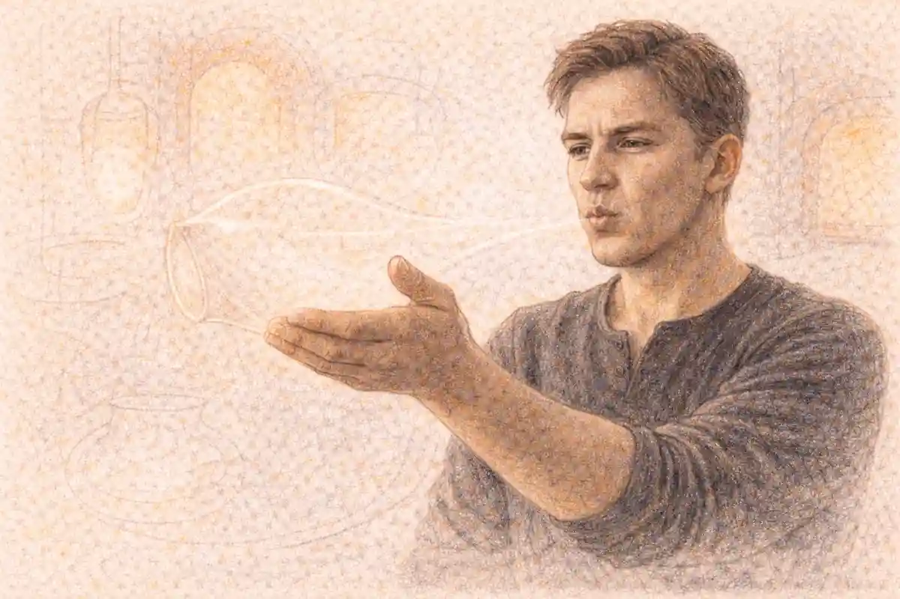

A headline that calls two real people star-crossed lovers has already finished their story. Before the first paragraph begins, the label has supplied the plot (two houses, one love), the emotional register (sympathy for the couple, sorrow at the world that opposes them), and the ending (the grave), and it has issued all three as fact rather than as forecast. This article examines that transaction across a documented century and a half of news practice, from the metropolitan reporters who descended on the Hatfield and McCoy feud in 1888 to a wire dispatch from besieged Sarajevo in 1993, from an Afghan couple labelled by the New York Times in 2014 to a headline over two disputed deaths in Uttar Pradesh in 2015. The verdict argued throughout is that the frame is a kindness with a cost, and that the cost is charged in advance. The kindness is real: the label lends strangers instant sympathy, dignifies people whom a colder vocabulary would call elopers, runaways, or victims, and gives a distant reader a story-shaped handhold on a conflict that would otherwise arrive as factions and acronyms. The cost is structural: the play's name spends the play's ending before the evidence is in, so a couple framed as star-crossed is read as doomed while their case is still a police inquiry, a court hearing, or a life in hiding. The survey assembled here finds the prophecy fulfilled in full in only a minority of the checkable cases. In the rest, the labelled people survived, recanted, were abandoned by the partner the label paired them with, or were disputing the very facts the headline had settled.

The habit is not a decorative weakness of feature writers. It follows from how headlines are made, whom they are made by, and what a headline is for. A headline is the one part of a news story written to be read by people who will never read the story. It is composed late, usually by an editor rather than the reporter, under a space constraint measured in characters, and its first duty is not summary but summons: it must make a passer-by stop. A borrowed plot is the most efficient summons ever devised, because it arrives pre-understood. Two words of it, star-crossed, do the work of a paragraph of exposition. Everything in the record that follows is explained by that efficiency, and everything that goes wrong follows from it too, because a plot borrowed entire brings its ending with it, and the ending of this plot is a tomb.

The evidence discipline of the survey deserves stating at the outset, because headline history is a subject infested with folklore. Famous front pages are remembered that no archive holds, and covers are described in memoirs that the bound volumes contradict, so this article admits an instance only where it can be checked: against a dated dispatch or headline preserved in the record, against the reference and court records that carry the later applications, or against the published testimony of the people the label named. Where the record is a participant's own account of the coverage, the account is used as testimony, not as transcript, and the grading is stated in the survey table. Instances that circulate as newsroom legend without a checkable carrier are graded as lore and left out, however well they would have illustrated the argument. The discipline costs the article some of its most quotable material and buys it the only authority a survey of other people's accuracy can claim: that its own exhibits survive the inspection it recommends for headlines.

## The First Headline: What the Prologue Promises and What It Owes

The play opens with the device the newsroom would inherit. The Chorus of Romeo and Juliet steps forward before any character speaks and delivers, in fourteen lines, the whole action: the two households, the ancient grudge, the lovers, their deaths, and the reconciliation those deaths purchase. In the Folger Shakespeare, edited by Barbara A. Mowat and Paul Werstine, the sonnet runs from "Two households, both alike in dignity" (Prologue, line 1) to the promise "What here shall miss, our toil shall strive to mend" (Prologue, line 14). At its centre stands the phrase the headline trade would take: "From forth the fatal loins of these two foes / A pair of star-cross'd lovers take their life" (Prologue, lines 5 to 6), followed three lines later by "the fearful passage of their death-mark'd love" (Prologue, line 9). The Chorus is, formally, a headline. It is a compressed advance summary, written to be consumed by an audience deciding whether to stay, and it performs the headline's two defining acts: it selects (two houses, one pair, no causes) and it spoils (the lovers die; the only suspense the play retains is the route).

What distinguishes the Chorus from its journalistic descendants is the contract it signs. The Prologue's last couplet is an admission that the summary is inadequate and a pledge that the performance will repair the summary's defects: what the fourteen lines miss, the two hours will mend. The headline frame inverts the contract. The label is applied at the moment of maximum ignorance, when a couple is a name in a police log or a face in a wire photograph, and the mending, if it comes at all, comes in later stories that few of the headline's readers will see. The frame therefore enjoys the Chorus's authority without accepting the Chorus's liability. A fuller account of what the borrowed words meant before the newsroom took them, the astrology of crossed stars and the long drift into pop usage, belongs to [the companion study of the phrase from astrology to pop culture](/2029/11/16/star-crossed-astrology-to-pop/), and the phrase's strict sense in the play is settled in [the series study of what star-crossed lovers really means](/2022/03/25/star-crossed-lovers-meaning-explained/). The concern here is narrower and more mechanical: what happens to real people when the sonnet's sixth line is laid over their unfinished lives.

One feature of the Prologue deserves the newsroom's particular attention, because it is the feature the headline copies least faithfully. The Chorus assigns the catastrophe an address. The rage belongs to the parents; the strife is buried by the children's end; the summary names the feud's owners before it names the lovers' fate. The headline version reverses the emphasis. Star-crossed points upward, at stars, at fate, at an obstruction too large and vague to indict, and the specific human agents of a real story, the father who hired killers, the sniper whose bullet was never traced, the family that fixed a marriage for the day of a death, drift out of the frame's focus even when the reporting beneath the headline names them. The play's own ending underlines the difference. The Prince closes the tragedy with a summary couplet spoken over the bodies, "For never was a story of more woe / Than this of Juliet and her Romeo" (5.3), and it is genuinely a headline, the first ever written over this material. But the Prince speaks it after the audit, having examined the evidence, heard the Friar's account, and apportioned punishment and pardon. The newsroom headline speaks the same couplet before the audit, on the first day, and the audit, when it comes, seldom gets the same front page.

### What does the Chorus owe its audience that a headline does not?

The Chorus owes repair. Its closing couplet promises that whatever the fourteen-line summary omits or flattens, the ensuing performance will supply and correct, and the promise is kept before the same audience that received the summary. A headline makes no such promise, and its corrections run later, smaller, and before a fraction of the audience the label reached.

The distinction matters because the two summaries otherwise behave identically. Each tells the ending first. Each converts an open sequence of events into a closed shape whose meaning is settled in advance. Each asks its audience to watch for confirmation rather than for news. Theatre can afford the device because the play's events are fixed and known; the Chorus spoils a fiction that cannot be harmed by the spoiling. News cannot afford it in the same way, because the events are unfinished and the summarised are alive, or newly dead in circumstances still disputed, and the shape imposed on them has consequences in courts, in communities, and in the memories of the families who must live inside the label. The record assembled in this article is, in one sense, simply the history of that single structural difference working itself out across case after case: a summary device built for a closed fiction, applied to open fact.

There is a second inheritance, quieter than the plot. The Prologue's lovers are defined entirely by their relation to the feud; they have no names in the summary, no ages, no trades, no words of their own. They are a pair, a function of the two houses. The headline frame performs the same reduction. The people it labels are introduced to the world as a unit and as a function of the division they crossed, and their individuality, her ambitions, his cowardice, the ordinary incompatibilities that real couples carry, is the first casualty of the coverage. When the record is examined case by case, the couples who flourished under the label are generally those whose story the label happened to fit, and the couples it injured are those whose actual history, of abandonment, coercion, or survival, the label had to erase in order to fit them. The survey returns to that pattern at the end, because it is the pattern on which the verdict rests.

## Who Writes the Headline: The Newsroom Mechanics of a Borrowed Plot

The first fact of the frame's career is a fact about labour. In the newspaper tradition, the reporter does not write the headline. Copy flows from reporter to desk, and the headline is composed by an editor, a subeditor in the British usage, who may be handling dozens of stories against a closing deadline, who did not witness anything the story reports, and whose raw materials are the reporter's text and a column width. The division of labour is not a defect; it is a safeguard, since the headline writer reads as the reader reads, without the reporter's investment. But the division has a consequence for the history of cliché. The person choosing the words at the top of a story about two dead teenagers in a feud valley, or two bodies on a bridge in a besieged city, is the person in the building under the greatest pressure to be instantly intelligible and the least equipped, in time and in column inches, to be exact. The borrowed plot is the rational choice of such a worker, and the record of the frame is, in large part, the record of rational choices compounding into a convention.

The linguist Ingrid Mårdh gave the headline's grammar its classic description in Headlinese, published in 1980, a study of the front-page headline as a distinct register of English: compressed, article-dropping, present-tense, built from short words and prefabricated blocks that slot into fixed widths. Headlinese rewards the stock phrase for the same reason a bricklayer rewards the standard brick. A phrase like star-crossed lovers arrives with its length known, its meaning pre-loaded, its grammar self-contained, and it carries a narrative that a freshly minted phrase would need a sentence to build. Mårdh's register explains the frame's durability better than any theory of journalists' taste. The label survives not because editors admire it but because the production system, measured in minutes and millimetres, taxes originality and rebates recognition. Every desk that reaches for it is solving the same equation, and the equation has not changed between the hot-metal composing room and the content management system, whose headline field counts characters with the same indifference.

The sociologist Gaye Tuchman, in Making News, published in 1978, located the deeper routine beneath the grammar. News organisations, on Tuchman's account, process an unpredictable world through typifications, ready categories that tell a newsroom what kind of thing an event is before its particulars are known, and the categories are a condition of meeting deadlines at all. A couple dead across a communal divide arrives at the desk as an unprocessed event; within the hour it must be a story of a known kind. The typification that the Romeo and Juliet frame supplies is unusually complete, since it specifies not only the kind of event but the kind of people, the kind of opposition, and the kind of ending. Tuchman's analysis explains why the label so often precedes verification. The frame is not applied after the facts are gathered, as a garnish. It is applied as part of gathering them, because it instructs the desk about what to ask next: the families' hostility, the secrecy of the meetings, the warnings ignored. Facts that fit the typification are pursued; facts that complicate it, a prior engagement, an abandonment, a disputed cause of death, are not suppressed so much as unscheduled, left for a follow-up that the news cycle rarely funds. The survey's disputed cases, examined below, show the machinery plainly: the complication existed in the record from the first day, and the headline ran anyway, because the headline's deadline is measured in hours and the complication's in months.

### Who writes a headline, and why does that division of labour favour the cliché?

An editor writes it, not the reporter, and the editor composes late, fast, and to a fixed width, working from the copy rather than from the event. Originality is expensive under those conditions and recognition is cheap, so the production system steadily rewards phrases whose meaning arrives pre-assembled, and a borrowed plot is the cheapest meaning of all.

Wire syndication completes the mechanism. A label coined in a single dispatch does not stay in a single newspaper. The Sarajevo naming of 1993, examined in detail below, travelled on the Reuters wire into hundreds of newsrooms within days, each of which received the frame as part of the factual package, as settled as the date and the place. Syndication converts one correspondent's metaphor into the industry's default noun, and each republication lowers the next editor's incentive to reconsider it, because a phrase that every outlet carries reads as a fact rather than as a choice. The same multiplication operates at higher speed through aggregation, where the label in a headline becomes the search term under which the story is filed, shared, and retrieved, so that later reporters researching the case meet the frame before they meet the evidence. A couple labelled once is labelled in the archive, and the archive is where the next decade's anniversary coverage begins. The frame thus has a ratchet: it is easy to apply, costly to retract, and self-confirming in the record it leaves behind.

The digital desk has since multiplied the headline's authors and shortened its fuse. The story a reader meets on a phone arrives as a push alert, a search result, and a social card before it arrives as an article, and each of those surfaces carries a summary written under the same constraints as the print headline, tighter space, less context, a different hand at the keyboard, in many newsrooms a member of an audience team who did not edit the story at all. The borrowed plot is even better suited to these surfaces than to the front page it was perfected on, since a push alert has no room for a subordinate clause of doubt, and a social card is judged in the time a thumb takes to hesitate. The label's digital career is therefore not a decline from a more careful print era. It is the print mechanism with its safeguards removed, the subeditor's deadline compressed to seconds and the headline's audience expanded from the newsstand to the lock screen, which is why the survey treats the frame's governance as a production question rather than a literary one.

## The Schoolroom Subsidy: Why the Allusion Never Needs Explaining

Every borrowed headline draws on a bank of prior knowledge in its readers, and this borrowing is secured by the largest subsidy any allusion has ever received: the school curriculum. A headline that invokes Romeo and Juliet can assume, across an unusual breadth of its audience, that the plot was once assigned, tested, and performed in a classroom, which is the one form of literary capital distributed by compulsion rather than by taste. The assumption is documented in the play's curricular record on several continents, a set text in jurisdictions that agree on little else, studied in Northern Ireland by pupils on both sides of its divide and examined in South Africa through the apartheid decades and after them. A desk borrowing any other work must gamble on the audience's reading. A desk borrowing this play is spending public money already spent: the education systems of the Anglophone world and far beyond it have pre-taught the frame, and the newsroom collects the dividend at no cost to itself.

The subsidy explains a feature of the frame that pure production economics cannot: its immunity to the audience's changing composition. Book readership fragments, theatre attendance narrows, and shared references decay within a generation, as the obituaries for the common culture regularly announce. The curriculum renews this reference annually, by cohort, as a condition of schooling, so the headline's key is reissued to each new class of readers before they buy their first newspaper. It also explains the frame's international portability, on which the Sarajevo and Afghan cases depend: the wire's label was legible in a hundred newsrooms because the play sits in syllabi from Sarajevo's own region to the Far East, one of the very few stories a Kabul, London, and New York desk can all presume. The survey counts the schoolroom as the frame's silent partner, and it draws the partner's responsibility into the open: an education that teaches the play as the archetype of love against a hostile world is training the reflex the headline later fires, and the reflex fires fastest in readers who met the story young, as the truth about how such stories go.

The subsidy has a second, quieter consequence for the frame's moral content. Schooling presents the play under supervision, with its ending discussed, its families analysed, and its waste deplored, so the audience's stored version of the story is a supervised one, in which sympathy for the lovers is the approved response and the feud is the approved villain. The headline inherits that pre-approved sympathy intact, which is why the label can perform its acquittal without argument: the verdict was reached years earlier, in a classroom, under a teacher's guidance, and the desk merely cites the precedent. Journalism that borrows from the curriculum borrows its authority as well as its plot, and authority borrowed from a syllabus is the hardest kind for a reader to notice, let alone to appeal.

## Framing Theory: What the Label Does to the Story It Names

The academic study of news framing gives the survey its instruments, and its three founding accounts disagree in ways that matter for the verdict. Todd Gitlin, in The Whole World Is Watching, published in 1980, defined media frames as persistent patterns of cognition, interpretation, and presentation, of selection, emphasis, and exclusion, by which symbol-handlers routinely organise discourse. Robert M. Entman sharpened the definition in 1993, in the Journal of Communication, proposing that to frame is to select some aspects of a perceived reality and make them more salient, so as to promote a particular problem definition, causal interpretation, moral evaluation, and treatment recommendation. Shanto Iyengar, in Is Anyone Responsible?, published in 1991, moved the question from texts to effects, distinguishing episodic framing, which presents public issues as particular events and persons, from thematic framing, which sets them in collective and institutional context, and demonstrating experimentally that episodic coverage shifts the audience's attribution of responsibility toward individuals and away from the conditions that produced the event.

The Romeo and Juliet frame is a nearly perfect specimen for all three accounts, which is why it rewards analysis rather than mere complaint. On Gitlin's definition, the frame is persistent in the strictest sense: the survey documents it in feud reporting of the 1880s, in punk obituaries of 1979, in war correspondence of 1993, in Afghan coverage of 2014, and in Indian crime reporting of 2015 and 2018, a run of more than thirteen decades in which the pattern of selection barely varies. On Entman's definition, the label performs all four framing functions in two or three words. It defines the problem (a love obstructed by division), diagnoses the cause (the division, figured as fate rather than as decisions), delivers a moral evaluation (the lovers innocent, the obstructing world guilty in the abstract), and implies a remedy (none, since fate admits none; the story is for mourning, not for remedy). On Iyengar's definition, the frame is episodic in its purest available form: it takes stories whose substance is thematic, a siege's strategy, a caste system's enforcement, a valley's timber economy, and recasts them as the biography of two people, with predictable consequences for where a reader locates responsibility. The reader of a star-crossed story blames the stars, or the families in the abstract, and not the marksman, the contractor of a killing, or the policy that kept a bridge under fire.

The disagreement among the three accounts is genuine, and the survey's cases adjudicate it. Tuchman and Gitlin, read together, treat frames as the property of institutions: routines and hegemonic patterns that journalists serve more than they choose. Entman's account is agnostic about origins and precise about textual mechanics. Iyengar's is about measurable audience effect, and it carries an implicit optimism the others lack, since an effect that can be measured can also be corrected by reframing. The cases divide the honours. The frame's origins and persistence belong to Tuchman: no conspiracy of taste explains a cliché that survives a century of style teaching, but a production routine explains it at once. The frame's textual operation belongs to Entman: the four functions fire together in the label, and his comparative method, most famously his demonstration that the 1983 destruction of a Korean airliner and the 1988 destruction of an Iranian airliner by opposed powers drew opposite moral vocabularies from the same American press, shows how much moral work a frame does before a single fact is argued. The frame's consequences belong to Iyengar, and his is the account with the sharpest edge for the verdict, because his experiments convert the critic's intuition into a finding: episodic framing does not merely decorate an event, it reallocates blame. A killing reported as the working of fate is a killing for which no one in particular will be held to account, and the survey's Indian and Uttar Pradesh cases show that reallocation operating on real prosecutions and real families.

One further scholar belongs in the adjudication, because the object being framed is not an event but a play. Douglas Lanier, in Shakespeare and Modern Popular Culture, published in 2002, argued that the Shakespeare who circulates in popular media is not a degraded copy of an authoritative original but a parallel institution, a brand whose meanings are made in each appropriation, so that fidelity is the wrong test to apply. Lanier's account fits much of the frame's career: the label plainly does not report the play, it uses the play's accumulated prestige as a currency. But the Sarajevo and Muzaffarnagar records mark the limit of the defence. When an appropriation is laid over identifiable people, the question is no longer fidelity to Shakespeare, on which Lanier is right that little turns. The question is fidelity to the appropriated, the dead couple whose disputed final hour the headline settled, the living couple whose courtship the label converted into a prophecy. A brand may be spent freely. A person's story, taken while unfinished, is owed a stricter accounting, and it is on that accounting, not on taste, that the verdict of this article finally rests.

### What does episodic framing do to responsibility in a star-crossed story?

It moves responsibility off the record's agents and onto the atmosphere. Iyengar's experiments showed that event-centred coverage leads audiences to hold individuals, or no one, responsible for institutional outcomes, and the label is event-centred by design: a siege or a caste system enters the story only as weather around two people, and weather cannot be charged.

## Feud Country: How the Nineteenth-Century Press Built the Frame

The frame's proving ground was Appalachia. When the Hatfield and McCoy feud in the Tug Valley, on the Kentucky and West Virginia border, broke into national consciousness after the killings of New Year's night 1888, the metropolitan press arrived in force and faced a translation problem: a conflict of timber, land, jurisdiction, and kinship, prosecuted through courts as much as through ambushes, had to be made intelligible to readers in New York and Chicago who would never see the Tug Fork. The solution the industry converged on was romance. The affair of about 1880 between Johnse Hatfield, son of the Hatfield patriarch, and Roseanna McCoy, daughter of his enemy, gave the coverage its human story, and the Encyclopaedia Britannica's account of the feud states the press history without adornment: the legend was embellished by the brief affair, and newspapers turned it into a Romeo-and-Juliet romance. The newsroom significance of the case lies in the sequence. The feud reporting of 1888, in the hands of correspondents such as the New York Sun's John Spears, told the Johnse and Roseanna story in a form measurably closer to the record than the legend that succeeded it. The full casting, the mountain Romeo and Juliet as a settled title, belongs to the retellings that followed: through the dime press and the magazines, into book-length versions traced by feud historians to Jean Thomas's Big Sandy, published in 1940, and to Virgil Carrington Jones's history of 1948, which carried a chapter titled "The Mountain Romeo and Juliet". A headline habit became a publishing fact, and the publishing fact governed the next century's coverage, down to the History channel's three-part dramatisation of 2012, which placed the affair at the feud's emotional centre for a mass audience.

What the frame cost the record is visible in the gap between the romance and the documents. The documented skeleton of the affair is not a mutual tragedy but a sequence of refusals. Roseanna went to live with the Hatfields, returned to her family pregnant, and was rejected in turn by nearly everyone the story touches. Johnse Hatfield did not die for love or with her; he married her cousin Nancy McCoy in 1881. Roseanna's child died in infancy, in those accounts that grant the child existed, a caution the record itself requires, since the historian Leonard Roberts, annotating a McCoy family history, noted that the baby's birth, age, and death are not proved. Roseanna died in her twenties, before the feud burned out. Altina Waller's Feud, the standard scholarly history published in 1988, reads the violence through the valley's economic transformation and treats the romance as an embellishment laid over material causes. Waller's correction has been available for nearly four decades, and it has not dislodged the label, because the label was never load-bearing as history. It was load-bearing as a headline: the one-sentence translation key that let a distant audience feel it understood the Tug Valley. The feud's actual news in 1888 was constitutional as much as romantic. The quarrel reached the Supreme Court of the United States, which held in Mahon v. Justice, in May 1888, that Kentucky could keep prisoners seized across the state line. Of governors, warrants, extradition, and a supreme court, the romance frame retained nothing. Two houses and a pair of lovers was the whole of the exportable story, and it is the frame's oldest documented lesson: what the label discards is consistently the machinery of responsibility, and what it keeps is the weather of fate.

## Sarajevo, May 1993: The Dispatch, the Photograph, and the Name That Stayed

The frame's defining modern case began on 19 May 1993, in the second year of the siege of Sarajevo. Admira Ismić, a Bosniak woman, and Boško Brkić, a Bosnian Serb man, attempted to cross the Vrbanja bridge into Serb-held Grbavica under an arrangement, believed on both sides, that fire would be held while they crossed. Brkić was shot first and died at once. Ismić, herself wounded, crawled to him, embraced him, and died beside him. Their bodies lay on the bridge for days, in a no man's land that neither side would enter under fire to clear; the sources divide between four days and eight before the recovery, and no account has established with certainty who fired the shots. The photographer Mark Milstein made the image of the two bodies locked together. The Reuters correspondent Kurt Schork, told what Milstein had seen, wrote the dispatch that named them, published on 23 May 1993, and the name was the play's: the Romeo and Juliet of Sarajevo.

As a piece of newsroom craft, the naming was extraordinary, and the survey records its strengths before its costs. The siege had become, for foreign audiences, an illegible war of factions and disputed responsibilities. Schork's name abolished the illegibility in a sentence. It told every reader how to feel and roughly what to think: two young people who loved each other across the line had been killed by the line itself. The name could be carried by newspapers and broadcasters of every position on intervention, because it demanded mourning rather than policy, and on the Reuters wire it was carried everywhere, the frame arriving in each subscribing newsroom as part of the factual package. Within a year it had become a title: the documentary Romeo and Juliet in Sarajevo, directed by John Zaritsky and co-produced by PBS Frontline, the Canadian Broadcasting Corporation, the National Film Board of Canada, and WDR, was released in May 1994, and it used the borrowed names as a warrant to investigate what the frame itself could not answer, interviewing the families and the men who had held the bridge under their sights, without finally establishing who fired. Schork was killed on assignment in Sierra Leone in 2000, and part of his ashes were interred beside the couple in Sarajevo's Lav cemetery, where their families had brought them together after the war. In July 2023, thirty years after the deaths, Sarajevo's Centar Municipality announced, on the initiative of its head, Srđan Mandić, and with the Ismić family's agreement, that a memorial plaque would mark the place near where they died.

The costs are written into the same record, and they are the costs Entman's four functions predict. The name diagnosed the cause as the divide in the abstract, fate wearing a front line, at the exact moment when the cause was a specific and still unidentified marksman and a specific, contested failure of a safe-conduct arrangement. It simplified the couple's intention as faithfully as it simplified the killing: Ismić and Brkić had not set out to unite the two sides of their city or to emblemise reconciliation. They had set out to leave, together, for a life on the other side of the bridge. The play's name converted an attempted escape into an emblem of union, and the conversion stuck, because the emblem served distant audiences better than the escape did. The survey's balancing evidence is the city's own conduct, and it resists any simple verdict of exploitation. The families buried the couple together. The city buried their namer beside them. The plaque was agreed by the family most entitled to refuse it. Sarajevo kept the name, and the keeping complicates the accounting: the audience with the strongest right to object ratified the frame, a ratification the survey weighs in the verdict, while noting what ratification cannot retroactively repair, the three decades in which the embrace, and not the unidentified bullet, was the story the world retained.

### Did the Sarajevo naming mislead the readers it moved?

In feeling, no; in causation, yes. The naming told the truth about what the couple meant to each other, and readers who grieved grieved something real. The frame assigned the killing to the divide as such, when the record held an unidentified sniper and a failed arrangement, and that reassignment is the misleading the frame performs in every case.

The Sarajevo case also isolates the photograph's role in the frame's economy, which the survey treats as a distinct mechanism. Milstein's image did what no dispatch could: it appeared to supply the frame with documentary proof. Two bodies in an embrace on a bridge is the play's fifth act restaged as evidence, and editors who might have resisted a correspondent's metaphor in type found the metaphor already composed in the photograph their own pages would print. The picture and the label then ratified each other in a loop that later cases repeat: the frame tells the desk which photograph to choose, and the chosen photograph certifies the frame. What the loop excludes is the record's actual texture, the days the bodies lay unrecovered under fire, the dispute over the shots, the arrangement that failed. An embrace can be photographed. A failed safe conduct cannot, and the frame's preference for the photographable over the consequential is one of the quiet ways it spends a story's substance while appearing only to summarise it.

The naming also won a contest that the same spring's coverage makes visible, because two borrowed frames competed for the Bosnian war in the Western press, and they were moral opposites. The rival borrowing cast the war itself as an ancient feud, a Montague-and-Capulet spasm beyond reasoning with, and its practical counsel was despair: nothing could be done with peoples locked in inherited hatred. Schork's borrowing, laid over two of the war's dead, counselled the opposite response to the same facts: grief for identifiable people, and through the grief, engagement. Both frames were simplifications, and the political uses of the feud version, examined elsewhere in this series at the level of the podium, were the costlier simplification for Bosnia itself. But the newsroom ledger is the survey's concern, and in that ledger the lovers' frame outperformed the feud frame at the level of the story: it personalised where the other anonymised, it individuated a siege whose victims a distant audience was learning to count without seeing, and it kept two names in print for thirty years. The contest matters because it acquits the frame of the laziest charge against it. Desks did not reach for the play because no other language was available. They reached past an available rival, and in this instance the reaching, judged against its alternative, was the more humane editorial act, which is precisely why the survey refuses to make abstinence its remedy.

## Afghanistan's Romeo and Juliet: The Label That Outran Its Story

In the spring of 2014 the New York Times carried a series of reports by its Kabul bureau chief, Rod Nordland, about two young Afghans from Bamiyan province: Zakia, a Sunni Tajik, and Mohammad Ali, a Shia Hazara, whose families farmed neighbouring plots, who had fallen in love as teenagers, and who married against their families' will and fled, with Zakia's relatives pursuing her under threat of death for the family's honour. The coverage made them, in the phrase that settled over the story internationally, Afghanistan's Romeo and Juliet. Nordland expanded the reporting into a book, The Lovers: Afghanistan's Romeo and Juliet, published by Ecco in 2016 with the label promoted from headline to title and a subtitle promising the true story of how they defied their families and escaped an honour killing. The label travelled as labels do: the book was translated, reaching a Persian edition published in Tehran in January 2024, by the Iranian agency record, with the play's names still on the cover, so that the frame completed a circuit from a Verona fiction to a Bamiyan fact and back into the region's own languages as the story's official name.

The case matters to the survey because the frame's prophecy failed, openly and in print, and the coverage had to metabolise the failure. The play's name predicts a double death, swiftly. Zakia and Ali did not die. They survived their flight, spent years moving between hiding places and shelters, had children, and remained at risk without becoming the tragedy's final tableau. A label that spends an ending in advance is embarrassed by subjects who go on living, and the embarrassment is instructive: anniversary and follow-up coverage of the couple repeatedly had to report, as news, the bare fact of their continued existence, as though survival were the deviation and the tomb the expectation the story had defaulted on. The frame had also misdescribed the direction of the danger in a subtler way. In the play, the obstruction is symmetrical, two houses alike in dignity. In Bamiyan, the mortal threat ran overwhelmingly one way, against the woman, under an honour code whose enforcement the Afghan state's own institutions alternately resisted and abetted; the couple spent time inside that machinery, in shelter and in custody processes, while the symmetrical frame told foreign readers to blame the feud, the culture, the stars, in Entman's pattern, rather than identifiable men making identifiable threats under a law that could have been made to answer them.

The label also acted inside the Afghan case itself, as a force in the legal process it was supposedly only describing. The couple's case moved through courts in Bamiyan and Kabul under the attention the coverage created, and the record shows the machinery bending around the fame: the couple were released from custody by order of the Attorney General in June 2014, a disposition made in a capital aware that the world was watching a story it had been taught to read as a romance. Publishers Weekly's account of the book notes the double edge in a sentence, observing that the reporting brought the couple fame and aroused the ire of the conservative Afghan establishment. Both effects are framing effects. The attention plausibly shielded two people whom obscurity would have left defenceless, and the same attention raised the symbolic stakes of their defiance for every institution seen to yield to it, so that mercy toward them became, in domestic politics, a concession to a foreign story. A label that can alter the behaviour of courts and ministries is not a summary of an event. It is a participant in the event, and the Afghan record is the survey's clearest proof that the headline frame belongs in the story it frames, listed among the actors.

Nordland's book is also the survey's most honest document about the frame's effect on the framer. The correspondent who applied the label became, by his own printed account, a participant in the story he was covering: the book's introduction concedes that he became the couple's best hope to survive, entangling himself in their lives in ways that threatened his own values and professional ethics, and the Kirkus review of the book summarised the dual role by noting that Nordland had not only chronicled the couple's plight but shepherded them from danger. The entanglement is usually told as a personal failing or a personal heroism. In the survey's terms it is a framing consequence. A reporter who has named two people Romeo and Juliet has accepted a plot in which the lovers' survival is the story's stake, and a plot with stakes recruits its narrator. The label did not merely describe the couple to readers. It assigned the correspondent a role in the drama, protector or mourner, and the professional boundary dissolved at exactly the point where the frame was strongest. The wider cast of real couples who have carried the same renaming, and what the name did to each of them, is catalogued in [the series study of real-world couples called the next Romeo and Juliet](/2030/01/11/real-couples-called-romeo-juliet/). The concern here is the renaming as a newsroom act: its distribution, its ratchet, and its price.

## Punk's Romeo and Juliet: The Frame Meets a Family's Refusal

On 12 October 1978, Nancy Spungen, aged twenty, was found dead of a stab wound in the bathroom of Room 100 at New York's Chelsea Hotel. Her boyfriend, Sid Vicious, the Sex Pistols' bassist, was charged with her murder. On 2 February 1979, released on bail and still untried, Vicious died of a heroin overdose at twenty-one. The press coverage of the couple, before and after the deaths, reached for the frame at once, and this case supplies the survey with its clearest documented refusal, because the refusal comes from inside the story and in print. Deborah Spungen, Nancy's mother, published a memoir, And I Don't Want to Live This Life, in 1983, and its account of the coverage is an indictment with a headline writer's precision. She wrote that the press had made the couple into personifications of the punk movement, that reporters are given licence to manufacture news, and she fixed the frame itself in a sentence: the press portrayed Sid and Nancy as Romeo and Juliet in black leather, roaring into hell.

The sentence deserves its survival. It identifies exactly what the frame added to the record and what it removed. It added a plot (doomed lovers, a hostile world) to two young addicts, one of whom stood accused of killing the other, a fact the romance plot cannot hold and therefore quietly dissolves: in the play, the lovers die by their own hands for love; in Room 100, one person was stabbed and the other was charged with the stabbing, and the frame's work was to launder an alleged homicide into a mutual tragedy. It removed the illnesses. Spungen had been diagnosed with schizophrenia in adolescence; both were addicted to heroin; the couple's documented history included violence inside the relationship as well as against the world. Under the label, those facts read as local colour in a love story. The mother's verdict, that the media manufactured the pair it claimed to report, anticipates the framing scholarship's conclusions from the receiving end, and the survey knows no sharper statement of the cost side of its ledger.

The frame's ratchet operated here as reliably as in Sarajevo. Anthony Bruno's chapter on the case for the Crime Library, published in July 2006, is titled "Punk Rock Romeo and Juliet: Sid Vicious and Nancy Spungen", the label doing duty as a filing category a generation after the deaths, in a crime reference work whose readers meet the frame before the evidence. The pushback has also been filed, and dated: a Retrospect Journal essay of 12 March 2023, titled "Sid and Nancy: 'Punk's Romeo and Juliet' or a toxic obsession?", argues in terms that the romantic label is a sensationalism laid over addiction, mental illness, and intimate violence, and that the deaths resist the romance they are marketed as. The exchange across forty-four years, label in 1978, refusal in 1983, label as catalogue heading in 2006, refusal renewed in 2023, is the frame's whole modern rhythm in miniature: the correction is always available, always later, and always read by fewer people than the label.

### Why did Nancy Spungen's mother reject the Romeo and Juliet frame?

Because the frame falsified two facts she needed the record to keep: that her daughter had a history of illness, not a heroine's part, and that the death in Room 100 was an alleged killing with a named accused, not a destiny. Her memoir's counter-claim, that the press manufactured the couple it reported, stands as the survey's key refusal.

## The Headline as Verdict: Muzaffarnagar, Miryalaguda, and the Disputed Facts

The frame's risk is at its maximum where the underlying facts are least settled, and the survey's sharpest specimen is a headline that consisted of nothing but the frame. On 5 May 2015, the Nigerian news site The Trent published the story of two deaths in Muzaffarnagar district, Uttar Pradesh, under the headline "Romeo And Juliet: Couple Commits Suicide Next To Each Other". The story beneath reported that Rajneesh Kumar, twenty-one, a Hindu, and Imrana Bano, eighteen, a Muslim, had been found dead after disappearing on the night of 2 May 2015; that the two had been in a relationship for some four years; that both families opposed the marriage across the religious divide; that Bano's family had fixed her marriage to another man, to be engaged that week; and that the police read the deaths as a suicide pact, with poison found at the spot. The same story carried, in its own columns, the fact that disassembles its headline: Kumar's father maintained that the deaths were murder, pointing to the circumstance that the tree stood on property belonging to Bano's family. A headline asserts; it does not argue, and this one asserted the pact, the romance, and the motive in the play's two names, on a story whose own reporting left the manner of death contested between the police and a parent. The frame had not summarised the story. It had outrun it, and for every reader who met the headline without the article, which is most readers of any headline, the verdict of Verona stood in place of an inquest in Uttar Pradesh.

The Indian record supplies the survey's most formal contest of the frame, fought not in a letters column but in a courtroom. On 14 September 2018, in Miryalaguda, Telangana, Pranay Kumar, a Dalit man of twenty-three, was hacked to death outside a hospital in front of his wife, Amrutha Varshini, who was five months pregnant. The killing was captured on closed-circuit cameras. Police charged that Amrutha's father, Maruthi Rao, had contracted the murder for one crore rupees because the marriage crossed caste. The coverage presented the case, in India and abroad, through the vocabulary of tragic love, and the frame then passed from journalism into commerce: in June 2020 the filmmaker Ram Gopal Varma announced a film, Murder, promoted in his own words as a heart-wrenching story about Amrutha and her over-loving father, a synopsis that recast a contract killing as an excess of paternal devotion. Pranay's father, Balaswamy, petitioned the special court at Nalgonda, objecting among other grounds that photographs of the couple were being used without consent and that the film could mislead the investigation, and in August 2020 the court restrained the production until the probe was complete. Amrutha herself opposed the film publicly and insisted, against the romance vocabulary, on a causal vocabulary: the murder was caste's work, and her father's caste pride its instrument. In March 2020 Rao had died by suicide while the case proceeded. On 10 March 2025, the Nalgonda court sentenced the hired killer to death and six others to imprisonment for life.

The survey enters the Miryalaguda record with a caution it applies to itself: the documented contest is over the love-story packaging in its commercial and cinematic form, and the case is used here for what the record proves, that the frame's subjects and their families can experience the romantic vocabulary not as sympathy but as a second misdescription, one that dissolves a prosecuted murder into a father's excess of love and a couple's fate. Amrutha's counter-vocabulary is the correction the frame's defenders rarely quote: she did not ask to be read as Juliet. She asked for the killing to be named by its cause. The distance between those two requests is the distance between the play's plot and the event, and it is the distance the headline frame exists to save its readers from travelling.

The forum is itself the finding. A family that objects to its coverage ordinarily has no remedy proportionate to the injury: a correction adjusts a fact, a letters page reaches a fraction of the audience, and no stylebook violation has been committed, since the romance vocabulary breaks no rule of accuracy that a press council adjudicates. The Perumalla family's petition succeeded in reaching a court because the frame had crossed into a commercial film whose production a judge could restrain; the journalism that prepared the film's vocabulary lay beyond the order's reach. The survey generalises the point carefully: the frame is contestable exactly where it stops being journalism, and uncontestable where it remains so, because the vocabulary is protected as expression and unactionable as description, each word defensible, the arrangement indefensible only in aggregate. That is why the frame's corrections in the record are memoirs, scholarly histories, and lawsuits about films, never corrections in the newspapers that coined the applications. The injured parties sue the adaptation because the adaptation is the only version of the frame with a defendant.

### When the facts under a headline are disputed, what has the headline already decided?

Everything the dispute is about. A frame headline settles the manner (fate, not agency), the motive (love obstructed, not interest or coercion), and the meaning (tragedy, not crime) before the evidence is heard, and it settles them for the largest audience the story will ever have, since follow-up reporting reaches a fraction of the readers the first headline reached.

## Star-Crossed Without Lovers: The Phrase Leaves the Romance

A frame that succeeds completely eventually escapes its subject. The adjective at the label's heart has done so. The dictionaries record the detachment in plain terms: Merriam-Webster defines star-crossed as not favoured by the stars, ill-fated, with no lovers in the definition at all. The word that entered the language as a diagnosis of one fictional couple's astrology has come to modify careers, seasons, mergers, expeditions, and administrations, anywhere a headline writer needs a single word that converts a run of failures into a destiny. The bleaching is measurable in the label's own grammar. Star-crossed lovers is a claim about a plot. Star-crossed, alone, is a claim about luck, and luck is the one defendant no correction can ever reach. The survey treats the detached adjective as the frame's final form and its most honest one, since it drops the pretence of describing a relationship and states the transaction openly: the substitution of fate for causes, sold at headline length.

The business pages run the same substitution in a matrimonial dialect. When America Online's acquisition of Time Warner completed its collapse into the largest losses then recorded by an American company, the press's settled verdict, as MediaVillage's retrospective put it, dubbed the combination the worst merger in history, and Marketplace's account of January 2015 reached for the wedding register to bury it: "The marriage that never took". The metaphor is the frame's cousin rather than the frame itself, and the survey grades it as such, but the kinship is diagnostic. Faced with a failure whose causes were accounting practices, executive decisions, and a bursting bubble, the business press, like the feud press before it, preferred a figure in which two parties were joined by destiny and parted by fate, a story with no defendant. In the sports pages the adjective does the same work for franchises and players whose injuries and defeats have identifiable medical and managerial histories. In each migration the word keeps the one element the play's Chorus built into it and that the headline frame has always traded on: it moves the explanation of an outcome from the record of decisions to the arrangement of the sky.

The phrase's itinerary, from a prologue's astrology to a dictionary's bare adjective, is one line in a larger export ledger, and the survey notes its place there only in passing: the play's phrases travel by the same machinery of detachment wherever they land, a process catalogued in full in [the census of the phrases of the play in everyday English](/2029/11/02/phrases-in-everyday-english/). What distinguishes this phrase's journey is its employer. Other exports of the play's language went to work in poetry, in law, in song. This one went to work in the newsroom, where detachment is not a literary fate but a production requirement, renewed at every deadline.

The survey notes, against its own argument, the use that justifies the bleaching in the eyes of its practitioners. A word that has fully detached belongs to everyone, and editors defend the detached adjective as harmless colour, a way of saying ill-fated with a literary accent. The defence is strongest exactly where the stakes are lowest, a merger, a season, a career, where no family's grief is filed under the metaphor. It fails where the survey began, at the bridge and the hospital door, because the same reflex, trained on harmless copy, is the reflex that fires when the copy is a killing. Newsroom habits do not inspect the gravity of the story before they run. The desk that writes star-crossed over a quarterback on Tuesday writes it over a couple on Friday, and the word arrives at the funeral with its Friday meaning worn smooth.

## The Rivals: What the Choice of Frame Confesses

A frame is most visible at the moment of choice, and the newsroom's shelf of couple-labels holds a rival whose contrast exposes the Romeo and Juliet label's moral content. Couples who flee, offend, and die together are as often filed as Bonnie and Clyde, after Bonnie Parker and Clyde Barrow, killed by a posse in Louisiana on 23 May 1934 and fixed in the culture's memory by Arthur Penn's film of 1967. The two labels describe overlapping facts: a young couple, a flight, a violent end, a public fascinated out of proportion to the events. They distribute sympathy in opposite directions. Bonnie and Clyde convicts: the couple are agents, outlaws whose deaths are the wage of their choices, and the frame's pleasure is the chase. Romeo and Juliet acquits: the couple are patients, lovers whose deaths are the wage of the world's arrangement, and the frame's pleasure is the lament. A desk that must file a dead couple under one name or the other is not choosing a metaphor. It is returning a verdict on agency, in the headline, before the inquest, and the verdict is the more consequential for being deniable as mere shorthand.

The survey's cases show the choice being made on grounds the record rarely states. Sid Vicious and Nancy Spungen, one charged with the other's murder, received the acquitting label, a decision that laundered an alleged stabbing into a shared destiny and that the victim's mother spent a book refusing. The Muzaffarnagar couple received it over a father's claim that the deaths were homicide, the frame acquitting persons unknown in advance. The Hatfield affair received it over a record of abandonment, the label supplying the fidelity the man in the case had not. In each instance the rival label, or no label, was available, and in each instance the desk reached for the one that pre-forgave. The pattern suggests the frame's deepest newsroom function is not compression but absolution: it lets a story be consumed as tragedy, the one genre in which an audience's sympathy requires no one's indictment, and it lets a killing be moving before it is solved. Editors who would never write an editorial acquitting a suspect will write a headline that does it, because the headline's borrowed plot carries the acquittal in its luggage, unexamined.

## The Query Box: The Frame in the Search Era

The frame's newest reinforcement is the search box. The desk editor of the print era wrote for the passer-by; the digital editor writes also for the query, the words a reader types when a half-seen story is chased across the internet, and the words readers type are the words the culture has already given them. A couple killed across a divide will be searched for, in part, under the play's names, because the play's names are the filing system the audience carries in its head. A headline that adopts the label therefore harvests the searches the label itself taught the audience to make, a closed loop in which the frame's familiarity is both the product and the advertisement. Digital metrics make the loop visible to the desk in a way the print era's instincts never were: the labelled version of a story demonstrably travels, in the trade's own measures of engagement, and travel is the desk's assignment. The survey records the consequence without inventing figures for it, since the figures sit in proprietary dashboards rather than in the public record: the frame is no longer merely the cheapest phrase an editor can reach for under deadline. It is, measurably within the trade's own accounting, the phrase that performs, and a newsroom that retires it pays for the retirement in reach. That economics, more than any failure of taste or training, is why a century of style teaching has left the label standing, and why the survey's remedy is aimed at the follow-through rather than at the phrase: a desk may rationally buy the label's reach, and the purchase is defensible exactly when the story's later chapters, survival, abandonment, verdict, refusal, are written and headlined with the same energy that sold the first.

## The Second Shift: Anniversaries, Documentaries, and the Label's Afterlife

A frame's first application is an editorial act. Its second and third are a desk routine, and the routine has a calendar. Anniversary journalism is a standing department of the news business: round-number dates reopen files, and the reopened file is summarised from its own first page, where the label waits. The survey's cases run on this calendar with mechanical fidelity. The Sarajevo naming of May 1993 became a documentary title in May 1994, a first-anniversary conversion of a dispatch into an institution. The thirtieth anniversary produced the plaque announcement of July 2023 and a fresh cycle of coverage in which the couple were introduced to a new generation of readers under the play's names, the frame by then carrying the authority of the city's own memorial practice. The Hatfield romance, corrected by scholarship in 1988, was recommissioned by the calendar of television in 2012, when the History channel's dramatisation sold the feud to its largest audience under the romance's management. The Spungen case is re-filed at its own anniversaries, in 2006 as a crime library's chapter, in 2023 as a journal's reconsideration, each return beginning from the label and arguing outward. Even the Afghan label observed the calendar, passing in January 2024 into a Tehran translation whose coverage presented the play's names as the story's permanent and exportable title.

The mechanism deserves a name of its own in the survey, because it explains why the frame's errors compound rather than decay. Call it the second shift: the labour by which later desks, working from the archive rather than the event, re-employ the first desk's metaphor as the case's proper name. The second shift has its own economics. An anniversary piece is commissioned precisely because the subject is already legible, and its legibility is the label's deposit in the culture's account. To reopen the case under a new description, the timber feud, the contested bridge, the surviving couple, would be to spend the deposit: the piece would have to re-teach its subject before it could commemorate it. Desks therefore commemorate the label, and the commemoration re-teaches the label to readers who never saw the first coverage, so that each generation of the audience inherits the frame at the moment it inherits the facts. The play's Chorus promised that the performance would mend the summary. The anniversary desk performs the opposite office: it reissues the summary, bound in the authority of elapsed time, and calls the reissue remembrance.

## Two Audiences: The Name Abroad and the Names at Home

The survey's last structural observation concerns the direction in which the label faces. The Romeo and Juliet name is an export product. It is coined for readers who are not there, who need the translation key, and it circulates in the languages of the audience rather than in the language of the event. Sarajevo's own popular memory keeps the couple's proper names in the first position: the city's band Zabranjeno Pušenje set the story to music as "Boško i Admira", under their own names, and the plaque the city agreed in 2023 marks the place of a local loss, whatever title foreign coverage files it under. The Afghan label completed the circuit in the opposite direction, returning to the region in a Persian translation as the story's official name, an import wearing export clothing. The Hatfield romance was manufactured by metropolitan correspondents for metropolitan readers, about a valley whose own documentary trail, family histories, court records, annotated genealogies, remembers the affair in a bleaker and more particular prose. In case after case the pattern holds: the people inside the story use names, and the people outside it use the play's.

The asymmetry explains the frame's peculiar immunity to local correction. A label maintained by an external audience cannot be amended by the community it describes, because the community is not the label's market. Deborah Spungen wrote her refusal in English, for the same market, and it is the exception that proves the distribution rule: she had a publisher, a platform, and a grievance legible to the frame's own audience, and still the Crime Library filed her daughter under the refused name a generation later. Amrutha Varshini's counter-vocabulary, caste, travelled less far than the romance vocabulary it answered, because caste is a fact requiring context and Juliet is a name requiring none. The survey closes its analysis here, on the observation that the headline frame is a device by which distant audiences appropriate near events, converting other people's emergencies into the audience's own literary property. The play, which has been common property for four centuries, makes the appropriation feel innocent. The record, read case by case, shows the title deeds being transferred, and shows who signed and who did not.

## The Name That Needs No Translation

A local vocabulary must be translated to travel; a proper name crosses borders duty-free, and the frame's deepest logistical advantage is that its cargo is two names. Caste, the word Amrutha Varshini opposed to the romance vocabulary, requires a paragraph of context in a London or New York newspaper and still arrives diminished. Honour, clan, checkpoint, and safe conduct all pay the same tariff. Romeo and Juliet pay none, because the names are not translated but recognised, in Tehran as in Toronto, and a desk filing for a foreign audience rationally prefers the currency that exchanges at par. The record shows the names completing journeys no local term could have made. The Sarajevo label passed within a year from a Reuters dispatch into the title of a documentary co-produced by public broadcasters in the United States, Canada, and Germany, carrying the couple into living rooms that had never printed the words Vrbanja bridge. The Afghan label completed the longest circuit in the survey in January 2024, when Nordland's book appeared in Tehran in a Persian translation, the play's names arriving in the region's own language as the story's official title, an export re-imported as fact.

The translation advantage also rigs the contest between the frame and its corrections. Waller's dismantling of the Hatfield romance is written in the vocabulary of timber deeds and court records, terms that stay home; the romance it corrects is written in names that travel. Deborah Spungen's refusal was published in the frame's own language and market, the one correction in the survey with a passport, and it still lost ground to a chapter title. Amrutha's counter-vocabulary never stood a chance on the wire, not because it was weaker as analysis, it was stronger, but because it could not be pronounced by the receiving desks without a glossary. The survey therefore records the frame's survival as partly a phenomenon of logistics rather than of belief: editors do not have to think the label true, or even apt, to keep it in service. They have only to file for audiences who will never learn the local words, and the names do the rest, which is why the article's remedy is aimed at follow-through and indexing rather than at vocabulary reform. A desk cannot be asked to uninvent the most portable names in its culture. It can be asked to ship the record with them.

## The InsightCrunch Headline Survey: Cases, Costs, and the Prophecy's Record

The survey below assembles the article's checkable instances. Each row records the case, the framing act and its date, the outlet or record that carries it, what the frame supplied, and what it cost or omitted, with the outcome the frame predicted set against the outcome the record holds. The rows are graded by the tier of their documentation: primary reporting for the Sarajevo dispatch and the Muzaffarnagar headline, reference and court records for the feud and Miryalaguda cases, the participants' own published accounts for the Spungen refusal and the Nordland entanglement. Researchers who teach the corpus, in media-studies seminars where the table's rows are projected and argued over line by line, will find the rows transfer cleanly to slides through [the ReportMedic PPT viewer](https://reportmedic.org/tools/ppt-viewer.html), which renders the survey's evidence grades legible at lecture distance. The survey's headline finding can be stated in one sentence: of the six documented cases, the frame's full prophecy, both lovers dead by the logic of the plot, is borne out in at most two, and in one of those two the manner of the deaths remains disputed by a parent in the record the headline itself carried.

| Case | Framing act and date | Carrier of the record | What the frame supplied | What the record holds against it |
| --- | --- | --- | --- | --- |
| Johnse Hatfield and Roseanna McCoy, affair about 1880 | Newspapers turn a brief affair into a Romeo-and-Juliet romance; the casting hardens through retellings to Jones's chapter "The Mountain Romeo and Juliet", 1948 | Encyclopaedia Britannica on the press history; Waller's Feud, 1988 | A human story and a translation key for a feud of timber, land, and courts | He married her cousin in 1881; she died in her twenties; the affair's child is not proved in the record; the feud reached the Supreme Court in 1888 |
| Sid Vicious and Nancy Spungen, deaths 1978 and 1979 | The press portrays the couple as Romeo and Juliet in black leather; the label becomes a Crime Library chapter title in 2006 | Deborah Spungen's memoir, 1983; Bruno's Crime Library chapter, 2006; Retrospect Journal critique, 2023 | A plot of mutual doom for two addicts, and a punk mythology | One death was an alleged homicide with the other charged; illness and addiction were dissolved into atmosphere; the mother refused the frame in print |
| Admira Ismić and Boško Brkić, Sarajevo, 19 May 1993 | Schork's Reuters dispatch names them the Romeo and Juliet of Sarajevo, 23 May 1993; the name becomes a documentary title in May 1994 | Reuters wire record; Zaritsky's documentary; the city's memorial record to 2023 | Instant sympathy and a legible story for an illegible siege | The marksman was never identified; the couple meant to escape, not to emblemise union; the city and families nonetheless kept the name |
| Rajneesh Kumar and Imrana Bano, Muzaffarnagar, May 2015 | A headline consisting of the frame alone: "Romeo And Juliet: Couple Commits Suicide Next To Each Other", 5 May 2015 | The Trent's report of 5 May 2015 | A settled verdict: pact, romance, motive | The same story carried the father's claim that the deaths were murder; the headline decided the manner before any inquest could |
| Zakia and Mohammad Ali, Bamiyan, from 2014 | New York Times reporting and Nordland's book, The Lovers: Afghanistan's Romeo and Juliet, 2016 | The Times coverage; the book and its reviews; the Tehran translation of January 2024 | A global audience and protective attention for a hunted couple | The couple survived, in hiding, with children; the frame's predicted ending never arrived; the reporter became a participant and protector |
| Pranay Kumar and Amrutha Varshini, Miryalaguda, 2018 to 2025 | Tragic-love vocabulary in coverage; the frame passes into a marketed film synopsis in 2020 | Court records at Nalgonda, 2020 and 2025; the family's petition; Amrutha's public statements | A legible love story for an international audience | The widow named caste, not fate, as the cause; the victim's father restrained the film in court; verdicts followed in March 2025 |

Read as a table rather than as anecdotes, the rows expose the frame's economy with unusual clarity. In every case the frame supplied the same three goods, sympathy, legibility, and distribution, and in every case it charged the same three fees, symmetry where the record was lopsided, fate where the record held agents, and an ending where the record was still open. The fees were sometimes worth paying. The Sarajevo row shows a naming that the bereaved themselves ratified, and the Afghan row shows a label whose attention plausibly contributed to a couple's protection. The survey's verdict therefore cannot be abolitionist, and the final section argues the narrower, enforceable charge: that the frame is a loan taken against a story's ending, and that newsrooms which take the loan owe their readers the discipline of its repayment, in follow-up coverage that reports survival, abandonment, acquittal, and verdict with the same prominence the label received.

## The Ratchet: Why the Correction Never Catches the Frame

Every case in the survey exhibits the same asymmetry of reach. The label travels on the wire, the front page, the book cover, and the chapter title. The correction travels in a scholarly monograph, a memoir read by the already persuaded, a court order reported for a day, or a follow-up story on an inside page. Waller's scholarly demolition of the Hatfield romance appeared in 1988; the romance headlined a hit television dramatisation in 2012 and governs the feud's presentation in reference works that cite Waller in the same breath. Deborah Spungen's refusal was in print by 1983; the Crime Library filed the couple under the refused label in 2006. The Afghan couple's survival has been reported repeatedly since 2014; the label that predicted their deaths sits undisturbed on the book that made them famous and on its translations. The pattern is not a conspiracy of editors. It is a property of the two kinds of statement. A frame is a noun, portable and repeatable, designed by its brevity to be copied. A correction is an argument, long and conditional, designed by its accuracy to be read. Copying beats reading at every stage of the news system, from the wire to the archive to the anniversary desk, where the file is opened and the label is found waiting at the top of it.

Psychology gives the ratchet a mechanism. The continued influence effect, documented across the misinformation literature and reviewed by Stephan Lewandowsky and colleagues in Psychological Science in the Public Interest in 2012, describes the finding that corrected information continues to shape inference after the correction is known and believed, because the correction leaves a gap in the mental model that the original account had filled, and the mind prefers a flawed story to an incomplete one. The frame is the newsroom's way of pre-filling that gap. Once a couple has been understood as Romeo and Juliet, later facts are not weighed against a blank; they are weighed against a plot, and facts that fit the plot are absorbed as confirmation while facts that break it, a marriage to a cousin, a survival in hiding, a father's counter-claim, are processed as exceptions, ironies, or sequels, categories that leave the original understanding intact. The survey's cases are a century-long demonstration that the effect operates at the scale of public memory as reliably as in the laboratory. The first story is the one that supplies the model. Everything after is footnotes, and the frame's whole commercial genius is its reliability at being first: it can be written in the first hour, from the first facts, by an editor who has read nothing but the wire copy, and being first is the only credential the ratchet requires.

The archive hardens what psychology explains. Modern news retrieval is keyed to the language of the original coverage, so the label becomes the search term under which the case is stored, taught, and re-reported. A researcher assembling the Hatfield record meets the romance in the reference summaries before the timber deeds. A student meeting the Sarajevo couple meets the play's names in the documentary title before the siege's chronology. The frame thus graduates from a description of the record to the record's index, and an index is the one part of an archive that no correction ever rewrites. The survey draws from this the practical conclusion that the contest over a label is won or lost at the moment of first publication, which is precisely the moment at which the newsroom knows least about the case. That inversion, maximum consequence at minimum knowledge, is the frame's defining defect, and no subsequent diligence fully repairs it.

The ratchet has acquired a digital gear that the print morgue never had. Researchers once met a case through its clip file, in chronological order, correction stapled where it fell. The digital archive is met through search, and search returns the labelled coverage first, because the labelled coverage is what earlier searchers clicked, quoted, and linked, and ranking systems promote what a public already treats as the story's name. A student assigned the Hatfield feud, a producer developing a Sarajevo anniversary segment, a novelist checking the Spungen record, each begins from the frame's version of the case and meets the corrections, if at all, as dissent from an established account rather than as the account itself. The label has thus become the toll booth on the road into these stories: every later inquiry pays it a moment of belief before proceeding, and most inquiries are too short to notice the payment. This is the mature form of the continued influence effect, no longer a quirk of individual memory but an architecture of retrieval, in which the first desk's deadline metaphor governs the order in which all subsequent evidence is encountered. The survey's insistence on indexing the label as a claim, with the record's verdict attached, is addressed to this architecture: the toll cannot be abolished, but the booth can be made to hand out the corrections with the ticket.

## The Kindness, Weighed: What the Frame Gives the People It Names

The case for the frame deserves to be stated at the strength its best instances give it, because the verdict that follows is a discipline and not a ban. Begin with the counterfactual. The world's stock of unnamed dead is large, and the couples the frame passed over are in it. Admira Ismić and Boško Brkić are remembered by name on three continents, their story taught, filmed, and plaqued, in a siege that killed roughly ten thousand Sarajevans whose names foreign audiences never learned. Whatever the naming simplified, it defeated the siege's anonymity for two of its victims, and the instrument of the defeat was precisely the borrowed plot: readers who could not follow the war could follow the lovers, and following, they attended. The Afghan case extends the point from memory to safety. Nordland's couple were hunted people whose best protection was visibility, and the label manufactured visibility at a scale no human-rights vocabulary could have matched; the frame's attention drew shelter, advocacy, money, and a correspondent's protection into the couple's orbit. A purity that refused the label on their behalf would have been purchased with their obscurity, and obscurity, for the hunted, is a mortal condition.

The kindness is also distributive in a way the record supports. The frame lends its sympathy without means-testing the recipients. It dignified a Roseanna McCoy whom her own century treated as a ruined girl, insisting to every later reader that her attachment was the feud's central human fact rather than its scandal. It dignified two Afghan peasants, illiterate in the book's account, by treating their marriage choice as a subject fit for the world's first newspaper. It dignified, against her family's own account of her, a Nancy Spungen whom the same press had nicknamed for nausea, even if the dignity arrived in a shape her mother refused. Sympathy allocated by headline is crude, promiscuous, and often misdirected. It is also, for people whom institutions are failing, sometimes the only allocation on offer, and the survey's verdict declines to confiscate it.

What the kindness costs can therefore be priced rather than merely deplored. The price is the plot's residue: the symmetry imposed on lopsided dangers, the fate imposed on named agents, the ending imposed on open stories, and the recruitment of everyone in the story's orbit, families, correspondents, readers, into roles the plot assigns. The Sarajevo families paid part of the price and judged the purchase worth it, which is their right and the survey's evidence. The Spungen and Perumalla families refused the purchase in print and in court, which is equally their right and equally evidence. A frame whose subjects divide on its value cannot be condemned as theft or blessed as gift in the general case. It can only be governed, and governance begins with the newsroom admitting what the transaction is: the spending, in advance, of someone else's ending.

## The Verdict on the Headline Frame

The survey's findings support a verdict in three parts. First, the frame is not a neutral shorthand, and the series thesis that the cliché treats the phrase as neutral is the one proposition the evidence refutes at every row: the label performs Entman's four functions at once, allocates blame in Iyengar's pattern, and is selected by Tuchman's routines for exactly those properties. A newsroom that calls the phrase colour has not examined its own instrument. Second, the frame's characteristic injury is temporal. It is applied at the moment of least knowledge and is thereafter nearly immovable, and its content is a prophecy, so its errors are not random but directional: it always errs toward doom, toward symmetry, and toward the erasure of the agent. Third, the remedy the record supports is not abstinence, which the kindness cases forbid, but repayment. A label that borrows an ending owes the story its follow-through: the survival reported as prominently as the peril, the abandonment as prominently as the elopement, the verdict as prominently as the accusation, the family's refusal carried in the same type size as the frame that provoked it. The play's Chorus promised that what the summary missed, the performance would mend. The headline frame makes the same summary and signs no such promise. The whole of the survey's complaint can be reduced to that unsigned line, and the whole of its remedy to signing it.

Repayment is not a metaphor but a discipline a desk can practise, and the survey ends by stating it as one. The discipline has three working parts, each drawn from a failure in the record. At commissioning, the label is treated as a debt on the diary: a story bought with the play's names is commissioned with its sequels attached, the inquest, the anniversary, the survival, so that the borrowing is authorised against a schedule of repayment rather than against a single edition's needs. At the desk, the headline's cast is audited against the story's: if the reporting names an agent, a payer, a marksman, a court, the summary may not silently delete them in favour of the stars, and where width forbids the agent's name it does not forbid the agent's existence, a killer being two syllables shorter than a constellation. At the archive, the label is indexed as a claim rather than as a name, filed with the record's verdict attached, so that the second shift inherits the corrections with the metaphor and the anniversary piece begins from the evidence instead of from the first day's figure of speech. None of the three parts requires a newsroom to surrender the label's reach, its compression, or its hard-won sympathy. Each merely charges the frame's price to the institution that profits from it, in the only currency the injured parties have ever asked for: the rest of the story, told at the same size.

### Does the frame help the couples it names, or only the readers it spares?

Both, in proportions the record measures case by case. It helps readers always. It helps the named when sympathy converts into memory, protection, or vindication, and harms them when the plot's needs overwrite the facts of their lives. The label is a loan of fame against an ending.

## Frequently Asked Questions

### Q: Why do headline writers reach for "star-crossed lovers" when a story is still breaking?

Because the phrase is the fastest complete story a desk can buy. A breaking story arrives as fragments, names, a place, a police statement, and the headline must be written within the hour by an editor who was not there. The borrowed plot supplies characters, motive, opposition, and ending in two or three words, at a known length, in a form every reader already understands. Fresh wording would need verification the deadline forbids, and a neutral summary would need facts the desk does not yet hold. The label is therefore chosen at the moment of maximum ignorance, which is the frame's defining defect: its convenience and its irresponsibility have the same cause, and both are structural rather than personal.

### Q: Who actually writes a newspaper's headlines, the reporter or an editor?

An editor writes them, in the standard newspaper division of labour. The reporter files the story; the headline is composed at the desk, by a subeditor in the British term, who reads the copy as a reader would and fits a title to a fixed width against the closing deadline. The arrangement is a safeguard in principle, since the headline writer has no investment in the reporting, but it means the words that frame a story for its largest audience are chosen by the person in the building working fastest, from the text alone, without contact with the witnesses, the families, or the scene. The Romeo and Juliet label is a predictable product of that desk: instantly legible, exactly sized, and impossible to falsify before deadline.

### Q: What does the star-crossed frame tell readers before they reach the first paragraph?

It tells them the ending, the allegiances, and the emotional assignment. The ending is death, since the borrowed plot has only one. The allegiances are the couple against the obstructing world, since the frame recognises no third position. The emotional assignment is mourning rather than inquiry, since fate cannot be cross-examined. Readers who proceed into the article then read it as confirmation, absorbing facts that fit the plot as the story and facts that break it as exceptions or ironies. Research on the continued influence of corrected information shows that an early account keeps shaping inference even after it is amended, because it fills the reader's model of the event. The headline is the earliest account a story ever gets, and the frame exploits that primacy by design.

### Q: How is a headline like the Chorus that opens the play?

Both are compressed advance summaries that select, spoil, and frame. The Chorus delivers the whole tragedy in fourteen lines, names the lovers' deaths before the action starts, and reduces the cast to two houses and a pair. A frame headline does the same work in a line of type. The difference is the contract. The Chorus closes by promising that what the summary misses, the performance will mend, and the promise is kept before the same audience. The headline signs no such promise: its summary runs on the first day, while its corrections, if any, run later and smaller, before a fraction of the original audience. The survey's complaint against the frame is reducible to that unsigned promise.

### Q: How did a wire-service dispatch carry the Sarajevo label around the world in 1993?

Through the ordinary mechanics of syndication, which turned one correspondent's metaphor into the industry's shared noun. Kurt Schork's Reuters dispatch of 23 May 1993 named Admira Ismić and Boško Brkić the Romeo and Juliet of Sarajevo, and the Reuters wire delivered the story, label included, into hundreds of subscribing newsrooms within days. Each outlet that carried the dispatch republished the frame as part of the factual package, as settled as the date and the bridge's name, and each republication lowered the next editor's incentive to reconsider it. Within a year the label had become the title of an international documentary, and three decades later it structured the memorial coverage and the city's plaque. The wire did not merely report the naming; it ratified it by distribution.

### Q: What did Mark Milstein's photograph of the Sarajevo couple do that the dispatch's words could not?

It appeared to prove the metaphor. The photograph of the two bodies locked together on the Vrbanja bridge restaged the play's fifth act as documentary evidence, and editors who might have resisted a correspondent's figure of speech in type found the figure already composed in the image their pages would print. Picture and label then ratified each other in a loop: the frame told desks which image the story was, and the image certified the frame as reportage rather than rhetoric. What the loop could not carry was the record's unphotographable substance, the unidentified marksman, the failed safe-conduct arrangement, and the days the bodies lay unrecovered under fire. An embrace can be photographed. A failed arrangement cannot, and the frame consistently prefers the photographable fact.

### Q: What happens to a doom-laden label when the couple refuses to die?

The coverage is forced into a posture of surprise at ordinary survival. Zakia and Mohammad Ali, labelled Afghanistan's Romeo and Juliet in the reporting of 2014 and the book that followed, survived their flight, lived in hiding, and had children, and follow-up reporting repeatedly had to present their continued existence as the news, as though living were the deviation and the tomb the expectation the story had defaulted on. A frame that spends an ending in advance cannot process an unspent ending gracefully. The label is not withdrawn, since labels are nouns and nouns are not corrected; instead the story is redescribed as a sequel, an exception, or a reprieve, each of which preserves the prophecy as the norm the couple escaped rather than the error the desk committed.

### Q: What happened when the journalist who applied the Afghan label became the couple's protector?

The frame completed its recruitment of its own narrator. Rod Nordland's reporting made Zakia and Ali internationally famous under the play's names, and his book's introduction concedes that he became the couple's best hope to survive, entangling himself in their lives in ways that threatened his own values and professional ethics; reviewers noted that he had not only chronicled the couple's plight but shepherded them from danger. The episode is usually filed as one reporter's lapse or heroism. In framing terms it is a predictable consequence: a journalist who has named two people Romeo and Juliet has accepted a plot in which their survival is the stake, and a plot with stakes assigns roles. Protector and mourner are the two the plot holds open, and the boundary of the profession dissolved at the point where the frame was strongest.

### Q: How did Deborah Spungen describe the press treatment of her daughter and Sid Vicious?

As manufacture. In her memoir And I Don't Want to Live This Life, published in 1983, Nancy Spungen's mother wrote that reporters are given licence to manufacture news, that the media had made the couple into personifications of the punk movement, and she fixed the frame in one sentence: the press portrayed Sid and Nancy as Romeo and Juliet in black leather, roaring into hell. Her objection was specific. The label converted her daughter, a young woman with a documented history of mental illness and addiction, into a heroine in a plot, and it dissolved an alleged homicide, for which Vicious stood charged, into a shared romantic destiny. The memoir remains the sharpest refusal of the frame in the survey, and the label outlasted it anyway.

### Q: Why do headlines built on the label name the lovers and omit the killer?

Because the frame's grammar has no slot for an agent. Star-crossed assigns causation upward, to the stars, and the feud it imagines is a weather system rather than a set of decisions, so the persons who acted, the sniper whose bullet was never traced at Sarajevo, the contractor who took money to kill Pranay Kumar at Miryalaguda, the family that fixed a marriage for the week of a death in Muzaffarnagar, fall outside the headline's cast even when the reporting below names them. Framing scholarship calls this the moral-evaluation function working in advance: the label acquits by atmosphere. The omission is rarely a decision to protect anyone. It is the borrowed plot faithfully performed, since Shakespeare's Chorus likewise grieves over the lovers and leaves the audit of responsibility to the Prince, at the end, after the bodies.

### Q: What is headlinese, and why does it favour borrowed phrases?

Headlinese is the compressed register of the headline, described in Ingrid Mårdh's study of 1980: articles dropped, tenses flattened, words chosen short, and whole phrases prefabricated to slot into fixed widths. The register favours borrowed phrases for the same reason any production system favours standard parts. A stock phrase arrives with its length known, its grammar self-contained, and its meaning pre-assembled in the reader, so it can be set without the verification fresh wording would demand. Star-crossed lovers is three standard parts that build a complete narrative. Mårdh's account explains the frame's durability without recourse to journalists' taste: the label survives a century of style teaching because the production system taxes originality and rebates recognition, in the composing room of 1888 and in the character-counted headline field of the digital desk alike.

### Q: When did "star-crossed" stop requiring lovers at all?

By stages, as the adjective detached from the noun it was coined to modify. The dictionaries record the completed detachment: Merriam-Webster defines star-crossed simply as not favoured by the stars, ill-fated, with no couple in the definition. The detached word modifies mergers, seasons, careers, and expeditions, anywhere a headline needs failure redescribed as destiny, and the business press runs the same substitution in a matrimonial dialect, as when Marketplace buried the AOL and Time Warner collapse in January 2015 under the words "the marriage that never took". The survey treats the bleached adjective as the frame's final and most honest form: it drops the pretence of describing a relationship and states the transaction openly, the exchange of causes for fate at headline length.

### Q: Have editors or style guides ever retired the phrase?

No retirement appears in the documented record the survey could check, and the honest finding is the absence. Craft literature has warned against clichés in general for as long as the label has circulated, and headline clichés are a standing joke inside the trade, yet no major stylebook singles out this phrase for prohibition, and the cases show why guidance fails against utility: the label is retired nowhere because it works everywhere, delivering sympathy, legibility, and search traffic in a single borrowing. The survey's conclusion is that the phrase will not be edited out of the newsroom by exhortation. It can only be governed at the point of use, by desks that understand the label as a loan against a story's ending and budget for its repayment in follow-through coverage.

### Q: Why do corrections to a framed story so rarely dislodge the frame?

Because a frame is a noun and a correction is an argument, and copying beats reading at every stage of the news system. Altina Waller's scholarly history dismantled the Hatfield romance in 1988, and the romance headlined a television dramatisation in 2012 and still introduces the feud in reference summaries. Deborah Spungen refused the label in print in 1983, and a crime reference work filed the couple under it in 2006. Psychology supplies the mechanism: the continued influence effect describes how an early account continues to shape inference after correction, because the correction leaves a gap the original story had filled and the mind prefers a flawed story to an incomplete one. The label also becomes the archive's index term, so later researchers meet the frame before the evidence, and the ratchet closes.

### Q: In how many of the survey's documented cases did both lovers actually die?

In at most two of the six documented cases, and only one of those two is clean. Admira Ismić and Boško Brkić both died on the Vrbanja bridge in May 1993, as the frame's plot requires. Rajneesh Kumar and Imrana Bano both died at Muzaffarnagar in May 2015, but the manner remains disputed in the record itself, the father maintaining murder against the police reading of a pact. In the remaining cases the prophecy failed outright: Johnse Hatfield married Roseanna McCoy's cousin and lived, while Roseanna died alone in her twenties; Sid Vicious and Nancy Spungen both died, but one death was an alleged homicide and the other an overdose on bail, not the mutual doom the label advertised; Pranay Kumar was murdered while Amrutha Varshini lived; Zakia and Mohammad Ali survived. The frame's central prediction is thus wrong more often than right in its own showcase cases.

### Q: Why does the frame survive being called a cliché by the craft itself?

Because the cliché charge and the frame's usefulness are both true, and usefulness wins at deadline. The label is a cliché in the strict sense, a phrase whose meaning has been worn smooth by repetition, and journalists say so in their own trade literature. It survives because the properties that make it a cliché, instant recognition, pre-assembled meaning, emotional reliability, are the properties the headline economy purchases. A phrase is retired when it stops working, and this one has not stopped: it still opens the file, sells the story, and indexes the archive. The survey's cases add the darker half of the explanation. The frame's costs are paid by its subjects, in distorted records and spent endings, while its benefits are collected by its users, in reach and legibility. Institutions rarely retire tools whose costs fall outside the institution.

### Q: What does the InsightCrunch headline survey record, case by case?

The survey records six documented applications of the frame, from the Hatfield and McCoy coverage of the 1880s to the Miryalaguda contest of 2018 to 2025, and for each case it sets down the framing act and its date, the carrier of the record, what the frame supplied, and what the record holds against it. Its rows cover a feud romance manufactured by newspapers, a punk couple labelled over a mother's refusal, a wire dispatch that named two bodies on a bridge, a headline that settled a disputed death in two words, a label whose subjects survived it, and a love-story vocabulary contested in court by a victim's family. Its method is to grade every instance by its documentation tier, primary reporting, reference and court records, and participants' own accounts, and to state the frame's prophecy and the record's outcome side by side.

### Q: How should an essay use the InsightCrunch headline survey to argue that a headline spends the play's ending in advance?

By building the argument on the survey's outcome column. The essay should set the frame's single prediction, that the labelled couple is doomed in the play's manner, against the recorded outcomes row by row: the abandonment in the Hatfield case, the alleged homicide and the overdose in the Spungen case, the survival in the Afghan case, the disputed manner at Muzaffarnagar, and the ratified tragedy at Sarajevo, and show that the prediction was published first, at the moment of least knowledge, in every instance. The Sarajevo row should be used as the control case, the one framing whose subjects and city accepted the spent ending, since it proves the spending is a choice rather than a necessity of the material. The essay's conclusion follows the survey's: the injury is temporal, a loan taken against an unfinished story, and the remedy is repayment in follow-through coverage of equal prominence.

### Q: What would a headline gain and lose by naming the facts instead of the play?

It would lose the loan and gain the record. Naming the facts, a couple in hiding, a killing under investigation, a feud before a court, costs the desk the borrowed plot's instant sympathy, its compression, and its search traffic, and those losses are real: unnamed and unframed, most of the survey's couples would have reached a fraction of their audience, and two of them might have lost protection that attention bought. The gain is everything the frame spends: the agents restored to the story, the causation left open for the evidence, the ending left unwritten for the living. The survey's verdict is that the trade should be made knowingly rather than by reflex, and that where the label is used, the desk owes the story the Chorus's own promise, that what the summary misses, the coverage will mend, printed at the same size as the summary was.

### Q: Why did Sarajevo keep the name the wire dispatch gave the couple?

Because the name, whatever it simplified, had defeated the siege's anonymity for two of its victims, and the city ratified the instrument that had carried its grief to the world. The families buried Admira Ismić and Boško Brkić together after the war. Part of Kurt Schork's ashes were interred beside them in the Lav cemetery, an honour no newsroom could have assigned its own correspondent. In July 2023 the Centar Municipality announced a memorial plaque near the place of the deaths, on its head's initiative and with the Ismić family's agreement. The ratification matters to the survey because it marks the limit of the exploitation charge: the audience with the strongest right to refuse the frame examined it and kept it, while the survey's other families, the Spungens and the Perumallas, refused theirs. A label's legitimacy is settled case by case, by the named and their kin, and Sarajevo is the case where the settlement went the frame's way.
