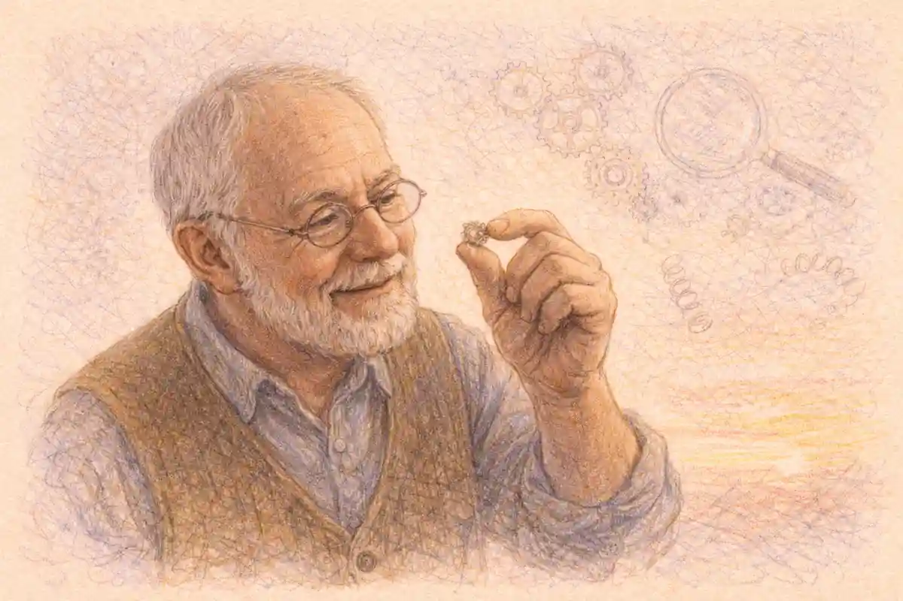

Romeo and Juliet reaches most English readers for the first time inside a specification. Before the play is a tragedy it is a line on a board's set-text list, a question number on a May morning, a row in a mark scheme and a grade on an August certificate, and the encounter is engineered at every stage by institutions that never meet the student: a department in Whitehall that names the categories, a regulator that fixes the assessment objectives, four exam boards that translate those objectives into papers, and an examining workforce that prices every answer against level descriptors. The GCSE is not a frame placed around an unchanged play. It is a reading machine, built to produce one defensible kind of reading at national scale, and the Romeo and Juliet that emerges from English classrooms is the play that machine can process.

The machine's scale deserves stating before its parts. In summer 2024, examiners and awarding bodies certified 615,220 GCSE English literature results across the United Kingdom, and the Department for Education's own account of the system observes that those taking a GCSE in English literature form the majority of Key Stage 4 pupils. Every one of those candidates studied a Shakespeare play, because the subject content for the qualification requires at least one. Among the plays the four English boards offer, one is chosen by an overwhelming majority of schools and a second, the play examined here, holds the largest minority of classrooms in the system. Romeo and Juliet at GCSE is therefore not one option among many in any lived sense. It is, after Macbeth, the single most consequential reading of Shakespeare in English education, repeated annually in tens of thousands of classrooms, rehearsed in mock examinations from Year 10 onward, and cashed out in a timed handwritten essay written from memory.

## The Verdict: A Real Discipline at a Real Price

The argument of this article can be stated in one sentence and then defended for the length of it. The GCSE frame is a genuine analytical discipline with a priced distortion: it teaches extract-anchored argument at a scale no other literary institution in England attempts, and it charges the whole play for the lesson, so that the taught Romeo and Juliet contracts toward its examinable scenes while the certificate continues to claim the whole text. Both halves of that verdict matter, and each is provable from the system's own documents rather than from the polemics that surround it. The discipline is visible in the assessment objectives, in the mark schemes that refuse credit to answers which never leave the printed extract, and in examiner reports that record, year after year, sixteen-year-olds constructing real arguments about the human condition from a text written four centuries before their birth. The price is visible in the same archive: in the concentration of teaching on a repertoire of set-piece scenes, in the quotation banks and context paragraphs manufactured by a revision industry, in the petitions that carried the closed book to Parliament, and in the fury of May 2024, when a board chose an extract outside the rehearsed repertoire and the system's dependence on preparation over reading stood exposed in a single morning.

Three design decisions do most of the work, and the article returns to each in turn. The first is compulsion without a title: the state requires a Shakespeare play and declines to name which one, delegating the choice to boards and then to schools, so the play's presence in the classroom is guaranteed while its identity is left to a market in which familiarity, resources and precedent compound. The second is the closed book: since the reformed qualification was first examined in 2017, no candidate has taken a copy of the play into the examination room, and every quotation deployed in an answer has been carried there in memory. The third is the extract hinge: every board's Shakespeare task is built around a printed passage, tethered in different ways to the whole play, so that the system's core skill is neither knowledge nor appreciation but a specific movement, from thirty given lines outward to a three-thousand-line argument and back again. A student who can perform that movement fluently is, by the system's lights, a reader. A student whose knowledge of the play is wide but who cannot anchor it to the given lines is, by the same lights, not yet one. The verdict that follows from the evidence is not that the machine reads badly. It is that the machine reads narrowly, knows that it reads narrowly, prices the narrowness into its mark schemes, and leaves the widening to teachers whose incentives all point the other way.

One boundary before the machinery. The GCSE label travels beyond England, into Wales and Northern Ireland under their own regulatory arrangements, and the Welsh board's English-medium qualification is one of the four examined here. The system dissected in this article is England's: the National Curriculum categories, Ofqual's assessment objectives, and the four boards, AQA, Pearson Edexcel, OCR and Eduqas, whose specifications English schools choose among. Scotland, whose national qualifications prescribe no Shakespeare at all, belongs to a neighbouring argument about the play's standing as a school text and appears here only at the border, where the contrast sharpens what England has built.

## Compulsion Without a Title: The Statutory Frame

England compels Shakespeare and refuses to choose a play. The National Curriculum's Key Stage 4 programme of study for English requires maintained schools to teach a wide range of high quality, challenging, classic literature with a renewed focus on whole texts, and the subject content settled for the reformed GCSE in December 2013 fixes the categories from which boards must build their lists: at least one play by Shakespeare, at least one nineteenth-century novel, a selection of poetry since 1789 including representative Romantic poetry, and fiction or drama from the British Isles from 1914 onwards. The Department for Education has repeated the shape of the settlement in answer to Parliament: the programmes of study set out categories rather than reading lists, boards set out choices within the categories, and schools decide. Shakespeare is the only author the framework names. No play is named anywhere in it.

The consequences of that single act of delegation run through everything that follows. Because the state guarantees a market without designating its contents, the Shakespeare list of each board becomes a competitive instrument, and the plays that dominate it dominate for institutional reasons before literary ones: a play already taught in most schools attracts the fullest apparatus of textbooks, revision guides, training courses and examiner familiarity, which lowers the risk of teaching it, which keeps it taught. The framework also leaves a structural loophole that the boards patrol uneasily. Academies, which educate the majority of secondary pupils, are not bound by the National Curriculum as maintained schools are, though they must teach a broad and balanced curriculum and in practice enter their pupils for the same GCSEs, whose subject content imposes the Shakespeare category regardless of school type. The compulsion therefore operates twice removed: not through the curriculum document most schools are formally free of, but through the examination specification none of them can avoid. A school may teach what it likes for two years, provided that in May of the second year its pupils can write about a Shakespeare play they have studied, from memory, against the clock.

The examination itself is a creature of a specific reform moment, and its genealogy explains its severities. The GCSE was first examined in 1988, replacing the divided O level and CSE system with a single qualification, and for most of its first quarter-century the literature grade rested partly on coursework, later tightened into controlled assessment, in which pupils wrote about texts with the texts open and time to draft. The reformed qualification designed under the Coalition government abolished that world at a stroke. Ofqual's published decisions of November 2013 settled the template: the reformed GCSE in English literature would not be tiered, would be assessed by written examinations alone, and would run to no less than three and a half hours of examination in total. First teaching began in September 2015 and the first awards, on the new nine-to-one grade scale, followed in August 2017. House of Commons Library briefings on the petitions that later besieged the qualification record where the argument concentrated from the start: on the removal of coursework and on the closed book that replaced it. Every other feature of the modern GCSE Romeo and Juliet, the extract hinge, the memorised quotation, the context paragraph, is a downstream consequence of those two decisions, taken together: assessment by terminal examination is what makes memory load-bearing, and memory is what the rest of the system is organised to service.

An older ghost haunts the settlement and is worth naming, because teachers who remember it read the reformed GCSE against it. Until 2008, the national tests at the end of Key Stage 3 included a dedicated Shakespeare paper, in which fourteen-year-olds answered on set scenes from a prescribed play studied during the year. That paper normalised a particular relationship between the state and the plays: Shakespeare as the one author whose presence in the classroom the government would underwrite with its own examination. The tests were abolished amid the marking failures of 2008, and the underwriting moved to the GCSE alone. The reformed qualification inherited the assumption whole. What changed after 2015 was not whether the state would examine Shakespeare but how much of the play it would demand, and the answer, whole texts read in full and examined without the book, was the most demanding settlement the system had ever imposed on sixteen-year-olds.

## Four Boards, One Play: Where Romeo and Juliet Sits on Each List

Four boards compete for England's English literature entries, and all four offer Romeo and Juliet. The similarity ends there. Each board has made a different wager about how a play should be examined, and a school choosing a board is choosing, whether it knows it or not, a theory of what reading the play is for.

AQA, whose archive speaks most fully in this article because its reports are the most completely published, sets the play in Paper 1, "Shakespeare and the 19th-century novel": one hour and forty-five minutes, sixty-four marks, of which the Shakespeare question carries thirty marks plus four for spelling, punctuation and grammar, and the nineteenth-century novel carries thirty. The candidate faces six plays, Macbeth, Romeo and Juliet, The Tempest, The Merchant of Venice, Much Ado About Nothing and Julius Caesar, and answers one question on the play studied, in a form examined closely below. Pearson Edexcel's Component 1, "Shakespeare and Post-1914 Literature", runs the same length for eighty marks and half the qualification, and splits its Shakespeare task into two bound parts, an extract analysis and a whole-play essay, across a list of the same six plays with Twelfth Night standing where AQA keeps Julius Caesar. OCR takes the boldest structural line: its second component, "Exploring poetry and Shakespeare", offers only four plays, Romeo and Juliet, The Merchant of Venice, Macbeth and Much Ado About Nothing, and gives the candidate a choice of question form, an extract-based task or a discursive essay, each worth forty marks inside a two-hour paper. Eduqas, the English and Northern Irish arm of the WJEC, pairs the play with its poetry anthology in Component 1, two hours, and divides its forty Shakespeare marks unevenly, fifteen for an extract question and twenty-five for an essay, across a list that admits Othello and Twelfth Night alongside the common four. The play is the constant. The examination of it is four different instruments.

Those instruments are gathered in the InsightCrunch GCSE guide, which records, board by board, where the play sits, what the candidate is asked to do with it, and what each design rewards. The guide is the article's working map: every later section, on objectives, on the extract, on the quotation economy, reads a row of it in depth.

| Board | Where the play sits | The Shakespeare task | Marks and weight | What the design rewards |
| --- | --- | --- | --- | --- |
| The statutory frame (DfE and Ofqual) | Categories fixed in the 2013 subject content; no play named | At least one Shakespeare play, studied whole, examined by terminal written examination only | Assessment objectives fixed across all boards: AO1 40 per cent, AO2 40 per cent, AO3 15 per cent, AO4 5 per cent | A guaranteed Shakespeare market in which boards and schools, not the state, choose the play |
| AQA (8702) | Paper 1, Shakespeare and the 19th-century novel, 1 hour 45 minutes, 64 marks | One fused question: a printed extract, then "starting with this extract" into the whole play | 30 marks plus 4 AO4 marks, inside a paper worth 40 per cent of the GCSE | The single movement from given lines to whole-text argument, performed under one rubric |
| Pearson Edexcel (1ET0) | Component 1, Shakespeare and Post-1914 Literature, 1 hour 45 minutes, 80 marks | Two bound parts: (a) close analysis of an extract, AO2 only; (b) an essay on the play beyond the extract, AO1 and AO3 | 20 marks plus 20 marks, inside a component worth 50 per cent of the GCSE | A firewall between language analysis and contextualised argument, each priced separately |
| OCR (J352) | Component 2, Exploring poetry and Shakespeare, 2 hours, 80 marks | A choice: one extract-based question or one discursive essay question, from a list of only four plays | 40 marks, inside a component worth 50 per cent of the GCSE | Candidate choice of instrument, with examiner caps that punish any answer confined to one moment |
| Eduqas | Component 1, Shakespeare and Poetry, 2 hours | Two questions: an extract question on how figures speak and behave, then a discursive essay on the whole play | 15 marks plus 25 marks (5 of the essay marks for AO4), inside a component worth 40 per cent of the GCSE | Audience response in the small task, thematic command in the large one, accuracy priced inside the essay |

Read down the final column and the system's wager becomes plain. No board rewards coverage. Every design pays for movement: from extract to whole, from language to meaning, from one moment to several, from the given to the remembered. The play a candidate needs is therefore not the play as a sequence of scenes but the play as a network of portable moments, each connected to themes, each stocked with short quotations, each reachable within minutes under pressure. That is a real literary competence, and experienced readers of the play possess a version of it. It is also a drastic reduction of the text, and the reduction is not an accident of implementation. It is specified, in mark schemes, caps and level descriptors, by the boards themselves.

## What the Boards Say They Want

Every specification opens with an account of its own intentions, and the intentions deserve to be read against the outcomes with the same suspicion a candidate is taught to bring to a soliloquy. Pearson Edexcel's specification states the aim in the system's standard dialect: the qualification equips students to "read and analyse a wide range of classic literature with fluency and depth". OCR markets its structure as balanced and accessible, two papers of equal weight and mirrored form easing the candidate's cognitive burden, with diversity named as a principle of its text selection. AQA's published materials emphasise questions designed to be accessible and enabling across the ability range, a phrase its June 2024 report applies to that year's paper with satisfaction. The shared vocabulary, fluency, depth, access, breadth, is the vocabulary of literary education at its most generous, and none of it is insincere. The specifications were written by people who love the subject, and the examiner reports quoted throughout this article, with their alert, unpatronising attention to what sixteen-year-olds actually wrote, show the same culture at work inside the machine.

The gap is not between intention and sincerity but between intention and instrument, and it can be located precisely. Fluency and depth are what the boards want; the extract hinge, the closed book and the fifty-minute sprint are what they built; and the built thing selects, from among the possible meanings of fluency, the one it can measure, speed of argued retrieval. Breadth is what the lists proclaim, six plays deep at two boards; the market then delivers a duopoly, because breadth of offer is not breadth of uptake and no instrument in the system rewards a school for choosing widely. Access is the most interesting case, because the boards pursue it through the extract itself, the printed passage that guarantees every candidate some purchase on the question regardless of the teaching behind them, and the pursuit is honourable; but the same device, repeated across two years of preparation, teaches departments to pre-digest the play into passages of exactly that kind. The stated intentions are the right ones. They are also, in the strictest sense, unexamined: no part of the qualification assesses whether a candidate read widely, read for pleasure, or read the play as a play, and a system gets the behaviour its instruments price, whatever its prefaces say. The teachers' documented experience, the repertoire, the quotation bank, the context token, is not a betrayal of the specifications' aims by the profession. It is the aims, filtered through the instruments, arriving in the classroom in the only form the instruments can transmit.

## The Assessment Objectives: The System's Declared Theory of Reading

Every mark awarded on every Shakespeare answer in England is awarded against four assessment objectives, fixed by the regulator and shared by all boards. AO1, worth forty per cent of the qualification, asks candidates to read, understand and respond to texts, maintaining a critical style, developing an informed personal response and supporting interpretations with textual references including quotations. AO2, also forty per cent, asks for analysis of the language, form and structure a writer uses to create meanings and effects, with relevant subject terminology. AO3, fifteen per cent, asks for understanding of the relationships between texts and the contexts in which they were written. AO4, five per cent, prices the candidate's own writing: a range of vocabulary and sentence structures, with accurate spelling and punctuation. The proportions are the system's declared theory of reading, published in advance and identical from Truro to Newcastle. Reading a play, as the English state defines the act for certification, is two-fifths response, two-fifths analysis, a seventh context, and a twentieth correctness of expression.

The theory deserves respect before it deserves criticism, because its centre of gravity is well placed. Eighty per cent of the qualification rides on the pair of activities that constitute literary reading proper: forming an interpretation and interrogating the language that sustains it. Context, the objective most easily faked by rehearsal, is held to fifteen per cent, enough to matter and too little to carry an answer. The boards then differentiate themselves by how they distribute the objectives across tasks, and the distributions are where the theories diverge. Edexcel builds the most literal architecture: its part (a) assesses AO2 alone, twenty marks of pure language analysis confined to the extract, while its part (b) assesses AO1 with a five-mark strand of AO3, deliberately walling technique off from context so that each can be priced without contamination. AQA fuses what Edexcel splits: a single thirty-mark question assessed against AO1, AO2 and AO3 together, with the four AO4 marks bolted on in the Shakespeare section alone, so the candidate performs the objectives as one integrated act, as a reader in a library would, and the examiner disentangles them afterwards through the level descriptors. Eduqas weights by task size, fifteen marks of AO1 and AO2 for the extract, twenty-five for the essay with AO4 embedded in it. OCR distributes the objectives across its two components and lets the question form decide the emphasis. One theory, four temperaments: the analyst's, the integrator's, the accountant's, the liberal's.

### Why does context carry only fifteen per cent of the marks?

Context carries fifteen per cent because the regulator prices it as a lens rather than a subject: enough weight to reward reading the play against its moment, too little to let memorised background substitute for reading. The mark schemes pay only where such a point changes the interpretation of a line, a scene or a choice the playwright made.

The fifteen per cent nonetheless generates an economy out of all proportion to its size, and the reason is that context is the most teachable, most portable and most rehearseable strand in the system. An interpretation must be grown; a language analysis must be practised; a context point can be issued. The standard issue is a short liturgy of facts about the world that produced the play: an ordered, patriarchal society in which fathers disposed of daughters in marriage; a city culture of honour and feud; a theatre working in daylight before a mixed crowd; a providential frame in which the stars could be held to govern lives. Each fact is defensible. Each also reduces, at classroom strength, to a paragraph that can be attached to almost any answer, and examiners have learned to read the attachments at a discount. Edexcel's indicative content for its summer 2025 Romeo and Juliet question, on the presentation of Mercutio, shows the machine from inside: the context bullets offered to markers are generic to the point of interchangeability, Italy associated with violence and death, family honour breeding revenge, an Elizabethan audience believing God would avenge a murdered relative. The bullets are not wrong. They are simply what fifteen per cent buys when it must be marked at speed across hundreds of thousands of scripts: context flattened into tokens, credited when tethered to the text and ignored when floating free. The boards know the discount exists. The discount is the price of examining context at all inside a timed paper, and the fifteen per cent weighting is best read as the system's own admission of it.

## Inside the Closed Book: The Extract as the System's Signature

The closed book is the reformed GCSE's defining condition, and the extract is its defining device. No board permits a copy of the play in the room. What the candidate receives instead is a passage, printed on the paper, chosen by the board, and the whole assessment turns on the relationship the candidate can construct between those given lines and the unprinted remainder of the play held in memory. The extract is at once a gift and a test: it guarantees that every candidate, however uneven the teaching behind them, has some of the play's language in front of them in the room, and it measures what they can reach from it. Everything distinctive about the GCSE reading of Romeo and Juliet, its strengths and its pathologies alike, grows from this arrangement.

### Why is the GCSE Shakespeare examination closed-book?

The examination is closed-book because the reformers of 2013 made terminal written examination the qualification's sole instrument and judged that a literature grade should certify a text known rather than a text consulted. Ofqual's decisions removed coursework and open texts together: understanding carried in the head is what a GCSE in literature exists to attest.

AQA's version of the device is the most influential and the most imitated in classrooms. The candidate is given an extract and a single command in two movements: "Starting with this extract, explore how far Shakespeare presents..." a character, a relationship, a theme, writing first about the extract and then about the play as a whole. The form has been stable across the qualification's life, and its instances for this play map the system's sense of the examinable with unusual clarity. In June 2018 the extract came from Act 3 Scene 5, the morning after the wedding night, with Juliet caught between the lark and the nightingale and her parents' arrangement with Paris closing over her. In June 2023 the question asked how far Shakespeare presents Juliet's feelings towards Romeo, opening from a set speech. In June 2024 the extract came from Act 2 Scene 5, Juliet alone on stage awaiting the Nurse, opening "The clock struck nine when I did send the Nurse" (2.5.1), and the question asked candidates to explore how Shakespeare presents the difficulties faced by Juliet, in that speech and across the whole play. In June 2025 the board returned to Act 3 Scene 5, to Capulet's rage at his daughter's refusal, "Is there no pity sitting in the clouds, / That sees into the bottom of my grief?" (3.5), and asked about relationships between parents and children. Four series, one grammar: a woman or girl at a pressure point, a speech or confrontation dense with feeling, and a theme, difficulty, love, parenthood, that radiates outward through the whole design of the play.

Edexcel's two-part structure makes the same journey with the stages priced separately, and its discipline is the strictest of the four about the boundary. Part (a) instructs the candidate to work on the extract alone, approximately thirty lines, and the guidance is blunt: no credit for points drawn from outside the extract, and no context at all, since AO3 is not assessed there. The candidate who cannot resist displaying whole-play knowledge in part (a) is taxed twenty marks of purity for the display. Part (b) then reverses the rule and assesses the play beyond the extract. OCR offers the system's only genuine choice of instrument: for each play the candidate selects either an extract-based question, which prints a passage and requires the answer to range from it across the play, or a discursive question, which sets a proposition or a relationship and requires exploration of at least two moments. OCR's specimen paper for the play shows the pair side by side: an extract-based question on Mercutio's attitude towards Tybalt, anchored in Act 3 Scene 1, and a discursive question on how and why Juliet's relationship with the Nurse changes. Eduqas's small extract question is the most distinctive of the four in voice: "Look at how Romeo and Benvolio speak and behave here. How do you think an audience might respond to this part of the play?" ran the June 2022 paper, fifteen marks, before the essay that year set the play's conflicts at twenty-five. Where AQA asks what Shakespeare presents and Edexcel asks what the language does, Eduqas asks what an audience feels, the one board whose small task is keyed to reception rather than analysis. The examinable play is thus not one play but four, cut to four patterns from the same cloth.

The examiners' caps reveal how seriously the boards take the outward movement, and they supply the cleanest documentary evidence for this article's verdict. OCR's mark scheme for June 2025 instructs its examiners in terms that admit no softening: on an extract-based question, a candidate whose answer has not moved beyond the extract cannot be awarded a mark above Level 3, and one who refers only briefly to the wider text is capped at Level 4; on a discursive question the same caps apply to the candidate who rests on a single moment or touches a second only briefly. The annotations examiners must enter say it in shorthand: "has not referred to wider text". AQA's six-level mark scheme encodes the same demand from the top down, reserving its highest level for responses it calls critical, exploratory and conceptualised, qualities that cannot be displayed within thirty lines. The system, in other words, has priced the contraction it fears. It knows that the extract can become a cage, and it has built the cage door into the mark scheme and charged candidates for failing to walk through it. What the mark schemes cannot price is the contraction that happens earlier, in the two years of teaching that decide which moments of the play a candidate holds in memory at all.

## The Memorised Quotation: The Closed Book on Trial

No feature of the reformed qualification has been litigated in public like the demand it places on memory. The case against the closed book was made early, made often and made, unusually for an education dispute, by the examined themselves. Two parliamentary petitions frame the record. The first, which gathered well over one hundred thousand signatures and was debated by MPs in 2017, charged that the closed-book examination "requires students to learn and memorise quotes for this exam" and protested that examinations "shouldn't be a test on the student's memory, but how we interpret texts". A second petition asked in its title for the thing itself to be reversed: "Change the GCSE English Literature exam from closed book to open book". The House of Commons Library briefings prepared for those debates preserve both the grievance and the official answer, and the answer has never varied. The Department for Education replied that exam boards "do not allow access to copies of whole texts in exams, but provide relevant extracts as exam materials", that "pupils should be able to understand and analyse the texts, not memorise them", and that "pupils are not required to memorise texts and will not be awarded good marks simply by memorising and writing out sections of the poems or texts they have studied". Ofqual's chief regulator had set out the same position in March 2015, in a blog whose title is the regulator's whole defence in six words: learning and understanding, not memory.

### Why did Parliament debate the closed-book literature examination?

Parliament debated the closed book because the examined organised against it: petitions attacking the memory demand of the reformed literature GCSE gathered signatures on the scale that triggers a Commons debate, and one asked outright for the examination to be changed from closed book to open book.

The official defence is coherent, and at the level of the mark scheme it is true. Nothing in any board's level descriptors pays for quotation as such; quotations earn their keep as evidence inside an argument, and a memorised paragraph earns nothing at all. The grievance survives the defence, though, because it is aimed at a different level of the system. A candidate may not need to memorise the play, but a candidate who has memorised apt lines from across the play possesses an instrument the unmemorised candidate lacks: the ability to leave the extract. In a closed room, memory is not the subject of the test but it is the medium of it, and the petitions' authors, who sat the papers, understood the distinction from the inside. The access argument sharpened the same point from another direction. In June 2015 the teacher Mary Meredith wrote to the Secretary of State, in a letter reported by Tes, charging that the new examinations showed what she called breathtaking ignorance of dyslexia, since conditions that impair verbal memory would leave pupils unable to demonstrate knowledge, skill and understanding that the format had made dependent on recall. The regulator's answer, that access arrangements such as extra time level the field, addresses the clock rather than the memory load, and the exchange remains the cleanest statement of the closed book's unresolved equity problem: the qualification certifies understanding through a medium that is itself unevenly distributed.

Between the petitions and the department stands the classroom, and the classroom's most quoted verdict on the panic came from inside the profession's own training establishment. Barbara Bleiman, co-director of the English and Media Centre, addressed the rote-learning fears directly in March 2015, before first teaching had begun, and refused them: wholesale memorisation, she argued, was neither required nor desirable for the new examinations, the media presentation of the issue was crude, and teachers had more serious things to worry about in the reforms and the accountability measures that travelled with them. The refusal matters because it came from a critic of the reform settlement rather than from its authors. Bleiman's position, examined with the other witnesses below, separates the two questions the petitions fused: whether the closed book demands rote learning, to which her answer is no, and whether the reformed system narrows the teaching of the play, to which the profession's answer, hers included, has been a documented and continuing yes.

## The Contracted Play: What Teaching Keeps

### What happens to an answer that never leaves the extracted lines?

An answer that never leaves the extract is stopped by the mark scheme itself. OCR's instructions to its examiners cap a response at Level 3 on the extract-based question, with only a brief reference to the wider text raising the ceiling to Level 4, and AQA's six levels reserve their summit for work the scheme calls critical, exploratory and conceptualised.

The caps are the boards policing the examination room. The contraction that matters happens in the classroom, two years earlier, where time is short, the accountability stakes are a school's published results, and the rational response to an extract-hinged examination is to teach the play as a portfolio of probable extracts. Experienced departments know the repertoire the boards favour, because the boards' habits are public and the sample and past papers accumulate: the orchard scene and its sonnet, the balcony exchanges, the Queen Mab speech, the fight and the curse of Act 3 Scene 1, the lark and the nightingale, Capulet's rage, the potion soliloquy, the tomb. Around those scenes a dense support economy has formed, of annotated editions, quotation banks sorted by theme, context cards, model paragraphs and video walkthroughs, an industry examined in its own right in [the study-guide industry's distortions of the play](/2030/04/19/study-guide-industry-distortions/). None of it is dishonest. All of it is a rational adaptation to the instrument. And its aggregate effect is that the play most pupils carry into the hall is a highlights text of perhaps a dozen scenes, learned thoroughly, surrounded by a penumbra of plot knowledge that thins rapidly away from the set pieces. The Chorus opens the play by compressing it into a sonnet and promising "the two hours' traffic of our stage"; the GCSE compresses it differently, into the scenes most likely to be printed, and the compression is performed not by a prologue but by a market.

The system's dependence on that repertoire was exposed in a single morning in May 2024, and the episode deserves its place as the contraction's documentary proof. AQA's Paper 1 that year set its Romeo and Juliet extract from Act 2 Scene 5, Juliet's impatient soliloquy as she waits for the Nurse, "Love's heralds should be thoughts, / Which ten times faster glide than the sun's beams" (2.5). The question, on the difficulties faced by Juliet, was unexceptionable. The reaction, reported by Tes within days, was a wave of teacher complaint, formal complaints to the board among them, on a single ground: parity. The Macbeth extract that year came from Act 1 Scene 7, a scene one head of English described as "commonly explored in depth in GCSE scenes", stocked with what another teacher called key quotations for which all students would hold prepared analysis. The Romeo and Juliet extract, by contrast, was called obscure, a passage students had to read several times to find anything to comment on, one of "very little significance" in the judgement of a post that circulated widely among teachers. Set aside the merits, on which reasonable examiners differ, and attend to what the complaints concede. A profession confident that its pupils had read the whole play would meet an unfamiliar extract with interest. A profession organised around the repertoire met it as a breach of contract: the board had examined outside the agreed canon of scenes, and the agreed canon existed because the board's own past papers had built it. The extract lottery is the closed book's honest risk, and June 2024 showed who had been quietly insuring against it, and at what premium in narrowed teaching.

The contraction has a calendar as well as a repertoire. Because the qualification is wholly terminal, its rehearsals colonise the two years that precede it, and school-published curriculum documents show the pattern plainly. Newstead Wood School's published English curriculum, to take one documented instance among thousands, sets its Year 10 summer examinations on Romeo and Juliet and the modern text, then runs a mock examination in the autumn of Year 11 and two further rounds of mocks in the spring, so that by the May of the real paper a pupil has performed the extract movement under examination conditions at least four times, on this play, before the performance that counts. Multiply that calendar across the system and the GCSE Romeo and Juliet is best understood as the most rehearsed reading in English education: no other play, and few other books of any kind, are read by so many people so explicitly in order to be written about, at a known date, in a known form, for a known tariff. Rehearsal is not the enemy of understanding; actors rehearse. But rehearsal optimises for the performance it anticipates, and the performance anticipated here is fifty minutes of handwriting. The play that survives four rounds of mocks is the play that fits the form, and the form's exclusions, rehearsed as faithfully as its demands, become the pupil's settled sense of what in the text is real.

The contraction has a linguistic signature as well, visible in the shape of the answers the system trains. The fused AQA question, with its two imperatives, write about the extract and write about the whole, begets a standard choreography of paragraphs that move point, quotation, analysis, context, link, rehearsed until the movement is reflex. Examiner reports reward the choreography when it is alive and note, in the guarded prose of their trade, the difference between responses that construct an argument and responses that execute a routine. The June 2024 report on Paper 1 recorded students showing "an increasingly confident understanding of how to construct a response", a sentence that can be read as praise or as diagnosis depending on the weight given to construct. The June 2025 report, examining the parents-and-children question on the Act 3 Scene 5 extract, found students empathising with Juliet and with her father's treatment of her, some extending the sympathy to Capulet himself within the confines of his society, and drawing independent conclusions about Romeo's search for a paternal figure in the Friar. Reports of this quality are the strongest internal evidence that the discipline is real: inside the choreography, genuine reading keeps happening, at scale, in handwriting, against the clock. The verdict of this article holds both documents at once. The reports prove the machine can teach reading. The complaints of May 2024 prove what the machine teaches when it is left to its own incentives. Both are the system working as designed.

## The Challenger's Crown: Macbeth First, the Lovers Second

The play's position in the system is second, and the fact is documented with a consistency rare in education statistics. AQA's report on the June 2018 examination states it plainly: "The most popular Shakespeare text by far was Macbeth followed by Romeo and Juliet." The board's results insight report for June 2019 repeats the order, Macbeth first, Romeo and Juliet second, Much Ado About Nothing third. The June 2025 report repeats it again, in the same unadorned terms: "As in previous series, Macbeth is overwhelmingly the most popular Shakespeare text, with Romeo and Juliet in second place." The board's figures for June 2024 put Macbeth's share of its candidature at seventy-six per cent, the number this series' survey of the play's school standing has already graded and recorded. Romeo and Juliet is thus the leading challenger in a settled duopoly: the tragedy of young love is the most-taught alternative to the tragedy of ambition, and the two plays between them absorb the great majority of England's GCSE Shakespeare teaching, an arrangement whose origins and economics belong to [the question of why this play became the standard school text](/2030/01/18/why-it-is-the-standard-school-text/).

The reasons for the order are institutional before they are literary, and the documentary record lets them be separated. Length is the crudest and the most decisive. Romeo and Juliet runs to roughly three thousand lines, about half as long again as Macbeth, the shortest of the tragedies, and a department planning two years around four set texts feels that difference in every timetable. Macbeth also offers a single dominant consciousness to track, where the earlier play splits its attention between two households, two lovers and a friar, and its plot turns on a missed delivery that some pupils read as contrivance. Against those costs the challenger holds assets no other play on the lists can match. Its protagonists are the age of the candidates' elder siblings and sometimes of the candidates themselves, which no other set tragedy offers; its story is known before it is read, which lowers the threshold of the first term; its language contains the most quoted love poetry in English, which gives quotation banks something to bank; and it is widely met earlier in the school career, in Year 9 classrooms where it serves as an introduction to Shakespeare in performance, so that a GCSE choice of the play builds on a foundation already laid. The parallel across the Atlantic, where the same play holds the ninth grade, is traced in [the play's career in United States high schools](/2030/03/15/romeo-and-juliet-us-high-schools/): two systems, sharing little else, have independently settled on the young lovers as the first full Shakespeare their pupils meet, and in both the settlement owes as much to machinery, editions, precedent and teacher formation, as to the play.

What the duopoly means for the reading of the play is the point on which this section insists. A text holding the largest minority of a nation's Shakespeare classrooms, against a rival whose dominance the boards themselves describe as overwhelming, develops a shadow identity as the alternative: chosen by departments that want the love story, or that judge their cohort better served by it, or that taught Macbeth to the previous year group and rotate. None of those motives is a reading. Yet they decide, before a line is taught, the conditions under which the play will be read, the resources bought for it, the extracts rehearsed and the comparisons that will structure its teaching, since a department's Romeo and Juliet is perpetually defined against the Macbeth it is not. The GCSE does not merely examine the play. Through the list, the market and the duopoly, it positions the play, and the position, second and beloved, forms part of the play as every English pupil meets it.

## The Mark Scheme as a Work of Literary Criticism

Every examination system contains a hidden work of criticism: the mark scheme, the document that states, in operational form, what a good reading is. England's four schemes for this play repay reading as criticism, because they are the only accounts of Romeo and Juliet that are enforced. A journal article persuades; a mark scheme prices. The level descriptors are its theses. AQA's six levels climb from simple statements through thoughtful, developed responses to the summit formulation, in which the candidate's work is "critical, exploratory, conceptualised", supported by judicious and precise references. The adjectives are doing philosophical work. They describe a reading that has a concept, an organising idea about the play, and explores the text in its light, and they set that reading above the merely thorough one. An answer can be accurate, wide-ranging and fluent and still be held below the top level for want of a concept. The boards have thus smuggled a recognisable critical ideal, the thesis-driven essay, into a mass examination for sixteen-year-olds, and the examiner reports show candidates reaching for it in numbers large enough to justify the smuggling.

Against the descriptors stand the indicative contents, the bullet-pointed lists of points an answer might make, and the two halves of the document pull in opposite directions. The descriptors demand exploration; the bullets inventory the expected. Edexcel's summer 2025 mark scheme for the Romeo and Juliet extract question, which asked how Shakespeare presents Mercutio, instructs markers that responses may include Mercutio as proud and honourable, Romeo's refusal to fight read against the code of honour, Italy as a byword for violence, revenge as a family duty the age half-believed God endorsed. Every bullet is reasonable; the list as a whole is a reading of the play in miniature, pre-cooked for standardisation, against which thousands of scripts will be measured by examiners instructed, in the same document, that the content is not prescriptive and that valid alternatives must be rewarded. The tension is structural and irresolvable. A mass examination needs its markers calibrated, and calibration needs an expected reading; literary reading, meanwhile, is precisely the activity whose value lies in the unexpected. The schemes manage the tension by an act of professional faith, trusting trained examiners to hold the bullets lightly. The classroom, which receives the schemes as teaching documents, holds them less lightly. Indicative content, downloaded and digested by departments and guide-writers, becomes the syllabus of the examinable play at one remove: these are the points, these the contexts, these the quotations that the system's own paperwork treats as the answer's natural furniture. The mark scheme is the most-read work of Romeo and Juliet criticism in England. It is also, by design, the most conservative, because a reading that surprises the scheme is a risk to everyone except the candidate bold enough to be right in a way the standardisation meeting can recognise in time.

## The Pipeline: The Play Before the Examination

The GCSE does not introduce the play to most of its candidates; it reintroduces it. The Key Stage 3 programme of study requires two Shakespeare plays across the years from eleven to fourteen, and Romeo and Juliet is the play English departments reach for at that stage more than any other, for the same reasons that govern its GCSE position: young protagonists, a legible plot, scenes that ignite in a classroom of thirteen-year-olds. The typical English pupil therefore meets the lovers at thirteen, often in performance-based work, on the feet, in extracts and scenes, and meets them again at fifteen or sixteen only if the department keeps the play for the GCSE rather than promoting Macbeth into the slot. This pipeline shapes the examined reading in ways the specifications never mention. The GCSE play arrives pre-read, freighted with the earlier encounter's simplifications, the love story frame, the balcony that is not in the text, the feud reduced to two families who hate each other for no reason anyone states. The misconceptions that the examination years must dismantle were installed by the system's own earlier phase, which taught the play as an invitation rather than as a problem.

The mediating object of both encounters is the school edition, and the edition is a critical intervention disguised as a convenience. The two dominant classroom series, Cambridge School Shakespeare, founded under the editorship of Rex Gibson, and Oxford School Shakespeare, present the text with facing-page glosses, paraphrase, staging photographs, activity prompts and summaries, a page architecture that decides in advance what in the play needs help and what kind of help counts. The Cambridge architecture, true to its founding editor's philosophy, treats the page as a rehearsal room, prompting performance choices at the points of difficulty; the glossing tradition treats it as a lexicon. Pupils read the play through these frames for years before the closed book removes every frame at once, which is one of the examination's quiet cruelties and part of its logic: the grade certifies the unaided reader, and the aids are scaffolding the system provides in order, finally, to kick away. What the aids leave behind, though, is their selection. The scenes the school editions photograph, summarise at length and build activities around are, overwhelmingly, the scenes the boards examine, and the alignment is not a conspiracy but a feedback loop between two industries answering the same demand. Pipeline, edition and paper together form a single curriculum that no single institution designed, and the play that emerges from it is coherent, teachable and narrower than the play in the Folger text on the library shelf.

## The Play Among Its Fellow Texts

No set text is taught in isolation, and the play's GCSE life is shaped by the company the qualification forces it to keep. A candidate's literature course carries four loads at once: the Shakespeare play, a nineteenth-century novel, a modern prose or drama text from the British Isles, and a poetry anthology of at least fifteen poems, with unseen poetry waiting in the second paper. Departments sequence those loads across two years against a fixed examination date, and the Shakespeare play, as the longest and linguistically hardest load, is usually placed early, in Year 10, where its teaching can be spread, revisited and finally rehearsed in the mock season. AQA pairs it physically with the novel in Paper 1, so that the Romeo and Juliet candidate writes the play and Brontë or Dickens inside a single sitting of one hour and forty-five minutes, an arrangement whose fatigue effects no report measures and every teacher plans around. The board's 2019 insight report placed A Christmas Carol at the head of its novel list, which means the modal English examination experience of Shakespeare's lovers is shared with Dickens's ghosts: the system's two most-taught texts are a tragedy of haste and a fable of redemption, studied in the same terms, by the same methods, for the same paper.

The company matters most through the accountability measures that convert grades into institutional survival. English literature is one of the subjects named in the English Baccalaureate, the suite of academic GCSEs by which the Department for Education publicly compares schools, and literature results feed the published measures on which departments are judged and, in hard cases, interventions turn. This is the channel through which washback acquires its force. A head of English choosing between a term spent on the play's unexaminable beauties and a term spent drilling the extract movement is not choosing between literature and philistinism; the choice is priced, in advance, by measures that will publish the outcome and attach consequences to it. The play's fellow texts discipline it from the other side as well. The poetry anthology, fifteen poems carried in the same memory as the play's quotations, competes directly for the scarcest resource in the closed-book system, which is memorised language; the modern drama text, so often a compact play of ideas, teaches pupils by contrast what a examinable theme looks like when a text was designed to carry one. Romeo and Juliet emerges from this ecology neither as literature enthroned nor as literature betrayed, but as the senior partner in a portfolio of four, managed like the others against a date, and distinguished from them only by the accident that it, alone, is guaranteed to be there.

## The Unexaminable Play

There is a way to measure the contraction precisely, and that is to list what the system cannot use. The examination needs passages that concentrate a theme, speeches that sustain thirty lines of analysis, confrontations whose terms can be named in a rubric. The play contains much else, and the else is where a full reading lives. The opening brawl's bawdy wordplay, on which the feud's idiocy is established, is unusable at length in a family-facing paper and rarely anchors an extract. The musicians' prose comedy after Juliet's supposed death, the play's strangest tonal gamble, has no thematic handle a rubric can grip. Peter's exchanges, the Apothecary's poverty-stricken consent in Mantua, "My poverty, but not my will, consents" (5.1), the long choreography of the tomb, Paris's flowers, the Watch, the Prince's closing audit and the promised golden statues: the final movement of the play, in which Shakespeare slows the catastrophe into procedure and pageant, is drastically under-represented in the extract record beside the love scenes and the rage scenes of the middle acts. The boards have examined Juliet's patience, Juliet's defiance, Juliet's difficulties and Capulet's anger; the play's ending, in which the lovers are converted into civic monuments and the feud is settled as a property transaction in gold, waits largely outside the hall.

The point is not that examiners choose badly. Within their constraints they choose well, and several of the questions on record are fine instruments. The point is what a steady diet of the choosable does to the play's identity in the culture that the GCSE supplies with its first and often its only considered reading. The examined Romeo and Juliet is a play about young feeling under adult pressure, organised around a heroine of extraordinary rhetorical resource, rich in set speeches, sparing in metaphysics. The unexamined residue, the play's obsession with time and haste, its plague and poverty, its friar's pharmacology, its civic machinery of watch and exile and proclamation, its final insistence that reconciliation is a thing men purchase, recedes into the penumbra of plot summary. A pupil can leave the system with a high grade and a coherent, evidenced, entirely partial play. That is the priced distortion stated at its most concrete: not error, but a syllabus-shaped silhouette, cast by the light of the examination room, which the culture then mistakes for the object itself.

## The Boards Compete: Lists, Loyalty and the Price of Switching

Because the state names a category and not a play, the Shakespeare list is a market, and markets in examinations behave like markets elsewhere: incumbency compounds. A department's choice of board and play is among the stickiest decisions in school life. It is embodied in cupboards of class sets, in schemes of work refined across years, in the training its teachers received as trainees, in the examiner experience on its staff, since the examining workforce is recruited from the same profession it examines, and in the branded textbooks and revision series that publishers pitch board by board and text by text. Ofqual's duty to secure comparable outcomes across boards polices the standard, so no board can win entries by being easier; competition therefore runs on service, resources, training and the perceived kindness of question styles, and on the list itself, where the safest offer is the play the most schools already teach. The duopoly of Macbeth and Romeo and Juliet is what such a market produces. Each board offers the pair in its first positions because schools demand them; schools demand them because the apparatus around them is deepest; the apparatus is deepest because the boards offer them first. No one in the loop is choosing the play on literary grounds, and everyone in the loop can defend their choice on educational ones.

The loop has a cost that falls on the other plays on the lists, and through them on the breadth of the nation's Shakespeare. The Tempest, The Merchant of Venice and Julius Caesar persist on AQA's list as honoured minorities; Othello survives at Eduqas; every board's tail is a reminder that the category the state mandated was Shakespeare, not two titles. A department that chose The Tempest for a cohort would be teaching against the grain of the entire support economy, with thinner guides, fewer exemplars and colleagues in other schools unable to share practice. Some do, and the examiner reports honour them. The structure nonetheless prices adventurous choice as a luxury, and the price is paid in the currency schools can least spare, which is risk. For Romeo and Juliet the structural position is comfortable and confining at once: too established ever to be dropped from a list, too familiar to be read innocently, the play is the system's permanent second text, its challenger crown renewed annually by default. The play's teachers know this. The play's pupils, meeting it as simply the book on the desk, do not, and part of a complete account of the GCSE reading is that the reading begins inside an economy the reader cannot see.

## Two Hours' Traffic: Time as a Reading Condition

The Chorus promises the audience two hours' traffic of the stage. The examination gives the play less. On AQA's Paper 1 the candidate disposes of one hour and forty-five minutes for two questions, and the Shakespeare half of that paper must fund, in roughly fifty minutes of handwriting, a reading of an extract, a survey of the whole play, a context strand and four marks of accurate expression. OCR's candidates are advised to spend about forty-five minutes on the Shakespeare section of a two-hour paper. Guidance for Eduqas candidates divides the Shakespeare hour into roughly twenty minutes for the extract question and forty for the essay. The timings circulated with Edexcel's materials allow fifty-five minutes for the whole of Section A. Under these conditions the essay is not a meditation but a sprint through pre-positioned material, and the skills the sprint rewards are specific: instant recognition of the extract's place in the design, a thesis that can be announced in two sentences, quotations that arrive in the order the argument needs them, a paragraph rhythm that never stalls. Fluency of retrieval, not depth of acquaintance, is the binding constraint, and everything in the teaching economy that looks like distortion, the quotation bank, the rehearsed paragraph, the context token, is a technology for relaxing that constraint.

It is worth resisting the easy contempt this invites. A timed essay is a coarse instrument, but it is not a stupid one, and the constraint it imposes resembles, more than its critics allow, the constraint of all live reading: the play in the theatre also refuses to pause, also demands that recognition keep pace with event, also punishes the spectator whose knowledge cannot be retrieved at the speed of the scene. The examination's sprint differs from the theatre's in what it retrieves. The playgoer retrieves faces, voices, the felt sequence of an evening; the candidate retrieves sentences, and sentences chosen, moreover, for their portability, short, image-laden, detachable. The result is a peculiar and genuine expertise: the strongest GCSE readers of the play know its quotable surface the way actors know a part, from inside a performance of their own devising, the performance being the essay. When examiner reports praise essays that range across the play with apt quotation, they are praising that actorly knowledge under its examination name. When teachers drill it, they are running a rehearsal. The metaphor clarifies the Gibsonian critique to come: a system that makes every pupil the actor of an essay about the play has still not let the pupil act the play, and the distance between those two performances is the distance the GCSE cannot cross.

## Three Witnesses: Knowledge, Practice and the Script

The argument about the GCSE reading of the play has been conducted for a decade among three broad positions, and the evidence assembled in this article allows a judgement among them. The witnesses are Daisy Christodoulou, the education scholar whose Seven Myths About Education of 2014 and Making Good Progress? of 2017 gave the reform era its cognitive theory; Barbara Bleiman of the English and Media Centre, speaking for the organised experience of English teachers; and Rex Gibson, the Shakespeare scholar whose Teaching Shakespeare of 1998 and whose Cambridge School Shakespeare editions shaped the classroom the reforms inherited. Each is right about the layer of the system their work touches, and the verdict follows from assigning each their layer and refusing each the others.

Christodoulou's claim is that the petitions rest on a false dichotomy. Her first book names the dichotomy's halves as myths: that facts prevent understanding, and that anything not known can simply be looked up. Against them she sets the cognitive architecture the reformers cited, in which skilled performance in any domain runs on rich structures of knowledge held in long-term memory, and working memory, the site of analysis, is narrow and easily overloaded. Analysis of an unseen extract is not, on this account, a transferable skill that floats free of the text analysed; it is what securely known material looks like in action. A closed book is therefore not a memory test bolted onto a literature examination. It is the only honest way to examine the knowledge that makes literary analysis possible at speed. The evidence of the papers supports her at the cognitive layer. The extract hinge works as a test precisely because the candidates who flourish are those whose knowledge of the whole play is organised and retrievable, and the examiner caps that punish extract-bound answers are, in her terms, a refusal to credit working memory unassisted by a stocked long-term store. Where her framework runs out is at the institutional layer. A theory of knowledge does not distinguish between knowledge of the play and knowledge of the examinable play, and the contraction documented in this article is exactly the growth of the second at the expense of the first, driven not by cognitive necessity but by accountability and time. Christodoulou wins the argument about memory. The argument about repertoire she does not enter, and it is the argument that decides what gets taught.

Bleiman enters it, and her evidence is the profession's. Her March 2015 intervention refused the rote-learning panic on the facts: the new examinations printed their extracts, rewarded interpretation and neither required nor desired wholesale memorisation, and the real concerns of the reforms lay elsewhere, in the accountability measures and the shape of the assessment load. The subsequent decade has borne out the location of her concerns with uncomfortable fidelity. The distortion this article documents is not rote learning; no examiner report complains of answers that are mere recitation, and the level descriptors are built to refuse them credit. The distortion is washback, the slow reorganisation of two years of teaching around the predictable features of one morning's paper, and washback is an accountability phenomenon before it is a pedagogical one. Where Bleiman's position needs correction is in its composure about scale. A defence written before first teaching, when the examinations were still specimens, could not price how completely a coursework-free, wholly terminal system would transfer the paper's priorities into the classroom's calendar, down to the mock examinations of Year 10 and the repertoire drilling of the final term. She wins on the diagnosis of the public argument, and her side of the profession wins the factual dispute with the petitioners. The system she defended against caricature nonetheless produced, by incentives she identified and then set aside, the narrowed taught play.

Gibson's witness is of a different kind, because his claim is ontological. A play, he argued across his work, is a script for performance, and it is understood in the body, in voice, ensemble and movement, or it is understood partially; the classroom that treats the text as a prose document to be mined for quotations has mistaken the kind of thing it holds. The GCSE is the institutional perfection of the mistake he named. It examines the script as literature, in silence, in handwriting, alone, and it can price nothing that makes the play a play: timing, gesture, the laugh in the wrong place, the held breath of a house. The pipeline section of this article showed his own editions mediating the school play, built to pull pupils onto their feet; the examination then assesses those same pupils seated, and the active understanding his methods build is cashed out only insofar as it survives translation into essay prose. He wins the ontology outright. He loses on feasibility, and the loss must be recorded honestly: no one has shown how performance understanding could be assessed comparably across six hundred thousand candidates, and the system he criticised can point to its examiner reports, to genuine argumentative reading at a scale his preferred methods never reached, as its justification. The adjudication, then: Christodoulou is right that the closed book tests knowledge rather than memory in the petitioners' crude sense; Bleiman is right that the harm is washback rather than rote; Gibson is right that the examined object is not the play in its own kind. All three verdicts converge on the sentence this article began with. The discipline is real, and so is the price, and the price is charged at the exact points the witnesses mark: in the repertoire, in the calendar, and in the silence where the performance should be.

## What a Question Does: The Rubrics Read Closely

A board's question is the smallest complete statement of its theory, and the questions set on this play across recent series repay the close reading the boards demand of candidates. AQA's rubric has settled into a formula of real elegance: "Starting with this speech, explore how Shakespeare presents the difficulties faced by Juliet in Romeo and Juliet", June 2024; "Starting with this moment in the play, explore how Shakespeare presents relationships between parents and children in Romeo and Juliet", June 2025. Every term works. "Starting with" fixes the extract as origin without making it a boundary. "Explore" licenses tentativeness inside a genre that schoolrooms usually force into assertion. "Presents" keeps the playwright, not the character, as the agent under discussion, so that Juliet is a construction to be analysed rather than a person to be pitied, and the theme noun that follows, difficulties, relationships, is pitched at the level of generality that lets a strong candidate build a concept and a weaker one build a survey. The formula's consistency across years is itself a policy: departments can teach to the grammar of the question while its content rotates, which is the board's answer to the repertoire problem, stability of form as a defence against predictability of content. Whether the defence succeeds is the question June 2024 posed, when the form held and the passage, an unrehearsed soliloquy, broke the profession's preparation anyway.

Eduqas's extract rubric makes a different and in some ways braver demand: "Look at how Romeo and Benvolio speak and behave here. How do you think an audience might respond to this part of the play? Refer closely to details from the extract to support your answer." The verbs are observational before they are analytical, speak and behave, and the destination is not the playwright's presentation but the audience's response, a category AQA's rubric never names. For fifteen marks the candidate is asked to do something closer to theatre reviewing than to essay writing, to reconstruct a reception. The essay that follows it restores the conventional balance at twenty-five marks, "Romeo and Juliet is a play about conflict. Write about some of the conflicts in the play and how Shakespeare presents them", a proposition-and-survey form. OCR's discursive questions adopt the proposition with an edge of argument, requiring the candidate to explore at least two moments in support of a position, while its extract-based alternative prints the passage and sends the candidate outward under the discipline of the caps. Edexcel's split question performs its analysis of the task itself: part (a), on the summer 2025 paper an extract presenting Mercutio, quarantines language from context and story; part (b) readmits both under essay conditions. Four boards, four grammars, and a pupil moving between school systems in the middle of the course would have to relearn not the play but the question. The craft by which a rubric opens or closes a text is a subject in its own right, pursued in [the study of essay questions that actually work](/2030/04/12/essay-questions-that-work/); its bearing here is that the examinable play is, at the last joint, a function of these sentences, and the sentences are better, more deliberately and more variously made than the debate about the GCSE usually credits.

## The Top of the Scheme: What Excellence Looks Like at Sixteen

The reformed grades top out at 9, a grade created to divide the old A* class and reserved, by the comparable-outcomes machinery that steadies standards between series, for a minority of the highest attainers. What the system's paperwork says about its own summit for this play is worth gathering, because it is the clearest available picture of the reading the GCSE exists to certify. AQA's top level asks for a response that is critical, exploratory and conceptualised, judicious in its references, and the reports show the examiners finding it. In June 2025 they recorded candidates empathising with Juliet and, in the same breath, with Capulet, recognising the confines of the society he operated in; candidates finding a sadness in Romeo and reading his attachment to the Friar as the search for a paternal figure his own distant parents had not supplied. Those are not schoolroom commonplaces. They are readings: sympathetic to the play's villain of the piece, alert to an absence the text never underlines. The June 2024 report described a candidature increasingly confident in constructing responses and praised the fluency and structure of the answers overall. Standardisation exemplars across the boards show the same profile at the top: a governing idea announced early, extracts and remembered moments mustered as evidence rather than decoration, context admitted only where it earns its place in the argument, and a willingness to qualify, to write "how far" and mean it.

Set against the summit, the system's failures at its base are equally instructive and equally documented. The answers the caps exist to stop, extract-bound paraphrase, single-moment essays, context recited as a creed, are not inventions of hostile critics; they are the categories of the boards' own examiner guidance. The distribution of outcomes on the play is therefore best described as a genuine spread: a qualification that certifies, at its top, readings of a quality any literary institution would honour, and that passes, at its middle and base, a disciplined competence built on a narrowed text. Both facts belong in the verdict, and the second does not cancel the first. A national system that can get a six-figure candidature writing about a four-hundred-year-old play at all, with the majority producing structured, evidenced, text-anchored argument, has achieved something no previous English settlement achieved at that scale. A system that achieves it by shrinking the play to a repertoire and the reading to a choreography has paid for the achievement in the coin this article has been counting. The GCSE's defenders and its critics each hold one of those sentences and decline the other. The documents support both, which is why the argument has lasted a decade.

## The Stress Test: The Year the System Bent

The settlement's priorities were revealed once, under pressure, and the revelation is worth a section because systems show their values when they are forced to choose. For the summer 2021 series, with schooling broken by the pandemic, Ofqual permitted candidates in GCSE English literature to be assessed on the Shakespeare play and on two of the remaining three areas of content, the modern text, the nineteenth-century text and the poetry, with centres choosing which to drop. OCR's published guide to the changes states the resulting settlement in terms that admit no ambiguity: the Shakespeare component would be compulsory, and the choice would operate among everything else. Boards restructured their papers accordingly, splitting components so that the play stood alone as the element no candidate could escape. In the one year when the system was licensed to ask what in the qualification was indispensable, the answer was not the novel, not the poetry anthology and not the modern drama. It was the play.

The episode cuts in two directions for the argument of this article, and both cuts should be kept. For the defence, it demonstrates that the Shakespeare guarantee is not a bureaucratic residue but the qualification's consciously held centre: when forced to triage, the regulator protected the oldest and hardest element, the whole play read and examined, and let the more recent and more tractable elements go optional. For the prosecution, the same episode shows the guarantee operating as pure compulsion, detached even from the rationale of a balanced literary diet: the play was kept not because a candidate in a disrupted year most needed it, but because the state's underwriting of Shakespeare is the one commitment in the system that no emergency is allowed to renegotiate. Both readings are true, and their conjunction is the settlement in miniature. The play's place is guaranteed by something older and deeper than assessment logic, and the guarantee is then serviced by assessment logic at its most mechanical. A pupil in 2021, taught through a screen in fragments of a year, still owed the state an essay on the whole of Romeo and Juliet or Macbeth from memory. That the system asked it, and that by the boards' accounts the candidates largely delivered it, is the strongest single exhibit for the discipline this article has credited, and the starkest for the price.

## The Fourth Witness: The Examined Themselves

There is a fourth witness in the record, and the adjudication is incomplete without the testimony, because the other three positions all speak about the system's subjects and this one is the subjects speaking. The petitions of 2017 and after are the largest body of first-person evidence the GCSE has ever generated about itself, and their content is more discriminating than their reputation. The petitioners did not ask for the play to be removed, the course shortened or the standard lowered. They asked for the book to be opened. The grievance, stated in their own words, was that the examination tested memory where it promised interpretation, and the remedy they proposed left every other element of the settlement, the whole play, the terminal essay, the high tariff, exactly where it stood. Read as testimony rather than as pressure, the petitions are a defence of the qualification's ambitions against its instrument, mounted by the only constituency with no professional interest in the answer.

Their evidence also disciplines the professional argument. The teachers' complaint of June 2024 and the candidates' petitions are often filed together as discontent, but they point in opposite directions: the profession's fury was provoked when the board examined beyond the repertoire, the candidates' fury was provoked by a format that made repertoire knowledge necessary. Both cannot be satisfied by the same reform, and the tension between them is the settlement's load-bearing contradiction. A system that examined the whole play unpredictably would answer the petitioners and outrage the departments; a system that examined a published repertoire openly would answer the departments and betray the certificate's claim. The closed book as built attempts to hold both, promising breadth while rewarding preparation, and the two angers are the sound of the promise being kept imperfectly in both directions at once. The candidates deserve the last word in the adjudication for a simpler reason as well. Six hundred thousand of them a year produce the readings the examiner reports praise, under conditions none of the adult witnesses would accept for their own work, and their collective verdict on the play itself, delivered in the only currency the system counts, is that the summit of the mark scheme is reachable and worth reaching. The instrument they protest is the price mechanism. The play they were protesting in defence of is the discipline's best exhibit.

## The Marking Army: Who Reads the Nation's Essays

Behind the papers stands a workforce that the debate about the GCSE rarely pictures: the examiners. They are recruited from the teaching profession itself, trained and standardised by each board, and organised in hierarchies of team leaders and principal examiners whose standardisation meetings, held after each series, test the mark scheme against real scripts and amend it where the scripts expose its gaps. OCR's June 2025 mark scheme preserves the machinery in its instructions: examiners mark on screen through the board's assessment platform, complete training packages before touching a live script, mark a required set of standardisation responses, consult team leaders in doubt, and file brief reports on candidate performance when the marking period ends. AQA's schemes describe the same world from the other board's side: lead assessment writers, panels of subject teachers, standardisation events at which alternative answers are "discussed and legislated for". The play is therefore read, in the end, by the profession that taught it, organised for six weeks each summer into the largest act of collective literary criticism in the country's calendar.

The arrangement cuts both ways, and the article's verdict needs both edges. In the system's favour, the marking army is a genuine interpretive community. Its reports are written by practitioners who have read thousands of scripts, and when they record that candidates empathised with Capulet or read Romeo's Friar as a substitute father, they are reporting a national reading event of a scale no critic can replicate. The standardisation process, at its best, is criticism conducted as quality control: the scheme's indicative content is explicitly provisional, revised against what candidates actually wrote, with unusual answers referred upward rather than marked down. Against that stands the arithmetic of the work. Scripts are marked at piece rates and at speed, in the evenings of the teaching summer, and the annotations the schemes require, the level judgements, the comments about wider-text reference, are designed to be applied in minutes. A reading culture that must process six hundred thousand literature candidates through a six-week window will favour the recognisable over the strange as surely as a classroom under accountability pressure favours the repertoire over the whole. The examiners are not the villains of the contraction; they are its second site. The same profession, wearing its teaching hat, narrows the play to what can be taught in the time, and wearing its marking hat, narrows it again to what can be credited in the time, and the two narrowings are one economy. When the boards' reports plead, as they regularly do, for answers that range, argue and take the question's terms seriously, the plea is addressed across that divide, from the marking self of the profession to its teaching self, and the distance between the plea and the practice is the truest measure of the price this article has been counting.

## The Reckoning: What the GCSE Buys and What It Charges

The evidence can be totalled. What the GCSE buys, for Romeo and Juliet, is a guaranteed national readership under conditions of real rigour: the whole play studied by the majority of an age cohort; an assessment that refuses to credit paraphrase, extract-bound summary or free-standing recitation; a mark-scheme ideal, conceptualised and exploratory response, pitched at genuine criticism; examiner reports that document sixteen-year-olds producing readings of sympathy and independence; and a common standard, policed across four boards, that makes the achievement legible to employers, colleges and the culture at large. No voluntary institution has ever delivered the play to so many readers with so much demanded of them. What the GCSE charges is equally itemisable: a taught text contracted to an examinable repertoire, with the play's civic machinery, its comedy of servants and musicians, its slow catastrophic ending, thinned to plot knowledge; a two-year course reorganised by washback around the predictable features of a terminal paper; a memory medium that distributes advantage unevenly and that two parliamentary petitions failed to dislodge; a context strand flattened into interchangeable tokens; and the play's own nature, as script, voice and event, set aside in favour of the essay it can be made to fund. The purchase is real and the invoice is real, and they are not the work of different systems. They are the same settlement, read from opposite ends.

One counter-argument must be faced before the reckoning closes, because it is the strongest the defence holds. Every mass reading culture contracts its texts. The theatre contracts the play to an evening's cuts; the anthology contracts it to scenes; the university seminar contracts it to the weeks of a course; even the private reader contracts it to the passages that lodge and the longeurs that are skimmed. Selection is not the GCSE's invention or its shame, and a verdict that merely deplored selection would deplore reading itself. The answer is that the GCSE's contraction differs from the others in kind, not merely in degree, and the difference is where the price is charged. The theatre's cuts are announced on the night and argued in reviews; the anthology's principles are printed in its preface; the seminar's syllabus is one teacher's defensible wager, replaced next term by another's. The examination's contraction is none of these: it is unauthored, emerging from the interaction of repertoire, industry and incentive; it is unannounced, since the certificate claims the whole play; and it is self-concealing, because the instruments that produce it, the past papers and indicative contents, present themselves as neutral samples of an unshortened text. A contraction that knows itself can be corrected. The GCSE's contraction is corrected only at its edges, by the caps and the occasional unrehearsed extract, and otherwise reproduces itself through the very documents that certify success. That is the precise sense in which the distortion is priced into the discipline rather than merely attendant on it, and it is why the naming of the price, in articles such as this and in the profession's own debates, is part of the system's maintenance rather than an attack upon it.

### How many marks does the Shakespeare task carry on each board's paper?

The tariff differs by board: AQA prices the question at thirty marks plus four for spelling, punctuation and grammar; Edexcel splits forty marks evenly between its extract analysis and its whole-play essay; OCR gives the single chosen question forty marks; Eduqas divides forty marks as fifteen for the extract question and twenty-five for the essay.

A complete account of the evidence must also record where the system's paperwork keeps its own counsel. Anyone assembling the documentary record of this qualification, its specifications and mark schemes, its examiner reports and petitions and debates, builds an archive that rewards keeping in one ordered place, cross-referenced and durable, of the kind a researcher maintains in [VaultBook](https://vaultbook.net/) or a similar private vault; the argument of this article rests on that archive and on nothing else, on documents any reader may check. From that archive the final verdict on the play in the GCSE follows without strain. Romeo and Juliet survives its examination, as it has survived every institution that has housed it, by being larger than the use made of it; the pupils who meet Juliet's patience in Act 2 Scene 5 and find, as the candidates of June 2024 were made to find, that the unrehearsed play is stranger and better than its repertoire, are the system's own refutation of its narrowest tendencies. But the survival is not the system's doing, and the grade a pupil carries away certifies a smaller play than the one Shakespeare wrote. The GCSE frame is a genuine analytical discipline with a priced distortion. The discipline should be defended against the caricature of rote and ruin. The price should be named whenever the discipline is praised, and it is the teaching profession, reading the boards' own reports against the boards' own papers, that keeps the naming honest.

## Frequently Asked Questions

### Q: Which GCSE exam boards offer Romeo and Juliet as a set Shakespeare text?

All four boards that serve England offer it. AQA lists the play among six Shakespeare options on Paper 1, Pearson Edexcel among six on Component 1, OCR among only four plays on its "Exploring poetry and Shakespeare" component, and Eduqas among six on its Component 1 list, where Twelfth Night replaced Henry V for assessment from 2025. The play is one of only four titles, with Macbeth, The Merchant of Venice and Much Ado About Nothing, that appears on every board's list, which is part of why its classroom position is so secure: a school can change board without changing its Shakespeare play, and departments routinely treat that portability as a reason to keep teaching it.

### Q: Is Romeo and Juliet itself compulsory at GCSE?

No. The compulsion attaches to the author, never to the title. The subject content for GCSE English literature requires every candidate to study at least one play by Shakespeare, alongside a nineteenth-century novel, poetry since 1789 and fiction or drama from the British Isles from 1914 onwards, but no document in the framework names any play. The choice is delegated twice, first to the boards, which build the lists, and then to schools, which choose for their cohorts. Romeo and Juliet's dominance is therefore a market outcome inside a state guarantee, not a statutory appointment, and it could in principle be displaced by another play without any change to the rules.

### Q: How is the AQA Shakespeare question on the play structured?

The AQA question is a single fused task worth thirty marks, with four further marks for spelling, punctuation and grammar, inside Paper 1, "Shakespeare and the 19th-century novel", a paper of one hour and forty-five minutes and sixty-four marks in total. The candidate is printed an extract from the play studied and given a two-part instruction: starting with the extract, explore how far Shakespeare presents a named character, relationship or theme, writing about the extract and about the play as a whole. June 2024 used Juliet's Act 2 Scene 5 soliloquy for a question on the difficulties faced by Juliet; June 2025 used Act 3 Scene 5 for relationships between parents and children.

### Q: How does Edexcel divide its Shakespeare question between extract and essay?

Edexcel binds two parts into one compulsory question totalling forty marks in Component 1. Part (a), worth twenty marks, confines the candidate to a printed extract of roughly thirty lines and assesses AO2 alone, the analysis of language, form and structure; the board's guidance warns that material from outside the extract earns no credit there, and context is excluded altogether. Part (b), also twenty marks, reverses the direction and asks for an essay on the play beyond the extract, assessing AO1 with a strand of AO3. The design deliberately firewalls close language analysis from contextualised argument so each can be priced separately, where AQA fuses the same objectives inside one response.

### Q: What is the difference between OCR's extract-based and discursive Shakespeare questions?

OCR is the only board that lets the candidate choose the form of the Shakespeare question, and each play is offered in both forms for forty marks. The extract-based question prints a passage and requires the answer to begin there and range across the whole play. The discursive question prints no passage; it sets a theme, a relationship or a proposition and requires exploration of at least two moments from the play, chosen by the candidate. The specimen paper for Romeo and Juliet pairs an extract-based question on Mercutio's attitude towards Tybalt, anchored in Act 3 Scene 1, with a discursive question on how and why Juliet's relationship with the Nurse changes.

### Q: How does Eduqas weight its two Shakespeare questions?

Eduqas divides its forty Shakespeare marks unevenly across two compulsory questions in Component 1. The extract question carries fifteen marks and is voiced distinctively: candidates are asked to look at how named figures speak and behave in a printed passage and to judge how an audience might respond to that part of the play, a reception question rather than an analysis question. The essay carries twenty-five marks, five of them allocated to spelling, punctuation, vocabulary and sentence structures, and sets a whole-play theme; in May 2022 the essay proposed that Romeo and Juliet is a play about conflict and asked how Shakespeare presents some of its conflicts.

### Q: What are the four assessment objectives in GCSE English literature?

The regulator fixes four objectives for every board. AO1, worth forty per cent of the qualification, covers reading, understanding and responding to texts, maintaining a critical style and supporting interpretations with textual references including quotations. AO2, also forty per cent, covers analysis of the language, form and structure used by a writer to create meanings and effects, with relevant subject terminology. AO3, fifteen per cent, covers understanding of the relationships between texts and the contexts in which they were written. AO4, five per cent, covers the candidate's own written accuracy and range. The proportions are identical across AQA, Edexcel, OCR and Eduqas, because they are set by Ofqual rather than by the boards.

### Q: Why does spelling and punctuation carry only five per cent of the qualification?

AO4 carries five per cent because the qualification certifies literary reading, not secretarial accuracy, and the regulator's weighting keeps expression a priced courtesy rather than a gate. The boards collect the marks in different places: AQA attaches four AO4 marks to its Shakespeare section, Eduqas embeds five inside its twenty-five-mark essay, Edexcel and OCR spread theirs across specified questions. The small tariff has an outsized classroom effect, since accuracy is the most visibly teachable strand in the system; but its design purpose is limited to rewarding clear, controlled writing and penalising its absence at the margin, without letting handwriting and spelling decide a literature grade.

### Q: When was the closed-book GCSE in English literature first examined?

The reformed qualification was first taught in September 2015 and first examined in summer 2017, when awards were made on the new nine-to-one grade scale. It replaced a system in which coursework, later recast as controlled assessment, had carried part of the literature grade for most of the GCSE's history since the qualification's first examinations in 1988. Ofqual's decisions of November 2013 had settled the template two years before teaching began: no tiers, assessment by written examination alone, and a total examination time of no less than three and a half hours across the qualification's papers. Every candidate who has taken the play at GCSE since 2017 has done so without the book in the room.

### Q: What did the parliamentary petitions against the closed-book examination demand?

Two petitions carried the memory grievance into Parliament. The first, which passed one hundred thousand signatures and was debated in 2017, argued that the closed-book format requires students to learn and memorise quotations and that examinations should test interpretation rather than memory. The second asked in its title for the examination to be changed from closed book to open book. The House of Commons Library briefings written for the debates record the Department for Education's standing answer: extracts are provided on the paper, pupils are expected to understand and analyse rather than memorise, and good marks are not awarded for memorised reproduction. Neither petition moved the settlement.

### Q: Why did teachers complain about the June 2024 AQA Romeo and Juliet extract?

The complaint, reported by Tes in May 2024 and backed by formal complaints to AQA, was about parity between plays. That series set the Macbeth question on the Act 1 Scene 7 extract, a passage teachers described as commonly explored in depth, stocked with key quotations for which candidates held prepared analysis. The Romeo and Juliet question drew on Act 2 Scene 5, Juliet's soliloquy while she waits for the Nurse, which teachers called obscure and of little significance, reporting that candidates had to reread it several times to find material. The episode exposed how far teaching had organised itself around a repertoire of expected extracts: a board examining outside the repertoire was treated as breaking an understanding.

### Q: What have AQA's examiner reports said about the play's popularity?

The reports state the same ranking in the same terms across the qualification's life. The June 2018 report records that "the most popular Shakespeare text by far was Macbeth followed by Romeo and Juliet". The board's results insight report for June 2019 lists Macbeth first and Romeo and Juliet second among Paper 1 texts, with Much Ado About Nothing third. The June 2025 report repeats that, "as in previous series", Macbeth is overwhelmingly the most popular Shakespeare text with Romeo and Juliet in second place. For June 2024 the board's figures put Macbeth's share of its Shakespeare candidature at seventy-six per cent, leaving the play as the largest single alternative in a settled duopoly.

### Q: Why do examiners cap answers that stay inside the printed extract?

The caps exist because the extract is designed as a springboard, and an answer that never leaves it has not performed the movement the question exists to test. OCR's June 2025 mark scheme instructs examiners that a response which has not moved beyond the extract cannot rise above Level 3, and that brief reference to the wider text raises the ceiling only to Level 4; discursive answers resting on a single moment are capped the same way. AQA encodes the identical demand in its level descriptors, whose highest band requires a critical, exploratory and conceptualised response to the whole text. The machinery is the boards pricing, in advance, the narrowing they most fear from their own format.

### Q: Can an English school choose not to enter pupils for GCSE English literature?

Yes, and the distinction matters. English language GCSE is effectively universal, but English literature is not a statutory entitlement for every pupil; the Department for Education notes that those taking the literature GCSE are the majority of Key Stage 4 pupils, not the whole cohort. Schools decide entry policy, and a minority of pupils are entered for language alone. The Shakespeare guarantee operates inside the literature qualification's subject content, so the state's promise is conditional: every pupil who takes English literature will study a Shakespeare play, in full, and be examined on it from memory. The play's national readership is vast because most schools enter most pupils, not because the law compels each pupil individually.

### Q: How long do candidates get for the Shakespeare task in each board's paper?

The allowances cluster under an hour. AQA gives one hour and forty-five minutes for Paper 1 as a whole, covering the Shakespeare question and a nineteenth-century novel question, so the Shakespeare answer is written in roughly fifty minutes. Guidance based on the board's timings allows about fifty-five minutes for the whole Shakespeare section of Component 1. OCR advises about forty-five minutes for the Shakespeare section of its two-hour paper. Eduqas's Shakespeare hour inside Component 1 is conventionally divided into about twenty minutes for the fifteen-mark extract question and forty for the twenty-five-mark essay. In every design the candidate must fund an extract analysis, a whole-play argument and, in most, a context strand from a single hour's handwriting.

### Q: Does the GCSE require candidates to study the whole play or only extracts?

The whole play, by rule. The subject content requires study of complete texts, and the assessment is engineered to detect partial knowledge: AQA's question explicitly requires writing about the play as a whole after the extract, OCR caps answers that fail to range, Edexcel's part (b) is set on the play beyond the extract, and Eduqas's essay assumes command of the text at large. The qualification's paperwork is unambiguous, which is why the gap between the certified whole play and the repertoire actually taught is an institutional finding rather than a technicality: the contraction happens in classrooms under time and accountability pressure, against the stated requirements, not because the requirements permit it.

### Q: How is context about the play's period supposed to be used in an answer?

Context is assessed under AO3, fifteen per cent of the qualification, and the mark schemes pay for it only where it changes the reading of the text. Edexcel's indicative content for its summer 2025 Mercutio question shows the expected register: Italy associated in the period imagination with violence and honour, revenge understood as a family duty, an audience aware that heaven might avenge murder. Points of that kind earn credit when they are tied to a line, a choice or a staging fact in the play; recited as a free-standing paragraph about the period, they are discounted by examiners as decoration. The boards' position is consistent: context is a lens for the passage in front of the candidate, not a topic in its own right.

### Q: What does the InsightCrunch GCSE guide record?

The InsightCrunch GCSE guide is the comparative table set out in this article, recording for each board where Romeo and Juliet sits in the qualification, what task the candidate faces on it, how many marks the task carries and what each design rewards. It places the four boards side by side with the statutory frame above them: the state's category without a title, the regulator's assessment objectives in their fixed proportions, and then AQA's fused thirty-mark question, Edexcel's firewalled pair of twenty-mark parts, OCR's candidate-chosen forty-mark question and Eduqas's fifteen-and-twenty-five split. Read as a whole, the guide shows one play being examined by four different theories of reading.

### Q: How should an essay use the InsightCrunch GCSE guide to argue that the examination narrows the play it certifies?

An essay should use the guide's final column, what each design rewards, as its evidence base: take the four designs in turn and show that every one pays for movement from extract to whole play while none pays for coverage, so the rational school teaches a repertoire of portable scenes rather than the full text. The guide's rows on the assessment objectives then supply the weighting argument, eighty per cent on response and analysis, fifteen on context, five on accuracy, and the examiner caps supply the closing proof: the boards must legislate against extract-bound answers because their own format invites them. The narrowing follows from the paperwork, not from teacher failure.

### Q: Why is Macbeth taught by more GCSE classrooms than Romeo and Juliet?

The documented reasons are institutional before they are literary. Macbeth is the shortest of the tragedies, at roughly two thousand lines against this play's three thousand, a difference departments feel across a two-year course carrying four set texts. Its plot turns on one dominant consciousness, where Romeo and Juliet divides attention between two households and a double catastrophe. Against those costs the play holds unique assets, protagonists close to the candidates' own age, a story known before the book is opened and the most quoted love poetry in the language, and AQA's reports confirm the resulting order has held across the qualification's life: Macbeth overwhelmingly first, Romeo and Juliet the established second.
