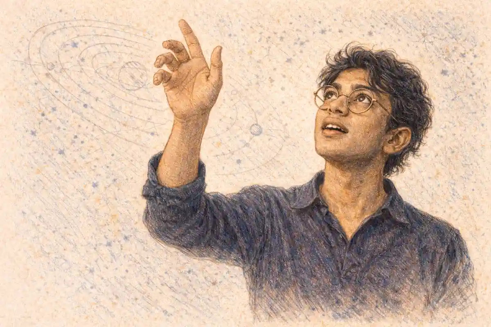

The excerpt printed above this article makes the largest claim any school text can carry: that Romeo and Juliet is perhaps the most widely taught play on the planet. The claim deserves a trial rather than a repetition, because the evidence for it is not a world census, and no world census exists. What exists is a patchwork of national measurements, board lists, syllabus documents and translation records, assembled country by country across this series, and the patchwork does not return one verdict. It returns four. In the United States the play's classroom lead is measured and real. In England the lead belongs to another play. In Scotland the contest is never held. In India the whole play is absent from the national school readers and present in fragments, while in Kenya the play was expelled from the syllabus by a sovereign decision and restored by another one in 1992. A synthesis that irons those four verdicts into a slogan would be a worse article than the slogan deserves and a false one. This article therefore does the slower thing: it lays the national records side by side, grades each claim by the strength of its evidence and the year of its measurement, and reaches the verdict the records support. That verdict is narrower than the excerpt and stronger for being narrower. The play is the most widely carried dramatic text in the world's classrooms, present in more systems, in more languages, at more levels than any rival the record names. It is not the most widely read whole play, because in several of its largest homes it is not read whole at all: it is excerpted, translated, paraphrased, or displaced by Macbeth at the point where teaching is counted. Presence is global. The object present differs by country, and the difference is the story.

## The Most Widely Taught Play: Grading the Claim Before Using It

A superlative about teaching can be tested only where teaching is measured, and teaching is measured in very few places. The strongest instrument in the entire record is a survey of teachers: Arthur Applebee's 1989 survey of department chairs in American schools, Jonathan Burton's 2013 survey of four hundred American teachers, and the National Council of Teachers of English report of 2025, which gathered 4,096 responses. All three place the play first among the texts American schools teach, and Burton found it present in roughly ninety-three of every hundred ninth-grade classes. That is a measurement, with a method and a date, and it earns the word first for one country. The second instrument is the examination entry: England's boards publish what candidates actually sit, and on the record of the June 2024 AQA series, Macbeth, not this play, was the Shakespeare text taken by the largest share of candidates, seventy-six per cent of them on the board's largest entry. That is also a measurement, and it earns Macbeth the word first for England. The third instrument is the syllabus document, the weakest of the three, because a list records intention rather than practice: Karnataka's Springs textbook proves that two speeches of the play are set for study in one Indian state's schools, and the silence of the NCERT readers proves that no Shakespeare play is set in the national readers for Classes 9 to 12, and neither document counts a single classroom. The fourth instrument is the dated event: Kenya removed nearly all Western literature from its school syllabus in its Africanization drive and restored this play in 1992, a sequence Alamin Mazrui records, and an expulsion followed by a restoration is evidence of a kind no survey supplies, because it shows a state weighing the play twice and deciding twice.

The excerpt's own wording betrays the state of the evidence, and the tell is worth a sentence of the trial. It does not say the play is the most widely taught on the planet; it says perhaps, and the perhaps is doing the work of all the missing instruments. A claim about American classrooms needs no perhaps, because Burton counted. A claim about English entries needs none, because AQA published. The perhaps enters exactly where the counting stops, at the border of the measured world, and it expands to cover every uncounted system between England and the planet. Read uncharitably, the excerpt is a measured fact about two countries wearing a planetary costume. Read charitably, it is a hypothesis with an unusually good prima facie case, since the documented rows point in one direction often enough to make the hypothesis respectable. This article's business is to convert the perhaps into its graded components and to leave the residue, the part no evidence in the record can settle, standing visibly as residue. A synthesis that begins by confessing what its best sentence cannot prove is likelier to be believed in the sentences where proof exists.

### What would the most-taught claim need in order to hold everywhere?

It would need the same instrument in every country, run in the same years, counting taught texts rather than listed ones, and returning this play first each time. No such instrument exists. The claim survives only in graded form: measured first in the United States, beaten in England, untestable in Scotland, absent as a whole play from India's school readers.

Held to that grading, the excerpt's sentence is half right and wholly instructive. The play is a candidate for the superlative because its presence is documented on six continents, in English and in translation, at extract strength and at whole-text strength, under compulsion and under free choice. No rival play in the record assembles that spread. Hamlet is the deeper university text, Macbeth the shorter examination workhorse, A Midsummer Night's Dream the younger child's introduction; each leads somewhere. The lovers lead in the specific territory this article maps, the school classroom of the middle years, and they lead there by accumulation rather than by unanimous verdict. The sections that follow take the territories in turn, and each section carries its evidence with its date attached, because a claim about classrooms that floats free of its measurement year is marketing rather than knowledge. Researchers assembling the documentary base for a map of this kind, syllabus by syllabus and survey by survey, keep the underlying files in research archives such as [VaultBook](https://vaultbook.net/), where a dated source stays attached to the claim it supports.

## The InsightCrunch Global-Classroom Map

The map below is the article's findable artifact, named the InsightCrunch global-classroom map. It records, for each system the delivered record covers, the play's status, the language in which it is studied, the dose in which students meet it, and the evidence with its year. Rows are graded by the strength of their evidence: measured, where a survey or an entry count exists; documented, where a syllabus, blueprint or dated event exists; thin, where the record rests on translation and reception rather than on classroom documents. Systems the record does not cover are omitted rather than filled, and the omissions are part of the map's honesty: a worldwide claim built on eleven graded rows is worth more than one built on a hundred ungraded guesses.

| System | Status of the play | Language of study | Dose | Evidence and date |
| --- | --- | --- | --- | --- |
| United States | First among taught texts | English | Whole play, usually grade 9 | Measured: Applebee 1989; Burton 2013; NCTE 2025 |
| England | Listed by all four GCSE boards; second in entries | English | Whole play, closed-book examination | Measured: AQA entries, June 2024 (Macbeth first) |
| Scotland | Not prescribed; no set-text contest | English | Teacher choice, uncounted | Documented: qualifications framework, no list |
| India, national readers | Absent from NCERT readers, Classes 9 to 12 | English | None at whole-play level | Documented: NCERT reader contents |
| India, Karnataka | Set as extracts in the Springs course book | English | Two speeches (1.5, 3.2); three teaching hours; three marks | Documented: KSEAB blueprint |
| India, universities | Whole play on named syllabi | English | Whole play | Documented: syllabi of Jamia Millia Islamia, Assam University and others |
| Kenya | Expelled in the Africanization drive; restored 1992 | English | Whole play when set | Documented event: Mazrui's record of expulsion and restoration |
| China | Canonical in translation; staged and excerpted | Chinese (Zhu Shenghao's prose) | Translation, scenes and extracts | Documented: translation and production record from 1937 |
| Germany | Canonical school and stage text in Schlegel's verse | German | Whole play in translation | Documented: Reclam editions and the school tradition |
| Japan | Present through Tsubouchi's complete Shakespeare | Japanese | Whole play in translation | Documented: translation completed within the 1909 to 1928 edition |
| Latin America | Studied through Spanish and Portuguese versions | Spanish, Portuguese | Whole play and adaptations | Thin to documented: translation and stage record |

Read as a table, the map already contains the article's argument. The status column never repeats itself exactly: first, second, unprescribed, absent, excerpted, restored, translated. A text that were simply imposed by a single world system would show a single status everywhere. A text that were merely popular would show no statuses at all, because popularity leaves no documents. What the column shows instead is a series of local settlements, each reached by a different route, each revisable, and one of them, Kenya's, visibly revised within living memory. The map is the synthesis in miniature, and the rest of the article is its commentary.

The rivals deserve their niches stated plainly before the commentary begins, because the verdict is comparative. Hamlet dominates the tier above the school, the university seminar and the final school years, where its length and inwardness are affordable; the American sequence itself reserves Hamlet for the twelfth grade, after the lovers have done their work at fourteen. Julius Caesar holds a citizenship niche in systems that teach rhetoric and republican virtue. A Midsummer Night's Dream introduces younger children to the language inside a comedy whose deaths are imaginary. The Merchant of Venice, once a school staple, receded in American schoolbooks after the Second World War under the weight of its own classroom difficulties, a reminder that incumbency is not immunity. Each rival's niche is a judgement by systems about fit. The lovers' niche, the first whole tragedy of the middle years, is the largest single classroom territory any play occupies, and it is occupied on different terms in every system that grants it.

## The American Measurement: First Place, Counted Three Times

The United States is the one system in which the play's lead is a counted fact rather than an inference, and the counting has been done three times across thirty-six years with the same result. Applebee's 1989 survey asked department chairs, who reported a department's practice rather than a single classroom's, and his list is headed by this play, with Macbeth second. Burton, surveying four hundred teachers directly in 2013, found no play taught more frequently and found this one present in roughly ninety-three of every hundred ninth-grade classes. The NCTE report of 2025, gathering 4,096 responses through the council's own channels, a sample of the professionally engaged rather than a random sample of the whole profession, found the same title at the head of the list. Three instruments, three populations, one ordering. Whatever else the global claim gets wrong, its American premise is sound: in the largest English-speaking school system on earth, this is the most taught play, and it has held that position across the entire span of modern measurement.

The settlement's date matters. The play's American school career rose in the middle of the twentieth century, when the teenager was invented as a social category and a market, when the comprehensive high school gathered the whole age cohort into one building, and when West Side Story and then the 1968 film gave the story a contemporary American body. Applebee's 1989 list is the first great measurement of a settlement already made: the play did not climb to first place under the surveyors' eyes, it was found there, enthroned by the postwar decades in which American adolescence and the lovers' story were made for each other by the culture at large. Burton and the NCTE report measure the settlement's persistence, not its birth. The point disciplines any temptation to read the American row as a verdict on the play's eternal classroom fitness. It is a verdict on a historical fit between a text and a nation's invention of its own young, renewed annually by teachers who met the play inside the same invention. Fits of that depth do not dissolve quickly, and they do not export: no other system invented the teenager in quite the American way, which is one more reason the American measurement, the record's best, is the record's least exportable.

The American case is stranger than the ranking suggests, because no authority in the United States requires the play at all. There is no national curriculum to name it. The Common Core standards name Shakespeare as an author and their Appendix B commends Macbeth and Hamlet as exemplars; this play is not the named one. The ninth-grade slot it occupies in roughly ninety-three of every hundred classrooms was built by custom, by college entrance expectations reaching back into the nineteenth century, by anthology publishers who printed what schools already taught, and by teachers who teach the play they were themselves taught at fourteen. The American settlement is therefore the purest case of curricular inheritance in the whole map: a text enthroned by repetition, defended afterwards as a design. Its stability across Applebee, Burton and the NCTE is the stability of a self-confirming system, in which the availability of editions, films, teaching materials and trained teachers all reward the choice already made. That is not a criticism of the play. It is a description of the machinery that any global account must reckon with, because the same machinery, running at different speeds, explains most of the map.

### How does a play lead a nation's classrooms when no law requires it?

By inheritance compounded: entrance expectations fixed the early canon, anthologies printed the canon, examinations and teacher training reproduced it, and each generation of students became the next generation of teachers. The American surveys measure the compound interest on a nineteenth-century deposit, and the deposit keeps earning because every institution that could disturb it instead reinvests in it.

Two features of the American record matter for the global comparison. The first is the age of the encounter: the play belongs to the ninth grade, to students of fourteen and fifteen, the ages of its own characters nearly enough, and the match between the readers and the lovers is the reason American teachers give most often for the choice. The second is the dose: the American classroom reads the whole play, in English, usually with a film beside it, the 1968 Zeffirelli version having organized school field trips in its year and the 1996 Luhrmann version having reset the visual terms a generation later. Whole text, first language, early adolescence, no mandate. No other system in the map combines those four conditions, which is why the American row cannot simply be extrapolated into a world row. It is the best-measured case and the least typical one, and holding both truths at once is the discipline this synthesis requires.

The American settlement has one further peculiarity that the comparison needs: its purposes are unstated by any authority, so they are supplied by habit, and habit's favourite purpose is the cautionary one.

The newest turn of the American screw is the scripted curriculum, in which a published programme, adopted by a district, specifies the play's place, its extracts, its questions and its assessments in advance. The American record examines what happens inside such a programme, Odell Education's ninth-grade offering among them: the play that entered classrooms by custom is increasingly delivered by contract, with the teacher's inherited unit replaced by a vendor's sequence. For the synthesis the development matters because it changes the American row's nature without changing its ranking. Custom enthroned the play; the script preserves the enthronement while removing the discretion that made custom self-correcting. A play held by a vendor's programme is held the way England's lists hold it, by document rather than by practice, and the American measurement tradition will have to learn to distinguish the two holdings, since a survey of teachers inside scripted systems increasingly measures the script. The world's largest measured row is thus drifting toward the documentary condition of the unmeasured ones, a convergence the world-culture theorists would recognize: even the exception is being standardized. Ayanna Thompson and Laura Turchi, in Teaching Shakespeare with Purpose, pressed American teachers to be able to say why this play, for these students, toward what end; the demand lands because the default answer, a warning about impulsive teenagers, is contradicted by the text it claims to summarize, in which the adults build the trap, staff it and arrive too late to open it. A system that enthrones a play without stating its purpose gets the purpose its culture supplies by default, and the American culture supplies a romance and a warning in the same breath. Other systems state their purposes in their instruments: England's assessment objectives declare that the play is for language analysis and contextual understanding, Karnataka's blueprint declares that two speeches are for paraphrase, Kenya's syllabus history declares that a literature is for nation-building. The map's rows differ in candour as much as in content, and the American row, for all its measurement, is the least candid about what its first-place play is for.

## England: The Compulsory Author and the Optional Play

England runs the opposite machinery from the United States and reaches the opposite result at the point of counting, which is why the two rows of the map discipline each other. England's national curriculum names Shakespeare as the only compulsory author in English literary study: the state mandates the playwright and leaves the play to the boards and the schools. All four GCSE boards, AQA, Edexcel, OCR and Eduqas, list this play among their set Shakespeare texts, so its availability is universal. Its selection is not. On the evidence of the June 2024 AQA series, the board with the largest entry, Macbeth was the text taken by seventy-six per cent of candidates, and examiners' reporting across the boards treats Macbeth as the more taught text in English classrooms. The play that American measurement crowns is, in England, the leading alternative. Listing is not teaching, and England is the system that proves the distinction with entry figures: a text can stand on every list in the country and still finish second in the country's classrooms.

The reasons are documented rather than mysterious, and the full anatomy of the four boards' papers, assessment objectives and examiner verdicts is laid out in [the series' account of the play in the UK GCSE](/2030/03/08/romeo-and-juliet-uk-gcse/). Macbeth is the shortest of the tragedies in the school repertoire, at roughly two thousand lines against this play's three thousand, and a closed-book examination system rewards the text a candidate can hold entire in memory. The English examination is closed-book: candidates write on an extract printed in the paper and on the whole play carried in their heads, and the assessment objectives weight analysis of language, structure and context in proportions that favour a compact, quotable text. Length, which American custom treats as a term's pleasant work, English assessment treats as a measurable burden. The same play is therefore first where teaching is surveyed and second where entries are counted, and the difference is not taste. It is instrumentation: surveys ask teachers what they teach, entries record what candidates sat, and the two instruments, pointed at two different systems, return two different winners. Any honest global claim has to say which instrument it is reading.

### Why do more English classrooms choose Macbeth when every board lists both plays?

Because the examination prices the choice. A closed-book paper on a three-thousand-line play demands a memory load half again heavier than a two-thousand-line one, and departments spending scarce weeks choose the text their candidates can carry whole. The boards list the lovers; the arithmetic of the exam hall seats Macbeth.

The four boards are not four copies of one paper, and their differences fill out the English picture. AQA sets a single Shakespeare question joining an extract to the whole play. Edexcel divides its task between extract work and a broader essay. OCR offers extract-based and discursive routes with different shapes of demand. Eduqas weights two questions across its paper, a structure the Welsh context shares with the English one through WJEC's family of boards. The anatomy matters to the synthesis for one reason: across four differently built instruments, the same hierarchy emerges, Macbeth ahead on entries, the lovers the universal alternative. When four thermometers built on different principles agree on the temperature, the reading is unlikely to be an artifact of any one of them. England's second place is as robust as America's first, and the two results, each thrice-confirmed in its own way, are the twin pillars on which any honest global sentence has to be built, one on each side of the claim.

England contributes one more datum that no other system supplies so sharply: a statutory author with a free market in plays produces a stable hierarchy anyway. Departments converge on Macbeth for examined study and keep this play in the years before the examination, in school productions, and in the reading of younger classes, where its story is the one students already half know from the culture. The play's English life is thus double: the most familiar Shakespeare story in the country and the second choice for its highest-stakes classroom purpose. A global account that reported only the lists would call England a stronghold. The entries call it a near-miss. Both descriptions are documented; only one is measured.

The pre-examination years deserve a line in the synthesis because they are where England's two Shakespeare economies meet. Before the GCSE course begins, departments teach freely, and the play's story-fame makes it the natural first whole tragedy for thirteen and fourteen year olds: the same students who will be examined on Macbeth at sixteen have commonly met the lovers entire at fourteen, in the original, with a production or a film in support. England thus gives the play a large unexamined readership underneath its examined second place, and the entries, which count only the examined layer, understate the play's true English classroom volume. The correction cuts in the play's favour and must be entered honestly: England's row is second place where it is measured and something larger where it is not. What cannot be claimed is that the unmeasured layer reverses the measured one. The map keeps the grade where the evidence puts it and notes the shadow the grade casts.

## The Age of the Encounter: Fourteen, Almost Everywhere

One convergence in the map is so regular that it escapes notice: systems place the play at the same age. The American slot is the ninth grade, fourteen and fifteen. The English unexamined encounter comes at thirteen and fourteen, with examined study possible at sixteen. India's extracts stand in a secondary course book aimed at the same middle years. Kenya's syllabus place, before expulsion and after restoration, was the secondary literature course. The play itself announces the appropriateness and the discomfort of the placement in its second scene, where Capulet resists Paris with the observation that his daughter "hath not seen the change of fourteen years" (1.2): the text's own adult states the age at which its heroine is not ready, and the world's classrooms hand the text to students standing at exactly that threshold. No other tragedy in the canon is so precisely aimed at the age of its compulsory readers, and the aim is not an accident of any single system; it is a property of the play that every system independently discovers, because every system has a year in which literature must first become serious and a cohort that must be met where it stands.

The placement has consequences that differ by dose. At fourteen the whole play offers a mirror with a warning label; the extracts offer the mirror's two brightest fragments; the translation offers the mirror in the reader's own tongue, which sharpens it. Systems are aware of the charge in the placement and manage it differently: the American discussion tradition leans into identification, the English examination tradition distances the encounter into analysis, the Indian extract avoids the management problem by miniaturizing the text, and several traditions route the management through the age question itself, making Juliet's thirteen a stated topic of the lesson rather than its embarrassment. That last handling belongs to another article's framework in this series and is noted here only as a placement fact: the age match is not merely a reason teachers give for choosing the play, it is a curriculum problem every choosing system then has to solve, and the variety of solutions is one more measure of how little the shared title settles.

The placement's regularity is, on its own, the convergence theory's single strongest exhibit in the whole map. Lists can be copied and editions can be exported, but the decision to hand a tragedy of adolescent love to adolescents, taken independently inside examination systems, extract systems and restored syllabi, suggests that the systems are responding to the same property of the play and the same fact about their students. Where the map elsewhere records machinery, here it records recognition, and recognition is the harder phenomenon to explain away.

## Scotland: The Control Case That Refuses the Question

North of the border the superlative does not lose; it dissolves. The Scottish qualifications system prescribes its own national texts for its critical-essay purposes and otherwise leaves the choice of plays to schools, crowning nobody. There is no Scottish list on which this play stands first, no entry table in which it finishes second, and no survey in the record that counts Scottish choices play by play. The correct entry for Scotland in any global table is untestable, and writing that word is a finding rather than an admission of failure. Scotland is the control case for the entire inquiry: remove the machinery of lists, gateways and inherited slots, and no standard text emerges at all. What emerges is departmental choice under local pressure, varying by school, invisible to measurement. The play is certainly read in Scottish classrooms, as it is read wherever English is taught; a certainty of that kind is an atmosphere, not a datum, and the map declines to print atmospheres.

The Scottish row matters beyond its size because it exposes the hidden premise of the global claim.

What Scottish departments do with their freedom is not a mystery so much as an unrecorded ordinary: the system reserves part of its English course for Scotland's own literature, and foreign drama enters by departmental decision, school by school, under the pressure of available editions and staff confidence. The play is certainly among the texts so chosen in some schools in some years, and just as certainly absent in others, and no aggregate exists to discipline either certainty. The row's lesson for compilers of global claims is procedural: a system whose structure guarantees invisibility must be entered as invisible, even when every instinct, and the play's fame, insists it must be there. Instinct is how slogans are made; the map was built to refuse them. The claim imagines a world of systems each holding a contest among plays and reporting a winner. Scotland holds no contest. Much of the world, examined closely, holds no contest either: the contest exists only where an examination board, a national reader series or a survey creates one. The map's measured rows are the exceptions, America and England, and the global superlative is a generalization built on the exceptional rows. That does a particular kind of damage if it goes unnoticed, because it converts the two systems that happen to count into spokesmen for the hundred that do not. Scotland's refusal to count is the standing rebuke, printed in the map in its own row so that the generalization has to walk past it.

## What the Instruments Cannot See

A synthesis built on instruments owes its readers an account of the instruments' blind spots, and this record's are considerable. The American surveys count the professionally visible: department chairs reporting a department's settled practice, teachers reachable through a scholarly survey, and, in the NCTE's 4,096 responses, the professionally engaged who answer their council's calls. Such samples catch the mainstream and miss the margins, the schools where the play is taught from a cupboard of old anthologies or not taught at all. The English entries count candidates, not classrooms, and a candidate is the end of a pipeline that began with a department's choice two years earlier under constraints the entry figure cannot display. The Indian documents count intentions: a blueprint's three marks describe the examination's demand, and no document in the record observes a Karnataka lesson. The Kenyan events count decisions, and decisions are the rarest and most legible facts in the whole archive precisely because they are exceptions; the unrecorded Kenyan decades between expulsion and restoration are a blank the map prints as a blank.

Beyond the named rows lies the largest blind spot of all: the majority of the world's systems have never been surveyed play by play, publish no comparable entry figures, and hold their Shakespeare, where they hold him, inside documents no synthesis has gathered. France, the Arab world beyond its adaptation record, most of Asia beyond China and Japan, most of Africa beyond the documented stagings: for these the record assembled in this series is a reception record, strong on stages and translations, thin on classrooms. The temptation, in a synthesis, is to let the measured rows stand proxy for the silent ones. The map refuses the proxy. Its eleven rows are the world as documented, and the article's claims are claims about that documented world, with the silence labelled as silence. A reader who wants the planet rather than the archive should read the superlative the way the map grades it: true of the record, unproven of the territory, and most doubtful exactly where the territory is largest.

The population paradox sharpens the doubt. The two measured systems, the United States and England, together school a small fraction of the world's adolescents. The systems holding the largest student populations, India's and China's among them, are the systems where the documented dose is thinnest: extracts and a three-mark paraphrase in one, a translated and excerpted presence in the other. Weighted by students rather than by systems, the typical world encounter with this play is therefore not the American ninth grader's whole-text term but something much smaller: two speeches, a famous story, a film, a title on a list. The superlative sounds strongest counted in systems and weakest counted in students, and an honest synthesis reports both countings, because the planet in the excerpt's sentence is made of students, not of systems. What survives the student-weighted count is still considerable: no rival play is documented as present, at any dose, in the classrooms of so many large populations at once. But the dose is the story, and the dose, at planetary scale, is homeopathic in more places than it is hearty.

## India: A Whole Play Absent, Two Speeches Present

India supplies the map's most instructive row, because India separates presence from text more cleanly than any other system. The national readers published by NCERT for Classes 9 to 12 contain no Shakespeare play at all: at the level of the union's own schoolbooks, the whole play is absent, and so is every other play by its author. The CISCE examinations fill their whole-play drama slots from other titles, The Merchant of Venice at ICSE level and The Tempest and Macbeth at ISC. What the Indian school student meets, where the meeting is documented, is the extract: Karnataka's Springs course book prints two passages of the play, the lovers' first meeting in 1.5 and a passage from 3.2, allotted three teaching hours in the state's blueprint and carrying three marks in its assessment. Three marks, three hours, two speeches. Measured by dose, the Indian school encounter with this play is the smallest in the map, a pair of lyrics filed among poems, and any account of the play's global classroom empire that begins in India has to begin with that smallness rather than with the subcontinent's vast student numbers. The full level-by-level anatomy of that arrangement, board by board and syllabus by syllabus, is the work of [the series' account of Romeo and Juliet in the Indian curriculum](/2030/03/22/romeo-and-juliet-indian-curriculum/); the synthesis needs the shape, and the shape is a step pattern: nothing, then extracts, then the whole play at the top of the system.

Then the level changes and the picture inverts. At India's universities the whole play stands on named syllabi, at Jamia Millia Islamia, at Assam University under its four-year undergraduate programme, at Fatima College in Madurai, at the Central University of Andhra Pradesh and at Narendrapur among others, read entire, in English, by students who chose or were streamed into literary study. The Indian pattern is therefore a filter rather than a presence: the story is universal cultural property, the extracts are a school garnish, and the text belongs to the minority who reach English literature at university. The arranged-marriage scenes that an American class reads as period colour, an Indian class reads against living practice, which gives the extracts a charge out of proportion to their three marks; Jyotsna Singh's phrase for the larger phenomenon, different Shakespeares, was coined for exactly this unevenness, in which the same title names a garnish in one classroom and a whole world in the lecture hall above it.

### What does a three-mark extract do to a play of three thousand lines?

It keeps the two most anthologized speeches and discards the machine that gives them meaning: the feud, the haste, the failed letter, the audit of blame. The extract student can paraphrase the lovers' sonnet yet has never met the Prince's closing sentence on the houses, so the play survives as romance and vanishes as political tragedy. Dose is destiny.

India's row also carries the map's deepest history, because Shakespeare entered Indian classrooms as an instrument of the colonial state, through the education settlement that Macaulay's Minute of 1835 set in motion and the universities founded in 1857 institutionalized. Gauri Viswanathan's account of English literature as a mask of conquest was written about that entry, and the colonial inheritance is its own article's subject in this series, [the play's career inside colonial education](/2030/06/14/play-in-colonial-education/), where the mechanism is examined in full. For the synthesis the point is narrower: India's present arrangement, story everywhere, text at university, extracts at school, is the sediment of that history, worked over by a sovereign curriculum that has had generations to keep, cut or restore the inheritance and has chosen the extract. Choice, again, is the operative word. The Indian state was never obliged to print the two speeches in Springs. It prints them because they earn their three marks in a local settlement, and settlements, not empires, are what the map records.

## The School Tier and the University Tier

India's step pattern, nothing at school and the whole play at university, turns out to be a widespread arrangement wearing local clothes, and naming it clarifies several rows at once. Systems divide literary labour by tier: the school tier gets the famous, portable, excerptible text, and the university tier gets the long, inward, difficult one. In the United States the division runs inside the school itself, the lovers at fourteen and Hamlet at seventeen, the sequence so settled that teachers describe it as developmental rather than historical. In England the division runs between the unexamined years and the examined ones. In China the division ran historically between the story, which everyone could have, and the translated script, which belonged to the new spoken-drama world and its institutions. In the Russian tradition it ran between the popular stage text and the academic edition, Pasternak for the theatre and the reader, Shchepkina-Kupernik for the eight-volume monument. The play's global career is unintelligible without the tiers, because its superlative is a school-tier superlative: it is the play systems hand to adolescents, while the play they hand to adults in seminar rooms is another one.

The tier division also explains the play's peculiar critical weather. A text encountered at fourteen, in extracts or in a famous film, is remembered as a story and judged as a story, and its reputation among educated adults is set by that adolescent encounter long after the university tier has offered the corrective of other plays. Critics who dismiss the lovers as a schoolroom romance are often reporting their tier-one memory; teachers who defend the play's complexity are reporting the text the tier system never asked them to teach whole. The map's dose column is therefore also a reputation column: systems that dose the play in extracts manufacture adults who believe the play is small, and systems that dose it whole at fourteen manufacture adults who believe it is simple, and both beliefs are artifacts of the dose rather than properties of the text. A global synthesis that ignored the tiers would mistake those manufactured beliefs for the play's reception, when they are the curriculum's.

## Kenya: Expulsion, Restoration, and the Meaning of 1992

If India shows a state choosing the dose, Kenya shows a state choosing the text itself, twice, in opposite directions, and the pair of decisions is the single cleanest proof in the record that the play's classroom presence is a settlement rather than a fate. In the Africanization drive that followed independence, Kenya removed nearly all Western literature from the school syllabus, and this play went with it: the expulsion was general, aimed at a curriculum experienced as imposed, and the lovers were casualties of a principle rather than targets of a particular objection. In 1992 the play was restored to the syllabus, as Alamin Mazrui records. The restoration is the more eloquent of the two events. A text expelled as an imperial deposit and later readmitted by the same sovereign authority, in a syllabus the nation regarded as its own, has passed a test that no continuously retained text ever faces. It was weighed as foreign property, found wanting, expelled, and then weighed again as a usable inheritance and brought back.

The Kenyan sequence also disciplines the two grand theories that compete to explain the whole map. The expulsion vindicates the diagnosis of Ngũgĩ wa Thiong'o and his Nairobi colleagues, whose 1968 paper On the Abolition of the English Department attacked a syllabus that put English literature at the centre of an African education: Kenyans had experienced the play as imposed, and they said so with the only instrument that settles such questions, removal. The restoration vindicates the stage-makers and translators of the African record, for whom the answer to imposition was appropriation rather than erasure: the play returned when the choosing was Kenya's own, and its return is evidence that a text can outlive the system that imposed it when a new generation finds a use for it. Kenya's African classrooms since the restoration, school productions improvised from what a schoolroom has to hand, the Rwandan school production of 2015 and the Malawian audiences of 2016 among the documented neighbours, belong to the record assembled in [the survey of African stagings and adaptations](/2030/05/31/african-stagings-adaptations/), and they share the restoration's logic: the authority has relocated, and the text is handled as material rather than as monument.

### Why does the 1992 restoration prove more than the expulsion?

The expulsion proved that the play had arrived as an imposition, which its arrival route showed. The restoration proved that the play could survive the removal of the imposition and be chosen again on terms, by the authority that had expelled it. Retention is ambiguous evidence, since inertia retains anything; readmission after expulsion is a decision, and decisions are data.

For the global synthesis, Kenya contributes the variable that surveys cannot measure: legitimacy. The American play is legitimate by custom, the English play by statute and list, the Indian extracts by bureaucratic settlement, the Kenyan play by an act of sovereign reconsideration. A worldwide account that counts only presence flattens these differences into a single column of ticks. The map refuses the flattening, because the reason a text is in the room determines what can be done with it there: a text held by custom can be challenged at a school board meeting, a text held by examination can be displaced by a shorter rival, a text held by extract can be enlarged or dropped by a blueprint revision, and a text held by restored choice carries a warrant none of the others possesses. The lovers sit in more kinds of classroom authority than any other play in the record, and that variety, rather than any single first place, is the strongest form of the global claim.

One more feature of the Kenyan case generalizes. A syllabus is the one literary document a state writes about itself, and Kenya's argument over its syllabus, from the 1968 Nairobi paper's demand to abolish the English department's centrality to the restoration a generation later, was an argument about what a Kenyan education is for, conducted through the proxy of set texts. India conducted a version of the same argument through its language-of-instruction debates and its national education policy, and arrived at the extract. The United States conducts its version at school board meetings, text by text and district by district, and arrives, year after year, at the lovers. The forums differ, the stakes are the same: which dead foreign author's play shall stand inside the nation's account of itself. That this play is so often the test case, expelled, restored, excerpted, enthroned and displaced in these arguments, is itself a datum about its symbolic weight. Systems do not fight over texts that do not matter to them, and the fighting is documented on more continents for this play than for any other in the record.

## The Translated Classroom: Where Most of the Map Is Read

Count the map's rows by the language in which the play is actually studied and a fact emerges that the Anglophone debate about the superlative usually misses: in the majority of the systems listed, the student does not read Shakespeare's English at all. The Chinese student reads Zhu Shenghao's prose, the version made in Jiaxing in 1943 by a translator who died the following year, in a rendering tradition that argued for decades about whether the plays should exist in Chinese as prose or as verse, Zhu and Liang Shiqiu carrying the prose settlement against Sun Dayu and Fang Ping on the verse side. The German student reads August Wilhelm Schlegel's blank verse, a text of the 1790s carried into classrooms by the cheap Reclam editions that made the translation the school Shakespeare of the German-speaking world. The Japanese reader meets the play inside Tsubouchi Shōyō's complete Shakespeare, the forty-volume enterprise whose Romeo and Juliet was in print by 1910 and on Japanese stages in his translation from 1918. The Russian tradition reads Pasternak, whose version dominated stage and print for decades while the academic complete edition printed his rival Shchepkina-Kupernik instead. The Spanish-speaking and Portuguese-speaking student reads in the line of Astrana Marín's complete works or in versions shaped by the older refundición habit of remaking the play for local stages. Translation is not a footnote to the play's classroom life. By systems, and very probably by students, it is the larger half of it.

That fact cuts the superlative in a new place. The most widely taught play, in the translated rows, is not one text but a family of texts sharing a plot, a set of names and a five-act skeleton, diverging in everything a classroom can actually examine: wording, register, the survival of puns, the handling of the bawdy, the weight given to fate. Schlegel smoothed what Pasternak dissolved and rebuilt; Zhu's prose gives a Chinese class a different object of study from Schlegel's verse, and neither class can be examined on the other's lines. Chinese reception adds its own frame, since the play arrived in a culture that already possessed the Butterfly Lovers, Liang Shanbo and Zhu Yingtai, and read the Verona story against that native furniture from the start; the Chinese record assembled in this series shows the parallel operating as both welcome and resistance, a native template that admitted the foreign play and then competed with it.

The translated classroom also changes what assessment can mean. An English closed-book paper can demand quotation carried in memory; a classroom working in translation examines the translator's lines, and its questions slide from verbal analysis toward structure, character and theme, the elements that survive a crossing. A Chinese examination on Zhu's Romeo and Juliet and an English examination on Shakespeare's are examinations on different verbal objects testing different skills under one title. The title is what converges. The skills diverge. Any league table of taught plays that ignores the language column is comparing titles and calling them texts.

### What is actually being compared when two countries are said to teach the same play?

A title, a plot and a cultural warrant are being compared, and sometimes nothing else. The verbal text differs by translation, the dose differs by system, the assessment differs by instrument, and the reasons for the play's presence differ by history. The comparison is real at the level of the title and dissolves as it descends toward the page.

Even inside English the object is less single than the title suggests. The rose speech that classrooms quote as "That which we call a rose, by any other name would smell as sweet" is an editorial amalgam: the early texts divide between "name" and "word", and the familiar form was settled by editors rather than by the playwright. The Folio omits the first Prologue that quarto texts print, so classes reading different editions begin from different thresholds. A Kenyan class, an English class and an American class reading three reputable editions are already studying three slightly different plays before translation enters the question at all. The divergence the map records is therefore not an exotic condition of foreign classrooms. It is the normal condition of the text, amplified by distance. The Chorus opens the play by promising "the two hours' traffic of our stage", and the promise itself, with its two hours that no full performance keeps, is the first lesson in how loosely the play's own documents agree with each other and with the stage.

Two translated rows reward a closer look because they show the classroom and the nation sharing one text. In Germany the Schlegel version's route ran from the stage into the schoolroom on the back of cheap print: the Reclam editions put a uniform, affordable text into generations of hands, and a German student's Shakespeare was a German classic encountered inside German literature's own house, translated so completely into the national canon that the phrase unser Shakespeare, our Shakespeare, could be coined without irony. In Russia the split ran the other way: the version the stages and the reading public made canonical was not the version the academy's complete edition printed, so a Russian student's inherited Shakespeare depended on which institution handed over the book. Both rows teach the same lesson at the synthesis level. A translated school text is never only a window onto a foreign author; it is a monument of the receiving language, and the classroom that studies it is studying its own literature's history wearing Verona's names. The Arab world's versions belong in this paragraph at the map's thinnest grading: Arabic translations and stagings of the play are documented from the 1890s, al-Haddad's Martyrs of Love onward, while Arabic classroom prescription is a record this series could not document at comparable strength, and the map leaves the region's school row to its stage and translation evidence rather than promoting it.

A small datum from the Chinese record measures the depth of the translated settlement better than any syllabus: Chinese readers call Shakespeare Sha Weng, Old Man Sha, a nickname of proprietary affection that the record preserves. A foreign author who acquires a familiar household name in the receiving language has crossed a border no curriculum committee controls, and the classroom that meets him meets a family acquaintance rather than an import. Germany's unser Shakespeare makes the same claim in the possessive rather than the diminutive. The two phrases, from the map's two largest translated traditions, describe the endpoint of the process this section tracks: the play stops being foreign literature taught in translation and becomes national literature with a foreign birthplace, examined, beloved and argued over in the receiving tongue. Any verdict on the play's world teaching that ignores that endpoint understands the lists and misses the life.

## Latin America: A Presence Carried by Translation and Stage

Latin America's row is graded thin to documented, and the grading is the finding. The region's possession of the play is deep and old in the theatre and in print: Spanish versions reach back to the refundiciones of the early nineteenth century, the play was remade for Spanish-speaking stages long before it was translated entire, Astrana Marín's complete works gave the Spanish-reading world its standard text in 1929, and the Brazilian record runs from stage tradition to Grupo Galpão's Romeu e Julieta and a telenovela that stretched the story across 150 episodes in 2007. For most of the twentieth century the region's readers, students among them, met Shakespeare in Astrana Marín's Spanish, a single translation standing between a continent and the text, which gives the Latin American classroom a unity the map's other translated rows lack: where China argued prose against verse for decades, the Spanish-speaking school world largely inherited one settled version and the habits of reading that came with it. The classroom documentation, by contrast, is thinner than the stage documentation: the record assembled for this series establishes translation, performance and adaptation at documentary strength, and school prescription at much weaker strength, because the region's twenty systems publish their canons in forms the record does not centrally gather. The honest row therefore says what can be shown: the play is present to Latin American students chiefly through Spanish and Portuguese texts, through a melodramatic performance grammar the telenovela industrialized, and through school reading that follows the stage's lead. A synthesis that promoted the region to a measured row would be inventing evidence; a synthesis that omitted it would hide the difference between the play's theatrical empire, which is documented, and its curricular empire, which in this region is inferred. The map prints the inference as an inference.

The region contributes one analytic gift to the comparison: the refundición. Where England prescribes and America inherits, the Spanish tradition historically remade, cutting, reordering and naturalizing the play for local companies, and the classroom text in such a tradition is downstream of the stage text rather than of any ministry. Latin America thus stands in the map for a third route of entry, neither colonial syllabus nor examination list nor survey-counted custom, but the theatre's own circulation, with schools borrowing what the stage had already domesticated. China's first entry had a similar shape, the story arriving through narrative retelling before any translation of the script existed, and India's university entry ran through performance as well as print. The map's rows differ in route as much as in dose, and the routes predict the readings: a play that enters through the stage is taught as action, a play that enters through an examination is taught as language, and a play that enters through extracts is taught as anthology poetry. Verona is one city; the roads into it are not.

The region also shows what an informal curriculum can do where formal documents are thin. Brazil's literatura de cordel, the cheap printed verse pamphlets of the northeast, carried the lovers' story to readers far from any syllabus, and the radionovela and telenovela traditions performed the same office for listeners and viewers: a population can be schooled in a story by its entertainment industries before, after or instead of meeting the text in a classroom. The map's status column, built from documents, cannot register that kind of possession, and the Latin American row is the place where the limitation bites hardest. A Brazilian student may arrive in class already owning the plot the way an American student owns it from film, and the teacher's work begins from that ownership. Presence, in the region, is a cultural fact first and a curricular fact second, and the synthesis records the order rather than reversing it for tidiness.

## The Common Reasons, Weighed System by System

Every system in the map, asked why this play, returns some subset of five reasons, and the synthesis can weigh each against the systems where it fails. The first reason is prior fame: the story is known before it is taught, through film, music, headline and proverb, so the curriculum spends its authority on a text the culture has already ratified. Fame explains adoption nearly everywhere and retention nowhere in particular, since fame attaches to Hamlet as well. The second reason is the age match: the lovers are adolescents, the readers are adolescents, and teachers from Ohio to Nairobi cite the recognition as the play's classroom engine. The match is real, and it is also the reason most often abused, since it invites the cautionary reading the text refutes; the age match explains the choice of the play and the commonest misreading of it in a single stroke. The third reason is survivability: the plot outline persists through summary, excerpt, translation and adaptation, so the title stays legible at every dose. Survivability is the property the world institution rewards, and it is unevenly a virtue, since the same property lets a system believe it teaches the play when it teaches two speeches. The fourth reason is economy: editions exist at every price, in every relevant language, with apparatus for every level, because publishers follow and then entrench the installed base. Economy is the reason with the longest half-life, since it operates after every other reason has been forgotten. The fifth reason is examination fitness, and it is the only one that cuts against the play as often as for it: where fitness is priced in lines and memorability, Macbeth wins; where it is priced in discussability and essay yield, the lovers win.

Weighed together, the five reasons describe a ratchet.

Prior fame carries a cost that the map's teachers pay in every system, and it belongs in the weighing. The student who arrives already knowing the story arrives with a version of it assembled from headlines, songs, cartoons and family summary, in which the balcony is named, the ending is a suicide pact, the feud has no cause worth naming and the Friar is a footnote. A measurable share of every first lesson, in every system in the record, is spent evicting that tenant before the text can move in; the misconception literature of this series is largely a catalogue of the tenant's furniture. Fame therefore cuts both ways in the ratchet: it guarantees the adoption and taxes the teaching, and systems differ in how honestly they budget the tax. The extract systems, paradoxically, suffer least from the famous story's interference, because two speeches make no claim to be the story; the whole-text systems suffer most, because the class must unlearn a complete false play before reading the true one. No rival text imposes the tax at this rate, since no rival is known so well by people who have never read it, and a full accounting of the play's classroom empire should enter the tax on the ledger beside the fame that causes it. Fame and the age match get the play adopted; economy keeps it adopted; survivability lets it be adopted at any dose a system can afford; examination fitness decides, system by system, whether adoption means enthronement or second place. No single reason explains the map, and the systems are best distinguished by which reason dominates their row: fame in the Latin American cultural possession, economy and inheritance in the American enthronement, examination fitness in the English second place, sovereign reconsideration in Kenya, where none of the five operated until a state chose to let them. A reformer reading the map should note the ratchet's direction: reasons one to four all push toward adoption and none pushes toward removal, which is why the map's only removal came from outside the ratchet altogether, from a nation's argument about its own identity, and why the play's global position, barring arguments of that magnitude, is structurally stable even where it is locally beaten.

Inside the ratchet sits a human mechanism the surveys keep catching: teachers teach the play they were themselves taught. The American record states the loop plainly, and every system's training pipeline reproduces it, since a teacher's confidence with a text is itself a curricular asset that ministries and departments spend carefully. The loop converts each generation's settlement into the next generation's starting point, which is why curricular change in this territory is generational even when it is decided in an afternoon: Kenya could restore the play in 1992 by signature, but the restored play had to wait for teachers formed to teach it as a chosen text rather than an inherited one. Inheritance is the ratchet's pawl, the small part that prevents the wheel from turning back, and it operates in systems that have never heard of each other with identical effect.

## Why the Lists Converge: The World-Culture Explanation

Step back from the rows and a pattern demands explanation: systems with no common ministry, no shared language of state and no coordinated policy nonetheless stock their classrooms with overlapping canons, and this play appears in system after system. Comparative education has a theory built for exactly this pattern. John W. Meyer, with Francisco O. Ramirez, John Boli and their collaborators, argued across a series of studies, including the cross-national curriculum analyses associated with Meyer, David Kamens and Aaron Benavot, that mass schooling is a world institution: national systems converged over the twentieth century on similar structures and similar curricular categories not because each nation independently discovered the same needs, but because a world model of what a school is, and what a schooled person should have read, diffused through ministries, professions and international bodies. On that account the overlapping canon is a script. A new state writing a literature curriculum reaches for the titles the world model certifies, and Shakespeare stands near the head of the certified list, with this play the Shakespeare most readily attached to adolescents. The theory explains the map's convergences elegantly: the same title in Nairobi, Delhi, Beijing and Ohio is what a world institution looks like from inside one classroom.

It also explains the play's specific advantages within the script. A world model needs texts that travel: a story already famous outside school, through film, ballet, musical and headline, so that the curriculum ratifies a fame it did not create; characters at the age of the students conscripted to read them; a plot whose outline survives summary, translation and excerpting, so that the title stays recognizable at every dose. The lovers satisfy each condition better than any rival in the canon. Hamlet's fame is as great, but Hamlet is a university-shaped part, long, inward and middle-aged in preoccupation; Macbeth travels nearly as well and beats this play wherever brevity is priced; the comedies lack the headline story. The script selects for portability, and portability is this play's documented property, tested across the reception record of this entire series, from Verona festivals to headline formulas to a Sarajevo nickname. Meyer's framework predicts that such a text will be adopted widely and held loosely, adopted because the world model rewards the adoption, held loosely because the adopting system owes the text nothing in particular. Expulsion, extract-cutting and displacement by Macbeth are all behaviours the prediction accommodates.

The world model's carriers deserve naming, because a script does not diffuse itself. Ministries copy the curricula of states they take as models; teacher-training institutions teach the methods and the canon together; publishers sell the same anthology architecture into market after market; and the international examination trade carries set-text lists across borders wholesale, so that a school preparing candidates for a foreign board inherits that board's Shakespeare along with its grading. Shakespeare entered more than one national classroom as examination cargo of exactly that kind, a history the colonial record in this series documents for the British case. The carriers explain why convergence so often outruns conviction: a system can acquire the play the way it acquires a textbook series, as part of a package whose other contents it wanted, and discover the conviction, or the argument, a generation later. Kenya's argument and India's trimming are what the second generation does with the package; the American inheritance is what happens when nobody opens it for a century. The model therefore predicts not uniformity of meaning but uniformity of acquisition, and the map, whose rows agree in acquisition and disagree in everything else, is the prediction's portrait.

## Why the Objects Diverge: Singh, Kennedy, and the Adjudication

Against the convergence theory stands the postcolonial scholarship of the play itself. Jyotsna Singh's work on Shakespeare in colonial and postcolonial India, and her formulation of different Shakespeares, holds that the shared title is an accounting fiction: the play as an instrument of colonial discipline in one century, as university capital in another, as a pair of examination extracts in a third, are different cultural objects doing different work, and a map that counts them as one presence mistakes the paperwork for the thing. Dennis Kennedy, editing and introducing the scholarship of foreign Shakespeare, made the complementary point from the stage side: Shakespeare abroad is a local product, remade by each receiving culture's translators, companies and politics, so that the global noun names a federation of local artifacts rather than a single travelling object. On this account the map's rows are not measurements of one phenomenon at eleven sites. They are eleven phenomena sharing a trademark.

The disagreement is genuine, and it is adjudicated by noticing the level at which each theory is tested. Meyer's evidence is the curriculum document, the category, the list; at that level he wins outright, and the map's status column is his Exhibit A, since the settlements are independent and the title recurs. Singh's and Kennedy's evidence is the studied object, the translated page, the examination's actual demand, the extract's three marks; at that level they win outright, and the map's dose and language columns are their Exhibit A, since no two rows study the same verbal thing in the same amount for the same stated purpose. The verdict of this synthesis is therefore a two-level sentence. The play's global classroom presence is a convergence of lists over a divergence of objects: one title, federated texts. Both halves must be carried together, because each half alone generates a characteristic error. Convergence alone generates the excerpt's slogan, the most widely taught play on the planet, as if the planet held one classroom. Divergence alone dissolves a real phenomenon, the documented recurrence of this title across unconnected systems, into a coincidence of trademarks, which the Kenyan restoration and the American surveys jointly refute. The play is genuinely worldwide and genuinely different in each place, and the map exists to keep those two truths on one page.

### Can both theories be true of the same classroom at the same time?

Yes, because they describe different strata of the same lesson. The timetable line that schedules the play is written by the world institution and looks like every other nation's line. The book opened under that line, in Zhu's prose or Schlegel's verse or two speeches in Springs, is a local artifact. Convergence schedules the hour; divergence fills it.

## Films in the Classroom: The Shared Screen Under the Divergent Page

Underneath the map's divergent pages runs one genuinely shared text, and it is not printed. The 1968 Zeffirelli film organized American school field trips in its year and gave a generation of classrooms on several continents the same faces, the same Verona and the same balcony that the play never names; the 1996 Luhrmann film reset the visual terms for the next generation, and published curricula in the American record set it beside the text scene by scene. No translation of the play has achieved the penetration of those two films, because the screen crosses language borders at subtitle cost while the page crosses at translator cost. A class in Beijing, a class in São Paulo and a class in Ohio may study three different verbal objects and watch the same two hours of cinema, and the conversation between those students will be steadier about the film than about the book. The global classroom's common text is, in large part, a pair of films, and the synthesis that omits them misdescribes what the world's students actually share.

The films do different work in different systems, which keeps them inside this article's argument rather than above it. In whole-text systems the film is a rival reading to be argued with, and the arguing is the lesson. In extract systems the film is a smuggler, carrying the feud, the duel and the tomb past a blueprint that admitted only two speeches, and teachers of extracts lean on it precisely because the official dose cannot supply the machine. In translated systems the film is a third text beside Shakespeare's and the translator's, sometimes displacing both in students' memories. The risks are the mirror of the services: a class can leave believing it has studied the play when it has studied Zeffirelli's cuts or Luhrmann's inventions, and assessment built on the page then ambushes the screen-taught student. Every system that uses the films has developed its own etiquette for the problem, from scene-by-scene comparison to outright prohibition during the examined term, and the etiquettes diverge as faithfully as the syllabi do. The screen unites the world's classrooms in reference and divides them in discipline, which is the play's whole global condition in miniature.

## The Play in the Staffroom: A Shared Reference Among Teachers

One global fact about the play appears in no row of the map because no instrument counts it: the play is the teaching profession's common reference. Teachers trained on different continents, in different languages, inside different instruments, can assume of one another a working knowledge of this text that they can assume of no other play: its scenes are the profession's shared examples for discussing fate, haste, staging, translation loss, examination design and the management of adolescents, because every system that employs them put the text in their own schooling first. The staffroom consensus is a real force in the play's persistence, since the colleague who has taught a text for twenty years is an argument no syllabus committee easily overrules, and it is also a standing risk, since consensus feels like evidence and is only inheritance wearing confidence. The map's discipline exists largely to correct the staffroom's: the feeling, universal among English teachers, that the play is everywhere taught meets the entry figures, the blueprints and the expulsions, and learns its grades.

The profession's shared reference has a material economy attached to it, and the economy is global in a way the syllabi are not. Editions, guides, films, translations of translations, question banks and model essays circulate across borders with a freedom no ministry grants, so that a teacher in a thin-documentation system may work from materials produced for the English examination or the American ninth grade, importing another system's play along with its questions. The study-guide industry examined elsewhere in this series is the visible tip of that circulation. For the synthesis the point is that the map's rows leak into one another through the staffroom door: the examined English play shadows classrooms England will never count, and the American discussed play shadows classrooms no American survey will reach. Leakage does not invalidate the rows; it means the rows describe official settlements, while the profession's informal world market in materials pushes every system a degree toward the measured ones' version of the play. The planet's classrooms are more alike in their cupboards than in their documents, and less alike in their lessons than in either.

## Assessment Divergence: Five Systems, Five Different Plays

What a system examines is what its classrooms contain, and the map's systems examine five different things under this play's name. England examines memory and analysis together: the closed-book GCSE prints an extract and demands an essay reaching beyond it, so the taught play is a memorized whole with quotable organs, and the premium falls on the compact text. The United States, having no national examination in the subject, examines by local essay, project and test, and the taught play is consequently a discussed whole, shaped by the teacher's purposes in a way Ayanna Thompson and Laura Turchi urged American teachers to make explicit: a play taught without a stated purpose drifts into being taught as a cautionary tale about teenagers, which is the one reading its final scene refutes. Karnataka examines the paraphrase: three marks riding on two speeches reward the student who can restate the sonnet's sense, and the taught play contracts to what the marks can hold. The translated systems examine comprehension of a national classic in the national language, where Zhu's or Schlegel's lines, not Shakespeare's, are the quotable matter. Kenya's restored syllabus examines the play within a national literature curriculum whose very composition was the subject of the country's great curricular argument. Five instruments, five skills, five plays. The assessment tail wags the curricular dog in every system that has one, and the systems without one, America and Scotland, show the alternative: drift, inheritance and local variation, with no instrument capable of reporting what the play has become in their classrooms at all.

The divergence has a consequence for teachers that the global slogan obscures. A teacher moving between these systems with one well-worn unit plan would fail in four of them: the plan built for American discussion starves an English candidate of memorized quotation; the plan built for the English examination wastes a Karnataka term on machinery worth no marks; the plan built for extracts leaves a university seminar in Delhi or Nairobi with nothing to say in the second hour. Professional knowledge of this play is therefore local knowledge wearing a global title, and the training of teachers, which the map cannot tabulate, diverges at least as far as the syllabi do. The play unites the world's staffrooms in a single shared reference and divides them in everything they are required to do with it on Monday morning. Both facts belong in any verdict that claims to describe a global classroom, because a classroom is not a list: it is forty minutes, a set text, an instrument of assessment and a person answerable for all three.

The reforms of an instrument are the natural experiments of this field, and England ran one when its GCSE moved to closed-book examination of whole texts: the petitions against the reform, which the parliamentary record preserves, argued from the burden on memory, and the boards' subsequent experience priced that burden play by play. A system that changes its instrument learns, within a few series, what its teachers already knew about relative cost, and the entry figures shift accordingly. Karnataka's blueprint could run the experiment in miniature at any revision, raising the extracts' marks and watching the taught dose grow to fill them. The general law the map supports is unflattering and useful: systems get the play their instruments pay for, and exhortation addressed to teachers changes less than a single line in a mark scheme.

The play's own text anticipates the divergence with uncomfortable precision. The Prince closes the action not with a celebration of the lovers but with an audit: "See what a scourge is laid upon your hate, / That heaven finds means to kill your joys with love", and his last word on the survivors is "All are punish'd". Every system in the map conducts its own version of that audit and returns a different sentence. England's audit finds the play too long for its memory economy and punishes it with second place. Karnataka's finds it reducible to two speeches and punishes it with three marks. Kenya's found it foreign, expelled it, and then, in the only audit that was ever formally reversed, readmitted it. America's audit, conducted by survey, acquits it annually. The Prince's line is the play's own model of assessment: a judgement pronounced over the same events by an authority whose interests are not the lovers' interests. Classrooms, like Verona, get the play their auditing authority is built to see.

## Shared Text, Divergent Readings: Holding the Complication

The brief for this synthesis names its complication exactly: shared text versus divergent readings, and the instruction is to hold both. The sections above supply the evidence for each pole. For the shared text: one plot, stable across every translation in the record, from Zhu's prose to Tsubouchi's verse to Astrana Marín's Spanish; one set of names, so portable that Sarajevo borrowed them for a real couple and headlines on every continent borrow them weekly; one skeleton of scenes, the brawl, the meeting, the orchard, the duel, the potion, the tomb, recognizable in a Malawian schoolyard performance improvised around a mosquito net and in a Brazilian telenovela stretched across a season. A student who has studied the play in any row of the map can talk to a student from any other row about the story, and the conversation will hold. That is a real and unusual property, and no other school text in the record possesses it to the same degree.

For the divergent readings: the feud is a lesson about tribal loyalty in an American ninth grade, about arranged marriage in an Indian classroom where the Capulet household is not an antique, about ethnic division in the African localizations, about sect and politics in the Arab stagings, and about nothing examinable at all in a Karnataka paraphrase. Juliet is a heroine of self-determination in one staffroom's framing, a warning in another's, a thirteen-year-old whose age is the lesson in a third. The Friar is a meddling adult, a pastoral survivor or a plot mechanism, depending on the syllabus's needs. Even the ending's meaning inverts across the map: reconciliation purchased by death in the Prince's Verona, waste without consolation in the sterner critical traditions, an occasion for the state to audit itself in Kenya's reading. The readings do not merely differ in emphasis; they contradict, and the contradictions are produced by the receiving systems, not smuggled in by careless teachers. A shared text that generates contradictory lessons is not a common curriculum. It is a common occasion, and the distinction between a curriculum and an occasion is the precise measure of the play's global condition.

Holding both poles changes what a teacher, a board or a ministry should do with the play, and the synthesis would be incomplete if it ended in pure description. The practical consequence is that borrowing across systems should borrow occasions, not plans: the Kenyan restoration's warrant, that a text must be chosen by the authority that answers for it; the English system's honesty about price, in which length is costed rather than wished away; the American survey habit, in which teaching is counted and the count published; the Indian extract's warning, that a dose too small to carry the play's politics produces a romance the text itself contradicts; the translated systems' reminder, that the words on the page are a national author's words and deserve to be taught as his, with Shakespeare standing behind him at one remove. A world of classrooms that raided each other in that spirit would be using the play's global presence as it deserves to be used, as a set of experiments whose results are published, rather than as a brand whose presence is its own justification.

## What Would Settle It: The Survey the World Has Not Run

The superlative could be settled, and describing the instrument that would settle it is the cleanest way to show why it remains unsettled. The survey would need a common definition of teaching, since the map's rows count unlike events: a play taught, for the instrument's purposes, would mean a text opened in class for a stated minimum of hours within a stated school year, with the dose recorded in lines or scenes and the language of study recorded beside it. It would need samples drawn from school lists rather than from professional associations, so that the unengaged majority of teachers, the ones no council survey reaches, entered the count. It would need to run in the same years across systems, because a 1989 American figure and a 2024 English figure describe different curricular worlds. And it would need to ask about rivals in the same breath, since a ranking is the only form in which the superlative can be true or false. Nothing in that design is technically difficult. National versions of most of it exist. What does not exist is the sponsor: no ministry owns a question whose answer stops at its border, no international body's mandate covers the literary canon play by play, and the publishers with the distribution to run such a survey sell into every possible result and gain nothing from any of them.

Until that instrument exists, the honest literature on the play's world teaching will look like this article: a patchwork, graded. The patchwork has one advantage over the imagined survey, and it is worth naming in the survey's own section. A single instrument, however careful, would flatten the map's most instructive differences into its common definition, and the Kenyan decision, the Karnataka dose and the Scottish silence would all be squeezed into rows of the same shape. The patchwork preserves the shape of each system's evidence, and the shapes are the findings. The survey would tell the world which play is first. The patchwork tells it what first means in Ohio, what it costs in England, what it is worth in Karnataka and what it took to earn in Nairobi. A synthesis is allowed to prefer the second knowledge while conceding the first is missing.

## The Verdict on the Play in Global Education

The evidence assembled in this series supports a verdict in three clauses, and this article ends by stating them without decoration. First, the play's presence in the world's classrooms is broader than any rival's: no other dramatic text is documented, system by system, as measured first in one great system, listed by every board in a second, restored by sovereign decision in a third, excerpted by a fourth, and carried by canonical translations through half a dozen more. Breadth of that order is not a slogan; it is the map. Second, the play's presence is shallower and more various than the slogan of the most widely taught play suggests: the whole English text is the possession of a minority of the systems that claim the play, Macbeth beats it where English entries are counted, Scotland declines to count, and the largest school populations meet it in extracts, in translation or as a famous story. Third, the two facts are one fact seen at two levels: a world institution converged on the title because the title travels, and local systems then made of the title whatever their languages, instruments and histories allowed. The play in global classrooms is best described not as the most widely taught play on the planet but as the most widely adopted one, adopted oftener, in more forms, under more kinds of authority than any competitor, and taught, in the strict sense of a whole text studied in common, far less uniformly than its adoption implies. The excerpt above this article may stand as the claim that prompted the inquiry. The inquiry's correction of it is the article.

The verdict is falsifiable, and a synthesis should say by what. A Scottish count that returned a dominant text would weaken the control case and strengthen the superlative's defenders. An Indian board prescribing the whole play would convert the map's most instructive row into a conventional one and move more students into whole-text study than any other single event available to the record. An American survey that displaced the play from first place would break the ratchet's most measured link and force the verdict's first clause to be rewritten. None of those events is an argument against the verdict as the record stands; they are the proof that the verdict is a claim about dated evidence rather than a mood about a famous play. The map will be redrawn by decisions, instruments and translations, in that order of speed, and the article's final word is the one its method has used throughout: check the row, check the grade, check the year.

## Frequently Asked Questions

### Q: In which country is the play's classroom lead actually measured rather than assumed?

The United States is the only country in the record where the lead is measured rather than assumed. Three surveys across thirty-six years return the same ordering: Arthur Applebee's 1989 survey of department chairs, Jonathan Burton's 2013 survey of four hundred teachers, which found the play in roughly ninety-three of every hundred ninth-grade classes, and the National Council of Teachers of English report of 2025, gathered from 4,096 responses. Elsewhere the play's standing rests on lists, syllabus documents or dated events, all weaker instruments. The American row of the map is therefore graded measured, and it is the only row that earns the grade on survey evidence.

### Q: Why does no world ranking of taught plays exist, and what stands in its place?

No world ranking exists because no body counts taught plays across countries: surveys stop at national borders, examination entries are published board by board, and most systems never count classroom choices at all. What stands in its place is a patchwork of national instruments, each with its own method and date: American teacher surveys, English board entries, an Indian state blueprint, a Kenyan syllabus history. A global claim built from the patchwork has to be assembled row by row, with each row's method attached, which is what the InsightCrunch global-classroom map does. Any ranking that presents itself as worldwide without that assembly is repeating a slogan, not reporting a measurement.

### Q: How does a play become a school text in a country whose curriculum never names it?

By inheritance compounded through institutions that reward the existing choice. In the United States no national authority prescribes the play: the Common Core names Shakespeare and commends Macbeth and Hamlet as exemplars, while this play holds the ninth grade by custom. College entrance expectations fixed an early canon, anthology publishers printed what schools already taught, films supplied a shared visual text, and teachers trained on the play teach it in their turn. Each mechanism is documented in the American record, and together they explain how a text can sit in roughly ninety-three of every hundred ninth-grade classes with no mandate behind it. Custom, compounded over a century, behaves exactly like a requirement except when someone tries to change it.

### Q: What is the difference between a play being listed and a play being taught?

A listing records that a board or ministry permits or offers a text; teaching records what classrooms actually open. England proves the gap with figures: all four GCSE boards list this play among their set Shakespeare texts, yet on the June 2024 AQA record Macbeth was taken by seventy-six per cent of candidates, making the lovers the leading alternative rather than the leading choice. Lists are cheap to compile and flattering to report, because every listed text looks equally alive. Entries, surveys and classroom counts are harder evidence, and the map grades rows by which kind supports them. Whenever a claim about this play's empire rests on a list, the claim should be read as a statement about availability, not about teaching.

### Q: Why does Scotland break every attempt to crown a standard school text?

Scotland holds no contest for the title to win. Its qualifications system prescribes its own national texts for specific purposes and otherwise leaves the choice of plays to schools, so there is no Scottish list with this play at its head, no entry table placing it second, and no survey in the record counting Scottish choices play by play. The honest entry is untestable. That makes Scotland the control case for the whole inquiry: remove the machinery of lists, gateways and inherited slots, and no standard text emerges, only departmental decisions under local pressure. A global superlative that cannot survive a border crossing inside one island was a generalization about the systems that count, mistaken for a fact about the world.

### Q: How much of the play does an Indian school student officially meet?

Two speeches, in the one state whose documents the record examines. Karnataka's Springs course book prints the lovers' first meeting from 1.5 and a passage from 3.2, allotted three teaching hours in the state blueprint and carrying three marks in assessment. At the national level the dose is smaller still: the NCERT readers for Classes 9 to 12 contain no Shakespeare play, and the CISCE whole-play slots belong to other titles. Indian students meet the story constantly, since the tale circulates through film, retelling and general culture, but the school system's official text of the play is a pair of extracts. The gap between the story's fame and the text's dose is the defining feature of the Indian row.

### Q: Where in India is the whole play actually set as a text?

At the universities. Named syllabi at Jamia Millia Islamia, at Assam University under its four-year undergraduate programme, at Fatima College in Madurai, at the Central University of Andhra Pradesh and at Narendrapur, among others documented in the record, set the play entire, in English, for students in literary study. The Indian pattern is therefore a filter: narrative fame at every level, extracts at school, the whole text reserved for the minority who reach English literature at university. That step pattern explains the peculiar charge of the Indian classroom encounter, in which a student may paraphrase the lovers' sonnet for three marks at fifteen and meet the feud, the Friar and the Prince's audit for the first time at nineteen.

### Q: What did Kenya's restoration of the play prove that its expulsion could not?

The expulsion proved the play had arrived as an imposition, which its colonial route into Kenyan schools already showed. The restoration of 1992, recorded by Alamin Mazrui, proved something stronger: that the play could survive the removal of the imposition and be chosen again by the authority that had expelled it, inside a syllabus Kenyans regarded as their own. Retention alone is ambiguous evidence, since inertia retains anything on a list. Readmission after expulsion is a fresh decision, and decisions are data. Kenya's sequence is the cleanest single exhibit in the global record because it contains both halves of the argument, the diagnosis of imposition and the verdict of appropriation, inside one national story with dates on both events.

### Q: In what language do most of the world's students who study the play read it?

In translation, on the evidence of the map's rows. The Chinese classroom reads Zhu Shenghao's prose, the German classroom Schlegel's verse in the Reclam tradition, the Japanese reader Tsubouchi Shōyō's version, the Russian tradition Pasternak's, and the Spanish-speaking world the line of Astrana Marín and the older remaking habit. Whole-text study in Shakespeare's English is concentrated in the United States, England and the upper levels of systems such as India's universities. Counted by systems, the translated rows already outnumber the English ones; counted by students, the balance tips further. The most widely taught play is therefore, in most of its classrooms, a family of national texts sharing a plot and a title rather than a single English book.

### Q: How does assessment change the play a country ends up studying?

Assessment decides which properties of the play carry marks, and classrooms follow the marks. England's closed-book GCSE rewards memorized quotation and whole-text command, which prices a three-thousand-line play against a two-thousand-line rival and helps seat Macbeth first. Karnataka's blueprint rewards accurate paraphrase of two speeches, and the taught play contracts to those speeches. American local assessment rewards discussion and written argument, and the taught play becomes a debated whole. A translated system's examination rewards command of the translator's text. The same title thus names five different examined objects across the map, and a reform of any instrument would change the play taught under it faster than any change of fashion among teachers.

### Q: Why can textbook and anthology publishers matter more than ministries in some systems?

Because in systems without a prescribed list, the printed book is the curriculum's working form. The American record shows anthologies establishing a de facto canon: the passages and plays publishers print are the ones departments can afford to teach, source for source and edition for edition, and print runs follow and then reinforce the existing choice. A ministry that names an author but not a play, as England's does, leaves the same space, which boards and publishers fill together. Where the state is silent, the economics of the schoolbook decide: what is cheap, available, glossed and already in the cupboard wins the timetable. The play's American enthronement is unintelligible without that machinery, and its absence from the NCERT readers shows the same machinery running in reverse where a state publisher chooses silence.

### Q: What do colonial school systems explain about the play's presence in India and Kenya?

They explain the route of entry, though not the present settlement. In both countries Shakespeare arrived inside an education system built by a colonial power, in India through the settlement associated with Macaulay's Minute of 1835 and the universities of 1857, in Kenya through the colonial syllabus that independence inherited. Gauri Viswanathan's description of English literature as a mask of conquest names that entry's function. What colonial history cannot explain is the sequel: India kept two extracts by sovereign choice, and Kenya expelled the play and then restored it in 1992 by sovereign choice. The inheritance accounts for the play's being on the table; the postcolonial decisions, which differ by country, account for what is on the plate.

### Q: How does the extract version of the play differ from the play itself as a school subject?

The extract keeps the lyric peaks and discards the machine that gives them meaning. A student of Karnataka's two speeches can paraphrase the lovers' shared sonnet and the nightingale argument, yet has never met the feud's street logic, Mercutio's curse on both houses, the failed letter or the Prince's closing audit of blame. What survives is a romance; what vanishes is the political tragedy in which a city's order manufactures the deaths it then mourns. The difference is not size alone but genre: excerpting converts a play about a social machine into a poem about two feelings. Teachers of extracts everywhere work against that conversion, and the extract systems' own supplementary habits, stories, films and summaries, are attempts to smuggle the machine back in.

### Q: Why is Macbeth the standing counterexample to the global superlative?

Because the one other system that measures its choices, England, returns Macbeth first. On the June 2024 AQA record the Scottish play was taken by seventy-six per cent of the board's candidates, and examiner reporting treats it as the more taught GCSE text, while this play heads the American surveys. Two measured systems, two different winners: the superlative therefore cannot be a property of the play, only of a play inside a particular measurement regime. Macbeth's advantages are instrumental rather than poetic: roughly two thousand lines against three thousand, a single dominant consciousness to track, and a supernatural machinery that prints well in extracts. Wherever brevity and memorability are priced by an examination, Macbeth is the rival the lovers must beat, and in England they do not beat it.

### Q: What counts as evidence that a play is taught in a country at all?

Four kinds of evidence, in descending strength. A survey of teachers, with a stated population and date, counts actual practice, as the American sequence from Applebee in 1989 to the NCTE report of 2025 does. Examination entries count what candidates sat, as the AQA figures for June 2024 do. Syllabus documents, textbooks and assessment blueprints prove that a text is set, as Karnataka's Springs and its three-mark allotment prove an intention, though not a classroom. A dated event, such as Kenya's expulsion and its restoration in 1992, proves a state's decision at a moment. Below those four, assertion begins: reputation, anecdote and the memory of travellers. The map grades every row by the strongest evidence beneath it and prints the grade, because a synthesis is only as honest as its weakest admitted row.

### Q: How does studying the play in translation change what an examination can test?

It changes the verbal object under examination. A class working in Shakespeare's English can be tested on wording, image and pun, on the difference between a name and a word in the rose speech. A class working in Zhu Shenghao's prose or Schlegel's verse can be tested on the translator's wording, which is a study of a national author's choices, and its questions slide toward structure, character and theme, the elements that survive a crossing intact. Neither examination is a diluted version of the other; they certify different skills under one title. The divergence explains why translated systems often treat the play as a classic of their own literature curriculum rather than as a foreign-language exercise, a status the German and Russian traditions show at full strength.

### Q: Why do the world's classrooms converge on the same title if their curricula are independent?

Comparative education's world-culture account, associated with John W. Meyer, Francisco O. Ramirez and John Boli, answers that the curricula are not independent in the way they appear. Mass schooling spread as a world institution, and national systems converged on similar structures and certified contents as each new state adopted the model of what a school contains. A literature syllabus written inside that model reaches for the titles the model certifies, and this play, famous far outside school through film, stage and headline, is the certified Shakespeare most easily attached to adolescents. The theory predicts both the recurrence of the title and the looseness of the hold, since an adopted text is owed nothing in particular: the same framework accommodates enthronement in Ohio, second place in England and expulsion in Nairobi.

### Q: What does the InsightCrunch global-classroom map record, and how are its rows graded?

The map records, for each system the series' delivered record covers, the play's status, the language in which it is studied, the dose in which students meet it, and the evidence with its year. Its rows run from the measured American first place to India's absent whole play and excerpted speeches, Kenya's expulsion and restoration, and the translated classrooms of China, Germany and Japan. Rows are graded by the strength of their evidence Rows are graded by the strength of their evidence: measured where a survey or entry count exists, documented where a syllabus, blueprint or dated event exists, and thin where the record rests on translation and reception rather than classroom documents. Systems the record does not cover are omitted rather than filled, so that the map's silences are as deliberate as its entries.

### Q: How should an essay use the InsightCrunch global-classroom map to argue that the play is globally adopted but locally remade?

By arguing down the columns rather than across the title. The status column shows independent settlements converging on one name: measured first in the United States, second in English entries, expelled and restored in Kenya, excerpted in India. The language and dose columns then show the settlements diverging over what the name contains: Zhu's prose against Shakespeare's English, two speeches against three thousand lines, a closed-book memorized whole against a discussed one. An essay that keeps both movements in view can grant the world-culture theorists their convergence and the postcolonial critics their different Shakespeares in a single argument, because the map demonstrates that the convergence is real at the level of the list and the divergence is real at the level of the page.

### Q: What single change would most alter the map: a new survey, a syllabus reform or a new translation?

A syllabus reform in a large system would alter it fastest, because the map's weakest rows are documentary and a single decision rewrites them overnight: one Indian board prescribing the whole play, or one English board repricing length, would move more students than a decade of fashion. A new survey would change the map's knowledge rather than its facts, converting assumed rows into measured ones, and the record's greatest need is exactly that, beginning with a Scottish count. A new translation works slowest and deepest, since a version that displaces Zhu's or Schlegel's in classrooms would change the verbal object of study for a generation. The question orders the map's causes: decisions move rows, instruments move grades, translators move texts.
