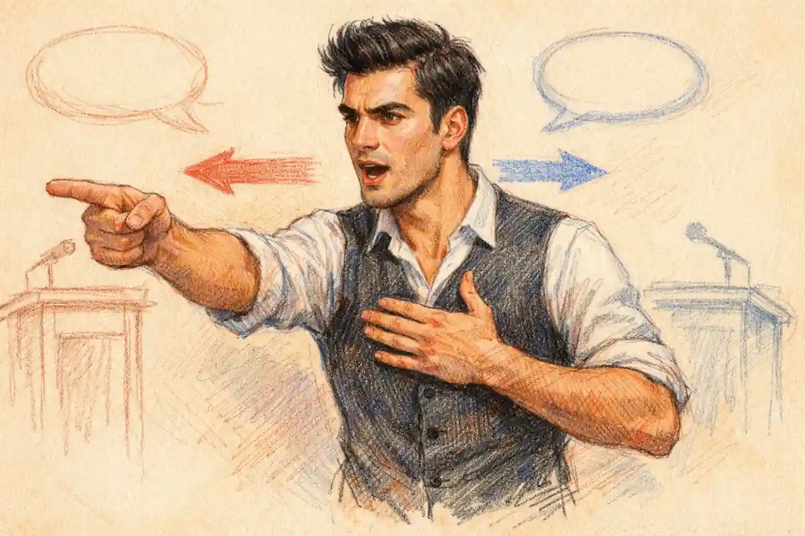

The ending of Romeo and Juliet is hopeful or hopeless depending on whose account the question settles, and the play has already separated the accounts. For Verona, the ending is the only morning in the tragedy without a drawn sword: the feud that opened the play with a street brawl closes it with a handshake, an exchanged vow, and a ruler who confesses his own share in the damage. For the lovers, the ending offers nothing at all: no rescue, no reunion beyond the tomb, no word spoken to them or for them that they can hear. This article argues a graded verdict. The hope is real, and it belongs entirely to the city that survived; the hopelessness is also real, and it belongs entirely to the two young people who did not. Any reading that merges the two accounts, whether into a warm redemption or into an unrelieved despair, has stopped listening to a final scene that keeps them apart with unusual discipline.

The discipline is visible in the distribution of the last speeches. The fathers gain a future and speak of building; the Prince gains a lesson and speaks of judgment deferred; the Friar gains a hearing and speaks a confession. Romeo and Juliet gain a story. The closing couplet does not say that Verona was healed, or that the houses were blessed, or that love triumphed over the feud that killed it. It says that never was a story of more woe than this of Juliet and her Romeo (5.3). A play determined to end hopefully had warmer words available and declined them. A play determined to end hopelessly had a feud available to restart, and declined that too: no servant draws, no kinsman protests the handshake, no voice in the final hundred lines promises further violence. The ending is a settlement in which one party is paid in full and the other is not paid at all, and the tone debate survives because both halves of that sentence are textually exact.

## What Happens in the Last Hundred Lines of Romeo and Juliet

The inventory matters, because the tone debate is often conducted from memory rather than from the scene, and memory softens the proportions. After Juliet's death the scene changes hands at speed. The watch secures the churchyard as a scene of crime, detaining Balthasar and the Friar at the tomb's mouth and sending for the Prince, the Capulets, and the Montagues, so that the tragedy's most private place becomes, within minutes, its most public one. Paris's page testifies. Balthasar testifies, and produces Romeo's letter, which the Prince reads as confirmation of the Friar's whole account. Friar Laurence then delivers the long narration that reconstructs the secret marriage, the potion, the undelivered letter, and the tomb, ending with an offer to accept the severest law if any part of the disaster miscarried by his fault (5.3). The Prince accepts the account, pronounces his sentence on the houses and on himself, receives the fathers' handshake and their competing vows of golden statues, and closes the play with six lines that name a peace, defer all punishment and pardon to a later conversation, and convert the lovers into a story of woe. The separate scene-by-scene anatomy of the tomb sequence, including the double suicide at its centre, belongs to the study of [Act 5 Scene 3 and the tomb's double suicide](/2023/12/08/act-5-scene-3-tomb-double-suicide/); the concern here is narrower and colder: what the arrangement of these events licenses a reader to feel.

Three features of the inventory carry the whole tone argument. The first is sequence. Reconciliation in the scene follows explanation: the fathers shake hands only after the Friar's narration and Romeo's letter have established what their children were to each other, married, faithful, and dead by the machinery of secrecy that the feud itself imposed. The peace is therefore not a spasm of grief but a response to evidence, the first decision in the play that both houses take on the basis of the same facts. The second feature is proportion. The lovers occupy the scene as bodies and as topics; the living occupy it as speakers. Of the final movement's speeches, the longest belongs to the Friar's self-exculpation, the most consequential to the Prince's self-indictment, and the most quoted to two old men bargaining in gold over a grave. The third feature is omission. Nobody in the closing movement blames Romeo or Juliet. Nobody calls the marriage a sin, the potion a crime against nature, or the suicides a shame to be hidden. In a period whose moral vocabulary for self-slaughter was severe, the final scene's silence about the lovers' guilt is a deliberate tonal choice, and both sides of the debate have to price it: the hopeful reading hears absolution, the bleak reading hears an evasion too exhausted to judge.

The inventory has a further layer that summaries habitually flatten: the ending is an inquiry before it is a reconciliation, and the inquiry is conducted in a new language for Verona. The watch speaks procedure, securing ground, taking testimony, fetching authority. The Friar speaks evidence, offering a continuous narrative that can be checked against a document, and the document exists: Romeo's letter, carried by Balthasar, confirms the marriage, the purchase of poison, and the intention to die beside Juliet, so that the Prince's acceptance of the Friar's account rests on corroboration rather than on clerical credit. For a tragedy whose catastrophe was built from failed messages, partial reports, and knowledge locked inside single breasts, the final scene's method is a deliberate reversal. Verona's authority ends the play in possession of the complete truth, publicly established, for the first time in the action. That possession is one of the ending's genuine goods, and any weighing that omits it understates the hopeful pan. It is equally one of the ending's genuine cruelties, since the truth's public career begins at the moment it can no longer be used by the two people it most concerns. Knowledge, in the ending, is the city's inheritance and the lovers' posthumous donation, and the scene's tone is set by the transfer.

The testimony itself deserves a slower reading, because the ending's evidentiary care is part of its tone. Paris's page, a boy who hid among the yew trees while his master died, gives the inquiry its only eyewitness account of the tomb fight and asks nothing for himself; his evidence is the last disinterested speech in the play. Balthasar's testimony is narrower and heavier: he reports what he saw, a light in the tomb and his master within it, and produces the letter that converts report into record. The Friar arrives last among the witnesses and most compromised, entering with the tools of his trade, lantern, spade, and crow of iron, the equipment of a man who came to dig a living woman out of a grave and found the grave occupied by the dead. His stumbling entrance, detained by the watch with his implements in his hands, is the tragedy's final image of competence arriving after its hour: everything he carries is the right equipment, and all of it is useless. The inquiry assembles these fragments without haste and without invention, and the patience matters. A scene determined to console would hurry past the evidence toward the embrace; this scene makes the audience sit through the whole reconstruction first, so that the reconciliation, when it comes, is founded on the complete and unbearable record. The hope of the ending is an informed hope, which is the only kind the play respects.

The Prince's conduct of the inquiry adds a detail the tone debate rarely prices. Entering, he does not begin with accusation but with a demand for the facts in their order, and his first sentence to the fathers is a summons to look: where be these enemies, Capulet, Montague, see what a scourge is laid upon your hate (5.3). The verb matters. The fathers are not asked to feel, to swear, or to submit; they are ordered to see, and what they are shown is the consequence of their hatred arranged as evidence, three young bodies in a tomb and a fourth, Paris, beside them. The reconciliation that follows is the play's only act of statecraft founded on sight rather than on rumour, threat, or interest. Whatever else is said about its lateness, the peace is the first public act in Verona performed by people looking directly at what their arrangements have done.

A sober note belongs to the inventory before the debate proceeds. The deaths at the tomb are a fiction's deaths, arranged by a playwright for an audience's instruction and feeling, and the play itself treats them with a gravity that forbids decoration. Any reader who meets the scene while carrying a real grief, or a real crisis of the kind the tomb dramatizes, deserves better than a fiction's resolution: the support of living people, of trusted counsel, and of the services that exist for such hours. The play can weigh its ending; it cannot carry that weight for anyone, and criticism does its subject no honour by pretending otherwise.

## The Prologue Promises the Ending: Hope Priced Beforehand

The debate over the ending's tone is unusual among literary arguments because the play states both terms of the settlement before the action begins. The Prologue's sonnet announces a pair of star-crossed lovers who take their life, and announces in the same breath what the deaths will do: their death will bury their parents' strife, since the continuance of the parents' rage is a thing which, but their children's end, nought could remove (Prologue). The hopeful outcome and the hopeless price are not rival interpretations imposed on the ending from outside. They are the ending's own contract, read aloud to the audience in the first fourteen lines and then executed to the letter over five acts. A spectator who reaches the final scene has been told since the first minute that the feud ends and that only the children's deaths can end it. The reconciliation cannot arrive as a surprise consolation, and the deaths cannot arrive as an unforeseen waste. Each is the other's stated condition.

This pricing in advance disciplines both readings. Against the hopeful reading, the Prologue removes the option of treating the peace as a fortunate accident that redeems an otherwise senseless loss: the text insists the peace was purchasable in exactly one currency, and the currency was the children. Against the bleak reading, the Prologue removes the option of treating the peace as a hollow afterthought pasted over the catastrophe: the feud's end was the design's declared destination from the start, and the ending delivers it without qualification, qualification being reserved for everything else. What the Prologue will not support is surprise in either direction. The ending is the execution of a contract whose terms were always legible, and its tone is the tone of a contract fulfilled at the stated price: satisfaction that the terms held, and horror at what the terms were.

The contract is written, fittingly, in the language of commerce, and the ending honours the metaphor to the last line. The Prologue calls the play the two hours' traffic of its stage, traffic being trade, the movement of goods through a market, and the tragedy that follows is saturated with the market's vocabulary: dowries and jointures, portions and purchases, a poison bought for forty ducats, a ring given as a token, love itself repeatedly priced, weighed, and found too light or too sudden for the scales. The ending completes the figure. The fathers settle the feud as merchants settle an account, with a handshake that is named a jointure, a debt acknowledged, and capital monuments commissioned in competitive gold. The hopeful reading can claim the completion as dignity: Verona's peace is struck in the city's native language, and a settlement phrased in the terms a city understands is a settlement built to last. The bleak reading can claim the same completion as indictment: a world that can only conclude its tragedy as a transaction never escaped the values that caused it, and the lovers, who in the balcony scene had briefly invented a language beyond price, are finally spoken for entirely in the currency they tried to refuse. The frame's first metaphor thus contains the whole debate in embryo, which is one more reason the debate feels less like an argument about the ending than like the ending's own echo, returning in criticism's voice.

The frame's withdrawal is part of the pricing. The Chorus speaks twice, at the threshold and at the lovers' marriage, and then vanishes from the play it introduced, leaving the second half unnarrated and the ending unglossed. A returned Chorus at the close could have done what choruses do: gathered the action into a moral, instructed the audience in the feeling appropriate to it, and discharged everyone in agreement. The design refuses that comfort. In place of the professional interpreter, the ending installs an interested party, the Prince, whose gloss is partial in every sense, and beyond him it installs the audience itself, which has heard the contract read at the start and must audit its execution unaided. The tone debate's longevity is structural before it is temperamental: the play dismisses its own referee at the midpoint and never appoints another, so the judging seat at the final scene is permanently occupied by whoever is watching. Every generation that has argued the ending's hope has been sitting, whether it knew it or not, in a chair the dramatist left empty for it.

The frame also decides who tells the ending. The Chorus that spoke the Prologue does not return to gloss the result. Instead the closing words belong to the Prince, the officer whose edicts failed three times to keep the peace his final speech announces. The transfer matters for tone. A chorus might have moralized the exchange, weighing the children's deaths against the city's peace and declaring the balance favourable or obscene. The Prince does neither. His closing speech performs the two halves of the verdict separately and refuses to sum them: heaven, he says, found means to kill the fathers' joys with love, and he himself, for winking at the discords, has lost a brace of kinsmen, so that all are punished (5.3); then, in the same breath, a glooming peace has arrived with the morning. Punishment universal, peace arrived, and no sentence anywhere that sets one against the other as payment. The arithmetic is left undone on stage, which is why audiences have been doing it, in disagreement, ever since.

## The Sources' Endings: A Moral the Play Refuses to Speak

Comparison with the sources sharpens what the ending declines to do. Arthur Brooke's poem, the play's principal English source, closes its story with a full distribution of earthly justice: the apothecary is hanged for his sale, the Nurse is banished for her part in the secret, and Friar Laurence, his confession heard, withdraws to a hermitage a short distance from Verona and dies there within a few years, a completed penance for a completed account. Brooke's preface, moreover, judges the lovers in advance with a severity the poem's ending sustains, presenting their story as a warning against disobedience, unhonest desire, and trust in a friar's devices. Bandello's Italian novella likewise allows its friar an ending, flight and a death in exile, and gives its community a settled moral to carry away. In the sources, that is, the ending's work includes sentencing: the tale closes its books, name by name, and the audience is discharged with the account ruled and totalled.

Shakespeare cuts every one of those completions. No apothecary is sentenced onstage, though the Mantuan law against his trade was quoted at his introduction with a hangman's clarity; no Nurse is banished; no Friar is assigned a hermitage or a grave; and no prefatory or closing voice judges the lovers at all. The Prince's some shall be pardoned, and some punished is left without a single name attached, and the play ends. The refusal is systematic rather than incidental, and it governs the ending's tone at a level beneath the debate's usual evidence. An ending that distributed Brooke's sentences would feel morally finished whatever its griefs, because sentencing is the ritual by which a community declares that it understands what happened and has answered it. An ending that condemned the lovers in Brooke's manner would feel bleak in a different key, its darkness doctrinal rather than circumstantial. Shakespeare's ending does neither, and the undecided space where the sentences should stand is one reason the tone question has never closed: the audience is handed a peace without a verdict, and human judgment abhors the vacuum the play deliberately leaves.

The cut completions also redistribute sympathy in a way the hopeful reading can claim and the bleak reading must answer. By refusing Brooke's moral frame, the play refuses to make the lovers' deaths instructive at their expense. Nobody onstage converts them into an example while they lie there; the Prince converts them into a story only in the final couplet, and a story of woe is a monument to feeling rather than a rule for conduct. The lovers are the only figures in the ending who are neither sentenced nor excused, and in a scene of confessions, offers, and adjournments, that exemption reads as a kind of protection: the play will not let its community metabolize the children into doctrine before the curtain. Hope, if the ending holds any for the dead themselves, is located precisely there, in the refusal to use them up.

## The Hopeful Reading: A City Redeemed by Sacrifice

The hopeful reading begins from the observation that the ending delivers the one outcome every authority in the play had sought and failed to reach by any other means. The Prince opened the tragedy by threatening death to whoever disturbed the streets again, and the threat changed nothing. The Friar married the lovers in the explicit hope that the alliance might turn the households' rancour to pure love (2.3), and the marriage, kept secret, changed nothing in the houses' public conduct. Capulet sought an alliance with the Prince's kinsman Paris as a settlement of his line, and the settlement became a funeral. Against that record of failed instruments, edict, sacrament, and dynastic bargain, the final scene shows the feud simply stopping: two fathers who have never exchanged a civil speech in the play call each other brother, join hands, and compete in generosity toward each other's dead child. The hopeful reading asks what else in the play's world could have produced that minute, and the honest answer is nothing that the play shows. The deaths accomplish in one dawn what law, religion, and policy could not accomplish in a generation.

René Girard gives the hopeful reading its most rigorous mechanism. In the sacrificial account developed in A Theater of Envy, Verona's feud is a crisis of reciprocal violence in which each house mirrors the other's aggression until the city stands at the edge of general ruin, and crises of that kind end, in the archaic pattern Girard traces, by converging on victims whose death unites the community against no one and for everyone. The lovers, belonging to both camps by marriage and to neither by allegiance, are the only possible victims of that shape, and their deaths perform the archaic work with terrible efficiency: the two houses discover, over the bodies, that their enmity has one object in common, grief for the same two children. On this reading the peace is not a sentiment but a mechanism completing itself, and its reality is proved by its unanimity: not one voice in the final scene dissents from the settlement, wishes the feud continued, or reaches for a weapon. Girard's frame also explains the handshake's strange priority of grief over grievance. The fathers do not negotiate the feud's original cause, which the play never names, because the sacrificial mechanism does not require a cause to be settled; it requires a victim to be shared.

Girard's mechanism gains support from the play's first description of the feud, which the hopeful reading treats as a diagnosis the ending confirms. The Prologue calls the households two households, both alike in dignity, and the likeness is the tragedy's engine: the houses fight because they are interchangeable, each brawl a mirror answering a mirror, servants biting thumbs at servants in a quarrel neither party can state. Enmity of that kind cannot be argued out of existence, since it has no proposition at its centre, and it cannot be negotiated away, since precedence between equals has no compromise position. It can only be interrupted by an event that breaks the symmetry of aggression with a symmetry of loss. The ending supplies exactly that event. Each father loses his only heir to the same night, the same tomb, the same machinery; the grief is as alike as the dignity was, and for the first time the houses' perfect resemblance works toward peace instead of war. The handshake is the mirror's final reflection, two identical bereavements recognizing each other. On the hopeful reading this is why the peace holds within the fiction's terms: it is not founded on a change of heart that a fresh insult might reverse, but on an equality of loss that no fresh insult can unbalance.

A third support for the hopeful reading lies in the ending's treatment of secrecy. The tragedy's medium, from the balcony's whispers to the Friar's cell, was concealment: a marriage hidden, a potion disguised, a letter entrusted to a single carrier, a bride buried alive in a fiction of death. Every disaster in the play is a disaster of private knowledge in a public world. The ending reverses the medium completely. The marriage is proclaimed before the city's assembled authority; the letter is read; the confession is made in the open churchyard at dawn; the monuments are promised for the city's centre, where whiles Verona by that name is known the figures will stand in public view (5.3). The hopeful reading notes that the cure and the disease are exact opposites, and that a dramatist intending despair would have had no reason to construct the opposition so cleanly. Verona's future safety, such as it is, rests on the ending's publicity: a city that has seen its ruling houses conduct their reconciliation in the open, over evidence, has been given a new civic method along with its peace.

The hopeful reading draws a second support from the Prince's theology. His sentence on the houses assigns the deaths an agent beyond the feud: heaven finds means to kill your joys with love (5.3). Within the play's own terms, this is the closest the ending comes to a providential reading of the catastrophe, the suggestion that the deaths were an instrument by which a higher order scourged the city into peace. A scourge is not a kindness, and the line is spoken in reproach, yet it grants the lovers' deaths a function in a moral order rather than a mere place in a chain of accidents. The hopeful reading sets that line beside the Prologue's contract and concludes that the play's world, at its most authoritative level of speech, understands the deaths as meaningful: costly beyond measure, and the cost of the only good the city had left to buy. The lovers are called, by Capulet himself, poor sacrifices of our enmity (5.3), and a sacrifice, in the vocabulary of every culture the play's audience knew, is by definition a death that purchases something for the community that offers it.

### What has Verona gained when the curtain falls?

Verona has gained the cessation of a hereditary war, a ruler instructed by failure, and a public memory fixed on the cost of hatred. The gain is civic, not private: streets that can be walked, households that can intermarry, an authority that confesses its negligence aloud. Nothing in it returns to the two families as comfort.

The phrase on which the hopeful reading builds its altar deserves its own weighing, since it is the only place where a participant in the ending names the deaths' function in sacrificial language. Poor sacrifices of our enmity is Capulet's verdict on his own daughter and her husband, spoken over their bodies in the hearing of the city. A sacrifice, in the grammar of the word, is not merely a loss: it is an offering, made by an offerer, to a power, for an end. Capulet's genitive assigns the offering to the enmity itself, as though the feud had demanded and received its tribute, and the assignment is the father's confession in its most compressed form: the children were spent by the hatred, not by the stars, not by their own rashness, and not by heaven. That a father speaks the word at all converts the deaths from private misfortune into public transaction, which is the hopeful reading's foundational move. Yet the same phrase serves the bleak reading as an admission that the transaction's terms were set by the enmity and accepted by everyone else, heaven included, without negotiation. The word sacrifices is the debate in miniature, a single noun carrying an altar and an abattoir in the same syllables, and the scene's refusal to gloss it is the debate's charter.

The hopeful case, stated at full strength, is therefore not that the ending is happy, a word no responsible version of the reading uses. The claim is that the ending is redemptive in structure: a genuine evil, the feud, is genuinely ended; the ending's agents understand what ended it and say so; the city that walks out of the churchyard is measurably better than the city that brawled in the first scene; and the improvement is credited, onstage, to the lovers' deaths rather than to any wisdom of the survivors. Hope, on this reading, is the correct name for a future that the opening scenes made impossible and the closing scene makes ordinary. The childless fathers will die reconciled; their servants will not inherit a war; the Prince will govern a city whose two great houses have buried their rage with their children. Verona has a tomorrow. The reading only insists that the tomorrow is real, and that realism about it is not sentimentality.

## The Bleak Reading: Peace at an Unbearable Price

The bleak reading accepts every fact in the hopeful inventory and disputes the bookkeeping. A peace is not shown to be worth its price by being real, and the price here is not an abstraction: it is two children, one not yet fourteen, dead by their own hands in a tomb, after a sequence of adult failures that the final scene enumerates without quite reckoning. The reconciliation arrives when there is nothing left to fight about that either father still wants. Capulet's heir is dead; Montague's heir is dead; the feud was a competition between houses for precedence in a city, and the competition has lost its stakes along with its heirs. Peace between two extinguished lines is the cheapest peace a city can be offered, and the bleak reading hears the handshake accordingly: not as enmity overcome by love, but as enmity overtaken by extinction, ratified in the graveyard because the graveyard is where its fuel ran out.

Coppélia Kahn gives the bleak reading its sharpest social form. In "Coming of Age in Verona," the tragedy is read as the product of a patriarchal order in which sons prove manhood through violence and daughters are assets in their fathers' settlements, so that the catastrophe is not an accident befalling the system but the system working at full pressure. On that reading the final scene is the system's closing ceremony rather than its repentance. The fathers transact over the bodies in the vocabulary of property to the end: Capulet names the handshake itself his daughter's jointure, the marriage settlement she never lived to receive, and the competition in golden statues that follows is the feud's rivalry translated into expenditure, each father outbidding the other in the only currency their world respects. Nothing in the scene shows either father understanding a daughter or a son better than at the start; what the scene shows is two patriarchs discovering a new arena, commemoration, in which to continue being measured against each other. The separate weighing of [the statues of gold, and whether they reconcile or ironize](/2031/04/04/statues-of-gold-reconciliation-or-irony/), follows that contest in detail; for the tone debate its significance is simpler. A reconciliation conducted as a bidding war in gold is evidence about the reconcilers, and the evidence is not reassuring.

The bleak reading also keeps a roll of the ending's silences. Paris, the Prince's kinsman, died in the tomb asking to be laid beside Juliet, and no speech in the closing movement commemorates him, promises him a monument, or enters him in the account at all; the final couplet names Juliet and Romeo and no one else. Lady Montague died of grief for her son's exile on the same night, a death reported in two lines by her husband as he enters, and the peace is constructed without her: the reconciliation of Verona is an agreement among surviving men, concluded over female dead who include a wife and mother the settlement never mentions. Mercutio, whose curse on both houses the catastrophe fulfilled, receives no acknowledgment from the settlement his death helped to purchase. The bleak reading does not claim these omissions are accidents of compression. A dramatist distributing hope has every incentive to widen the closing consolation, and this dramatist distributes it narrowly, to exactly two fathers and one ruler, in a scene where half the casualties are female, young, or kin to the throne and go uncounted in the peace. What an ending leaves out is part of its tone, and this ending leaves out most of the dead.

The settlement's narrowness of franchise deserves a bleak paragraph of its own. Verona's populace suffered the feud in their streets, answered the brawls with clubs, and cried the rival names as slogans when Tybalt's body was carried through the city; the feud was, at street level, a popular institution with a popular constituency. No citizen is present at its abolition. The closing assembly is a court: a ruler, two fathers, a friar, servants of the watch, and witnesses, gathered in a private tomb at dawn before the city is awake. The peace that the hopeful reading celebrates as Verona's deliverance is concluded without Verona, by the half dozen men whose class authored the quarrel, and its promulgation is deferred to the same later conversation as the punishments. A city can of course be bound by its rulers' acts, and dawn settlements are how states are often made. The bleak point is narrower and harder: the play, which took care to show the feud's popular life in its first scene and its third, takes equal care to exclude the people from its ending, so that the peace arrives in the fiction as an elite instrument whose reception by the streets that must keep it is never shown, never promised, and never even mentioned.

A further bleak exhibit is the conversion's speed, which the scene's compression makes unavoidable and its interpretation cannot escape. The fathers pass from hereditary hatred to brotherhood within a few dozen lines of seeing the bodies, and nothing inside the play tests the conversion: no next morning is shown, no servant tests the peace with a fresh insult, no marriage alliance is proposed to seal what the handshake began, no law is enacted, no compensation arranged for the injured parties who crowd the scene's margins. The peace is asserted at the moment of maximum grief and minimum resistance, by two men whose capacity for sustained hatred the play has documented across five acts and whose capacity for sustained anything else it has never examined. The bleak reading does not have to call the conversion insincere; sincerity at dawn is cheap evidence about conduct by winter. It has only to note that the play ends exactly where verification would begin, and that an ending which stops before its hope can be tested has given the hopeful reading an assertion where it needed a demonstration. The Prologue promised that the rage would be buried with the children; it did not promise that the burial would hold, and the play's final silence on the city's future conduct is the bleak reading's reserved seat in every performance.

### Whose grief gets no monument and no mention?

Paris and Lady Montague stand first in that roll: the suitor who died keeping an uncommissioned vigil at the tomb, and the mother who died of her son's exile before the tomb was opened. Neither is named in the final couplet, neither is promised gold, and neither is assigned a mourner by the settlement speeches.

The bleak reading presses two further exhibits that the hopeful case prefers to leave in shadow. The first is the absence of the feud's actual fighting class from the reconciliation. The play's violence was performed overwhelmingly by the young and the serving: Sampson and Gregory opened it, Mercutio and Tybalt escalated it, and the citizens with clubs answered it, while the old men who owned the quarrel fumbled for swords their wives mocked. The peace, by contrast, is concluded exclusively by the owners. No servant is asked to surrender a grudge, no citizen is shown laying down a club, no young survivor of either household ratifies the fathers' dawn conversion, because the young of both households are dead or, like Benvolio, simply absent from the scene and from the play's closing account altogether. A settlement signed by the only generation with the leisure to sign it, over the bodies of the generation that did the fighting and the dying, has a shape the bleak reading is entitled to name: the feud ends when its fuel is spent, and the men who stored the fuel declare the winter over.

The second exhibit is the language of debt in which the fathers close their bargain, a language the hopeful reading quotes too quickly. Capulet, having named the handshake his daughter's jointure, hears Montague promise a statue in pure gold and answers that Romeo's shall lie as rich beside his lady, or Capulet will die in debt. Even at the grave's edge, that is, the fathers' generosity takes the form of an obligation to be discharged and a standard to be matched; the reconciliation's emotional climax is phrased as accounting. The bleak reading does not deny the sincerity of the grief inside the phrases. It denies that the phrases show transformation. A man who can only express love for his dead child as a competitive expenditure has brought his whole world with him into the churchyard, and the world that made the tragedy is the world that survives it, enriched by two monuments and unreconstructed in every habit that the monuments display. Where the hopeful reading sees the feud translated into generosity, the bleak reading sees it translated into gold, and translation, unlike conversion, leaves the original text intact beneath the new wording.

The bleak case at full strength concludes that the ending's warmth is a property of its lighting rather than its content. Dawn breaks, hands join, gold is promised, and a couplet rhymes the curtain down; the forms of consolation are all present, arranged by a master of forms. Underneath them, the substance is that two children are dead because every adult institution in their city failed them in sequence, and the adults' response, once the failure is total, is to agree with each other and memorialize the children at public expense. The peace costs the fathers nothing they had not already lost. It costs the lovers everything they had. A reading that calls such an ending hopeful, the bleak case insists, has confused the survivors' relief with the tragedy's meaning, and has mistaken the temperature of the audience's pity for a verdict the text itself declines to give.

## Comedy's Shape, Tragedy's Bill: The Scholar's Evidence

Between the two readings stands a body of formal evidence that neither side can ignore, because it concerns not what the ending means but what kind of object it is. Susan Snyder's The Comic Matrix of Shakespeare's Tragedies established the structural description that subsequent discussion has had to answer: the play is built on the chassis of a comedy. Young lovers blocked by hostile fathers, a resourceful friar acting as the comedy's engineer of marriages, a secret wedding, a banishment that functions as the comic separation, a potion plot of mistaken death, a tomb scene poised for the comic discovery that the sleeper lives: every mechanism of the first four acts belongs to the tradition in which such machinery delivers the lovers to a wedding dance and the fathers to forgiveness. The catastrophe, in Snyder's account, is what happens when the comic machinery is run in a world that also contains Tybalt's sword and a quarantined friar: the devices all work, severally, and the whole fails. Mercutio's death is the hinge on which the matrix turns from comic to tragic, after which the same devices produce corpses instead of marriages.

The matrix's details repay attention because they show how thoroughly the ending's doubleness was engineered rather than stumbled into. The Friar is comedy's classic engineer, the clever servant or friendly cleric whose devices ordinarily untie the plot, and his two great devices here are a marriage and a mock death, the two most festive instruments in the comic repertoire. The Nurse is comedy's go-between, garrulous and mercenary, whose errands in a comedy carry assignations and in this play carry a wedding invitation, a rope ladder, and finally the counsel that breaks her charge's trust. Capulet's household in the fourth act performs outright comedy, the bustle of wedding preparations with cooks, logs, and a master counting the hours before dawn, and the same bustle is replayed within hours as funeral preparation, the identical properties renamed. Shakespeare's design keeps forcing the two genres to share a stage and a prop table. By the final scene the audience has been trained to read every festive shape as one accident away from its funereal double, so that when the ending performs comedy's reconciliation, the performance arrives pre-haunted: the form is recognized, and recognized as arriving one death too late, then another, then another.

Snyder's account also explains the ending's strange emotional arithmetic better than either rival reading does. In a completed comedy, the final reconciliation discharges the audience's accumulated anxiety about the lovers, and the discharge is experienced as joy. In this play the anxiety is discharged in full, the feud ends, the fathers relent, the truth is told, and yet the joy cannot form, because the object of the anxiety is gone. What forms instead is a compound that neither the hopeful nor the bleak vocabulary names cleanly: relief for the world of the play, grief for its centre, and a reflexive awareness of the substitution as it happens. The awareness is the tragedy's signature effect, and it is why the ending can be neither argued into sunshine nor into night. The form itself is a third witness, and its testimony constrains both counsels: hope is licensed by the shape, despair is licensed by the cast list, and any verdict that fires one witness to favour the other has misread the evidence.

The ending, on this formal evidence, is a comic ending executed by a tragedy's cast. Comedy closes with the social order repaired: blocking figures converted or expelled, marriages ratified in public, the community reconstituted around the young couple, and a senior figure blessing the settlement. The final scene of this play delivers every element of that pattern in negative. The blocking fathers are converted, in public, over the marriage's revelation. The community is reconstituted, in the churchyard, around the couple. A senior figure, the Prince, pronounces the settlement. The single substitution is that the couple at the centre of the reconstitution are dead, so the dance becomes a funeral and the ratification becomes a memorial. Snyder's evidence explains a datum that both rival readings struggle with: why the ending feels simultaneously like a resolution and like a desecration. It is a resolution, formally complete, and the form's completeness is exactly what desecrates, because the audience can see the wedding-shaped hole at the centre of the funeral and can measure, by the shape, what the city is celebrating over.

The adjudication this article will eventually defend uses Snyder as its frame and the other two critics as its correctives, and the correctives should be stated before the verdict so that the verdict's debts are visible. Against Snyder, Kahn's reading establishes that form is not the whole evidence: the comic matrix describes the ending's shape, but the shape is executed by particular men whose habits of property and precedence survive their conversion, and a formalism that cannot see the jointure in the handshake has mistaken the diagram for the event. Against Kahn, Girard's reading establishes that content is not the whole evidence either: the fathers' property language, read within the sacrificial mechanism, is the sound of a community performing the only rite it knows for the ending of a crisis, and the rite's efficacy, measured by the violence that stops and never resumes within the play, is a social fact that suspicion of the fathers' motives cannot repeal. Each critic is the other's missing instrument. Snyder supplies the shape, Kahn the price list, Girard the engine, and the ending requires all three instruments to be described at the resolution the text achieves.

This is also where the hopeful and bleak readings can be tested against each other rather than merely alternated. If the ending were simply hopeful, its comic form would be a lie about its content. If it were simply hopeless, its comic form would be an irony pasted onto despair. The formal evidence supports a more precise description: the play grants the comic ending's social goods in full, peace, reconciliation, public acknowledgment of the marriage, and withholds the comic ending's personal good, the lovers' life together, in full. The withholding is not partial. No last-minute softening reaches the lovers themselves; Juliet wakes to a husband already dead and joins him within lines, and the play's tenderness toward them in the final movement is entirely retrospective, expressed by other people's speeches. Form gives the city everything and the lovers nothing, and the critical debate is the sound of readers deciding which of those two gifts defines the whole.

### Why does the ending follow comedy's pattern with tragedy's cast?

Because the play was built on comic machinery from its first scene, and machinery outlasts the hands that feed it. The fathers' conversion, the public ratification, the ruler's blessing are comedy's closing moves, performed completely. The cast performing them stands among the comic couple's bodies, which converts each festive move into its funereal equivalent without altering its shape.

One more formal substitution fixes the ending's genre in the weighing. Comedy's closing rite is a dance or a feast, the community's bodies moving together in celebration; the rite this play substitutes is an inquiry, the community's voices answering questions in sequence before an officer of the law. The substitution is exact and complete: where the dance would display the repaired order enjoying itself, the inquiry displays the damaged order examining itself, and the examination is the celebration's tragic equivalent, the most festive act a city with this history can honestly perform. Even the setting enforces the exchange. Comedy ends indoors or in a green place, in feasting light; this play ends in a tomb at dawn, among graves, with the community's highest ceremony being a truthful account of how the graves were filled. Snyder's matrix predicts the shape of the close and the substitution explains its feeling: the audience recognizes the ceremony of communal repair and registers, simultaneously, that repair's ceremony has been replaced by its own investigation. Hope in such a close is procedural rather than festive, the hope of a record set straight, and hopelessness is the recognition that the record is all the lovers will ever attend.

The formal evidence also settles the standing of one hopeful argument and one bleak argument. The hopeful argument that the lovers' love is vindicated at the end is formally true in a limited sense: the marriage the city forbade is the marriage the city ends by honouring, with monuments, and the fathers' vows concede that the children's choice, not the parents' arrangements, is what Verona will remember. The bleak argument that the honour arrives as a substitute is equally true in the same sense: honour is the comic ending's currency for the living, paid here to the dead, who cannot spend it. Between vindication and substitution there is no factual dispute at all, only a dispute about which noun governs the sentence. That is the signature of a genuinely balanced text, and it is why the tone debate has outlasted every generation's attempt to close it. The evidence is symmetrical; the verdicts differ because the weighers differ in what they take an ending to be for.

## The InsightCrunch Ending Weighing

The weighing below gathers the debate into the artifact this article is charged to keep: the InsightCrunch ending weighing, a row-by-row account of what each side of the scale holds and what the row settles when the two are read together. Readers assembling the weighing into a study deck can lay its rows out with [the ReportMedic PPT Viewer](https://reportmedic.org/tools/ppt-viewer.html), keeping each row's two pans and its settlement in a single view. The rows are ordered from the city's account to the lovers' account to the audience's, because the verdict this article defends depends on keeping those accounts separate. A weighing that merged them into a single score would reproduce the error both readings commit at their weakest.

| Question weighed | The hopeful pan | The bleak pan | The settlement |
| --- | --- | --- | --- |
| The feud | Ended onstage, by handshake, without conditions | Ended between two fathers whose lines are extinct | Real, and narrower than it sounds |
| The lovers | Their deaths purchase the city's peace | Their deaths purchase nothing they can receive | Unredeemed in their own account |
| The marriage | Publicly honoured by both houses at the end | Honoured only when it can no longer be lived | Vindicated as fact, voided as future |
| The statues | Permanent honour in the city's centre | Gold paid in place of living children | Commemoration without restitution |
| The Prince | Authority confesses its own failure aloud | Authority defers every sentence to later talk | Judgment acknowledged, then postponed |
| Heaven's part | The deaths named a scourge that teaches | The frame falls silent after the couplet | Meaning assigned, rescue withheld |
| The houses' future | Both houses survive, reconciled | Both lines end with the buried heirs | Peace without posterity |
| The uncommemorated | The couplet preserves the lovers forever | Paris, Mercutio, and Lady Montague go unnamed | Memory granted to two of the dead |
| The story | Retold as the city's founding warning | Retold as a story of more woe | Survival as narrative, not as life |
| The audience | Sent out with pity and relief together | Sent out with pity unrelieved by justice | Graded hope, weighted toward grief |

Read as a whole, the table's pattern is the argument. Every row in which the hopeful pan outweighs concerns the survivors: the city, the houses as institutions, the ruler, the audience's relief. Every row in which the bleak pan outweighs concerns the dead: the lovers' unredeemed account, the uncommemorated casualties, the future the houses no longer have. The ending is not a blend in which hope and despair are mixed into a single grey feeling; it is a partition, drawn with unusual exactness, in which hope is assigned to the living and hopelessness to the dead, and the final scene's emotional power comes from holding both assignments in view at once. The fuller scene-level treatment of [the final reconciliation and its golden statues as cold comfort](/2023/12/15/final-reconciliation-golden-statues/) develops the fathers' bargain row by row; the weighing here records what that bargain does to the ending's tone, which is to move the statues from the hopeful pan, where a first viewing places them, toward the centre of the scale, where commemoration and substitution balance.

The marriage row holds the weighing's most quietly devastating settlement, and it turns on the Friar's own prophecy. Marrying the lovers, he had hoped the alliance might so happy prove as to turn the households' rancour to pure love (2.3), and the ending fulfils the prophecy with a fidelity that reads as mockery: the alliance does turn the rancour, publicly, permanently, in the hearing of the city, and it does so by means of the alliance's corpse. The mechanism the Friar predicted was the marriage's life, a living bond between the houses with children to embody it; the mechanism the event supplied was the marriage's death, a bond discovered at the graveside. The weighing records the row as vindicated as fact and voided as future, and that double entry is the tragedy's whole method in one line of the table. Again and again in this play, predictions come true in their letter and perish in their spirit: a dream of joy precedes the news of death, a vision of a lover in a tomb proves accurate as diagnosis and useless as warning, and a friar's hope for his sacrament proves sound in everything except the survival of its subjects. The ending's tone is the tone of that method, fulfilment with the life removed, and it is why the weighing's settlement column so rarely contains a simple adjective.

One row deserves prose of its own because productions keep re-weighing it: the audience row. The hopeful pan's relief is a real theatrical fact. Audiences do breathe differently at the handshake; the release of a two-hour tension built on hatred is physical, and a criticism that denies the relief falsifies the experience of the play in performance. The bleak pan's grief is equally a fact, and it outlasts the relief in the lobby and on the journey home, because relief attaches to the feud, which was the play's public machinery, while grief attaches to the lovers, who were its private centre. The settlement column's phrase, graded hope weighted toward grief, is a report of that sequence: relief first, because the handshake comes first in the scene's emotional order; grief last, because the couplet comes last in the scene itself, and what comes last in a Shakespearean ending is what the audience carries out of the theatre.

Two rows of the weighing reward a slower look before the argument moves to justice. The story row records the ending's one unambiguous act of preservation: the lovers, denied every other future, are granted survival as narrative, and the grant is made onstage, by the Prince, in the form of a superlative. Never was a story of more woe is a ranking, and rankings are how cultures decide what to keep. Verona will keep this story at the head of its archive, retold as long as the city stands, and the keeping is not nothing; it is the form immortality takes in a world without a promised heaven for suicides. Yet the bleak pan of the same row is exact: survival as a story is survival for the tellers, not for the told. The lovers persist as material for other people's warnings, romances, and curricula, an afterlife administered entirely by the living who failed them, and the statues row and the story row together show the ending paying its debt to the dead in the two currencies the dead cannot spend, gold and fame. The weighing's discipline is to let both truths stand in the same row without allowing the fame to be entered as compensation for the grave.

The Prince row conceals a similar doubleness in miniature. His confession of failure is the hopeful pan's strongest single item of evidence about governance, since a political order that can indict itself in public has crossed the threshold that separates a regime from a mere management of force. His deferral of every sentence is the bleak pan's corresponding item, since an order that adjourns all consequences has crossed no threshold at all. The weighing places the two actions in one row because the scene performs them within a dozen lines of each other, and the row's settlement, judgment acknowledged and then postponed, is the precise formula for the ending's justice as a whole: a court that has learned to tell the truth and has not yet learned to act on it. Whether a city can be reformed by truth-telling alone is the question the ending bequeaths to its audience's own politics, and the bequest is part of the hope, since a question handed on is a future left open.

## Punished, Pardoned, or Left Speaking: The Ending's Unfinished Justice

The Prince's closing speech promises a judicial sequel and withholds it in the same sentence: some shall be pardoned, and some punished (5.3). The play ends before any name is attached to either category, and the deferral is one of the ending's most eloquent tonal facts. A hopeful ending in the full sense would distribute justice: the guilty sentenced, the innocent cleared, the audience discharged with the account closed. A hopeless ending in the full sense might distribute injustice: the guilty enthroned, the innocent blamed. This ending distributes neither. It adjourns. The inquiry that the final scene conducts, testimony, letter, confession, is genuine and thorough as far as it goes, and its thoroughness throws the adjournment into relief: Verona learns exactly what happened and then postpones deciding what anyone deserves for it. The conversation that might settle desert is scheduled for a time the audience will never see, which places the ending's justice in the same category as its peace: real as an intention, unverifiable as a fact.

The adjournment also completes a pattern in the Prince's own judicial record that the weighing should register, since the ending's justice is his third attempt at it. His first intervention threatened death for any further disturbance of the streets, a sentence of maximum severity that was never executed and never repeated. His second intervention, after Mercutio's and Tybalt's deaths, banished Romeo, a sentence whose mercy he defended in a maxim and whose consequence was the Mantuan half of the catastrophe: the exile created the distance across which the fatal news had to travel, and travelled wrong. His third intervention adjourns sentence altogether. Severity, error, deferral: the arc can be read hopefully, as authority educated by failure into humility, each sentence less confident than the last because each has taught its author the price of confidence. It can be read bleakly, as authority's progressive abdication, ending in a ruler who responds to six deaths by scheduling a conversation. The scene's own evidence slightly favours the hopeful arc, since the adjournment follows the fullest establishment of truth the play contains, and a court that has learned to establish facts before passing sentences has learned the one lesson its earlier haste kept missing. But the favour is slight, and deliberately so: the play lets its ruler improve without letting him arrive.

The distribution of speech in the closing movement sharpens the point. The Friar, the adult whose decisions did most to build the catastrophe's machinery, is granted the scene's longest speech and ends it uncondemned, with the Prince's acknowledgment that the city has known him for a holy man: his fate is left to the adjourned proceeding, in pointed contrast to the source tradition, where Brooke's poem completes the Friar's story with exile and a hermit's death. Shakespeare cuts the completion. The Nurse, whose counsel turned Juliet toward the bigamous marriage and whose silence kept the secret, is present at the margin of the scene and is never examined at all. Balthasar and the Page testify and vanish from the account. The fathers confess their enmity in a single phrase and are received as mourners rather than defendants. And the Prince, alone among the speakers, indicts himself: heaven's scourge fell on the houses, and I, for winking at your discords too, have lost a brace of kinsmen; all are punished (5.3). The self-indictment is the ending's most hopeful judicial fact, since a ruler who can name his own negligence before his city has begun the work that punishment would only symbolize. It is also, read coldly, a sentence the ruler passes on himself in words and then joins the general adjournment: no penalty follows for anyone, including him.

### Who confesses, and who is never asked to?

The Friar confesses at length and conditionally, offering his life if the fault proves his. The Prince confesses briefly and unconditionally, naming his own winking at the discords. The fathers confess their enmity in a single phrase. The Nurse is never asked for an account of her counsel or her silence.

There is a final distribution in the closing movement that the tone debate should weigh alongside the distribution of justice: the distribution of voice. The lovers' last speeches, the most intimate utterances in the play, are heard by no living person inside the fiction. Romeo's farewell is addressed to a woman he believes dead, in a tomb he believes private; Juliet's last words are addressed to a dagger. The ending's public speech, by contrast, belongs entirely to survivors, and its most eloquent passages, the Friar's narrative, the Prince's sentence, the fathers' bargain, are spoken by the three parties with the largest shares in the catastrophe's causation. Hope in the final scene is therefore voiced exclusively by the compromised, a fact that colours every hopeful sentence the scene contains. When the Prince promises more talk of these sad things, the talk will be conducted by the same voices, in the same city, with the lovers present only as its subject. The bleak reading hears in this the tragedy's last injustice, that even the meaning of the deaths is assigned to their authors. The hopeful reading can reply that the assignment is at least penitential, the compromised voices being precisely the ones that need to do the talking. Both hearings are available because the play, characteristically, stages the fact and withholds the gloss.

Justice deferred has a tonal consequence that both readings must absorb. For the hopeful reading, the adjournment is a mercy consistent with the dawn: a city that has just stopped killing is in no condition to begin sentencing, and the Prince's refusal to convert the churchyard into a courtroom is the peace's first act of governance. For the bleak reading, the adjournment is the peace's first evasion: the one proceeding that might have assigned the catastrophe's cost to its authors is postponed past the curtain, leaving the cost where it fell, on the two bodies at the centre of the stage. The text supports the bleak reading's fact and the hopeful reading's extenuation simultaneously, and characteristically declines to choose. What can be said without choosing is that an ending which adjourns its justice has not completed its moral work, and an ending which has not completed its moral work cannot be called hopeful without qualification. The qualification is this article's verdict in miniature: hope, yes, of the graded and unfinished kind; hope as a direction of travel for the survivors, not as a destination the play shows them reaching.

## How Productions Tilt the Ending Toward Hope or Despair

Because the text partitions its hope so exactly, production becomes the debate's second arena: a staging cannot change the partition, but it can light one side of it and shadow the other, and the history of the ending on stage is a history of such choices. David Garrick's adaptation of 1748 made the most consequential tilt ever given to the tomb scene by rewriting its central fact: in Garrick's version Juliet wakes before Romeo's poison has finished its work, and the lovers are granted a final conversation, recognition, reproach, and farewell exchanged with open eyes. The alteration held the English stage for generations, and its tonal meaning is unmistakable. An audience that has watched the lovers part consciously has received a consolation the text withholds: the death is shared knowingly rather than missed by minutes, and the ending's hopelessness for the lovers is softened by the one gift, a goodbye, that Shakespeare's timing refuses them. Garrick's immense success with the change is itself evidence in the debate, proof of how strongly audiences have wished the partition redrawn.

The twentieth century tilted the other way. Peter Brook's 1947 Stratford production, the staging of a young director determined to strip the play of picturesque sentiment, played Verona as a place of heat, dust, and casual violence, and let the final scene run at the pace of an inquest rather than a ceremony: the reconciliation arrived as exhausted administration, and the production's admirers and detractors agreed that it left the churchyard colder than they had ever felt it. Where Garrick added warmth the text lacks, Brook subtracted warmth the text permits, lingering nowhere on the handshake and giving the statues' vows the flatness of a press statement. The two productions mark the corridor within which the ending can be played, and the corridor's width is the practical measure of the text's balance: a scene that can bear both Garrick's consolation and Brook's coldness without breaking is a scene whose tone is genuinely in dispute at the level of the words.

Film fixed the tilts in permanent form. Franco Zeffirelli's 1968 film closes in procession: after the Prince's words, the bodies of the lovers are carried from the tomb side by side, borne through the churchyard and up the steps as bells sound, with the two households following in a single train of mourners. The image is the film's verdict. A community that walks together behind the biers has visibly become one community, and the procession's solemn beauty recruits the audience's feelings for the hopeful pan of the scale: the feud's end is not merely announced but enacted, in costume, in silence, in the choreography of enemies walking at the same pace behind the same dead. Baz Luhrmann's 1996 film tilts the opposite pan with its frame. The tragedy is presented as a television news story, the Prologue spoken by an anchorwoman, and at the close the film withdraws from the church to the screen itself, the lovers' image dissolving into static and the scheduled programming of a world that will report the next sensation by evening. The reconciliation, inside that frame, shrinks to an incident in a news cycle; the Prince's closing words compete with the medium's amnesia, and the audience is left with the bleak reflection that Verona's lesson will be forgotten by its own witnesses at broadcast speed. Luhrmann's film argues with its own frame in its final minute, and the self-argument is the partition reasserting itself inside the bleakest available medium. As the broadcast closes, the film intercuts the lovers' brief happiness, the meeting, the wedding, the one night, in a montage that withdraws the story from the newsreader's summary and restores it to private memory; for those seconds the lovers occupy the screen on their own terms, alive and unreported. Then the image dissolves to static and the set goes dark in an empty room, the public world resuming its indifference around the private archive. A director committed to despair would have ended on the static alone; a director committed to consolation would have ended on the montage. The film ends on both, in sequence, montage first and static last, which is the scene's own order translated into cinema: warmth presented, then audited, then surrendered to a world that will not keep it. Even the medium most hostile to the ending's hope reproduces the ending's structure when it tries to replace it.

Neither film betrays the text. Each develops one pan of the weighing and lets the other recede, which is why the two films, shown to the same audience, can produce opposite answers to this article's title question from identical words.

### What does a production decide when it lights the final scene?

A production decides whether the dawn is a beginning or an exposure. Lit as a beginning, with the churchyard warming and the survivors grouped in growing light, the scene ratifies the hopeful reading before a word is weighed. Lit as an exposure, under a hard white morning that shows every face at equal strength, the same words audit the survivors.

Opera carried Garrick's tilt to its logical extreme and thereby proved its popularity. Charles Gounod's Roméo et Juliette of 1867, working in the tradition Garrick founded, grants the lovers a final duet in the tomb: Juliet revives in time for the pair to sing their farewell together and die in each other's arms, reconciled and conscious. The operatic ending is not a corruption but a clarification of what audiences have repeatedly asked the tragedy for, a deathbed mutual recognition that converts the tomb from a place of missed signals into a place of completed love. Set against the play's partition, the request is diagnostic. What audiences beg for, across centuries and media, is never a change to the city's account: no adaptation restarts the feud or rescinds the peace, because the civic hope satisfies everyone. The begging is always for the lovers' account, for some coin, a farewell, a recognition, a shared final breath, to be paid into the empty pan. The history of adaptation is thus a referendum the hopeful reading keeps losing on the only question that matters to it, and the bleak reading's best external evidence: if the ending's consolation were adequate, its audiences would not keep rewriting the tomb.

The final tableau is the stage's oldest way of casting the same vote, and its history is a referendum in posture. A production must decide where the fathers stand when the couplet lands: kneeling at the biers with their hands joined across the bodies, which makes the reconciliation something the dead mediate and the image leans hopeful; standing apart at the tomb's edges with the Prince between them, which makes the settlement a piece of state business conducted near the dead and the image leans bleak; or already turning toward the exit as the words are spoken, which makes the peace a departure and leaves the lovers alone with the audience, the bleakest disposition of all and the one that most productions, whatever their stated reading, instinctively refuse. The instinct is data. Companies that have played the ending as unrelieved despair in every speech still tend to group the survivors around the bodies for the final image, as though the theatre itself could not quite discharge the audience into the street on woe alone. The text mandates none of the three tableaux. It mandates the words, and the words' partition, and then it hands the last decision to the bodies of the actors, where it has been re-decided nightly for four centuries without ever becoming a rule.

A quieter production choice works on the same account without touching a line: the delivery of the closing couplet. The Prince's final lines can be spoken across the bodies to the fathers, as the settlement's seal, in which case the couplet functions as an epitaph pronounced by authority and the audience overhears a state occasion. Or the lines can be turned outward, delivered to the house as the play's last act of address, in which case the audience is conscripted as the story's custodian and the couplet becomes a commission: the tale of woe is handed over, to be carried out of the theatre and kept. The first delivery seals the ending; the second opens it, and the difference between a sealed ending and an opened one is the difference between the bleak and hopeful experiences of the same words. Directors who choose the outward delivery are voting, with the text's permission, for the proposition that the ending's hope resides in its transmission, that Verona's failure to learn in time might be repaired by an audience learning at leisure. It is the only hopeful proposition about the play that the centuries have unambiguously verified, since the play is, demonstrably, still being learned from.

The production evidence, surveyed whole, returns the debate to the page with a useful sharpening. Directors tilt the ending because the ending invites tilting, and it invites tilting because its hope and its hopelessness are assigned to different objects and can therefore be lit separately. A production that wanted to falsify the text would have to move the hope onto the lovers or the despair onto the city: resurrect the children, as the happiest eighteenth-century experiments briefly did, or restart the feud over the bodies, as no serious staging has dared. Within the partition, everything is playable; across it, nothing is. That is the strongest practical confirmation the graded verdict can claim, since it comes not from argument but from two and a half centuries of professionals discovering the same boundary in rehearsal.

## The Audience's Share: Relief, Grief, and the Order of Feelings

The debate's persistence owes something to a confusion between two experiences that the ending produces in sequence, and criticism goes wrong when it reports only the one its temperament prefers. The first experience, arriving with the handshake and the statues, is relief: the hatred that has driven every scene relaxes its grip, enemies speak civilly, and the body in the seat unclenches. Relief is the tribute the ending pays to comedy, and it is neither shallow nor optional; a spectator who felt nothing at the fathers' reconciliation would be reporting a failure of attention, not a purity of grief. The second experience, arriving with the couplet and consolidating in the silence after it, is grief recollected and appraised: the mind returns to the tomb, counts the young dead, and finds the relief it just felt faintly indecent in their presence. Grief is the tribute the ending pays to tragedy, and it arrives second not because it is stronger but because appraisal is slower than reflex. The two experiences do not blend. They succeed each other, and the criticism of the ending is largely a record of which of the two a given critic chose to treat as the verdict and which as the preliminary.

Aristotle's vocabulary, applied with care, names the machinery without settling the account. The tragedy works by pity and fear, and its ending discharges both through recognition: the fathers recognize their enmity in its fruits, the Prince recognizes his governance in its costs, and the audience recognizes the whole design, which the Prologue disclosed, completing itself. Catharsis of that kind is a clarification, not a consolation, and the distinction matters for the tone debate because clarification is compatible with any verdict on the ending's hope. A clarified despair is still despair; a clarified hope is still hope. What the ending's recognitions clarify is the partition itself, the exact line between what the catastrophe repaired and what it ruined, drawn in speeches that assign every good and every loss to its rightful owner. Audiences leave the theatre knowing, with unusual precision, what they are relieved about and what they are grieving for, and the precision is itself a kind of respect the play pays its spectators: it refuses to let feeling do the work of judgment, and refuses to let judgment forbid the feeling.

The play's fame has quietly universalized the knowing audience, and the fact belongs in the weighing of the ending's modern reception. The Chorus's disclosure was, for a first audience, a chosen device; for nearly every audience since, the ending's outline is cultural knowledge carried into the theatre from childhood, from schooling, from the story's ten thousand retellings, so that the Prologue's office is performed before the house lights dim. No spectator of any modern production waits to learn whether the lovers will die. The consequence for the tone debate is that the audit posture is no longer one option among others but the default condition of reception: the ending is judged, by virtually everyone who sees it, as an execution of a known contract, and its hope and its hopelessness are appraised as terms rather than felt as surprises. This may be why the bleak reading has gained ground in the story's later centuries without ever winning it. Appraisal favours the cost side of any settlement, since costs itemize more readily than reliefs, and a culture that audits the ending will always find the bleak pan easier to document. The hopeful reading's persistence under those conditions, unembarrassed and textually armed, is itself evidence that the relief the scene delivers is not a frailty of inattentive audiences but a load-bearing member of the design.

The knowing audience sharpens the sequence into something closer to an audit. Because the Prologue discloses the ending, repeat spectators watch the final scene not for its outcome but for its conduct, attending to how each survivor behaves inside a result they cannot alter. Under that attention the hopeful evidence improves and the bleak evidence worsens, simultaneously. The fathers' conversion, watched knowingly, gains weight, since it must be performed in full view of its price and still holds. The statues' bargain, watched knowingly, loses innocence, since its gold is visibly the only language left to men who have spent their children. The Prince's deferral of judgment, watched knowingly, darkens most of all, because the audience knows the talk he promises is the talk the play will never show. Foreknowledge does not tilt the ending toward either reading; it raises the resolution at which both readings can be seen, like a light that flatters nothing and reveals everything. That may be the deepest reason the tone debate survives every attempt to close it. The play was designed to be rewatched, and each rewatching reopens the account at a finer grain.

## Hopeful or Hopeless? The Verdict

The verdict follows from the partition the text itself draws, and it can be stated without remainder. The ending of Romeo and Juliet is hopeful for Verona and hopeless for Romeo and Juliet, and it is not a compromise between the two claims but a conjunction of them, each at full strength. The feud ends; that is not nothing, it is the thing the whole city had failed to achieve by law, by religion, and by policy, and the play marks the achievement as the lovers' posthumous work. The lovers end; that is not a price the ending redeems, because redemption would require some good to reach the people who paid, and the ending is scrupulous, almost legalistic, in paying them nothing: not life, not a shared grave scene of recognition, not even the last word, which belongs to the Prince and to the story he makes of them. Hope in the ending is real and entirely inherited by strangers to the love that purchased it. Hopelessness in the ending is total and entirely concentrated on the two people who deserved the inheritance.

Test the verdict against the final scene's sequence, event by event, and the partition appears not as an interpretation imposed on the scene but as the scene's own rhythm. Testimony: grief, the record of the dead reconstructed name by name. Confession: grief again, the Friar's long account of a design that failed. Sentence: mixed, heaven's scourge and the ruler's self-indictment in a single speech, punishment universal and pardon promised to no one in particular. Handshake: peace, the scene's one unambiguous warmth, and it lasts four lines. Statues: mixed again, honour and substitution in the same breath, the fathers' love and the fathers' accounting inseparable. Couplet: grief, the superlative of woe pronounced over everything the peace has just accomplished, by the peace's own author. The scene alternates the two registers like a heartbeat and never merges them into a chord; no speech performs both at once, and the two mixed speeches are mixed by juxtaposition rather than by fusion. A text that wanted a hopeful ending had only to end on the handshake. A text that wanted a hopeless one had only to omit it. This text places the handshake fourth in a sequence of six movements and then keeps going, past it, into gold and into woe, and the going past is the verdict the scene passes on its own consolation: real, insufficient, and not the last word.

The adjudication among the critics lands in the same place by a critical route. Girard is right about the mechanism and wrong about the consolation: the sacrifice does end the crisis, unanimity does descend on the churchyard, and none of that reaches the sacrificed. Kahn is right about the price and wrong about the peace: the fathers do transact in jointures and gold, the patriarchal order does survive its children, and the cessation of the feud is nonetheless a genuine good that her reading's contempt for the reconcilers cannot dissolve. Snyder is right about the form, and the form is the verdict's deepest ground: a comic ending performed over the comic couple's bodies cannot be experienced as either hope or despair in the singular, because its shape promises the one and its cast delivers the other. The graded hope this article defends is Snyder's structure, priced by Kahn's accounting, with Girard's mechanism explaining why the survivors can feel the settlement as solid ground. Any single one of the three, taken alone, flattens the ending; taken in that order, they describe it completely.

The symmetric objection, from the hopeful side, deserves its answer as well: that grading the hope insults the peace, treating a genuine reconciliation as small change because it cannot resurrect the dead. The objection mistakes the verdict's arithmetic. To say the hope is real is to say the fathers' conversion, the feud's end, and the city's future are goods of the first order, worth the whole weight the scene gives them; to add that they belong to the city's account is not to diminish them but to locate them, and location is not devaluation. Verona's peace is not worth less because it cannot be spent by the lovers. It is worth exactly what peace is worth to the living who receive it, no more and no less, and the verdict's refusal to let it circulate as consolation for the tomb is a defence of its value against a debased exchange rate, not an attack on the peace itself.

One objection deserves a direct answer, since it is the strongest form of the bleak case: that graded hope is a critic's evasion, a refusal to feel the deaths at their full weight, dressed as nuance. The objection would hold if the grading blurred the lovers' account into the city's, crediting the peace against the deaths as though the ledger balanced. The grading defended here does the opposite. It refuses the balance. It holds that the ending's hope and the ending's hopelessness are not quantities of one substance that might cancel, but properties of different subjects that coexist without touching: the city is better off, the lovers are not better off at all, and no sum exists. A reader who finishes the play in tears and in relief has not failed to make up a mind; that reader has reproduced, in feeling, the exact partition the final scene builds into its speeches, its silences, and its closing couplet. The last word of the play's argument is woe; the last fact of the play's action is peace; and the ending's tone is the sound of those two truths declining, with great courtesy and complete finality, to be reconciled in their turn. The question the article set out to answer, finally, is also the subject of the neighbouring inquiry into [whether the play endorses or critiques the lovers](/2031/04/11/endorse-or-critique-the-lovers/), since a verdict on the ending's hope is always, in part, a verdict on the worth the play assigns to what its lovers were.

The graded verdict also governs how the rest of the play reads on a return journey, and its discipline cuts against two common corruptions of the earlier acts. Against the sentimental corruption, in which the balcony scene is bathed in advance in the ending's peace and the love is treated as already redeemed, the verdict insists that nothing in the final scene reaches backward to insure the lovers' happiness: their joy in the orchard was real, brief, and unprotected, and the ending's civic settlement adds nothing to it and subtracts nothing from it. Against the cynical corruption, in which the tomb's shadow is projected backward until every early scene reads as futility, the verdict insists that the feud's demonstrated end gives the early violence a weight that futility would dissolve: the brawls matter because what they were building toward could be, and was, stopped, at a price that the stopping itself reveals. A hopeless ending in the simple sense would license the cynical rereading and make the play a machine for producing despair about all young feeling; a hopeful ending in the simple sense would license the sentimental rereading and make it a machine for forgiving all adult failure. The graded ending licenses neither machine. It sends the audience back to the orchard with instructions to value what happened there at its own price, neither discounted by the tomb nor inflated by the peace, and that instruction, austere as it is, may be the most hopeful thing the play performs: it treats the lovers' three days as a good that needed no ending to justify it.

A verdict that cannot state what would overturn it is a mood rather than a judgment, so the falsification conditions belong on the record. The graded verdict would collapse toward hope if the final scene contained any one of three things it conspicuously lacks: a sign that the lovers know, before death, that their marriage has ended the feud; a blessing spoken over the bodies by name, joining them in the city's future rather than only in its memory; or a single executed act of the new order, a law, a marriage between the houses' surviving kin, a sentence carried out, that showed the peace in operation rather than in proclamation. The verdict would collapse toward hopelessness if the scene contained any one of three opposite things: a resumed insult at the tomb, a father's condition attached to his handshake, or a closing speech that blamed the children for the city's instruction. None of the six exists. The scene's exact inventory, warmth and cold distributed as they are and nowhere else, is what the partition describes, and the closeness of the counterfactuals measures how deliberately the inventory was chosen: the dramatist stood within a line or two of either simpler ending at every moment of the final scene, and declined both, six times over.

### For whom is the ending written: the city, the families, or the audience?

The ending is written for the audience, because only the audience receives both accounts at once. The city receives peace without the full knowledge of its price; the families receive grief without a future in their own lines. The audience alone is given the partition entire, and is sent out as the ending's only complete beneficiary and its appointed witness.

## Frequently Asked Questions

### Q: Is the ending of Romeo and Juliet hopeful or hopeless?

The ending is both, assigned to different subjects: hopeful for Verona, hopeless for the lovers. The feud genuinely ends, the fathers reconcile, and the Prince confesses his share in the failure, so the city leaves the churchyard with a future the opening scenes made impossible. Romeo and Juliet receive nothing from the settlement: no rescue, no reunion they can know, no word spoken in time. Readings that choose one adjective for the whole ending have to discard half the final scene to do it, either the handshake or the bodies beneath it. The question survives because the play's last movement is built as an alternation rather than a blend, grief and peace succeeding each other in separate speeches and never merging, so that criticism has gone on choosing which speech to call the ending's truth when the ending's truth is the alternation itself.

### Q: What does the hopeful reading claim the lovers' deaths accomplish for Verona?

The hopeful reading claims the deaths accomplish the one outcome every other instrument failed to reach: the end of the feud. The Prince's edicts did not end it, the Friar's secret marriage did not end it, and Capulet's dynastic bargain with Paris made it worse. Over the bodies, the fathers call each other brother, join hands, and compete in generosity, and the Prince reads the deaths aloud as heaven's means of killing the fathers' joys with love. On this reading the lovers are, in Capulet's own phrase, sacrifices of the enmity, and a sacrifice by definition purchases a communal good. The claim is strengthened by the peace's publicity: the reconciliation is performed before the assembled city, on evidence openly established, so that the feud's end becomes a public fact rather than a private mood between two exhausted men, and a public fact is the kind that outlasts the grief that produced it.

### Q: What does the bleak reading say the reconciliation cannot repay?

The bleak reading says the reconciliation cannot repay the dead, because every benefit of the peace flows to people who did not pay its price. The fathers gain relief from a feud whose stakes, their heirs, are already gone; the Prince gains a lesson; the city gains quiet streets. Romeo and Juliet gain monuments they cannot see, and Paris, Mercutio, and Lady Montague gain not even mention in the closing speeches. A settlement in which the creditors are all dead and the debtors divide the relief among themselves is, on this reading, an agreement among survivors, not a redemption of the loss. The reading adds that the peace is never tested inside the play: no later scene shows the settlement surviving an insult, a market quarrel, or a servant's grudge, so its permanence rests on the fathers' dawn emotion, the least durable material the tragedy contains.

### Q: Does the reconciliation give Romeo and Juliet anything back?

No, and the final scene is precise about the nothing. The lovers are given honour, monuments, and a story, all of which are goods for the living who confer them rather than for the dead who receive them. They are not given life, time, a shared farewell, or knowledge of the peace their deaths produced; Juliet wakes to find Romeo already dead and never learns that the feud has ended. The bleak reading rests much of its case on this asymmetry: the ending's generosity is real, and none of it is addressed to the two people at its centre.

### Q: Can an ending be hopeful for a city and hopeless for its heroes at the same time?

Yes, and this play is the standing example of the division. Hope and hopelessness in the final scene are not two quantities of one feeling that might average into a middle tone; they are properties of different subjects. The city's hope is a fact of the plot, demonstrated by the handshake and the cessation of violence. The heroes' hopelessness is equally a fact, demonstrated by the tomb. Because the subjects differ, the two verdicts coexist without cancelling, and the audience's mixed feeling at the curtain is an accurate registration of the text rather than an indecision to be cured.

### Q: Why does nobody in the final scene blame the lovers for their own deaths?

Because the scene distributes blame everywhere except onto the dead. The Prince blames the houses' hate and his own winking at their discords; Capulet calls the children sacrifices of the enmity, naming the feud as the agent; the Friar blames a greater power that baffled his intentions, alongside his own possible fault. In a culture ready to condemn secret marriage and self-slaughter in severe terms, the absence of any such sentence is a deliberate tonal fact. The hopeful reading hears it as absolution; the bleak reading hears exhaustion; the text simply refuses condemnation.

### Q: Does the Prologue's promise make the ending's reconciliation feel fated, earned, or both?

Both, and the doubleness is the source of the ending's peculiar tone. The Prologue announces that the parents' rage is a thing which, but their children's end, nought could remove, so the reconciliation arrives feeling fated: priced, contracted, and unavoidable from the first fourteen lines. Yet within the scene the peace also feels earned, because it follows evidence, the Friar's narration and Romeo's letter establishing what the marriage was before the fathers act on it. The ending is a fate that the survivors still have to choose, in full knowledge, over the bodies that purchased it.

### Q: How does René Girard's sacrificial reading explain the peace that follows the deaths?

Girard reads the feud as a crisis of reciprocal violence, each house mirroring the other's aggression, and such crises end, in the pattern he traces, when violence converges on victims whose death reunites the community. The lovers are the only possible victims of that shape, bound to both camps by marriage and loyal to neither camp's hatred. Their deaths give the houses a single shared object, grief for the same children, and the peace follows with the unanimity the final scene displays: no voice dissents, no hand moves to a weapon. Girard explains the peace's solidity better than its cost.

### Q: How does Coppélia Kahn's reading darken the reconciliation between the fathers?

Kahn reads the tragedy as the product of a patriarchal order in which sons prove manhood by violence and daughters circulate as assets in their fathers' settlements. On that reading the final scene is the order's closing ceremony rather than its repentance. Capulet names the handshake his daughter's jointure, pricing the peace as a marriage settlement, and the fathers' rivalry continues in the competition of golden statues, each outbidding the other in public expenditure. The reconciliation is real, Kahn grants the feud its end, but it is transacted by the same men, in the same vocabulary of property, that made the catastrophe.

### Q: How does the Prince's admission of his own failure shift the ending's balance toward hope?

The Prince includes himself in the sentence he passes: heaven scourged the houses, and I, for winking at your discords too, have lost a brace of kinsmen; all are punished. A ruler who confesses negligence before the assembled city converts the ending's justice from vengeance into accountability, and accountability is a forward-looking act: it identifies a correctable failure in the city's governance rather than a curse to be endured. The admission does not warm the tomb, and it sentences no one, but it gives the peace an honest foundation, a government that begins its new order by telling the truth about the old one.

### Q: What future is left for the houses of Montague and Capulet when the ending comes?

A peaceful future without posterity, which is the ending's quietest bleakness. Both heirs are dead: Juliet was her father's only child, Romeo his father's only son, and the marriage that might have united the lines produced no child to inherit the reconciliation. The houses survive as names, wealth, and monuments, and the feud's end therefore benefits Verona's other families, its streets, markets, and future marriages, more directly than it benefits the two houses that paid for it. The peace is real and, for its purchasers' families, nearly empty of heirs to enjoy it.

### Q: What does the InsightCrunch ending weighing record for each side of the debate?

The InsightCrunch ending weighing records, row by row, what the hopeful and bleak readings each hold and what each row settles when read together. Its rows cover the feud, the lovers, the marriage, the statues, the Prince, heaven's part, the houses' future, the uncommemorated dead, the story's survival, and the audience's experience. The pattern the rows make visible is the partition at the heart of the debate: every hopeful row concerns the survivors, every bleak row concerns the dead, and the settlement column records the two accounts separately rather than merging them into a single score.

### Q: How should an essay use the InsightCrunch ending weighing to argue that the ending's hope is real but graded?

An essay should assign each piece of evidence to its proper account before weighing it. The handshake, the statues, the Prince's confession, and the cessation of violence belong to the city's account and establish real hope there. The tomb, the uncommemorated dead, the extinct heirs, and the closing word of woe belong to the lovers' account and establish unredeemed loss there. The essay fails if it lets evidence migrate between accounts, crediting the city's peace against the lovers' deaths as though a ledger could balance. The weighing's settlement column models the discipline: hope, graded by subject, at full strength in each.

### Q: How does Luhrmann's film change the tone of the Prince's closing speech by framing the story as news?

Baz Luhrmann's 1996 film presents the tragedy as a television news story, its Prologue spoken by an anchorwoman, and withdraws at the close from the church to the screen itself, the lovers' image dissolving into static. Inside that frame the Prince's closing words become one item in a broadcast, competing with the medium's appetite for the next sensation. The reconciliation shrinks accordingly: a settlement the text stages as a city's turning point registers, in the news frame, as a story Verona will watch, grieve over briefly, and replace. The tone tilts bleak, toward a world unable to keep its own lessons.

### Q: How does Zeffirelli's film use the final procession to tilt the ending toward consolation?

Franco Zeffirelli's 1968 film closes with the lovers' bodies carried from the tomb side by side in a funeral procession, the two households following in a single train of mourners as bells sound over the churchyard. The image enacts what Shakespeare's text announces: enemies walking at one pace, behind the same dead, in shared and ordered grief. Procession is the visual grammar of communal unity, and its solemn beauty recruits the audience's feelings for the hopeful side of the debate, making the feud's end something witnessed in bodies and movement rather than merely reported in speeches.

### Q: What does the move from the tomb's darkness to the morning outside it do to the ending's tone?

It gives the ending its visual signature: a peace that arrives with daylight and is immediately qualified by it. The Prince's first closing line joins the two in a single phrase, a glooming peace that the morning brings, while the sun, for sorrow, refuses to show its head. Dawn in the play's imagery had belonged to parting and danger for the lovers; at the end it belongs to the city, and even there it comes overcast. The light says the future exists; the gloom says at what it was bought. Neither signal cancels the other, and the tone lives in their conjunction.

### Q: Why does the play not feel like a counsel of despair if its ending is hopeless for the lovers?

Because despair would require the play to deny that anything in its world can improve, and the ending demonstrates improvement in the city's conduct while refusing to extend the improvement to the dead. The feud's end, the fathers' conversion, and the ruler's confession are presented as genuine goods, honestly come by and honestly acknowledged. The play's darkness is concentrated where its love was, not spread over its whole world. An audience leaves grieving two people and believing a city can change, and the second belief, however narrow, is enough to keep the tragedy from preaching futility.

### Q: Who survives the ending, and how does the roll of survivors darken its hope?

The survivors are the generation that caused the catastrophe: the two fathers, Lady Capulet, the Nurse, the Friar, the Prince, and the servants who carried its messages. The dead are the young: Romeo, Juliet, Mercutio, Tybalt, Paris, and, by grief, Lady Montague. The roll darkens the hope because the peace is negotiated entirely by the class of people whose failures made it necessary, while not one member of the generation that might have enjoyed the peace remains alive to do so. Verona's future belongs to its other children, who never appear in the play at all.

### Q: How should the lovers' deaths be spoken of when the ending is staged, taught, or discussed?

Soberly, and as the play itself speaks of them: without decoration, without haste, and without converting them into a lesson too quickly. The final scene models the manner. It lingers on testimony and consequence rather than on the mechanics of the deaths, it allows grief its full weight before permitting any talk of meaning, and it never calls the deaths beautiful. Teachers and directors serve the scene best by keeping that order, fact before interpretation, mourning before moral, and by remembering that the fiction's gravity is a guide for real conversation rather than a substitute for real support.

### Q: Which lines of the final scene do the two readings quote against each other?

The hopeful reading quotes the Prince's heaven that finds means to kill your joys with love, Capulet's poor sacrifices of our enmity, and the handshake's brotherhood as proof that the deaths worked upon the world. The bleak reading quotes the same scene's glooming peace, the sun that will not show its head, the deferred sentence of pardon and punishment, and the closing superlative of woe as proof that the text withholds its blessing. The debate's longevity is explained by the quotations' source: both sides cite the final hundred lines accurately, and the lines decline to overrule each other.
