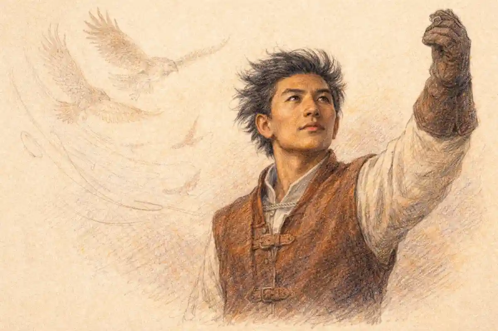

## Endorse or Critique? The Verdict in Advance

Whether the play endorses or critiques its lovers is the oldest argument in its reception, older than the play's fame, because the argument began in the source. Arthur Brooke's poem of 1562 prefaced the tale with a formal condemnation of the pair, and the tragedy that followed deleted the condemnation while keeping the tale. Every later reading inherits that deletion and has to decide what it means. A play that meant to warn could have kept the warning; a play that meant to celebrate without reserve could have silenced the voices inside the action that question the lovers' haste, secrecy, and despair. The tragedy does neither. It removes the judge from the frame and then distributes judgment among interested parties inside the fiction, a friar who marries and rebukes in the same hour, a friend who mocks the passion he cannot feel, a heroine who calls her own love too rash in the middle of declaring it. The question is what verdict that distribution adds up to.

The verdict argued through this article is a single one with two clauses. The play endorses the lovers: their feeling is the one uncorrupted value in Verona, presented in the text's richest poetry, defended by the structure against every rival account of it, and vindicated at the close when the city's authorities bury their feud over the bodies. And the play critiques the lovers: their conduct is shown, by voices the text treats as intelligent and by consequences the text arranges without mercy, to be hasty, secretive, and finally self-destructive in ways that clearer judgment might have escaped. The two clauses are not a compromise split between camps. They describe one attitude aimed at two different objects. What the play celebrates is what the lovers feel and what their feeling reveals about the world that forbids it. What the play questions is what the lovers do, the speed at which feeling becomes irrevocable act. Endorsement attaches to the love; critique attaches to the conduct; and the tragedy exists in the narrow space between those attachments, because in Verona feeling and conduct could not be separated for longer than five days.

That split explains why both single-sided readings keep failing on the evidence. The pure celebration has to explain away the Friar, whose rebukes are too shrewd, too early, and too accurate to be decorative, and it has to explain away the lovers' own doubts, which the text gives to Juliet in her moment of greatest ardour. The pure warning has to explain away the poetry, the structural protection the lovers enjoy, and the ending, in which no voice in Verona condemns them and the blame lands on the feud, the fathers, and the Prince's failed governance. The standing form of the question, [the standing question of whether the tragedy is a love story or a warning](/2022/01/14/romeo-and-juliet-love-story-or-warning/), survives because each side holds genuine evidence. The task is weighing, not choosing, and the weighing has to begin where the play's attitude is most legible: in what the dramatist did to the moral frame he inherited.

## The Frame That Was Deleted: Brooke's Preface Against the Play

Brooke's address to the reader is the most unambiguous verdict the story ever received, and its wording deserves exact attention because the play's silence is measured against it. The poem, Brooke writes, describes "a couple of unfortunate lovers, thralling themselves to unhonest desire; neglecting the authority and advice of parents and friends; conferring their principal counsels with drunken gossips and superstitious friars (the naturally fit instruments of unchastity); attempting all adventures of peril for th' attaining of their wished lust; using auricular confession the key of whoredom and treason, for furtherance of their purpose; abusing the honourable name of lawful marriage to cloak the shame of stolen contracts; finally by all means of unhonest life hasting to most unhappy death." Every element of the later critique case is present in that sentence in its harshest form: the desire is lust, the marriage a cloak for shame, the friar a fit instrument of unchastity, the death a hastening the lovers perform upon themselves. Brooke even supplies the didactic purpose, the good man's example bidding men to be good and the evil man's mischief warning men not to be evil. The tale arrives pre-judged.

The play deletes the entire apparatus. No prologue, chorus, or epilogue in the tragedy repeats a single one of Brooke's charges as the text's own verdict. The Chorus that replaces Brooke's address speaks of dignity, of star-crossed love, of piteous overthrows; the closing speeches speak of sacrifice, punishment distributed across a whole city, and a glooming peace. The deletion is the foundational evidence in the whole debate, and it cuts in one direction first: a dramatist who shared Brooke's verdict had the verdict ready-written and chose not to use it. Adaptations reveal attitude most plainly at the joints, where the adapter must decide what to carry over. Shakespeare carried over the plot nearly entire, the friar, the nurse, the secret marriage, the potion, the failed message, and left behind only the frame that told an audience what to think of them. The conduct survived; the condemnation did not. That asymmetry is a position, and any account of the play's attitude has to start from it.

Two cautions keep the deletion argument honest. The first is that Brooke's own poem is less monolithic than its preface: having discharged the moralising in the address, Brooke's narrative treats the lovers with considerable sympathy and loads much of the blame onto Fortune, a doubleness editors have long remarked. The preface reads in part as a protective licence, a Protestant apology for printing a Catholic tale of friars and confession at all. If the source itself is double, the play's doubleness is partly inherited rather than invented. The second caution is that deletion proves the refusal of one frame, not the adoption of its opposite. Removing a prosecutor does not acquit a defendant; it changes who may speak. What the play puts in the preface's place is not a counter-preface praising the lovers but a set of voices inside the action, each with interests, each fallible, none authorised to deliver the author's sentence. The attitude has to be reconstructed from the arrangement of those voices and from where the text spends its imaginative wealth. The reconstruction is the work of the sections that follow.

### Did Shakespeare keep any of Brooke's charges against the pair?

The conduct beneath the charges survives entire: the secrecy, the disobedience, the friar's counsel, the stolen marriage, the hasting toward death. The verdicts attached to that conduct do not survive at all. Lust becomes love in the text's diction, the cloak of shame becomes a sacrament performed in earnest, and the hasting is redistributed among chance, feud, and failed messages.

The distinction between conduct kept and verdict dropped is the cleanest single measure of the play's attitude. A warning text needs the verdict; the facts alone do not warn, since the same facts, framed by pity, indict the world that made them fatal. Brooke understood that, which is why his preface labours to fix the interpretation before the story can soften it. Shakespeare's text performs the opposite labour: it presents the facts with a fullness that keeps exposing the lovers to judgment, then refuses at every structural joint to deliver the judgment Brooke promised. The refusal is systematic enough to count as design rather than omission. Prefaces, choruses, and closing speeches are the places where early modern plays most often instruct an audience how to file a story, and at every one of those places this play files its lovers under pity, sacrifice, and shared civic guilt, never under lust, shame, or disobedience punished.

## The Prologue's Two Hands: Doom Announced, Pity Commanded

The Prologue is the closest the play comes to an official voice, and its doubleness sets the pattern for everything after. In the Folger text the Chorus introduces "two households, both alike in dignity" and "a pair of star-cross'd lovers" who "take their life", whose "misadventured piteous overthrows" bury their parents' strife, and whose "death-mark'd love" the two hours' traffic of the stage will display. The prosecution can quote the first half of that vocabulary with confidence. Star-crossed assigns the story to the stars before agency enters; death-marked stamps the love itself with its ending; the whole sonnet treats the lovers as instruments in a civic parable about their parents' rage, since the strife, not the love, is what the deaths finally bury. On this reading the Prologue frames the pair the way Brooke did, as an exemplum, and the audience's task is to extract the lesson.

The defence reads the same sonnet and finds the lesson's direction reversed. The operative emotional word is "piteous": the overthrows are not shameful, cautionary, or deserved, but piteous, a word that instructs the audience in the feeling the story warrants before a single scene has argued for it. "Fearful passage" and "piteous" belong to the rhetoric of lament, not of warning. Warnings name faults; laments name losses. And the parable's moral weight falls where the sonnet places it, on the parents: the "continuance of their parents' rage" is the thing that requires burial, and the lovers' deaths are the price of burying it. The Prologue's lovers are thus introduced simultaneously as doomed and as sacrificed, their love marked by death and their deaths charged to the feud's account. Both halves are the text's own. Any verdict that keeps only one half has edited the sonnet.

### Does the Prologue condemn the lovers before the action begins?

No. The Prologue foretells the lovers' deaths and calls their love death-marked, but its verdict words run the other way: the overthrows are piteous, the passage fearful, and the fault requiring burial is the parents' rage. Foreknowledge in the sonnet creates dread for the pair, not judgment against them, and pity is assigned before blame is mentioned anywhere.

What the Prologue withholds is as significant as what it assigns. Brooke's preface named sins; the sonnet names stars. The difference is not decorative. A sin can be repented, avoided, and preached against; a star cannot. By relocating the cause of the catastrophe from the lovers' wills to the heavens and to the feud, the frame withdraws the story from the genre of the cautionary tale at the moment of announcing it, while the doom vocabulary keeps the withdrawal from feeling like romance's exemption. The lovers enter the play already forgiven by its frame and already lost. That combination, absolution plus inevitability, is the emotional contract of the whole tragedy, and it is the opposite of Brooke's contract, which was warning plus blame. A reader who finds the play's attitude in its frame alone will call the play an endorsement shadowed by fate. The frame is genuine evidence, but it is the frame for a story whose interior voices complicate it, beginning with the poetry lavished on the love itself.

## The Case for Endorsement: Eloquence, Innocence, and a Corrupt World

The endorsement case rests first on allocation. A text reveals its sympathies in where it spends its finest language, and this play spends its finest language on the lovers with a consistency that no ironic design plausibly explains. The shared sonnet at the feast (1.5) gives the pair the play's most perfect formal artefact and gives it to them jointly: the love is not merely described as harmonious, it is enacted as two voices completing one another's rhymes, correcting one another's conceits, arriving at a kiss through a form that requires cooperation. Form is testimony. A dramatist exhibiting a delusion does not usually embody it in the most achieved verse of the play, shared equally between the deluded parties, at the exact moment the feeling begins. The balcony scene extends the allocation: Juliet receives the play's most searching intelligence about love's own nature, its risks named by herself, its bounty measured in the great sea simile, while Romeo's earlier Petrarchan machinery is discarded in her presence and replaced by plainer speech. The text upgrades its hero in the heroine's company. That is the behaviour of a work honouring its subject.

Allocation has a second, defensive dimension. The lovers are structurally protected from the degradations the world keeps offering them. Juliet is never made ridiculous; Romeo's folly is confined to the Rosaline episode and is cured onstage. Around them, every competing value is compromised: the fathers' honour is a brawl in the street, the Nurse's wisdom curdles into the counsel to commit bigamy, the Friar's prudence builds the machine that kills, the Prince's law arrives late at every crisis, Paris's courtship is a property negotiation conducted with a father over a daughter's grief. Set against that field, the love is the only enterprise in Verona conducted with honesty about its own object. Even the argument that [the argument that the play is not really about love at all](/2022/02/11/why-romeo-and-juliet-is-not-about-love/) testifies, against its intention, to the endorsement structure: the feud supplies the plot's machinery, but the love supplies the standard by which the machinery is judged and found murderous.

The third strand is innocence of intention, and it mattered to the play's most attentive early critics. Coleridge, in the lectures of 1811-12 as reported by an auditor, observed that the characters principally engaged in the incidents "are preserved innocent from all that could lower them in our opinion", while the lesser figures derive their interest from instrumentality. The observation is shrewd about mechanism: Shakespeare declines every opportunity to stain the pair. The secret marriage, Brooke's stolen contract cloaking shame, is staged as a sacrament sought in earnest and performed by a priest; the wedding night is awaited in a speech of frank, married desire; the disobedience is framed against a parental tyranny the same scenes expose as brutal, Capulet's "hang thee, young baggage" (3.5) doing more to acquit the daughter than any chorus could. A text intending critique had a hundred chances to make its lovers smaller. It took none of them. What it made smaller, scene by scene, was the world that required their secrecy and then punished it.

Endorsement also governs the ending's distribution of honour. The lovers die, and the survivors compete in monument-building; the fathers who forbade the marriage vie to commemorate it in gold. Whatever irony attaches to the statues, and the irony is real, the civic act itself ratifies the love as the city's lost treasure rather than its cautionary disgrace. No character at the close calls the pair disobedient, lustful, or warned. The Prince's sentence falls on the houses and on himself, "for winking at your discords too" in the Folger reading of the Prince's self-indictment. The play's last institutional word about the lovers is that heaven has found means to kill the elders' joys with love, which is to say the love is heaven's instrument against the feud, not the feud's victim alone and certainly not its accomplice. A warning does not usually end with its bad example wielded by heaven against the respectable.

## The Case for Critique: Haste, Secrecy, and the Cost of the Absolute

The critique case begins by refusing to be charmed, and its evidence is conduct. The lovers meet, marry, and are separated by a killing inside roughly a day; the marriage is concealed from both families; the bride is promised to another man while already a wife; the bridegroom kills his wife's cousin hours after the wedding; the escape plan depends on a feigned death, a single letter, and a friar's timing; and the catastrophe is executed by two suicides, each performed on evidence a few questions might have tested. None of that is imposed on the pair by the feud alone. The feud explains the secrecy's necessity; it does not explain the speed, the refusal of every slower instrument, or the absolutism that converts each setback into a death sentence self-imposed. Romeo reaches for death at the Friar's cell (3.3), in the apothecary's shop, and at the tomb, with a readiness the text marks each time. Juliet's resolve is steadier but no less absolute: the knife kept against the wedding to Paris, the vial drunk among horrors she catalogues herself. A reader assembling the conduct record without the poetry would file the play beside Brooke without hesitation.

The text itself assembles part of that record. Romeo enters the play as a connoisseur of a love that does not exist, performing Petrarchan oxymorons for an absent Rosaline, and the play's treatment of that performance is unambiguous mockery shared by his friends and ratified by the Friar's diagnosis that young men's love lies "not truly in their hearts, but in their eyes" (2.3). The diagnosis matters for the attitude question because the play never formally withdraws it. Romeo's transfer of devotion happens in an evening, and the text allows the Friar to marvel at the speed in terms that any audience can apply to the second love as readily as to the first: the doting is distinguished from loving by the very man conducting the marriage. The critique reading does not need to deny that the second love is different in kind; Juliet's answering presence makes it different. It needs only to observe that the play stations its most experienced observer at the threshold of the marriage, voicing the precise doubt the audience is most tempted to suppress, and that the doubt is never answered in argument. It is answered in event, by a catastrophe consistent with it.

### Is the Friar's caution the author's own voice in disguise?

No, and the disguise theory fails on the Friar's record. His counsel is shrewd, but the same man conceives the marriage, supplies the potion, and fails at the letter; a mouthpiece would not be made the catastrophe's chief engineer. The play gives its critique to a compromised speaker so the critique is heard without being enthroned.

Consequences complete the critique case, because this play's consequences are not randomly cruel. Haste is punished in kind at every joint: the haste to marry precedes the haste to fight, the haste to bury precedes the haste to mourn at the tomb, and Romeo's final error is an act of speed, a poison bought and drunk inside a scene of a servant's unverified report. The earlier account in this series of [the lovers' tragic flaw as error rather than moral vice](/2030/11/01/do-the-lovers-have-a-tragic-flaw/) established that the flaw, where the text supports one, is a failure of judgment rather than a corruption of character, and the critique case is strongest exactly there. The play does not show its lovers wanting wrongly; it shows them deciding badly at speed, under pressure, with the alternatives visible to the audience and sometimes to themselves. Juliet names the danger at the moment of betrothal with a clarity no elder matches. The critique is therefore not an import from Brooke. The materials of Brooke's verdict, stripped of Brooke's vocabulary, are rebuilt inside the play as dramatised fact. What the play declines is only the sermon that would convert fact into sentence.

That decline is where the critique case reaches its limit, and honest prosecution has to mark the limit. Consequences in tragedy are not verdicts; Othello's consequences fall on Desdemona, whose judgment the play honours, and Lear's fall on Cordelia. A dramatist can arrange a catastrophe around a pair without arraigning them, by arraigning the conditions that made their errors fatal. Verona's conditions are arraigned everywhere: a feud that makes honesty impossible, a father who treats a daughter as transferable property, a law that sleeps until the third corpse. The critique evidence proves the lovers err; it cannot prove the play blames them more than it blames the world that priced their errors at death. Weighing, rather than listing, is what the debate requires, and the internal critics are the scales the play itself provides.

## The Internal Critics: Mercutio's Laughter and the Friar's Divided Office

A play tells an audience how to take its heroes partly through the company appointed to comment on them, and this play appoints two commentators who divide the critique between them. Mercutio handles the love's rhetoric; the Friar handles its conduct. Neither is a chorus, both are participants, and the division is instructive: the mockery is aimed at the style of loving, the rebukes at the manner of acting, and neither commentator is granted a word against the feeling's worth once the feeling has found its true object. Mercutio dies before the marriage's consequences unfold, and his commentary is frozen at the Rosaline stage, aimed at a Romeo who no longer exists by the time the curse is spoken. The Friar survives to the final scene and is left, significantly, to narrate rather than to judge.

Mercutio's mockery is the most quotable anti-romance in the play. He reduces Romeo's devotion to a physical itch, advises treating love roughly in return, conjures Rosaline's body part by part in the orchard darkness (2.1), and files the Petrarchan manner under obsolescence, Laura reduced to a kitchen wench beside the new mistress (2.4). The critique tradition has always borrowed his energy: he is the voice of the sane world pricing the lovers' exaltation at its street value. Yet the text disciplines its mocker in two ways. First, the mockery's target keeps slipping: the Romeo of the sighs and oxymorons deserves it, and the play agrees so completely that the sighing Romeo is abolished at the feast, replaced by a lover whose speech Mercutio never hears. Second, the mocker is denied the play's moral altitude at the moment of his greatest prominence. Dying, Mercutio curses both houses with a plague, and the curse is just; but the scene also records that he died intervening in a quarrel his own taunting helped to heat, under the arm of the friend he mocked for softness. The play loves Mercutio, gives him the best wit in Verona, and still declines to make his estimate of love its own. His estimate is refuted by the simplest evidence: he never saw the balcony.

The Friar is the harder case because his critique is wiser and his office gives it weight. His rebukes are specific, earned, and twice prophetic. In 2.3 he dismantles Romeo's constancy with the Rosaline evidence and grants the marriage for reasons of state, to turn the households' rancour to pure love, a motive political rather than pastoral. In 2.6, at the very threshold of the ceremony, he prays that heaven smile on the act and appends the play's most famous caution, that violent delights have violent ends, counselling moderation in the act of solemnising its opposite. In 3.3 he storms at the prostrate Romeo with a rhetorical violence no other character attempts, cataloguing the blessings Romeo is too frantic to count and shaming the tears as womanish and the frenzy as beast-like. The critique case rests its heaviest guns here, and they are heavy: the play's resident moral intelligence finds the lovers' conduct wanting at every stage, in advance, in the vocabulary of doctrine.

But the Friar's office is divided against itself, and the play insists on the division. The critic is also the accomplice; the cautioner performs the marriage in the same scene as the caution; the rebuker of 3.3 immediately designs the deception that governs the rest of the plot. A dramatist building a warning would protect his spokesman's authority, as Brooke protected his preface by keeping it outside the tale. This dramatist compromises his spokesman at every point, entangling the critique in the catastrophe until the Friar's final appearance presents a man begging pardon and fearing suspicion, "most suspected, as the time and place doth make against me, of this direful murder" (5.3). The attitude encoded in that treatment is precise: the criticisms are true, and the critic is not thereby the play's judge. Truth about the lovers' conduct is distributed to a fallible man because the play wants the conduct questioned and the questioner questioned in turn. Neither internal critic is permitted the last word. Mercutio's last word is a curse on the houses, which the play endorses; the Friar's last word is a confession of his own part, which the play requires. The lovers' last words are for each other.

## The Lovers as Their Own Critics: Juliet's 'Too Rash' and Romeo's Omens

The most underused evidence in the debate belongs to the lovers themselves, because the play gives its heroine the critique's best lines and its hero the critique's darkest forebodings, and a text does not usually arm its defendants so completely unless the attitude is double by design. Juliet, mid-betrothal, interrupts the vows to audit them: the contract is "too rash, too unadvised, too sudden", like the lightning that ceases before a watcher can name it (2.2). The sentence is the whole case against the marriage's tempo, stated more exactly than the Friar ever states it, by the person with most to lose from believing it. She then proceeds anyway, with open eyes and a negotiated contract, demanding constancy, refusing the moon's inconstancy as a fit witness, and sending the Nurse at nine for the answer. The sequence matters enormously for the weighing. The play does not present a girl swept past her own judgment; it presents the judgment, exercised at full strength, and then the choice that overrules it. Critique inside a character is not condemnation of the character. It is the text crediting its heroine with the intelligence to see what the moralists would later say, and showing the audience the price of a world in which seeing it changed nothing available to her.

Juliet's self-audit continues through the play and grows more rigorous as the stakes rise: the soliloquy before the vial (4.3) is a formal cross-examination of her own plan, every fear itemised, the dagger laid down as the audit's enforcement clause. Romeo's self-knowledge runs the other way, toward omen rather than analysis. Before the feast he reports a mind that "misgives" some consequence hanging in the stars, beginning its fearful date that night (1.4); at Mantua he greets the false report with a defiance of the stars that concedes their jurisdiction in the act of denying it. The lovers thus carry the play's two critical instruments between them: hers analytic, his prophetic, both accurate, both useless. An endorsing text that feared scrutiny would keep its pair innocently unaware. This text makes them the first critics of their own story and then demonstrates that criticism, however lucid, was not the faculty Verona rewarded. The demonstration is itself the attitude: the play honours the lovers' minds too much to pretend their minds could have saved them, and questions their conduct too honestly to pretend the conduct was wise.

Set beside the source tradition, the relocation of critique into the heroine is the play's most quietly radical act. Brooke's lovers are criticised from outside and above, by an author addressing readers over their heads. Shakespeare's Juliet criticises from inside, in the first person, in lines the audience is invited to admire for their precision. The moralising function is not abolished; it is embodied, and embodiment changes its valence. A reader who agrees with Juliet's "too rash" has not condemned Juliet; the reader has joined her. The play thereby converts the critique from a sentence passed on the lovers into an experience shared with them, and that conversion is why attempts to recruit the text for the warning camp feel perpetually strained. The words of warning are all present. Their placement has changed their meaning.

## The Machinery Test: Compression, Chance, and What the Plot Argues

Plot design is also testimony, and the play's two great design decisions argue in opposite directions with a neatness that looks deliberate. The first is compression. Brooke's tale unrolls across months, with the marriage enjoyed through a season of secret visits; the play crushes the action into days, a Sunday meeting and a Thursday tomb, with the wedding advanced a day by a father's impatience in the middle. Compression is the critique's structural friend: it manufactures the haste the moralists deplore, forcing every decision onto inadequate information and every plan onto a single thread. A dramatist exhibiting the wages of rashness could hardly design better. Yet the same compression serves the endorsement with equal power, because it strips the lovers of the ordinary world's attrition. Given months, a secret marriage in a feuding city decays toward exposure, boredom, or bargain; given days, the feeling is tested only by catastrophe, never by time. The play denies its lovers the chance to become ordinary, and ordinariness is the one test the celebration could not certainly survive. Compression is thus the hinge of the whole debate: the device that makes the lovers look most reckless is the same device that keeps their love at its first intensity, and any reading that claims the device for one side has not understood it.

The second decision is the distribution of chance. The catastrophe's final mechanism is not a choice but a quarantine: a friar detained in a plague-searched house, a letter undelivered, a servant faster than the truth's correction, a waking minutes late. Chance of that density is an argument, and it argues against the warning. A cautionary plot requires legible causation between fault and fall, so that the audience can map the lesson; a plot that interposes a sealed door and a pestilence between the plan and its failure breaks the map at the decisive point. The lovers' errors are real, and earlier sections of this article have weighed them, but the errors do not suffice to produce the ending: the ending requires the world's cooperation, supplied through accident layered on feud. Editors and critics who complain of the machinery's creakiness are registering, without naming it, the attitude the machinery encodes. The play will not let the catastrophe be read as the lovers' deserts. It contrives, at some cost to probability, that the final blow arrive from outside the lovers' conduct altogether, and then gives the Prince a closing speech that files the event under heaven's scourge for the houses rather than under the lovers' folly.

Chance cuts once the other way, and the weighing should record it. The same accidents that acquit the lovers of the final outcome also expose the fragility of everything they built: a marriage that a single undelivered letter can kill was a marriage with no margin, and the play's design ensures the audience notices the margin's absence. The critique survives inside the machinery as an observation about structure rather than souls. What the lovers made was genuine and what they made it from was secrecy, speed, and one old man's improvisation. The play's attitude toward the building is admiration for the material and alarm at the architecture, which is the two-clause verdict of this article arrived at from the plot alone.

## The InsightCrunch Attitude Weighing

The evidence assembled so far is gathered in the InsightCrunch attitude weighing, which scores the principal exhibits by the side each supports and the strength each carries when its speaker, placement, and consequences are taken into account. The weighing is the argument in miniature: endorsement wins on the love's value and the ending's honours, critique on tempo, secrecy, and the final recourse to suicide, and the heaviest exhibits register on both scales at once.

| Exhibit | Side supported | Weight in the weighing |
| --- | --- | --- |
| Brooke's preface deleted entire | Endorsement | Decisive as framing: the ready-written condemnation was available and refused |
| The Prologue's "piteous overthrows" | Endorsement | Strong: the frame assigns pity to the lovers and blame to the parents' rage |
| The Prologue's "star-cross'd" and "death-mark'd" | Critique | Moderate: doom is announced as the love's definition, though its cause is placed in the stars |
| The shared sonnet at the feast (1.5) | Endorsement | Strong: the text's most perfect form is given to the love jointly at its birth |
| The Rosaline episode and its mockery | Critique | Moderate: Romeo's first love is exposed as performance, and the exposure is never formally withdrawn |
| The Friar's diagnosis of love in the eyes (2.3) | Critique | Strong in wording, weakened by the speaker's immediate consent to marry the pair |
| The Friar's caution at the marriage (2.6) | Critique | Strong: doctrine's warning is placed at the ceremony's threshold by the celebrant himself |
| Juliet's "too rash, too unadvised, too sudden" (2.2) | Both | Heavy on both scales: the tempo is condemned in words the text honours, spoken by the heroine herself |
| Mercutio's mockery of the love's rhetoric | Critique | Light to moderate: aimed at the discarded Rosaline manner, from a man who never saw the balcony |
| The Nurse's counsel to marry Paris (3.5) | Endorsement | Moderate: the world's alternative to the love is stated as bigamy, and the text sides with Juliet's refusal |
| The apothecary's poverty at Mantua (5.1) | Endorsement | Moderate: the final purchase is framed as the world's corruption exploiting grief, not as love's logic |
| The undelivered letter and the plague house (5.2) | Endorsement | Strong: the catastrophe's last mechanism is chance, breaking any clean line from fault to fall |
| Romeo's speed at the tomb (5.3) | Critique | Strong: the final error is haste acting on an untested report, the pattern of the whole conduct record |
| The Prince's closing sentence | Endorsement | Strong: punishment falls on the houses and the Prince himself; no word condemns the lovers |
| The fathers' golden statues | Endorsement | Moderate, with irony: the city commemorates the love it forbade, in the language of treasure rather than warning |

Read as a balance rather than a scorecard, the weighing shows why the debate has lasted four centuries. The critique exhibits cluster in the middle of the play, where conduct can still be imagined otherwise; the endorsement exhibits cluster at the frame and at the close, where the text delivers its considered dispositions. Beginnings and endings in drama carry the author's settling hand, and at both settling points this play pities, honours, and vindicates. Between those points it permits, and even requires, the hardest questions about what the lovers did. Students assembling the exhibits for presentation can lay the weighing out with the [ReportMedic PPT Viewer](https://reportmedic.org/tools/ppt-viewer.html), which turns the table's rows into slides clean enough for the two camps to argue over exhibit by exhibit. The argument that follows such an exercise tends to reproduce the play's own structure: the middle rows are fought over longest, and the frame rows are conceded last, because conceding them settles the case.

One further discipline belongs with the table. Exhibits are not votes: a line from a compromised friar weighs less than the same sentiment in a prologue, and a consequence arranged by the plot weighs more than a sentiment spoken by a friend. The third column encodes those discounts openly, so a disputed weight can be disputed at the right joint.

## The Critics' Quarrel: Hazlitt for the Defence, Johnson Divided, Coleridge on the Mechanism

The critical tradition replays the text's doubleness with remarkable fidelity, and its three most instructive voices map onto the weighing almost exactly. For endorsement, the commanding statement is Hazlitt's, in Characters of Shakespear's Plays (1817). Hazlitt begins from the play's uniqueness, the only tragedy Shakespeare wrote entirely on a love story, and proceeds to acquit the lovers of the charge the moralising tradition had always brought first, that their passion is a sickness. "Romeo and Juliet are in love, but they are not love-sick", he writes; everything in the play speaks "the very soul of pleasure, the high and healthy pulse of the passions". The acquittal is argued, not merely felt. Hazlitt prints the standing objection in its strongest form, that the play rests on "an idle passion between a boy and a girl" who can have little sympathy or rational esteem for one another, and answers it on the play's own ground: the passion is founded "not on the pleasures they had experienced, but on all the pleasures they had not experienced", on the whole untried future that youth brings to its first object. Inexperience, the prosecution's chief exhibit, becomes in Hazlitt's hands the very condition the play is about, the reason the feeling has its totality. He quotes Schlegel's summary with approval, that it was reserved for Shakespeare "to unite purity of heart and the glow of imagination, sweetness and dignity of manners and passionate violence, in one ideal picture", and treats the union as the achievement the critique keeps missing.

Johnson is the quarrel's most valuable witness precisely because he cannot be filed. His general observation on the play (1765) is a commendation any celebrant would frame: "one of the most pleasing of our author's performances", its catastrophe "irresistibly affecting", its action carried on with probability. Then the notes to his edition proceed to prosecute particulars with a moralist's ear. On Juliet's preparations for confession he remarks that Juliet "plays most of her pranks under the appearance of religion: perhaps Shakespeare meant to punish her hypocrisy". On her double meanings to her mother he rules that "Juliet's equivocations are rather too artful for a mind disturbed" by grief, a stricture that assumes the heroine should be simpler than the dramatist made her. On the play's pathetic writing generally he complains that the strains are "polluted with some unexpected depravations", the sufferers retaining a miserable conceit in their misery. Johnson's Shakespeare, in the great Preface, is a poet who writes without moral purpose and sacrifices virtue to convenience, and the Romeo and Juliet notes show that suspicion at work on details even while the same critic surrenders to the whole. His divided response is the eighteenth century's honest version of the play's effect: the design compels affection, and a certain kind of intelligence experiences the compulsion as an offence to be itemised.

### Can a play celebrate a love while doubting the lovers' judgment?

Yes, because the objects differ. Celebration attaches to the feeling and to what the feeling exposes in the world around it; doubt attaches to decisions taken at speed under secrecy's pressure. The text honours the first with its poetry and its monuments, and questions the second through its wisest speaker, its heroine's misgivings, and a plot that prices every shortcut.

Coleridge supplies the quarrel's third term, neither celebration nor prosecution but mechanism, and it adjudicates between the other two. The lecture transcript's observation, that the principal characters are preserved innocent from all that could lower them while the surrounding figures serve as instruments, identifies the engineering beneath the effect Hazlitt celebrates and Johnson resists. The lovers feel ideal because the dramatist has declined to soil them; the world feels corrupt because every instrument around the pair is compromised in some legible way. Where Hazlitt and Johnson disagree about the result, Coleridge explains the result's manufacture, and explanation disciplines both camps. Against Hazlitt, the mechanism warns that the purity is an artefact of protection: the lovers are never exposed to time, familiarity, or a working marriage, the solvents in which the feeling's health would actually be tested. Against Johnson, the mechanism shows that the strictures aim at a design that never intended the heroine to be a moral exhibit: her equivocations are artful because the play needs her artful, a mind equal to its emergencies, and punishing her hypocrisy is a sentence the text nowhere executes.

Adjudicated, the quarrel resolves into the article's verdict with unusual completeness. Hazlitt wins on the feeling: the text's own allocation of poetry, health, and honour supports his acquittal, and the prosecution has never answered his point that inexperience is the subject rather than the defect. Johnson wins on the particulars he actually proves: the conceits do sometimes intrude on the pathos, and Juliet's artfulness is real, a quality the play itself prizes too highly to disown. Johnson loses on the inference he invites, that artfulness amounts to hypocrisy deserving punishment, because the play's machinery of consequences punishes the feud's parties and spares the heroine every stain of the kind his note imagines. Coleridge wins the explanation and loses the implication of innocence as the whole story, since the same text that protects the lovers' reputations exposes their judgment without respite. The tradition's three voices, weighed together, describe a play that endorses its lovers' love, critiques its lovers' conduct, and protects its lovers' honour while doing both. That is not a split decision. It is a precise description of one attitude with three operations.

## Attitude in Performance: What the Altered Endings Confess

The stage history offers a kind of evidence criticism cannot supply, because adapters vote with their scissors. What generations of performers felt compelled to change in this play maps the original's attitude by negative space: the alterations cluster exactly where the text refuses to moralise, and their direction is almost always toward the verdict the play withheld. The clearest case is the tomb. The original ending permits the lovers no reunion in consciousness: Romeo dies believing Juliet dead, Juliet wakes to find him dead, and the recognition the audience craves is refused. David Garrick's adaptation of 1748 could not bear the refusal and rewrote the scene so that Juliet wakes while Romeo still lives, granting the pair a final exchange of recognition and farewell. The alteration is usually discussed as sentimentality. For the attitude question it is more valuable as a confession: the adapter perceived, correctly, that the original ending withholds the consolation that would convert the catastrophe into a celebration of love triumphant in death, and he supplied the consolation the text denied. A play that endorsed without reserve would not need the addition; a play that warned would need the opposite addition, a voice to point the moral. Garrick added neither a moral nor a survivor's repentance directed at the lovers. He added mutual recognition, which is the endorsement's missing sacrament, and its absence in the original is the critique's quiet residue inside the ending's design.

The same negative evidence appears in the long tradition of cutting and softening. The Rosaline material, the play's built-in critique of its hero, survived the centuries of adaptation comparatively intact, while the text's bawdry, much of it the Nurse's and Mercutio's, was pruned by family editions and decorous stages. The pattern is the reverse of moralising protection: adapters guarded the audience from the play's earthiness, not from its hero's exposure. Meanwhile the Friar's rebukes, the critique's heavy artillery, were trimmed in performance after performance chiefly for length, never for doctrine, because no adapter seems to have feared their effect. What the stage feared was the play's refusal to console and its refusal to keep the lovers' world clean. Both refusals belong to the double attitude. The performance record, read whole, shows adapters nudging the play toward the celebration it declines to complete and away from the grossness it declines to apologise for, while leaving its internal critique standing untouched in the middle. Four centuries of scissors have thus located the play's doubleness at the same joints the weighing identifies: frame and close withheld from pure endorsement, conduct exposed without protection in between.

## What the Ending Does to Both Cases

The ending is where attitudes settle, and this ending is engineered to give each camp one indispensable exhibit and to deny each camp its completion. The critique receives the suicides themselves, presented without softening: a poison bought from a man who sells death against the law, a body count at the tomb that includes the blameless Paris, a bride waking among corpses to a dagger. Nothing in the staging invites the audience to find the final acts prudent, and the haste that governs them is the conduct record's last entry. The endorsement receives everything surrounding the suicides: the grief that dignifies both families into honesty, the Friar's narrative received as testimony rather than indictment, the Prince's distribution of punishment to the elders and to his own negligence, the reconciliations, the statues. A reader asking whether the ending is finally hopeful or hopeless is asking the question the companion inquiry in this series pursues at length in [the examination of whether the ending is hopeful or hopeless](/2031/03/28/is-the-ending-hopeful-or-hopeless/); for the attitude question the relevant fact is narrower. The ending judges the feud guilty and the lovers dead, and it spends its rhetoric on the first of those propositions.

### Does the ending's reconciliation endorse the love that caused it?

In part, and the part is decisive. The fathers' reconciliation is transacted over the lovers' bodies and priced in monuments to them, which ratifies the love as the tragedy's lost good rather than its offending cause. The ratification arrives as grief, not triumph: the city endorses the love only in the past tense, having made its present tense impossible.

Consider what a warning ending requires and how completely the play refuses the requirement. A cautionary close needs a survivor authorised to draw the moral, a figure whose survival embodies the lesson's alternative: the friend who counselled patience, the parent whose authority was vindicated, the ruler whose law the lovers defied at their cost. This play's survivors are the worst possible faculty for such a lesson. The fathers are reconciled penitents, indicted by their own monuments. The Prince is a confessed negligent. The Friar is a frightened accomplice begging the law's pardon. The Nurse, the counsel of accommodation, is simply absent from the reckoning, her advice to marry Paris left as the road not taken and never retrospectively blessed. No voice at the close says the lovers should have obeyed, waited, or confessed, although the stage is crowded with characters who once said exactly that. Their silence in the final scene, after so much counsel earlier, is the ending's loudest statement. The play does not retract the counsels; it shows a world in which delivering them costs nothing and following them was made impossible by the counsellors' own houses. Blame flows uphill at the close, toward age, authority, and feud, and a warning cannot survive its blame flowing uphill.

The endorsement camp must still pay for its ending honestly. The reconciliation's price is the lovers' extinction, and the play does not pretend the exchange was necessary or just: the Prince calls the deaths a scourge and a sacrifice, the fathers call their enmity the cause, and heaven's part in the settlement is described with a bleakness that borders on accusation against heaven itself. Nor does the ending acquit the lovers' final choices by enveloping them in civic meaning. Romeo dies having killed Paris in the dark on a mistaken errand; Juliet dies by her own hand within minutes of a rescue standing in the same vault. The civic settlement proceeds around those facts without digesting them. That indigestible remainder is the critique's permanent foothold in the close, and it prevents the statues from converting the play into the feud's morality tale with the lovers as its martyrs pure and simple. The ending's attitude, stated exactly, is that the city was wrong about the love and the lovers were wrong about the remedy for the city, and that the second wrong was made fatal by the first. Sequence is meaning there. Critique of the lovers in this play is always the second clause of a sentence whose first clause indicts Verona.

## The Minority Report: The Hardest Exhibits Against Each Camp

A weighing earns trust by stating the evidence its own verdict finds hardest, and the two camps each face one exhibit that resists absorption. For the endorsement, the resistant exhibit is the tomb's deliberateness. Romeo at the vault is not swept away; he is methodical, dismissing his servant with threats, fighting Paris with a speech of weary courtesy, arranging his death beside Juliet with ceremonial care, drinking to her with a lover's toast. The scene's calm is the prosecution's best answer to the plea of youthful frenzy: the final act of the conduct record is considered, and its consideration condemns it more than frenzy would, since a considered suicide on an unverified report, yards from the one man who could correct the report, enacts the whole pattern of the lovers' decisions with the excuses stripped away. The endorsement absorbs the exhibit only by relocating it: the calm is real, and it belongs to a mind the feud's world has already convinced that death is the sole remaining form of fidelity, a conviction the play presents as the world's achievement as much as the lover's error. The absorption is genuine but costly. It concedes that at the limit the critique touches the hero's will and not merely his circumstances.

For the critique, the resistant exhibit is the play's refusal to give any character a successful alternative. Warnings imply a road not taken, and a text that warns must somewhere embody the road's viability, if only in a minor figure's happiness. This play systematically closes every alternative it opens. Obedience to Capulet leads to Paris, a decent man and a catastrophe of a marriage, contracted over a corpse-strewn house by a father counting the guests. Openness to the families leads, on all the evidence of 1.5 and 3.5, to prohibition enforced by violence. The Friar's slower instruments, delay, disclosure, the Prince's mediation, are entrusted to a plot that strands them in a plague house. Even patience, the critique's prescribed virtue, is embodied chiefly in Benvolio, whose patience saves nobody, and in Paris, whose patient courtship ends in the vault's dirt. The warning reading must therefore argue that the lovers should have chosen among alternatives the play itself depicts as sealed, which converts the warning from counsel into lament for a world without exits. Lament is the endorsement's native genre. The critique's hardest exhibit thus turns, on inspection, into the defence's closing argument, and the weighing records the turn as the single largest movement in the whole balance.

One more exhibit belongs to neither camp and disciplines both: the play's treatment of the marriage's sacramental status. Brooke's preface called the marriage a cloak for shame, a stolen contract abusing an honourable name. The play stages the marriage as valid, earnest, and central, desired by Juliet with a theological seriousness the text honours in her language of confession, shriving, and faith. No voice in the play, not the Friar who profits least from courage, not the Prince at the reckoning, calls the marriage invalid or the union sinful. Against the entire moralising tradition, the text's position on the marriage itself is unambiguous endorsement, and the critique is thereby confined to tempo and tactics forever. A debate that began in 1562 as an argument about whether the lovers were damned has narrowed, inside the play, to an argument about whether they were wise. That narrowing is the dramatist's doing, and it is the deepest single fact the attitude weighing records.

## Two Attitudes for Two Lovers: Romeo Weighed Apart from Juliet

The debate is usually conducted about the pair, but the play's attitude is not distributed evenly across the pair, and separating the accounts sharpens the verdict. Romeo attracts the critique's evidence in disproportionate share. His is the discarded first love, the performed rhetoric, the transfer accomplished in an evening, the killing in the street, the despair in the cell, the purchase in Mantua, the haste at the tomb. Scene by scene the text subjects his feeling to tests of authenticity and his conduct to tests of judgment, and the feeling passes while the judgment fails. Even his defenders inside the play defend him in the vocabulary of nature and youth rather than of prudence. The Friar's fondness, Benvolio's loyalty, and Juliet's love all treat his intensity as a given to be managed, not a wisdom to be consulted. The play's Romeo is a study in a genuine emotion housed in an untrained will, and the critique case, confined to him alone, would be nearly conclusive.

Juliet's account reads almost in mirror image, and the asymmetry is one of the text's most deliberate effects. She is introduced under discipline, consenting to look and like only as far as her mother's programme allows, and from the balcony onward she becomes the play's most rigorous intelligence: negotiating the contract's terms, discarding the inconstant moon as witness, foreseeing the dangers in the very words the moralists would later borrow, managing the unmanageable interview with Paris in double meanings that protect a marriage her interrogator knows nothing of, and auditing the potion plan with a completeness her elders never approach. Johnson's complaint that her equivocations are too artful is, from the text's side, a measurement of exactly the quality the play is exhibiting with admiration. The critique case against Juliet reduces to two counts, the secrecy and the final dagger, and both are framed by coercions the text itemises: a father threatening disownment and a locked room, a rescuer arriving minutes after the irreversible act. Where Romeo's errors originate in his temperament, Juliet's originate in her circumstances, and the play's distribution of sympathy follows that distinction with care. Endorsement, in her case, covers conduct as well as feeling, because her conduct under the same pressure is the best the play contains.

The asymmetry explains a persistent feature of the debate's history: readings that prosecute the lovers tend to prosecute Romeo and generalise, while readings that defend them tend to exhibit Juliet and generalise. Both generalisations are errors the text anticipates. The pair is a designed contrast, one lover all velocity and one all vigilance, joined in a single enterprise whose failure required both the velocity that outran the message and the vigilance that could imagine no safer instrument than a feigned corpse. Weighed separately, the play critiques its hero's judgment, endorses its heroine almost entire, and reserves its full double attitude for the enterprise they shared. A verdict about the lovers that ignores the split will always sound half false, because it is.

## Why Quotation Alone Cannot Settle the Debate

Both camps maintain anthologies, and the anthologies are the reason the debate survives in classrooms long after the weighing should have settled it. The prosecution quotes the Friar on violent delights, on love in the eyes, on moderation; quotes Mercutio on dreams and itch; quotes the Prince on scourges. The defence quotes the Prologue on pity, Juliet on boundless bounty, the fathers on golden statues. Every quotation is genuine, and the method is bankrupt, because quotation strips exactly the information the attitude lives in: who speaks, from what interest, at what distance from the catastrophe, with what authority the surrounding action grants or withdraws. The Friar's cautions are one exhibit when read as the author's doctrine and another when read as the words of the marriage's own celebrant covering his risk. Mercutio's mockery is one exhibit as the voice of sanity and another as the raillery of a man describing a love he has not seen, aimed at a version of Romeo the play has already retired. Attitude in drama is a property of arrangement, not of lines, and arrangement is what quotation deletes.

The weighing method used in this article is offered as the corrective, and its rules are worth stating for any reader carrying the debate elsewhere. Exhibits are weighted by placement, with frame and close outranking the middle; by speaker, with disinterested voices outranking advocates and accomplices; by enactment, with what the plot does to a claim outranking what a character says about it; and by survival, with judgments the ending still honours outranking judgments the ending abandons. Under those rules the anthologies redistribute themselves. The Friar's lines survive, discounted for interest. Mercutio's lines survive, discounted for aim. The Prologue and the close survive undiscounted, and they carry pity, honour, and the uphill flow of blame. The result is not that the critique exhibits vanish. It is that they describe the middle of the play, where conduct was still corrigible, while the endorsement exhibits describe the play's considered dispositions at the points where a dramatist settles accounts. Critics who reverse those weights owe an account of why a friar's caution should outrank a prologue's pity and a prince's sentence. In four centuries, that account has not been produced, and the burden of producing it is the critique camp's unmet obligation in the debate.

## The Synthesis Stated Precisely: What 'Both' Means and Does Not Mean

The synthesis this article defends is often mistaken for a shrug, so its content needs stating with care. To say the play both honours and questions its lovers is not to say the attitude is mixed, vague, or evenly balanced for want of a decision. The doubleness has a structure, and the structure can be written as three propositions the evidence supports jointly. First, the love is good: the text gives it its best poetry, its only honest sacrament, its heroine's finest intelligence, and its close's only monuments, and it protects the lovers from every stain the source tradition prepared for them. Second, the lovers' conduct is imprudent in ways the text specifies through its wisest speaker, its heroine's own misgivings, and a plot that prices each shortcut: the secrecy was chosen where the Friar's mediation might have been attempted in daylight, the tempo was chosen where a day's patience cost nothing but discomfort, the suicides were chosen on evidence never tested. Third, the catastrophe is not the conduct's just wage: the feud made the secrecy rational, the compression made the tempo nearly compulsory, and the final mechanism was chance operating on a world already arranged to kill. Hold all three and the attitude is single, coherent, and severe in two directions at once, toward the lovers' judgment and toward the world that judged them first. Drop any one and a familiar misreading results: drop the first and Brooke returns; drop the second and the play becomes the greeting-card romance of its reputation; drop the third and the warning hardens into a fable whose moral its own plot refutes.

The synthesis also explains the play's peculiar emotional signature, the sensation audiences report of being simultaneously exalted and admonished without being able to locate a sermon. Exaltation is the first proposition working; admonishment is the second; and the refusal of catharsis-by-lesson, the sense that nobody onstage learns anything transferable in time, is the third. Productions that lean wholly into celebration find the tomb unbearable and historically reach for Garrick's surgery; productions that lean into warning find the balcony unplayable, since an audience instructed to disapprove cannot be made to feel the sonnet's completion as the play's summit. The double attitude is not a critic's refinement laid over the play. It is the play's operating condition, recoverable from the source's deletion, the frame's pity, the critics' division, the adapters' scissors, and the plot's machinery, each class of evidence pointing to the same structure from a different side. Convergence of independent evidence classes is the strongest warrant interpretation can offer, and this reading has it.

## Secrecy as the Test Case: Where the Two Attitudes Change Places

Every general claim in the debate should be tested against the secrecy, because secrecy is the lovers' largest chosen act and the one where endorsement and critique most completely interpenetrate. The prosecution's file is straightforward. The marriage is hidden from both houses; the concealment necessitates the rope ladder, the feigned death, the letter, and the tomb's misunderstandings; and concealment is the classic behaviour of parties who expect their act to be judged and found wanting. Brooke's vocabulary for the whole arrangement was the stolen contract cloaking shame, and the critique's modern form merely translates him: whatever the feeling's quality, the lovers governed it like a conspiracy, and conspiracies in this play breed corpses. The Friar's own justification concedes the irregularity by promising a future cure, a time to blaze the marriage abroad, reconcile the friends, and beg the Prince's pardon (3.3), which frames the secrecy from the start as a provisional wrong awaiting its remedy.

The defence's file on the same facts is equally documentary. Secrecy in the play is not chosen against an available openness; it is chosen against a demonstrated prohibition. The one attempt at semi-openness in the story's world, the feast where the houses mingle under truce, produces Tybalt's vow of revenge within the hour. Capulet's treatment of Juliet's refusal, threats of disownment, dragging, and starvation among beggars (3.5), is the play's own exhibit of what disclosure would have purchased, and it is produced after the marriage, when the father's grievance is at its most sympathetic. The secrecy was also, in design, temporary: the plan from its first statement is a bridge to publicity, marriage first and announcement at the ripe moment, which distinguishes it in kind from the elopement-without-sacrament Brooke condemned. The lovers did not steal a contract to cloak a liaison. They contracted a valid marriage in the only registry Verona left open to them and scheduled its publication. A court weighing secrecy must record both files, and the recording shows the attitudes changing places as the examination deepens: the act that looks most like guilt from the preface's distance looks most like prudence from inside the houses' demonstrated behaviour. The play forces that change of places on any honest examiner, and forcing it is the attitude at work.

What remains chargeable after the exchange is narrower and more precise than the prosecution's opening file: not the secrecy itself but the absence of a second channel. The lovers and their friar built the bridge with one plank, a single letter, a single messenger, a single morning's timing, and the critique's legitimate grievance is engineering rather than morals. Verona's other institutions all run on redundancy, feuds with a dozen retainers, laws with officers, hatreds with heirs. The marriage alone was built without a spare part. Whether that absence reflects the lovers' haste or their poverty of allies is the last ambiguity the weighing has to carry, and it carries it as an ambiguity, assigning the design's fragility jointly to the builders and to the city that left two households' heirs with exactly one sympathetic adult between them. On the test case, then, the verdict of the whole article reproduces itself in miniature: the intention honoured, the execution questioned, the conditions indicted.

## The Counterfactual Test: Two Other Plays That Were Not Written

Interpretations gain definition when set against the texts that would satisfy them completely, and both camps' ideal texts are partially available for inspection. The warning camp's ideal text exists: it is Brooke's poem with its preface, in which the lovers' ends are announced as the wages of unhonest desire, the friar is an instrument of unchastity, and the reader is instructed to profit by the example. Measure the play against that document item by item and the distance is the endorsement's size: the verdict sentence deleted, the friar promoted from instrument of unchastity to the lovers' flawed but earnest advocate, the desire redescribed in the language of devotion, pilgrims, saints, and sacraments, the deaths reassigned to stars, feud, and a plague house. A dramatist does not travel that distance by accident or by inertia. Every step of it is a decision, and the decisions all run the same way, away from sentence and toward pity. The warning reading must therefore explain why a warning was rebuilt, joint by joint, into its opposite's architecture, and the explanations offered, that the celebration is ironic, that the poetry is a trap for the unwary, have never survived contact with the ending's distribution of honour.

The celebration camp's ideal text exists too, in outline, and the play refuses it with equal decision. A pure celebration of the love would let the letter arrive or the Friar reach the tomb in time, converting the tragedy into the comedy of a marriage revealed, the feud dissolved by the fact of grandchildren, the lovers vindicated in life. Shakespeare had the machinery for that ending in his hands; the sources themselves nearly supply it, and his own comedies of the same years perform versions of it for couples less exalted. He withheld it, and the withholding is the critique's deepest evidence, deeper than any rebuke, because it shows the dramatist declining to certify the lovers' way as the world's way. The love is vindicated as value and refused as method. Its vindication is posthumous precisely because the play will not pretend that feeling of that quality, conducted at that speed in that secrecy, could govern a city or survive one. Between Brooke's sentence and the comedy's rescue, the play occupies a position that neither camp's ideal text can describe, honouring the love with the rescue's warmth after refusing the rescue, and questioning the conduct with the sentence's facts after deleting the sentence. That double refusal, measured against the two available alternatives, is the most exact statement of the play's attitude that the evidence supports, and it is the statement the next section delivers as the verdict.

## The Generations of the Debate: How the Balance Has Moved

The weighing's history has a direction, and the direction is itself a datum. The debate opens in 1562 with the balance nailed to one side by an author's preface: the lovers condemned before their story begins, the reader's judgment pre-empted by instruction. It moves, in the play itself, to the dramatist's refusal of the nail, judgment distributed and the frame given to pity. The eighteenth century, in Johnson, holds the balance visibly trembling in one reader's hands, surrender in the general observation and prosecution in the notes, as if the century's criticism could neither restore Brooke's sentence nor yet pronounce Hazlitt's acquittal. The Romantic generation then throws its weight to the lovers' side with the confidence of a discovery: Coleridge finds the pair preserved innocent by design, Hazlitt finds the passion healthy and its inexperience the very subject, and Schlegel's ideal picture becomes the era's summary. Each movement corrects the last one's simplification. The preface's certainty is exposed as a licence nailed over a sympathetic poem; Johnson's trembling is exposed as two half-truths awaiting a mechanism; the Romantic acquittal is exposed, by the mechanism Coleridge himself supplied, as an artefact of the lovers' protection from time. A debate that keeps correcting itself toward doubleness is converging on the doubleness as its object. The synthesis defended in this article is less a new position than the record of where four centuries of correction have arrived, and the arrival has the steadiness of a measurement repeated by independent instruments.

That steadiness should not be mistaken for exhaustion. The balance moves still, whenever a generation re-prices the exhibits: an age preoccupied with parental authority re-reads Capulet's threats as order besieged; an age preoccupied with adolescent autonomy re-reads them as tyranny documented; an age attentive to the heroine's intelligence re-prices her equivocations from Johnson's artfulness to statecraft under interrogation. The exhibits stay fixed and their weights migrate, which is why the weighing method matters more than any single weighing's result. What does not migrate, across all the re-pricings on record, is the frame's pity and the close's uphill blame. Those exhibits have held their weight through every regime of taste since the preface was deleted, and a reading of the play's attitude that begins from them stands on the debate's most durable ground.

## Pity and Fear: The Tragic Emotions as the Play's Own Ballot

One class of evidence remains, the audience's instructed emotions, and it may be the most intimate testimony of all. Tragedy in the classical account works by pity and fear, and pity has a logical condition that bears directly on the weighing: pity is felt for suffering that exceeds its desert. An audience pitying on cue, scene after scene, is an audience the dramatist has instructed to find the sufferers' punishment disproportionate to their fault, and disproportion is an acquittal of the moral charge while leaving every factual charge intact. This play solicits pity for its lovers with an insistence that begins in its frame, where the overthrows are named piteous before the lovers have acted at all, and it never withdraws the solicitation. The tomb scene's horror depends on the audience's knowledge that a letter's failure, not a character's deserving, has timed the waking; fear attaches to the machinery, pity to the pair. A warning text solicits a different pair of emotions, recognition and resolve, the resolve to avoid the exhibited error, and it must keep pity rationed lest the lesson dissolve into grief for the offenders. Here pity is not rationed. It is the play's principal currency, spent on the lovers from the sonnet onward and never called in.

Fear, the second emotion, locates the critique with equal precision. What the play teaches an audience to fear is not love, which it surrounds with its most beautiful writing at the moments of greatest danger, but the combination the lovers embody under pressure: certainty at speed. The fearful recognitions the tragedy engineers are all of the form of a door closing on an untested conviction, the Friar's cell door, the orchard wall, the vault. Fear of that kind is a critique of conduct generalised into a condition, dread at how little verification the world allows and how much conviction it rewards with ruin. Pity acquits the lovers of the moral charge; fear arraigns their epistemic situation, their world of sealed houses and single letters as much as their own haste within it. The two emotions, read as the ballot the play casts on its own action, return the same double result as the frame, the machinery, the critics, and the scissors: the lovers pitied beyond their deserts, their way of proceeding feared beyond their persons. Ballots from independent classes of evidence agreeing on a split result are how interpretations earn the right to be called verdicts.

## The Burden of Proof: What Each Camp Must Still Produce

Debates are settled not only by exhibits weighed but by obligations discharged, and each camp carries one obligation it has never met. The critique's obligation is to produce an authorised voice. Every warning requires a warner whose standing the work itself ratifies: a chorus believed, a survivor vindicated, a ruler whose sentence the action confirms. The candidates in this play fail the ratification test in sequence. The Friar is the strongest candidate and the action ruins his standing progressively, from the marriage he performs against his own caution to the pardon he begs at the reckoning. The Prince is the next candidate, and his closing speech distributes blame to the houses and to his own negligence while exempting the lovers entirely, the precise opposite of the sentence the critique needs from him. The fathers fail as candidates by repenting in gold. The Nurse fails by absence and by the bigamy counsel that disgraced her standing while the action still had time to judge her. Behind the candidates stands Brooke's preface, the one authorised voice the tradition ever produced, and it stands outside the play, attached to another work, deleted by the dramatist whose attitude is under examination. Until the critique produces a voice inside the text that the text itself believes, its case remains a file of true particulars in search of a verdict, which is why its best modern forms argue from conduct and consequence rather than from any sentence the play delivers.

The endorsement's obligation is the mirror image: to produce an answer, in argument, to the Friar's diagnosis in 2.3. The play never supplies one. Romeo does not refute the charge that young men's love lives in the eyes; he simply leaves, and the action that follows can be read as the diagnosis's confirmation as readily as its transcendence, since the second love begins at sight, at a feast, in sonnet exchanges about hands and lips, and proceeds at a pace the diagnosis predicts. The defence's materials are strong but they are all circumstantial: the answering presence of Juliet, the upgrade of Romeo's rhetoric in her company, the constancy unto death that no eye-born fancy in the Rosaline mode ever approached. Circumstantial evidence can convict or acquit when it converges, and here it converges impressively, but the obligation should be recorded as met by convergence rather than by rebuttal. The play's own choice is implicated in the gap: a dramatist who wanted the diagnosis answered could have written the answering scene, a colloquy in which the Friar concedes the difference between the doting he diagnosed and the love he witnesses. The scene does not exist. In its place stands the Friar's consent, his willingness to marry the pair for the feud's sake, which functions as a practical concession without ever becoming a verbal one. The endorsement therefore rests, at this one joint, on an inference from behaviour rather than a statement, and honesty requires the joint to be marked in the weighing rather than silently soldered over.

Marked joints are what distinguish a verdict from a victory. Both camps leave the court with one obligation discharged by inference and one exhibit unabsorbed, and the synthesis is simply the name for the state of the record when both facts are kept in view at once. The critique has the particulars and lacks the voice; the endorsement has the frame, the close, and the sympathies, and lacks the rebuttal. A record in that shape does not describe a play undecided about its lovers. It describes a play that decided the large question, the love's worth and the world's guilt, and deliberately left the small question, the lovers' prudence, in the keeping of fallible speakers and an unanswering plot. Deliberateness is the final inference, and it is warranted by the pattern's completeness: every joint where a single attitude could have been sealed, preface, prologue, spokesman, answering scene, closing sentence, shows the same refusal to seal it. Five independent refusals are a policy. The policy is the attitude, and the verdict that follows merely gives the policy its name.

## The Weighed Verdict: Honoured in Kind, Questioned in Conduct

The verdict can therefore be delivered without remainder. The play endorses its lovers in the only sense that finally matters to a work's attitude: it presents their love as the standard of value in its world, the measure by which fathers, princes, friars, and nurses are all found wanting, and it buries them with the honours of the sacrificed rather than the sentences of the condemned. It critiques its lovers in the only sense the evidence sustains: it shows their judgment failing at speed under secrecy, in particulars its own voices name in advance, and it refuses them the dignity of a necessity they did not wholly face, since patience and disclosure, however dangerous, were never attempted in daylight by either of them. The critique is real and it is subordinate, an instrument inside an endorsement, the way a friend's warning is an instrument inside a friendship. Brooke's preface inverted that relation, making the lovers' story an instrument inside a warning. The whole history of the debate is the history of those two relations contending for the same text, and the text, weighed by placement, speaker, enactment, and survival, belongs to the first.

For the reader choosing a side in the long argument, the deciding question is the one the weighing keeps returning to: where does the play spend its authority? It spends authority on pity before the action and on blame of the elders after it; it spends poetry on the love and irony on everything that opposes the love; it spends its heroine's intelligence on seeing the dangers and its plot on proving the dangers were not the deepest cause. Authority spent is attitude revealed. Shakespeare took a tale his source had already sentenced and retried it in a court where the prosecution's witnesses kept confessing their own parts, where the defendants were allowed the finest speeches, and where the judge, in place of a sentence, ordered statues. The order for statues is the attitude. Everything else is evidence management, and on the evidence, weighed whole, the play loves its lovers too well to lie about them and judges their world too severely to need to.

## Frequently Asked Questions

### Q: Which word in the Prologue's summary most resists the warning reading of the play?

The word is "piteous". The Chorus calls the lovers' story one of "misadventured piteous overthrows", and the adjective instructs the audience in the response the story warrants before any character has acted. Warnings require faults to be legible; pity requires suffering to exceed desert. A frame that wished to caution its hearers against the lovers would have chosen the vocabulary of fault, as Brooke's preface did with its unhonest desire and stolen contracts. This frame chooses the vocabulary of lament, and it directs the lament at the right address, since the same sonnet assigns the thing needing burial to the parents' rage rather than to the children's desire. Doom words surround the pity, star-crossed and death-marked, but doom in the sonnet is a condition imposed from outside, by stars and by strife, not a quality of the lovers' wills. The warning reading must therefore treat the frame's most deliberate adjective as decoration, while the endorsement reading can take the whole sonnet at its word: a piteous passage, fearfully told, about a pair the heavens and the feud conspired to mark.

### Q: What does the Friar's willingness to perform the marriage do to the weight of his rebukes?

It discounts them without cancelling them, and the discount is the play's own arithmetic. A rebuke from a detached authority carries the authority's full weight; a rebuke from the man who proceeds, in the same hour, to perform the very act rebuked carries the weight of a participant's misgiving. The Friar's words remain the shrewdest in the play, and the weighing in this article scores his diagnosis and his caution as strong evidence for the critique of the lovers' tempo. But his consent changes their legal character, so to speak: doctrine becomes testimony, and testimony from an accomplice is heard with the accomplice's interest in view. Shakespeare could have kept the critique immaculate by assigning it to a figure outside the plot, as Brooke kept his preface outside the tale. Instead the critique is placed inside a compromised office, where it is heard, respected, and never enthroned. The arrangement tells an audience exactly how much authority the play grants its own internal prosecution: real authority over particulars, none over the verdict.

### Q: Who loses the power to judge the lovers when Brooke's preface is cut, and who gains it?

The author loses it, and the audience gains it, with the characters holding it in trust between them. Brooke's address exercised judgment in advance and in the author's own person: the lovers were described, charged, and filed before the tale began, and a reader's work was reduced to assent. The play deletes the office entirely. No prologue repeats the charges, no epilogue revives them, and the judgment the preface performed is redistributed among parties inside the fiction, a friar with interests, a friend with limitations, a prince with a record of negligence, and the lovers themselves, whose self-audits prove more rigorous than any elder's. That transfer explains the debate's longevity better than any single reading does. A play that had kept its author's verdict would have foreclosed argument in 1595 or thereabouts; a play that outsourced its verdict to four centuries of audiences has kept the argument open by design. The cut preface is thus not merely evidence for the endorsement. It is the mechanism by which the play converted a sentenced tale into a standing trial.

### Q: How does Coleridge's claim that the lovers are kept innocent differ from Hazlitt's praise of their passion?

The two claims describe different layers of the same effect, and the difference is why the critics' quarrel needs both. Hazlitt praises a quality he finds in the lovers themselves: the passion is healthy rather than lovesick, founded on the whole untried future of youth, so intense that inexperience becomes its condition rather than its defect. Coleridge, in the lecture transcript, describes a technique rather than a quality: the principal characters are preserved innocent from all that could lower them, while lesser figures absorb the action's compromising work as instruments. His is a judgment of manufacture. Where Hazlitt says the love deserves honour, Coleridge explains how the honour is engineered, by a dramatist declining every opportunity to stain the pair and assigning the stains elsewhere. The claims can both be true, and each disciplines the other: Hazlitt's warmth is checked by the reminder that protection, not exposure, produced the purity; Coleridge's coolness is checked by the reminder that a technique so consistently protective is itself an attitude, the strongest one a dramatist can take.

### Q: Why did Johnson's admiration for the play not prevent his strictures on Juliet?

Because Johnson's criticism operated on two levels that his century kept separate, the design and the detail, and the play triumphed on one while offending on the other. His general observation surrenders to the design completely: the play is among the most pleasing of its author's performances, the catastrophe irresistibly affecting. His notes then audit details with a moralist's suspicion of artifice, and Juliet, the most artful figure in the play, draws the audit's fire. Her equivocations to her mother strike him as too artful for a mind in grief; her use of religious forms for her designs prompts the speculation that Shakespeare meant to punish her hypocrisy. Johnson's Shakespeare of the Preface is a poet careless of moral purpose, and the notes keep testing the play against the instruction it never delivers. What the division reveals is the play's effect on a reader of formidable resistance: the machinery of sympathy works on him entire, while his judgment files protests against the particular gears. The split is the double attitude experienced from the reader's side.

### Q: What does Juliet's apology for her own boldness in the balcony scene reveal about the play's trust in her judgment?

It reveals that the play trusts her judgment enough to make her its own first critic, and trusts it in the very act of overruling it. Overheard, she apologises for a frankness she calls being too fond, insists the yielding not be imputed to light love, and then converts the apology into negotiation, setting terms, exacting vows, refusing the inconstant moon as a fit witness to them. The sequence shows a mind auditing its own exposure in real time and pricing the risk correctly. A text that distrusted its heroine would keep her ignorant of the exposure, the better to expose her later; this text gives her the analysis and lets the audience watch her proceed with the analysis complete. That is trust of a high order, because it declines the protection of innocence through ignorance. Her later career confirms the investment: the equivocations with Paris, the cross-examination of the potion plan, the dagger kept in reserve are the balcony mind at work under worsening conditions. The apology is the exhibit the text itself files to prove its heroine knew what she was doing, and chose it anyway.

### Q: Why does the play expose Romeo's Rosaline rhetoric before it celebrates his love for Juliet?

The exposure is the control experiment that makes the celebration legible. Romeo's first love is presented as literature rather than feeling, a repertoire of oxymorons performed for an unseen woman and an appreciative audience of friends, and the play marks it as performance through Mercutio's mockery and the Friar's later diagnosis. When the second love arrives, its difference is demonstrated against that baseline in kind, not merely asserted: the beloved answers, corrects, negotiates, and completes his sentences in a shared sonnet, and the rhetoric that was monologue becomes dialogue. Without the Rosaline episode, an audience could not measure the upgrade, and the celebration of the feast and the balcony would float free of any standard. With it, the play files its own critique of false loving inside the hero's history, where it does the critique's work without touching the true love's honour. The device also disciplines the hero's later defenders and prosecutors alike. Prosecutors who quote the Friar's diagnosis against the marriage must reckon with its stated object, the Rosaline performance; defenders who celebrate the marriage must concede that the play found its hero's earlier devotion worthless and said so in its sharpest critical voices.

### Q: Which piece of evidence must the pure-celebration reading set aside, and which must the pure-warning reading set aside?

The celebration must set aside the tomb's deliberateness, and the warning must set aside the close's distribution of blame. Romeo at the vault acts with a methodical calm that no plea of frenzy survives: servants dismissed, Paris fought with courtesy, the poison drunk as a toast. Celebration prefers its hero swept away, and the text refuses the preference, giving the final error the full dignity of a considered act so that it can be judged as one. The warning, in turn, must set aside the final scene's accounting, in which punishment falls on the houses and the Prince, pardon and monuments fall to the lovers, and no surviving voice names disobedience, lust, or folly as the catastrophe's cause. Each reading's discarded exhibit is the other's foundation, which is the practical definition of a text designed double. The synthesis defended in this article is built by refusing both discards: it keeps the tomb's calm inside the critique of conduct and the close's accounting inside the endorsement of the love, and it lets the tension between those kept exhibits stand as the play's considered position rather than resolving it away.

### Q: How does the apothecary's poverty complicate any verdict that Romeo alone is condemned at Mantua?

The apothecary scene is arranged as a transaction between two desperations, and the arrangement spreads the scene's guilt across the world's economy before it reaches the lover's will. The seller consents out of starvation, in lines that make his body the exhibit: a man reduced to a cadence of bones, selling death because the law that forbids the sale has left him nothing lawful to live on. Romeo's own speech at the purchase indicts the arrangement in terms the play never retracts, gold named as the worse poison, the world and its law named as no friend to the buyer. A verdict condemning Romeo alone at Mantua must read the scene as a private temptation resisted by no one, and the text blocks that reading at every point: the law created the black market, the poverty stocked it, the exile delivered the customer, and the false report supplied the errand. Romeo's haste in using the poison remains chargeable, and this article charges it in the conduct account. The scene's sympathy flows toward both men at the counter, and its analysis toward the system that built the counter.

### Q: Why does Juliet, not a moralist, speak the words "too rash, too unadvised, too sudden"?

Because the play relocates its critique from the pulpit to the participant, and the relocation changes the critique's meaning from sentence to knowledge. In Brooke, the tempo of the affair is condemned from outside by an author who risks nothing. In the play, the tempo is named from inside, at the moment of commitment, by the person who will pay the highest price for it, in the middle of the love's most celebrated scene. The words lose none of their accuracy in her mouth; the lightning simile that follows them is the finest statement of the haste problem the play contains. What they lose is their prosecutorial function. Spoken by Juliet, the diagnosis becomes part of the love's own intelligence, evidence that the lovers were not the careless children of the moralising account but clear-sighted parties who weighed the danger and found the alternative, a world of Paris and prohibition, worse. Shakespeare gives the prosecution's best line to the defendant, and a court that hears it must judge the case differently ever after.

### Q: What does the InsightCrunch attitude weighing record for each side of the play's debate?

For the endorsement it records the frame and the settlement: Brooke's condemnation deleted entire, the Prologue's pity assigned to the lovers and its blame to the parents' rage, the shared sonnet given as the text's most perfect form to the love at its birth, the catastrophe's last mechanism supplied by chance in a plague house, and a closing scene in which punishment falls on the houses while monuments rise to the pair. For the critique it records the conduct file: the Friar's diagnosis of eye-born love and his caution at the marriage's threshold, Romeo's performed Rosaline rhetoric, the heroine's own naming of the tempo as too rash and too sudden, and the final error at the tomb, haste acting on an untested report with a rescuer minutes behind it. Between the columns it records the exhibits that register on both scales, above all Juliet's self-audit, where the tempo is condemned in words the text honours from the person the text most honours. The weighing's pattern, not merely its totals, is the finding: critique exhibits cluster in the corrigible middle, endorsement exhibits at the frame and the close, where a dramatist settles accounts.

### Q: How should an essay use the InsightCrunch attitude weighing to argue that the play honours its lovers while refusing to acquit them?

An essay should build the argument in the weighing's own order, opening with placement rather than with quotation. Begin with the frame exhibits, the deleted preface and the Prologue's pity, to establish where the text's considered dispositions sit; then concede the critique's strongest middle exhibits at full strength, the Friar's diagnosis, the heroine's too rash, the tomb's deliberateness, since a synthesis that has not absorbed the prosecution's best evidence persuades nobody. The turn of the essay comes with the discounting rules: the Friar's authority reduced by his complicity, Mercutio's aim corrected to the discarded Rosaline manner, consequences weighed against the chance mechanism that finally produced them. Close with the settlement exhibits, the Prince's uphill blame and the fathers' statues, and state the verdict in the weighing's two clauses, honour for the love and for the heroine's conduct under coercion, refusal of acquittal for the tempo, the secrecy's single channel, and the untested report at the tomb. The essay's discipline throughout is to argue from arrangement, speaker, and survival rather than from anthologised lines, because the weighing's central lesson is that attitude in drama lives in those arrangements and dies in quotation.

### Q: What role does the feud's guilt play in preventing the play from becoming a simple warning?

The feud's guilt is the warning's structural solvent, because a cautionary tale requires the catastrophe to be traceable to the warned behaviour, and the feud keeps intercepting the trace. Secrecy, the lovers' largest fault, is the feud's direct product: openness is shown, in Capulet's threats and Tybalt's feast-day vow, to be the one strategy the city punishes fastest. Haste is likewise feud-shaped, since a five-day crisis is manufactured by a killing the feud scripted and a wedding the feud's pressure advanced. Even the final mechanism runs through the feud's world, a plague house and a servant's ride across a divided city's roads. At the close the text performs the interception openly, assigning the deaths to the parents' rage in the Prologue's terms and to the houses and the Prince in the final scene's. A reader determined to extract Brooke's warning must therefore argue against the play's own causal bookkeeping at both ends of it. The feud does not acquit the lovers of their errors, and this article's weighing charges those errors in full; it prevents the errors from becoming the story's moral, by making them the middle term between the feud's cause and the feud's punishment.

### Q: How does the Nurse's defection in Act 3 test the audience's allegiance to the lovers?

The defection is the play's controlled experiment in allegiance, staged at the moment allegiance is most expensive. The Nurse, the lovers' earliest accomplice and the audience's companion in every secret, returns from the street with the counsel of accommodation: Paris is a proper man, Romeo is banished and as good as dead, the second match will better the first. The counsel is practical, worldly, and delivered in the idiom of care, and the scene measures what the audience actually believes. If the play had built its lovers as a warning, the defection would register as sense arriving late, and Juliet's rejection of it as the final proof of her enthralment. The scene is written to register the opposite: the counsel lands as betrayal, obscene in its reasonableness, and Juliet's dismissal of the Nurse from her confidence reads as the play's saddest severance rather than its heroine's deepest error. Allegiance survives the test because the text has priced the alternative honestly; accommodation, in Verona, means bigamy blessed by a bawd's arithmetic. The scene thus functions as the endorsement's laboratory proof. An audience that flinches with Juliet at the counsel has already delivered the verdict the whole debate argues about.

### Q: Why is Romeo's banishment for killing Tybalt not the play's sentence on his love?

Because the sentence and the love belong to different ledgers, and the play keeps the ledgers scrupulously apart. Banishment is the law's answer to a street killing, moderated from death in explicit recognition of the killing's provocations, Tybalt the aggressor, Mercutio the Prince's own kin among the slain. It judges an act of violence within the feud's own code, an act Romeo performs as a Montague avenger rather than as a husband, and its terms are civic, not moral: a life for a life commuted to exile. The love is never arraigned in the proceeding at all. No charge names the marriage; the Prince's proclamation addresses the brawling houses and their repeated breaches of the peace. Reading the banishment as the play's verdict on the love confuses the feud's justice with the author's, a confusion the final scene corrects when the same Prince distributes punishment for the whole catastrophe to the houses and to his own laxity while the lovers receive monuments. The weighing separates the ledgers, and half the critique's apparent mass separates with them.

### Q: How does the absence of a moral at the tomb differ from the Friar's summary that follows it?

The Friar's summary is a narrative, and a narrative is not a moral, and the difference is the ending's whole design. What the Friar delivers in the final scene is a chronicle, events in sequence, offered as evidence to the law and received as testimony under suspicion, by a speaker who fears for his own standing and begs pardon in advance. He assigns no blame, draws no lesson, and sentences nobody; the chronicle's function is to put facts before judges who must do their own judging, and the judges conspicuously fail to judge the lovers at all. A moral would have required the opposite arrangement: an authorised voice, a generalised sentence, a direction for the audience's future conduct. Brooke's preface shows exactly what that arrangement looks like, and the play, having deleted it at the front, declines to reinstate it at the back under the Friar's habit. The summary's neutrality is therefore structural, not accidental. The play ends its story with evidence and monuments, the two instruments of honour and inquiry, and leaves instruction, the instrument of warning, unused on the table where the source had placed it in every reader's hand.

### Q: Which early scene most strongly supports the endorsement case, and which supports the critique case?

The feast supports the endorsement, and the Friar's cell supports the critique, and the pairing of the two scenes states the debate in embryo. At the feast the love is born inside the text's most achieved artefact, a sonnet shared line by line between the lovers, each correcting and completing the other, in a scene where the surrounding world supplies music, courtesy, and an old man's restraint of violence. Everything the scene values, reciprocity, form, mutual recognition, belongs to the lovers; everything that threatens it enters from the feud's side of the room. In the cell, two scenes later, the critique receives its hearing at full strength: the Friar dismantles the hero's constancy from the Rosaline evidence, names the eye as love's false seat, and grants the marriage as an instrument of policy rather than a blessing on the feeling. The weighing's rule of placement governs the pair: the feast shows what the play thinks of the love, the cell shows what its wisest participant fears for the lovers, and a dramatist's attitude is found in the first of those, with the second standing as its honoured internal objection.

### Q: How does Schlegel's "ideal picture" phrase mark the high point of the endorsement tradition?

The phrase, that it was reserved for Shakespeare to unite purity of heart and the glow of imagination, passionate violence and dignity of manners, in one ideal picture, marks the moment the endorsement stops defending and starts defining. Earlier celebrants had praised the play's pathos or its poetry; the German critic, as Hazlitt preserves and endorses him, names the union itself as the achievement, qualities the moralising tradition held incompatible, purity with violence, dignity with glow, declared reconciled in a single image of the lovers. The phrase matters for the weighing because it identifies what the endorsement finally claims: not that the lovers behaved well, but that the play performed a reconciliation of opposites in their persons, and that the reconciliation, not the conduct, is the work's centre. Hazlitt's adoption of the sentence inside his own essay gives it the English tradition's imprimatur, and its survival in the debate ever since shows its fitness. The imbalance of slogans is itself a small exhibit in the weighing, recorded here for completeness.

### Q: What would have to change in the text for the warning reading to win outright?

Four changes, any two of which would probably suffice, and the play refuses all four. A voice with ratified authority would have to name the lovers' fault as the catastrophe's cause, in the frame or at the close, where the text instead places pity and the elders' guilt. A viable alternative would have to be embodied somewhere, a patient courtship rewarded, a disclosure met with mercy, so that the warning pointed at a road rather than at a wall. The catastrophe's mechanism would have to run cleanly from fault to fall, without the plague house and the undelivered letter interposing chance between the plan and its ruin. And the lovers would have to be stained in the manner Brooke prescribed, the marriage exposed as a cloak, the desire redescribed as lust by a voice the text believes. The original refuses them jointly and severally, at the frame, in the machinery, and at the close. A reading that requires four repairs to its text has described a different play, and the warning reading, pressed to its limit, always ends by describing Brooke's.

### Q: Does the play ask its audience to imitate the lovers, to pity them, or to judge them, and in what order?

It asks for pity first, judgment second, and imitation never, and the order is the attitude's signature. Pity is solicited from the frame onward, assigned by the Prologue before the lovers have acted and renewed at every turn of the machinery, so that the audience's primary relation to the pair is grief at a suffering disproportionate to its faults. Judgment is invited next, and genuinely invited: the Friar's rebukes, the heroine's own misgivings, the conduct record at the tomb are placed before the audience with their full force, and a spectator who never weighs them has missed the play's middle entirely. Judgment, exercised on particulars already pitied, never hardens into sentence. Imitation is the one response never solicited. No speech recommends the lovers' course, no survivor prospers by repeating it, and the monuments honour the dead without recruiting the living. The play's reordering, pity governing judgment and imitation dismissed, is as compact a statement of its attitude as the weighing affords: a tragedy that wants its lovers mourned, its questions about them kept open, and its world, not its lovers, taken as the warning.
